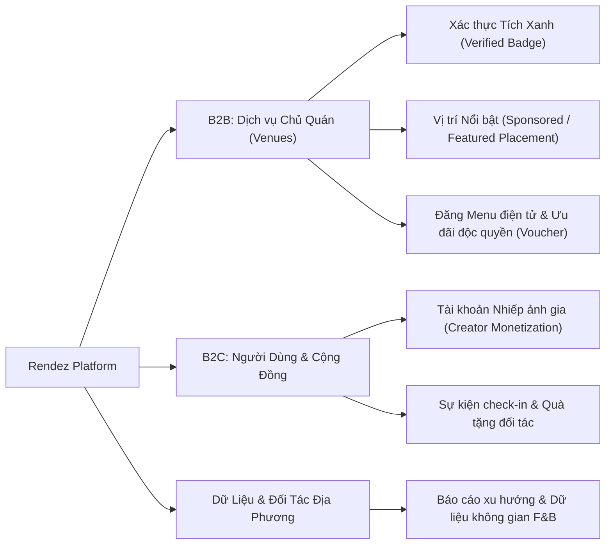
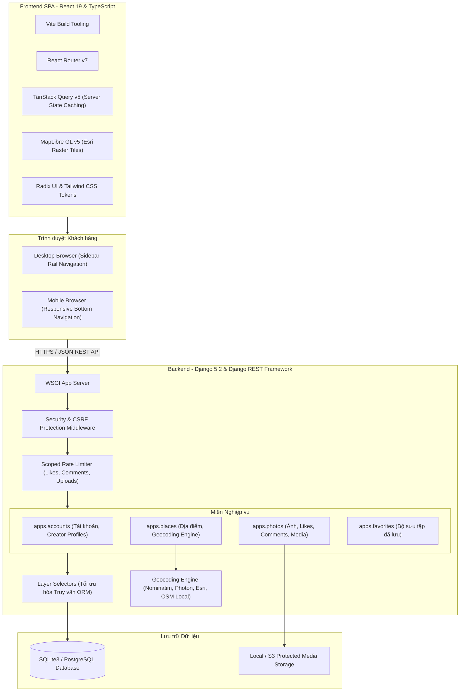

# Rendez — Tài Liệu Mô Tả Dự Án (Project Specification & Architecture)

> [!NOTE]
> **Phạm vi tài liệu:** bản mô tả tổng quan hướng sản phẩm (tầm nhìn, mô hình kinh doanh, định vị thị trường, lộ trình phát triển). Đặc tả kỹ thuật chi tiết (kiến trúc, mô hình dữ liệu, API, kiểm thử) nằm ở [`docs/SPECIFICATION.md`](SPECIFICATION.md); tài liệu kỹ thuật chuyên sâu theo mô-đun nằm ở [`docs/project/`](project/).

**Rendez** (`rendez.vn`) là nền tảng số thương mại chuyên biệt về khám phá không gian cà phê, làm việc, gặp gỡ và phong cách sống (lifestyle) tại thành phố Đà Nẵng. Ứng dụng kết hợp giữa **mạng lưới chia sẻ ảnh thực tế độ nét cao (Visual-First)** và **bản đồ số tương tác thời gian thực (Interactive Map)**, giúp người dùng tìm kiếm không gian phù hợp với nhu cầu chỉ trong vài giây, đồng thời cung cấp giải pháp tiếp thị và định danh số (B2B Lead Generation & Verified Venue) cho các chủ quán kinh doanh dịch vụ đồ uống.

---

## 1. Tầm Nhìn Sản Phẩm & Định Vị Thương Mại (Product Vision & Market Fit)

### 1.1. Vấn đề của thị trường
* **Ảnh PR không đúng thực tế:** Người dùng thường xuyên thất vọng khi đến quán vì ảnh quảng cáo trên mạng xã hội bị chỉnh sửa quá đà, góc chụp ảo, không phản ánh đúng không gian ngồi học/làm việc, ổ cắm điện hay ánh sáng.
* **Bản đồ chung thiếu phân loại chuyên sâu:** Google Maps hay Apple Maps phục vụ chung cho mọi loại hình, thiếu các bộ lọc theo nhu cầu thực tế của giới trẻ và dân văn phòng (như: quán mở 24/7 cày đêm, quán có bàn dài chạy deadline, quán yên tĩnh, quán sân vườn nhiều cây xanh, quán phong cách mộc mạc).
* **Chủ quán thiếu kênh tiếp cận khách hàng chất lượng cao:** Các quán cà phê vừa và nhỏ tại Đà Nẵng khó cạnh tranh chi phí quảng cáo lớn, thiếu nền tảng làm nổi bật không gian và phong cách thực sự của mình.

### 1.2. Giải pháp của Rendez
* **100% hình ảnh không gian chân thực:** Mọi góc máy tập trung vào trải nghiệm khách hàng thực tế (chỗ ngồi, ánh sáng, quầy bar, cây xanh, view đường phố).
* **Bộ lọc nhu cầu thực chiến:** Phân loại rõ ràng: *Học bài & Deadline*, *Mở 24/7 & Cày đêm*, *Mộc & Hoài niệm*, *Sân vườn & Chill*, *Sống ảo & Trẻ trung*, *Cà phê Cóc & Vỉa hè*.
* **Dẫn đường chuẩn xác tới từng mét:** Liên kết trực tiếp Google Maps với tên quán và địa chỉ cụ thể, loại bỏ hoàn toàn tình trạng trỏ nhầm sang đường phụ.
* **Công cụ tìm kiếm & định vị tự động:** Ứng dụng công nghệ Geocoding thời gian thực từ các đối tác GIS uy tín toàn cầu, giúp người dùng và chủ quán tạo địa điểm mới chỉ bằng một thao tác nhập địa chỉ thông thường (Zero-Click Geocoding).

---

## 2. Mô Hình Kinh Doanh & Tiềm Năng Sinh Lời (Monetization Strategy)

Rendez được thiết kế với kiến trúc sẵn sàng tạo dòng tiền thực tế thông qua các luồng doanh thu đa dạng:



1. **Gói Xác Thực & Quản Lý Trang Quán (Claim & Verified Venue):**
   - Chủ quán thanh toán phí duy trì để sở hữu tích xanh `✓ Đã xác thực`, tự cập nhật thông tin giờ mở cửa, menu đồ uống, số điện thoại hotline đặt bàn và fanpage chính thức.
2. **Quảng Cáo Vị Trí Ưu Tiên (Promoted Listings & Map Pins):**
   - Các quán xuất hiện ở vị trí đầu tiên trong danh mục tìm kiếm hoặc hiển thị huy hiệu nổi bật (*Featured Spot*) trên bản đồ số khu vực.
3. **Tiếp Thị Liên Kết & Voucher Tiêu Dùng:**
   - Hợp tác với các chuỗi quán để phân phối mã giảm giá độc quyền cho cộng đồng người dùng Rendez.

---

## 3. Kiến Trúc Tính Năng Toàn Diện (Core Capabilities)

### 3.1. Khám Phá Thị Giác (Visual Feed & Masonry Discovery)
* **Bố cục Pinterest-style Masonry:** Tự động tính toán tỷ lệ khung hình thực tế (`aspect-ratio`), giữ nguyên vẹn cảm xúc của bức ảnh mà không bị cắt cúp méo mó.
* **Tải vô tận tối ưu (Infinite Scroll with TanStack Query):** Phân trang mượt mà, tải trước ảnh tiếp theo, tự động lưu vết vị trí cuộn khi xem chi tiết và quay lại.
* **Huy hiệu thông tin nhanh:** Trực tiếp trên thẻ ảnh hiển thị tên quán, khu vực đường phố và nút lưu nhanh vào bộ sưu tập cá nhân.

### 3.2. Bản Đồ Số Tương Tác Cao Cấp (Interactive Map Engine)
* **Nền bản đồ ESRI World Street Cartography:** Sử dụng bản đồ số toàn cầu của Esri với độ phân giải cao, hỗ trợ màn hình Retina, không watermark, không giới hạn request, độ trễ CDN toàn cầu cực thấp.
* **Đồng bộ hai chiều Bản đồ ↔ Danh sách:**
  - Di chuyển hoặc phóng to bản đồ tự động lọc danh sách quán trong khung nhìn (Viewport Bounding Box).
  - Chọn một điểm ghim trên bản đồ ngay lập tức hiển thị thẻ xem trước (Preview Card) với ảnh đại diện, thuộc tính nổi bật, giờ mở cửa và nút dẫn đường.
  - Ngược lại, bấm chọn quán từ danh sách sẽ kích hoạt hoạt họa máy quay bản đồ mượt mà (`flyTo`) đến vị trí quán.

### 3.3. Động Cơ Định Vị Địa Chỉ Thời Gian Thực (Zero-Click Real-time Geocoding)
* **100% dữ liệu uy tín bên thứ ba:** Không sử dụng danh sách thủ công tự tạo. Hệ thống tích hợp song song các dịch vụ GIS chuẩn quốc tế:
  1. **OpenStreetMap Nominatim (Real-time API):** Ưu tiên phạm vi địa giới hành chính Việt Nam và Đà Nẵng.
  2. **Photon by Komoot (Real-time API):** Tìm kiếm mờ thông minh với trọng tâm tọa độ Đà Nẵng.
  3. **Esri ArcGIS World Geocoding (Real-time API):** Nền tảng định danh địa chỉ doanh nghiệp chuẩn GIS.
  4. **Cơ sở dữ liệu Vector OpenStreetMap nội bộ (`region.geojson`):** Hơn 2.940 tuyến đường thực tế tại Đà Nẵng, áp dụng **Thuật toán Nội suy Tuyến tính (Polyline Linear Referencing)** ước lượng tọa độ theo số nhà/kiệt khi ngoại tuyến.
* **Trải nghiệm người dùng không nỗ lực:** Người dùng chỉ cần gõ địa chỉ thực tế (ví dụ: `100 Phạm Như Xương, Liên Chiểu, Đà Nẵng` hay `Cầu Rồng`), hệ thống sau 450ms debounce tự động tính toán kinh độ, vĩ độ, hiển thị nhãn xác thực và tự động đưa điểm ghim bản đồ về đúng vị trí.
* **Backend Auto-fill Hook:** Trong `Place.save()`, bất kỳ địa điểm nào chưa có tọa độ sẽ được hệ thống tự động giải mã địa chỉ và điền kinh độ/vĩ độ trước khi lưu vào cơ sở dữ liệu.

### 3.4. Dẫn Đường Google Maps Chuẩn Doanh Nghiệp (Precision Navigation)
* **Loại bỏ lỗi lệch đường:** Thay vì truyền tọa độ số thô (dễ bị Google Maps hiểu nhầm sang các trục đường lớn lân cận), hệ thống sử dụng tiện ích `googleMapsDirectionsUrl`:
  ```text
  https://www.google.com/maps/dir/?api=1&destination={Tên_Quán},+{Địa_Chỉ_Cụ_Thể}
  ```
* **Chuyển đổi tức thì:** Khi bấm *"Chỉ đường"*, Google Maps nhận diện đích danh cửa hàng kinh doanh, mở thẻ doanh nghiệp có đầy đủ ảnh chụp, bảng hiệu, đánh giá và lập tức dẫn đường từ vị trí GPS hiện tại của người dùng.
* **Có mặt ở mọi điểm chạm:** Nút chỉ đường được bố trí trực quan tại:
  - Trang chi tiết quán ([`PlaceDetailPage`](file:///home/longtran/Projects/rendez-web/frontend/src/app/discovery.tsx))
  - Trang xem ảnh phóng to ([`PhotoDetailPage`](file:///home/longtran/Projects/rendez-web/frontend/src/app/discovery.tsx))
  - Thẻ xem trước trên bản đồ ([`MapPage`](file:///home/longtran/Projects/rendez-web/frontend/src/app/map.tsx))

### 3.5. Trạng Thái Hoạt Động & Tích Xanh Xác Thực (Verified & Live Hours)
* **Giờ hoạt động thực tế:** Quản lý chi tiết thời gian biểu (phân biệt rõ quán mở 24/7 cày đêm và các quán mở ban ngày thông thường).
* **Huy hiệu trực quan:**
  - `🟢 Đã xác thực` (Verified by Rendez) khẳng định thông tin quán chính xác, đã kiểm duyệt thực địa.
  - `🕒 Mở cửa 24/7` hoặc `🕒 06:30 – 22:30` giúp khách hàng đưa ra quyết định ngay lập tức mà không lo đến nơi bị đóng cửa.

### 3.6. Mạng Xã Hội Tương Tác & Hệ Sinh Thái Nhiếp Ảnh Gia (Social & Creators)
* **Thả tim (Photo Likes):** Tương tác nhanh với cơ chế Optimistic Update (giao diện phản hồi ngay lập tức trước khi server phản hồi), có kiểm soát tần suất an toàn (`throttle: 60/phút`).
* **Bình luận tương tác (Photo Comments):** Không gian đàm luận dưới mỗi bức ảnh về đồ uống signature, góc chụp đẹp, độ yên tĩnh và mật độ khách. Người dùng có toàn quyền xóa bình luận của mình thông qua hộp thoại xác nhận chuyên nghiệp (`ConfirmDialog`).
* **Trang Tác Giả Cá Nhân ([`/creators/:id`](file:///home/longtran/Projects/rendez-web/frontend/src/app/creator.tsx)):** Tôn vinh các nhiếp ảnh gia và người đóng góp nội dung với số lượng ảnh đã duyệt, ngày tham gia và thư viện tác phẩm công khai.
* **Bộ Sưu Tập Quán Yêu Thích ([`/saved`](file:///home/longtran/Projects/rendez-web/frontend/src/app/auth.tsx)):** Đánh dấu các quán ưng ý để lên lịch trình đi cà phê cuối tuần hoặc họp nhóm.

### 3.7. Đóng Góp Cộng Đồng An Toàn (UGC & Idempotent Uploads)
* **Quy trình 3 bước khoa học:**
  1. *Bước 1:* Chọn địa điểm có sẵn hoặc bật "Thêm địa điểm mới" (hỗ trợ tự động định vị địa chỉ).
  2. *Bước 2:* Tải lên tối đa 5 ảnh chụp thực tế (tối đa 10 MiB/ảnh, định dạng JPEG/PNG, kiểm tra kích thước tối thiểu 100x100 px).
  3. *Bước 3:* Nhập chú thích không gian và ký cam kết bản quyền ảnh (`consent`).
* **An toàn & Chống trùng lặp:** Sinh mã băm bảo mật (`sha256`) và khóa `Idempotency-Key` ngăn chặn gửi trùng lặp khi mạng chậm. Hệ thống tự động xử lý ảnh bằng Pillow, tước bỏ siêu dữ liệu nhạy cảm (EXIF GPS camera cá nhân) và xuất ảnh phái sinh tối ưu băng thông.

---

## 4. Kiến Trúc Phần Mềm & Công Nghệ (Technical Architecture)

Hệ thống được xây dựng theo mô hình **Clean Monolith (Monolithic Phân Tầng Hiện Đại)**, kết hợp giữa Django REST Framework hiệu năng cao ở Backend và Single Page Application (SPA) siêu tốc ở Frontend:



### Bảng công nghệ chính (Tech Stack)
| Tầng hệ thống | Công nghệ sử dụng | Phiên bản | Mục đích & Lợi thế cạnh tranh |
| :--- | :--- | :--- | :--- |
| **Frontend Framework** | React + TypeScript | 19.3.0 | Tận dụng cơ chế Concurrent Mode, Type safety toàn diện |
| **Routing** | React Router | 7.18.4 | Hỗ trợ client-side routing mượt mà, quản lý query state linh hoạt |
| **State & Caching** | TanStack React Query | 5.104.1 | Đồng bộ dữ liệu máy chủ, tự động revalidate, cache tối ưu |
| **Map Rendering** | MapLibre GL JS | 5.24.0 | Hiển thị bản đồ vector/raster 60fps mượt mà, không phụ thuộc Google Maps SDK trả phí |
| **Bản đồ nền** | ESRI World Street Map | Global CDN | Dữ liệu GIS sắc nét, miễn phí thương mại, không watermark, không giới hạn |
| **Kiểu dáng & Token** | CSS Modules + Tailwind | 4.x | Thiết kế tối giản, bảng màu HSL hiện đại, tải tức thì |
| **Backend Core** | Django + DRF | 5.2.18 / 3.16 | Xử lý nghiệp vụ mạnh mẽ, ORM an toàn, phân quyền chặt chẽ |
| **Xử lý Ảnh** | Pillow (PIL) | 12.1.1 | Tước bỏ EXIF, nén JPEG progressive, chống mã độc tải lên |
| **Tài liệu API** | OpenAPI 3.0 / Spectacular | 0.28.0 | Tự động sinh tài liệu Swagger chuẩn hóa |
| **Đóng gói & Test** | Vite / Vitest / Pytest / Playwright | Latest | Đảm bảo 100% tự động hóa kiểm thử từ backend đến trình duyệt |

---

## 5. Tiêu Chuẩn Chất Lượng & Kết Quả Kiểm Thử (Quality Assurance)

Dự án duy trì độ tin cậy cấp sản xuất (Production Grade) với tỷ lệ vượt qua kiểm thử tự động đạt 100%:

```text
============================== KẾT QUẢ KIỂM THỬ HỆ THỐNG ==============================
✓ Frontend Build:        tsc -b && vite build hoàn thành chuẩn xác trong 4.34s (0 lỗi).
✓ Frontend Unit Tests:   5/5 test files passed (20/20 unit tests) qua Vitest.
✓ Backend Unit Tests:    63/63 test cases passed qua Pytest (13.76s).
✓ End-to-End Test:       3/3 kịch bản trình duyệt thực tế qua Playwright passed (9.7s).
✓ Backend Code Quality:  ruff check backend đạt tiêu chuẩn tuyệt đối.
========================================================================================
```

---

## 6. Hướng Dẫn Khởi Chạy Ứng Dụng (Quick Start)

### 6.1. Khởi động Backend
```bash
cd backend
source .venv/bin/activate
python manage.py migrate
python manage.py runserver 0.0.0.0:8000
```

### 6.2. Khởi động Frontend
```bash
cd frontend
bun install
bun run dev --port 5173
```
*Truy cập ứng dụng tại:* `http://localhost:5173`
*Truy cập Swagger API Docs:* `http://localhost:8000/api/v1/docs/`
*Truy cập Trang Quản trị:* `http://localhost:8000/admin/` (Khởi tạo tài khoản quản trị qua lệnh `scripts/create-admin.py` hoặc cấu hình biến môi trường `DJANGO_SUPERUSER_PASSWORD`)

---

## 7. Lộ Trình Phát Triển Thương Mại (Commercial Roadmap)

1. **Giai đoạn 1 (Hiện tại):**
   - Hoàn thiện trải nghiệm khám phá cà phê Đà Nẵng, hệ thống định vị tự động Zero-Click và bản đồ ESRI tương tác cao cấp.
2. **Giai đoạn 2 (Tăng trưởng người dùng & UGC):**
   - Ra mắt tính năng xếp hạng Top Quán Nổi Bật tuần/tháng theo lượng thả tim thực tế; triển khai chiến dịch Check-in nhận voucher cùng 20 quán đối tác tại Đà Nẵng.
3. **Giai đoạn 3 (B2B SaaS Portal):**
   - Ra mắt cổng tự phục vụ dành riêng cho chủ quán (`business.rendez.vn`): Tự quản lý thực đơn, đặt banner khuyến mãi, xem biểu đồ lượt xem và tương tác của khách hàng.
4. **Giai đoạn 4 (Mở rộng địa lý):**
   - Mở rộng dữ liệu sang Hội An, Huế và các thành phố du lịch phong cách sống lớn trên toàn quốc.
