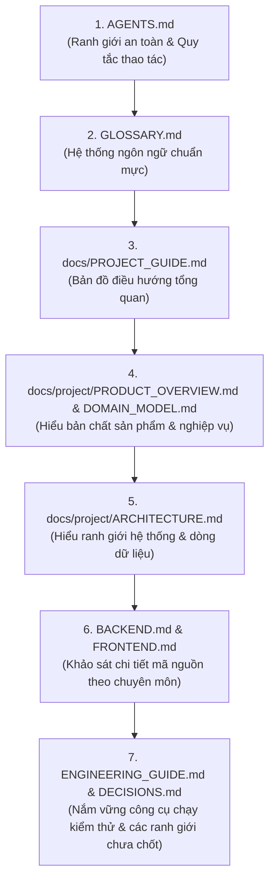

# Rendez Project Guide & Agent Onboarding

Chào mừng bạn đến với **Rendez**. Tài liệu này là điểm bắt đầu duy nhất (Single Entry Point) dành cho kỹ sư và các AI coding agent mới tiếp nhận repository.

Mục tiêu của tài liệu này là cung cấp bức tranh toàn cảnh, bản đồ điều hướng tài liệu, quy ước kỹ thuật và các ranh giới an toàn để bạn có thể tiếp tục phát triển hệ thống mà không cần người phát triển ban đầu giải thích từ đầu.

---

## 1. Rendez Là Gì?

**Rendez** (bắt nguồn từ *Rendezvous* — điểm hẹn) là nền tảng số hóa không gian cà phê và làm việc tại Đà Nẵng, được xây dựng theo triết lý **Visual-First** và **Data Sovereignty / Local-First**.

### Vấn đề cốt lõi giải quyết
Người dùng (sinh viên, freelancer, khách du lịch) thường gặp thất vọng khi tìm quán cà phê qua các ứng dụng truyền thống do:
- Ảnh quảng cáo bị can thiệp quá mức, ảnh 3D sai lệch thực tế.
- Thiếu thông tin về chỗ ngồi thực tế, độ sáng, không gian ngoài trời, điều hòa và đặc biệt là **ổ cắm điện**.
- Thuật toán ưu tiên quán trả phí thay vì không gian phù hợp nhu cầu.

Rendez giải quyết vấn đề này bằng cách:
- Duyệt không gian qua **lưới ảnh thực địa (Masonry Feed)** giữ nguyên 100% tỷ lệ khung hình thật (`aspect-ratio`).
- Tra cứu trực quan trên **bản đồ số tương tác (MapLibre GL)** đồng bộ hai chiều với bộ lọc và khung nhìn (`bbox`).
- Lọc không gian theo **đặc điểm thị giác (Visual Attributes)** nhìn thấy trực tiếp bằng mắt (ổ cắm, làm việc yên tĩnh, điều hòa, view sông Hàn...).
- Cộng đồng đóng góp ảnh thực tế (1–5 ảnh/lần) với cam kết bản quyền, tự động loại bỏ EXIF và nén hiển thị an toàn.

---

## 2. Công Nghệ & Kiến Trúc Cốt Lõi

Hệ thống được thiết kế theo mô hình **Monolith phân tầng sạch (Clean Monolith)**, tự vận hành hoàn chỉnh trong môi trường cục bộ:

| Tầng | Công nghệ / Thư viện | Vai trò |
|---|---|---|
| **Frontend** | React 19, TypeScript 5.9, Vite 7 | SPA responsive (Desktop Left Rail + Mobile Bottom Bar) |
| **Bản đồ** | MapLibre GL 5 | Hiển thị bản đồ vector/raster, marker tương tác, đồng bộ URL |
| **Quản lý dữ liệu Client** | TanStack Query v5, React Router v7 | Cache API, đồng bộ tham số tìm kiếm, optimistic updates |
| **Backend** | Python 3.12+, Django 5.2, Django REST Framework 3.16 | API RESTful, dịch vụ nghiệp vụ, xử lý ảnh |
| **Xử lý ảnh** | Pillow (PIL) 11 | Chuẩn hóa, bóc tách EXIF, tạo file phái sinh WebP/JPEG, tính SHA-256 |
| **Cơ sở dữ liệu** | PostgreSQL 17 + PostGIS (Docker port 55433) | Lưu trữ quan hệ, truy vấn không gian (`ST_MakeEnvelope`, `bbox`) |
| **Lưu trữ tệp** | Local Filesystem (`.local/media/`) | Lưu trữ tệp media có bảo vệ phân quyền |
| **Web Server** | Gunicorn + WhiteNoise | Phục vụ cả frontend build, backend API và static của Admin |

---

## 3. Cấu Trúc Repository

```text
rendez-web/
├── AGENTS.md                  # Hợp đồng vận hành & Hướng dẫn dành cho AI Agent
├── GLOSSARY.md                # TỪ ĐIỂN MIỀN CHUẨN MỰC (Ubiquitous Language Authority)
├── PRODUCT.md                 # Tuyên ngôn sản phẩm & Nguyên lý cốt lõi
├── DESIGN.md                  # Hệ thống thiết kế (Warm Botanical Pine & Clay)
├── Makefile                   # Lệnh tắt điều hành hệ thống
│
├── backend/                   # Ứng dụng Django & REST API
│   ├── apps/
│   │   ├── accounts/          # User, xác thực session/CSRF, hồ sơ Creator
│   │   ├── places/            # Place, Category, Geocoding, bản đồ bbox
│   │   ├── photos/            # PlacePhoto, PhotoAsset, Submissions, Comments, Likes
│   │   └── favorites/         # Bookmark địa điểm (SavedPlace)
│   ├── config/                # Cấu hình Django (settings, urls, wsgi, middleware)
│   └── tests/                 # 178 bài kiểm thử Pytest (API, nghiệp vụ, bảo mật)
│
├── frontend/                  # Ứng dụng React SPA
│   ├── src/
│   │   ├── app/               # Màn hình chính (discovery, map, creator, auth)
│   │   ├── components/ui/     # Thành phần giao diện dùng chung (button, confirm-dialog)
│   │   ├── lib/api/           # HTTP Client & định nghĩa kiểu dữ liệu
│   │   └── styles/            # CSS tokens, theme, layout, components
│   └── public/map/            # Dữ liệu vector bản đồ địa phương (region.geojson)
│
├── data/                      # Dữ liệu hạt giống (12 cơ sở tại Đà Nẵng, 36 ảnh minh hoạ sinh tự động)
├── docs/                      # Tài liệu kỹ thuật chi tiết
│   ├── PROJECT_GUIDE.md       # << BẠN ĐANG Ở ĐÂY >>
│   └── project/               # 11 tài liệu chuyên sâu của Knowledge Base
└── scripts/                   # Bộ công cụ vận hành, kiểm tra và sao lưu cục bộ
```

---

## 4. Bản Đồ Tài Liệu Knowledge Base (`docs/project/`)

Khi cần tìm hiểu sâu từng khía cạnh kỹ thuật, hãy đọc các tài liệu tương ứng:

1. [**PRODUCT_OVERVIEW.md**](file:///home/longtran/Projects/rendez-web/docs/project/PRODUCT_OVERVIEW.md): Tầm nhìn sản phẩm, chân dung người dùng, các hành trình cốt lõi, phạm vi địa lý hiện tại và các ranh giới loại trừ.
2. [**DOMAIN_MODEL.md**](file:///home/longtran/Projects/rendez-web/docs/project/DOMAIN_MODEL.md): Mô hình nghiệp vụ chuyên sâu, các thực thể cốt lõi, quan hệ cardinality, vòng đời, bất biến nghiệp vụ và ranh giới phân quyền.
3. [**ARCHITECTURE.md**](file:///home/longtran/Projects/rendez-web/docs/project/ARCHITECTURE.md): Kiến trúc hệ thống toàn cục, sơ đồ luồng dữ liệu Mermaid, ranh giới phân quyền media, chiến lược Monolith và phụ thuộc ngoại vi.
4. [**BACKEND.md**](file:///home/longtran/Projects/rendez-web/docs/project/BACKEND.md): Cấu trúc 4 Django apps, danh mục toàn bộ API endpoints `/api/v1/`, tầng dịch vụ `services.py`, pipeline xử lý ảnh Pillow và kiểm thử.
5. [**FRONTEND.md**](file:///home/longtran/Projects/rendez-web/docs/project/FRONTEND.md): Cấu trúc React 19 SPA, định tuyến, đồng bộ URL với bản đồ MapLibre, quản lý cache TanStack Query và tối ưu hiển thị ảnh.
6. [**UI_UX.md**](file:///home/longtran/Projects/rendez-web/docs/project/UI_UX.md): Hệ thống thiết kế *Warm Botanical Pine & Clay*, bảng màu, thang chữ, quy tắc đổ bóng thực vật và bố cục Masonry chống giật layout.
7. [**DATA_AND_INFRASTRUCTURE.md**](file:///home/longtran/Projects/rendez-web/docs/project/DATA_AND_INFRASTRUCTURE.md): Cơ sở dữ liệu PostgreSQL 17/PostGIS port 55433, volume Docker, quy trình lưu trữ tệp, nguồn gạch bản đồ và danh mục biến môi trường an toàn.
8. [**ENGINEERING_GUIDE.md**](file:///home/longtran/Projects/rendez-web/docs/project/ENGINEERING_GUIDE.md): Hướng dẫn cài đặt môi trường, danh mục lệnh vận hành, quy trình kiểm tra cổng chất lượng (`./scripts/check.sh all`) và cách gỡ lỗi.
9. [**PROJECT_STATUS.md**](file:///home/longtran/Projects/rendez-web/docs/project/PROJECT_STATUS.md): Ma trận trạng thái tính năng (Đã kiểm chứng / Bán phần / Kế hoạch / Chờ quyết định / Đã loại bỏ) và nợ kỹ thuật hiện tại.
10. [**DECISIONS.md**](file:///home/longtran/Projects/rendez-web/docs/project/DECISIONS.md): Hồ sơ các quyết định kiến trúc (ADRs) đã chấp thuận và đăng bạ các điểm nghiệp vụ chờ quyết định (Decision Pending Register).
11. [**SOURCE_INDEX.md**](file:///home/longtran/Projects/rendez-web/docs/project/SOURCE_INDEX.md): Mục lục tra cứu nhanh mã nguồn, kết nối trực tiếp giữa khái niệm và đường dẫn tệp/hàm cụ thể trong repository.

---

## 5. Thẩm Quyền Ngôn Ngữ & Các Phân Định Quan Trọng

> [!IMPORTANT]
> **`GLOSSARY.md` tại thư mục gốc là văn bản có thẩm quyền tối cao về thuật ngữ nghiệp vụ.**
> Tuyệt đối không tự suy diễn khái niệm mới, không tự ý chuyển trạng thái từ `Proposed` hay `Decision Pending` thành `Accepted`.

### Các ranh giới miền cần ghi nhớ tuyệt đối:
- **`Place` vs `Physical Location` vs `Visual Space`:** Địa điểm được định danh bởi sự kết hợp của cơ sở kinh doanh, mặt bằng vật lý và không gian thị giác. Chuyển địa điểm hoặc đại tu thay đổi toàn bộ không gian làm đứt gãy danh tính.
- **`Place.status` vs `Place.deleted_at`:** `deleted_at` là dấu mốc xóa mềm kỹ thuật, **không đại diện cho trạng thái đóng cửa kinh doanh ngoài đời thực**. Hệ thống hiện chưa có trạng thái `closed`.
- **`Photo` vs `PhotoAsset`:** `Photo` (`PlacePhoto`) là bản ghi gắn với `Place`. `PhotoAsset` là thực thể kỹ thuật quản lý tệp nhị phân trên đĩa.
- **`PhotoAsset.original`:** Là tệp đã qua hàm chuẩn hóa `normalize_image()` (tái tạo từ pixel thô, loại bỏ EXIF), **không phải tệp upload nguyên bản chưa qua xử lý**.
- **`PhotoSubmission`:** API Serializer kiểm tra giới hạn 1–5 ảnh. DB chỉ chặn cận trên qua `sort_order <= 4`, không tự chặn cận dưới.
- **`VenueProposal`:** Model tồn tại trong database schema nhưng **luồng nộp ảnh hiện tại bỏ qua model này** và tạo thẳng `Place(published)` (Xem Decision Pending #2).
- **`Moderator` vs `Staff`:** `Staff` là quyền kỹ thuật vào Django Admin (`is_staff=True`). `Moderator` đòi hỏi quyền cụ thể `photos.review_photosubmission`.
- **`Place Owner` vs `Property Owner` vs `Place Operator`:** Tất cả là tác nhân bên ngoài (External Stakeholders), hiện **chưa được mô hình hóa trong hệ thống**.
- **`Archived Photo`:** Khái niệm nghiệp vụ đã thống nhất nhưng **chưa có implementation** trong database schema và giao diện (Xem Decision Pending #3).

---

## 6. Lộ Trình Đọc Dành Cho Agent Mới (Reading Order)

Để nắm bắt dự án nhanh nhất mà không bị quá tải thông tin, hãy đọc theo thứ tự sau:



---

## 7. Cẩm Nang Lệnh Thường Dùng (Cheatsheet)

Mọi thao tác phát triển đều được đóng gói trong các script an toàn tại thư mục `scripts/`:

```bash
# 1. Khởi động hệ thống phát triển cục bộ (PostgreSQL container & app)
./scripts/start-local.sh

# 2. Chạy toàn bộ 9 bài kiểm tra cổng chất lượng (Lint, Format, Migrations, Tests, Build)
./scripts/check.sh all

# 3. Chỉ chạy kiểm thử backend (178 bài test Pytest)
./scripts/check.sh backend

# 4. Chỉ chạy kiểm thử frontend (56 bài test Vitest & build)
./scripts/check.sh frontend

# 5. Dừng hệ thống cục bộ an toàn
./scripts/stop-local.sh

# 6. Sao lưu / Phục hồi dữ liệu cục bộ
./scripts/backup-local.sh
./scripts/restore-local.sh
```

---

## 8. Các Ranh Giới An Toàn Bắt Buộc

Khi làm việc trên repository này, bạn **phải tuân thủ nghiêm ngặt** hợp đồng vận hành trong `AGENTS.md`:
1. **Không sửa đổi mã nguồn ứng dụng** trừ khi được yêu cầu rõ ràng trong prompt.
2. **Không thêm/xóa/nâng cấp package dependency** (không dùng `pip install`, `bun add`).
3. **Không kết nối Internet** hoặc gọi các dịch vụ API đám mây bên thứ ba có tính phí.
4. **Không chạy các lệnh phá hủy Git** (`git reset --hard`, `git clean -fd`).
5. **Không để lộ thông tin nhạy cảm** (mật khẩu, khóa bí mật, token) trong tài liệu hoặc mã nguồn.
