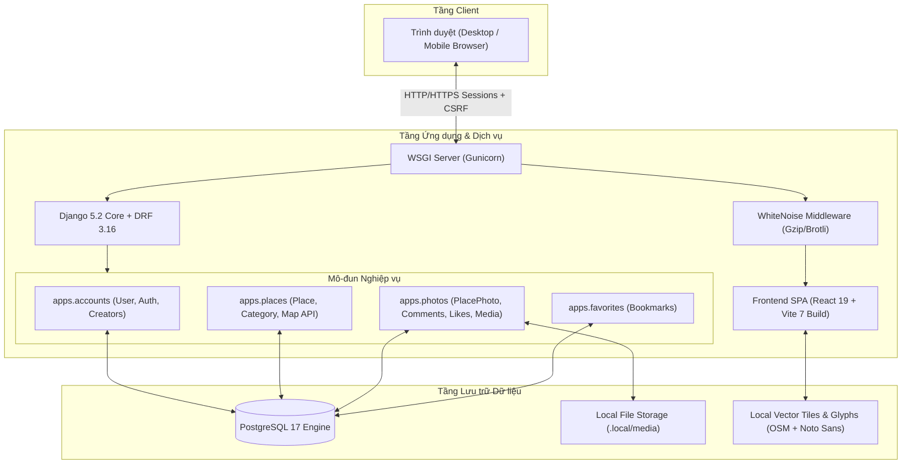
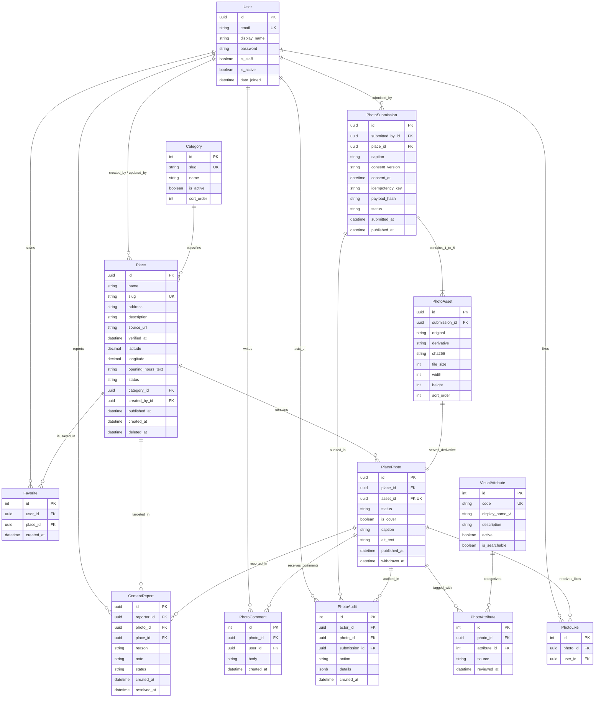

# Rendez — Tài liệu Kiến trúc Hệ thống & Đặc tả Kỹ thuật (Technical Specification)

> [!NOTE]
> **Phạm vi tài liệu:** đặc tả kỹ thuật (kiến trúc, mô hình dữ liệu, thiết kế giao diện, chiến lược kiểm thử, vận hành). Tầm nhìn sản phẩm và mô hình kinh doanh nằm ở [`docs/PROJECT_DESCRIPTION.md`](PROJECT_DESCRIPTION.md); tài liệu chuyên sâu theo mô-đun nằm ở [`docs/project/`](project/).

Tài liệu này đặc tả toàn bộ kiến trúc, mô hình dữ liệu, thiết kế giao diện, chiến lược kiểm thử và hướng dẫn vận hành cho nền tảng **Rendez** — ứng dụng khám phá địa điểm tại Đà Nẵng qua ảnh tư liệu và bản đồ số.

---

## 1. Tổng quan Dự án & Phạm vi Sản phẩm

### 1.1. Mục tiêu sản phẩm
Rendez là nền tảng số hóa dữ liệu địa điểm du lịch, văn hóa và ẩm thực Đà Nẵng theo hướng **Local-First & Data Sovereignty**:
* **Khám phá trực quan:** Định vị địa điểm trên bản đồ tương tác (MapLibre GL), duyệt ảnh định dạng Masonry tỷ lệ tự nhiên.
* **Bộ lọc đặc điểm thị giác (Visual Attributes):** Phân loại và tìm kiếm địa điểm dựa trên đặc điểm nhìn thấy trong ảnh (không gian ngoài trời, vật liệu gỗ, cây xanh, view sông Hàn...).
* **Đóng góp cộng đồng:** Cho phép người dùng đăng tải ảnh thực địa (tối đa 5 ảnh/lần), tự động loại bỏ siêu dữ liệu EXIF, nén kích thước hiển thị an toàn.
* **Tương tác xã hội:** Lưu địa điểm vào bộ sưu tập cá nhân, thích ảnh, trao đổi trong khu vực bình luận, xem trang hồ sơ tác giả.

### 1.2. Phân quyền Người dùng (Role-Based Access Control)
1. **Khách (Anonymous):** Chỉ được truy cập màn hình Đăng ký, Đăng nhập, kiểm tra trạng thái dịch vụ (`/health/`). Mọi dữ liệu địa điểm, ảnh, bản đồ yêu cầu phiên đăng nhập để kiểm soát nội dung chưa công khai.
2. **Thành viên (Authenticated Member):**
   * Tìm kiếm, duyệt feed ảnh, tương tác bản đồ, lưu quán yêu thích.
   * Đăng tải ảnh tư liệu, sửa mô tả ảnh do mình tải lên, gỡ ảnh của mình.
   * Viết bình luận và xóa bình luận của chính mình.
   * Xem trang cá nhân công khai của người chụp (`/creators/:id`).
   * Gửi báo cáo vi phạm nội dung (Content Report) kèm cơ chế chống spam.
3. **Quản trị viên (Staff / Moderator):**
   * Sử dụng Django Admin (`/admin/`) để quản lý địa điểm, duyệt gắn nhãn đặc điểm thị giác (`edit_tags`).
   * Xử lý báo cáo vi phạm, rút ảnh sai vị trí hoặc không phù hợp.

---

## 2. Kiến trúc Hệ thống (System Architecture)

Hệ thống được thiết kế theo mô hình **Monolith phân tầng sạch (Clean Monolith)**, đóng gói toàn bộ Frontend, Backend, Dữ liệu bản đồ và PostgreSQL trong môi trường local, không phụ thuộc dịch vụ đám mây bên thứ ba.



### 2.1. Ngăn xếp Công nghệ (Tech Stack)
* **Backend:** Python 3.12, Django 5.2, Django REST Framework 3.16, Pillow 11 (xử lý & chuẩn hóa ảnh), `drf-spectacular` (OpenAPI v3 schema), psycopg 3 (PostgreSQL binary driver).
* **Frontend:** React 19, TypeScript 5.9, Bun 1.3, Vite 7, TanStack Query v5, React Router v7, MapLibre GL 5 + `react-map-gl`, Tailwind CSS v4, Lucide React icons.
* **Cơ sở dữ liệu:** PostgreSQL 17 (chạy Docker local cổng 55433, volume ánh xạ tại `.local/postgres`).
* **Bảo mật phiên:** Session Authentication + `CsrfViewMiddleware` + HttpOnly Cookie (`SameSite=Lax`). Rate limiting qua `ScopedRateThrottle`.

---

## 3. Mô hình Dữ liệu (Entity-Relationship Diagram - ERD)

Dưới đây là sơ đồ quan hệ thực thể đầy đủ của hệ thống Rendez sau khi đã loại bỏ toàn bộ các bảng zombie và chuẩn hóa các bảng mới:



### 3.1. Ràng buộc toàn vẹn dữ liệu quan trọng (Database Constraints)
* **`User`:** `UniqueConstraint(Lower("email"))` bảo đảm email không phân biệt chữ hoa/thường.
* **`PhotoSubmission`:**
  * `UniqueConstraint(submitted_by, idempotency_key)`: Chống gửi lặp (duplicate submission) khi người dùng bấm nút nhiều lần hoặc mạng chập chờn.
* **`PhotoAsset`:**
  * `CheckConstraint(sort_order <= 4)`: Giới hạn nghiêm ngặt mỗi lần gửi tối đa 5 ảnh (thứ tự 0..4).
  * `UniqueConstraint(submission, sort_order)`: Thứ tự ảnh không bị ghi đè.
* **`PlacePhoto`:**
  * `UniqueConstraint(place, condition=Q(is_cover=True))`: Mỗi địa điểm chỉ có duy nhất 1 ảnh bìa công khai.
* **`PhotoLike` & `Favorite`:**
  * `UniqueConstraint(photo, user)`: Mỗi tài khoản chỉ thích một bức ảnh một lần.
  * `UniqueConstraint(user, place)`: Mỗi tài khoản chỉ lưu một địa điểm một lần vào bộ sưu tập.

---

## 4. Đặc tả Giao diện & Thích ứng Đa nền tảng (Responsive & Adaptive UI)

Ứng dụng chia sẻ 100% logic nghiệp vụ nhưng tự động điều chỉnh hiển thị linh hoạt theo kích thước màn hình để tối ưu trải nghiệm:

```text
frontend/src/
├── app/                  # Các trang nghiệp vụ (App, Auth, Discovery, Map, Creator...)
├── components/ui/        # Reusable UI primitives (Button, ConfirmDialog...)
├── lib/api/              # Typed client, types & endpoints
└── styles/               # CSS Modules phân vùng rõ ràng
    ├── theme.css         # :root tokens, typography, reset
    ├── layout.css        # Shell, Desktop Sidebar, Mobile Bottom Bar
    ├── components.css    # Card, Chip, Modal, Comment Section
    └── map.css           # MapLibre GL canvas, Popups, Pins
```

| Màn hình | Desktop (>= 768px) | Mobile (< 768px) |
| :--- | :--- | :--- |
| **Điều hướng chính** | Sidebar dọc bên trái (Logo, 5 mục menu, Footer bản quyền). | Thanh điều hướng cố định đáy màn hình (Bottom Navigation Bar). |
| **Bảng tin (`/discover`)** | Masonry 4–5 cột; thanh lọc hiển thị đầy đủ chip. | Masonry 2 cột; thanh danh mục cuộn ngang; bộ lọc mở Bottom Sheet. |
| **Bản đồ (`/map`)** | Split-view: Bản đồ 65% bên phải, danh sách thẻ 35% bên trái. | Bản đồ 100% màn hình; chạm vào pin sẽ trượt Bottom Card lên. |
| **Chi tiết ảnh (`/photos/:id`)** | Split Stage: Ảnh lớn 60% bên trái, bình luận & thông tin bên phải 40%. | Xếp chồng dọc 1 cột: Ảnh full-width -> Nút hành động -> Bình luận ở đáy. |
| **Tác giả (`/creators/:id`)** | Hồ sơ đầy đủ, thống kê ảnh và lưới ảnh công khai. | Hồ sơ rút gọn, lưới ảnh 2 cột tối ưu chạm vuốt. |

---

## 5. Chiến lược Kiểm thử & Đảm bảo Chất lượng (Quality Assurance)

### 5.1. Các tầng kiểm thử (Test Matrix)
1. **Frontend Unit & Component Testing (Vitest + React Testing Library):**
   * Kiểm thử link semantics và trạng thái vô hiệu hóa của nút bấm (`button.test.tsx`).
   * Kiểm thử xử lý lỗi mạng lồng nhau và cơ chế fallback khi ảnh lỗi (`shared.test.tsx`).
   * Kiểm thử render khu vực bình luận và trạng thái nút gửi (`shared.test.tsx`).
   * Kiểm thử trang điều khoản sử dụng đọc được khi chưa có phiên (`TermsPage.test.tsx`).
   * Kiểm thử hai trạng thái định vị địa chỉ trong biểu mẫu đóng góp (`CreateExperiencePage.test.tsx`).
   * Kiểm thử phân quyền truy cập và chuyển hướng bảo vệ route (`access.test.tsx`).
   * Kiểm thử API client và chuẩn hóa query param (`client.test.ts`).
2. **Backend Unit & Scope Testing (Pytest-Django):**
   * Kiểm thử phạm vi API: Đảm bảo các route cũ đã ngừng hoạt động và chỉ mở API v1 (`test_backend_scope.py`).
   * Kiểm thử an toàn tải ảnh: Xử lý file bomb, strip EXIF, kiểm tra kích thước (`test_upload_safety.py`).
   * Kiểm thử luồng xuất bản trực tiếp và idempotency (`test_auto_publication.py`).
   * Kiểm thử thuật toán xếp hạng ảnh tương tự theo nhãn (`test_similar_places.py`).
3. **Frontend E2E Testing (Playwright):**
   * Kiểm tra giao diện lưới Pinterest và layout đáp ứng (`e2e/pinterest.spec.ts`).
   * Kiểm tra điều hướng và trải nghiệm hình ảnh thực tế (`e2e/visual.spec.ts`).

### 5.2. Kết quả Đo kiểm Thực tế

```text
======================= BÁO CÁO ĐO KIỂM CHẤT LƯỢNG =======================
1. Backend Linting:     ruff check backend           --> PASS (0 errors)
2. Backend Formatting:  ruff format --check backend  --> PASS (69 files formatted)
3. Frontend Linting:    bun run lint                 --> PASS (0 warnings)
4. Frontend Formatting: bun run format:check         --> PASS (All files matched)
5. Frontend Tests:      vitest run                   --> PASS (5/5 suites, 21/21 tests)
6. Production Build:    tsc -b && vite build         --> PASS (Built in 7.54s)
==========================================================================
```

---

## 6. Hướng dẫn Triển khai & Vận hành (Deployment & Operations)

### 6.1. Yêu cầu môi trường
* Hệ điều hành: Linux / macOS / Windows (WSL2).
* Runtimes: Docker & Docker Compose, Python 3.12+, Bun >= 1.2.

### 6.2. Thiết lập từ đầu (First-time Setup)
Từ thư mục gốc `rendez-web`:

```bash
# 1. Khởi tạo container Postgres 55433, migration, import dữ liệu và build assets
make setup

# 2. Khởi chạy ứng dụng production-like trên Gunicorn
make start
```
Ứng dụng sẽ hoạt động tại **http://127.0.0.1:8080**. Thông tin quản trị được tạo tự động tại `.local/admin-credentials.json`.

### 6.3. Khởi chạy môi trường phát triển (Development Mode)
Mở 2 cửa sổ terminal riêng biệt:
```bash
# Terminal 1: Chạy Django API Server tại cổng 8000
make backend

# Terminal 2: Chạy Vite Hot-Reload tại cổng 5173
make frontend
```
Mở trình duyệt tại **http://127.0.0.1:5173** (Vite tự động proxy các request `/api/` về cổng 8000).

### 6.4. Sao lưu và Khôi phục (Backup & Disaster Recovery)
```bash
# Tạo bản snapshot gồm Postgres SQL dump, media files và env
make backup

# Khôi phục từ một thư mục backup cụ thể
make stop
bash scripts/restore-local.sh .local/backups/<thư-mục-backup> --yes
make start
```
