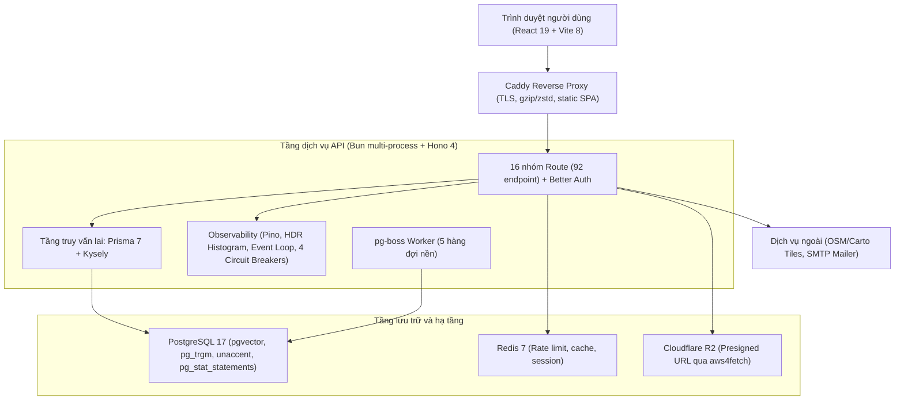
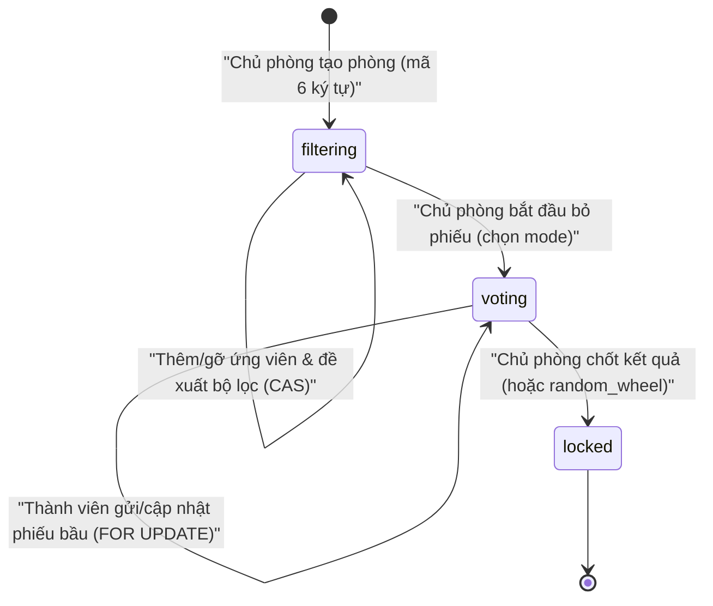

# Báo cáo kỹ thuật hệ thống Rendez

- **Cập nhật lần cuối:** 2026-11-23
- **Phạm vi:** Toàn bộ kiến trúc Backend, Lược đồ dùng chung (`@rendez/schema`), Hạ tầng dữ liệu, Quan sát vận hành và Kiểm thử tự động của hệ thống Rendez.
- **Trạng thái kho mã nguồn:** Nhánh `main`, mọi chỉ số trong báo cáo được trích trực tiếp từ mã nguồn và kết quả thực thi kiểm thử thực tế.

---

## 1. Tổng quan và quy mô hệ thống

Rendez là mạng xã hội khám phá địa điểm ăn uống và vui chơi tại Đà Nẵng, vận hành theo kiến trúc monorepo gồm ba thành phần chính: `packages/schema` (lược đồ kiểm chứng Zod dùng chung), `backend` (API và tác vụ nền trên Bun + Hono + PostgreSQL 17), và `frontend` (SPA trên React 19 + Vite 8 + Tailwind CSS 4).

**Bảng 1. Quy mô thực tế của hệ thống (tính đến 2026-11-23)**

| Hạng mục | Số lượng đo được | Ghi chú kiểm chứng |
|---|---|---|
| Bảng dữ liệu (Prisma models) | 37 bảng (14 enum) | `backend/prisma/schema.prisma`, chuẩn hóa 3NF |
| Lịch sử migration | 26 migration | `backend/prisma/migrations/` |
| Nhóm route & Endpoint API | 16 nhóm / 92 endpoint | Chưa kể `/healthz`, `/readyz`, `/api/v1/auth/*` |
| Hàng đợi tác vụ nền (`pg-boss`) | 5 hàng đợi định kỳ | `place-detect`, `daily-picks`, `event-retention`, `refresh-affinity`, `auth-cleanup` |
| Cầu dao ngắt mạch (`cockatiel`) | 4 cầu dao đăng ký | `embeddings`, `mailer`, `tiles-osm`, `tiles-carto` |
| Dữ liệu địa điểm Đà Nẵng | 358 địa điểm | 6 hạng mục trên 6 quận nội thành, 29 ảnh gốc (87 biến thể WebP) |
| Truy vấn SQL thuần còn lại | 33 câu trên 17 file | Giảm từ 77 câu (34 file) sau khi chuyển sang Kysely |
| Bộ kiểm thử tự động | 125 file / 709 test case | 4 tầng: Schema (3/17), Backend (52/415), Frontend Unit (49/228), E2E (21/49) |

---

## 2. Kiến trúc tổng thể

Mọi lưu lượng bên ngoài đi qua Caddy reverse proxy với chứng chỉ TLS tự động và nén nội dung. Tầng dịch vụ API chạy đa tiến trình trên Bun (`reusePort: true`), dùng chung bộ đệm phiên và giới hạn tốc độ qua Redis 7. Dữ liệu nghiệp vụ, vector ngữ nghĩa, hàng đợi tác vụ nền và kênh phát sự kiện thời gian thực (`LISTEN/NOTIFY`) đều đặt tại PostgreSQL 17 để giảm số thành phần vận hành trên máy chủ đơn.

---

## 3. Kiến trúc truy vấn lai và nguyên tắc Package-First

### 3.1. Giảm truy vấn SQL thuần bằng Kysely

Phiên bản trước đây tích lũy 77 câu truy vấn `$queryRaw` / `$executeRaw` rải rác ở 34 tệp nguồn, gây khó khăn cho kiểm tra kiểu tĩnh khi thay đổi lược đồ bảng. Tầng truy vấn hiện kết hợp **Prisma 7** (cho thao tác CRUD tiêu chuẩn và quản lý migration) với **Kysely 0.29.9** (sinh kiểu tự động qua `prisma-kysely`).

Hàm dùng chung `selectPlacesQuery()` trong `backend/src/lib/places/select.ts` xây dựng truy vấn đọc địa điểm bằng `leftJoinLateral` an toàn kiểu, giúp xóa toàn bộ `$queryRaw` khỏi `places/crud.ts` (4 xuống 0), `routes/places.ts` (1 xuống 0 nhờ `unionAll`), `app.ts` (1 xuống 0) và cắt một nửa ở `recommendations.ts` (6 xuống 3).

Tổng số truy vấn SQL thuần trên toàn bộ backend còn **33 câu nằm trong 17 tệp**. Toàn bộ 33 câu này đều sử dụng cú pháp đặc thù của PostgreSQL mà ORM hoặc Query Builder chuẩn không biểu diễn trực tiếp được: khóa hàng `SELECT ... FOR UPDATE`, toán tử khoảng cách vector `<=>` của `pgvector`, độ tương đồng chuỗi `pg_trgm` kết hợp `unaccent`, hàm sinh chuỗi thời gian `generate_series`, truy vấn thống kê `pg_stat_statements` và câu lệnh DDL quản trị phân vùng lưu giữ sự kiện.

### 3.2. Chuẩn hóa thư viện cộng đồng

Hệ thống loại bỏ các gói trùng lặp chức năng (gỡ bỏ `@hono/zod-openapi` và `@formkit/auto-animate`) và thay thế các hàm tự cài đặt dễ sai bằng thư viện chuẩn được cộng đồng bảo trì.

**Bảng 2. Các thư viện chuẩn cộng đồng thay thế mã tự viết trong hệ thống**

| Bài toán kỹ thuật | Thư viện đang sử dụng | Phạm vi áp dụng |
|---|---|---|
| Ký URL Cloudflare R2 (AWS SigV4) | `aws4fetch` | `backend/src/lib/r2.ts` (thay thế hàm ký thủ công bằng `node:crypto`) |
| Kiểm tra IP nội bộ chống SSRF | `node:net` (`BlockList`) | Chặn dải IP riêng (IPv4/IPv6) khi gọi dịch vụ ngoài |
| Bộ đệm LRU có giới hạn bộ nhớ | `lru-cache` | Bộ đệm vector truy vấn trong `backend/src/lib/embeddings.ts` |
| Bỏ phiếu loại trừ theo thứ hạng (IRV) | `votes` (`InstantRunoff`) | Kiểm phiếu chế độ `ranked_irv` trong phòng bình chọn nhóm |
| Ngắt mạch dịch vụ lỗi | `cockatiel` | 4 cầu dao: `embeddings`, `mailer`, `tiles-osm`, `tiles-carto` |
| Phân vị độ trễ và thống kê vận hành | `hdr-histogram-js`, `simple-statistics` | Tính p50/p95/p99 và phát hiện bất thường hiệu năng |
| Che giấu dữ liệu nhạy cảm & XSS | `maskdata`, `escape-html` | Che email/SĐT trong nhật ký kiểm toán và thoát ký tự thẻ OG |
| Xử lý múi giờ và giờ mở cửa | `Intl.DateTimeFormat` (`Asia/Ho_Chi_Minh`), `date-fns` | Đánh giá trạng thái mở cửa độc lập với múi giờ máy chủ |
| Đồng bộ trạng thái URL (Frontend) | `nuqs` | Toàn bộ bộ lọc bảng, tab quản trị và trang khám phá |
| Tải tệp và hook giao diện | `react-dropzone`, `@uidotdev/usehooks` | Kéo thả ảnh, media query, thao tác clipboard |
| Kiểm thử theo tính chất (PBT) | `fast-check` | Sinh hàng trăm đầu vào biên cho mật mã, cursor, giờ mở cửa |

---

## 4. Các phân hệ nghiệp vụ và hạ tầng trọng yếu

### 4.1. Tìm kiếm lai ghép EGRF và Gợi ý DES

Động cơ tìm kiếm vận hành trên bốn nhánh tín hiệu độc lập: khớp tên chuẩn hóa (`unaccent`), khớp gần đúng (`pg_trgm`), suy luận thuộc tính theo ý định, và tìm kiếm ngữ nghĩa bằng vector 384 chiều (`Xenova/multilingual-e5-small` qua `@huggingface/transformers` và `onnxruntime-node` lưu trên `pgvector`). Trọng số hợp nhất xếp hạng thay đổi theo bằng chứng định danh có trong truy vấn (EGRF).

Phân hệ gợi ý sử dụng thuật toán DES kết hợp trung bình Bayes có điều chỉnh độ đầy đủ hồ sơ (giải bài toán cold-start), hệ số sở thích cá nhân tính định kỳ qua hàng đợi `refresh-affinity`, và nhiễu có kiểm soát theo khung giờ trong ngày để làm mới danh sách "Gợi ý hôm nay" (`daily-picks`).

### 4.2. Đánh giá 3 tầng (F-002) và Thư viện ảnh món, thực đơn (F-079)

Mô hình `Review` hỗ trợ đánh giá theo ba mức độ (tổng quan, có nhận xét chi tiết, có hình ảnh và danh sách món đề xuất `recommended_dishes`). Tầng truy vấn tổng hợp danh sách món được nhắc nhiều nhất bằng phép mở rộng `LATERAL unnest(recommended_dishes)` để hiển thị trên trang chi tiết địa điểm.

Mô hình `PlaceImage` phân loại ảnh theo enum `PlaceMediaKind` (`food`, `menu`, `space`, `exterior`), cho phép người dùng đóng góp ảnh thực đơn và giá thực tế thông qua `POST /api/v1/places/:id/images` có bảo vệ khóa lũy đẳng (`IdempotencyKey`) và lọc xem theo từng nhóm qua `GET /api/v1/places/:id/media`.

### 4.3. Phòng bình chọn nhóm thời gian thực (F-040)

Phòng bình chọn nhóm hỗ trợ ba phương thức ra quyết định: bỏ phiếu nhiều lựa chọn (`multi_vote`), xếp hạng ưu tiên loại trừ dần (`ranked_irv` tính bằng thư viện `votes`), và vòng quay ngẫu nhiên có kiểm chứng từ máy chủ (`random_wheel`).

Khi nhiều thành viên cùng thao tác bỏ phiếu hoặc chuyển trạng thái phòng trong cùng mili giây, tuyến xử lý trong `backend/src/lib/room-voting.ts` bao bọc thao tác trong giao dịch PostgreSQL có khóa mức hàng `SELECT ... FOR UPDATE` trên bản ghi phòng, loại bỏ hoàn toàn điều kiện tranh chấp TOCTOU (Time-of-Check to Time-of-Use) vốn cho phép phiếu bầu lọt qua sau thời điểm chốt phòng. Các thay đổi trạng thái được phát tức thời qua cơ chế PostgreSQL `LISTEN/NOTIFY` kết hợp luồng SSE (`GET /api/v1/rooms/:code/events`).

### 4.4. Điểm neo vị trí và Đồng bộ GPS mã hóa đầu cuối

Phân hệ định vị (`backend/src/routes/location.ts`) hỗ trợ quản lý các điểm neo cá nhân (`UserLocationAnchor`: nhà riêng, cơ quan, trường học) cùng danh mục mốc địa danh Đà Nẵng (`CityLandmark`), phối hợp theo 6 tầng ưu tiên vị trí trên trình duyệt.

Tọa độ GPS đồng bộ lên máy chủ (`PUT /api/v1/me/location`) được mã hóa đối xứng **AES-256-GCM** trước khi lưu trữ. Mỗi bản mã dùng vector khởi tạo ngẫu nhiên 12 byte và gắn `userId` vào trường dữ liệu xác thực bổ sung (AAD). Nếu dữ liệu mã hóa bị sửa đổi hoặc sao chép sang bản ghi của người dùng khác, quá trình giải mã tự động từ chối xác thực thẻ GCM.

### 4.5. Cổng quản trị tách biệt môi trường và Quan sát vận hành

Cổng quản trị (`/admin`) tách thành sáu phân hệ độc lập (`overview`, `reports`, `places`, `users`, `observability`, `audit-logs`), bảo vệ bằng kiểm soát truy cập theo vai trò (`requireRole("admin")` và `requireRole("admin", "moderator")`) cùng nhận diện ngữ cảnh môi trường (`DEV · SANDBOX` so với môi trường thật). Mọi thao tác quản trị đều ghi vào bảng `AuditLog` với dữ liệu nhạy cảm đã che bằng `maskdata`.

Hệ thống quan sát (`GET /api/v1/admin/observability`) thu thập đầy đủ bốn trụ cột vận hành:

1. **Tín hiệu RED và tài nguyên (USE):** Tốc độ yêu cầu, tỷ lệ lỗi 4xx/5xx, phân vị độ trễ p50/p95/p99 từ `hdr-histogram-js`, tình trạng kết nối `pg.Pool` (đang chạy, nhàn rỗi, đang chờ), độ sâu 5 hàng đợi `pg-boss` qua `getQueueStats()`, và độ trễ vòng lặp sự kiện `eventLoopLagMs` đo bằng `monitorEventLoopDelay`.
2. **Độ tin cậy dịch vụ ngoài:** Trạng thái đóng/mở và số lần ngắt mạch của 4 cầu dao `cockatiel` (`embeddings`, `mailer`, `tiles-osm`, `tiles-carto`).
3. **An ninh và chất lượng tìm kiếm:** Bộ đếm lỗi xác thực (`401`, `403`, `429`, `authFailed`) và tỷ lệ truy vấn tìm kiếm không có kết quả (`Search Zero-Result Rate`).
4. **Trải nghiệm người dùng thực (RUM):** Thu thập Core Web Vitals (`LCP`, `INP`, `CLS`, `FCP`, `TTFB`) phân vị p75 từ trình duyệt thông qua `web-vitals` và endpoint `POST /api/v1/telemetry`.

---

## 5. Chiến lược kiểm thử 4 tầng và các lỗi thực tế đã xử lý

Thay vì chỉ kiểm thử kịch bản thuận lợi (happy path), bộ kiểm thử của hệ thống được tổ chức theo bốn tầng kết hợp phân vùng tương đương (EP), phân tích giá trị biên (BVA), kiểm thử theo tính chất (`fast-check` PBT), kiểm thử tương tranh trên PostgreSQL thật (Testcontainers) và kiểm thử giao diện đầu cuối.

**Bảng 3. Tổng hợp độ phủ bộ kiểm thử tự động (125 file / 709 test case)**

| Tầng kiểm thử | Công cụ | Số file | Số test case | Trọng tâm kiểm tra |
|---|---|---:|---:|---|
| 1. Lược đồ & logic thuần (`packages/schema`) | `bun:test`, `fast-check` | 3 | 17 | Giờ mở cửa xuyên đêm trên 3 múi giờ (`Asia/Ho_Chi_Minh`, `UTC`, `America/New_York`), ranh giới tọa độ, chuẩn hóa đầu vào |
| 2. Backend API & Cơ sở dữ liệu (`backend/test`) | `bun:test`, Testcontainers (`pgvector`), `fast-check` | 52 | 415 | 16 nhóm route, mật mã AES-256-GCM (AAD/tampering), cursor pagination PBT, tương tranh 18 luồng song song ở phòng bình chọn, bảo mật Tiles proxy, IDOR điểm neo vị trí, phân quyền Admin |
| 3. Frontend Unit & Component (`frontend/src`) | Vitest, React Testing Library, `fast-check` | 49 | 228 | Tách biệt tham số URL quản trị (`nuqs`), ngưỡng cảnh báo sức khỏe vận hành, hoàn tác trạng thái lạc quan (optimistic rollback), giữ nguyên thanh lọc khi danh sách rỗng |
| 4. Đầu cuối trình duyệt (`frontend/e2e`) | Playwright | 21 | 49 | Luồng đăng nhập, tìm kiếm, bản đồ, đăng bài, phòng bình chọn thời gian thực, cổng quản trị |
| **Tổng cộng** | | **125** | **709** | |

Quá trình kiểm toán mã nguồn và viết kiểm thử biên, tương tranh đã phát hiện và khắc phục triệt để ba lỗi thực tế trong mã sản phẩm:

**Bảng 4. Ba lỗi thực tế được phát hiện qua kiểm thử chuyên sâu**

| Vị trí | Mô tả lỗi phát hiện được | Nguyên nhân gốc | Cách khắc phục và bằng chứng xác minh |
|---|---|---|---|
| `backend/src/routes/admin/observability.ts` | Tỷ lệ truy vấn tìm kiếm trả về 0 kết quả (`Search Zero-Result Rate`) luôn hiển thị 0% dù có truy vấn rỗng | Câu truy vấn thống kê đọc trường JSON `metadata->>'resultCount'` trong khi tầng tìm kiếm ghi khóa `metadata.resultsCount` | Đồng bộ tên trường thành `resultsCount` và bổ sung test kiểm chứng tính toán tỷ lệ truy vấn rỗng |
| `backend/src/lib/room-voting.ts` | Khi nhiều người dùng gửi phiếu đồng thời với thao tác chốt phòng, một số phiếu bầu vẫn ghi thành công sau khi phòng đã chuyển sang `locked` | Kiểm tra trạng thái phòng và ghi phiếu thực hiện tách rời nhau, phát sinh điều kiện tranh chấp TOCTOU | Bọc trong giao dịch có `SELECT ... FOR UPDATE` trên bản ghi phòng; xác minh bằng kịch bản 18 yêu cầu song song trên PostgreSQL thật (`room-voting-integration.test.ts`) |
| `frontend/src/hooks/use-set-post-liked.ts` | Bấm thích/bỏ thích liên tục khi mạng lỗi có thể làm bộ đếm `likeCount` âm hoặc bị dữ liệu cũ ghi đè | Thiếu `queryClient.cancelQueries` trước khi cập nhật lạc quan và không chặn cận dưới `Math.max(0, ...)` | Gọi `cancelQueries`, chặn cận dưới bằng 0 và hoàn tác snapshot khi mutation lỗi (`use-social-optimistic.test.tsx`) |

---

## 6. Kiểm chứng thực thi gần nhất và các hạng mục chưa xác minh

### 6.1. Các kiểm chứng đã chạy và đạt yêu cầu (commit `4fed13c`)

- `packages/schema`: 3/3 file, 17/17 test case (705 assertions) đạt trên ba múi giờ `Asia/Ho_Chi_Minh`, `UTC`, `America/New_York`.
- `backend` (nhóm bị tác động bởi đợt chuyển đổi Kysely và kiểm thử mới): `places.test.ts` (39/39 test, 879 assertions), `recommendations-des.test.ts` (2/2), `health.test.ts` (3/3), cùng toàn bộ 5 bộ kiểm thử bảo mật/tương tranh/PBT mới (`crypto-cursor-pbt`, `tiles-security`, `room-voting-integration`, `admin-comprehensive`, `location-idor`) đều đạt trên Testcontainers.
- `frontend`: 49/49 file unit/component test (228/228 test case) đạt, 0 lỗi ESLint, đóng gói sản phẩm `vite build` thành công.
- Rà soát chất lượng mã: 0 trường hợp ép kiểu `as any` hoặc `as unknown as` trong mã sản phẩm, 0 tệp nguồn tính năng vượt quá 500 dòng.

### 6.2. Hạng mục chưa xác minh

Để bảo đảm tính trung thực khi nghiệm thu, các hạng mục sau chưa được kiểm chứng trong môi trường thực tế bên ngoài máy phát triển:

1. **Cloudflare R2 thật:** Mới kiểm chứng tạo chữ ký SigV4 qua `aws4fetch` và luồng tải lên kho lưu trữ cục bộ; chưa chạy thử với bucket Cloudflare R2 thật trên internet.
2. **Máy chủ gửi thư SMTP bên ngoài:** Mới kiểm chứng giao diện gửi thư và cầu dao `mailer` ở chế độ cục bộ; chưa kiểm chứng tỷ lệ vào hộp thư đến qua nhà cung cấp SMTP sản xuất.
3. **Cấu hình Caddy và triển khai máy chủ công khai:** Chưa chạy `caddy validate` và kiểm tra cấp phát chứng chỉ TLS thật trên tên miền công khai.
4. **Thẻ xem trước Open Graph trên mạng xã hội thật:** Đã kiểm chứng mã HTML trả về của `/og/place/:id` và `/og/post/:id` bằng kiểm thử tự động, chưa kiểm tra bộ thu thập (crawler) thật của Facebook và Zalo.
5. **Chạy trọn gói toàn bộ 52 file backend trong một lần (`test-all.sh`) sau commit `4fed13c`:** Đã chạy toàn bộ các file liên quan trực tiếp đến vùng sửa đổi; cần chạy lại một lượt toàn cục 52 file trước khi đóng gói phát hành.
