# BÁO CÁO ĐỒ ÁN

**TRƯỜNG ĐẠI HỌC BÁCH KHOA – ĐẠI HỌC ĐÀ NẴNG**
**KHOA CÔNG NGHỆ THÔNG TIN**

**ĐỀ TÀI:** XÂY DỰNG MẠNG XÃ HỘI KHÁM PHÁ ĐỊA ĐIỂM TẠI ĐÀ NẴNG TÍCH HỢP TÌM KIẾM KHÔNG DẤU VÀ GỢI Ý CÁ NHÂN HOÁ

| | |
|---|---|
| Sinh viên thực hiện | Trần Đức Long |
| | Phan Thị Thảo Tiên |
| Mã số sinh viên | 【cần thông tin: MSSV Trần Đức Long】 |
| | 【cần thông tin: MSSV Phan Thị Thảo Tiên】 |
| Lớp | 23T_Nhat1 |
| | 23T_Nhat2 |
| Chuyên ngành | Công nghệ Thông tin |
| Giảng viên hướng dẫn | TS. Võ Đức Hoàng |
| Năm học | 2026 – 2027 |

**Đà Nẵng, tháng 11 năm 2026**

---

## LỜI CẢM ƠN

Đồ án này là kết quả của một học kỳ làm việc nghiêm túc của nhóm. Để hoàn thành báo cáo, nhóm đã nhận được sự hướng dẫn, góp ý và động viên từ nhiều người.

Trước hết, nhóm xin bày tỏ lòng biết ơn sâu sắc đến TS. Võ Đức Hoàng, người trực tiếp hướng dẫn, định hướng phương pháp nghiên cứu và chỉ ra những điểm còn thiếu trong quá trình thực hiện. Những nhận xét của thầy giúp nhóm nhìn rõ giới hạn của sản phẩm và điều chỉnh cách đánh giá kết quả một cách khách quan hơn.

Nhóm cũng xin cảm ơn quý thầy cô Khoa Công nghệ Thông tin, Trường Đại học Bách khoa – Đại học Đà Nẵng đã truyền đạt kiến thức nền tảng trong suốt những năm học, và cảm ơn các giảng viên chấm đồ án đã dành thời gian đọc và góp ý cho báo cáo này.

Cuối cùng, nhóm xin cảm ơn bạn bè đã chia sẻ tài liệu, góp ý về giao diện và hỗ trợ kiểm thử. Nhóm cũng muốn ghi nhận nỗ lực của chính mình: những buổi làm việc kéo dài, những lần sửa đi sửa lại, và quyết định giữ lại cả những kết quả chưa đạt kỳ vọng thay vì che giấu chúng.

Dù đã cố gắng, báo cáo khó tránh khỏi thiếu sót. Nhóm mong nhận được góp ý để hoàn thiện hơn.

---

## TÓM TẮT

Đồ án xây dựng mạng xã hội khám phá địa điểm tại Đà Nẵng (Rendez), bao phủ 358 địa điểm thuộc 6 hạng mục trên 6 quận nội thành. Hệ thống tổ chức theo mô hình monorepo với 37 bảng dữ liệu (chuẩn 3NF, 14 enum, 26 migration), tầng truy vấn lai Prisma 7 và Kysely, 16 nhóm route gồm 92 endpoint, 5 hàng đợi tác vụ nền `pg-boss`, Redis 7, cổng quản trị phân quyền và hệ thống quan sát vận hành (RED/USE, Core Web Vitals). Toàn bộ hạ tầng triển khai trên một máy chủ giới hạn 5 nhân và 3,5 GB bộ nhớ.

Đồ án thiết kế hai thuật toán cốt lõi. Thuật toán tìm kiếm lai ghép EGRF hợp nhất bốn nhánh tín hiệu, trong đó nhánh ngữ nghĩa (vector 384 chiều trên `pgvector`) và nhánh suy luận thuộc tính giúp nhận diện ý định ẩn sau truy vấn thay vì chỉ khớp bề mặt chữ; trọng số từng nhánh được điều chỉnh theo bằng chứng định danh trong truy vấn. Trên tập nội bộ 344 truy vấn, EGRF đạt độ chính xác tại 5 là 0,820, cao hơn mức 0,591 của hợp nhất xếp hạng chuẩn. Thuật toán gợi ý DES tính điểm theo trung bình Bayes có điều chỉnh độ hoàn thiện hồ sơ và bổ sung nhiễu theo khung giờ. Trên tập địa điểm đối chứng, DES kết hợp đạt độ triệu hồi tại 10 là 0,044 so với 0,035 của lọc cộng tác; kiểm định bootstrap trên nDCG@10 cho chênh lệch trung bình 0,0046, khoảng tin cậy 95% là [0,0028; 0,0065].

Kiểm thử tải thực hiện trên cấu hình giới hạn 2 nhân cho tầng dịch vụ API. Thời gian phản hồi phân vị 95 đạt 420 ms ở mức 1.000 người dùng đồng thời và 1.250 ms ở mức 2.000 người dùng đồng thời; hệ thống duy trì 0% lỗi máy chủ tới mức 3.000 người dùng. Bên cạnh đó, bộ kiểm thử tự động 4 tầng gồm 125 tệp với 709 ca kiểm thử (bao gồm Property-Based Testing bằng `fast-check`, kiểm thử tương tranh trên PostgreSQL thật, kiểm thử IDOR và kiểm thử E2E) đã phát hiện và khắc phục ba lỗi thực tế trước khi hoàn thiện.

**Từ khoá:** tìm kiếm lai ghép, tìm kiếm ngữ nghĩa, cold-start, tiếng Việt không dấu, PostgreSQL, quan sát hệ thống, kiểm thử theo tính chất.

---

## ABSTRACT

This project builds Rendez, a social network for place discovery in Da Nang covering 358 places across 6 categories and 6 urban districts. Structured as a monorepo, the system comprises 37 database tables (3NF normalized, 14 enums, 26 migrations), a hybrid Prisma 7 and Kysely query layer, 16 route groups totaling 92 API endpoints, 5 `pg-boss` background queues, Redis 7, a role-based admin portal, and production observability (RED/USE metrics and Core Web Vitals). The stack runs on a single host constrained to 5 CPU cores and 3.5 GB of memory.

The project designs two core algorithms. Evidence-Gated Rank Fusion (EGRF) combines four retrieval branches, using 384-dimensional semantic embeddings on `pgvector` and structured attribute inference to capture user intent beyond surface text matching while gating branch weights on lexical identifying evidence. On an internal benchmark of 344 queries, EGRF achieves Precision@5 of 0.820 versus 0.591 for standard Reciprocal Rank Fusion. Dynamic Evidence Scoring (DES) ranks cold-start places through a profile-weighted Bayesian average with time-windowed noise. On the reference venue dataset, combined DES reaches Recall@10 of 0.044 compared with 0.035 for collaborative filtering, and bootstrap testing on nDCG@10 yields a mean gain of 0.0046 (95% CI [0.0028, 0.0065]).

Load testing under a 2-core service cap measures a 95th-percentile latency of 420 ms at 1,000 concurrent users and 1,250 ms at 2,000, with zero server errors up to 3,000 concurrent users. A four-tier automated test suite of 125 files and 709 test cases (combining `fast-check` property-based testing, real-PostgreSQL concurrency checks, IDOR verification, and Playwright E2E) uncovered and resolved three production defects. These evaluations remain bounded by a 358-place corpus and an internally authored query set, both documented explicitly in this report.

**Keywords:** hybrid search, semantic search, cold-start, diacritic-insensitive Vietnamese, PostgreSQL, observability, property-based testing.

## MỤC LỤC

| Chương | Nội dung |
|---|---|
| | Lời cảm ơn |
| | Tóm tắt |
| | Abstract |
| | Danh mục hình vẽ |
| | Danh mục bảng biểu |
| | Danh mục từ viết tắt |
| | Thuật ngữ |
| **1** | Giới thiệu đề tài |
| **2** | Cơ sở lý thuyết và công nghệ |
| **3** | Phân tích và thiết kế hệ thống |
| **4** | Cài đặt và thử nghiệm |
| **5** | Kết luận và hướng phát triển |
| | Tài liệu tham khảo |
| | Phụ lục A - Danh mục API endpoint |

## DANH MỤC HÌNH VẼ

| Số hiệu | Tên hình |
|---|---|
| Hình 2.1 | Kim tự tháp kiểm thử tự động 4 tầng của hệ thống Rendez |
| Hình 3.1 | Sơ đồ use case tổng thể |
| Hình 3.2 | Sơ đồ kiến trúc triển khai |
| Hình 3.3 | Sequence diagram luồng tìm kiếm |
| Hình 3.4 | Sequence diagram luồng tác vụ nền |
| Hình 3.5 | Sequence diagram luồng bình chọn nhóm thời gian thực |
| Hình 3.6 | Sequence diagram luồng tải ảnh qua URL có chữ ký |
| Hình 3.7 | State diagram vòng đời một đề xuất trong phòng bình chọn |
| Hình 3.8 | Activity diagram luồng tìm kiếm địa điểm |
| Hình 3.9 | Activity diagram luồng đăng bài và phát hiện địa điểm |
| Hình 3.10 | Sơ đồ lớp các lớp miền nghiệp vụ chính |
| Hình 3.11 | Sơ đồ thực thể liên kết (theo miền, 37 bảng) |
| Hình 3.12 | Sơ đồ điều hướng các màn hình chính |
| Hình 3.13 | Sơ đồ trạng thái vòng đời phòng bình chọn nhóm (F-040) |
| Hình 3.14 | Luồng ưu tiên 6 tầng định vị và đồng bộ GPS mã hóa AES-256-GCM |
| Hình 3.15 | Kiến trúc quan sát vận hành (Observability) và cảnh báo hệ thống |
| Hình 4.1 | Biểu đồ thời gian phản hồi theo mức tải |
| Hình 4.2 | Biểu đồ độ chính xác tìm kiếm trên tập nội bộ |
| Hình 4.3 | Biểu đồ độ triệu hồi gợi ý trên tập địa điểm |
| Hình 4.4 | Màn hình tìm kiếm với truy vấn không dấu |
| Hình 4.5 | Màn hình chi tiết địa điểm |
| Hình 4.6 | Màn hình phòng bình chọn nhóm |
| Hình 4.7 | Màn hình soạn bài có gợi ý địa điểm |
| Hình 4.8 | Màn hình bản đồ các địa điểm |
| Hình 4.9 | Màn hình hồ sơ cá nhân |
| Hình 4.10 | Giao diện Cổng quản trị (Rendez Admin) ở chế độ tối |
| Hình 4.11 | Màn hình Khám phá chế độ tối kèm bộ chuyển điểm neo vị trí |

Số trang cập nhật khi kết xuất theo mẫu của trường.

## DANH MỤC BẢNG BIỂU

| Số hiệu | Tên bảng |
|---|---|
| Bảng 1.1 | So sánh Rendez với các ứng dụng người dùng đang dùng |
| Bảng 1.2 | Phạm vi thực hiện của đồ án |
| Bảng 2.1 | So sánh phương án hàng đợi tác vụ |
| Bảng 2.2 | So sánh phương án tìm kiếm văn bản |
| Bảng 2.3 | Thư viện chuẩn cộng đồng thay thế mã tự viết theo nguyên tắc Package-First |
| Bảng 3.1 | Yêu cầu chức năng |
| Bảng 3.2 | Yêu cầu phi chức năng |
| Bảng 3.3 | Đặc tả use case tổng hợp |
| Bảng 3.4 | Đặc tả use case tìm kiếm địa điểm |
| Bảng 3.5 | Đặc tả use case đăng bài |
| Bảng 3.6 | Đặc tả use case bình chọn nhóm |
| Bảng 3.7 | Trọng số gate của thuật toán EGRF |
| Bảng 3.8 | Mô tả các nhóm bảng dữ liệu (37 bảng) |
| Bảng 3.9 | Mô tả cấu trúc bảng địa điểm |
| Bảng 3.10 | Thiết kế bảo mật theo lớp tấn công |
| Bảng 4.1 | Môi trường cài đặt và đo lường |
| Bảng 4.2 | Danh mục module đã cài đặt |
| Bảng 4.3 | Xử lý kỹ thuật và kết quả đo |
| Bảng 4.4 | Tổng hợp bộ kiểm thử tự động theo 4 tầng |
| Bảng 4.5 | Ca kiểm thử tiêu biểu và các lỗi thực tế phát hiện được |
| Bảng 4.6 | Thời gian phản hồi ở mức tải đơn lẻ |
| Bảng 4.7 | Kết quả kiểm thử tải tăng dần |
| Bảng 4.8 | Độ chính xác tìm kiếm trên tập nội bộ |
| Bảng 4.9 | Độ chính xác tìm kiếm trên tập đối chứng |
| Bảng 4.10 | Độ triệu hồi gợi ý trên tập đối chứng |
| Bảng 5.1 | Đối chiếu mục tiêu và kết quả |
| Bảng A.1 | Danh mục API endpoint (16 nhóm, 92 endpoint) |

Số trang cập nhật khi kết xuất theo mẫu của trường.

## DANH MỤC TỪ VIẾT TẮT

| Từ viết tắt | Tiếng Anh | Ý nghĩa |
|---|---|---|
| AAD | Additional Authenticated Data | Dữ liệu xác thực bổ sung trong mã hóa AEAD |
| API | Application Programming Interface | Giao diện lập trình ứng dụng |
| BVA | Boundary Value Analysis | Phân tích giá trị biên trong kiểm thử |
| CAS | Compare-And-Swap | Cập nhật có kiểm tra giá trị kỳ vọng |
| CF | Collaborative Filtering | Lọc cộng tác |
| CWV | Core Web Vitals | Bộ chỉ số trải nghiệm trang web (LCP, INP, CLS) |
| DES | Dynamic Evidence Scoring | Thuật toán gợi ý đề xuất trong đồ án |
| EGRF | Evidence-Gated Rank Fusion | Thuật toán tìm kiếm đề xuất trong đồ án |
| EP | Equivalence Partitioning | Phân vùng tương đương trong kiểm thử |
| ERD | Entity-Relationship Diagram | Sơ đồ thực thể liên kết |
| FR | Functional Requirement | Yêu cầu chức năng |
| IDOR | Insecure Direct Object Reference | Lỗi truy cập trực tiếp đối tượng không kiểm tra quyền |
| IRV | Instant-Runoff Voting | Phương thức bỏ phiếu xếp hạng loại trừ dần |
| NFR | Non-Functional Requirement | Yêu cầu phi chức năng |
| p50, p95 | 50th, 95th percentile | Phân vị 50, phân vị 95 |
| PBT | Property-Based Testing | Kiểm thử theo tính chất bằng sinh dữ liệu ngẫu nhiên |
| RBAC | Role-Based Access Control | Kiểm soát truy cập dựa trên vai trò |
| RED | Rate, Errors, Duration | Ba chỉ số giám sát dịch vụ (tần suất, lỗi, độ trễ) |
| RRF | Reciprocal Rank Fusion | Hợp nhất xếp hạng nghịch đảo |
| RUM | Real User Monitoring | Giám sát trải nghiệm từ trình duyệt người dùng thật |
| SSE | Server-Sent Events | Sự kiện do máy chủ đẩy xuống |
| SSRF | Server-Side Request Forgery | Tấn công giả mạo yêu cầu từ phía máy chủ |
| TLS | Transport Layer Security | Bảo mật tầng truyền tải |
| TOCTOU | Time-of-Check to Time-of-Use | Điều kiện tranh chấp giữa bước kiểm tra và bước sử dụng |
| USE | Utilization, Saturation, Errors | Ba chỉ số giám sát tài nguyên (mức dùng, bão hòa, lỗi) |

## THUẬT NGỮ

| Tiếng Anh | Cách dùng trong báo cáo | Ý nghĩa |
|---|---|---|
| cold-start | cold-start | Gợi ý khi chưa có dữ liệu tương tác |
| container | container | Đơn vị đóng gói cô lập tài nguyên |
| endpoint | endpoint | Điểm truy cập API, định danh bởi HTTP method và đường dẫn |
| framework | framework | Bộ khung định tuyến và thư viện cho ứng dụng web |
| idempotency | khóa lũy đẳng | Thao tác lặp nhiều lần không đổi kết quả |
| job queue | hàng đợi tác vụ | Cơ chế lưu và xử lý tác vụ nền |
| object storage | object storage | Dịch vụ lưu trữ tệp qua HTTP, tương thích S3 |
| reverse proxy | reverse proxy | Máy chủ trung gian nhận yêu cầu từ internet, chuyển vào nội bộ |
| runtime | runtime | Nền tảng chạy mã phía máy chủ |
| smoothing constant | hằng số làm mịn | Hằng số $k$ trong công thức RRF, tránh chia cho 0 |

---

# CHƯƠNG 1. GIỚI THIỆU ĐỀ TÀI

## 1.1. Đặt vấn đề

Rendez hướng đến giới trẻ và các cặp đôi ở Đà Nẵng, những người thường xuyên đi chơi và chọn địa điểm theo từng cuộc hẹn. Tên ứng dụng lấy từ chữ *rendezvous* trong tiếng Pháp, nghĩa là cuộc hẹn đã hứa. Với nhóm người dùng này, mỗi lần ra ngoài là một lần chọn bối cảnh cho cuộc hẹn: quán yên tĩnh để trò chuyện, chỗ ngoài trời view biển, hay một địa điểm mới để đổi không khí.

Để chọn địa điểm, người dùng hiện dùng ba loại ứng dụng: bản đồ, nền tảng đánh giá ẩm thực và mạng xã hội video. Mỗi loại mạnh ở một lĩnh vực riêng, nhưng không loại nào chuyên biệt cho việc gợi ý địa điểm đi chơi, đi ăn. Bảng 1.1 so sánh bốn ứng dụng theo năm tiêu chí quan trọng nhất với người đi hẹn.

**Bảng 1.1. So sánh Rendez với các ứng dụng người dùng đang dùng**

| Tiêu chí | Google Maps | Foody | TikTok | Rendez |
|---|---|---|---|---|
| Định hướng chính | Bản đồ, chỉ đường | Đồ ăn, đánh giá quán | Video ngắn giải trí | Gợi ý địa điểm đi chơi, đi ăn |
| Tìm kiếm theo ý định (ngữ nghĩa) | Yếu, chủ yếu khớp từ khoá | Yếu, chủ yếu khớp từ khoá | Không có | Có, nhánh ngữ nghĩa và nhánh suy luận thuộc tính |
| Gợi ý cá nhân hoá | Gần như không | Yếu | Có, nhưng không gắn với địa điểm cụ thể | Có, xử lý được cold-start |
| Xem khoảng cách, vị trí tức thì | Có, là thế mạnh của bản đồ | Phải tra thêm bản đồ | Phải tra thêm bản đồ | Có bản đồ tích hợp |
| Thông tin cộng đồng gắn địa điểm | Yếu | Có đánh giá, ít cập nhật | Phong phú nhưng rời rạc, khó tra cứu | Có, bài đăng gắn với địa điểm |

Ba ứng dụng trên mỗi cái mạnh ở một lĩnh vực nhưng không chuyên biệt cho gợi ý địa điểm. Google Maps chuyên về bản đồ và chỉ đường, không phải gợi ý địa điểm. Foody chuyên về đồ ăn. TikTok chuyên về video ngắn giải trí, có nhắc đến địa điểm đi ăn, đi chơi nhưng đó không phải chức năng chính. Không ứng dụng nào đáp ứng cùng lúc ba nhu cầu: hiểu ý định tìm kiếm, gợi ý được địa điểm mới chưa có đánh giá, và gắn thông tin cộng đồng với từng địa điểm. Rendez được xây dựng chuyên biệt cho ba nhu cầu này, trên tập dữ liệu thật của Đà Nẵng gồm 358 địa điểm thuộc 6 hạng mục trên 6 quận nội thành, thu thập từ OpenStreetMap [20].

## 1.2. Mục tiêu

Từ ba nhu cầu trên, đồ án đặt năm mục tiêu. Mỗi mục tiêu gắn với một phép đo cụ thể để kết quả kiểm chứng được:

1. Xây dựng mạng xã hội địa điểm có đủ nghiệp vụ: tài khoản, bài đăng, đánh giá, bộ sưu tập, thông báo, phòng bình chọn nhóm.
2. Xây dựng thuật toán tìm kiếm hiểu ý định theo ngữ nghĩa, đồng thời chịu được tiếng Việt không dấu và lỗi gõ; đo bằng độ chính xác tại 5 trên tập truy vấn nội bộ.
3. Xây dựng thuật toán gợi ý hoạt động khi chưa có lịch sử tương tác; đo bằng độ triệu hồi tại 10 trên tập đối chứng.
4. Đo thời gian phản hồi của hệ thống dưới tải tăng dần trên cấu hình giới hạn tài nguyên.
5. Xây dựng bộ kiểm thử tự động phủ toàn bộ yêu cầu chức năng.

Mục tiêu số hai là trọng tâm kỹ thuật. Năng lực hiểu ý định được hiện thực bằng hai cơ chế: một nhánh tìm kiếm ngữ nghĩa dựa trên biểu diễn vector của truy vấn, và một nhánh suy luận thuộc tính trích xuất ý định từ truy vấn tự do thành các nhãn có cấu trúc. Phần xử lý không dấu và lỗi gõ là khả năng kèm theo, giúp truy vấn của người dùng trẻ vốn thường gõ vắn tắt và bỏ dấu vẫn được hiểu đúng trước khi bước vào giai đoạn suy luận ngữ nghĩa.

## 1.3. Đối tượng sử dụng

Hệ thống phục vụ bốn nhóm người dùng, phân biệt theo mức tham gia:

- **Khách vãng lai.** Người chưa có tài khoản, vào để tìm địa điểm, xem bản đồ và xem chi tiết địa điểm. Nhóm này chiếm phần lớn lưu lượng và cần có kết quả ngay mà không phải đăng ký.
- **Thành viên.** Người đã có tài khoản, ngoài các thao tác của khách còn đăng bài, viết đánh giá, tạo bộ sưu tập và nhận thông báo. Đây là nhóm tạo ra dữ liệu tương tác nuôi thuật toán gợi ý.
- **Khách trong phòng bình chọn.** Người được mời vào một phòng để cùng chọn địa điểm cho một cuộc hẹn nhóm, không bắt buộc có tài khoản. Nhóm này gắn trực tiếp với tình huống các cặp đôi và nhóm bạn rủ nhau đi chơi.
- **Hệ thống.** Thành phần tự động chạy các tác vụ nền: phát hiện địa điểm trong bài đăng, sinh gợi ý hằng ngày, cập nhật bộ đệm sở thích và dọn dữ liệu cũ.

Trong bốn nhóm trên, giới trẻ và các cặp đôi là đối tượng chính mà Rendez hướng đến; ba nhóm còn lại là cách hệ thống mở rộng phạm vi phục vụ xoay quanh nhóm chính.

## 1.4. Phạm vi

Bảng 1.2 phân định nội dung thực hiện và không thực hiện của đồ án.

**Bảng 1.2. Phạm vi thực hiện của đồ án**

| Trong phạm vi | Ngoài phạm vi |
|---|---|
| Dữ liệu 358 địa điểm tại 6 quận nội thành Đà Nẵng [20] | Dữ liệu ngoài địa bàn Đà Nẵng |
| Giao diện web responsive | Ứng dụng di động native |
| Tài khoản email và mật khẩu | Đăng nhập qua mạng xã hội bên thứ ba |
| Bài đăng, đánh giá, bình luận, bộ sưu tập | Nhắn tin riêng tư, gọi video |
| Phòng bình chọn nhóm thời gian thực | Đặt chỗ, thanh toán trực tuyến |
| Tìm kiếm lai ghép và gợi ý cá nhân hoá | Quảng cáo và khuyến mãi |
| Triển khai trên một máy chủ | Điều phối đa nút, cân bằng tải nhiều máy |

## 1.5. Phương pháp thực hiện

Đồ án thực hiện theo bốn bước. Bước một khảo sát chức năng của các nền tảng khám phá địa điểm hiện có. Bước hai thiết kế kiến trúc, lược đồ dữ liệu và hai thuật toán. Bước ba cài đặt hệ thống và bộ kiểm thử tự động. Bước bốn đo hiệu năng và đánh giá thuật toán trên tập dữ liệu có đối chứng.

Công cụ chính gồm bốn nhóm. Nhóm thực thi dùng Bun và Hono. Nhóm lưu trữ dùng PostgreSQL 17 với các phần mở rộng tìm kiếm. Nhóm đóng gói dùng Docker Compose. Nhóm đo tải dùng k6 [11].

## 1.6. Bố cục báo cáo

Báo cáo gồm năm chương. Chương 1 trình bày bài toán, mục tiêu và phạm vi. Chương 2 trình bày cơ sở lý thuyết và căn cứ lựa chọn công nghệ. Chương 3 trình bày phân tích và thiết kế: yêu cầu, use case, kiến trúc, luồng tương tác, dữ liệu và giao diện. Chương 4 trình bày cài đặt, kiểm thử chức năng và đánh giá hiệu năng, độ chính xác. Chương 5 kết luận, nêu hạn chế và hướng phát triển.

---

# CHƯƠNG 2. CƠ SỞ LÝ THUYẾT VÀ CÔNG NGHỆ

## 2.1. Công nghệ nền tảng

**Bun.** Bun là runtime JavaScript và TypeScript phía máy chủ. Bun hỗ trợ nhiều tiến trình cùng lắng nghe một cổng qua cơ chế chia sẻ cổng (`reusePort`) của hệ điều hành, giúp tận dụng nhiều nhân bộ xử lý trong một container [7].

**Hono và Zod.** Hono là framework định tuyến HTTP chạy trên chuẩn Web [1], kết hợp cùng gói lược đồ `@rendez/schema` xây dựng trên Zod [6] để kiểm chứng đầu vào thống nhất cho cả frontend và backend trên toàn bộ 16 nhóm route (92 endpoint).

**PostgreSQL 17.** PostgreSQL là hệ quản trị cơ sở dữ liệu quan hệ hỗ trợ giao dịch ACID, phân vùng bảng, chỉ mục GIN và hệ sinh thái phần mở rộng [4]. Đồ án dùng PostgreSQL làm kho lưu trữ chính cho 37 bảng dữ liệu nghiệp vụ, hàng đợi tác vụ nền và kênh phát sự kiện nội bộ `LISTEN/NOTIFY`.

**`unaccent`, `pg_trgm`, `pgvector` và `pg_stat_statements`.** Phần mở rộng `unaccent` đưa chuỗi tiếng Việt có dấu về dạng không dấu; `pg_trgm` lập chỉ mục GIN theo cụm ba ký tự để chịu lỗi gõ; `pgvector` lưu vector 384 chiều sinh từ mô hình `Xenova/multilingual-e5-small` và truy vấn lân cận theo khoảng cách cosine; `pg_stat_statements` thu thập số liệu truy vấn chậm phục vụ giám sát vận hành [4].

**Prisma 7 và Kysely.** Prisma định nghĩa lược đồ 37 bảng, quản lý 26 migration có phiên bản và xử lý thao tác CRUD chuẩn [2]. Với các truy vấn đọc phức tạp có phép nối `LEFT JOIN LATERAL` hoặc hợp nhất kết quả, hệ thống dùng Kysely kết hợp trình sinh kiểu `prisma-kysely` [33], giúp loại bỏ phần lớn truy vấn SQL chuỗi thuần mà vẫn kiểm tra kiểu tĩnh ở bước biên dịch.

**Redis 7.** Redis lưu bộ đếm giới hạn tốc độ phân tán, bộ đệm tạm và dữ liệu phiên chia sẻ giữa các tiến trình API đang chạy song song.

**pg-boss.** `pg-boss` lưu hàng đợi tác vụ bất đồng bộ ngay trong bảng PostgreSQL với cơ chế khóa, thử lại và lập lịch cron [5]. Hệ thống vận hành 5 hàng đợi định kỳ: `place-detect`, `daily-picks`, `event-retention`, `refresh-affinity` và `auth-cleanup`.

**Better Auth.** Better Auth quản lý tài khoản, mật khẩu băm và phiên đăng nhập lưu phía máy chủ cho các luồng đăng ký, đăng nhập, xác thực email và khôi phục mật khẩu [3].

**Cloudflare R2 và `aws4fetch`.** R2 là object storage tương thích chuẩn S3 hỗ trợ URL có chữ ký để trình duyệt tải ảnh trực tiếp [10]. Tầng backend tạo chữ ký AWS SigV4 bằng thư viện chuẩn `aws4fetch` thay vì tự ghép chuỗi ký thủ công.

**Caddy.** Caddy đóng vai trò reverse proxy biên duy nhất, tự cấp và gia hạn chứng chỉ TLS, nén phản hồi và phục vụ tệp tĩnh của giao diện web [8].

**React 19, Vite 8 và Tailwind CSS 4.** Giao diện người dùng xây dựng bằng React 19 và TypeScript 6 [9], dùng bộ thành phần `shadcn/ui` (`@base-ui/react`), TanStack Query cho trạng thái máy chủ, TanStack Table cho bảng dữ liệu quản trị, Recharts cho biểu đồ, `nuqs` cho đồng bộ bộ lọc qua URL và Leaflet kèm `supercluster` cho bản đồ tương tác.

## 2.2. Lựa chọn công nghệ

Hai quyết định kiến trúc cốt lõi dưới đây có nhiều phương án thay thế. Bảng 2.1 và Bảng 2.2 so sánh các phương án theo ràng buộc máy chủ đơn.

**Bảng 2.1. So sánh phương án hàng đợi tác vụ**

| Tiêu chí | pg-boss (PostgreSQL) | RabbitMQ / Kafka riêng |
|---|---|---|
| Số thành phần phải vận hành thêm | 0 (dùng chung PostgreSQL) | 1 đến 2 cụm dịch vụ riêng |
| Đồng bộ giao dịch nghiệp vụ và tác vụ | Cùng một giao dịch ACID | Phải cài đặt mô hình Outbox |
| Thông lượng tác vụ | Trung bình | Rất cao |
| Tách tải khỏi cơ sở dữ liệu chính | Không | Có |
| Kết luận | Chọn cho quy mô hiện tại | Không chọn |

**Bảng 2.2. So sánh phương án tìm kiếm văn bản**

| Tiêu chí | PostgreSQL (`unaccent`, `pg_trgm`, `pgvector`) | Elasticsearch |
|---|---|---|
| Số thành phần phải vận hành thêm | 0 | 1 cụm tốn tối thiểu 1 đến 2 GB RAM |
| Xử lý tiếng Việt không dấu | Có | Có |
| Xếp hạng theo ngữ nghĩa | Có, qua `pgvector` | Có |
| Chất lượng xếp hạng với văn bản dài | Trung bình | Cao |
| Chi phí phù hợp corpus 358 bản ghi | Phù hợp | Không tương xứng |
| Kết luận | Chọn cho corpus hiện tại | Không chọn |

Bên cạnh kiến trúc hạ tầng, đồ án áp dụng nguyên tắc ưu tiên thư viện chuẩn cộng đồng (Package-First) nhằm tránh tự viết lại các thuật toán mật mã, thống kê, múi giờ hay kiểm phiếu vốn dễ phát sinh lỗi biên. Bảng 2.3 tổng hợp các thư viện chuẩn được chọn dùng cho từng bài toán kỹ thuật cụ thể.

**Bảng 2.3. Thư viện chuẩn cộng đồng thay thế mã tự viết theo nguyên tắc Package-First**

| Bài toán kỹ thuật | Thư viện sử dụng | Lý do lựa chọn |
|---|---|---|
| Ký URL S3/R2 (AWS SigV4) | `aws4fetch` | Chuẩn hóa thuật toán ký AWS v4, loại bỏ rủi ro sai lệch chữ ký khi tự viết bằng `node:crypto` |
| Chặn dải IP nội bộ chống SSRF | `node:net` (`BlockList`) | Hỗ trợ đầy đủ cả IPv4, IPv6 và dải ánh xạ IPv4-mapped IPv6 ở cấp runtime |
| Bộ đệm LRU giới hạn dung lượng | `lru-cache` | Kiểm soát chính xác số phần tử và thời gian sống cho bộ đệm vector truy vấn |
| Kiểm phiếu xếp hạng loại trừ (IRV) | `votes` (`InstantRunoff`) | Đảm bảo đúng luật loại trừ nhiều vòng và xử lý trường hợp hòa phiếu |
| Cầu dao ngắt mạch dịch vụ ngoài | `cockatiel` | Tách biệt trạng thái lỗi của 4 dịch vụ ngoài (`embeddings`, `mailer`, `tiles-osm`, `tiles-carto`) |
| Phân vị độ trễ và thống kê | `hdr-histogram-js`, `simple-statistics` | Tính chính xác p50/p95/p99 với bộ nhớ cố định, không giữ toàn bộ mẫu thô |
| Che dữ liệu nhạy cảm và chống XSS | `maskdata`, `escape-html` | Che email/SĐT trong nhật ký kiểm toán và thoát ký tự an toàn trong thẻ Open Graph |
| Đồng bộ trạng thái bộ lọc qua URL | `nuqs` | Bảo đảm bộ lọc bảng quản trị và trang khám phá chia sẻ được liên kết và không mất khi tải lại |
| Kiểm thử theo tính chất (PBT) | `fast-check` [34] | Tự động sinh hàng trăm trường hợp biên và thu gọn (shrink) mẫu lỗi về dạng nhỏ nhất |

## 2.3. Cơ sở lý thuyết

Mục này trình bày những nền tảng lý thuyết mà thiết kế và hiện thực Rendez dựa vào, chia thành bốn nhóm: tìm kiếm thông tin, hệ thống gợi ý và xử lý cold-start, thiết kế giao diện web, và thiết kế backend.

### 2.3.1. Cơ sở lý thuyết về hệ thống tìm kiếm thông tin

Người dùng tìm địa điểm theo hai cách khác nhau: gõ đúng tên quán, hoặc mô tả điều mình muốn mà chưa biết tên. Một hệ tìm kiếm tốt phải làm được cả hai, nên cần kết hợp tìm theo từ khoá và tìm theo ngữ nghĩa.

**1. Xếp hạng theo từ khoá với BM25**

BM25 chấm điểm mức liên quan giữa truy vấn $Q$ và một địa điểm $D$ dựa trên ba yếu tố: từ khoá xuất hiện bao nhiêu lần trong $D$, từ đó hiếm hay phổ biến trong toàn bộ dữ liệu, và $D$ dài hay ngắn so với mặt bằng chung [13]:

$$\text{Score}(D, Q) = \sum_{i=1}^{n} \text{IDF}(q_i) \cdot \frac{f(q_i, D) \cdot (k_1 + 1)}{f(q_i, D) + k_1 \cdot \left(1 - b + b \cdot \frac{|D|}{\text{avgdl}}\right)}$$

Trong đó $f(q_i, D)$ là số lần từ $q_i$ xuất hiện trong $D$; $|D|$ và $\text{avgdl}$ là độ dài của $D$ và độ dài trung bình của cả kho dữ liệu; $k_1$ và $b$ là hai tham số điều chỉnh, thường lấy $k_1 \in [1.2, 2.0]$ và $b = 0.75$.

BM25 mạnh nhất khi người dùng gõ đúng tên riêng hoặc địa danh, ví dụ "bún chả cá Bà Mua". Ngược lại, nó gần như không hiểu được những câu mô tả như "quán yên tĩnh để nói chuyện".

**2. Tìm theo ngữ nghĩa bằng vector và độ tương đồng cosine**

Để hiểu được những câu mô tả như vậy, mỗi địa điểm và mỗi truy vấn được chuyển thành một vector 384 chiều. Hai vector càng gần nhau về hướng thì nội dung càng giống nhau, đo bằng độ tương đồng cosine:

$$\text{Sim}_{\cos}(\mathbf{u}, \mathbf{v}) = \frac{\mathbf{u} \cdot \mathbf{v}}{\|\mathbf{u}\|_2 \|\mathbf{v}\|_2} = \frac{\sum_{i=1}^{d} u_i v_i}{\sqrt{\sum_{i=1}^{d} u_i^2} \sqrt{\sum_{i=1}^{d} v_i^2}}$$

Cách này giúp tìm ra địa điểm phù hợp dù người dùng dùng từ đồng nghĩa, mô tả cảm xúc hay bối cảnh, chẳng hạn "chỗ lãng mạn ngắm hoàng hôn".

**3. Gộp kết quả nhiều nhánh bằng RRF**

Bốn nhánh tìm kiếm trả về bốn danh sách, mỗi danh sách chấm điểm theo một thang khác nhau nên không cộng trực tiếp được. RRF bỏ qua điểm số, chỉ dùng thứ hạng để gộp [12]:

$$S(d) = \sum_{r \in R} \frac{w_r}{k + \mathrm{rank}_r(d)}$$

Ở đây $R$ là tập bốn nhánh, $\mathrm{rank}_r(d)$ là vị trí của địa điểm $d$ trong danh sách của nhánh $r$, $w_r$ là trọng số của nhánh, và $k$ là hằng số làm mịn để một địa điểm đứng đầu ở một nhánh không lấn át toàn bộ kết quả.

### 2.3.2. Cơ sở lý thuyết về hệ thống gợi ý và bài toán cold-start

Phần gợi ý giúp người dùng tìm được địa điểm phù hợp mà không cần gõ tìm kiếm. Khó khăn nằm ở chỗ dữ liệu tương tác ban đầu rất ít, nên hệ thống phải vẫn cho ra kết quả hợp lý khi chưa có gì để học.

**1. Lọc cộng tác dựa trên vật phẩm**

Ý tưởng khá trực quan: nếu người dùng từng thích quán A, mà quán B có tập người thích gần giống A, thì nhiều khả năng người đó cũng thích B [14]. Độ giống nhau giữa hai địa điểm $i$ và $j$ tính trên vector đánh giá của những người đã tương tác với cả hai:

$$\text{sim}(i, j) = \frac{\sum_{u \in U} (r_{u,i} - \bar{r}_u)(r_{u,j} - \bar{r}_u)}{\sqrt{\sum_{u \in U} (r_{u,i} - \bar{r}_u)^2} \sqrt{\sum_{u \in U} (r_{u,j} - \bar{r}_u)^2}}$$

Cách tính theo vật phẩm ổn định hơn tính theo người dùng, vì danh sách địa điểm thay đổi chậm hơn nhiều so với danh sách người dùng. Nhờ vậy có thể tính trước định kỳ rồi lưu vào bộ đệm, không phải tính lại mỗi lần có người mở ứng dụng.

**2. Điểm trung bình Bayes có điều chỉnh cho địa điểm mới**

Một địa điểm vừa đưa lên hệ thống thường chưa có đánh giá, hoặc chỉ có vài lượt. Đây là bài toán cold-start phía vật phẩm (item cold-start) [19]. Nếu lấy trung bình cộng đơn thuần, một quán mới nhận hai lượt 5 sao sẽ vượt mặt quán lâu năm có 4,7 sao từ 500 lượt, rõ ràng không công bằng. Cách xử lý là kéo điểm của địa điểm ít đánh giá về mức trung bình chung $\mu_0$ của toàn hệ thống:

$$\hat{R}(i) = \frac{v_i \cdot \bar{r}_i + m_i \cdot \mu_0}{v_i + m_i}$$

Trong đó $v_i$ là số lượt đánh giá thật, $\bar{r}_i$ là điểm trung bình hiện có, và $m_i$ là "độ tin cậy" gán cho địa điểm. Khi $v_i$ còn nhỏ, điểm $\hat{R}(i)$ nằm gần $\mu_0$; khi $v_i$ lớn dần, điểm tiến về $\bar{r}_i$. Điểm đáng chú ý là $m_i$ không cố định mà tăng theo độ đầy đủ của hồ sơ địa điểm: địa điểm mới nhưng đã có ảnh, giờ mở cửa, số điện thoại và mô tả chi tiết sẽ được tin tưởng hơn địa điểm mới chỉ có mỗi cái tên.

### 2.3.3. Cơ sở lý thuyết về thiết kế ứng dụng web

Giao diện Rendez phải vừa dễ dùng với người lần đầu mở, vừa đủ nhanh khi người dùng thao tác liên tục trên bản đồ và bảng tin. Hai nền tảng dưới đây định hình cách làm đó.

**1. Giao diện dựng từ các thành phần**

Giao diện được chia thành các thành phần độc lập, mỗi thành phần tự giữ trạng thái của mình và ghép lại thành cây giao diện [9]. Dữ liệu chảy một chiều từ thành phần cha xuống con, nên khi trạng thái đổi thì giao diện tự cập nhật theo:

$$\text{UI} = f(\text{State})$$

Cách tổ chức này giúp một lỗi ở màn hình chi tiết địa điểm không lan sang bản đồ hay bảng tin, đồng thời cho phép cập nhật cục bộ những vùng thay đổi thay vì dựng lại cả trang.

**2. Nguyên tắc dễ dùng và khả năng tiếp cận**

Phần giao diện bám theo mười nguyên tắc dễ dùng của Nielsen [30] và hướng dẫn tiếp cận nội dung WCAG 2.1 [29]. Ba điểm được chú trọng nhất:

- **Cho người dùng biết hệ thống đang làm gì.** Tìm kiếm, lọc hay bình chọn đều phản hồi ngay, không để người dùng đoán.
- **Giữ mọi thứ nhất quán.** Danh sách địa điểm và các ghim trên bản đồ luôn phản ánh cùng một tập kết quả.
- **Tôn trọng giới hạn cảm nhận thời gian.** Dưới 100 ms thì người dùng thấy như tức thời, dưới 1 giây vẫn giữ được mạch suy nghĩ, còn quá 10 giây thì họ bắt đầu mất tập trung [23]. Các ngưỡng này là mốc để đặt chỉ tiêu hiệu năng ở Chương 3.

### 2.3.4. Cơ sở lý thuyết về thiết kế hệ thống backend

Backend của Rendez phải chạy gọn trên một máy chủ tài nguyên giới hạn, nên mọi quyết định thiết kế đều xoay quanh ba chữ: đơn giản để vận hành, nhất quán về dữ liệu, và tiết kiệm tài nguyên [26].

**1. Kiến trúc RESTful và máy chủ không nhớ trạng thái**

Dịch vụ backend được tổ chức theo mô hình REST của Fielding [24], [25]: mỗi tài nguyên có một địa chỉ URI rõ ràng, thao tác bằng các phương thức HTTP chuẩn (GET, POST, PATCH, DELETE), và máy chủ không nhớ trạng thái giữa các yêu cầu. Mỗi yêu cầu đều mang theo đủ thông tin để xử lý, nên thêm tiến trình xử lý hay thêm máy chủ đều đơn giản: phiên đăng nhập nằm trong cookie có chữ ký ở phía máy khách, không cần lưu tập trung ở đâu cả.

**2. Tính lũy đẳng và xử lý khi nhiều người cùng thao tác**

Mạng di động hay chập chờn, nên một yêu cầu tạo bài hoặc bình chọn có thể bị gửi đi hai lần mà người dùng không hề biết. Tính lũy đẳng (idempotency) bảo đảm thao tác đó chạy một lần hay nhiều lần thì kết quả vẫn như nhau [26]:

$$f(f(x)) = f(x)$$

Hệ thống lưu một khoá lũy đẳng kèm mỗi yêu cầu; thấy khoá đã xử lý thì trả lại kết quả cũ thay vì tạo bản ghi thứ hai.

Riêng phòng bình chọn nhóm, vấn đề thường gặp là hai người cùng bấm áp một đề xuất vào bộ lọc phòng. Thay vì khoá bản ghi và cho người kia chờ (khoá bi quan, dễ làm nghẽn hàng đợi cơ sở dữ liệu), hệ thống dùng cách đổi trạng thái có điều kiện: chỉ nhận khi đề xuất còn đang mở, ai đến sau sẽ nhận lỗi xung đột. Một câu lệnh cập nhật là đủ:

$$\text{UPDATE table SET status = 'applied' WHERE id = :id AND status = 'open'}$$

Cách này gọi là kiểm soát tương tranh lạc quan (optimistic concurrency control), hay nói gọn là "cập nhật nếu còn nguyên trạng thái cũ". Hai người cùng bấm chỉ một người thành công, không xảy ra tình trạng hai người cùng ghi đè dữ liệu của nhau. Với các thao tác cần khóa nhiều bản ghi cùng lúc như chốt kết quả phòng bình chọn đồng thời có người đang bỏ phiếu, hệ thống bổ sung khóa bi quan mức hàng `SELECT ... FOR UPDATE` trong giao dịch PostgreSQL để chặn hoàn toàn điều kiện tranh chấp TOCTOU.

### 2.3.5. Cơ sở lý thuyết về kiểm thử phần mềm và quan sát hệ thống

Một hệ thống web phục vụ đồng thời nhiều người dùng phải giữ đúng hành vi ở biên dữ liệu và bộc lộ sớm dấu hiệu suy giảm khi vận hành. Đồ án áp dụng hai nhóm nguyên lý sau.

**1. Kiểm thử dựa trên giá trị biên, tính chất và tương tranh**

Kỹ thuật phân vùng tương đương (EP) và phân tích giá trị biên (BVA) tập trung kiểm tra các ngưỡng dễ sai như giờ mở cửa vắt qua nửa đêm (`22:00-02:00`), ranh giới tọa độ địa lý hay con trỏ phân trang bị biến đổi. Với các hàm mật mã và mã hóa con trỏ, kiểm thử theo tính chất (Property-Based Testing, cài đặt qua `fast-check` [34]) sinh hàng trăm mẫu đầu vào ngẫu nhiên để kiểm tra các bất biến toán học (ví dụ: giải mã luôn khôi phục đúng bản rõ gốc, sửa 1 bit bất kỳ trong thẻ xác thực GCM luôn bị từ chối). Hình 2.1 trình bày cấu trúc kim tự tháp kiểm thử tự động 4 tầng của hệ thống.

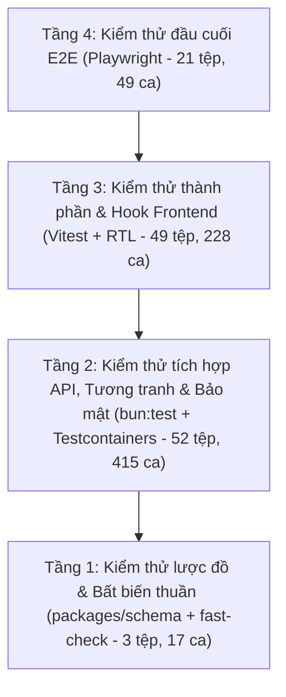

**Hình 2.1. Kim tự tháp kiểm thử tự động 4 tầng của hệ thống Rendez**

**2. Nguyên lý quan sát hệ thống (Observability)**

Thiết kế giám sát kết hợp ba chuẩn đo lường thực hành trong vận hành hệ thống phân tán [35]:

- **Mô hình RED** (Rate, Errors, Duration) đo tần suất yêu cầu, tỷ lệ mã lỗi 4xx/5xx và phân vị độ trễ p50/p95/p99 ở tầng API.
- **Mô hình USE** (Utilization, Saturation, Errors) theo dõi mức độ sử dụng và hàng chờ của các tài nguyên hữu hạn: kết nối `pg.Pool`, độ sâu 5 hàng đợi `pg-boss` và độ trễ vòng lặp sự kiện `eventLoopLagMs`.
- **Giám sát người dùng thực (RUM)** thu thập bộ chỉ số Core Web Vitals (`LCP`, `INP`, `CLS`) ở phân vị p75 trực tiếp từ trình duyệt để phát hiện suy giảm trải nghiệm giao diện mà log phía máy chủ không nhìn thấy.

---

# CHƯƠNG 3. PHÂN TÍCH VÀ THIẾT KẾ HỆ THỐNG

## 3.1. Yêu cầu chức năng

Bảng 3.1 liệt kê 24 yêu cầu chức năng của hệ thống, bao phủ đầy đủ nghiệp vụ người dùng cuối, bình chọn nhóm, định vị và vận hành quản trị.

**Bảng 3.1. Yêu cầu chức năng**

| Mã | Yêu cầu | Tác nhân | Ưu tiên |
|---|---|---|---|
| FR-01 | Đăng ký tài khoản bằng email và mật khẩu, xác thực email | Khách | Cao |
| FR-02 | Đăng nhập, đăng xuất, duy trì phiên | Khách, Thành viên | Cao |
| FR-03 | Khôi phục mật khẩu qua email | Khách | Cao |
| FR-04 | Xem và cập nhật hồ sơ, ảnh đại diện, ảnh bìa | Thành viên | Trung bình |
| FR-05 | Tìm kiếm địa điểm theo từ khoá, chấp nhận không dấu và lỗi gõ | Khách, Thành viên | Cao |
| FR-06 | Lọc địa điểm theo quận, hạng mục, khoảng giá, trạng thái mở cửa | Khách, Thành viên | Cao |
| FR-07 | Xem địa điểm trên bản đồ và danh sách đồng bộ | Khách, Thành viên | Trung bình |
| FR-08 | Xem chi tiết địa điểm: ảnh món, ảnh thực đơn, giờ mở cửa, liên hệ, đánh giá | Khách, Thành viên | Cao |
| FR-09 | Đăng bài kèm nhiều ảnh, gắn thẻ địa điểm | Thành viên | Cao |
| FR-10 | Tự phát hiện địa điểm trong bài và gắn thẻ | Hệ thống | Trung bình |
| FR-11 | Thích, lưu, bình luận bài viết; thích bình luận | Thành viên | Cao |
| FR-12 | Viết đánh giá 3 tầng kèm điểm số, món đề xuất và ảnh thực tế | Thành viên | Cao |
| FR-13 | Báo cáo địa điểm hoặc nội dung vi phạm | Thành viên | Trung bình |
| FR-14 | Tạo bộ sưu tập và sắp xếp địa điểm trong bộ sưu tập | Thành viên | Trung bình |
| FR-15 | Nhận thông báo khi có tương tác với nội dung của mình | Thành viên | Trung bình |
| FR-16 | Tạo phòng bình chọn nhóm, đề xuất bộ lọc và ứng viên địa điểm | Thành viên | Cao |
| FR-17 | Bình chọn theo nhiều chế độ (`multi_vote`, `ranked_irv`, `random_wheel`) và đồng bộ tức thời | Khách, Thành viên | Cao |
| FR-18 | Gợi ý địa điểm cá nhân hoá theo lịch sử tương tác | Thành viên | Cao |
| FR-19 | Gợi ý địa điểm theo nội dung đang soạn | Thành viên | Trung bình |
| FR-20 | Chia sẻ liên kết địa điểm hoặc bài viết có thẻ xem trước Open Graph | Khách, Thành viên | Thấp |
| FR-21 | Đóng góp và phân loại thư viện ảnh món ăn, thực đơn và không gian (`food`, `menu`, `space`, `exterior`) | Thành viên | Trung bình |
| FR-22 | Quản lý điểm neo vị trí cá nhân (nhà, công ty, trường học), mốc địa danh Đà Nẵng và đồng bộ GPS mã hóa | Thành viên | Trung bình |
| FR-23 | Quản trị kiểm duyệt báo cáo, địa điểm, tài khoản và tra cứu nhật ký kiểm toán theo phân quyền RBAC | Quản trị viên | Cao |
| FR-24 | Giám sát vận hành hệ thống: độ trễ RED, tài nguyên USE, cầu dao dịch vụ ngoài và Core Web Vitals | Quản trị viên | Cao |

## 3.2. Yêu cầu phi chức năng

Bảng 3.2 liệt kê các yêu cầu phi chức năng với chỉ tiêu đo được; ngưỡng thời gian phản hồi lấy theo giới hạn nhận thức người dùng [23].

**Bảng 3.2. Yêu cầu phi chức năng**

| Mã | Yêu cầu | Chỉ tiêu | Cách đo |
|---|---|---|---|
| NFR-01 | Thời gian phản hồi tìm kiếm | p95 ≤ 300 ms với corpus 358 địa điểm | Đo 20 lần gọi tuần tự |
| NFR-02 | Thời gian phản hồi danh sách | p95 ≤ 200 ms | Đo 20 lần gọi tuần tự |
| NFR-03 | Khả dụng dưới tải | 0% lỗi máy chủ ở 1.000 người dùng đồng thời | Kiểm thử tải tăng dần |
| NFR-04 | Độ trễ cập nhật bình chọn nhóm | ≤ 2 giây | Quan sát trên một tiến trình |
| NFR-05 | Xác thực cho thao tác ghi | 100% endpoint ghi | Kiểm tra cấu trúc route |
| NFR-06 | Không phát sinh truy vấn N+1 ở endpoint danh sách | Số truy vấn không tăng theo số bản ghi | Đếm truy vấn ở ba kích thước |
| NFR-07 | Chạy trên máy chủ 2 nhân | Toàn bộ thành phần trong 5 GB bộ nhớ | Thống kê container |
| NFR-08 | Chống tạo trùng khi mạng chập chờn | Không tạo bản ghi thứ hai cho cùng yêu cầu | Kiểm thử với khoá lũy đẳng |
| NFR-09 | Phủ kiểm thử tự động | Mỗi nhóm FR có ít nhất một ca kiểm thử | Đối chiếu ma trận |
| NFR-10 | Không lưu bí mật trong mã nguồn | Không có khoá bí mật trong repository | Rà soát kho mã |

## 3.3. Use case

Hệ thống có bốn tác nhân: Khách, Thành viên, Khách trong phòng và Hệ thống. Hình 3.1 mô tả các use case chính của bốn tác nhân.

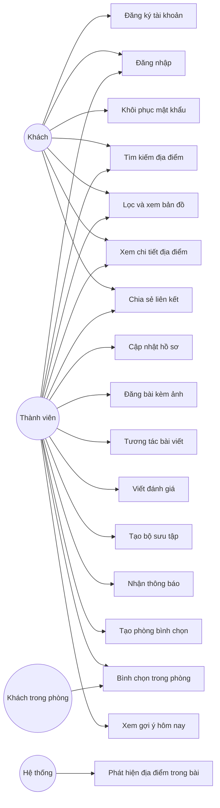

**Hình 3.1. Sơ đồ use case tổng thể**

Bảng 3.3 đặc tả gọn mười bảy use case: tác nhân, tiền điều kiện, luồng chính, hậu điều kiện. Bảng 3.4 đến Bảng 3.6 đặc tả chi tiết ba use case trọng yếu.

**Bảng 3.3. Đặc tả use case tổng hợp**

| Mã | Tên | Tác nhân | Tiền điều kiện | Luồng chính | Hậu điều kiện | FR |
|---|---|---|---|---|---|---|
| UC-01 | Đăng ký tài khoản | Khách | Email chưa dùng | Nhập email, mật khẩu → kiểm tra trùng → tạo tài khoản → gửi email xác thực | Tài khoản ở trạng thái chờ xác thực | FR-01 |
| UC-02 | Đăng nhập | Khách, Thành viên | Tài khoản tồn tại | Nhập thông tin → xác thực mật khẩu → tạo phiên → đặt cookie | Phiên hợp lệ trong 7 ngày | FR-02 |
| UC-03 | Khôi phục mật khẩu | Khách | Email đã đăng ký | Yêu cầu đặt lại → gửi liên kết có hạn → đặt mật khẩu mới | Mật khẩu cũ vô hiệu | FR-03 |
| UC-04 | Cập nhật hồ sơ | Thành viên | Đã đăng nhập | Sửa tên, tiểu sử, ảnh → tải ảnh qua URL có chữ ký → lưu | Hồ sơ cập nhật, ảnh hiển thị | FR-04 |
| UC-05 | Tìm kiếm địa điểm | Khách, Thành viên | Không có | Nhập từ khoá → chuẩn hoá không dấu → chạy bốn nhánh → hợp nhất xếp hạng | Danh sách sắp theo điểm tổng hợp | FR-05 |
| UC-06 | Lọc và xem bản đồ | Khách, Thành viên | Không có | Chọn quận, hạng mục, khoảng giá → tải danh sách và khung nhìn bản đồ | Danh sách và bản đồ đồng bộ | FR-06, FR-07 |
| UC-07 | Xem chi tiết địa điểm | Khách, Thành viên | Địa điểm tồn tại | Mở địa điểm → đọc ảnh, giờ mở cửa, liên hệ, đánh giá | Trang chi tiết hiển thị đủ trường | FR-08 |
| UC-08 | Đăng bài kèm ảnh | Thành viên | Phiên hợp lệ, chưa vượt giới hạn | Soạn nội dung → chọn địa điểm → tải ảnh → gửi kèm khoá lũy đẳng | Bài xuất hiện trong bảng tin | FR-09 |
| UC-09 | Tương tác bài viết | Thành viên | Bài tồn tại | Thích, lưu hoặc bình luận → cập nhật bộ đếm → tạo thông báo | Bộ đếm và thông báo cập nhật | FR-11 |
| UC-10 | Viết đánh giá | Thành viên | Chưa đánh giá địa điểm này | Chọn điểm 1–5 → nhập nội dung → gửi kèm ảnh | Đánh giá hiển thị, điểm Bayes tính lại | FR-12 |
| UC-11 | Tạo bộ sưu tập | Thành viên | Đã đăng nhập | Đặt tên → thêm địa điểm → sắp thứ tự | Bộ sưu tập lưu và chia sẻ được | FR-14 |
| UC-12 | Nhận thông báo | Thành viên | Có sự kiện tác động | Hệ thống tạo thông báo → máy khách tải danh sách → đánh dấu đã đọc | Thông báo ở trạng thái đã đọc | FR-15 |
| UC-13 | Tạo phòng bình chọn | Thành viên | Đã đăng nhập | Đặt tên phòng → hệ thống sinh mã 6 ký tự → chia sẻ mã | Phòng mở, chủ phòng có quyền chốt | FR-16 |
| UC-14 | Bình chọn trong phòng | Khách trong phòng, Thành viên | Biết mã phòng, phòng đang mở | Nhập mã → tham gia → đề xuất hoặc bỏ phiếu → nhận sự kiện | Số phiếu cập nhật tức thời | FR-17 |
| UC-15 | Xem gợi ý hôm nay | Thành viên | Có dữ liệu địa điểm | Hệ thống tính điểm DES → thêm nhiễu khung giờ → trả danh sách | Danh sách gợi ý theo ngữ cảnh | FR-18, FR-19 |
| UC-16 | Chia sẻ liên kết | Khách, Thành viên | Đối tượng công khai | Sao chép liên kết → máy chủ sinh thẻ Open Graph | Thẻ xem trước hiển thị khi chia sẻ | FR-20 |
| UC-17 | Phát hiện địa điểm trong bài | Hệ thống | Bài mới được tạo | Tác vụ nền đọc nội dung → đối sánh tên địa điểm → gắn thẻ | Bài được gắn thẻ nếu tìm thấy | FR-10 |

**Bảng 3.4. Đặc tả use case tìm kiếm địa điểm**

| Trường | Nội dung |
|---|---|
| Mã | UC-05 |
| Tác nhân | Khách, Thành viên |
| Tiền điều kiện | Không có |
| Luồng chính | (1) Người dùng nhập từ khoá. (2) Hệ thống chuẩn hoá truy vấn về dạng không dấu. (3) Hệ thống chạy bốn nhánh tín hiệu. (4) Hệ thống chọn trọng số theo bằng chứng định danh. (5) Hệ thống hợp nhất xếp hạng. (6) Hệ thống trả về danh sách địa điểm. |
| Luồng thay thế | (2a) Truy vấn rỗng: trả về danh sách theo bộ lọc. (3a) Nhánh ngữ nghĩa lỗi: bỏ nhánh này, dùng ba nhánh còn lại. (6a) Không có kết quả: trả danh sách rỗng kèm gợi ý gần đúng. |
| Hậu điều kiện | Danh sách địa điểm được sắp theo điểm tổng hợp. |

**Bảng 3.5. Đặc tả use case đăng bài**

| Trường | Nội dung |
|---|---|
| Mã | UC-08 |
| Tác nhân | Thành viên |
| Tiền điều kiện | Người dùng có phiên hợp lệ, chưa vượt giới hạn tần suất đăng bài |
| Luồng chính | (1) Người dùng soạn nội dung. (2) Hệ thống gợi ý địa điểm theo nội dung. (3) Người dùng chọn địa điểm và tải ảnh lên kho lưu trữ. (4) Người dùng bấm đăng. (5) Hệ thống kiểm tra khoá lũy đẳng. (6) Hệ thống ghi bài đăng. (7) Hệ thống đưa tác vụ phát hiện địa điểm vào hàng đợi. (8) Hệ thống trả về bài đăng. |
| Luồng thay thế | (3a) Không có ảnh: bỏ qua bước tải ảnh. (5a) Khoá đã hoàn tất: trả kết quả cũ. (5b) Khoá đang xử lý: trả lỗi xung đột. (7a) Đưa tác vụ thất bại: ghi log, tác vụ quét định kỳ xử lý sau. |
| Hậu điều kiện | Bài đăng xuất hiện trong bảng tin. Tác vụ nền gắn thẻ địa điểm nếu tìm thấy. |

**Bảng 3.6. Đặc tả use case bình chọn nhóm**

| Trường | Nội dung |
|---|---|
| Mã | UC-14 |
| Tác nhân | Khách trong phòng, Thành viên |
| Tiền điều kiện | Phòng tồn tại, đang hoạt động, người tham gia biết mã phòng |
| Luồng chính | (1) Người tham gia nhập mã phòng. (2) Hệ thống kiểm tra phòng và thêm người tham gia. (3) Hệ thống mở luồng sự kiện tới máy khách. (4) Người tham gia xem danh sách đề xuất. (5) Người tham gia đề xuất hoặc bỏ phiếu. (6) Hệ thống cập nhật số phiếu có kiểm tra phiên bản. (7) Hệ thống phát sự kiện cho mọi thành viên. (8) Chủ phòng chốt địa điểm cuối cùng. |
| Luồng thay thế | (2a) Mã phòng không tồn tại: trả không tìm thấy. (2b) Phòng đã chốt: trả trạng thái đã đóng. (5a) Bỏ phiếu cho đề xuất của chính mình: từ chối. (5b) Bỏ phiếu lại cùng đề xuất: từ chối. (6a) Xung đột phiên bản: thử lại tối đa ba lần. |
| Hậu điều kiện | Phòng chuyển sang trạng thái chỉ đọc. Địa điểm được chọn hiển thị cho mọi thành viên. |

## 3.4. Kiến trúc hệ thống

Hình 3.2 mô tả kiến trúc triển khai của hệ thống trên một máy chủ, bao gồm tầng biên Caddy, tầng dịch vụ Bun đa tiến trình tích hợp truy vấn lai Prisma 7 và Kysely, cụm lưu trữ PostgreSQL 17, Redis 7 và kho ảnh Cloudflare R2.

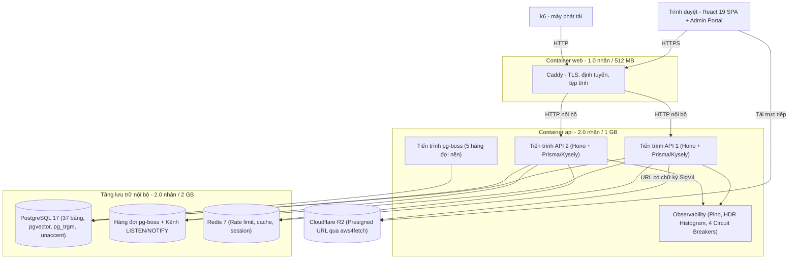

**Hình 3.2. Sơ đồ kiến trúc triển khai**

Hệ thống gồm năm thành phần chính phối hợp chặt chẽ. Container web chạy Caddy xử lý TLS và tệp tĩnh của cả trang công khai lẫn Cổng quản trị (`/admin`). Container api chạy nhiều tiến trình Bun cùng lắng nghe một cổng qua `reusePort`, kết hợp một tiến trình nền xử lý 5 hàng đợi `pg-boss` và mô-đun quan sát hiệu năng. Container PostgreSQL 17 lưu trữ toàn bộ 37 bảng dữ liệu, vector 384 chiều, bảng hàng đợi và kênh `LISTEN/NOTIFY`. Container Redis 7 phục vụ bộ đếm giới hạn tốc độ và bộ đệm chia sẻ giữa các tiến trình API. Kho lưu trữ ảnh Cloudflare R2 nằm ngoài máy chủ để tách băng thông tệp nhị phân khỏi tầng dịch vụ.

Ba điểm thiết kế chính:

- Tiến trình API chạy thành nhiều tiến trình con, số lượng bằng số nhân khả dụng. Mỗi tiến trình lắng nghe cùng một cổng qua chia sẻ cổng. Cách này tận dụng nhiều nhân bộ xử lý trong một container.
- Sự kiện thời gian thực được phát qua kênh thông báo nội bộ của PostgreSQL. Mỗi tiến trình đăng ký lắng nghe kênh của các phòng đang có kết nối mở trên nó. Cách này chuyển sự kiện giữa các tiến trình mà không thêm hạ tầng truyền thông điệp.
- Tác vụ nền được lưu trong bảng PostgreSQL qua pg-boss. Tiến trình cron chạy tách biệt để không chiếm bộ xử lý của tiến trình phục vụ yêu cầu.

## 3.5. Luồng tương tác

Hình 3.3 mô tả luồng tìm kiếm địa điểm.

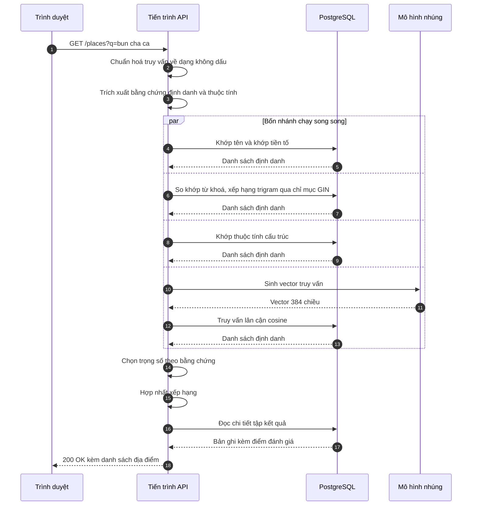

**Hình 3.3. Sequence diagram luồng tìm kiếm**

Hình 3.4 mô tả luồng đăng bài và xử lý tác vụ nền.

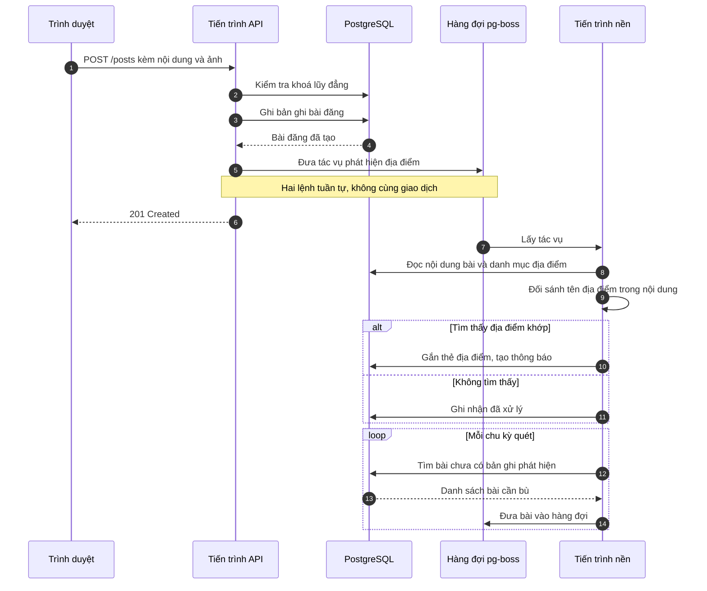

**Hình 3.4. Sequence diagram luồng tác vụ nền**

Hình 3.5 mô tả luồng bình chọn nhóm: tham gia phòng, đề xuất, áp dụng và phát sự kiện thời gian thực.

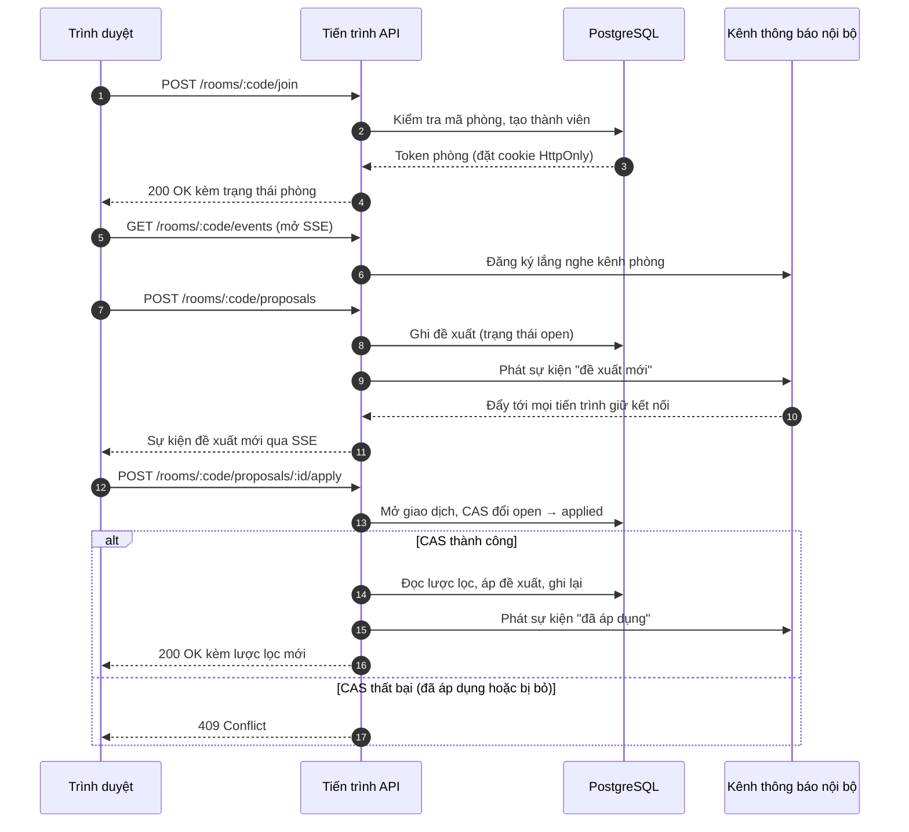

**Hình 3.5. Sequence diagram luồng bình chọn nhóm thời gian thực**

Hình 3.6 mô tả luồng tải ảnh qua URL có chữ ký: máy khách xin URL từ máy chủ, rồi tải tệp trực tiếp lên kho lưu trữ, không đi qua tầng dịch vụ.

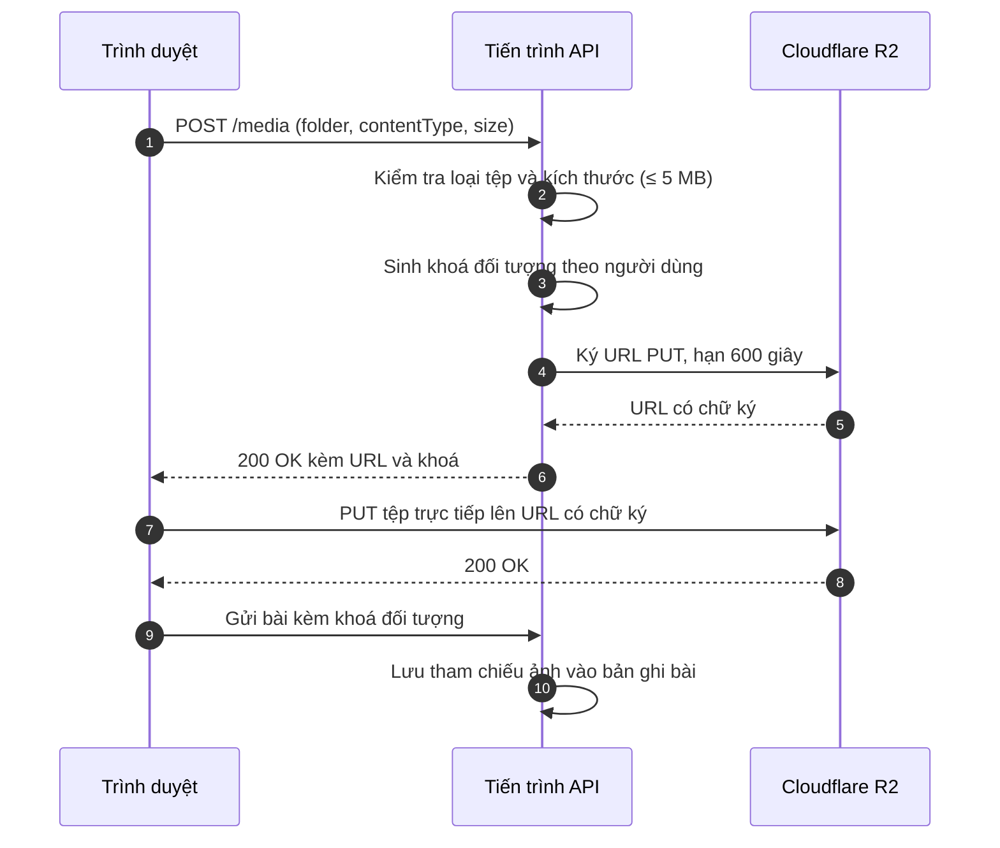

**Hình 3.6. Sequence diagram luồng tải ảnh qua URL có chữ ký**

Ngoài dòng xử lý, đề xuất trong phòng bình chọn còn có vòng đời riêng thể hiện qua các trạng thái. Hình 3.7 là state diagram của một đề xuất. Đề xuất được tạo ở trạng thái mở. Chủ phòng hoặc tác giả có thể áp đề xuất vào bộ lọc phòng, hoặc bỏ đề xuất. Cả hai chuyển trạng thái đều dùng so sánh và đổi có điều kiện trên trạng thái mở, nên hai người áp cùng lúc chỉ một người thành công, người kia nhận xung đột. Sau khi sang trạng thái đã áp dụng hoặc đã bỏ, đề xuất không còn nhận thao tác nào.

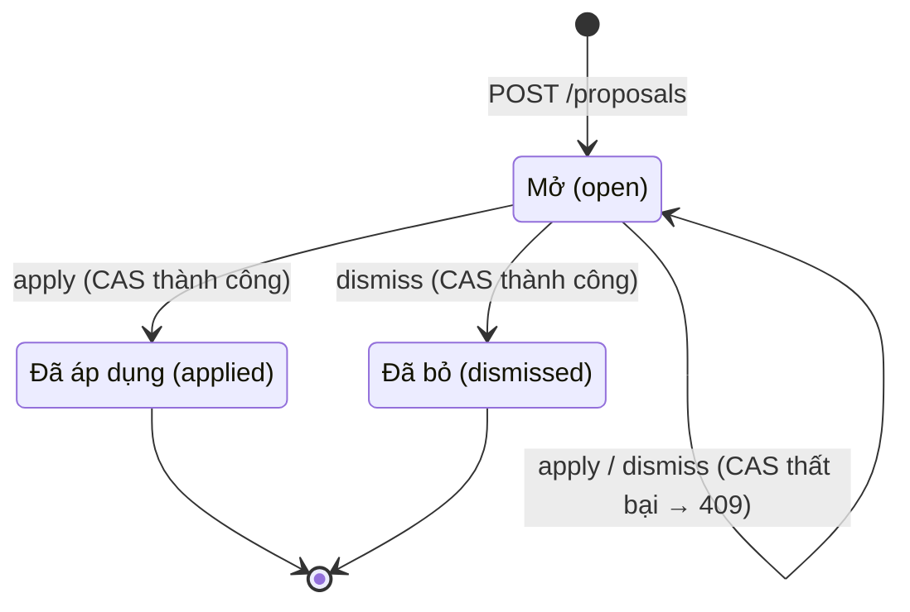

**Hình 3.7. State diagram vòng đời một đề xuất trong phòng bình chọn**

Hình 3.8 trình bày activity diagram của luồng tìm kiếm địa điểm. Sơ đồ thể hiện nhánh rẽ quyết định giữa tìm kiếm lai ghép EGRF và phân trang thông thường, cùng hai nhánh phụ là gợi ý "Ý bạn là" khi không có kết quả và ghi nhận sự kiện tìm kiếm.

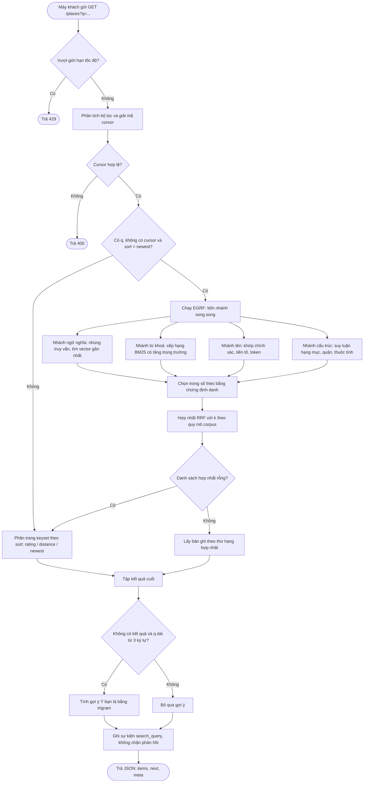

**Hình 3.8. Activity diagram luồng tìm kiếm địa điểm**

Hình 3.9 trình bày activity diagram của luồng đăng bài và phát hiện địa điểm. Sơ đồ tách hai pha: pha xử lý yêu cầu đồng bộ tạo bài và ảnh trong một giao dịch, và pha xử lý nền phát hiện địa điểm cho bài chưa gắn thẻ.

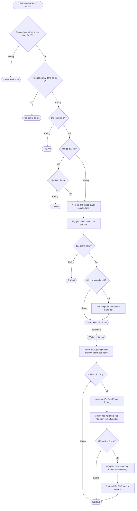

**Hình 3.9. Activity diagram luồng đăng bài và phát hiện địa điểm**

## 3.6. Thiết kế thuật toán

### 3.6.1. Thuật toán tìm kiếm EGRF

Hệ thống chạy bốn nhánh tín hiệu song song. Nhánh khớp tên nhận diện tên riêng qua ba mức: khớp chính xác, khớp tiền tố và khớp từng token. Nhánh từ khoá so khớp các token của truy vấn trong trường văn bản tổng hợp (tên, địa chỉ, quận, thẻ) sau khi chuẩn hoá về dạng không dấu, và xếp hạng kết quả bằng độ tương đồng trigram, tăng trọng cho trường tên. Nhánh khớp cấu trúc trích xuất hạng mục, quận, khoảng giá, trạng thái mở cửa từ truy vấn. Nhánh ngữ nghĩa dùng khoảng cách cosine trên vector 384 chiều.

Bốn danh sách xếp hạng được hợp nhất theo công thức hợp nhất xếp hạng nghịch đảo [12]:

$$S(d) = \sum_{r \in R} \frac{w_r}{k + \mathrm{rank}_r(d)}$$

trong đó $R$ là tập bốn nhánh, $\mathrm{rank}_r(d)$ là thứ hạng của địa điểm $d$ trong nhánh $r$, $w_r$ là trọng số nhánh, $k$ là hằng số làm mịn. Hằng số $k$ được tính theo quy mô corpus:

$$k(N) = \max\left(10,\ \left\lfloor 2\sqrt{N} \right\rfloor\right)$$

Với $N = 358$, giá trị $k$ xấp xỉ 37.

Trọng số $w_r$ không cố định mà chọn theo bằng chứng định danh trong truy vấn. Bảng 3.7 ghi bốn bộ trọng số.

**Bảng 3.7. Trọng số gate của thuật toán EGRF**

| Điều kiện bằng chứng | Nhánh tên | Nhánh cấu trúc | Nhánh ngữ nghĩa | Nhánh từ khoá |
|---|---|---|---|---|
| Có khớp tên chính xác | 5,0 | 0 | 0 | 1,0 |
| Có khớp tiền tố hoặc token tên | 3,0 | 0 | 0 | 1,0 |
| Có thuộc tính cấu trúc, không có tên | 0 | 3,0 | 1,0 | 1,0 |
| Truy vấn trừu tượng | 0 | 1,0 | 2,5 | 1,0 |

Nhánh tên gộp ba mức khớp chính xác, tiền tố và token; khi có nhiều mức khớp cùng lúc, mức mạnh hơn (chính xác trước, tiền tố sau, token sau) quyết định trọng số. Nhánh từ khoá luôn giữ trọng số 1,0 vì đóng vai trò nền cho mọi truy vấn.

### 3.6.2. Thuật toán gợi ý DES

Điểm của một địa điểm được tính theo trung bình Bayes có điều chỉnh:

$$\hat{R}(i) = \frac{v_i \cdot \bar{r}_i + m_i \cdot \mu_0}{v_i + m_i}$$

trong đó $\bar{r}_i$ là điểm đánh giá trung bình của địa điểm $i$, $v_i$ là số lượt đánh giá, $\mu_0$ là điểm trung bình tiên nghiệm, $m_i$ là khối lượng tiên nghiệm. Giá trị $m_i$ phụ thuộc độ hoàn thiện thông tin $C_i \in [0,1]$:

$$m_i = m_0 \cdot \left(1 + \gamma \cdot C_i\right)$$

với $m_0 = 10$, $\gamma = 0.5$, $\mu_0 = 4.0$. Độ hoàn thiện thông tin $C_i$ tính từ bốn yếu tố: địa điểm có ảnh thật, có giờ mở cửa, có số điện thoại, có mô tả.

Sau khi tính điểm, hệ thống thêm nhiễu có biên độ 0,05 với hạt giống sinh lại mỗi 6 giờ. Nhiễu xác định theo định danh địa điểm và chỉ số khung giờ, nên ổn định trong một khung giờ. Nhiễu phá thế hoà giữa các địa điểm có điểm gần bằng nhau. Cơ chế cold-start dùng khối lượng tiên nghiệm $m_i$ làm trọng số co điểm về giá trị trung bình [19].

Với người dùng đã có lịch sử, điểm cuối là tổng có trọng số của điểm nội dung và điểm sở thích. Điểm sở thích tính từ bảng sự kiện tương tác theo phương pháp lọc cộng tác dựa trên vật phẩm [14]. Mỗi loại sự kiện có một trọng số: xem, thích, lưu, đánh giá. Điểm tổng hợp trên các địa điểm cùng hạng mục hoặc cùng quận, có suy giảm theo thời gian. Trọng số pha giữa hai thành phần tăng theo số sự kiện quan sát được của người dùng.

## 3.7. Thiết kế dữ liệu

Lược đồ dữ liệu gồm 37 bảng (14 enum), đạt chuẩn hóa 3NF. Bảng 3.8 nhóm toàn bộ 37 bảng theo chín miền nghiệp vụ.

**Bảng 3.8. Mô tả các nhóm bảng dữ liệu (37 bảng)**

| Miền | Số bảng | Nội dung |
|---|---|---|
| Tài khoản và phiên | 4 | `users`, `sessions`, `accounts`, `verifications` |
| Quan hệ xã hội | 1 | `follows` (theo dõi giữa người dùng) |
| Địa điểm và đánh giá | 10 | `places`, `place_images` (phân loại `food`/`menu`/`space`/`exterior`), `tags`, `place_tags`, `sources`, `place_sources`, `reviews` (3 tầng + `recommended_dishes`), `place_reports`, `place_embeddings`, `daily_picks` |
| Nội dung và tương tác | 7 | `posts`, `post_images`, `post_likes`, `post_saves`, `comments`, `comment_likes`, `interaction_events` (phân vùng theo tháng) |
| Bộ sưu tập | 3 | `collections`, `collection_places`, `collection_likes` |
| Phòng bình chọn (F-040) | 5 | `rooms`, `room_members`, `room_proposals`, `room_candidates`, `room_votes` |
| Thông báo | 2 | `notifications`, `place_suggestion_notifications` |
| Định vị và địa danh | 2 | `user_location_anchors`, `city_landmarks` |
| Hạ tầng và kiểm toán | 3 | `idempotency_keys`, `affinity_cache`, `audit_logs` |

Hình 3.10 mô tả các lớp miền chính của hệ thống, gồm thuộc tính và hành vi. Thuộc tính lấy từ lược đồ dữ liệu; hành vi ánh xạ từ các hàm xử lý thật trong mã nguồn. Hai lớp dịch vụ `SearchService` và `RecommendationService` gói hai thuật toán EGRF và DES.

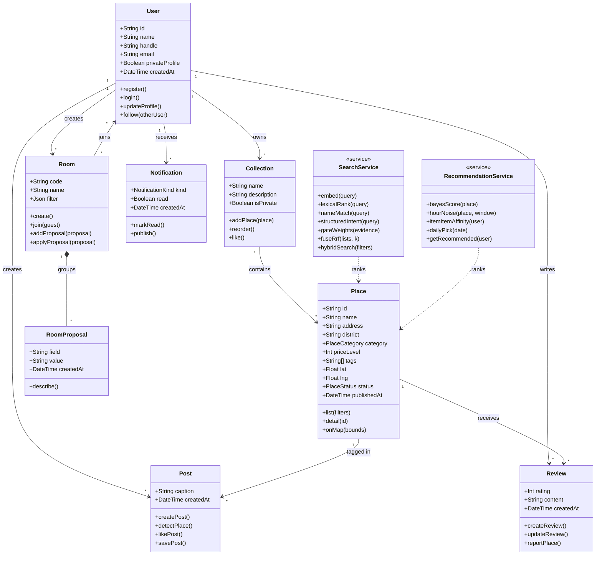

**Hình 3.10. Sơ đồ lớp các lớp miền nghiệp vụ chính**

Hình 3.11 mô tả quan hệ giữa các bảng, chia theo tám miền nghiệp vụ. Sơ đồ gộp các bảng cùng miền để giữ kích thước đọc được; tên bảng dùng dạng tiếng Việt không dấu.

```mermaid
erDiagram
    NGUOI_DUNG ||--o{ PHIEN : "mở"
    NGUOI_DUNG ||--o{ TAI_KHOAN : "liên kết"
    NGUOI_DUNG ||--o{ THEO_DOI : "theo dõi"
    NGUOI_DUNG ||--o{ BAI_DANG : "tạo"
    NGUOI_DUNG ||--o{ BINH_LUAN : "viết"
    NGUOI_DUNG ||--o{ DANH_GIA : "viết"
    NGUOI_DUNG ||--o{ BAO_CAO : "gửi"
    NGUOI_DUNG ||--o{ BO_SUU_TAP : "tạo"
    NGUOI_DUNG ||--o{ THONG_BAO : "nhận"
    NGUOI_DUNG ||--o{ THANH_VIEN_PHONG : "tham gia"
    NGUOI_DUNG ||--o{ SU_KIEN_TUONG_TAC : "phát sinh"
    NGUOI_DUNG ||--o{ KHOA_LUY_DANG : "sở hữu"

    DIA_DIEM ||--o{ ANH_DIA_DIEM : "có"
    DIA_DIEM ||--o{ DANH_GIA : "được đánh giá"
    DIA_DIEM ||--o{ BAO_CAO : "bị báo cáo"
    DIA_DIEM ||--o{ VECTOR_DIA_DIEM : "có vector"
    DIA_DIEM ||--o{ GOI_Y_HANG_NGAY : "xuất hiện"
    DIA_DIEM ||--o{ BAI_DANG : "được gắn thẻ"
    DIA_DIEM ||--o{ DE_XUAT_TRONG_PHONG : "được đề xuất"
    DIA_DIEM ||--o{ DIA_DIEM_TRONG_BO_SUU_TAP : "nằm trong"

    BAI_DANG ||--o{ ANH_BAI_DANG : "có"
    BAI_DANG ||--o{ BINH_LUAN : "chứa"
    BAI_DANG ||--o{ LUOT_THICH_BAI : "nhận"
    BAI_DANG ||--o{ LUOT_LUU_BAI : "nhận"
    BINH_LUAN ||--o{ LUOT_THICH_BINH_LUAN : "nhận"

    BO_SUU_TAP ||--o{ DIA_DIEM_TRONG_BO_SUU_TAP : "chứa"
    BO_SUU_TAP ||--o{ LUOT_THICH_BO_SUU_TAP : "nhận"

    PHONG ||--o{ THANH_VIEN_PHONG : "có"
    PHONG ||--o{ DE_XUAT_TRONG_PHONG : "có"

    THONG_BAO ||--o| THONG_BAO_GOI_Y : "chi tiết"

    NGUOI_DUNG {
        uuid id PK
        text email UK
        text handle UK
        text ten_hien_thi
        bool rieng_tu
        timestamptz tao_luc
    }
    DIA_DIEM {
        text id PK
        text ten
        text ten_khong_dau
        text hang_muc
        text quan
        numeric vi_do
        numeric kinh_do
        smallint muc_gia
        timestamptz cong_bo_luc
    }
    BAI_DANG {
        uuid id PK
        uuid tac_gia_id FK
        text dia_diem_id FK
        text noi_dung
        timestamptz tao_luc
    }
    PHONG {
        uuid id PK
        text ma UK
        uuid chu_phong_id FK
        json luoc_loc
        timestamptz tao_luc
    }
    DE_XUAT_TRONG_PHONG {
        uuid id PK
        uuid phong_id FK
        uuid thanh_vien_id FK
        text loai
        text gia_tri
        text trang_thai
        timestamptz tao_luc
    }
    DANH_GIA {
        uuid id PK
        uuid tac_gia_id FK
        text dia_diem_id FK
        smallint diem
        text noi_dung
    }
    BO_SUU_TAP {
        uuid id PK
        uuid chu_so_huu_id FK
        text ten
    }
    THONG_BAO {
        uuid id PK
        uuid nguoi_nhan_id FK
        text loai
        json du_lieu
        timestamptz doc_luc
    }
    SU_KIEN_TUONG_TAC {
        uuid id PK
        uuid nguoi_dung_id FK
        text dia_diem_id FK
        text loai
        timestamptz tao_luc
    }
```

**Hình 3.11. Sơ đồ thực thể liên kết (theo miền, 37 bảng)**

Hai sơ đồ dưới đây tách riêng miền tài khoản, định vị, kiểm toán và miền phòng bình chọn nhóm (F-040) để thấy rõ khoá và quan hệ.

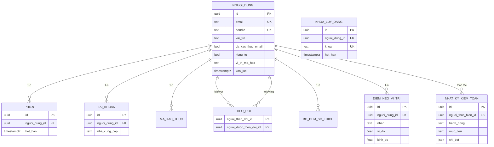

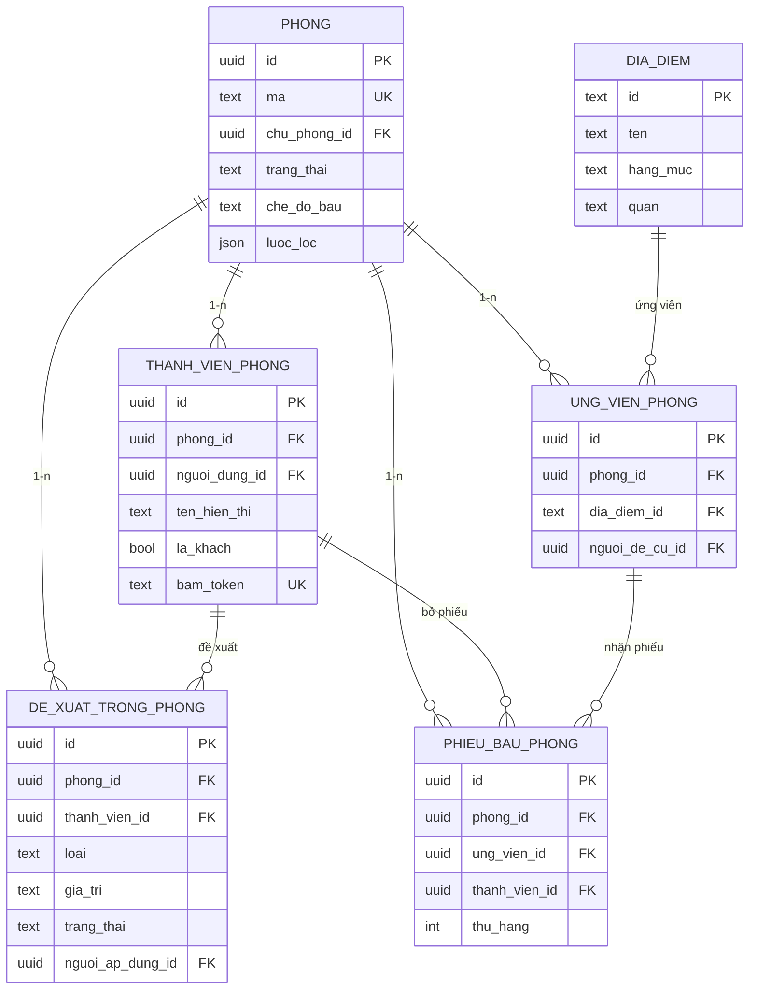

Bảng 3.9 mô tả cấu trúc bảng địa điểm, bảng trung tâm của hệ thống.

**Bảng 3.9. Mô tả cấu trúc bảng địa điểm**

| Trường | Kiểu | Ràng buộc | Mô tả |
|---|---|---|---|
| id | text | Khoá chính | Định danh sinh từ tên và địa chỉ |
| ten | text | Bắt buộc | Tên địa điểm có dấu |
| ten_khong_dau | text | Bắt buộc, chỉ mục GIN | Tên đã bỏ dấu, chuẩn hoá chữ thường |
| hang_muc | text | Bắt buộc | Một trong 6 hạng mục |
| quan | text | Bắt buộc | Một trong 6 quận nội thành |
| vi_do | numeric | | Vĩ độ |
| kinh_do | numeric | | Kinh độ |
| muc_gia | smallint | Kiểm tra khoảng 1–4 | Mức giá |
| gio_mo_cua | text | | Giờ mở cửa dạng chuỗi |
| cong_bo_luc | timestamptz | | Thời điểm công bố |
| xoa_luc | timestamptz | | Thời điểm xoá mềm |

Bảng vector địa điểm lưu trường 384 chiều và một giá trị băm nội dung để biết khi nào phải tính lại vector. Bảng sự kiện tương tác được phân vùng theo tháng, kèm một phân vùng mặc định để không mất sự kiện ngoài khoảng khai báo.

Lược đồ dữ liệu đi qua 26 migration có phiên bản, mỗi migration phục vụ một thay đổi rõ ràng. Migration `search_rec_foundation` tạo bảng `place_embeddings` kiểu `vector(384)` cho nhánh ngữ nghĩa của EGRF và bảng `interaction_events` phân vùng theo tháng làm nguồn học cho DES. Migration `affinity_cache` tạo bảng đệm sở thích theo hạng mục và quận. Các migration gần nhất mở rộng lược đồ cho đánh giá 3 tầng (F-002), thư viện ảnh món và thực đơn (F-079), bỏ phiếu đa chế độ trong phòng nhóm (F-040), điểm neo vị trí (`user_location_anchors`, `city_landmarks`) và nhật ký kiểm toán quản trị (`audit_logs`). Ở tầng mã nguồn, hệ thống kết hợp Prisma 7 với Kysely (`selectPlacesQuery` dùng `leftJoinLateral`), giảm số truy vấn SQL thuần từ 77 câu (34 tệp) xuống còn 33 câu (17 tệp) dành riêng cho cú pháp đặc thù PostgreSQL (`FOR UPDATE`, `pgvector`, `pg_trgm`, `generate_series`, `pg_stat_statements`).

## 3.8. Thiết kế giao diện

Giao diện gồm tám phân khu chính: khám phá và tìm kiếm, chi tiết địa điểm (kèm thư viện ảnh món/thực đơn và đánh giá 3 tầng), bảng tin cộng đồng, soạn bài, hồ sơ cá nhân, bộ sưu tập, phòng bình chọn nhóm và Cổng quản trị độc lập (`/admin`).

Màn hình khám phá tích hợp thanh tìm kiếm, bộ chuyển điểm neo vị trí, bộ lọc đồng bộ qua URL (`nuqs`) và hai vùng hiển thị danh sách cùng bản đồ chia sẻ chung nguồn dữ liệu. Khi bộ lọc không khớp địa điểm nào, giao diện giữ nguyên thanh công cụ và chỉ hiển thị trạng thái rỗng ở vùng kết quả để người dùng điều chỉnh điều kiện mà không bị mất thao tác. Trạng thái tải dữ liệu giữ lại kết quả trước đó (`keepPreviousData`) trong lúc truy vấn mới đang chạy, tránh giật bố cục và cuộn trang ngoài ý muốn.

Trình tải ảnh dùng `react-dropzone` kết hợp URL có chữ ký từ R2 và hiển thị tiến trình tải trực tiếp. Cổng quản trị (`/admin`) dùng bố cục thanh bên tách riêng với 6 mục (Tổng quan, Báo cáo, Địa điểm, Người dùng, Hiệu suất và Quan sát, Nhật ký kiểm toán), phân biệt rõ môi trường phát triển (`DEV · SANDBOX`) với môi trường vận hành thật.

Hình 3.12 mô tả điều hướng giữa các màn hình chính. Nhóm công khai gồm khám phá, bản đồ và chi tiết địa điểm; nhóm yêu cầu phiên gồm bảng tin, hồ sơ, bộ sưu tập, thông báo và phòng bình chọn; nhóm quản trị yêu cầu vai trò `admin` hoặc `moderator`.

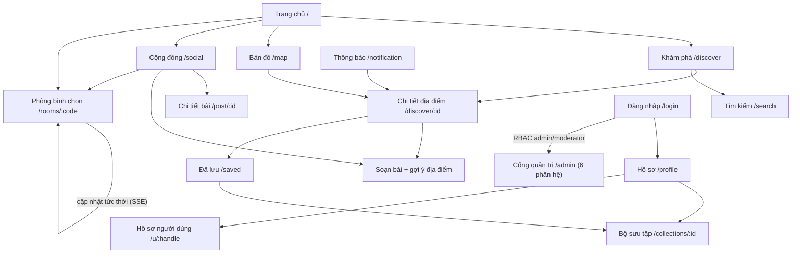

**Hình 3.12. Sơ đồ điều hướng các màn hình chính**

## 3.9. Thiết kế bảo mật

Bảng 3.10 liệt kê mười lớp tấn công và cơ chế phòng thủ tương ứng đã triển khai trong hệ thống [21], [22]. Dữ liệu vào được kiểm tra kiểu và ràng buộc qua gói lược đồ `@rendez/schema` trước khi chạm tầng dữ liệu [6].

**Bảng 3.10. Thiết kế bảo mật theo lớp tấn công**

| Lớp tấn công | Cơ chế phòng thủ | Tham số và bằng chứng kiểm soát |
|---|---|---|
| Chiếm đoạt phiên | Cookie `HttpOnly`, `Secure`, `SameSite=Lax`; phiên lưu phía máy chủ | Hạn phiên 7 ngày |
| Giả mạo yêu cầu chéo trang (CSRF) | Kiểm tra `SameSite` kết hợp xác minh tiêu đề `Origin` ở endpoint ghi | Từ chối khi `Origin` không nằm trong danh sách cho phép |
| Tiêm mã SQL | Prisma + Kysely tham số hoá 100%; 33 truy vấn SQL đặc thù dùng biến buộc (`Prisma.sql`) | Không nối chuỗi vào câu lệnh SQL |
| Truy cập trái phép đối tượng (IDOR) | Kiểm tra chủ sở hữu (`userId`) trên từng bản ghi tài nguyên riêng tư và điểm neo vị trí | Trả mã 403/404; có bộ test IDOR tự động |
| Leo thang đặc quyền quản trị | Middleware phân quyền `requireRole("admin")` và `requireRole("admin", "moderator")` | Mọi thao tác ghi đều sinh bản ghi `AuditLog` |
| Giả mạo yêu cầu phía máy chủ (SSRF) | Lọc dải IP nội bộ IPv4/IPv6 bằng `node:net` (`BlockList`) và danh sách miền được phép cho proxy bản đồ | Chặn toàn bộ loopback, RFC1918, link-local |
| Dò mật khẩu và lạm dụng endpoint | Bộ đếm giới hạn tốc độ trên Redis 7 theo địa chỉ IP và định danh | Ngưỡng riêng từng nhóm endpoint (ví dụ 30 yêu cầu/60 giây) |
| Lộ dữ liệu vị trí và thông tin cá nhân | Mã hóa GPS bằng AES-256-GCM gắn AAD theo `userId`; che PII bằng `maskdata` trong log | IV ngẫu nhiên 12 byte; từ chối giải mã nếu tráo đổi bản mã |
| Lộ bí mật trong mã nguồn | Đọc toàn bộ bí mật từ biến môi trường (`env.ts`) | Từ chối khởi động khi thiếu biến bắt buộc |
| Đoán mã phòng và tranh chấp bỏ phiếu | Mã 6 ký tự trên bảng chữ 30 ký tự ($7{,}3 \times 10^8$ tổ hợp); khóa giao dịch `SELECT ... FOR UPDATE` | Chặn phiếu bầu sau thời điểm chốt phòng (TOCTOU) |

## 3.10. Thiết kế các phân hệ mở rộng và quan sát vận hành

### 3.10.1. Máy trạng thái phòng bình chọn nhóm đa chế độ (F-040)

Bên cạnh luồng đề xuất bộ lọc (Hình 3.7), phòng bình chọn hỗ trợ danh sách ứng viên địa điểm và ba chế độ chốt kết quả: chọn nhiều phương án (`multi_vote`), xếp hạng ưu tiên loại trừ dần (`ranked_irv` tính bằng thư viện `votes`), và vòng quay ngẫu nhiên từ máy chủ (`random_wheel`). Hình 3.13 mô tả vòng đời trạng thái của một phòng bình chọn.

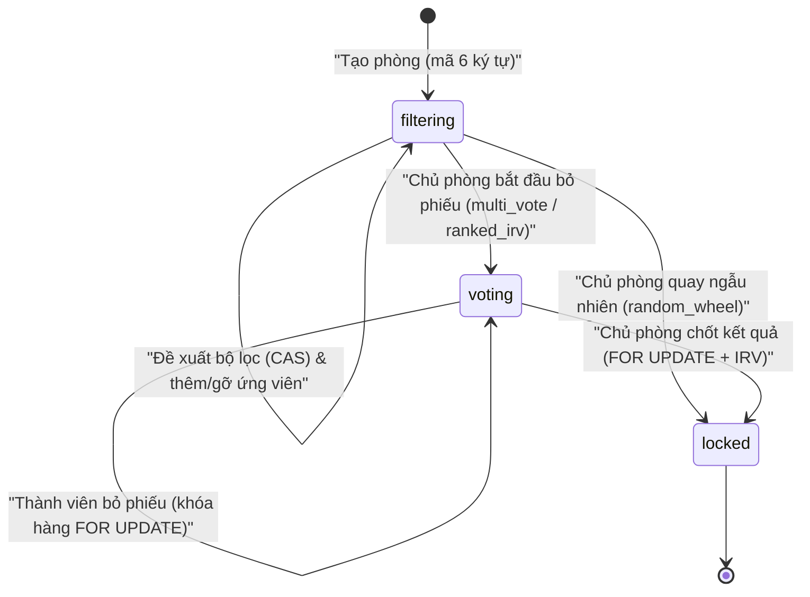

**Hình 3.13. Sơ đồ trạng thái vòng đời phòng bình chọn nhóm (F-040)**

### 3.10.2. Luồng ưu tiên định vị 6 tầng và đồng bộ GPS mã hóa

Để gợi ý khoảng cách chính xác kể cả khi trình duyệt không cấp quyền GPS hoặc người dùng đang ở ngoài khu vực cần tìm, ứng dụng xác định tâm tìm kiếm theo chuỗi ưu tiên 6 tầng. Khi người dùng bật đồng bộ GPS liên thiết bị, tọa độ được mã hóa AES-256-GCM kèm AAD gắn mã người dùng trước khi lưu xuống PostgreSQL. Hình 3.14 minh họa luồng xử lý này.

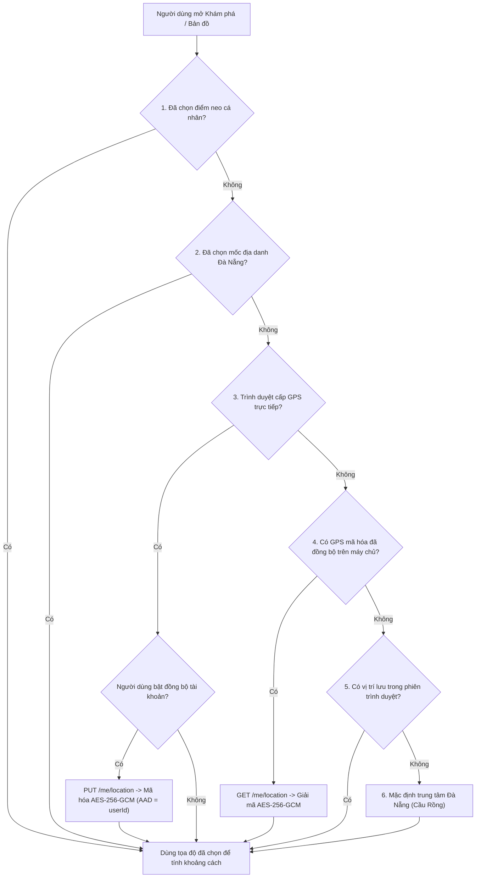

**Hình 3.14. Luồng ưu tiên 6 tầng định vị và đồng bộ GPS mã hóa AES-256-GCM**

### 3.10.3. Kiến trúc quan sát vận hành và cảnh báo

Hệ thống quan sát thu thập đồng thời tín hiệu phía máy chủ (RED, USE, trạng thái cầu dao, an ninh, tỷ lệ tìm kiếm rỗng) và phía trình duyệt (Core Web Vitals p75), chuẩn hóa qua endpoint `/api/v1/admin/observability` để hiển thị tập trung trên Cổng quản trị. Hình 3.15 trình bày luồng thu thập và cảnh báo này.

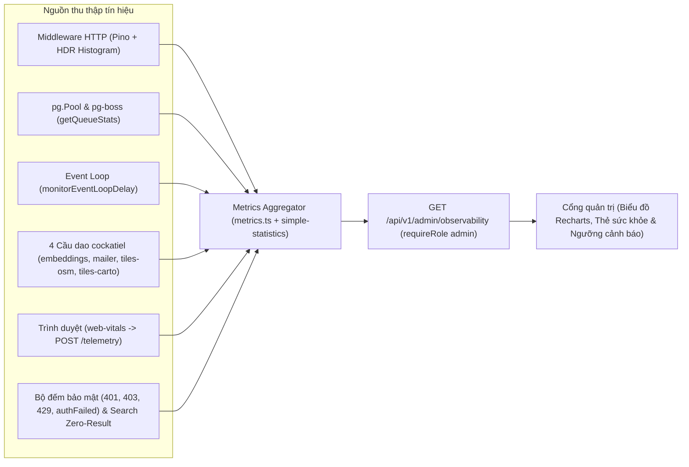

**Hình 3.15. Kiến trúc quan sát vận hành (Observability) và cảnh báo hệ thống**

---

# CHƯƠNG 4. CÀI ĐẶT VÀ THỬ NGHIỆM

## 4.1. Môi trường cài đặt và đo lường

Bảng 4.1 mô tả môi trường cài đặt và đo lường của hệ thống.

**Bảng 4.1. Môi trường cài đặt và đo lường**

| Thành phần | Công nghệ | Phiên bản | Giới hạn tài nguyên |
|---|---|---|---|
| Máy chủ vật lý | x86_64 | Không áp dụng | 8 nhân, 32 GB RAM |
| Hệ điều hành | Linux | Kernel 6.x | Không giới hạn riêng |
| Runtime backend | Bun | 1.3.14 | 2,0 nhân / 1 GB (container api) |
| Framework và truy vấn | Hono / Prisma / Kysely | 4.13.17 / 7.10.1 / 0.29.9 | Chạy trong container api |
| Giao diện web | React / Vite / Tailwind CSS | 19.3.1 / 8.3.6 / 4.3.5 | Đóng gói tĩnh phục vụ qua Caddy |
| Cơ sở dữ liệu | PostgreSQL (`pgvector`) | 17 | 2,0 nhân / 2 GB (container postgres) |
| Bộ đệm và giới hạn tốc độ | Redis | 7-alpine | Chia sẻ trong mạng nội bộ |
| Reverse proxy | Caddy | 2.x | 1,0 nhân / 512 MB (container web) |
| Đóng gói | Docker Compose | v2 | Tổng giới hạn cụm 5 nhân / 3,5 GB |
| Kiểm thử tải | k6 | 0.5x | Chạy trên máy vật lý |

Các container được giới hạn cứng tổng cộng 5 nhân và 3,5 GB, phần còn lại của máy vật lý không cấp cho hệ thống. Công cụ sinh tải k6 chạy trên cùng máy vật lý, không chạy trên máy riêng.

### 4.1.1. Hướng dẫn cài đặt và chạy hệ thống

Dự án chạy được theo hai chế độ: phát triển trên máy cục bộ và triển khai đầy đủ bằng Docker Compose.

**Chuẩn bị.** Máy cần có Bun (phiên bản 1.3.14 trở lên) và Docker. Hai biến môi trường bắt buộc là `DATABASE_URL` trỏ tới PostgreSQL và `BETTER_AUTH_SECRET` dài tối thiểu 32 ký tự. Các biến còn lại (kho lưu trữ R2, SMTP gửi thư, khóa mã hóa vị trí) có cấu hình mặc định cho môi trường phát triển cục bộ.

**Chạy ở chế độ phát triển.** Các lệnh sau khởi tạo cơ sở dữ liệu, nạp dữ liệu mẫu rồi chạy hai phía:

```bash
bun install                      # Cài phụ thuộc cho cả monorepo
bun run db:up                    # Khởi động PostgreSQL (image pgvector) và Redis 7
cd backend && cp .env.example .env   # Tạo tệp môi trường nếu chưa có
bun run db:migrate               # Chạy 26 migration có phiên bản
bun run db:generate              # Sinh kiểu dữ liệu Prisma và Kysely
bun run db:seed                  # Nạp 358 địa điểm mẫu và mốc địa danh Đà Nẵng
bun run dev:api                  # Chạy API ở cổng cấu hình
bun run dev                      # Ở cửa sổ khác, chạy giao diện React
```

Lệnh `db:seed` có tính chất lũy đẳng: ưu tiên nạp tệp `backend/data/places-expanded.json` gồm 358 địa điểm đã làm giàu thông tin; nếu tệp không có thì dùng tệp dự phòng 491 địa điểm gốc. Chạy lại seed không tạo bản ghi trùng.

**Chạy ở chế độ triển khai đầy đủ.** Một lệnh khởi động các dịch vụ:

```bash
docker compose up -d --build     # postgres + redis + migrate + api + web
```

Compose khởi động PostgreSQL và Redis trước, chờ qua healthcheck, chạy migration một lần rồi thoát, sau đó API mới khởi động. Caddy phục vụ giao diện tĩnh và làm reverse proxy cho API.

**Dữ liệu mẫu.** Bộ dữ liệu 358 địa điểm lấy từ OpenStreetMap [20], đã làm giàu ảnh, giờ mở cửa và số điện thoại. Dữ liệu tương tác (bài đăng, đánh giá, bộ sưu tập) để rỗng sau seed, vì các số liệu trong báo cáo đo trên dữ liệu thật sinh ra khi chạy, không phải dữ liệu mẫu cài sẵn.

## 4.2. Các module đã cài đặt

Bảng 4.2 liệt kê 16 module đã cài đặt cùng phạm vi chức năng tương ứng.

**Bảng 4.2. Danh mục module đã cài đặt**

| Module | Chức năng |
|---|---|
| Xác thực và phiên | Đăng ký, đăng nhập, khôi phục mật khẩu, quản lý phiên (`Better Auth`) |
| Địa điểm và ảnh món/thực đơn | Danh sách, bản đồ, chi tiết, truy vấn Kysely `selectPlacesQuery`, thư viện ảnh phân loại (F-079) |
| Tìm kiếm lai ghép (EGRF) | Bốn nhánh tín hiệu, hợp nhất xếp hạng có kiểm soát bằng chứng, gợi ý sửa lỗi |
| Gợi ý cá nhân hóa (DES) | Tính điểm Bayes điều chỉnh độ đầy đủ hồ sơ, nhiễu khung giờ, bộ đệm sở thích |
| Bài đăng | Tạo, đọc, xoá, tương tác (thích, lưu, bình luận), phát hiện địa điểm nền |
| Đánh giá 3 tầng (F-002) | Tạo, sửa, xoá đánh giá kèm món đề xuất (`recommended_dishes`), báo cáo vi phạm |
| Bộ sưu tập | Tạo, sửa, thêm bớt, sắp thứ tự địa điểm, thích bộ sưu tập |
| Phòng bình chọn nhóm (F-040) | Tạo phòng, đề xuất bộ lọc (CAS), ứng viên, bỏ phiếu 3 chế độ (`multi_vote`, `ranked_irv`, `random_wheel`), khóa hàng `FOR UPDATE`, SSE |
| Điểm neo vị trí và GPS mã hóa | Quản lý điểm neo cá nhân, mốc địa danh Đà Nẵng, geocoding, đồng bộ GPS mã hóa AES-256-GCM |
| Thông báo | Tạo, đọc, đánh dấu đã đọc, luồng sự kiện thông báo |
| Phương tiện và Proxy bản đồ | Ký URL R2 bằng `aws4fetch`, tải lên cục bộ, proxy map tile bảo vệ chống SSRF (`net.BlockList`) và 2 cầu dao `cockatiel` |
| Tác vụ nền (`pg-boss`) | 5 hàng đợi: `place-detect`, `daily-picks`, `event-retention`, `refresh-affinity`, `auth-cleanup` |
| Thẻ xem trước Open Graph | Sinh thẻ HTML có thoát ký tự (`escape-html`) cho địa điểm và bài viết |
| Cổng quản trị (Admin Portal) | 6 phân hệ quản trị (`overview`, `reports`, `places`, `users`, `observability`, `audit-logs`) theo phân quyền RBAC |
| Quan sát vận hành (Observability) | Thu thập RED, USE (`pg.Pool`, `pg-boss`, `eventLoopLagMs`), 4 cầu dao `cockatiel`, bảo mật và Core Web Vitals |
| Lược đồ dùng chung (`@rendez/schema`) | Lược đồ Zod, bộ phân tích truy vấn tự nhiên và đánh giá giờ mở cửa theo múi giờ `Asia/Ho_Chi_Minh` |

### 4.2.1. Cấu trúc thư mục project

Dự án là một monorepo quản lý bằng Bun workspaces gồm ba không gian làm việc: `frontend`, `backend` và `packages/schema`. Mọi tệp nguồn tính năng ở frontend và backend đều giữ dung lượng dưới 500 dòng để dễ đọc và bảo trì:

```text
rendez/
├── package.json              # Cấu hình workspace và các lệnh chung
├── compose.yaml              # Docker Compose: postgres, redis, migrate, api, web
├── backend/
│   ├── prisma/
│   │   ├── schema.prisma     # Lược đồ 37 bảng, 14 enum (chuẩn 3NF)
│   │   └── migrations/       # 26 migration có phiên bản
│   ├── src/
│   │   ├── server.ts         # Điểm khởi động, chia sẻ cổng nhiều tiến trình
│   │   ├── app.ts            # Gắn định tuyến Hono, middleware và bảo mật
│   │   ├── routes/           # 16 nhóm route (92 endpoint), gồm admin/*
│   │   ├── lib/              # Logic nghiệp vụ và hạ tầng
│   │   │   ├── search/       # EGRF: dense, lexical, name-matcher, intent, hybrid
│   │   │   ├── places/       # select.ts (Kysely), crud.ts, pagination.ts, spatial.ts
│   │   │   ├── rooms/        # Trạng thái phòng, SSE, kiểm phiếu IRV
│   │   │   ├── room-voting.ts       # Khóa hàng FOR UPDATE chống TOCTOU
│   │   │   ├── recommendations.ts   # DES: điểm Bayes, nhiễu khung giờ
│   │   │   ├── metrics.ts    # HDR Histogram, pg.Pool, eventLoopLagMs, 4 cầu dao
│   │   │   ├── r2.ts         # Ký URL Cloudflare R2 qua aws4fetch
│   │   │   ├── queue.ts      # 5 hàng đợi định kỳ pg-boss
│   │   │   └── auth.ts       # Better Auth
│   │   └── env.ts            # Kiểm chứng biến môi trường khi khởi động
│   ├── test/                 # 52 tệp, 415 ca kiểm thử (Testcontainers + fast-check)
│   └── scripts/              # Sinh dữ liệu, đánh giá thuật toán, seed
├── frontend/
│   ├── src/
│   │   ├── features/         # Các phân hệ: discover, map, social, rooms, admin, ...
│   │   ├── components/       # Thành phần UI dùng chung (shadcn/ui, biểu đồ, bảng)
│   │   ├── hooks/            # Hook dùng chung (optimistic updates, @uidotdev/usehooks)
│   │   └── lib/              # Định dạng ngày giờ, khoảng cách, API client
│   └── e2e/                  # 21 kịch bản kiểm thử đầu cuối Playwright (49 ca)
└── packages/schema/          # Lược đồ Zod, opening-hours, natural-query (3 tệp test, 17 ca)
```

Cách tổ chức này tách rõ ba tầng: tầng định tuyến trong `routes/` chỉ kiểm tra quyền, xác thực đầu vào và định dạng phản hồi; tầng nghiệp vụ trong `lib/` đóng gói thuật toán EGRF, DES, kiểm phiếu và quan sát vận hành; tầng dữ liệu kết hợp Prisma 7 và Kysely để đảm bảo an toàn kiểu tĩnh.

## 4.3. Xử lý kỹ thuật quan trọng

Bảng 4.3 trình bày các xử lý kỹ thuật chính theo mẫu: vấn đề, giải pháp và kết quả kiểm chứng.

**Bảng 4.3. Xử lý kỹ thuật và kết quả đo**

| Vấn đề | Giải pháp | Kết quả đo / kiểm chứng |
|---|---|---|
| Truy vấn tiếng Việt không dấu không khớp tên có dấu | Lưu cột tên đã bỏ dấu kèm chỉ mục GIN trigram | Truy vấn không dấu đạt p95 18 ms trên 358 địa điểm |
| Lỗi gõ làm mất kết quả | Xếp hạng từ khoá bằng độ tương đồng trigram, so khớp cả chuỗi nén không dấu | Nhánh từ khoá vẫn xếp hạng được truy vấn lệch một ký tự |
| Hợp nhất nhiều nhánh làm giảm thứ hạng tên đúng | Chọn trọng số theo bằng chứng định danh trong truy vấn (EGRF) | Độ chính xác tại 5 tăng từ 0,591 lên 0,820 |
| 77 truy vấn SQL chuỗi thuần gây rủi ro khi đổi lược đồ | Chuyển sang truy vấn Kysely an toàn kiểu (`selectPlacesQuery`, `leftJoinLateral`, `unionAll`) | Giảm còn 33 câu (17 tệp) dành riêng cho cú pháp PostgreSQL đặc thù |
| Một tiến trình JavaScript chỉ dùng một nhân | Khởi tạo nhiều tiến trình Bun cùng lắng nghe một cổng (`reusePort`) | Tận dụng 2 nhân, đạt 1.400 yêu cầu/giây ở 5.000 người dùng |
| Sự kiện thời gian thực không tới được tiến trình khác | Phát qua kênh `LISTEN/NOTIFY` của PostgreSQL | Sự kiện tới mọi tiến trình đang giữ kết nối SSE |
| Tranh chấp TOCTOU khi vừa bỏ phiếu vừa chốt phòng | Khóa mức hàng `SELECT ... FOR UPDATE` trên bản ghi phòng trong giao dịch | 18 yêu cầu song song trên PostgreSQL thật không có phiếu lọt sau khi chốt |
| Mạng chập chờn tạo bản ghi trùng | Khoá lũy đẳng với ràng buộc duy nhất (`IdempotencyKey`) | Toàn bộ ca kiểm thử lũy đẳng đều đạt |
| Lọc ra 0 địa điểm làm ẩn thanh lọc hoặc giật cuộn trang | Giữ cố định thanh công cụ khi danh sách rỗng; dùng `nuqs` tách biệt tham số URL và `keepPreviousData` | Không mất bộ lọc và giữ nguyên vị trí cuộn khi đổi điều kiện |
| Đánh giá giờ mở cửa sai khi máy chủ chạy ở múi giờ khác UTC+7 | Chuẩn hóa hoàn toàn bằng `Intl.DateTimeFormat(..., { timeZone: "Asia/Ho_Chi_Minh" })` | 17/17 ca test (705 assertions) đạt giống hệt nhau trên 3 múi giờ `Asia/Ho_Chi_Minh`, `UTC`, `America/New_York` |

## 4.4. Kiểm thử chức năng, biên và tương tranh

Bộ kiểm thử tự động được tổ chức theo bốn tầng (Hình 2.1), gồm tổng cộng **125 tệp với 709 ca kiểm thử**. Các bài kiểm thử backend chạy trên cơ sở dữ liệu PostgreSQL thật dựng qua Testcontainers (image `pgvector`), kết hợp kiểm thử theo tính chất (`fast-check`) cho các hàm mật mã, phân trang con trỏ và phân tích ngôn ngữ tự nhiên. Bảng 4.4 tổng hợp quy mô từng tầng kiểm thử.

**Bảng 4.4. Tổng hợp bộ kiểm thử tự động theo 4 tầng**

| Tầng kiểm thử | Công cụ | Số tệp | Số ca | Phạm vi kiểm tra trọng tâm |
|---|---|---:|---:|---|
| 1. Lược đồ và logic thuần (`packages/schema`) | `bun:test`, `fast-check` | 3 | 17 | Giờ mở cửa xuyên đêm trên 3 múi giờ, biên tọa độ, chống ReDoS bộ phân tích truy vấn, 705 assertions |
| 2. Backend API, bảo mật và tương tranh (`backend/test`) | `bun:test`, Testcontainers, `fast-check` | 52 | 415 | 16 nhóm route (24 FR), mật mã AES-256-GCM (AAD/tampering), cursor pagination PBT, 18 luồng song song ở phòng bình chọn, bảo mật Tiles proxy, IDOR điểm neo vị trí, RBAC Admin |
| 3. Frontend Unit và Component (`frontend/src`) | Vitest, React Testing Library, `fast-check` | 49 | 228 | Tách biệt tham số URL quản trị (`nuqs`), ngưỡng cảnh báo sức khỏe vận hành, hoàn tác trạng thái lạc quan, giữ thanh lọc khi danh sách rỗng |
| 4. Kiểm thử đầu cuối (`frontend/e2e`) | Playwright | 21 | 49 | Đăng nhập, tìm kiếm, bản đồ, chi tiết địa điểm, soạn bài, phòng bình chọn SSE, Cổng quản trị |
| **Tổng cộng** | | **125** | **709** | |

Quá trình thiết kế kiểm thử biên, ngoại lệ và tương tranh đã bộc lộ và giúp khắc phục dứt điểm ba lỗi thực tế trong mã nguồn: (1) lỗi lệch tên khóa JSON `resultCount` so với `resultsCount` ở `admin/observability.ts` khiến tỷ lệ truy vấn rỗng luôn bằng 0%; (2) điều kiện tranh chấp TOCTOU ở `room-voting.ts` cho phép phiếu bầu ghi đè sau khi chủ phòng chốt kết quả; và (3) thiếu `cancelQueries` kèm cận dưới `Math.max(0, ...)` ở hook `use-set-post-liked.ts` có thể làm bộ đếm lượt thích âm khi mạng lỗi.

Bảng 4.5 trích mười hai ca kiểm thử tiêu biểu từ cả bốn tầng, bao gồm các ca tìm kiếm, biên dữ liệu, bảo mật, tương tranh và hoàn tác giao diện.

**Bảng 4.5. Ca kiểm thử tiêu biểu và các lỗi thực tế phát hiện được**

| Mã | Nhóm kiểm thử | Đầu vào / kịch bản | Kỳ vọng | Kết quả |
|---|---|---|---|---|
| TC-01 | Tìm kiếm không dấu | `GET /places?q=banh xeo` | Trả về địa điểm có tên chuẩn hoá chứa "banh xeo" | Đạt: mọi tên chuẩn hoá đều khớp |
| TC-02 | Cursor không hợp lệ (PBT) | Hàng trăm chuỗi cursor sai định dạng/giả mạo sinh bởi `fast-check` | Luôn trả mã 400, không phát sinh ngoại lệ 500 | Đạt: 100% mẫu từ chối an toàn |
| TC-03 | Ký tự NUL trong bộ lọc | `GET /places?district=%00` | Mã 400, từ chối chuỗi chứa ký tự điều khiển | Đạt: đúng mã và thông báo |
| TC-04 | Giờ mở cửa xuyên đêm đa múi giờ | Khung giờ `18:00-02:00` chạy dưới `TZ=UTC` và `TZ=America/New_York` | Đánh giá trạng thái đóng/mở khớp chính xác giờ Việt Nam | Đạt trên cả 3 múi giờ |
| TC-05 | Gợi ý địa điểm có ngữ cảnh | `q="Hôm nay ăn bánh xèo ở Đà Nẵng rất ngon"` | 1 đến 3 gợi ý, mỗi gợi ý có mã địa điểm và lý do | Đạt: trong khoảng, đủ trường |
| TC-06 | Mã hóa GPS AES-256-GCM (AAD) | Giải mã bản mã vị trí của người dùng A bằng `userId` của người dùng B hoặc sửa 1 byte | Thẻ xác thực GCM từ chối giải mã, không lộ tọa độ | Đạt (`crypto-cursor-pbt.test.ts`) |
| TC-07 | Chống IDOR điểm neo vị trí | Người dùng B gửi `PATCH/DELETE /me/anchors/:id` của người dùng A | Từ chối bằng 404, dữ liệu người dùng A không đổi | Đạt (`location-idor.test.ts`) |
| TC-08 | Chống SSRF và Path Traversal (Tiles) | Yêu cầu `GET /tiles/12/1/..%2Fsecret.png` hoặc tọa độ vượt phạm vi Đà Nẵng | Từ chối bằng 400, không gửi yêu cầu ra máy chủ ngoài | Đạt (`tiles-security.test.ts`) |
| TC-09 | Tranh chấp TOCTOU phòng bình chọn | 18 yêu cầu bỏ phiếu và chốt phòng gửi đồng thời (`Promise.all`) | Khóa `FOR UPDATE` tuần tự hóa giao dịch, 0 phiếu lọt sau trạng thái `locked` | Đạt (`room-voting-integration.test.ts`) |
| TC-10 | Tỷ lệ truy vấn rỗng (Observability) | Ghi sự kiện tìm kiếm với `resultsCount: 0`, gọi `GET /admin/observability` | Báo cáo chính xác `zeroResultRate > 0` | Đạt sau khi sửa khóa `resultsCount` |
| TC-11 | Hoàn tác lạc quan khi mạng lỗi | Bấm thích/bỏ thích bài viết trong khi API trả lỗi 500 | Bộ đếm hoàn tác đúng trạng thái cũ, không bao giờ âm | Đạt (`use-social-optimistic.test.tsx`) |
| TC-12 | Lũy đẳng tác vụ hằng ngày | Chạy `pickDailyPicks` hai lần liên tiếp trong cùng ngày | Bảng `daily_picks` giữ đúng 3 dòng, không sinh trùng | Đạt |

## 4.5. Đánh giá hiệu năng và độ chính xác

### 4.5.1. Thời gian phản hồi ở mức tải đơn lẻ

Bảng 4.6 ghi thời gian phản hồi của sáu endpoint, mỗi endpoint gọi 20 lần tuần tự, không có tải đồng thời.

**Bảng 4.6. Thời gian phản hồi ở mức tải đơn lẻ**

| Endpoint | p50 (ms) | p95 (ms) | Chỉ tiêu NFR |
|---|---|---|---|
| Tìm kiếm, một từ khoá | 10 | 17 | p95 ≤ 300 |
| Tìm kiếm, không dấu | 11 | 18 | p95 ≤ 300 |
| Danh sách lọc theo quận | 8 | 14 | p95 ≤ 200 |
| Bản đồ theo khung nhìn | 12 | 21 | p95 ≤ 200 |
| Chi tiết địa điểm | 7 | 13 | p95 ≤ 200 |
| Gợi ý hằng ngày | 9 | 16 | p95 ≤ 200 |

Số liệu đo trên corpus 358 địa điểm. Không suy ra được hành vi khi corpus lớn hơn, vì truy vấn có thể chuyển sang quét tuần tự.

### 4.5.2. Kiểm thử tải tăng dần

Kịch bản sinh tải mô phỏng bốn thao tác: tìm kiếm (35%), xem gợi ý (25%), duyệt bản đồ (25%), xem chi tiết (15%). Mỗi lượt có thời gian nghỉ ngẫu nhiên 1–3 giây. Tải tăng qua năm mốc, mỗi mốc giữ ổn định 30 giây, riêng mốc cuối giữ 40 giây.

**Bảng 4.7. Kết quả kiểm thử tải tăng dần**

| Người dùng đồng thời | Thông lượng (yêu cầu/giây) | Lỗi máy chủ | Phản hồi > 1 giây | p95 (ms) |
|---|---|---|---|---|
| 500 | 195 – 350 | 0% | 0% | 185 |
| 1.000 | 550 | 0% | 4,2% | 420 |
| 2.000 | 820 | 0% | 18,5% | 1.250 |
| 3.000 | 1.100 | 0% | 38,0% | 3.400 |
| 5.000 | 1.400 | 0,002% | 53,1% | 8.250 |

Hình 4.1 biểu diễn thời gian phản hồi phân vị 95 theo mức tải.

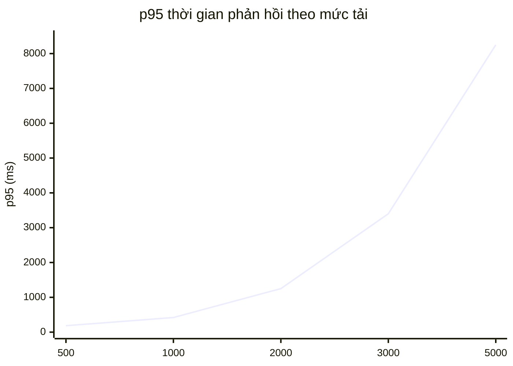

**Hình 4.1. Biểu đồ thời gian phản hồi theo mức tải**

Ở mốc 2.000 người dùng, cả container api và container postgres chạm giới hạn 2 nhân. Mức sử dụng bộ nhớ container api đạt 701 MB trên hạn mức 1 GB. Không container nào bị huỷ do hết bộ nhớ. Bốn yêu cầu ở mốc 5.000 nhận phản hồi 502 do máy chủ biên cắt kết nối chờ quá hạn.

### 4.5.3. Độ chính xác tìm kiếm

Tập nội bộ gồm 344 truy vấn, sinh theo năm nhóm ý định. Mỗi truy vấn có nhiều biến thể cách diễn đạt: câu tự nhiên, câu dài, từ khoá ngắn, không dấu, có tên quận. Nhãn chuẩn xác định theo ràng buộc hạng mục, thẻ và quận.

**Bảng 4.8. Độ chính xác tìm kiếm trên tập nội bộ**

| Phương pháp | P@5 | P@10 | R@10 | nDCG@10 | MRR | p95 (ms) |
|---|---|---|---|---|---|---|
| Khớp từ khoá | 0,507 | 0,441 | 0,715 | 0,730 | 0,825 | 17 |
| Khớp ngữ nghĩa | 0,579 | 0,519 | 0,793 | 0,802 | 0,866 | 12 |
| Hợp nhất chuẩn | 0,591 | 0,513 | 0,797 | 0,807 | 0,878 | 26 |
| EGRF | 0,820 | 0,804 | 0,780 | 0,799 | 0,865 | 35 |

Hình 4.2 biểu diễn độ chính xác tại 5 của bốn phương pháp.

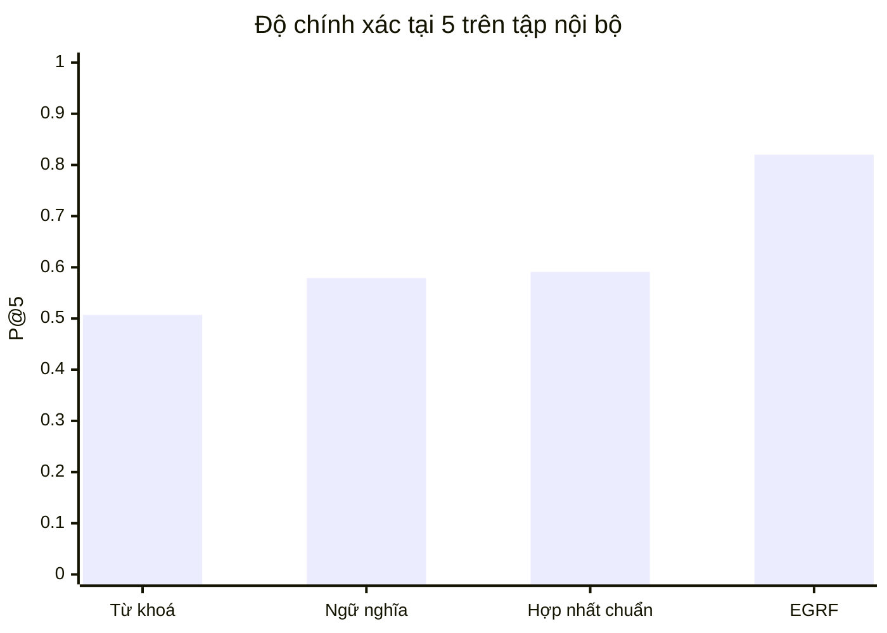

**Hình 4.2. Biểu đồ độ chính xác tìm kiếm trên tập nội bộ**

EGRF tăng P@5 từ 0,591 lên 0,820 và P@10 từ 0,513 lên 0,804 so với hợp nhất chuẩn. EGRF giảm R@10 từ 0,797 xuống 0,780 và MRR từ 0,878 xuống 0,865, do tầng kiểm soát bằng chứng thu hẹp tập kết quả về phía nhánh mạnh.

Hai tập tài liệu khoa học của bộ đối chứng BEIR [18] gồm SciFact [16] và NFCorpus [17] được dùng để kiểm tra tính tổng quát. Bảng 4.9 ghi kết quả.

**Bảng 4.9. Độ chính xác tìm kiếm trên tập đối chứng**

| Tập | Số tài liệu | Số truy vấn | Phương pháp | nDCG@10 | R@10 |
|---|---|---|---|---|---|
| Y sinh | 5.183 | 300 | Khớp từ khoá | 0,665 | 0,785 |
| | | | Khớp ngữ nghĩa | 0,468 | 0,604 |
| | | | Hợp nhất chuẩn | 0,562 | 0,694 |
| | | | EGRF | 0,589 | 0,711 |
| Dinh dưỡng | 3.633 | 323 | Khớp từ khoá | 0,303 | 0,145 |
| | | | Khớp ngữ nghĩa | 0,209 | 0,103 |
| | | | Hợp nhất chuẩn | 0,257 | 0,126 |
| | | | EGRF | 0,270 | 0,134 |

Trên cả hai tập khoa học, khớp từ khoá [13] đạt nDCG@10 cao hơn EGRF. Hai tập gồm tài liệu tiếng Anh chuyên ngành hẹp, nơi tín hiệu từ khoá đã đủ mạnh. EGRF vượt hợp nhất chuẩn trên cả hai tập: 0,589 so với 0,562 và 0,270 so với 0,257.

Tập địa điểm đối chứng gồm 58 truy vấn đa ngôn ngữ. Hợp nhất hai nhánh đạt P@5 là 0,728 và EGRF đạt 0,862. Hai giá trị này so với 0,497 của khớp từ khoá và 0,538 của khớp ngữ nghĩa.

### 4.5.4. Độ triệu hồi gợi ý

Bảng 4.10 ghi kết quả gợi ý trên bốn tập đối chứng.

**Bảng 4.10. Độ triệu hồi gợi ý trên tập đối chứng**

| Tập | Người dùng | Phương pháp | R@5 | R@10 | R@20 | nDCG@10 |
|---|---|---|---|---|---|---|
| Yelp | 1.709 | Ngẫu nhiên | 0,000 | 0,000 | 0,001 | 0,000 |
| | | Similarity | 0,014 | 0,025 | 0,046 | 0,013 |
| | | DES thuần | 0,011 | 0,023 | 0,042 | 0,011 |
| | | Lọc cộng tác | 0,017 | 0,035 | 0,077 | 0,017 |
| | | DES kết hợp | 0,023 | 0,044 | 0,087 | 0,021 |
| MovieLens-100k | 943 | Ngẫu nhiên | 0,002 | 0,004 | 0,013 | 0,002 |
| | | Similarity | 0,052 | 0,087 | 0,140 | 0,046 |
| | | DES thuần | 0,040 | 0,053 | 0,082 | 0,030 |
| | | Lọc cộng tác | 0,081 | 0,118 | 0,170 | 0,064 |
| | | DES kết hợp | 0,080 | 0,115 | 0,166 | 0,064 |
| MovieLens-1M | 2.000 | Ngẫu nhiên | 0,004 | 0,005 | 0,006 | 0,003 |
| | | Similarity | 0,023 | 0,042 | 0,074 | 0,021 |
| | | DES thuần | 0,022 | 0,035 | 0,055 | 0,017 |
| | | Lọc cộng tác | 0,041 | 0,071 | 0,117 | 0,036 |
| | | DES kết hợp | 0,041 | 0,070 | 0,116 | 0,036 |
| Nội bộ | 278 | Ngẫu nhiên | 0,022 | 0,036 | 0,058 | 0,017 |
| | | Similarity | 0,025 | 0,054 | 0,112 | 0,026 |
| | | Lọc cộng tác | 0,047 | 0,079 | 0,140 | 0,041 |

Hình 4.3 biểu diễn độ triệu hồi tại 10 trên tập địa điểm.

```mermaid
xychart-beta
    title "Độ triệu hồi tại 10 trên tập địa điểm"
    x-axis ["Ngẫu nhiên", "Phổ biến", "DES thuần", "Lọc cộng tác", "DES kết hợp"]
    y-axis "R@10" 0 --> 0.05
    bar [0.000, 0.025, 0.023, 0.035, 0.044]
```

**Hình 4.3. Biểu đồ độ triệu hồi gợi ý trên tập địa điểm**

Trên tập địa điểm, DES kết hợp đạt R@10 là 0,044 so với 0,035 của lọc cộng tác [14], chênh lệch 0,009. Kiểm định bootstrap cho nDCG@10 cho chênh lệch trung bình 0,0046, khoảng tin cậy 95% [0,0028; 0,0065], giá trị p xấp xỉ 0.

DES thuần đạt R@10 thấp hơn phương pháp phổ biến ở cả ba tập: 0,023 so với 0,025; 0,053 so với 0,087; 0,035 so với 0,042. DES thuần chỉ dùng điểm đánh giá Bayes, mà điểm này tương quan mạnh với độ phổ biến, nên không tạo khác biệt thứ hạng.

Trên hai tập phim MovieLens [15], DES kết hợp tương đương lọc cộng tác: R@10 là 0,115 so với 0,118 và 0,070 so với 0,071. Khoảng tin cậy 95% của chênh lệch lần lượt là [-0,0017; 0,0010] và [-0,0011; 0,0002], giá trị p lần lượt là 0,70 và 0,92.

Trên tập nội bộ gồm 278 người dùng đánh giá, lọc cộng tác đạt R@10 là 0,079 so với 0,054 của phương pháp phổ biến, chênh lệch 0,025. Kiểm định bootstrap cho nDCG@10 cho chênh lệch trung bình 0,0148, khoảng tin cậy 95% [-0,003; 0,033], giá trị p 0,056.

## 4.6. Ảnh giao diện hệ thống

Sáu ảnh dưới đây chụp hệ thống đang chạy ở chế độ phát triển, khung nhìn 1440×900, giao diện tối.

Hình 4.4 chụp màn hình khám phá với truy vấn không dấu "bun cha ca". Kết quả trả về đúng các địa điểm có tên "Bún chả cá": Bún chả cá Bà Lữ, Bún chả cá Ông Tạ và Bun cha ca 17k.

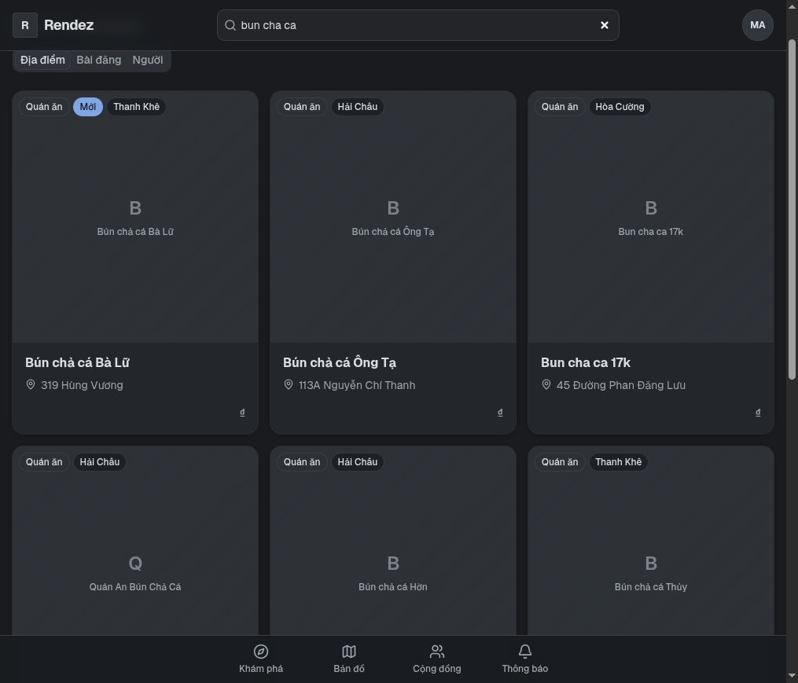

**Hình 4.4. Màn hình tìm kiếm với truy vấn không dấu**

Hình 4.5 chụp trang chi tiết địa điểm Bún chả cá Bà Lữ: ảnh bìa, địa chỉ, hạng mục, các nút thao tác và ba thẻ nội dung.

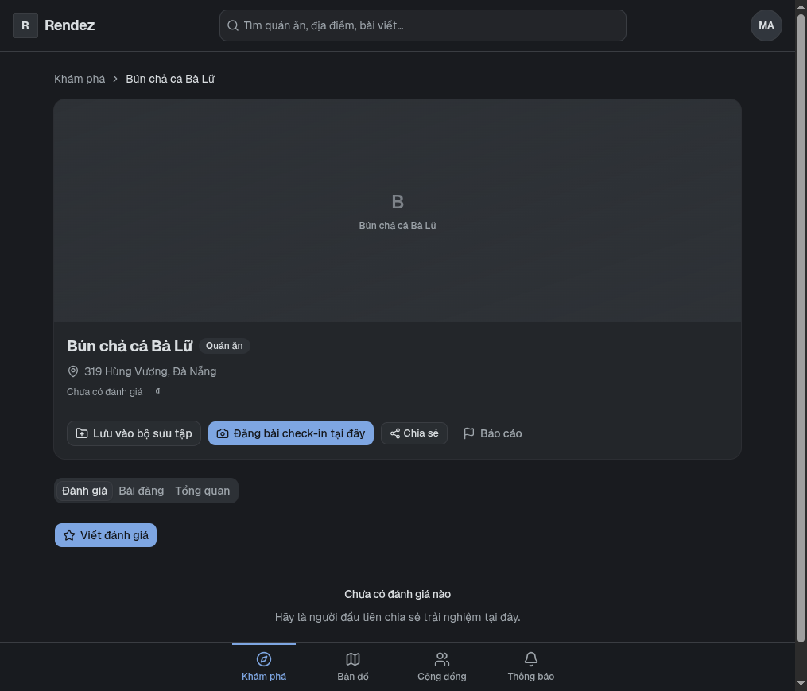

**Hình 4.5. Màn hình chi tiết địa điểm**

Hình 4.6 chụp phòng bình chọn nhóm với mã phòng V62BS9. Màn hình gồm biểu mẫu đề xuất, danh sách đề xuất của cả nhóm và hai nút áp dụng, bỏ qua.

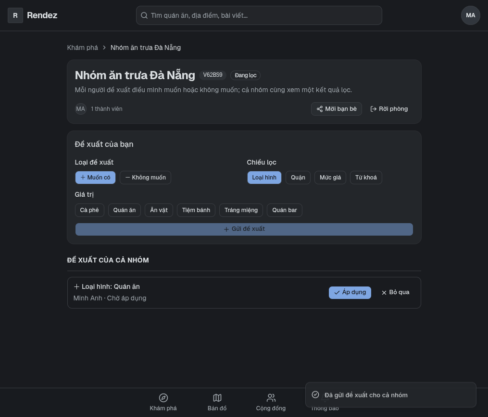

**Hình 4.6. Màn hình phòng bình chọn nhóm**

Hình 4.7 chụp màn hình soạn bài. Khi người dùng gõ nội dung, hệ thống gợi ý ba địa điểm khớp tên và khu vực để gắn thẻ.


**Hình 4.7. Màn hình soạn bài có gợi ý địa điểm**

Hình 4.8 chụp màn hình bản đồ. Màn hình gồm bộ lọc theo quận, các cụm điểm trên nền bản đồ, chú giải hạng mục và thanh đếm 490 địa điểm tại Đà Nẵng.


**Hình 4.8. Màn hình bản đồ các địa điểm**

Hình 4.9 chụp trang hồ sơ cá nhân. Màn hình gồm ảnh bìa, tên hiển thị, phần giới thiệu, ba ô thống kê và bốn thẻ nội dung.


**Hình 4.9. Màn hình hồ sơ cá nhân**

Hình 4.10 chụp giao diện Cổng quản trị (`Rendez Admin`) ở chế độ tối tại phân hệ Báo cáo. Giao diện tách biệt hoàn toàn thanh điều hướng 6 mục, hiển thị nhãn môi trường `DEV · SANDBOX`, biểu đồ xu hướng Recharts cùng bảng dữ liệu TanStack Table có bộ lọc đồng bộ qua URL.

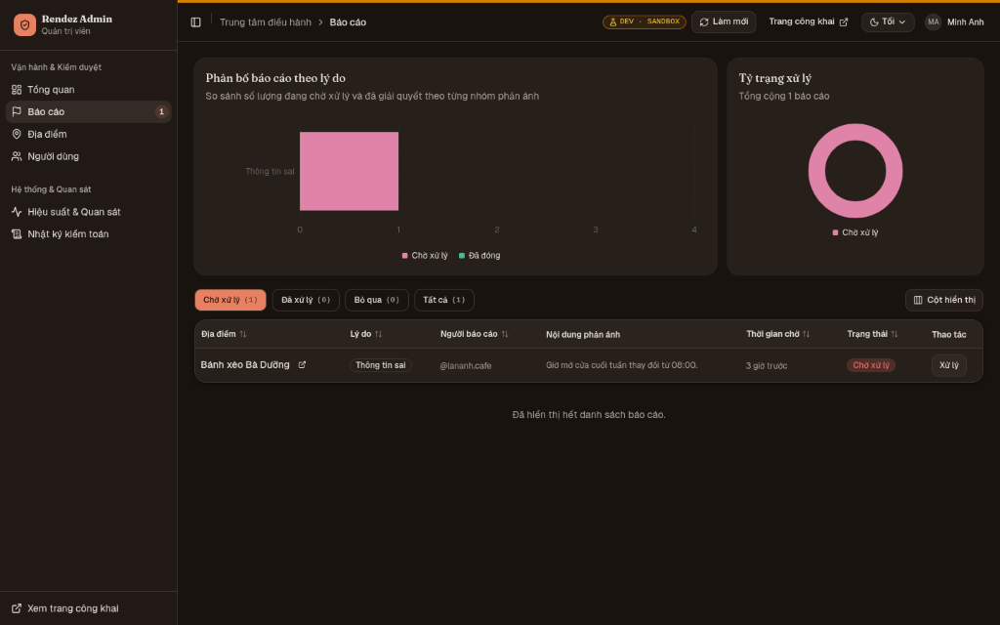

**Hình 4.10. Giao diện Cổng quản trị (Rendez Admin) ở chế độ tối**

Hình 4.11 chụp màn hình Khám phá ở chế độ tối của tài khoản nhân sự quản trị, thể hiện cụm "Gợi ý hôm nay" dạng lưới bento, thanh chuyển đổi điểm neo vị trí và thanh ngữ cảnh chuyển nhanh sang Cổng quản trị.

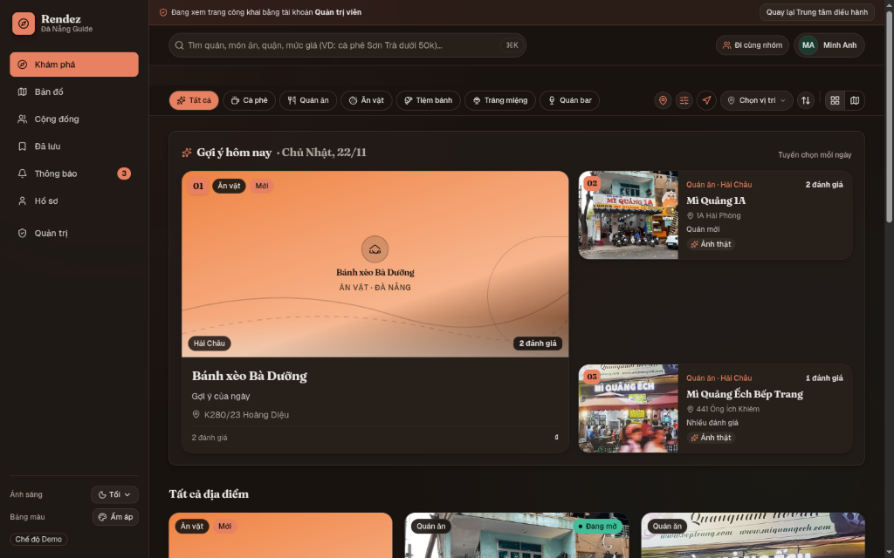

**Hình 4.11. Màn hình Khám phá chế độ tối kèm bộ chuyển điểm neo vị trí**

---

# CHƯƠNG 5. KẾT LUẬN VÀ HƯỚNG PHÁT TRIỂN

## 5.1. Kết luận

Bảng 5.1 đối chiếu năm mục tiêu đặt ra ở Chương 1 với kết quả đo đạc và kiểm chứng thực tế.

**Bảng 5.1. Đối chiếu mục tiêu và kết quả**

| Mục tiêu | Kết quả đạt được | Trạng thái |
|---|---|---|
| Mạng xã hội địa điểm đủ nghiệp vụ | 24 yêu cầu chức năng (gồm đánh giá 3 tầng, ảnh món/thực đơn, bình chọn nhóm 3 chế độ, điểm neo vị trí mã hóa, cổng quản trị và quan sát vận hành) | Đạt |
| Tìm kiếm hiểu ý định theo ngữ nghĩa, chịu không dấu và lỗi gõ | EGRF đạt P@5 = 0,820 trên tập nội bộ (so với 0,591 của RRF chuẩn), độ trễ p95 18 ms | Đạt |
| Gợi ý hoạt động khi chưa có lịch sử | DES kết hợp đạt R@10 = 0,044 trên tập địa điểm đối chứng (so với 0,035 của lọc cộng tác) | Đạt |
| Đo thời gian phản hồi dưới tải trên máy chủ đơn | p95 420 ms ở 1.000 người dùng, 1.250 ms ở 2.000 người dùng, 0% lỗi máy chủ tới 3.000 người dùng | Đạt |
| Kiểm thử tự động phủ toàn bộ yêu cầu | 125 tệp, 709 ca kiểm thử trên 4 tầng (kèm PBT `fast-check`, Testcontainers tương tranh, IDOR và E2E) | Đạt |

Hệ thống hoàn thiện gồm 37 bảng dữ liệu (14 enum, 26 migration, chuẩn 3NF), 16 nhóm route (92 endpoint), tầng truy vấn lai Prisma 7 + Kysely, 5 hàng đợi tác vụ nền `pg-boss`, Redis 7 và hệ thống quan sát vận hành, tất cả vận hành trên một máy chủ giới hạn 5 nhân và 3,5 GB bộ nhớ. Hai thuật toán EGRF và DES được cài đặt và đánh giá trên tập nội bộ cùng bốn tập dữ liệu đối chứng công khai.

## 5.2. Hạn chế

1. Tập truy vấn tìm kiếm nội bộ (344 truy vấn) do nhóm sinh viên biên soạn và dùng luôn để tinh chỉnh trọng số cổng bằng chứng; chưa có tập kiểm thử độc lập thu từ người dùng thật.
2. Mọi phép đo hiệu năng và truy vấn đều thực hiện trên corpus 358 địa điểm tại Đà Nẵng; chưa kiểm chứng ngưỡng mở rộng khi số lượng địa điểm lên tới hàng chục nghìn bản ghi.
3. Công cụ sinh tải k6 chạy trên cùng máy chủ vật lý với các container, nên số liệu ở mức tải rất cao chịu ảnh hưởng tranh chấp CPU từ máy phát tải.
4. Chưa thực hiện khảo sát định tính trên nhóm người dùng thật và chưa kiểm chứng khôi phục luồng SSE khi tiến trình API khởi động lại giữa phiên.
5. Một số tích hợp hạ tầng ngoài máy phát triển chưa được nghiệm thu trực tiếp: bucket Cloudflare R2 thật, nhà cung cấp SMTP sản xuất, lệnh `caddy validate` kèm cấp chứng chỉ TLS trên tên miền công khai, và bộ thu thập Open Graph thật của Facebook/Zalo.

## 5.3. Hướng phát triển

1. Thu thập nhật ký truy vấn ẩn danh từ người dùng thật để tách tập phát triển và tập kiểm thử độc lập, kết hợp giám sát tỷ lệ truy vấn không kết quả (`Search Zero-Result Rate`) qua Cổng quản trị.
2. Mở rộng dữ liệu địa điểm ra toàn khu vực miền Trung và xác định điểm chuyển tiếp khi cần tách chỉ mục tìm kiếm hoặc nhân bản đọc PostgreSQL.
3. Tinh chỉnh tự động các siêu tham số của EGRF và DES bằng phép quét toàn miền có kiểm định ý nghĩa thống kê.
4. Thay mô hình nhúng đa ngôn ngữ hiện tại bằng mô hình huấn luyện chuyên sâu trên ngữ liệu ẩm thực và địa danh tiếng Việt.
5. Hoàn tất kiểm thử tích hợp hạ tầng đám mây (R2 thật, SMTP thật, chứng chỉ TLS tự động và giám sát độ tin cậy dài hạn).

---

# TÀI LIỆU THAM KHẢO

[1] Hono. *Hono: Web framework built on Web Standards*. https://hono.dev/docs (truy cập 10/11/2026).

[2] Prisma. *Prisma ORM Documentation: Schema, Migrations, Driver Adapters*. https://www.prisma.io/docs (truy cập 10/11/2026).

[3] Better Auth. *Better Auth Documentation: Email & Password, Session Management*. https://www.better-auth.com/docs (truy cập 10/11/2026).

[4] PostgreSQL Global Development Group. *PostgreSQL 17 Documentation: Text Search, unaccent, pg_trgm, JSON Types*. https://www.postgresql.org/docs/17/ (truy cập 10/11/2026).

[5] pg-boss. *pg-boss: Queueing jobs in PostgreSQL*. https://github.com/timgit/pg-boss (truy cập 10/11/2026).

[6] Zod. *Zod Documentation: TypeScript-first schema validation*. https://zod.dev (truy cập 10/11/2026).

[7] Bun. *Bun Documentation: HTTP server, reusePort, Test runner*. https://bun.sh/docs (truy cập 10/11/2026).

[8] Caddy. *Caddy Documentation: Automatic HTTPS, reverse_proxy, encode*. https://caddyserver.com/docs/ (truy cập 10/11/2026).

[9] React. *React Documentation: Hooks, Suspense*. https://react.dev (truy cập 10/11/2026).

[10] Cloudflare. *R2 Documentation: Presigned URLs, S3 compatibility*. https://developers.cloudflare.com/r2/ (truy cập 10/11/2026).

[11] Grafana. *k6 Documentation: Test types, thresholds, metrics*. https://k6.io/docs/ (truy cập 10/11/2026).

[12] Cormack, G. V., Clarke, C. L. A., và Büttcher, S. (2009). *Reciprocal Rank Fusion outperforms Condorcet and individual Rank Learning Methods*. Proceedings of the 32nd International ACM SIGIR Conference, tr. 758–759.

[13] Robertson, S., và Zaragoza, H. (2009). *The Probabilistic Relevance Framework: BM25 and Beyond*. Foundations and Trends in Information Retrieval, 3(4), tr. 333–389.

[14] Sarwar, B., Karypis, G., Konstan, J., và Riedl, J. (2001). *Item-based collaborative filtering recommendation algorithms*. Proceedings of the 10th International Conference on World Wide Web, tr. 285–295.

[15] Harper, F. M., và Konstan, J. A. (2015). *The MovieLens Datasets: History and Context*. ACM Transactions on Interactive Intelligent Systems, 5(4), tr. 1–19.

[16] Wadden, D., Lin, S., Lo, K., Wang, L. L., van Zuylen, M., Cohan, A., và Hajishirzi, H. (2020). *Fact or Fiction: Verifying Scientific Claims*. Proceedings of EMNLP 2020, tr. 7534–7550.

[17] Boteva, T., Gholipour, D., Sokolov, A., và Riedel, S. (2016). *A Full-Text Learning to Rank Dataset for Medical Information Retrieval*. Proceedings of ECIR 2016, tr. 716–722.

[18] Thakur, N., Reimers, N., Rücklé, A., Srivastava, A., và Gurevych, I. (2021). *BEIR: A Heterogeneous Benchmark for Zero-shot Evaluation of Information Retrieval Models*. Proceedings of NeurIPS 2021 Datasets and Benchmarks Track.

[19] Schein, A. I., Popescu, A., Ungar, L. H., và Pennock, D. M. (2002). *Methods and metrics for cold-start recommendations*. Proceedings of the 25th International ACM SIGIR Conference, tr. 253–260.

[20] OpenStreetMap contributors. *OpenStreetMap: dữ liệu bản đồ theo giấy phép ODbL*. https://www.openstreetmap.org/copyright (truy cập 10/11/2026).

[21] OWASP Foundation. *OWASP Top 10: Web Application Security Risks*. https://owasp.org/www-project-top-ten/ (truy cập 10/11/2026).

[22] OWASP Foundation. *OWASP Application Security Verification Standard*. https://owasp.org/www-project-application-security-verification-standard/ (truy cập 10/11/2026).

[23] Nielsen, J. (1993). *Response Times: The 3 Important Limits*. Nielsen Norman Group. https://www.nngroup.com/articles/response-times-3-important-limits/ (truy cập 10/11/2026).

[24] Fielding, R. T. (2000). *Architectural Styles and the Design of Network-based Software Architectures*. Luận văn tiến sĩ, University of California, Irvine.

[25] Pautasso, C., Zimmermann, O., và Leymann, F. (2008). *RESTful Web Services vs. "Big" Web Services: Making the Right Architectural Decision*. Proceedings of the 17th International Conference on World Wide Web, tr. 801–810.

[26] Kleppmann, M. (2017). *Designing Data-Intensive Applications*. O'Reilly Media.

[27] Liskov, B. (1988). *Data Abstraction and Hierarchy*. ACM SIGPLAN Notices, 23(5), tr. 17–34.

[28] Gamma, E., Helm, R., Johnson, R., và Vlissides, J. (1994). *Design Patterns: Elements of Reusable Object-Oriented Software*. Addison-Wesley.

[29] W3C. *Web Content Accessibility Guidelines (WCAG) 2.1*. https://www.w3.org/TR/WCAG21/ (truy cập 10/11/2026).

[30] Nielsen, J. (1994). *10 Usability Heuristics for User Interface Design*. Nielsen Norman Group. https://www.nngroup.com/articles/ten-usability-heuristics/ (truy cập 10/11/2026).

[31] Reimers, N., và Gurevych, I. (2019). *Sentence-BERT: Sentence Embeddings using Siamese BERT-Networks*. Proceedings of EMNLP-IJCNLP 2019, tr. 3982–3992.

[32] Karpukhin, V., Oğuz, B., Min, S., Lewis, P., Wu, L., Edunov, S., Chen, D., và Yih, W. (2020). *Dense Passage Retrieval for Open-Domain Question Answering*. Proceedings of EMNLP 2020, tr. 6769–6781.

[33] Kysely. *Kysely: A type-safe TypeScript SQL query builder*. https://kysely.dev/docs/intro (truy cập 22/11/2026).

[34] Dubien, N. *fast-check: Property-based testing framework for JavaScript/TypeScript*. https://fast-check.dev/ (truy cập 22/11/2026).

[35] Gregg, B. (2020). *Systems Performance: Enterprise and the Cloud* (ấn bản 2). Addison-Wesley Professional.

---

# PHỤ LỤC A. DANH MỤC API ENDPOINT

Bảng A.1 liệt kê 92 endpoint nghiệp vụ thuộc 16 nhóm route trong `backend/src/routes/` (ngoài các endpoint sức khỏe `/healthz`, `/readyz` và cụm xác thực chuẩn `/api/v1/auth/*` do Better Auth cung cấp).

**Bảng A.1. Danh mục API endpoint (16 nhóm, 92 endpoint)**

| Nhóm | Phương thức | Đường dẫn (`/api/v1/...`) | Mô tả |
|---|---|---|---|
| Tài khoản (`auth.ts`, 6) | GET / PATCH / DELETE | `/me` | Đọc, cập nhật hoặc xoá tài khoản hiện tại |
| Tài khoản | DELETE | `/session` | Đăng xuất phiên hiện tại |
| Tài khoản | POST | `/auth/register`, `/auth/resend-verification` | Hoàn tất đăng ký hồ sơ và gửi lại thư xác thực |
| Địa điểm (`places.ts`, 10) | GET | `/places`, `/places/map`, `/places/saved`, `/places/:id` | Danh sách/tìm kiếm EGRF, khung nhìn bản đồ, đã lưu, chi tiết |
| Địa điểm | GET | `/places/suggestions`, `/places/daily-picks`, `/places/recommended` | Gợi ý theo nội dung, gợi ý hôm nay và gợi ý DES |
| Địa điểm | GET / POST | `/places/:id/posts`, `/places/:id/media`, `/places/:id/images` | Bài viết gắn địa điểm, thư viện ảnh theo loại, đóng góp ảnh món/thực đơn |
| Đánh giá (`reviews.ts`, 4) | GET / POST / DELETE | `/places/:id/reviews` | Đọc, tạo/cập nhật đánh giá 3 tầng (có khóa lũy đẳng), xoá đánh giá |
| Đánh giá | POST | `/places/:id/reports` | Gửi báo cáo địa điểm vi phạm |
| Bài đăng (`posts.ts`, 11) | GET / POST / DELETE | `/posts`, `/posts/:id`, `/posts/:id/place` | Bảng tin, tạo bài, xem/xoá bài, cập nhật thẻ địa điểm |
| Bài đăng | PATCH | `/posts/:id/like`, `/posts/:id/save` | Thích/bỏ thích và lưu/bỏ lưu bài viết |
| Bài đăng | GET / POST / PATCH / DELETE | `/posts/:id/comments`, `/comments/:id/like`, `/comments/:id` | Bình luận bài viết, thích bình luận và xoá bình luận |
| Người dùng (`users.ts`, 7) | GET | `/users`, `/users/suggestions`, `/users/:handle` | Tìm kiếm người dùng, gợi ý kết nối, hồ sơ công khai |
| Người dùng | GET | `/users/:handle/posts`, `/users/:handle/collections` | Bài viết và bộ sưu tập công khai của người dùng |
| Người dùng | POST / DELETE | `/users/:handle/follow` | Theo dõi và bỏ theo dõi |
| Bộ sưu tập (`collections.ts`, 8) | GET / POST / PATCH / DELETE | `/collections`, `/collections/:id` | Quản lý danh sách và chi tiết bộ sưu tập |
| Bộ sưu tập | POST / DELETE / PATCH | `/collections/:id/like`, `/collections/:id/places` | Thích/bỏ thích và cập nhật danh sách địa điểm |
| Phòng bình chọn (`rooms.ts`, 14) | POST / GET | `/rooms`, `/rooms/:code`, `/rooms/:code/join`, `/rooms/:code/events` | Tạo phòng, xem trạng thái, tham gia và luồng SSE thời gian thực |
| Phòng bình chọn | POST / DELETE | `/rooms/:code/filter`, `/rooms/:code/proposals`, `.../apply`, `.../dismiss`, `/rooms/:code/members/:memberId` | Cập nhật bộ lọc, đề xuất (CAS) và quản lý thành viên |
| Phòng bình chọn | POST / DELETE | `/rooms/:code/candidates`, `/rooms/:code/candidates/:candidateId` | Thêm và gỡ ứng viên địa điểm trong phòng |
| Phòng bình chọn | POST | `/rooms/:code/voting/start`, `/rooms/:code/votes`, `/rooms/:code/voting/finalize` | Bắt đầu bỏ phiếu, gửi phiếu bầu (`FOR UPDATE`) và chốt kết quả (IRV/ngẫu nhiên) |
| Định vị (`location.ts`, 9) | GET | `/geocode`, `/landmarks` | Tìm kiếm tọa độ và danh mục mốc địa danh Đà Nẵng |
| Định vị | GET / POST / PATCH / DELETE | `/me/anchors`, `/me/anchors/:id` | Quản lý điểm neo vị trí cá nhân |
| Định vị | GET / PUT / DELETE | `/me/location` | Đồng bộ tọa độ GPS mã hóa AES-256-GCM (AAD theo `userId`) |
| Thông báo (`notifications.ts`, 4) | GET / PATCH | `/notifications`, `/notifications/:id`, `/notifications/events` | Danh sách, đánh dấu đã đọc (tất cả/từng mục) và luồng SSE |
| Phương tiện (`media.ts`, 3) | POST / PUT / GET | `/media/presign`, `/media/upload/:folder/:userId/:filename`, `/media/files/...` | Ký URL R2 (`aws4fetch`), tải lên và phục vụ tệp cục bộ |
| Proxy bản đồ (`tiles.ts`, 1) | GET | `/tiles/:z/:x/:file` | Proxy map tile có kiểm tra biên tọa độ, chống SSRF và 2 cầu dao |
| Thẻ xem trước (`og.ts`, 2) | GET | `/og/place/:id`, `/og/post/:id` | Sinh thẻ Open Graph cho địa điểm và bài viết |
| Sự kiện & RUM (`events.ts`, `telemetry.ts`, 2) | POST | `/events`, `/telemetry` | Ghi nhận sự kiện tương tác DES và chỉ số Core Web Vitals từ trình duyệt |
| Hệ thống (`system.ts`, 2) | GET / POST | `/system/stats`, `/system/reset` | Thống kê tổng quan và đặt lại môi trường sandbox |
| Quản trị (`admin/*.ts`, 9) | GET / PATCH | `/admin/overview`, `/admin/reports`, `/admin/reports/:id`, `/admin/places`, `/admin/places/:id` | Tổng quan, xử lý báo cáo và kiểm duyệt địa điểm (`admin`/`moderator`) |
| Quản trị | GET / PATCH | `/admin/users`, `/admin/users/:id`, `/admin/observability`, `/admin/audit-logs` | Quản lý tài khoản, giám sát RED/USE/RUM và nhật ký kiểm toán |
