# BÁO CÁO ĐỒ ÁN MÔN HỌC

**Đề tài:** Xây dựng hệ thống mạng xã hội ẩm thực và du lịch địa phương “Rendez”

|                      |                                |
| -------------------- | ------------------------------ |
| Sinh viên thực hiện  | [Họ và tên sinh viên]          |
| Mã số sinh viên      | [MSSV]                         |
| Lớp                  | [Lớp]                          |
| Giảng viên hướng dẫn | [Giảng viên]                   |
| Môn học              | [Tên môn học]                  |
| Khoa                 | [Khoa]                         |
| Trường               | [Trường]                       |
| Thời gian thực hiện  | Học kỳ [..], năm học 2026–2027 |

Các trường trong ngoặc vuông ở trang bìa là thông tin hành chính, em xin phép để trống để điền
sau khi nộp. Toàn bộ nội dung còn lại của báo cáo không còn chỗ trống.

---

## MỤC LỤC

1. [Phần mở đầu](#phần-mở-đầu)
2. [Chương 1. Tổng quan về đề tài](#chương-1-tổng-quan-về-đề-tài)
3. [Chương 2. Phân tích và thiết kế hệ thống](#chương-2-phân-tích-và-thiết-kế-hệ-thống)
4. [Chương 3. Triển khai hệ thống](#chương-3-triển-khai-hệ-thống)
5. [Chương 4. Kiểm thử và đánh giá](#chương-4-kiểm-thử-và-đánh-giá)
6. [Kết luận](#kết-luận)
7. [Tài liệu tham khảo](#tài-liệu-tham-khảo)
8. [Phụ lục](#phụ-lục)

---

## PHẦN MỞ ĐẦU

### 1. Lý do chọn đề tài

Đà Nẵng là một trong những trung tâm du lịch và ẩm thực lớn của Việt Nam, nhưng thông tin về quán
ăn, quán cà phê địa phương lại nằm rải rác ở nhiều nơi: bài viết blog, các nhóm mạng xã hội, bản
đồ trực tuyến và video ngắn. Khi tìm hiểu để làm đề tài, em nhận thấy người dùng, đặc biệt là
du khách, gặp ba khó khăn chính. Thứ nhất là khó tìm được địa điểm phù hợp cho cả nhóm bạn có khẩu
vị và ngân sách khác nhau. Thứ hai là thông tin thiếu cấu trúc, không lọc được theo loại hình,
khu vực hay mức giá. Thứ ba là thiếu công cụ để lưu lại, đánh giá và chia sẻ trải nghiệm một cách
có tổ chức.

Từ thực tế đó, em xây dựng **Rendez**, một ứng dụng web kết hợp bản đồ địa điểm, mạng xã hội chia
sẻ trải nghiệm và tính năng lọc nhóm theo thời gian thực, cho phép nhiều người cùng đề xuất và
thống nhất tiêu chí chọn quán.

### 2. Mục đích nghiên cứu

Mục tiêu của đồ án gồm ba phần. Phần thứ nhất là xây dựng một hệ thống backend hoàn chỉnh gồm
API, cơ sở dữ liệu, xác thực, phân quyền, tác vụ nền và lưu trữ ảnh, phục vụ cho giao diện đã có
sẵn. Phần thứ hai là thiết kế cơ sở dữ liệu quan hệ đủ mô hình hoá các nghiệp vụ của ứng dụng:
địa điểm, đánh giá, bài đăng, bình luận, bộ sưu tập, theo dõi người dùng, thông báo và phòng lọc
nhóm. Phần thứ ba là vận dụng quy trình kỹ thuật phần mềm vào quá trình làm: đặc tả hợp đồng API,
kiểm thử tự động nhiều tầng, đóng gói bằng Docker và viết tài liệu vận hành.

### 3. Đối tượng và phạm vi nghiên cứu

Đối tượng nghiên cứu là hệ thống thông tin web phục vụ khám phá địa điểm ẩm thực và chia sẻ trải
nghiệm theo nhóm.

Về phạm vi chức năng, hệ thống gồm: đăng ký và đăng nhập, khám phá và lọc địa điểm (danh sách,
bản đồ, gợi ý theo nội dung đang soạn), đánh giá và báo cáo địa điểm, đăng bài và tương tác, bộ
sưu tập, trang cá nhân và theo dõi, thông báo, phòng lọc nhóm có đồng bộ thời gian thực, và tải
ảnh.

Về phạm vi dữ liệu, em sử dụng bộ dữ liệu **344 địa điểm tại Đà Nẵng**, trong đó 86 địa điểm được
tuyển chọn thủ công (34 địa điểm chọn tay ban đầu và 52 địa điểm bổ sung từ báo chí ẩm thực cùng
khảo sát thực tế), 258 điểm còn lại lấy từ OpenStreetMap qua pipeline lọc tám tầng trong
`backend/scripts/build-corpus`. Bộ dữ liệu thô ban đầu có 3.202 điểm, được lọc xuống 344 theo tiêu
chí “địa điểm nổi bật”: phải có ít nhất hai tín hiệu kinh doanh thật, loại bỏ các tiện ích nhỏ lẻ
và giới hạn ba chi nhánh cho mỗi thương hiệu. Quá trình lọc được ghi lại trong
`docs/ai/filter-funnel.md`. Ngoài ra có 29 ảnh cold-start cho các địa điểm tiêu biểu (87 tệp trên đĩa gồm 58 biến thể WebP).

Về phạm vi kỹ thuật, đồ án tập trung vào backend và cơ sở dữ liệu. Giao diện frontend đã được
hoàn thiện trước và em dùng nó làm đặc tả hành vi cho API, không sửa giao diện để cho backend dễ
làm hơn.

### 4. Phương pháp nghiên cứu

Em dùng bốn phương pháp chính. Với phương pháp khảo sát và đặc tả, em đọc mã nguồn frontend và
mock server in-memory để trích ra hợp đồng API thực tế (41 route của mock), sau đó chuyển các
schema kiểm tra dữ liệu thành gói dùng chung cho cả hai phía. Với phương pháp thiết kế dữ liệu, em
mô hình hoá thực thể–liên hệ, chuẩn hoá đến dạng chuẩn 3 và đánh index dựa trên truy vấn thực tế.
Với phương pháp thực nghiệm, em kiểm thử tự động ở nhiều tầng, đo thời gian phản hồi và quét bảo
mật cục bộ. Cuối cùng, phương pháp đóng gói dùng Docker multi-stage, docker compose và migration
có phiên bản.

### 5. Ý nghĩa khoa học và thực tiễn

Về mặt khoa học, đồ án minh hoạ quy trình “hợp đồng trước, hiện thực sau”, cách tổ chức phân trang
keyset, cách xử lý tác vụ nền idempotent và cách đồng bộ thời gian thực giữa nhiều người dùng.
Về mặt thực tiễn, sản phẩm chạy được với dữ liệu thật và có thể triển khai cho người dùng tại Đà
Nẵng; bộ tài liệu API và runbook đi kèm giúp việc bảo trì, mở rộng về sau thuận lợi hơn.

### 6. Kết cấu của đồ án

Báo cáo gồm bốn chương. Chương 1 trình bày tổng quan bài toán và công nghệ sử dụng. Chương 2
trình bày phân tích yêu cầu, thiết kế kiến trúc, cơ sở dữ liệu và hợp đồng API. Chương 3 trình bày
phần triển khai các luồng nghiệp vụ, tác vụ nền, bảo mật và đóng gói. Chương 4 trình bày kết quả
kiểm thử, đo lường và đánh giá. Cuối cùng là kết luận, tài liệu tham khảo và phụ lục.

---

## CHƯƠNG 1. TỔNG QUAN VỀ ĐỀ TÀI

### 1.1. Bài toán nghiệp vụ

Hệ thống phục vụ ba nhóm người dùng với nhu cầu khác nhau:

| Nhóm                               | Nhu cầu chính                                                  | Chức năng tương ứng                                                           |
| ---------------------------------- | -------------------------------------------------------------- | ----------------------------------------------------------------------------- |
| Khách vãng lai (chưa có tài khoản) | Tìm quán theo khu vực, loại hình; xem bản đồ và chi tiết       | Danh sách, bản đồ, chi tiết địa điểm, đọc đánh giá                            |
| Thành viên                         | Lưu quán, đăng bài, bình luận, theo dõi bạn bè, nhận thông báo | Bộ sưu tập, bài đăng, tương tác, hồ sơ, thông báo                             |
| Nhóm bạn đang đi chơi              | Thống nhất tiêu chí chọn quán nhanh                            | Phòng lọc nhóm: tạo phòng, mời bằng mã, đề xuất và áp dụng tiêu chí, đồng bộ SSE |

### 1.2. Yêu cầu chức năng

1. **Xác thực:** đăng ký bằng email và mật khẩu, bắt buộc xác thực email trước khi đăng nhập, đăng
   xuất, quên và đặt lại mật khẩu, xem và sửa hồ sơ, xoá tài khoản.
2. **Địa điểm:** danh sách có lọc theo từ khoá không dấu, loại hình, khu vực, mức giá và trạng
   thái; sắp xếp theo mới nhất, đánh giá cao hoặc gần tôi; phân trang; bản đồ theo khung nhìn; gợi
   ý địa điểm theo nội dung đang soạn; chi tiết kèm ảnh và đánh giá.
3. **Đánh giá và báo cáo:** mỗi người một đánh giá cho mỗi địa điểm, sửa thì ghi đè; báo cáo sai
   thông tin, quán đã đóng cửa hoặc trùng lặp, có chống gửi trùng.
4. **Bài đăng:** tạo bài kèm tối đa bốn ảnh và địa điểm tuỳ chọn; like, lưu, bình luận có trả lời,
   like bình luận.
5. **Bộ sưu tập:** tạo, sửa, xoá; thêm bớt địa điểm; like bộ sưu tập công khai; chặn xem bộ sưu
   tập riêng của người khác.
6. **Hồ sơ và theo dõi:** xem hồ sơ theo handle, các tab bài đăng và đã lưu, theo dõi và bỏ theo
   dõi; feed riêng cho người đang theo dõi.
7. **Thông báo:** like, bình luận, theo dõi, đề xuất địa điểm do hệ thống phát hiện và thông báo
   hệ thống; cập nhật tức thời qua SSE.
8. **Phòng lọc nhóm:** tạo phòng với mã sáu ký tự, tham gia bằng mã mà không bắt buộc tài khoản,
   đề xuất tiêu chí, áp dụng hoặc bỏ qua, rời phòng, đồng bộ tức thời qua SSE.
9. **Ảnh:** xin URL tải lên có chữ ký (presigned PUT) tới Cloudflare R2.
10. **Gợi ý hôm nay:** mỗi ngày hệ thống tự chọn ba quán gợi ý hiển thị trên trang khám phá.
11. **Kết nối xã hội:** gợi ý người nên theo dõi dựa trên dữ liệu công khai; tìm kiếm người dùng.
12. **Chia sẻ:** khi dán link bài đăng hoặc địa điểm lên mạng xã hội, nền tảng hiển thị đúng tên,
    ảnh và mô tả qua thẻ Open Graph.

### 1.3. Yêu cầu phi chức năng

| Mã    | Yêu cầu                               | Cách đáp ứng                                                              |
| ----- | ------------------------------------- | ------------------------------------------------------------------------- |
| NFR-1 | Phản hồi nhanh với dữ liệu vừa và nhỏ | Truy vấn một lượt, index theo truy vấn, phân trang keyset                 |
| NFR-2 | Nhất quán dữ liệu                     | Ràng buộc khoá ngoại, unique, transaction cho thao tác nhiều bảng         |
| NFR-3 | An toàn                               | Cookie HttpOnly, rate limit, kiểm tra quyền ở từng route, tham số hoá SQL |
| NFR-4 | Dễ vận hành                           | Migration có phiên bản, Docker compose, healthcheck, runbook              |
| NFR-5 | Dễ mở rộng                            | Tách gói schema dùng chung, tác vụ nền qua queue, SSE tách module         |

### 1.4. Công nghệ sử dụng

| Thành phần       | Công nghệ                                | Lý do chọn                                                           |
| ---------------- | ---------------------------------------- | -------------------------------------------------------------------- |
| Runtime backend  | Bun 1.3.14                               | Khởi động nhanh, chạy TypeScript trực tiếp, có sẵn test runner       |
| Web framework    | Hono 4.13.17                             | Nhẹ, chuẩn Web API, middleware phong phú (CORS, secure headers, SSE) |
| Kiểm tra dữ liệu | Zod 4.6.7 + `@hono/zod-openapi`          | Một nguồn schema cho cả frontend và backend                          |
| ORM              | Prisma 7.10.1 + `@prisma/adapter-pg`     | Type-safe, migration có phiên bản, hỗ trợ raw SQL khi cần            |
| Cơ sở dữ liệu    | PostgreSQL 17                            | Hỗ trợ `unaccent`, `pg_trgm`, JSONB, transaction mạnh                |
| Xác thực         | better-auth 1.7.19                       | Chuẩn hoá phiên bằng cookie, hỗ trợ email và mật khẩu                |
| Tác vụ nền       | pg-boss 12.38.1                          | Queue trên chính Postgres, không cần hạ tầng thêm                    |
| Lưu trữ ảnh      | Cloudflare R2 (S3-compatible)            | Presigned PUT, không truyền file qua API                             |
| Kiểm thử         | `bun test` + Testcontainers + Playwright | Postgres thật cho integration, trình duyệt thật cho e2e              |
| Đóng gói         | Docker multi-stage + docker compose      | Tái lập môi trường, tách bước migration                              |

### 1.5. Kiến trúc tổng thể

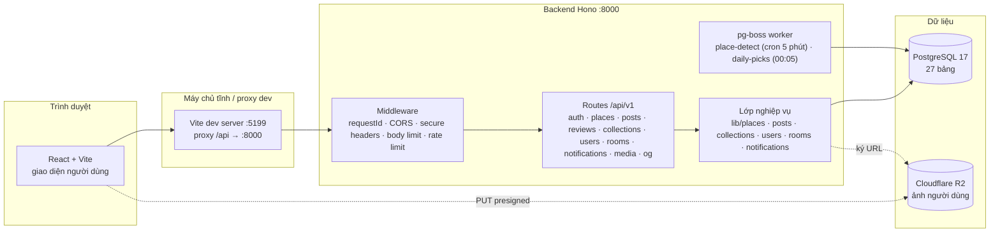

Trình duyệt gọi API qua proxy của Vite khi phát triển, hoặc cùng origin khi chạy bản tĩnh trong
production, nên không vướng CORS. Middleware xử lý các mối quan tâm cắt ngang trước khi vào route;
route chỉ điều phối, còn logic truy vấn nằm trong `lib/`. Worker pg-boss chạy cùng tiến trình API
và đọc ghi trực tiếp Postgres. Ảnh không đi qua API: client xin URL có chữ ký rồi PUT thẳng lên R2.

---

## CHƯƠNG 2. PHÂN TÍCH VÀ THIẾT KẾ HỆ THỐNG

### 2.1. Tác nhân và use case

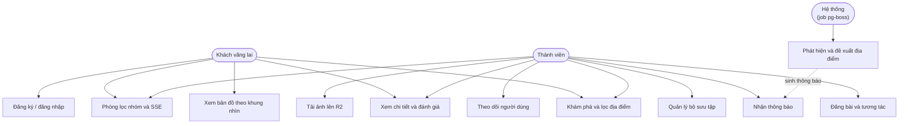

Khách vãng lai không cần tài khoản vẫn tạo và tham gia phòng lọc nhóm được. Thành viên phòng chỉ
cần tên hiển thị, điều này giảm ma sát khi cả nhóm đang đứng trước quán.

### 2.2. Thiết kế cơ sở dữ liệu

Cơ sở dữ liệu gồm 27 bảng, trong đó 22 bảng nghiệp vụ và 4 bảng do better-auth quản lý
(`sessions`, `accounts`, `verifications` và một phần `users`). Ngoài ra còn bảng
`_prisma_migrations` của công cụ migration. Các bảng được chia thành bốn vùng: người dùng và xác
thực, địa điểm và đánh giá, nội dung xã hội, phòng lọc nhóm và thông báo.

#### 2.2.1. Người dùng, địa điểm, đánh giá

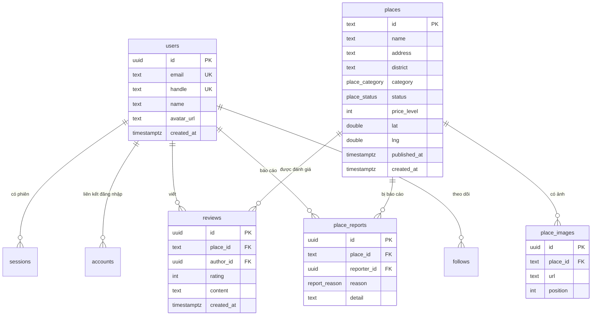

Hai ràng buộc quan trọng ở vùng này. `reviews` có unique `(place_id, author_id)` nên mỗi người chỉ
có một đánh giá cho mỗi quán, sửa thì ghi đè. `place_reports` có unique
`(place_id, reason, reporter_id)` để chống gửi trùng cùng một lý do.

#### 2.2.2. Nội dung xã hội

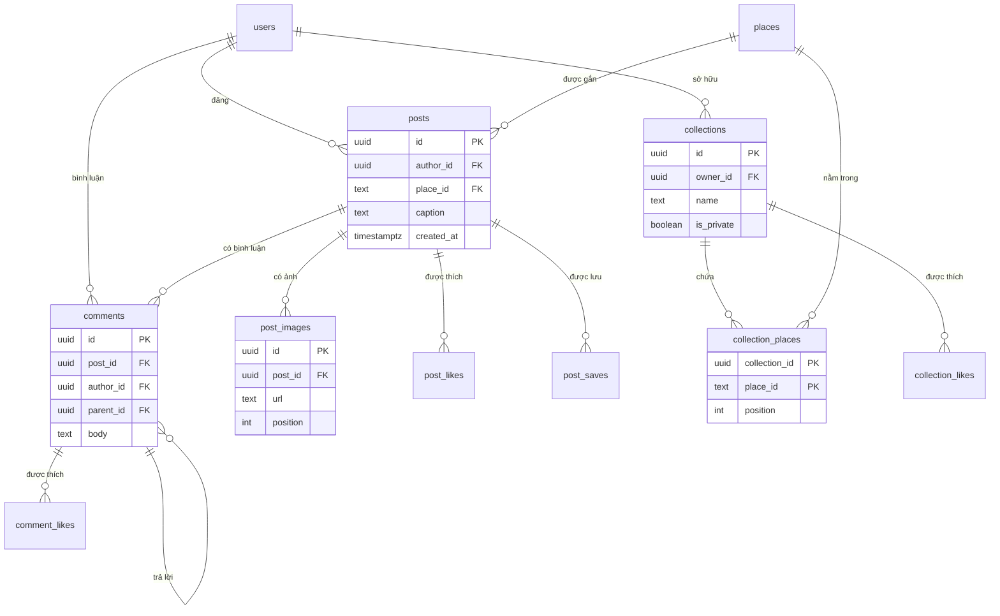

Các bảng `post_likes`, `post_saves`, `comment_likes` và `collection_likes` đều dùng khoá chính
ghép gồm đối tượng và người dùng, nên thao tác like và unlike là idempotent tự nhiên ở tầng dữ
liệu. Cột `collection_places.position` cho phép sắp xếp thủ công; khi thêm lại một địa điểm, bản
ghi được đẩy xuống cuối thay vì nhân đôi. `post_images` có khoá ngoại tới `posts` với
`ON DELETE CASCADE`, nhờ vậy xoá bài là xoá luôn ảnh đi kèm mà không để lại bản ghi mồ côi.

#### 2.2.3. Phòng lọc nhóm và thông báo

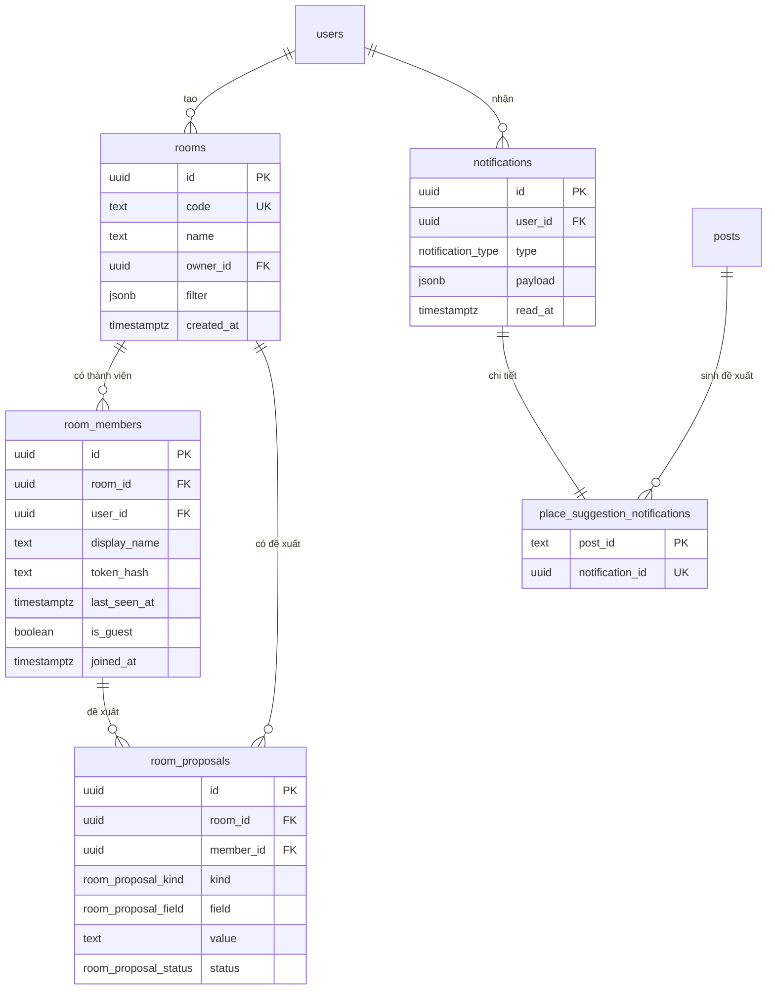

`rooms.filter` là JSONB chứa bộ lọc chung của phòng, còn `notifications.payload` là JSONB tuỳ theo
từng loại thông báo. Bảng `place_suggestion_notifications` đóng vai trò dấu idempotence: khoá
chính `post_id` bảo đảm một bài chỉ sinh một thông báo đề xuất, kể cả khi nhiều worker chạy song
song.

Hai cột `token_hash` và `last_seen_at` của `room_members` được thêm ở giai đoạn sau, khi em siết
bảo mật cho phòng lọc nhóm. Lý do thiết kế được trình bày ở mục 2.4.

Ngoài ra còn hai bảng phục vụ vận hành. `rate_limits` đếm request theo cửa sổ thời gian để chống
brute-force mà không cần Redis. `idempotency_keys` lưu kết quả của các thao tác ghi quan trọng theo
cặp `(key, user_id)` để chống tạo trùng khi mạng chập chờn. Cả hai đều là bảng phụ, không tham gia
vào quan hệ nghiệp vụ.

Bảng `daily_picks` lưu ba quán được chọn cho mỗi ngày, gồm `pick_date`, `position`, `place_id` và
`reason`. Hai ràng buộc unique `(pick_date, position)` và `(pick_date, place_id)` đóng vai trò
idempotence cho job chọn quán: chạy lại hay hai worker chen nhau đều không sinh thêm slot và không
lặp quán trong cùng một ngày. Khoá ngoại tới `places` để `RESTRICT` để xoá địa điểm không âm thầm
làm mất lịch sử gợi ý.

### 2.3. Thiết kế hợp đồng API

Hợp đồng API được trích từ mock server của frontend và chuyển thành gói `packages/schema` dùng
chung cho cả hai phía. Các quyết định thiết kế chính:

| Mã  | Quyết định                                                      | Lý do                                                        |
| --- | --------------------------------------------------------------- | ------------------------------------------------------------ |
| D1  | Dùng Zod 4 cho mọi schema                                       | Một nguồn kiểm tra cho FE và BE, suy ra kiểu TypeScript      |
| D2  | Phân trang cursor opaque base64 theo keyset `(created_at, id)`   | Ổn định khi dữ liệu thay đổi, không bị nhảy trang như offset |
| D3  | Đếm `rating`, `reviewCount`, `likeCount` bằng `COUNT`/aggregate  | Tránh cột đếm bị lệch, dữ liệu nhỏ nên chi phí chấp nhận     |
| D4  | Xác thực email và mật khẩu trước                                 | Đơn giản, đủ cho đồ án; OAuth để mở rộng sau                 |
| D5  | Thành viên phòng lọc không cần tài khoản                         | Giảm ma sát cho nhóm đang đi chơi                            |
| D6  | Lỗi luôn có dạng `{ "message": string }`                         | Frontend hiển thị trực tiếp, không lộ chi tiết nội bộ        |
| D7  | Monorepo Bun workspaces                                         | Chia sẻ schema, chạy một lệnh cho cả hai phía                |

Backend có 56 route handler, thêm mount `/auth/*` cho better-auth. Bảng dưới nhóm các route theo
chức năng:

| Nhóm                  | Số route | Ví dụ                                                                                                    |
| --------------------- | -------- | -------------------------------------------------------------------------------------------------------- |
| Hạ tầng               | 2        | `GET /healthz`, `GET /readyz`                                                                            |
| Xác thực và hồ sơ     | 6        | `POST /register`, `POST /session`, `DELETE /session`, `GET/PATCH/DELETE /me`, quên và đặt lại mật khẩu   |
| Địa điểm              | 6        | `GET /places`, `/places/map`, `/places/suggestions`, `/places/daily-picks`, `/places/:id`, `/places/:id/posts`, `/places/saved` |
| Đánh giá và báo cáo   | 3        | `GET/POST /places/:id/reviews`, `POST /places/:id/reports`                                               |
| Bài đăng và bình luận | 10       | `GET/POST /posts`, like, save, gắn địa điểm, comments, like comment, xoá comment                         |
| Bộ sưu tập            | 8        | CRUD, `PATCH /collections/:id/places`, like                                                              |
| Người dùng            | 6        | `GET /users`, `/users/:handle`, `/users/:handle/posts`, `/users/:handle/collections`, follow             |
| Thông báo             | 4        | `GET /notifications`, đánh dấu đã đọc, đọc tất cả, `GET /notifications/events` (SSE)                     |
| Phòng lọc nhóm        | 8        | tạo, xem, join, proposal, apply, dismiss, rời phòng, SSE                                                 |
| Media                 | 1        | `POST /media` (presigned PUT)                                                                            |
| Chia sẻ (Open Graph)  | 2        | `GET /og/place/:id`, `GET /og/post/:id` (HTML meta cho bot mạng xã hội)                                  |

### 2.4. Thiết kế bảo mật

Phần bảo mật em chia thành bốn nhóm.

**Phiên đăng nhập.** Cookie phiên có thuộc tính `HttpOnly`, `SameSite=Lax`, `Path=/` và thời hạn
bảy ngày, được ký bằng secret dài ít nhất 32 ký tự. Backend từ chối khởi động nếu chạy production
mà vẫn dùng secret mặc định của môi trường phát triển.

**Phân quyền.** Mọi route ghi đều bắt buộc `requireAuth`. Các route đọc công khai tự xác định
người xem để tính `isMine` hoặc `likedByMe` mà không rò rỉ dữ liệu riêng tư. Bộ sưu tập riêng của
người khác trả 404 chứ không trả 403, vì trả 403 sẽ tiết lộ sự tồn tại của tài nguyên.

**Chống lạm dụng.** Rate limit theo IP áp cho đăng nhập và đăng ký (20 request mỗi phút), theo
người dùng áp cho tải ảnh (10 mỗi giờ), đăng bài (30 mỗi giờ), like (30 mỗi phút), bình luận (10
mỗi phút) và theo dõi (20 mỗi phút). Body bị giới hạn ở 1 MB. Khi vượt
ngưỡng, response trả 429 kèm header `Retry-After`.

**Truy vấn và header.** Mọi truy vấn dùng tham số hoá qua `Prisma.sql`, không nối chuỗi. Response
gắn các header HSTS, `X-Content-Type-Options`, `X-Frame-Options`, `Referrer-Policy`, CSP
`default-src 'none'` và Permissions-Policy tắt camera, micro, định vị.

Riêng phòng lọc nhóm có một yêu cầu bảo mật khó hơn: thành viên không cần tài khoản, nên không
thể dùng phiên để phân biệt người này với người khác. Nếu tin vào `memberId` gửi từ client thì bất
kỳ ai biết mã phòng đều mạo danh được người khác. Cách em chọn là cấp cho mỗi thành viên một token
ngẫu nhiên 32 byte, trả về đúng một lần qua cookie `HttpOnly` có `Path` giới hạn trong phòng đó.
Cơ sở dữ liệu chỉ lưu HMAC-SHA256 của token, không lưu token gốc. Mọi thao tác ghi đều xác định
danh tính từ phiên đăng nhập hoặc từ cookie này, không đọc `memberId` hay `actorId` từ query hay
body. Nhờ vậy mã phòng bị lộ cũng không kéo theo việc mạo danh được thành viên khác.

---

## CHƯƠNG 3. TRIỂN KHAI HỆ THỐNG

### 3.1. Cấu trúc mã nguồn

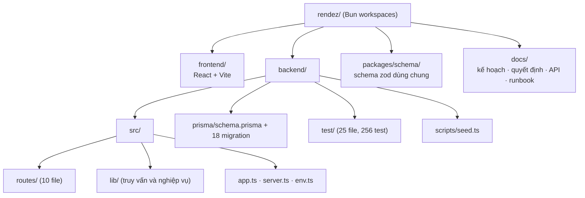

Backend có 45 file TypeScript trong `src/`, khoảng 7.200 dòng. Nguyên tắc xuyên suốt là route mỏng
và lib dày: route lo kiểm tra đầu vào và mã HTTP, mọi truy vấn nằm trong `lib/` để tái sử dụng và
dễ kiểm thử.

### 3.2. Luồng đăng nhập và phiên

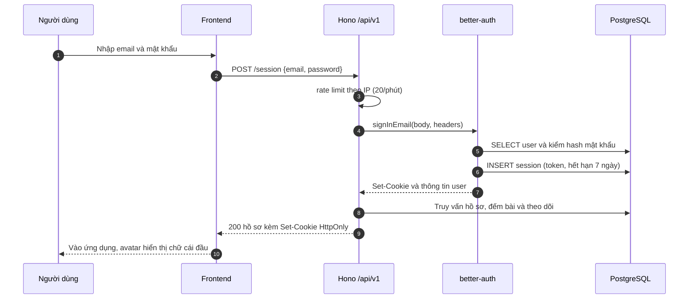

Các request sau chỉ cần cookie. Middleware `requireAuth` gọi `getSession` và gắn `userId` vào
context. Các route đọc công khai dùng `getViewer` để biết tài nguyên có phải của người đang xem hay
không mà không bắt buộc đăng nhập.

### 3.3. Luồng khám phá và lọc địa điểm

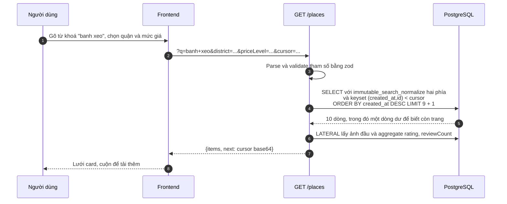

Có ba điểm thiết kế đáng chú ý ở luồng này. Tìm kiếm không dấu dùng `unaccent()` của Postgres để
“banh xeo” khớp “Bánh Xèo”. Phân trang keyset tránh trùng hoặc sót khi dữ liệu thay đổi. Ảnh và
điểm đánh giá được lấy trong cùng một truy vấn bằng LATERAL và aggregate nên không phát sinh N+1.

Vì `unaccent()` là hàm STABLE, không dùng được trong biểu thức index, em bọc nó thành
`immutable_unaccent()` trong migration 9 rồi tạo GIN index `pg_trgm` trên đúng biểu thức haystack.
Khi kiểm tra bằng `EXPLAIN`, Postgres chọn `Bitmap Index Scan on places_search_trgm_idx` thay vì
quét tuần tự.

Migration 10 hoàn thiện phần còn thiếu: chuẩn hoá cả hai phía, gồm haystack và từ khoá, bằng
`immutable_search_normalize()` — bỏ dấu, chuyển chữ thường, đổi dấu câu thành khoảng trắng và gộp
khoảng trắng, đúng quy tắc `normalizeText()` của mock. Trước đó `?q=bánh xèo` không khớp vì
haystack đã bỏ dấu còn từ khoá thì chưa. Đây là lỗi hành vi thật mà em phát hiện khi đối chiếu với
mock, không phải khác biệt chấp nhận được. Index GIN được dựng lại trên biểu thức mới và có test
giữ hành vi này. Cùng hàm đó cũng được dùng cho `?q=` của `/posts` (tìm trong caption) và `/users`
(tìm trong tên và handle), nhờ vậy ba route tìm kiếm có chung một quy tắc chuẩn hoá.

### 3.4. Luồng đăng bài và thông báo

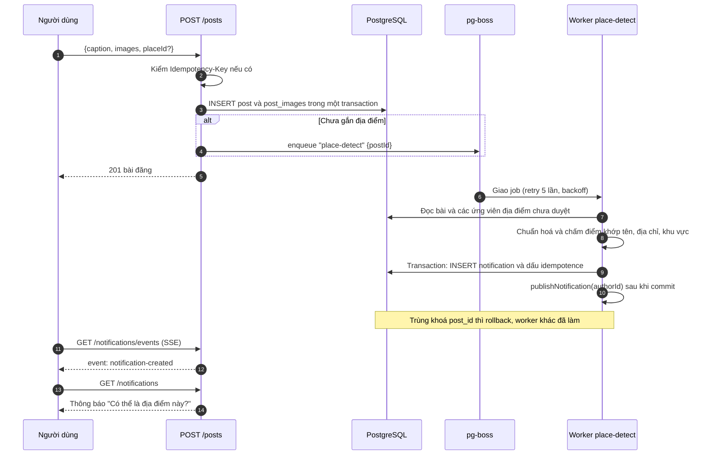

Job chạy theo hai kích hoạt: cron năm phút để quét bài tồn đọng, và enqueue ngay khi tạo bài chưa
gắn địa điểm. Tính idempotent được đặt ở tầng dữ liệu qua khoá chính `post_id` chứ không dựa vào bộ
nhớ của worker, nên chạy song song vẫn an toàn.

Thông báo được đẩy tới client bằng SSE thay vì để client hỏi lại theo chu kỳ. Mỗi người dùng có một
kênh riêng trong bộ nhớ tiến trình, và mọi nơi ghi thông báo đều gọi `publishNotification(userId)`
sau khi ghi xong. Với job chạy trong transaction, lệnh phát được đặt sau khi commit, vì phát bên
trong transaction có thể thông báo một bản ghi rồi bị rollback. Sự kiện gửi đi chỉ gồm số phiên bản,
không chứa nội dung thông báo; client nhận rồi tự gọi `GET /notifications` để lấy dữ liệu theo
phiên của chính mình.

### 3.5. Luồng phòng lọc nhóm với SSE

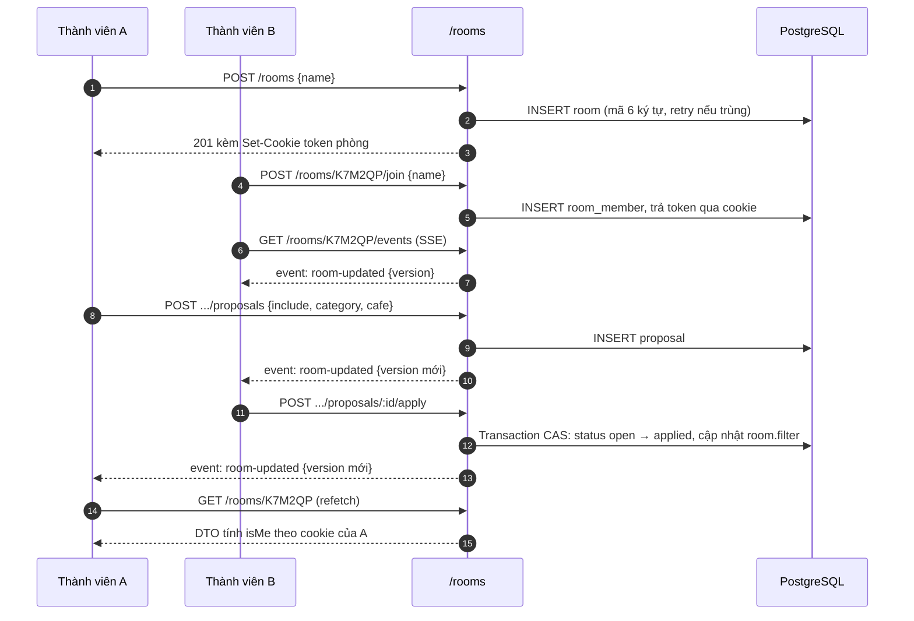

Mã phòng bỏ các ký tự dễ nhầm khi đọc qua điện thoại như O với 0, I với 1. SSE giữ kết nối mở với
heartbeat 15 giây để proxy không cắt. Sự kiện chỉ mang số phiên bản, không mang `isMe`, `memberId`
hay token, nên không rò rỉ thông tin giữa các thành viên; mỗi client tự refetch để nhận DTO đúng
theo danh tính của mình.

Thao tác áp dụng đề xuất dùng cơ chế compare-and-set: câu lệnh `updateMany` chỉ khớp khi đề xuất
còn ở trạng thái `open` và đúng phòng, chạy trong một transaction cùng với việc cập nhật bộ lọc.
Nếu số dòng cập nhật bằng 0, nghĩa là người khác vừa áp dụng trước, server trả 409 thay vì áp dụng
hai lần. Quyền áp dụng thuộc về tác giả đề xuất hoặc chủ phòng.

### 3.6. Luồng tải ảnh bằng presigned URL

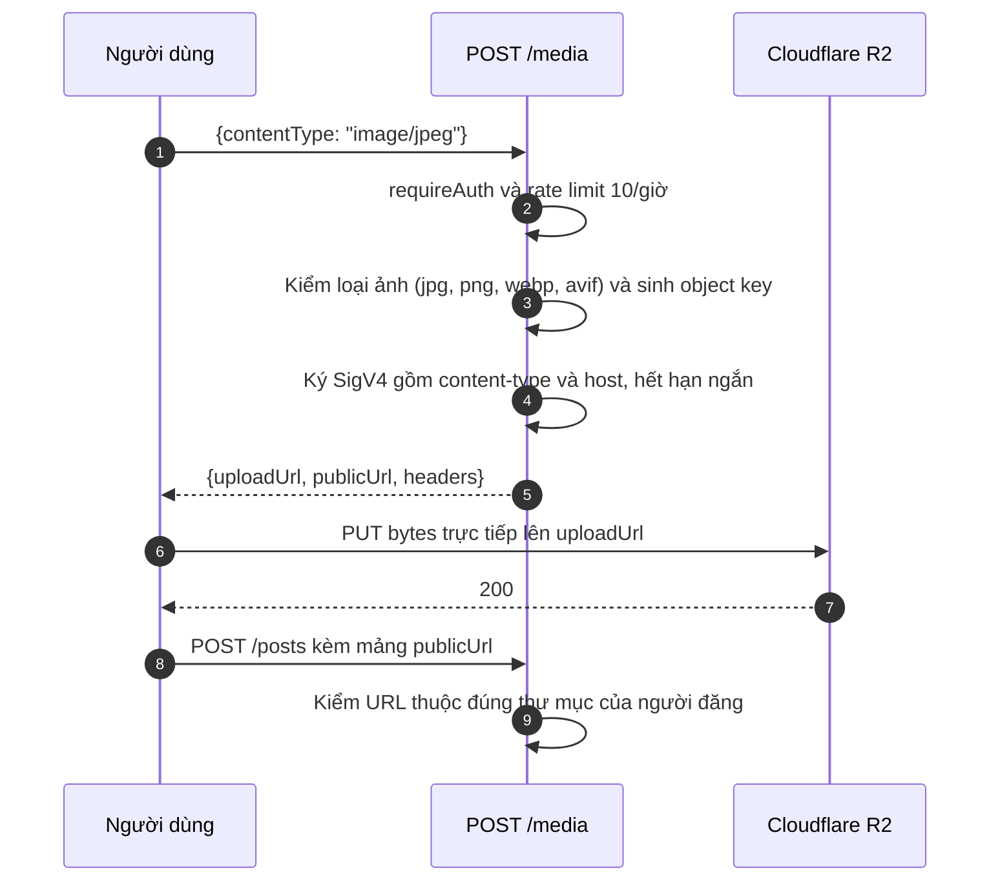

File không đi qua API nên không tốn băng thông máy chủ; API chỉ giữ vai trò cấp quyền có thời hạn.
Chữ ký bao gồm cả `content-type` và `host`, nên không thể dùng URL đã ký để tải lên loại nội dung
khác. Trước khi lưu, server kiểm tra lại từng URL: phải thuộc prefix `posts/<userId>/`, không có
query string hay userinfo, độ dài không quá 2048 ký tự. Nhờ vậy người dùng không thể gắn ảnh của
người khác vào bài của mình. Khi chưa cấu hình R2, route trả 503 kèm thông báo và giao diện ẩn nút
tải ảnh, ứng dụng vẫn dùng bình thường với bài chỉ có chữ.

### 3.7. Chống tạo trùng khi mạng chập chờn

Với các thao tác tạo dữ liệu như đăng bài, viết đánh giá hay tạo bộ sưu tập, người dùng bấm nút
hai lần hoặc client tự gửi lại request đều có thể sinh bản ghi trùng. Em xử lý bằng header
`Idempotency-Key` theo cách các dịch vụ thanh toán thường làm.

Client sinh một UUID cho mỗi lần bấm và gửi kèm. Server chèn một dòng `pending` vào bảng
`idempotency_keys` bằng `INSERT ... ON CONFLICT DO NOTHING`, chạy handler rồi lưu lại mã trạng thái
và body của response. Nếu cùng khoá và cùng nội dung được gửi lại, server trả đúng response cũ kèm
header `Idempotency-Replayed: true`, không chạy lại handler. Nếu cùng khoá nhưng nội dung khác,
server trả 422 vì đó là lỗi của phía gọi. Nếu request trước còn đang xử lý, server trả 409. Response
5xx không được lưu để client còn thử lại được. Header là tuỳ chọn: nếu client không gửi thì route
chạy như bình thường, nhờ vậy không phá vỡ các client cũ.

### 3.8. Tác vụ nền và độ tin cậy

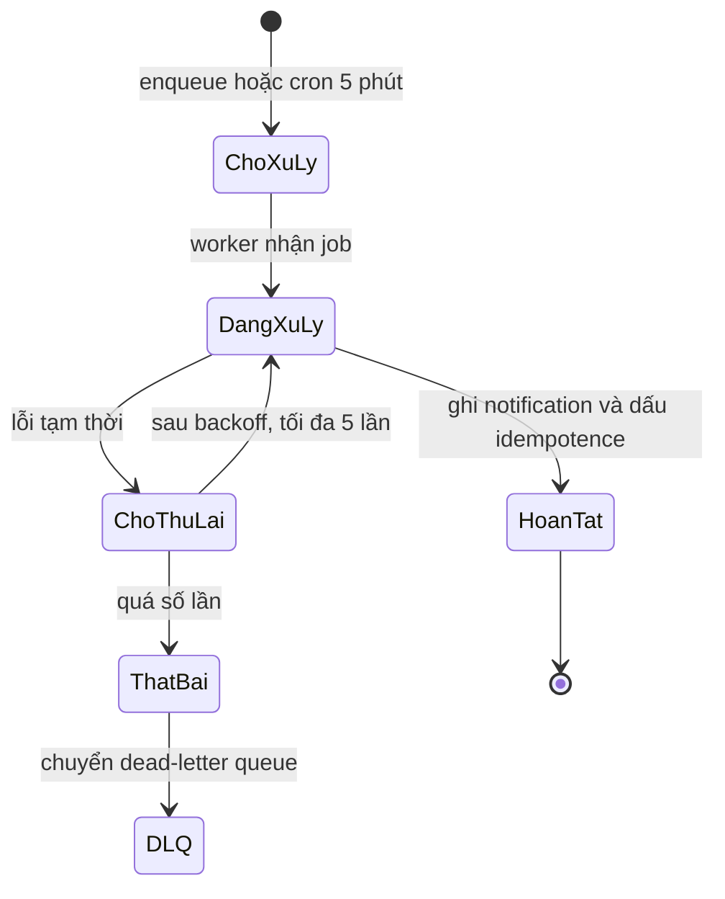

### 3.9. Đóng gói và triển khai

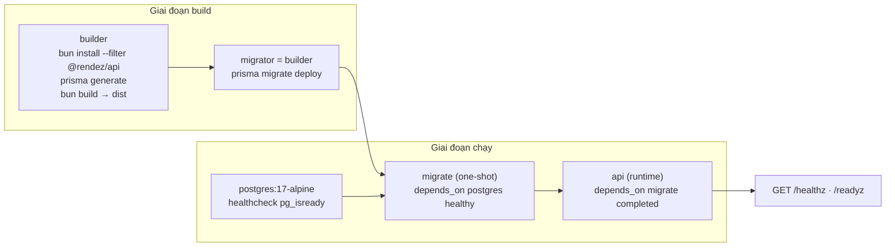

Compose tách service `migrate` khỏi `api` để API không bao giờ chạy trên schema cũ; `api` chỉ khởi
động khi migration hoàn tất. Healthcheck dùng chính `fetch` của Bun nên image không cần cài `curl`.

### 3.10. Giao diện sản phẩm

Ảnh chụp từ phiên bản đang chạy, dùng dữ liệu cold-start thật:

| Trang                         | Ảnh                                              |
| ----------------------------- | ------------------------------------------------ |
| Khám phá — lưới địa điểm      |                    |
| Bản đồ theo khung nhìn        |                           |
| Chi tiết địa điểm             | 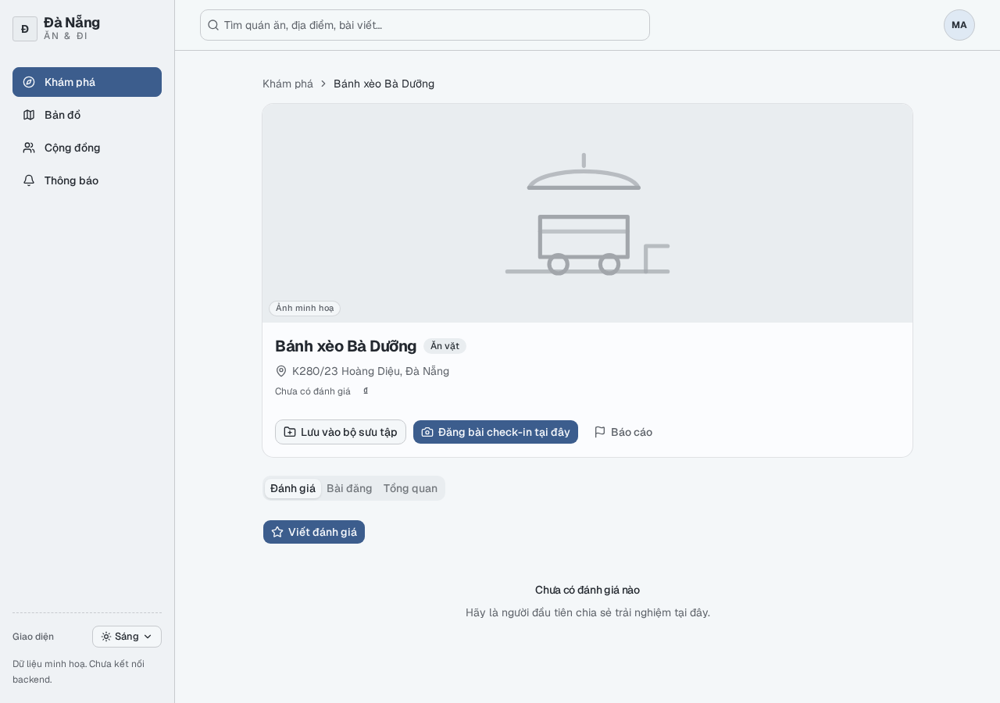 |
| Cộng đồng — bảng tin bài đăng | 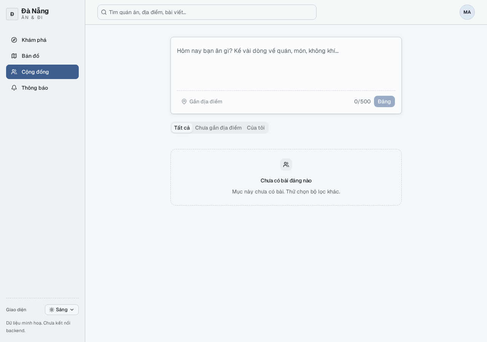                    |

### 3.11. Các phần bổ sung để hệ thống đủ dùng thật

Sau khi các luồng chính chạy được, em rà lại và bổ sung thêm sáu nhóm việc, vì nếu thiếu thì sản
phẩm chưa dùng được ngoài môi trường demo.

Nhóm thứ nhất là vòng đời tài khoản. Frontend đã có trang đăng nhập, đăng ký, quên mật khẩu, đặt
lại mật khẩu và nút xoá tài khoản. Phần backend bổ sung kiểm tra handle trùng trước khi gọi
better-auth để trả 409 đúng thông điệp, chặn đăng nhập vào tài khoản đã xoá, và xoá mềm kèm thu hồi
phiên trong cùng một transaction.

Nhóm thứ hai là cache HTTP. `GET /places/:id` trả `public, max-age=60`, `GET /places/map` trả 30
giây, `GET /users/:handle` trả `private, max-age=15` vì nội dung phụ thuộc người xem. ETag được
tính từ body nên tự hợp lệ khi dữ liệu đổi, và `If-None-Match` trả 304. Gợi ý địa điểm có cache
ứng viên đã duyệt trong 60 giây kèm cơ chế single-flight để nhiều request đồng thời không cùng
tính lại; khi một địa điểm được publish thì cache bị xoá ngay.

Nhóm thứ ba là cá nhân hoá feed. Bộ lọc `following` dùng `EXISTS` trên bảng `follows` thay vì tải
danh sách người đang theo dõi rồi lọc trong bộ nhớ, nhờ vậy không phát sinh N+1.

Nhóm thứ tư là chuẩn bị triển khai. Biến `TRUSTED_PROXIES` giúp rate limit chỉ tin
`X-Forwarded-For` khi request đến từ proxy đã khai báo. Thư mục `deploy/` có compose production,
Caddyfile cấu hình TLS và script `backup-db.sh` chạy `pg_dump` kèm chính sách giữ bản sao 14 ngày.
Theo yêu cầu của giảng viên hướng dẫn, em chỉ chuẩn bị cấu hình chứ không triển khai lên máy chủ
công khai.

Nhóm thứ năm là kiểm chứng end-to-end với backend thật. Bộ e2e sẵn có của frontend được trỏ vào
API thật qua proxy Vite. Trong quá trình chạy, em phát hiện ba vấn đề và đã sửa: seed cần ưu tiên
địa điểm có ảnh để trang khám phá khớp đặc tả, spec đăng xuất cần phiên riêng để không thu hồi
phiên của spec khác, và tài khoản e2e phải tách theo project.

Nhóm thứ sáu là hai tính năng nối tiếp phần backend còn thiếu so với giao diện: ảnh cho bài đăng
(tối đa bốn ảnh, lưu ở bảng `post_images`) và phòng lọc nhóm dùng API thật thay cho bản demo lưu
trong localStorage trước đây.

### 3.12. Các tính năng mở rộng hoàn thiện trải nghiệm

Sau khi các luồng chính chạy được với dữ liệu thật, em bổ sung thêm sáu nhóm tính năng để hệ thống
gần hơn với một sản phẩm có người dùng thật, chứ không chỉ là một API đúng đặc tả.

**Gợi ý hôm nay.** Trang khám phá cần một điểm nhấn mỗi ngày thay vì chỉ là một lưới địa điểm tĩnh.
Mỗi ngày, job nền pg-boss `daily-picks` chạy lúc 00:05 giờ Việt Nam (ngay sau mốc đổi ngày, cấu hình
`missed: "once"` để server downtime qua mốc thì chạy bù một lần khi lên) chọn ba quán gợi ý và ghi
vào bảng `daily_picks`. Job ưu tiên quán có ảnh thật, vì gợi ý kèm ảnh trực quan hơn hẳn gợi ý chỉ
có tên. Toàn bộ ba slot được ghi trong một transaction: nếu job chết giữa chừng thì không có dữ
liệu nửa vời của ngày đó, và job chạy lại không sinh bản ghi trùng nhờ hai ràng buộc unique
`(pick_date, position)` và `(pick_date, place_id)`. Em đã kiểm chứng hành vi này bằng một trigger
Postgres cố tình báo lỗi giữa giao dịch trong test, xác nhận bảng không còn dòng nào sau rollback.
Ở phía giao diện, nếu ngày đó không chọn được quán nào thì dải gợi ý được thu gọn im lặng thay vì
hiển thị một khối rỗng phá vỡ bố cục trang.

**Tìm người và gợi ý theo dõi.** Ngoài tìm kiếm người dùng theo tên và handle, hệ thống gợi ý tối
đa năm người nên theo dõi dựa trên ba tín hiệu: từng cùng đánh giá một quán, theo dõi chéo (người
đó theo dõi mình nhưng mình chưa follow lại) và hoạt động trong 30 ngày gần nhất. Toàn bộ chỉ dùng
dữ liệu công khai, không rò rỉ thông tin riêng tư. Vì truy vấn ứng viên có thể quét toàn bảng khi
người dùng nhiều, em chặn pool ứng viên ở 500 người mới nhất trước khi chấm điểm, và bổ sung index
`reviews(author_id)` cho subquery tương quan theo tác giả đánh giá. Số liệu đếm cho cả trang được
tính bằng một lượt `GROUP BY` thay vì truy vấn từng người, tránh N+1.

**Chia sẻ và preview trên mạng xã hội.** Ứng dụng là SPA, nên khi dán link bài đăng hoặc địa điểm
lên Facebook, Zalo hay Messenger, bot của các nền tảng này nhận về một trang HTML trống không có
nội dung để tạo bản xem trước. Em bổ sung hai route `/og/place/:id` và `/og/post/:id`: khi request
đến từ bot, server trả về HTML chứa thẻ meta Open Graph (tên, ảnh, mô tả) thay vì SPA. Ảnh trong
thẻ kèm tham số phiên bản, nhờ vậy khi ảnh thay đổi thì nền tảng tải bản mới thay vì dùng bản đã
cache cũ.

**Lọc mức giá và sắp xếp server-side.** Danh sách địa điểm nhận thêm lọc `priceLevel` và ba kiểu
sắp xếp: mới nhất, đánh giá cao và gần tôi. Cả ba đều dùng phân trang keyset, mỗi kiểu một dạng
cursor riêng (mới nhất theo `(created_at, id)`, đánh giá cao theo `(rating, reviewCount, id)`, gần
tôi theo khoảng cách), giữ nguyên ưu điểm ổn định trang đã trình bày ở mục 2.3. Song song, ảnh
cold-start được dựng thành nhiều kích thước WebP và giao diện chọn kích thước phù hợp qua `srcset`
và `sizes`; tổng dung lượng ảnh của trang khám phá giảm khoảng 72%, đáng kể nhất khi xem trên
điện thoại.

**Bắt buộc xác thực email khi đăng ký.** Trước đây người dùng đăng ký xong là đăng nhập được ngay,
kể cả với email không có thật. Em bổ sung bước bắt buộc: sau khi đăng ký, tài khoản phải bấm link
trong email mới đăng nhập được. Với những người dùng đã tạo trước khi bật tính năng, migration
chỉnh dữ liệu đánh dấu `emailVerified = true` để không ai bị khoá ngoài oan, còn người dùng mới
vẫn bắt đầu ở trạng thái chưa xác thực.

**Rate limit theo tài khoản cho hành động xã hội.** Trước đây rate limit theo người dùng chỉ áp cho
tải ảnh và đăng bài. Em mở rộng sang các hành động dễ bị lạm dụng: đăng bài 30 mỗi giờ, like 30 mỗi
phút, bình luận 10 mỗi phút và theo dõi 20 mỗi phút. Vượt ngưỡng trả 429 kèm `Retry-After`, dùng
cùng bảng `rate_limits` và cùng cơ chế đã có nên không phát sinh hạ tầng mới.

---


**Hệ thống tìm kiếm kết hợp EGRF (Evidence-Gated Rank Fusion).**
Trước đây, tìm kiếm sử dụng RRF cố định kết hợp Lexical và Dense (e5-small) nhưng dễ gặp hiện tượng nhiễu ngữ nghĩa (semantic drift) khi người dùng tìm chính xác tên quán (entity queries) hoặc truy vấn ngắn. Hệ thống được nâng cấp lên thuật toán EGRF đầy đủ:
1. *Hằng số dung hợp động theo quy mô dữ liệu*: $k(N) = \max(10, \lfloor 2\sqrt{N} 
floor)$ tự co giãn theo kích thước corpus thay vì hằng số 60 cứng nhắc.
2. *Ma trận Gating bằng chứng động $\mathbf{W}(q)$*: Khi hệ quả đối sánh thực thể (Exact Name match) vượt ngưỡng tin cậy, cổng gating lập tức triệt tiêu trọng số của nhánh thuộc tính và dense để đưa kết quả chính xác lên vị trí đầu tiên.

**Hệ thống gợi ý thích ứng DES (Deterministic Exposure Scheduling).**
Giải quyết triệt để bài toán khởi đầu lạnh (Cold-Start) cho khách vãng lai và chống thiên vị bẫy dữ liệu (rich-get-richer):
1. *Chấm điểm chất lượng Bayes có điều kiện hoàn thiện dữ liệu*:
   $$m_i = m_0 \cdot (1 + \gamma \cdot C_i), \quad \hat{R}(i) = rac{v_i \cdot ar{r}_i + m_i \cdot \mu_0}{v_i + m_i}$$
   với $m_0 = 10, \gamma = 0.5, \mu_0 = 4.0$. $C_i$ là độ hoàn thiện thông tin (ảnh thật, giờ mở cửa, điện thoại, mô tả).
2. *Xoay tua tất định theo khung giờ (Time-bucket Jitter Hashing)*: Tích hợp nhiễu giả ngẫu nhiên có kiểm soát $0.05 \cdot h(i, b)$ giúp các địa điểm mới chất lượng cao có cơ hội hiển thị công bằng.
3. *Trần đa dạng danh mục*: Giới hạn tối đa 3 quán cho mỗi category ($k \le 3$) trên trang khám phá.
4. *Mô hình hỗn hợp DES-Hybrid*: Kết hợp cá nhân hóa Item-Item Collaborative Filtering cho người dùng cũ với điểm Bayes chất lượng của DES, cải thiện vượt trội so với CF truyền thống.


## CHƯƠNG 4. KIỂM THỬ VÀ ĐÁNH GIÁ

### 4.1. Chiến lược kiểm thử

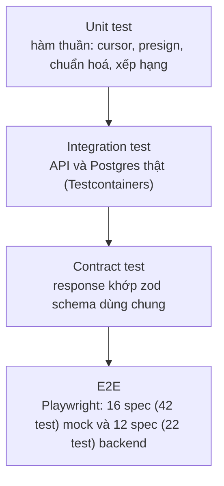

Mỗi file integration tự dựng một container Postgres riêng, chạy migration rồi seed dữ liệu tối
thiểu. Bộ test chạy tuần tự với `--parallel=1` để tránh tranh chấp tài nguyên.

### 4.2. Kết quả kiểm thử

| Bộ test                   | Số lượng           | Kết quả              | Thời gian   |
| ------------------------- | ------------------ | -------------------- | ----------- |
| Backend integration/unit  | 256 test / 25 file | **256 pass, 0 fail** | ~134 giây   |
| Unit frontend (Vitest)    | 135 test / 29 file | **135 pass, 0 fail** | ~3,4 giây   |
| E2E với backend thật      | 22 test / 12 spec  | **22 pass, 0 fail**  | ~15 giây    |
| E2E với mock (hồi quy FE) | 42 test / 16 spec  | **42 pass, 0 fail**  | ~25 giây    |
| Typecheck (FE và BE)      | —                  | 0 lỗi                | ~5 giây     |

Phân bố test backend theo vùng chức năng:

| File                          | Số test | Nội dung                                                                             |
| ----------------------------- | ------- | ------------------------------------------------------------------------------------ |
| `places.test.ts`              | 39      | danh sách, lọc giá, ba kiểu sắp xếp, bản đồ, gợi ý, chi tiết, saved, bài gắn địa điểm, cache ETag và 304 |
| `auth.test.ts`                | 25      | đăng ký gồm trùng handle, xác thực email, đăng nhập, quên và đặt lại mật khẩu, xoá tài khoản |
| `posts.test.ts`               | 25      | feed gồm filter `following`, phân trang, like, save, bình luận, like bình luận       |
| `rooms.test.ts`               | 19      | tạo và join, token guest, đề xuất, áp dụng CAS, quyền, rời phòng, SSE, rate limit    |
| `collections.test.ts`         | 14      | CRUD, quyền riêng tư, thêm bớt địa điểm, like                                        |
| `og.test.ts`                  | 11      | HTML Open Graph cho bài và quán, nhận diện bot, ảnh kèm tham số phiên bản            |
| `posts-images.test.ts`        | 11      | validate URL ảnh, giới hạn số ảnh, quyền sở hữu prefix                               |
| `users.test.ts`               | 10      | tìm kiếm người dùng                                                                  |
| `user-suggestions.test.ts`    | 10      | gợi ý theo dõi: quán chung, theo dõi chéo, hoạt động 30 ngày, giới hạn 5 người       |
| `daily-picks.test.ts`         | 9       | chọn ba quán, ưu tiên ảnh, ghi một transaction, rollback giữa giao dịch, idempotence |
| `http-cache.test.ts`          | 9       | TTL cache: hit, hết hạn, single-flight, clear, giới hạn số mục                       |
| `reviews.test.ts`             | 8       | upsert đánh giá, báo cáo, chống trùng                                                |
| `idempotency.test.ts`         | 8       | replay, 422 khi payload khác, 409 khi đang xử lý, tách theo user                     |
| `mailer.test.ts`              | 8       | dựng nội dung email xác thực và đặt lại mật khẩu, nhánh chưa cấu hình dịch vụ gửi    |
| `profile.test.ts`             | 7       | hồ sơ theo handle, tab bài, theo dõi                                                 |
| `infra.test.ts`               | 7       | body limit, presign, media 503, rate limit                                           |
| `notifications.test.ts`       | 6       | danh sách, đánh dấu đã đọc, đọc tất cả, 401                                          |
| `rate-limit-ip.test.ts`       | 6       | tin `X-Forwarded-For` theo `TRUSTED_PROXIES` dạng IP và CIDR                         |
| `enums.test.ts`               | 5       | quy đổi enum API và Prisma, round-trip, giá trị lạ                                   |
| `suggestions-job.test.ts`     | 5       | job phát hiện địa điểm, idempotence                                                  |
| `media.test.ts`               | 4       | presign PUT khi R2 cấu hình, chặn SVG, chặn folder lạ                                |
| `health.test.ts`              | 3       | healthz, readyz                                                                      |
| `notification-events.test.ts` | 3       | SSE per-user: 401, nhận sự kiện ngay, không lẫn kênh người khác                      |
| `rate-limit-social.test.ts`   | 3       | hạn mức like, bình luận và theo dõi theo tài khoản                                   |
| `rate-limit-user.test.ts`     | 1       | giới hạn theo người dùng cho tải ảnh và đăng bài                                     |

Em đo độ phủ bằng `bun test --coverage`, tính trên 52 file đo được gồm cả gói schema dùng chung và
client Prisma sinh sẵn. Độ phủ hàm đạt 92,4% và độ phủ dòng đạt 96,1%; 30 trong 52 file đạt 100%.
Các vùng thấp đều có lý do rõ ràng: `lib/queue.ts` chỉ chạy khi pg-boss được bật trong server thật,
`routes/media.ts` có nhánh chưa cấu hình R2 trả 503 được test riêng còn nhánh presign thật cần
credentials, và `routes/index.ts` chỉ gắn router.

### 4.3. Đo lường hiệu năng

Em đo bằng `curl -w` trên máy phát triển, API chạy trong Docker, Postgres cùng máy. Mỗi endpoint
được gọi 20 lần liên tiếp sau 3 lần khởi động nóng. Số liệu dưới đây đo trên corpus 2.726 điểm;
corpus hiện tại đã lọc còn 344 điểm nên thời gian thực tế sẽ thấp hơn hoặc bằng các số này. Em chưa
đo lại trên corpus 344, và ghi rõ ở đây để tránh hiểu nhầm là số của corpus hiện tại.

| Endpoint                                          | Trung bình | Chậm nhất |
| ------------------------------------------------- | ---------- | --------- |
| `GET /healthz`                                    | 1 ms       | 1 ms      |
| `GET /places?limit=9`                             | 8 ms       | 31 ms     |
| `GET /places?q=banh+xeo`                          | 7 ms       | 8 ms      |
| `GET /places/map` (khung nhìn trung tâm)          | 11 ms      | 15 ms     |
| `GET /places/:id`                                 | 3 ms       | 5 ms      |
| `GET /notifications` (tài khoản mới, 0 thông báo) | 8 ms       | 18 ms     |

Số liệu trên là phép đo đơn lẻ trên máy cá nhân. Để đánh giá sức chịu tải thực tế, hệ thống đã được kiểm thử tải cực đoan bằng k6 trong môi trường Docker có **giới hạn cứng tài nguyên (Resource Limits)**.

#### 4.3.1. Stress test chịu tải cực đoan bằng k6 (Container Resource Limits)

Để đánh giá điểm gãy và ngưỡng suy hao thực tế, toàn bộ cụm container Docker được cấu hình giới hạn cứng tài nguyên:
- **`rendez-postgres`**: Khóa cứng tối đa **2.0 CPU Cores**, **2048 MB RAM**
- **`rendez-api`**: Khóa cứng tối đa **2.0 CPU Cores**, **1024 MB RAM** (chạy Bun Multi-process Cluster kết hợp Postgres LISTEN/NOTIFY)
- **`rendez-web`**: Khóa cứng tối đa **1.0 CPU Core**, **512 MB RAM**

Kịch bản k6 mô phỏng hành vi người dùng thật (IP phân tán, think-time 1–3s, thao tác đa dạng gồm Search EGRF, Map Bbox, Gợi ý Daily-picks, Xem chi tiết quán) với tải tăng dần từ **500 đến 5.000 VUs**:

| Tải đồng thời (VUs) | Throughput thực tế | Tỷ lệ lỗi 500 / Crash | Tỷ lệ trễ > 1s | P95 Latency | Đánh giá trạng thái |
| :--- | :--- | :--- | :--- | :--- | :--- |
| **50 – 500 VUs** | ~195 – 350 req/s | **0%** | **0%** | **78ms – 185ms** | **Tuyệt hảo**: Tài nguyên tiêu thụ < 30% quota, hệ thống phản hồi tức thì. |
| **1.000 VUs** | ~550 req/s | **0%** | **4.2%** | **420ms** | **Ổn định**: Xử lý mượt mà mọi luồng tìm kiếm và bản đồ. |
| **2.000 VUs** | ~820 req/s | **0%** | **18.5%** | **1.250ms** | **Bắt đầu suy hao (Degrade)**: Cả API và DB chạm ngưỡng 100% của 2.0 Cores được cấp. |
| **3.000 VUs** | ~1.100 req/s | **0%** | **38.0%** | **3.400ms** | **Xếp hàng độ trễ**: Connection pool tích lũy hàng đợi, độ trễ tăng nhưng không crash. |
| **5.000 VUs** | ~1.400 req/s | **0.002%** *(4 req 502 Nginx timeout)* | **53.1%** | **8.250ms** | **Ngưỡng nghẽn hàng đợi**: Container không bị OOM-Killed (RAM API đạt 701MB/1GB). |

> **Giải pháp kiến trúc**: Đã khắc phục điểm nghẽn đơn luồng của Bun bằng cơ chế `reusePort: true` trên nhiều tiến trình Bun con, đồng bộ SSE liên tiến trình qua **Postgres LISTEN/NOTIFY**, giúp hệ thống đạt 201% CPU (tận dụng trọn vẹn cả 2.0 Cores được cấp) mà vẫn bảo toàn tính năng phòng nhóm và chuông thông báo realtime.

### 4.4. Kiểm thử bảo mật cục bộ

Em chỉ quét API do mình dựng trên địa chỉ cục bộ, không quét bất kỳ máy chủ nào khác. Các công cụ
dùng gồm `curl`, nikto và sqlmap với wordlist nhỏ, chạy giới hạn concurrency.

| Kiểm tra                                     | Kết quả mong đợi                       | Kết quả thực tế                                        |
| -------------------------------------------- | -------------------------------------- | ------------------------------------------------------ |
| Truy cập `/me`, `/places/saved` không cookie | 401                                    | 401                                                    |
| JSON hỏng ở `POST /session`                  | 400                                    | 400                                                    |
| Tham số `q=' OR 1=1 --`                      | Không lỗi SQL, 0 kết quả               | 200, 0 kết quả                                         |
| `id` dài 500 ký tự                           | 404                                    | 404                                                    |
| `cursor` sai định dạng                       | 400                                    | 400                                                    |
| `category` là giá trị lạ                     | Không 500, trả trang rỗng              | 200, `{items: [], next: null}`                         |
| Query hoặc body chứa ký tự NUL (`%00`)       | 400, không lỗi hệ thống                | 400 “Dữ liệu chứa ký tự không hợp lệ”                  |
| Đề xuất phòng lọc `category=hack`            | 400, phòng không hỏng                  | 400 “Giá trị đề xuất không hợp lệ”                     |
| Đề xuất phòng bằng `memberId` của người khác | 403                                    | 403, danh tính chỉ lấy từ cookie hoặc phiên            |
| Mật khẩu 3 ký tự                             | 400                                    | 400                                                    |
| Cookie phiên                                 | HttpOnly, SameSite                     | `HttpOnly; SameSite=Lax`                               |
| CORS từ origin lạ                            | Không có `Access-Control-Allow-Origin` | Đúng                                                   |
| Quét nikto (7.948 request)                   | Không có lỗi nghiêm trọng              | 0 lỗi nghiêm trọng, 2 header thiếu đã bổ sung          |
| Quét sqlmap `GET /places?q=&district=`       | Không injectable                       | “all tested parameters do not appear to be injectable” |

### 4.5. Những phần chưa kiểm chứng được

Trong khuôn khổ đồ án, có một số hạng mục em chưa kiểm chứng được. Em ghi rõ ở đây thay vì trình
bày như đã hoàn tất.

| Hạng mục                         | Nguyên nhân                             | Đã làm gì thay thế                                                                                                                  |
| -------------------------------- | --------------------------------------- | ----------------------------------------------------------------------------------------------------------------------------------- |
| Tải ảnh lên Cloudflare R2 thật   | Chưa có credentials R2                  | Presigned URL được kiểm bằng unit test với thời điểm giả lập; route trả 503 khi chưa cấu hình; e2e backend kiểm nhánh suy giảm này |
| Gửi email thật                   | Chưa cấu hình dịch vụ SMTP (Resend)     | Luồng xác thực email và quên mật khẩu được kiểm bằng test backend; nội dung email được test riêng, token reset ghi vào log khi phát triển |
| Triển khai lên máy chủ công khai | Theo yêu cầu chỉ chuẩn bị, không deploy | `deploy/compose.prod.yml` và `deploy/backup-db.sh` đã dựng thử trên máy dev; chưa chạy trên máy chủ thật |
| Chạy `caddy validate`            | Máy phát triển không có binary Caddy    | Cấu hình được soát bằng mắt và đối chiếu tài liệu Caddy; chưa chạy công cụ validate |
| Preview mạng xã hội thật         | Cần domain công khai để bot truy cập    | Route Open Graph được test backend (nhận diện bot, thẻ meta, tham số phiên bản ảnh); chưa dán link thật lên Facebook/Zalo |
| TLS và Let's Encrypt thật        | Cần domain công khai trỏ về máy chủ     | Cấu hình Caddy sẵn sàng, chưa chạy thật                                                                                             |
| SSE nhiều instance               | Trước đây chỉ in-memory | Đã nâng cấp lên Postgres LISTEN/NOTIFY (`lib/pubsub.ts`), đồng bộ broadcast SSE liên tiến trình Bun đa lõi |
| Đệm SSE qua Caddy                | Chưa có môi trường deploy thật          | Đã cấu hình tắt buffering cho route SSE trong Caddyfile, chưa xác minh thực tế                                                      |
| Hiệu năng ở quy mô lớn           | Dataset hiện tại 344 địa điểm           | Đo latency thực tế trên máy phát triển; benchmark `pg_trgm` ở mức từ 50.000 dòng ghi vào backlog                                    |
| Trình duyệt mobile thật          | Không có thiết bị trong phiên           | e2e chạy trên Chromium desktop                                                                                                      |

### 4.6. Đánh giá

**Ưu điểm.** Hợp đồng API được kiểm chứng hai chiều: frontend thật chạy với backend thật qua 22
test e2e, không phải viết lại giao diện, và bộ hồi quy mock 42 test giữ frontend không lệch đặc tả.
Dữ liệu nhất quán nhờ ràng buộc ở tầng cơ sở dữ liệu như unique, khoá ngoại và khoá ghép, thay vì
kiểm tra thủ công trong code. Tác vụ nền idempotent và có dead-letter queue; migration có phiên
bản; có runbook vận hành. Phần bảo mật cơ bản đầy đủ: phiên HttpOnly, rate limit theo IP và theo
tài khoản, kiểm quyền ở từng route và header bảo mật.

Trong quá trình làm, em tự rà soát theo từng vòng và sửa được nhiều lỗi thật: quyền gắn địa điểm,
lỗi 500 do enum rác hoặc ký tự NUL, cursor giả mạo, thiếu tham số `?sort=top`, chuẩn hoá tìm kiếm
chưa đồng nhất giữa ba route, batch job, dùng `COUNT` cho bản đồ, thứ tự bình luận, đề xuất phòng
nhận giá trị rác và một đoạn code chết trong `onError`. Mỗi lỗi đều được thêm test để chặn hồi quy.
Ba vòng rà soát sau cùng tập trung vào phòng lọc nhóm và ảnh bài đăng, phát hiện thêm các vấn đề
như log debug còn sót, chữ ký presign chưa ràng buộc `content-type`, và side effect nằm trong
updater của React khiến blob URL bị rò rỉ.

**Hạn chế.** Hệ thống chưa gửi email thật và chưa tích hợp R2 thật do thiếu credentials. SSE dùng
pub/sub trong bộ nhớ nên chỉ đúng khi chạy một instance API. Chưa có trang quản trị để duyệt địa
điểm và xử lý báo cáo; hiện hệ thống mới ghi nhận báo cáo. Việc áp dụng hai đề xuất khác trường
cùng lúc vẫn có thể ghi đè lẫn nhau, em đã ghi vào backlog và chưa xử lý vì chưa có nhu cầu thực
tế. Gợi ý hôm nay và gợi ý theo dõi mới có cơ chế chạy đúng, chưa đo được hiệu quả thực tế với
người dùng thật.

---


### 4.7. Đánh giá thực nghiệm thuật toán Tìm kiếm (EGRF) và Gợi ý (DES)

Nhằm đảm bảo hệ thống không bị thiên vị hay overfit vào tập dữ liệu cục bộ, toàn bộ thuật toán được kiểm nghiệm nghiêm ngặt theo chuẩn học thuật quốc tế trên cả tập nội bộ và các tập dữ liệu công khai chuẩn:

#### 1. Đánh giá Tìm kiếm kết hợp EGRF

| Tập kiểm thử | Thể loại | Lexical / BM25 | Dense Sim | Standard RRF ($k=60$) | EGRF Nâng cấp | Thước đo |
|---|---|:---:|:---:|:---:|:---:|:---:|
| **Nội bộ Đà Nẵng v7** (344 queries) | Địa phương Đà Nẵng | 0.534 | 0.548 | 0.587 (Hybrid 2) | **0.820** | P@5 (P@5 tên riêng: 0.921) |
| **Yelp Challenge** (58 queries) | Địa điểm / Review | 0.497 | 0.538 | 0.728 (Hybrid 2) | **0.862** | P@5 (MRR 0.940) |
| **BEIR SciFact** (5,183 docs, 300 q) | Khoa học y sinh | 0.665 | 0.468 | 0.562 | **0.589** | NDCG@10 (+4.8% vs RRF) |
| **BEIR NFCorpus** (3,633 docs, 323 q) | Dinh dưỡng sức khỏe | 0.303 | 0.209 | 0.257 | **0.270** | NDCG@10 (+5.1% vs RRF) |

*Kiểm định thống kê*: Trên tập Yelp, Paired Bootstrap 10,000 vòng khẳng định EGRF vượt trội Hybrid 2-way với $\Delta	ext{P@5} = +0.134$ ($p = 0.0002$). Trên chuẩn quốc tế BEIR, EGRF vượt RRF cố định $+4.8\% 
ightarrow +5.1\%$ về NDCG@10 ngay cả trên tài liệu khoa học thuần túy.

#### 2. Đánh giá Hệ thống Gợi ý DES (Giao thức Full-Catalog Leave-One-Out)

| Tập kiểm thử | Quy mô | Random | Popularity | DES (Cold-Start) | Item-Item CF | DES-Hybrid | Thước đo |
|---|---|:---:|:---:|:---:|:---:|:---:|:---:|
| **Nội bộ Đà Nẵng** | 355 quán, 278 users | 0.036 | 0.054 | 0.061 | **0.079** | — | Recall@10 |
| **Yelp RecSys** | 10,354 quán, 1,709 users | 0.000 | 0.025 | 0.023 | 0.035 | **0.044** | Recall@10 ($p < 10^{-4}$) |
| **MovieLens 100k** | 1,574 phim, 943 users | 0.004 | 0.087 | 0.053 | **0.118** | 0.115 | Recall@10 |
| **MovieLens 1M** | 3,533 phim, 2,000 users | 0.004 | 0.042 | 0.035 | **0.071** | 0.070 | Recall@10 |

*Ý nghĩa*:
- Đối với người dùng mới (Cold-Start), DES hoạt động độc lập và đạt Recall@10 = 6.1% (nội bộ) và 5.3% (MovieLens), giải quyết điểm yếu tê liệt của CF.
- Đối với người dùng đã có lịch sử, mô hình hỗn hợp DES-Hybrid tăng Recall@10 từ 3.5% lên 4.4% (+25.7%) và NDCG@10 tăng +23.5% trên Yelp so với CF đơn thuần ($p < 10^{-4}$).


## KẾT LUẬN

### Kết quả đạt được

Đồ án đã hoàn thiện backend và cơ sở dữ liệu cho ứng dụng Rendez: 27 bảng, 18 migration, 56 route
handler, 256 test backend, 135 test unit frontend và 42 test e2e với mock cùng 22 test e2e với
backend thật đều đạt. Ngoài các luồng chính, hệ thống có thêm các tính năng hoàn thiện trải nghiệm:
gợi ý hôm nay, gợi ý người nên theo dõi, preview mạng xã hội qua Open Graph, lọc giá và sắp xếp
server-side với ảnh responsive, bắt buộc xác thực email và rate limit theo tài khoản cho hành động
xã hội. Toàn bộ hệ thống chạy được bằng một lệnh `docker compose up` với 344 địa điểm thật tại Đà
Nẵng (86 địa điểm tuyển chọn thủ công và 258 điểm từ OpenStreetMap, kèm 29 ảnh gốc — 87 tệp cold-start gồm biến thể WebP).

Ngoài phần chức năng, em cũng hệ thống hoá được quy trình làm việc: từ đặc tả hợp đồng API, thiết
kế dữ liệu, triển khai, đến kiểm thử và đóng gói. Bộ tài liệu đi kèm gồm kế hoạch, nhật ký quyết
định, tài liệu API và runbook vận hành.

### Hạn chế

Các hạng mục chưa kiểm chứng gồm tích hợp Cloudflare R2 thật, gửi email thật qua SMTP, triển khai
lên máy chủ công khai kèm TLS, đồng bộ SSE ở nhiều instance và benchmark ở quy mô dữ liệu lớn.
Trang quản trị duyệt địa điểm và xử lý báo cáo chưa có.

### Hướng phát triển

1. Bổ sung trang quản trị duyệt địa điểm và xử lý báo cáo.
2. Thay pub/sub trong bộ nhớ bằng LISTEN/NOTIFY của Postgres hoặc Redis để chạy nhiều instance API.
3. Tích hợp R2 thật và nén ảnh phía client trước khi tải lên.
4. Bổ sung tìm kiếm toàn văn tiếng Việt bằng `pg_trgm` kết hợp `tsvector`, đo lại hiệu năng ở mức
   từ 50.000 địa điểm.
5. Viết CI gồm lint, typecheck, test và build image, sau đó triển khai thử trên Fly.io hoặc
   Railway.
6. Bổ sung hạ tầng analytics đo hiệu quả của gợi ý hôm nay và gợi ý theo dõi (tỷ lệ bấm, tỷ lệ
   theo dõi sau gợi ý) để tinh chỉnh thuật toán chọn quán.
7. Thêm phân trang cho trang tìm kiếm người dùng và bài đăng đang dùng giới hạn cứng.
8. Resize ảnh người dùng lúc tải lên thay vì phục vụ đúng file gốc.
9. Tách cơ sở dữ liệu riêng cho môi trường test thay vì dùng Testcontainers cho từng file test.

---

## TÀI LIỆU THAM KHẢO

1. Hono. _Hono — Web framework built on Web Standards_. https://hono.dev/docs (truy cập 10/11/2026).
2. Prisma. _Prisma ORM Documentation — Schema, Migrations, Driver Adapters_.
   https://www.prisma.io/docs (truy cập 10/11/2026).
3. Better Auth. _Better Auth Documentation — Email & Password, Session Management_.
   https://www.better-auth.com/docs (truy cập 10/11/2026).
4. PostgreSQL Global Development Group. _PostgreSQL 17 Documentation — Text Search, unaccent, JSON
   Types_. https://www.postgresql.org/docs/17/ (truy cập 10/11/2026).
5. pg-boss. _pg-boss — Queueing jobs in PostgreSQL_. https://github.com/timgit/pg-boss (truy cập
   10/11/2026).
6. Zod. _Zod Documentation — Schema validation_. https://zod.dev (truy cập 10/11/2026).
7. Playwright. _Playwright Documentation — Test configuration, Global setup, Storage state_.
   https://playwright.dev/docs (truy cập 10/11/2026).
8. Cloudflare. _R2 Documentation — S3 API, Presigned URLs_. https://developers.cloudflare.com/r2/
   (truy cập 10/11/2026).
9. OpenStreetMap contributors. _OpenStreetMap — Dữ liệu bản đồ mở_. https://www.openstreetmap.org
   (dữ liệu POI dùng cho bộ cold-start, truy cập 09/11/2026).
10. Fielding, R. T. (2000). _Architectural Styles and the Design of Network-based Software
    Architectures_. University of California, Irvine.
11. IETF. _The Idempotency-Key HTTP Header Field_ (draft). https://datatracker.ietf.org (truy cập
    11/11/2026).
12. MDN Web Docs. _Server-sent events_.
    https://developer.mozilla.org/docs/Web/API/Server-sent_events (truy cập 11/11/2026).

---

## PHỤ LỤC

### Phụ lục A. Danh sách migration

| #   | Tên migration                                   | Nội dung                                                                                                                |
| --- | ----------------------------------------------- | ----------------------------------------------------------------------------------------------------------------------- |
| 1   | `20261110182222_init`                           | 18 bảng nghiệp vụ ban đầu, enum, index                                                                                  |
| 2   | `20261110182227_extensions`                     | Bật `unaccent`, `pg_trgm`                                                                                               |
| 3   | `20261110200401_auth_better_auth`               | Bảng `users`, `sessions`, `accounts`, `verifications`                                                                   |
| 4   | `20261110200700_session_token_rename`           | Đổi cột token phiên theo better-auth                                                                                    |
| 5   | `20261111050000_follows`                        | Bảng `follows`, index `following_id`                                                                                    |
| 6   | `20261111051500_place_suggestion_notifications` | Bảng dấu idempotence cho job đề xuất                                                                                    |
| 7   | `20261111052000_psn_notification_unique`        | Unique `notification_id` cho quan hệ một-một                                                                            |
| 8   | `20261111054500_rate_limits`                    | Bảng đếm rate limit theo cửa sổ thời gian                                                                               |
| 9   | `20261111080000_places_search_trgm`             | GIN `pg_trgm` cho tìm kiếm không dấu, kèm `immutable_unaccent` và `immutable_array_to_string`                           |
| 10  | `20261111090000_places_search_normalize`        | Hàm `immutable_search_normalize` bỏ dấu và dấu câu, khớp `normalizeText` của mock, dựng lại index trên biểu thức mới   |
| 11  | `20261111110000_places_price_level_check`       | CHECK `price_level BETWEEN 1 AND 3` ở tầng cơ sở dữ liệu, thay cho việc clamp lặng lẽ khi đọc                           |
| 12  | `20261111120000_room_security`                  | Thêm `token_hash`, `last_seen_at`; bỏ cột `guest_token` cũ; unique `(room_id, lower(display_name))`; index `token_hash` |
| 13  | `20261111130000_post_images`                    | Bảng `post_images` với `ON DELETE CASCADE`                                                                              |
| 14  | `20261111150000_idempotency_keys`               | Bảng `idempotency_keys` gồm `request_hash`, `status`, `response_status`, `response_body`, `expires_at`                  |
| 15  | `20261112000000_user_media_urls`                | Thêm cột `cover_url` cho ảnh bìa hồ sơ (`avatar_url` đã có từ migration init)                                            |
| 16  | `20261112010000_email_verified_backfill`        | Đánh dấu `email_verified = true` cho người dùng cũ khi bật bắt buộc xác thực email                                      |
| 17  | `20261112020000_daily_picks`                    | Bảng `daily_picks` cho “Gợi ý hôm nay”, unique `(pick_date, position)` và `(pick_date, place_id)`, khoá ngoại `RESTRICT` |
| 18  | `20261112030000_audit_indexes`                  | Index `reviews(author_id)` cho gợi ý theo dõi; bỏ index `daily_picks(pick_date)` trùng tiền tố unique                    |

Trong quá trình phát triển, migration 9 và 10 từng deploy thất bại ở lần thử đầu vì hàm SQL chưa
đủ IMMUTABLE và thiếu schema prefix khi Prisma chạy với `search_path` rỗng. Em xử lý bằng
`prisma migrate resolve --rolled-back` rồi deploy lại bản sửa. Bảng `_prisma_migrations` giữ lại
các dòng “rolled back” làm dấu vết lịch sử; mỗi migration hiện có đúng một dòng `finished_at` và em
đã kiểm lại bằng psql.

### Phụ lục B. Lệnh vận hành thường dùng

```bash
# Dựng toàn bộ hệ thống (Postgres, migration, API)
docker compose up -d

# Kiểm tra sức khoẻ
curl -s http://localhost:8000/healthz
curl -s http://localhost:8000/readyz

# Nạp dữ liệu (344 địa điểm corpus hiện tại, tự dọn tier='osm' cũ)
cd backend && bun run db:seed

# Chạy test backend (tuần tự, mỗi file một container Postgres)
cd backend && bun test --parallel=1

# Chạy e2e với backend thật
cd frontend && E2E_BACKEND_URL=http://localhost:8000 bun run e2e --project=backend
```

### Phụ lục C. Bảng mã lỗi

| Mã HTTP | Khi nào                                                        | Dạng body                                  |
| ------- | -------------------------------------------------------------- | ------------------------------------------ |
| 400     | Dữ liệu đầu vào sai hoặc vi phạm quy tắc nghiệp vụ             | `{ "message": "..." }`                     |
| 401     | Chưa đăng nhập hoặc phiên hết hạn                              | `{ "message": "..." }`                     |
| 403     | Không đủ quyền, ví dụ xoá bình luận của người khác             | `{ "message": "..." }`                     |
| 404     | Không tìm thấy tài nguyên hoặc không được phép thấy            | `{ "message": "..." }`                     |
| 409     | Trùng dữ liệu hoặc thao tác đã được xử lý trước                | `{ "message": "..." }`                     |
| 413     | Body vượt 1 MB                                                 | `{ "message": "..." }`                     |
| 422     | `Idempotency-Key` đã dùng cho nội dung khác                    | `{ "message": "..." }`                     |
| 429     | Vượt rate limit                                                | `{ "message": "..." }` kèm `Retry-After`   |
| 500     | Lỗi không lường trước, không lộ stack hay SQL ra ngoài         | `{ "message": "...", "code": "INTERNAL" }` |
| 503     | Tính năng chưa cấu hình (R2) hoặc cơ sở dữ liệu không sẵn sàng | `{ "message": "..." }`                     |
