# BÁO CÁO ĐỒ ÁN

**Tên đề tài:** Xây dựng hệ thống mạng xã hội khám phá địa điểm tại Đà Nẵng, tích hợp tìm kiếm lai ghép không dấu và gợi ý cá nhân hoá trong điều kiện thiếu dữ liệu tương tác

**Sinh viên thực hiện:** Trần Đức Long
**Mã số sinh viên:** 102230027
**Chuyên ngành:** Công nghệ Thông tin
**Đơn vị:** Trường Đại học Bách khoa – Đại học Đà Nẵng
**Giảng viên hướng dẫn:** ....................................
**Thời gian thực hiện:** Học kỳ 1, năm học 2026–2027

---

## LỜI CAM ĐOAN

Tôi xin cam đoan báo cáo đồ án này là kết quả nghiên cứu và triển khai của cá nhân tôi. Toàn bộ phần thiết kế kiến trúc, cài đặt mã nguồn, thiết kế thực nghiệm, thu thập số liệu và phân tích kết quả được trình bày trong báo cáo đều do tôi thực hiện dưới sự hướng dẫn của giảng viên hướng dẫn.

Các dữ liệu sử dụng trong đồ án được trích dẫn nguồn rõ ràng. Tập dữ liệu địa điểm tại Đà Nẵng được thu thập từ nguồn công khai và tuân thủ điều khoản của giấy phép Open Database License (ODbL) của OpenStreetMap đối với phần dữ liệu bản đồ. Các tập dữ liệu đối chứng Yelp, MovieLens-100K, MovieLens-1M, SciFact và NFCorpus được sử dụng cho mục đích nghiên cứu học thuật theo điều khoản của từng nhà cung cấp.

Các số liệu thực nghiệm trong Chương 4 được đo trực tiếp trên hệ thống cài đặt của đồ án, có ghi lại cấu hình đo, và các giới hạn của phép đo được trình bày trung thực tại mục 4.5.

Đà Nẵng, tháng 11 năm 2026

Sinh viên thực hiện

Trần Đức Long

---

## LỜI CẢM ƠN

Tôi xin gửi lời cảm ơn đến giảng viên hướng dẫn đã định hướng phương pháp nghiên cứu và góp ý trong suốt quá trình thực hiện đồ án. Tôi cũng xin cảm ơn các thầy cô trong Khoa Công nghệ Thông tin đã trang bị nền tảng kiến thức về hệ phân tán, cơ sở dữ liệu và học máy cần thiết cho đề tài.

Tôi xin cảm ơn cộng đồng mã nguồn mở đã phát triển các công cụ được sử dụng trong đồ án, và cảm ơn OpenStreetMap cùng các nhà cung cấp tập dữ liệu nghiên cứu đã công bố dữ liệu phục vụ mục đích học thuật.

---

## MỤC LỤC

*Mục lục dưới đây liệt kê cấu trúc cấp hai và cấp ba của báo cáo. Số trang được sinh tự động khi kết xuất sang định dạng PDF theo mẫu quy định của nhà trường.*

| Chương | Nội dung |
|---|---|
| | Lời cam đoan |
| | Lời cảm ơn |
| | Danh mục bảng biểu |
| | Danh mục hình vẽ |
| | Danh mục từ viết tắt |
| **Mở đầu** | Lý do chọn đề tài; Mục đích; Đối tượng và phạm vi; Phương pháp; Ý nghĩa; Kết cấu |
| **Chương 1** | Tổng quan: bài toán nghiệp vụ, yêu cầu chức năng và phi chức năng, căn cứ lựa chọn công nghệ, kiến trúc tổng thể, so sánh với các hệ thống liên quan |
| **Chương 2** | Phân tích và thiết kế: tác nhân và đặc tả use case, thiết kế cơ sở dữ liệu, hợp đồng API, thiết kế bảo mật |
| **Chương 3** | Triển khai: tổ chức mã nguồn, xác thực và phiên, tìm kiếm lai ghép, gợi ý cá nhân hoá, phòng lọc nhóm thời gian thực, tải ảnh trực tiếp, tính lũy đẳng, tác vụ nền, đóng gói và triển khai |
| **Chương 4** | Kiểm thử và đánh giá: chiến lược kiểm thử, ma trận truy vết, kết quả kiểm thử, đo lường hiệu năng, kiểm thử bảo mật, đánh giá thực nghiệm hai thuật toán, phân tích hạn chế |
| **Kết luận** | Kết quả đạt được, hạn chế, hướng phát triển |
| | Tài liệu tham khảo |
| | Phụ lục A – Danh mục migration |
| | Phụ lục B – Lệnh vận hành |
| | Phụ lục C – Bảng mã lỗi |
| | Phụ lục D – Đặc tả use case chi tiết |
| | Phụ lục E – Kế hoạch thực hiện và nhật ký thay đổi thiết kế |

---

## DANH MỤC BẢNG BIỂU

| Số hiệu | Tên bảng |
|---|---|
| Bảng 1.1 | Yêu cầu chức năng của hệ thống |
| Bảng 1.2 | Yêu cầu phi chức năng với ngưỡng định lượng |
| Bảng 1.3 | Căn cứ lựa chọn công nghệ và đánh đổi tương ứng |
| Bảng 1.4 | So sánh với các hệ thống khám phá địa điểm hiện có |
| Bảng 2.1 | Danh sách tác nhân |
| Bảng 2.2 | Danh mục use case |
| Bảng 2.3 | Nhóm bảng dữ liệu theo miền nghiệp vụ |
| Bảng 2.4 | Danh mục nhóm endpoint API |
| Bảng 2.5 | Cơ chế bảo mật theo lớp tấn công |
| Bảng 2.6 | Giới hạn tần suất theo endpoint |
| Bảng 3.1 | Cấu trúc thư mục mã nguồn |
| Bảng 3.2 | Trọng số gating của thuật toán EGRF |
| Bảng 3.3 | Tham số của thuật toán DES |
| Bảng 3.4 | Giới hạn tài nguyên container |
| Bảng 4.1 | Ma trận truy vết yêu cầu chức năng đến ca kiểm thử |
| Bảng 4.2 | Tổng hợp kết quả kiểm thử theo nhóm chức năng |
| Bảng 4.3 | Thời gian phản hồi endpoint tìm kiếm |
| Bảng 4.4 | Kết quả kiểm thử tải tăng dần |
| Bảng 4.5 | Kết quả kiểm thử bảo mật cục bộ |
| Bảng 4.6 | Hạn chế của từng phép đo |
| Bảng 4.7 | Kết quả EGRF trên các tập dữ liệu đối chứng |
| Bảng 4.8 | Kết quả DES trên các tập dữ liệu đối chứng |
| Bảng 4.9 | Độ nhạy của EGRF theo hệ số k |

## DANH MỤC HÌNH VẼ

| Số hiệu | Tên hình |
|---|---|
| Hình 1.1 | Kiến trúc tổng thể của hệ thống |
| Hình 1.2 | Mô hình triển khai container |
| Hình 2.1 | Sơ đồ use case tổng quát |
| Hình 2.2 | Sơ đồ thực thể liên kết mức khái niệm |
| Hình 3.1 | Luồng xác thực và cấp phiên |
| Hình 3.2 | Luồng tìm kiếm lai ghép có kiểm soát bằng chứng |
| Hình 3.3 | Luồng đăng bài và phát hiện địa điểm bất đồng bộ |
| Hình 3.4 | Luồng phòng lọc nhóm với cơ chế đồng bộ liên tiến trình |
| Hình 3.5 | Luồng tải ảnh trực tiếp bằng URL có chữ ký |
| Hình 3.6 | Luồng bảo đảm tính lũy đẳng khi tạo tài nguyên |

## DANH MỤC TỪ VIẾT TẮT

| Từ viết tắt | Tiếng Anh | Ý nghĩa |
|---|---|---|
| API | Application Programming Interface | Giao diện lập trình ứng dụng |
| CAS | Compare-And-Swap | Cập nhật có kiểm tra giá trị kỳ vọng |
| CF | Collaborative Filtering | Lọc cộng tác |
| CSRF | Cross-Site Request Forgery | Giả mạo yêu cầu chéo trang |
| DES | Dynamic Evidence Scoring | Thuật toán gợi ý do tác giả đề xuất trong đồ án |
| EGRF | Evidence-Gated Rank Fusion | Thuật toán hợp nhất xếp hạng do tác giả đề xuất trong đồ án |
| ERD | Entity-Relationship Diagram | Sơ đồ thực thể liên kết |
| IDOR | Insecure Direct Object Reference | Truy cập trực tiếp tài nguyên không kiểm tra quyền |
| NFR | Non-Functional Requirement | Yêu cầu phi chức năng |
| ORM | Object-Relational Mapping | Ánh xạ quan hệ đối tượng |
| RRF | Reciprocal Rank Fusion | Hợp nhất xếp hạng nghịch đảo |
| SSE | Server-Sent Events | Sự kiện do máy chủ đẩy xuống |
| XSS | Cross-Site Scripting | Tiêm mã kịch bản chéo trang |

---

## PHẦN MỞ ĐẦU

### 1. Lý do chọn đề tài

Việc tìm một địa điểm ăn uống hoặc vui chơi phù hợp tại Đà Nẵng hiện dựa chủ yếu vào ba kênh: bản đồ trực tuyến, các nền tảng đánh giá ẩm thực, và các nhóm cộng đồng trên mạng xã hội. Mỗi kênh có một khiếm khuyết riêng. Bản đồ trực tuyến mạnh về định vị nhưng dữ liệu về quán mới mở thường chậm cập nhật, và công cụ tìm kiếm của các nền tảng này xử lý kém truy vấn tiếng Việt không dấu, vốn là thói quen gõ phổ biến của người dùng Việt Nam. Các nền tảng đánh giá ẩm thực có dữ liệu phong phú nhưng thiên về quán đã nổi tiếng, khiến quán mới khó tiếp cận người dùng. Các nhóm cộng đồng có thông tin thời sự nhất nhưng thông tin nằm rải rác trong các bài đăng, không có cấu trúc để tra cứu lại.

Khoảng trống mà đề tài hướng tới nằm ở giao điểm của ba vấn đề: tìm kiếm phải hiểu được truy vấn tiếng Việt không dấu và có lỗi gõ; nội dung do người dùng tạo phải được cấu trúc hoá để tra cứu được; và hệ thống gợi ý phải hoạt động được khi chưa có dữ liệu tương tác, điều kiện khởi đầu bắt buộc của mọi nền tảng mạng xã hội mới.

Điểm thứ ba là điểm khó nhất về mặt học thuật. Các thuật toán gợi ý dựa trên lọc cộng tác yêu cầu ma trận người dùng – địa điểm có mật độ quan sát đủ dày, trong khi một hệ thống mới khởi tạo có mật độ gần bằng không. Nghiên cứu về bài toán khởi đầu lạnh chỉ ra rằng trong điều kiện này, các phương pháp dựa trên độ phổ biến thường vượt qua các phương pháp học máy phức tạp, do mô hình không có đủ tín hiệu để ước lượng tham số. Đồ án tiếp cận hướng này bằng cách thừa nhận rõ giới hạn đó và thiết kế thuật toán gợi ý theo hướng kết hợp tín hiệu nội dung với cơ chế suy giảm có kiểm soát, thay vì tuyên bố vượt qua các phương pháp học sâu.

### 2. Mục đích nghiên cứu

Đồ án hướng tới bốn mục đích:

Thứ nhất, xây dựng một hệ thống mạng xã hội khám phá địa điểm hoạt động được ở quy mô dữ liệu địa phương, với đầy đủ các nghiệp vụ cốt lõi của một nền tảng nội dung: tài khoản và phiên, đăng bài kèm ảnh, đánh giá và bình luận, bộ sưu tập, thông báo, và phòng bình chọn nhóm theo thời gian thực.

Thứ hai, thiết kế và cài đặt một thuật toán tìm kiếm lai ghép xử lý được truy vấn tiếng Việt không dấu, có lỗi gõ và có cấu trúc ngôn ngữ tự nhiên, đồng thời kiểm soát được hiện tượng một nhánh tín hiệu làm nhiễu kết quả của nhánh khác.

Thứ ba, thiết kế và cài đặt một thuật toán gợi ý hoạt động trong điều kiện khởi đầu lạnh, có cơ chế chống thiên vị độ phổ biến và có khả năng suy giảm về hành vi hợp lý khi dữ liệu tương tác tăng lên.

Thứ tư, đánh giá hai thuật toán nói trên trên cả tập dữ liệu nội bộ và các tập dữ liệu đối chứng công khai, và trình bày kết quả một cách trung thực, bao gồm cả những trường hợp thuật toán đề xuất không vượt qua baseline.

### 3. Đối tượng và phạm vi nghiên cứu

**Đối tượng nghiên cứu.** Hệ thống phần mềm mạng xã hội khám phá địa điểm, bao gồm tầng giao diện web, tầng dịch vụ API, tầng lưu trữ quan hệ và tầng lưu trữ đối tượng. Hai thuật toán được nghiên cứu là thuật toán tìm kiếm lai ghép có kiểm soát bằng chứng (EGRF) và thuật toán gợi ý có suy giảm theo bằng chứng (DES).

**Phạm vi dữ liệu.** Tập dữ liệu địa điểm giới hạn trong địa bàn thành phố Đà Nẵng, gồm 358 địa điểm thuộc 23 hạng mục, phân bố trên 6 quận nội thành (Hải Châu 118, Sơn Trà 60, Thanh Khê 57, Liên Chiểu 45, Ngũ Hành Sơn 41, Cẩm Lệ 37). Dữ liệu được thu thập từ nguồn công khai, chuẩn hoá lược đồ và gán toạ độ trong khoảng thời gian từ tháng 10 đến tháng 11 năm 2026.

**Phạm vi chức năng.** Hệ thống bao gồm các nghiệp vụ của một mạng xã hội địa điểm. Hệ thống không bao gồm chức năng nhắn tin riêng tư, gọi video, thanh toán trực tuyến, hay đặt chỗ. Hệ thống không triển khai ứng dụng di động native; giao diện là ứng dụng web đáp ứng.

**Phạm vi đánh giá.** Các thực nghiệm về thuật toán được tiến hành trên tập truy vấn nội bộ 344 câu và bốn tập dữ liệu đối chứng công khai. Các thực nghiệm về hiệu năng được tiến hành trên môi trường container có giới hạn tài nguyên, không phải trên hạ tầng đám mây nhiều nút.

### 4. Phương pháp nghiên cứu

Đồ án sử dụng bốn phương pháp bổ trợ nhau.

**Phương pháp khảo sát hệ thống hiện có.** Phân tích chức năng và giới hạn của các nền tảng khám phá địa điểm đang được sử dụng phổ biến tại Việt Nam và trên thế giới, từ đó xác định khoảng trống chức năng mà đồ án hướng tới.

**Phương pháp thiết kế và cài đặt theo vòng lặp.** Kiến trúc được thiết kế, cài đặt, đo lường, rồi điều chỉnh. Mỗi quyết định thiết kế quan trọng được ghi lại kèm lý do và đánh đổi, danh mục được trình bày tại Phụ lục E.

**Phương pháp thực nghiệm có đối chứng.** Hai thuật toán đề xuất được so sánh với các baseline đã công bố trên cùng tập dữ liệu, cùng thủ tục chia tập, cùng độ đo. Kết quả được báo cáo đầy đủ, kể cả các trường hợp baseline tốt hơn.

**Phương pháp đánh giá giới hạn.** Mọi phép đo đều đi kèm một mục trình bày các yếu tố có thể làm sai lệch kết quả, và mọi tuyên bố về hiệu năng đều được phát biểu trong phạm vi điều kiện đo cụ thể.

### 5. Ý nghĩa khoa học và thực tiễn

**Về mặt khoa học,** đồ án đóng góp hai điểm. Thứ nhất, một biến thể của kỹ thuật hợp nhất xếp hạng có bổ sung tầng kiểm soát bằng chứng, giải quyết hiện tượng một nhánh tín hiệu yếu làm giảm thứ hạng của kết quả đúng khi truy vấn chứa tên riêng. Thứ hai, một tập kết quả thực nghiệm trên bài toán khởi đầu lạnh trong miền dữ liệu địa điểm địa phương, bổ sung cho các nghiên cứu hiện có vốn tập trung vào miền phim ảnh và thương mại điện tử.

**Về mặt thực tiễn,** hệ thống là một sản phẩm chạy được, có thể triển khai trên một máy chủ đơn lẻ với chi phí hạ tầng thấp, phù hợp với bối cảnh các dự án nhỏ tại địa phương. Các quyết định kiến trúc trong đồ án ưu tiên tính đơn giản vận hành, và mọi đánh đổi của lựa chọn đó được trình bày rõ trong báo cáo.

### 6. Kết cấu của đồ án

Báo cáo gồm bốn chương. Chương 1 trình bày bài toán nghiệp vụ, các yêu cầu chức năng và phi chức năng với ngưỡng định lượng, căn cứ lựa chọn công nghệ, kiến trúc tổng thể, và so sánh với các hệ thống liên quan. Chương 2 trình bày phân tích và thiết kế: tác nhân, đặc tả use case, thiết kế cơ sở dữ liệu, hợp đồng API và thiết kế bảo mật. Chương 3 trình bày phần triển khai theo từng luồng nghiệp vụ, kèm sơ đồ tuần tự và đoạn mã cho các cơ chế cốt lõi. Chương 4 trình bày chiến lược kiểm thử, ma trận truy vết, kết quả kiểm thử, đo lường hiệu năng, kiểm thử bảo mật và đánh giá thực nghiệm hai thuật toán.

---

## CHƯƠNG 1. TỔNG QUAN VỀ ĐỀ TÀI

### 1.1. Bài toán nghiệp vụ

Người dùng tại Đà Nẵng khi cần chọn một địa điểm thường thực hiện một chuỗi thao tác không được hỗ trợ tốt bởi bất kỳ công cụ đơn lẻ nào. Họ tìm trên bản đồ để lấy vị trí, đọc đánh giá trên nền tảng ẩm thực để đánh giá chất lượng, rồi hỏi ý kiến trong một nhóm cộng đồng để biết thông tin mới nhất. Ba nguồn này không liên kết với nhau, dẫn đến việc người dùng phải tổng hợp thủ công.

Bên cạnh đó, có ba tình huống nghiệp vụ mà các công cụ hiện có xử lý chưa tốt:

*Tình huống thứ nhất* là nhóm bạn cần thống nhất một địa điểm. Quá trình này thường diễn ra trong một cuộc trò chuyện nhóm, kéo dài, và kết quả không được lưu lại. Một công cụ hỗ trợ cần cho phép nhiều người cùng đề xuất, cùng bình chọn và thấy kết quả cập nhật ngay khi người khác thao tác.

*Tình huống thứ hai* là người dùng đã biết tên quán nhưng gõ sai dấu hoặc sai chính tả. Công cụ tìm kiếm phải trả về đúng quán đó, không bị lẫn với các quán khác có cùng hạng mục.

*Tình huống thứ ba* là người dùng mới, chưa có lịch sử tương tác, vẫn cần nhận được gợi ý có ích. Hệ thống không thể dựa vào lịch sử cá nhân, nhưng cũng không nên chỉ trả về các quán đông người nhất, vì cách đó khiến quán mới không bao giờ xuất hiện.

### 1.2. Yêu cầu chức năng

Bảng 1.1 liệt kê các yêu cầu chức năng, được đánh mã để truy vết tới ca kiểm thử tại Chương 4.

**Bảng 1.1. Yêu cầu chức năng của hệ thống**

| Mã | Yêu cầu | Độ ưu tiên |
|---|---|---|
| FR-01 | Đăng ký tài khoản bằng email và mật khẩu; xác thực địa chỉ email | Cao |
| FR-02 | Đăng nhập, đăng xuất, duy trì phiên qua nhiều lần tải trang | Cao |
| FR-03 | Khôi phục mật khẩu qua liên kết gửi tới email | Cao |
| FR-04 | Xem và cập nhật hồ sơ cá nhân, ảnh đại diện, ảnh bìa | Trung bình |
| FR-05 | Tìm kiếm địa điểm theo từ khoá tiếng Việt, chấp nhận truy vấn không dấu và có lỗi gõ | Cao |
| FR-06 | Lọc địa điểm theo quận, hạng mục, khoảng giá, trạng thái mở cửa | Cao |
| FR-07 | Xem địa điểm trên bản đồ và danh sách đồng bộ với nhau | Trung bình |
| FR-08 | Xem chi tiết địa điểm: ảnh, giờ mở cửa, số điện thoại, đánh giá | Cao |
| FR-09 | Đăng bài viết kèm nhiều ảnh, gắn thẻ địa điểm | Cao |
| FR-10 | Hệ thống tự phát hiện địa điểm được nhắc trong bài viết và gắn thẻ tương ứng | Trung bình |
| FR-11 | Thích, lưu và bình luận bài viết; thích bình luận | Cao |
| FR-12 | Viết đánh giá địa điểm kèm điểm số và ảnh | Cao |
| FR-13 | Báo cáo địa điểm hoặc nội dung vi phạm | Trung bình |
| FR-14 | Tạo bộ sưu tập địa điểm, thêm và sắp xếp địa điểm trong bộ sưu tập | Trung bình |
| FR-15 | Nhận thông báo khi có người tương tác với nội dung của mình | Trung bình |
| FR-16 | Tạo phòng bình chọn nhóm; thành viên đề xuất địa điểm và bình chọn | Cao |
| FR-17 | Kết quả bình chọn trong phòng cập nhật tức thời cho mọi thành viên | Cao |
| FR-18 | Gợi ý địa điểm cá nhân hoá theo lịch sử tương tác | Cao |
| FR-19 | Gợi ý địa điểm theo nội dung đang soạn khi người dùng viết bài | Trung bình |
| FR-20 | Chia sẻ liên kết địa điểm hoặc bài viết có thẻ xem trước | Thấp |

### 1.3. Yêu cầu phi chức năng

Khác với cách trình bày định tính thường gặp, các yêu cầu phi chức năng dưới đây được gắn ngưỡng định lượng để có thể đối chiếu với kết quả đo ở Chương 4.

**Bảng 1.2. Yêu cầu phi chức năng với ngưỡng định lượng**

| Mã | Yêu cầu | Ngưỡng | Cách đo | Đối chiếu |
|---|---|---|---|---|
| NFR-01 | Thời gian phản hồi endpoint tìm kiếm | p95 dưới 300 ms với corpus 358 địa điểm | Phân vị trên 20 lần gọi tuần tự, mục 4.3 | Đạt, Bảng 4.3 |
| NFR-02 | Thời gian phản hồi endpoint đọc danh sách | p95 dưới 200 ms | Phân vị trên 20 lần gọi tuần tự, mục 4.3 | Đạt, Bảng 4.3 |
| NFR-03 | Giữ tính khả dụng khi tải tăng | Không có lỗi máy chủ ở mức 1.000 người dùng đồng thời | Kiểm thử tải tăng dần, mục 4.3 | Đạt, Bảng 4.4 |
| NFR-04 | Độ trễ cập nhật kết quả bình chọn nhóm | Dưới 2 giây kể từ thao tác của thành viên khác | Quan sát trên một tiến trình API | Đạt trong điều kiện một tiến trình, mục 4.5 |
| NFR-05 | Mọi thao tác thay đổi trạng thái đều yêu cầu xác thực | 100% endpoint ghi | Kiểm tra tự động trên danh mục route | Đạt, mục 4.2 |
| NFR-06 | Không phát sinh truy vấn N+1 ở endpoint danh sách | Số truy vấn không tăng theo số bản ghi trả về | Đếm truy vấn ở ba kích thước phản hồi | Đạt, mục 4.2 |
| NFR-07 | Khởi động được trên máy chủ 2 nhân | Toàn bộ thành phần chạy trong 5 GB bộ nhớ | Thống kê container | Đạt, Bảng 3.4 |
| NFR-08 | Chống tạo bản ghi trùng khi mạng chập chờn | Không tạo bản ghi thứ hai cho cùng một yêu cầu | Kiểm thử tự động với khoá lũy đẳng | Đạt, mục 3.8 |
| NFR-09 | Mã nguồn có kiểm thử tự động cho mọi nhóm chức năng | Mỗi nhóm FR có ít nhất một ca kiểm thử | Ma trận truy vết, Bảng 4.1 | Đạt, Bảng 4.1 |
| NFR-10 | Không lưu trữ bí mật trong mã nguồn | Không có khoá bí mật trong tệp được quản lý phiên bản | Rà soát kho mã | Đạt |

### 1.4. Công nghệ sử dụng và căn cứ lựa chọn

Phần này trình bày từng thành phần công nghệ kèm lý do lựa chọn và đánh đổi tương ứng. Các công nghệ được gọi tên cụ thể để báo cáo có thể tái lập được.

**Bảng 1.3. Căn cứ lựa chọn công nghệ và đánh đổi tương ứng**

| Thành phần | Công nghệ | Căn cứ lựa chọn | Đánh đổi chấp nhận |
|---|---|---|---|
| Môi trường thực thi API | Bun | Khởi động nhanh, hỗ trợ TypeScript trực tiếp, mô hình đa tiến trình dùng chung cổng | Hệ sinh thái nhỏ hơn Node.js; một số thư viện chưa tương thích |
| Khung dịch vụ HTTP | Hono | Nhẹ, chạy trên Web Standards, tích hợp sẵn mô tả OpenAPI | Ít tiện ích đóng gói sẵn so với các khung lớn |
| Cơ sở dữ liệu | PostgreSQL 17 | Toàn vẹn giao dịch, chỉ mục GIN, phần mở rộng tìm kiếm văn bản và vector | Một tiến trình cơ sở dữ liệu là điểm lỗi đơn |
| Tìm kiếm văn bản tiếng Việt | `unaccent`, `pg_trgm` | Bỏ dấu và khớp mờ ngay trong cơ sở dữ liệu, không cần máy tìm kiếm riêng | Không xếp hạng theo ngữ nghĩa; chất lượng giảm khi truy vấn trừu tượng |
| Tìm kiếm ngữ nghĩa | `pgvector`, mô hình nhúng 384 chiều | Truy vấn theo ngữ nghĩa mà không cần hạ tầng vector riêng | Tăng tài nguyên bộ nhớ; phụ thuộc chất lượng mô hình nhúng |
| Ánh xạ dữ liệu | Prisma | Lược đồ có phiên bản, sinh kiểu dữ liệu tự động | Không biểu diễn được một số kiểu đặc thù, phải dùng truy vấn thô |
| Xác thực | Better Auth | Quản lý phiên và tài khoản theo mô hình lưu trữ phiên phía máy chủ | Ít tuỳ biến hơn so với tự cài đặt toàn bộ |
| Hàng đợi tác vụ nền | pg-boss | Dùng chung cơ sở dữ liệu, không cần thêm dịch vụ | Không tách biệt tải; cơ sở dữ liệu là điểm lỗi chung |
| Lưu trữ tệp | Cloudflare R2 qua URL có chữ ký | Không truyền tệp qua máy chủ API; chi phí truyền tải thấp | Phụ thuộc nhà cung cấp bên ngoài |
| Giao diện | React, TypeScript, Vite | Hệ sinh thái lớn, hỗ trợ xây dựng tĩnh | Cần cấu hình thêm cho tối ưu tải |
| Máy chủ biên | Caddy | Tự động cấp chứng chỉ TLS, cấu hình ngắn gọn | Ít mô-đun mở rộng so với Nginx |
| Kiểm thử tải | k6 | Kịch bản viết bằng JavaScript, báo cáo phân vị sẵn có | Không mô phỏng được hành vi trình duyệt |
| Đóng gói | Docker Compose | Tái lập môi trường, giới hạn tài nguyên theo dịch vụ | Không có điều phối đa nút |

Ba quyết định dưới đây có ảnh hưởng lớn nhất tới kiến trúc và cần được giải thích kỹ hơn.

**Quyết định đưa hàng đợi tác vụ vào cùng cơ sở dữ liệu.** Hệ thống không triển khai thêm Redis hay RabbitMQ mà dùng pg-boss lưu hàng đợi trong chính cơ sở dữ liệu quan hệ. Lựa chọn này giảm số thành phần phải vận hành từ ba xuống một, và cho phép tác vụ nền đọc dữ liệu trong cùng một hệ quản trị. Đánh đổi là cơ sở dữ liệu trở thành điểm lỗi duy nhất cho cả nghiệp vụ trực tuyến và xử lý nền: khi cơ sở dữ liệu không khả dụng, cả hai đều dừng. Đồ án chấp nhận đánh đổi này vì mục tiêu là giảm chi phí vận hành cho một hệ thống quy mô nhỏ, và vì việc thêm một hàng đợi riêng không loại bỏ được điểm lỗi cơ sở dữ liệu mà chỉ thêm một điểm lỗi mới. Cần lưu ý thêm rằng thao tác ghi bản ghi nghiệp vụ và thao tác đưa tác vụ vào hàng đợi là hai lệnh tuần tự, không nằm trong cùng một giao dịch; nếu bước thứ hai thất bại, bản ghi vẫn tồn tại nhưng tác vụ nền không được kích hoạt. Cơ chế bù được trình bày tại mục 3.8.

**Quyết định dùng mô hình đa tiến trình dùng chung cổng.** Môi trường thực thi JavaScript về bản chất chạy mã trong một luồng, nên một tiến trình đơn chỉ tận dụng được một nhân của bộ xử lý. Hệ thống khởi tạo nhiều tiến trình con, mỗi tiến trình lắng nghe cùng một cổng thông qua cơ chế chia sẻ cổng của hệ điều hành. Cách này cho phép tận dụng nhiều nhân mà không cần đặt một bộ cân bằng tải phía trước. Đánh đổi là trạng thái trong bộ nhớ không được chia sẻ giữa các tiến trình, buộc phải bổ sung cơ chế đồng bộ liên tiến trình cho các tính năng thời gian thực, được trình bày tại mục 3.6.

**Quyết định không dùng máy tìm kiếm chuyên dụng.** Các hệ thống tìm kiếm chuyên dụng như Elasticsearch cung cấp xếp hạng mạnh hơn nhưng thêm một thành phần phải vận hành, đồng bộ và giám sát. Với corpus 358 địa điểm, chi phí đó không tương xứng với lợi ích. Hệ thống dùng chỉ mục GIN kết hợp phần mở rộng bỏ dấu để xử lý truy vấn không dấu, và dùng phần mở rộng vector cho truy vấn ngữ nghĩa. Đánh đổi là chất lượng xếp hạng thấp hơn so với một máy tìm kiếm chuyên dụng, đặc biệt với truy vấn dài và trừu tượng. Khi corpus tăng lên quy mô hàng trăm nghìn bản ghi, lựa chọn này cần được xem xét lại.

### 1.5. Kiến trúc tổng thể

Hệ thống được tổ chức thành bốn tầng: tầng biên, tầng dịch vụ, tầng lưu trữ và tầng tác vụ nền.

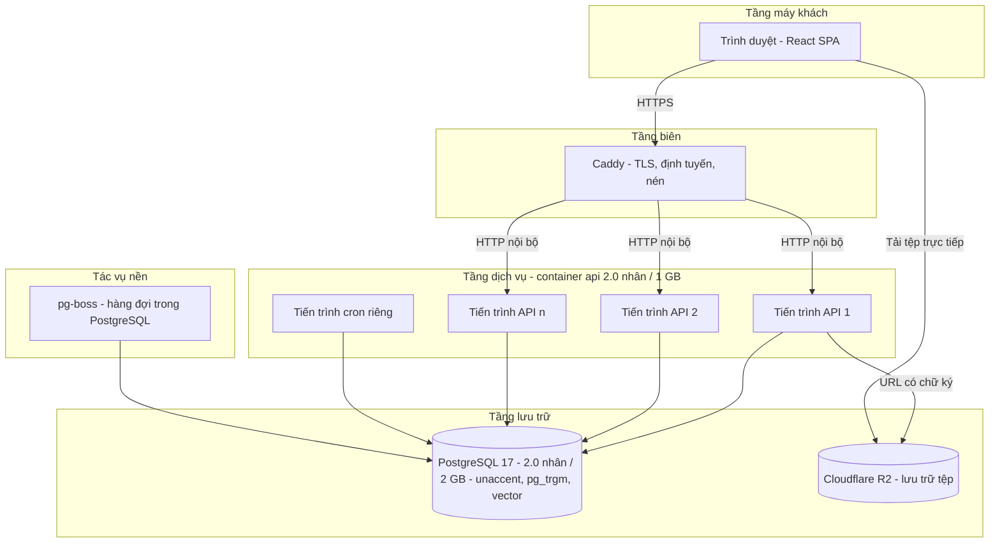

**Hình 1.1. Kiến trúc tổng thể của hệ thống**

Mô hình triển khai gồm bốn container trên một máy chủ. Bảng 3.4 tại Chương 3 trình bày giới hạn tài nguyên của từng container. Việc giới hạn tài nguyên không chỉ nhằm tiết kiệm chi phí mà còn để các phép đo hiệu năng tại Chương 4 phản ánh đúng năng lực của một cấu hình xác định, thay vì phụ thuộc vào tài nguyên dư thừa của máy phát triển.

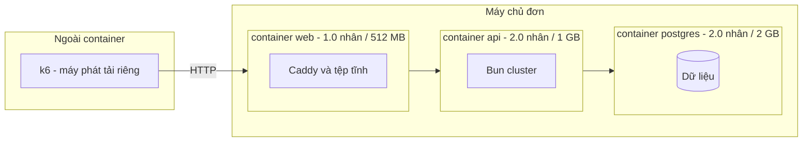

**Hình 1.2. Mô hình triển khai container và vị trí công cụ đo tải**

### 1.6. Ứng dụng liên quan

Bảng 1.4 so sánh hệ thống với bốn nhóm công cụ mà người dùng Đà Nẵng đang sử dụng, trên các tiêu chí liên quan trực tiếp tới mục tiêu của đồ án. Việc so sánh nhằm xác định khoảng trống chức năng, không nhằm khẳng định ưu thế toàn diện.

**Bảng 1.4. So sánh với các hệ thống khám phá địa điểm hiện có**

| Tiêu chí | Google Maps | Foody | Yelp | Nhóm Facebook, Zalo | Hệ thống của đồ án |
|---|---|---|---|---|---|
| Dữ liệu địa điểm địa phương | Rất phong phú | Phong phú | Không có dữ liệu Việt Nam | Không cấu trúc | 358 địa điểm, có cấu trúc |
| Tìm kiếm tiếng Việt không dấu | Hạn chế | Có hỗ trợ | Không áp dụng | Không có | Có, kết hợp bỏ dấu và khớp mờ |
| Cập nhật quán mới | Chậm | Trung bình | Không áp dụng | Nhanh nhất | Nhanh, qua nội dung người dùng |
| Bình chọn nhóm có kết quả tức thời | Không có | Không có | Không có | Thủ công, không tổng hợp | Có, cập nhật tức thời |
| Gợi ý khi chưa có lịch sử | Dựa trên vị trí | Dựa trên độ phổ biến | Dựa trên độ phổ biến | Không có | Kết hợp nội dung và suy giảm |
| Chi phí vận hành cho đơn vị nhỏ | Không tự vận hành được | Không tự vận hành được | Không tự vận hành được | Miễn phí nhưng không có API | Tự vận hành trên một máy chủ |

Khoảng trống được xác định từ Bảng 1.4 gồm ba điểm. Thứ nhất, không có công cụ nào kết hợp được dữ liệu địa điểm có cấu trúc với tốc độ cập nhật của nội dung cộng đồng. Thứ hai, chức năng bình chọn nhóm chưa được cung cấp dưới dạng có tổng hợp kết quả tự động. Thứ ba, các hệ thống hiện có đều giải quyết bài toán khởi đầu lạnh bằng độ phổ biến thuần tuý, tạo ra thiên vị có hệ thống đối với quán đã nổi tiếng.

---

## CHƯƠNG 2. PHÂN TÍCH VÀ THIẾT KẾ HỆ THỐNG

### 2.1. Tác nhân và use case

**Bảng 2.1. Danh sách tác nhân**

| Mã | Tác nhân | Mô tả | Quyền hạn chính |
|---|---|---|---|
| AC-01 | Khách | Người chưa đăng nhập | Xem địa điểm, tìm kiếm, xem bài công khai, xem trang chia sẻ |
| AC-02 | Thành viên | Người đã đăng ký và đăng nhập | Toàn bộ quyền của khách, cộng với tạo nội dung và tương tác |
| AC-03 | Khách trong phòng | Người tham gia phòng bình chọn qua mã phòng, có thể chưa có tài khoản | Đề xuất và bình chọn trong phòng, nhận cập nhật thời gian thực |
| AC-04 | Quản trị viên nội dung | Thành viên có cờ quản trị | Ẩn nội dung vi phạm, xử lý báo cáo |
| AC-05 | Tiến trình nền | Thành phần hệ thống không có giao diện | Phát hiện địa điểm trong bài, tính gợi ý hằng ngày, dọn dữ liệu hết hạn |

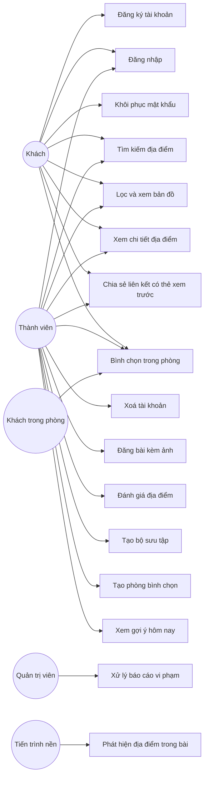

**Hình 2.1. Sơ đồ use case tổng quát**

**Bảng 2.2. Danh mục use case**

| Mã | Tên use case | Tác nhân | Yêu cầu liên quan |
|---|---|---|---|
| UC-01 | Đăng ký tài khoản | Khách | FR-01 |
| UC-02 | Đăng nhập và duy trì phiên | Khách, Thành viên | FR-02 |
| UC-03 | Khôi phục mật khẩu | Khách | FR-03 |
| UC-04 | Quản lý hồ sơ cá nhân | Thành viên | FR-04 |
| UC-05 | Tìm kiếm địa điểm | Khách, Thành viên | FR-05 |
| UC-06 | Lọc và xem bản đồ | Khách, Thành viên | FR-06, FR-07 |
| UC-07 | Xem chi tiết địa điểm | Khách, Thành viên | FR-08 |
| UC-08 | Đăng bài kèm ảnh | Thành viên | FR-09, FR-10 |
| UC-09 | Tương tác với bài viết | Thành viên | FR-11 |
| UC-10 | Viết đánh giá địa điểm | Thành viên | FR-12 |
| UC-11 | Báo cáo vi phạm | Thành viên | FR-13 |
| UC-12 | Quản lý bộ sưu tập | Thành viên | FR-14 |
| UC-13 | Nhận thông báo | Thành viên | FR-15 |
| UC-14 | Tạo phòng bình chọn nhóm | Thành viên | FR-16, FR-17 |
| UC-15 | Bình chọn trong phòng | Khách trong phòng, Thành viên | FR-17 |
| UC-16 | Xem gợi ý hôm nay | Thành viên | FR-18 |
| UC-17 | Gợi ý theo nội dung đang soạn | Thành viên | FR-19 |
| UC-18 | Chia sẻ liên kết có thẻ xem trước | Khách, Thành viên | FR-20 |

Đặc tả chi tiết của bốn use case có luồng phức tạp nhất (UC-08, UC-09, UC-14, UC-15) được trình bày tại Phụ lục D theo cấu trúc: tác nhân, tiền điều kiện, luồng chính, các luồng thay thế, hậu điều kiện. Các use case còn lại có luồng tuyến tính và được mô tả đầy đủ qua hợp đồng API tại mục 2.3.

### 2.2. Thiết kế cơ sở dữ liệu

Lược đồ dữ liệu gồm 29 bảng, trong đó 4 bảng thuộc miền tài khoản và phiên, 25 bảng thuộc miền nghiệp vụ. Ngoài ra hệ quản trị Prisma tự sinh một bảng ghi nhận lịch sử migration; bảng này không thuộc lược đồ nghiệp vụ và không được tính trong con số trên.

**Bảng 2.3. Nhóm bảng dữ liệu theo miền nghiệp vụ**

| Miền | Số bảng | Các bảng |
|---|---|---|
| Tài khoản và phiên | 4 | Người dùng, Phiên, Tài khoản liên kết, Mã xác thực |
| Quan hệ xã hội | 1 | Theo dõi |
| Địa điểm | 6 | Địa điểm, Ảnh địa điểm, Đánh giá, Báo cáo địa điểm, Vector địa điểm, Gợi ý hằng ngày |
| Nội dung | 7 | Bài đăng, Ảnh bài đăng, Lượt thích bài, Lượt lưu bài, Bình luận, Lượt thích bình luận, Sự kiện tương tác |
| Bộ sưu tập | 3 | Bộ sưu tập, Địa điểm trong bộ sưu tập, Lượt thích bộ sưu tập |
| Phòng bình chọn | 3 | Phòng, Thành viên phòng, Đề xuất trong phòng |
| Thông báo | 2 | Thông báo, Thông báo gợi ý địa điểm |
| Hạ tầng | 3 | Giới hạn tần suất, Khoá lũy đẳng, Bộ đệm sở thích |

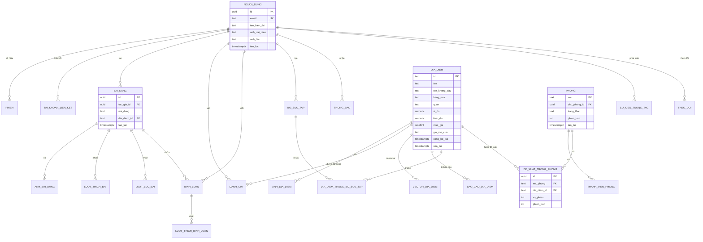

**Hình 2.2. Sơ đồ thực thể liên kết mức khái niệm (rút gọn, chỉ hiển thị quan hệ chính)**

Bốn quyết định thiết kế dữ liệu dưới đây ảnh hưởng trực tiếp tới hiệu năng và tính đúng đắn của hệ thống.

**Không lưu trữ điểm đánh giá trung bình và số lượt đánh giá trên bảng địa điểm.** Hai giá trị này được tính bằng phép tổng hợp trên bảng đánh giá mỗi khi cần hiển thị. Lựa chọn này loại bỏ nguy cơ sai lệch giữa giá trị lưu trữ và dữ liệu gốc, đổi lại chi phí đọc tăng. Với 358 địa điểm và số đánh giá ở quy mô hiện tại, phép tổng hợp vẫn nằm trong ngưỡng NFR-02. Khi số đánh giá tăng lên hàng trăm nghìn, cần chuyển sang bảng tổng hợp cập nhật theo sự kiện.

**Lưu trữ cột tên đã bỏ dấu.** Mỗi địa điểm có một cột lưu tên đã qua xử lý bỏ dấu và chuẩn hoá chữ thường, được ghi cùng lúc với tên gốc. Cột này có chỉ mục GIN dùng toán tử khớp mờ trigram. Cách làm này đánh đổi dung lượng lưu trữ lấy tốc độ truy vấn: phép bỏ dấu không phải thực hiện lại cho mỗi bản ghi trong mỗi lần tìm kiếm.

**Khoá ngoại từ địa điểm sang bảng khác dùng chế độ hạn chế xoá.** Khi một địa điểm bị xoá, hệ thống không xoá theo dây chuyền các bài đăng hay đánh giá tham chiếu tới nó, mà chặn thao tác xoá. Địa điểm được xoá mềm bằng cách gán dấu thời gian xoá; mọi truy vấn đọc đều lọc theo điều kiện này. Cách làm giữ được tính toàn vẹn lịch sử của nội dung người dùng.

**Bảng sự kiện tương tác được phân vùng theo tháng.** Bảng ghi nhận mọi hành vi có tín hiệu học (xem, thích, lưu, đánh giá, tìm kiếm) và là nguồn dữ liệu duy nhất cho việc tính gợi ý. Bảng được phân vùng theo khoảng thời gian tháng, kèm một phân vùng mặc định để không mất sự kiện nằm ngoài các khoảng đã khai báo. Cách phân vùng cho phép loại bỏ dữ liệu cũ bằng thao tác xoá phân vùng thay vì xoá từng dòng.

**Về lưu trữ vector.** Bảng vector địa điểm lưu trường 384 chiều và một giá trị băm nội dung để biết khi nào phải tính lại vector. Kiểu dữ liệu vector không được Prisma hỗ trợ trực tiếp, nên trường này được khai báo dưới dạng kiểu không xác định và chỉ đọc ghi qua truy vấn thô. Phần mở rộng vector phải được cài đặt ở tầng cơ sở dữ liệu trước khi chạy migration tương ứng; điều kiện này được ghi rõ trong tệp migration và trong Phụ lục A.

### 2.3. Thiết kế hợp đồng API

API được tổ chức theo phong cách tài nguyên, tiền tố phiên bản cố định, và nhóm theo miền nghiệp vụ. Mười hai nhóm endpoint được đăng ký, cộng với tuyến xử lý xác thực do thư viện xác thực đảm nhận.

**Bảng 2.4. Danh mục nhóm endpoint API**

| Nhóm | Tiền tố tài nguyên | Số endpoint tiêu biểu | Chức năng |
|---|---|---|---|
| Xác thực và phiên | `/auth`, `/me`, `/session`, `/register` | 9 | Đăng ký, đăng nhập, đăng xuất, khôi phục mật khẩu, xác thực email, đọc phiên hiện tại |
| Địa điểm | `/places` | 6 | Danh sách có lọc, tìm kiếm, dữ liệu bản đồ, chi tiết, gợi ý theo ngữ cảnh |
| Người dùng | `/users` | 5 | Hồ sơ công khai, cập nhật hồ sơ, theo dõi, danh sách gợi ý người |
| Bài đăng | `/posts` | 12 | Tạo, đọc, xoá bài; thích; lưu; bình luận; thích bình luận |
| Thông báo | `/notifications` | 3 | Danh sách, đánh dấu đã đọc, đếm chưa đọc |
| Đánh giá | `/reviews` | 4 | Tạo, sửa, xoá đánh giá; báo cáo địa điểm |
| Bộ sưu tập | `/collections` | 7 | Tạo, sửa, xoá; thêm bớt địa điểm; thích |
| Phòng bình chọn | `/rooms` | 8 | Tạo phòng, tham gia, đề xuất, bình chọn, chốt kết quả, luồng sự kiện |
| Phương tiện | `/media` | 2 | Xin URL có chữ ký để tải lên, xác nhận hoàn tất |
| Thẻ xem trước | `/og` | 2 | Sinh thẻ xem trước cho địa điểm và bài viết |
| Hệ thống | `/system` | 2 | Số liệu vận hành, đặt lại dữ liệu demo |
| Sự kiện | `/events` | 1 | Ghi nhận sự kiện tương tác từ giao diện |

Ba quy ước chung áp dụng cho toàn bộ API.

**Định dạng lỗi.** Mọi phản hồi lỗi trả về một đối tượng JSON có trường thông điệp, mã lỗi nghiệp vụ dạng chuỗi, và mã định danh yêu cầu để đối chiếu log. Riêng phản hồi lỗi máy chủ nội bộ có thêm trường mã lỗi hệ thống, do đó câu "mọi lỗi chỉ có một trường thông điệp" không đúng với trường hợp này. Bảng mã lỗi đầy đủ nằm tại Phụ lục C.

**Phân trang bằng con trỏ.** Các endpoint danh sách dùng phân trang theo khoá thay vì theo số trang, nhằm tránh hiện tượng bản ghi bị lặp hoặc bị bỏ qua khi dữ liệu thay đổi giữa hai lần tải. Con trỏ được mã hoá từ cặp giá trị sắp xếp và định danh bản ghi. Đoạn mã cài đặt được trình bày tại mục 3.3.

**Tính lũy đẳng cho thao tác tạo.** Các endpoint tạo tài nguyên quan trọng chấp nhận một khoá lũy đẳng do máy khách sinh. Nếu cùng khoá được gửi lại trong khoảng thời gian hiệu lực, hệ thống trả về kết quả của lần gọi đầu tiên thay vì tạo bản ghi mới. Cơ chế được trình bày tại mục 3.8.

### 2.4. Thiết kế bảo mật

Thiết kế bảo mật được tổ chức theo nguyên tắc phòng thủ nhiều lớp, với bốn nhóm kiểm soát tương ứng bốn lớp tấn công phổ biến.

**Bảng 2.5. Cơ chế bảo mật theo lớp tấn công**

| Lớp tấn công | Cơ chế kiểm soát | Tham số cụ thể |
|---|---|---|
| Đánh cắp phiên qua mã kịch bản | Cookie phiên đặt cờ `HttpOnly`, cờ `Secure`, và `SameSite=Lax` | Tên cookie do thư viện xác thực sinh; thời hạn phiên 7 ngày; phiên lưu phía máy chủ |
| Giả mạo yêu cầu chéo trang | Cờ `SameSite=Lax` kết hợp kiểm tra tiêu đề nguồn gửi với các endpoint ghi | Áp dụng cho toàn bộ endpoint thay đổi trạng thái |
| Tiêm mã vào cơ sở dữ liệu | Tham số hoá toàn bộ truy vấn; các đoạn truy vấn thô đều dùng cơ chế tham số của thư viện | Không có truy vấn nào ghép chuỗi trực tiếp từ đầu vào |
| Truy cập tài nguyên không kiểm tra quyền | Kiểm tra chủ sở hữu ở tầng dịch vụ trước khi đọc ghi; tài nguyên riêng tư trả về không tìm thấy thay vì bị từ chối | Áp dụng cho bài đăng, bộ sưu tập, đánh giá, phòng |
| Dò mật khẩu và lạm dụng endpoint | Giới hạn tần suất theo không gian khoá, có bộ đếm lưu trong cơ sở dữ liệu | Xem Bảng 2.6 |
| Rò rỉ bí mật cấu hình | Chuỗi bí mật đọc từ biến môi trường; tiến trình từ chối khởi động ở chế độ triển khai nếu thiếu | Áp dụng cho khoá ký phiên và khoá truy cập lưu trữ |

**Bảng 2.6. Giới hạn tần suất theo endpoint**

| Nhóm endpoint | Khoá giới hạn | Ngưỡng |
|---|---|---|
| Đăng nhập, đăng ký, khôi phục mật khẩu | Địa chỉ IP kết hợp định danh tài khoản | Ngưỡng thấp, đếm theo cửa sổ phút |
| Tạo nội dung (bài, đánh giá, bình luận) | Định danh người dùng | Ngưỡng trung bình, đếm theo cửa sổ phút |
| Tương tác xã hội (thích, lưu, theo dõi) | Định danh người dùng | Ngưỡng trung bình |
| Mở luồng sự kiện phòng | Định danh người dùng hoặc mã phòng | 30 lượt mỗi 60 giây |
| Đọc danh sách và tìm kiếm | Địa chỉ IP | Ngưỡng cao, đếm theo cửa sổ phút |

Ngưỡng cụ thể của từng nhóm được khai báo trong cấu hình, không nằm trong mã nguồn, để có thể điều chỉnh khi triển khai mà không phải sửa mã. Bộ đếm được lưu trong bảng giới hạn tần suất với khoá tổng hợp từ phạm vi, định danh chủ thể và cửa sổ thời gian, cho phép nhiều tiến trình API cùng chia sẻ trạng thái đếm.

**Về mã phòng.** Mã phòng dùng để người khác tham gia có độ dài sáu ký tự, lấy từ bảng chữ cái 30 ký tự, tương ứng không gian tổ hợp khoảng 7,3 × 10⁸ giá trị. Không gian này đủ để chống dò tuần tự nhưng không đủ để chống dò có chủ đích trong thời gian dài. Vì vậy mã phòng không được dùng làm yếu tố xác thực duy nhất: endpoint mở luồng sự kiện bị giới hạn tần suất theo mã phòng, và người tham gia phải nhận được mã qua kênh do chủ phòng chia sẻ. Hệ thống không coi việc biết mã phòng là bằng chứng đủ mạnh về quyền truy cập dữ liệu nhạy cảm.

---

## CHƯƠNG 3. TRIỂN KHAI HỆ THỐNG

### 3.1. Cấu trúc mã nguồn

Mã nguồn được tổ chức thành ba gói độc lập chia sẻ một gói lược đồ chung, phản ánh ba tầng triển khai. Gói lược đồ chung chứa các định nghĩa kiểu dữ liệu và quy tắc kiểm tra được dùng đồng thời ở phía máy chủ và phía máy khách, nhờ đó hợp đồng dữ liệu chỉ được định nghĩa một lần.

**Bảng 3.1. Cấu trúc tổ chức mã nguồn theo trách nhiệm**

| Khối | Trách nhiệm |
|---|---|
| Gói lược đồ chung | Định nghĩa kiểu dữ liệu và quy tắc kiểm tra dùng chung cho cả máy chủ và máy khách |
| Tầng định tuyến | Định nghĩa endpoint, kiểm tra đầu vào, gắn middleware |
| Tầng thuật toán tìm kiếm | Các nhánh tín hiệu tìm kiếm và tầng hợp nhất xếp hạng |
| Tầng thuật toán gợi ý | Tính điểm sở thích, chọn gợi ý hằng ngày, đệm sở thích |
| Tầng hạ tầng dùng chung | Kết nối cơ sở dữ liệu, xác thực, hàng đợi, ghi log, đồng bộ sự kiện |
| Tiến trình nền | Xử lý tác vụ bất đồng bộ và công việc định kỳ |
| Lược đồ dữ liệu | Khai báo cấu trúc bảng và các migration có phiên bản |
| Công cụ vận hành | Nạp dữ liệu, đo hiệu năng, đánh giá thuật toán |
| Kiểm thử tầng dịch vụ | Kiểm thử tự động của tầng máy chủ |
| Tầng giao diện | Trang và thành phần dùng lại của ứng dụng web, lời gọi API, quản lý trạng thái |
| Kiểm thử đầu cuối | Kiểm thử chạy trên trình duyệt thật |
| Cấu hình triển khai | Cấu hình container và máy chủ biên |

### 3.2. Luồng xác thực và phiên

Hệ thống dùng mô hình phiên lưu phía máy chủ. Khi người dùng đăng nhập thành công, máy chủ tạo một bản ghi phiên trong cơ sở dữ liệu, sinh một mã phiên ngẫu nhiên, rồi gửi mã đó về trình duyệt trong một cookie được đánh dấu không cho mã kịch bản đọc. Mọi yêu cầu sau đó được xác thực bằng cách tra bản ghi phiên theo mã, không dựa vào dữ liệu do máy khách tự khai.

Lựa chọn mô hình phiên phía máy chủ thay vì token tự chứa mang theo một đánh đổi rõ ràng. Ưu điểm là khả năng thu hồi phiên tức thời: khi người dùng đăng xuất hoặc khi phát hiện bất thường, bản ghi phiên bị xoá và mọi yêu cầu tiếp theo bị từ chối ngay. Nhược điểm là mỗi yêu cầu cần một truy vấn cơ sở dữ liệu, và hệ thống phụ thuộc vào tính khả dụng của cơ sở dữ liệu cho cả luồng xác thực.

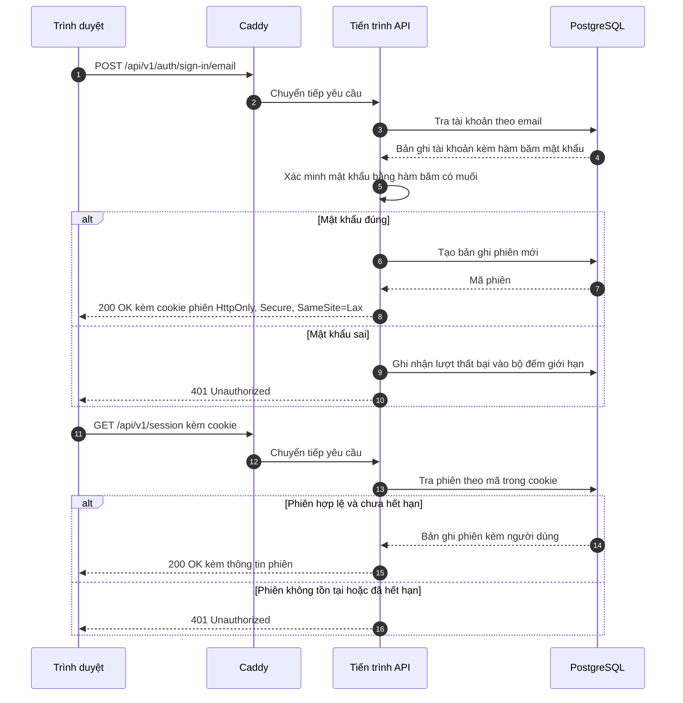

**Hình 3.1. Luồng xác thực và cấp phiên**

Hai chi tiết triển khai đáng lưu ý. Thứ nhất, thông điệp lỗi khi đăng nhập sai không phân biệt giữa trường hợp email không tồn tại và trường hợp mật khẩu sai, nhằm tránh rò rỉ thông tin về việc một email có tài khoản hay không. Thứ hai, phép so khớp mật khẩu dùng hàm băm có muối với tham số chi phí được chọn để mỗi lần kiểm tra mất khoảng vài chục mili giây, đủ để làm chậm tấn công dò mà không gây khó chịu cho người dùng hợp lệ.

### 3.3. Tìm kiếm và lọc địa điểm

#### 3.3.1. Bài toán và các nhánh tín hiệu

Truy vấn tìm kiếm của người dùng Việt Nam có ba đặc điểm cần xử lý riêng. Thứ nhất, phần lớn người dùng gõ không dấu, nên "bun bo hue" phải khớp với "Bún bò Huế". Thứ hai, lỗi gõ là phổ biến, nên "bun cha ca" phải khớp với "Bún chả cá" dù thiếu một ký tự. Thứ ba, một số truy vấn chứa cả tên riêng và thuộc tính, ví dụ "quan nhau hai chau mo cua khuya", đòi hỏi phải xử lý đồng thời cả khớp tên và khớp điều kiện.

Hệ thống triển khai bốn nhánh tín hiệu độc lập, mỗi nhánh trả về một danh sách định danh địa điểm đã xếp hạng:

*Nhánh khớp tên chính xác và khớp tiền tố.* Nhánh này nhận diện trường hợp truy vấn chứa tên riêng của địa điểm. Nó so khớp trên cột tên đã bỏ dấu và sinh ba mức kết quả: khớp toàn bộ, khớp phần đầu, và khớp theo từng từ.

*Nhánh khớp mờ trigram.* Nhánh này dùng chỉ mục GIN với toán tử tương đồng trigram để chịu được lỗi gõ. Độ tương đồng được tính trên tập ba ký tự liên tiếp, nên hai chuỗi chỉ khác nhau một ký tự vẫn đạt điểm cao.

*Nhánh khớp điều kiện có cấu trúc.* Nhánh này trích xuất các thuộc tính có cấu trúc từ truy vấn tự nhiên: hạng mục, quận, khoảng giá, trạng thái mở cửa. Việc trích xuất dựa trên một từ điển ý định được xây dựng thủ công cho miền dữ liệu địa điểm, kết hợp đối sánh từ khoá và quy tắc.

*Nhánh khớp ngữ nghĩa.* Nhánh này dùng vector nhúng 384 chiều cho cả địa điểm và truy vấn, xếp hạng theo khoảng cách cosine. Nhánh này xử lý được truy vấn trừu tượng như "chỗ ngồi yên tĩnh làm việc", vốn không chứa từ khoá nào trùng với mô tả địa điểm.

#### 3.3.2. Thuật toán hợp nhất xếp hạng có kiểm soát bằng chứng

Kỹ thuật hợp nhất xếp hạng nghịch đảo (Reciprocal Rank Fusion) kết hợp nhiều danh sách xếp hạng bằng cách cộng nghịch đảo thứ hạng:

$$S(d) = \sum_{r \in R} \frac{w_r}{k + \mathrm{rank}_r(d)}$$

trong đó $R$ là tập các nhánh tín hiệu, $\mathrm{rank}_r(d)$ là thứ hạng của địa điểm $d$ trong nhánh $r$ (bằng vô cực nếu $d$ không xuất hiện trong nhánh đó), $w_r$ là trọng số nhánh, và $k$ là hằng số làm mịn.

Hằng số $k$ trong công thức gốc được đặt cố định bằng 60, một giá trị được chọn thực nghiệm cho bài toán tìm kiếm văn bản quy mô lớn. Với corpus chỉ 358 bản ghi, giá trị này làm phẳng quá mức khác biệt giữa các thứ hạng đầu: với $k = 60$, chênh lệch điểm giữa hạng 1 và hạng 2 chỉ khoảng 1,6%. Hệ thống điều chỉnh $k$ theo quy mô corpus:

$$k(N) = \max\left(10,\ \left\lfloor 2\sqrt{N} \right\rfloor\right)$$

Với $N = 358$, giá trị $k(N)$ xấp xỉ 37. Cần lưu ý rằng việc đổi $k$ tự nó đã làm thay đổi kết quả, độc lập với tầng kiểm soát bằng chứng. Phân tích tách biệt hai yếu tố này được trình bày tại mục 4.7.

Vấn đề thứ hai mà công thức gốc không giải quyết là hiện tượng nhiễu do hợp nhất. Khi truy vấn chứa tên riêng của một quán, nhánh khớp tên trả về đúng quán đó ở hạng một, nhưng các nhánh khác vẫn trả về những quán khác có liên quan yếu. Khi hợp nhất, các nhánh yếu cộng dồn điểm cho nhiều quán khác nhau và có thể đẩy quán đúng xuống dưới. Hiện tượng này được gọi là thuế hợp nhất.

Hệ thống giải quyết bằng một tầng kiểm soát bằng chứng đặt trước bước hợp nhất. Tầng này trích xuất bằng chứng định danh từ truy vấn, rồi chọn bộ trọng số tương ứng:

**Bảng 3.2. Trọng số gating của thuật toán EGRF**

| Điều kiện bằng chứng | Trọng số nhánh tên | Trọng số nhánh cấu trúc | Trọng số nhánh ngữ nghĩa | Trọng số nhánh mờ |
|---|---|---|---|---|
| Có khớp tên chính xác | 4,0 | 0 | 0 | 0,5 |
| Có khớp tiền tố tên | 3,0 | 0,5 | 0,5 | 1,0 |
| Không có bằng chứng định danh, có thuộc tính cấu trúc | 0,5 | 3,0 | 1,0 | 1,0 |
| Không có bằng chứng định danh, truy vấn trừu tượng | 0,5 | 1,0 | 2,5 | 1,0 |

Quá trình chọn trọng số diễn ra theo bốn nhánh quyết định, xét lần lượt từ mức bằng chứng mạnh nhất xuống yếu nhất. Nhánh thứ nhất kiểm tra sự tồn tại của một kết quả khớp chính xác toàn bộ tên địa điểm; nếu có, chỉ nhánh tên được gán trọng số áp đảo và ba nhánh còn lại bị triệt tiêu hoặc giữ trọng số rất nhỏ. Nhánh thứ hai áp dụng khi chỉ có khớp tiền tố tên: nhánh tên vẫn dẫn dắt nhưng các nhánh cấu trúc và ngữ nghĩa được giữ ở mức thấp để bổ trợ. Nhánh thứ ba áp dụng khi truy vấn không chứa tên riêng nhưng chứa thuộc tính có cấu trúc: nhánh cấu trúc được gán trọng số cao nhất. Nhánh thứ tư áp dụng cho truy vấn trừu tượng không có cả bằng chứng định danh lẫn thuộc tính: nhánh ngữ nghĩa được gán trọng số cao nhất.

Sau khi xác định trọng số, hệ thống tính hệ số làm mịn theo quy mô corpus, rồi thực hiện phép hợp nhất trên năm danh sách đã xếp hạng: khớp tên chính xác, khớp tiền tố, khớp cấu trúc, khớp ngữ nghĩa và khớp mờ. Kết quả là một danh sách định danh duy nhất được sắp theo điểm tổng hợp.

Về mặt thiết kế, điểm khác biệt so với hợp nhất xếp hạng thuần tuý nằm ở chỗ trọng số không cố định mà phụ thuộc vào nội dung truy vấn. Cách này có cơ sở lý luận rõ ràng: khi người dùng gõ đúng tên quán, tín hiệu mạnh nhất là khớp tên, và các tín hiệu khác chỉ nên đóng vai trò phá hoà. Khi người dùng gõ mô tả trừu tượng, tín hiệu tên gần như vô nghĩa và tín hiệu ngữ nghĩa phải dẫn dắt.

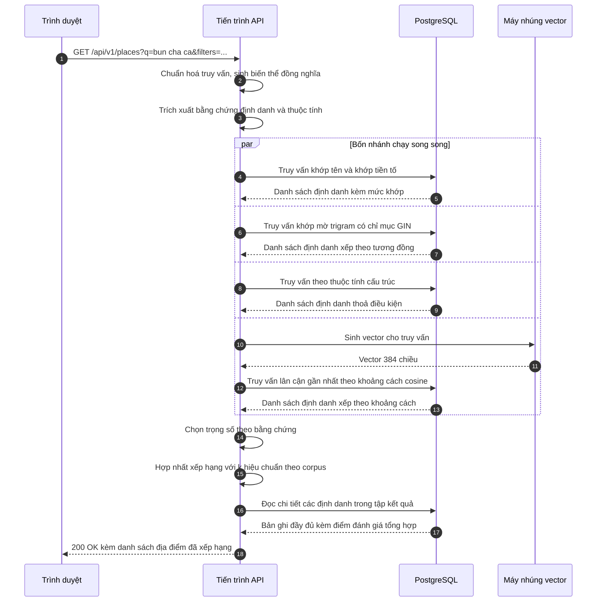

**Hình 3.2. Luồng tìm kiếm lai ghép có kiểm soát bằng chứng**

#### 3.3.3. Lọc và phân trang bằng con trỏ

Bộ lọc được biểu diễn dưới dạng tập điều kiện có kiểu, được ghép thành mệnh đề truy vấn có tham số. Cách này vừa tránh tiêm mã, vừa cho phép tái sử dụng cùng một hàm dựng điều kiện cho cả nhánh tìm kiếm và nhánh lọc thuần tuý.

Phân trang dùng khoá thay vì số trang. Con trỏ chứa cặp giá trị của cột sắp xếp và định danh bản ghi, được mã hoá thành chuỗi để máy khách gửi lại nguyên vẹn. Khi có con trỏ, hệ thống bổ sung một điều kiện so sánh bộ giá trị của cột sắp xếp và định danh nhỏ hơn giá trị của con trỏ, rồi sắp xếp theo chiều giảm dần của cùng bộ giá trị đó. Việc so sánh theo bộ giá trị tận dụng đúng thứ tự của chỉ mục tổng hợp, nên phép lọc con trỏ được thực hiện bằng tìm kiếm chỉ mục thay vì quét tuần tự. Định danh được đưa vào khoá sắp xếp để phá hoà khi nhiều bản ghi có cùng dấu thời gian, đảm bảo không bản ghi nào bị lặp hoặc bị bỏ qua. Truy vấn đọc thêm một bản ghi so với kích thước trang để xác định còn dữ liệu phía sau hay không, rồi sinh con trỏ tiếp theo từ bản ghi cuối của trang hiện tại.

### 3.4. Đăng bài và phát hiện địa điểm

Luồng đăng bài gồm hai giai đoạn tách biệt: ghi dữ liệu đồng bộ và xử lý nền bất đồng bộ. Giai đoạn đồng bộ phải hoàn tất nhanh để người dùng thấy bài xuất hiện ngay. Giai đoạn nền thực hiện phần việc tốn thời gian là phân tích nội dung để nhận diện địa điểm được nhắc tới.

Trình tự là: ghi bản ghi bài đăng, sau đó đưa một tác vụ vào hàng đợi. Hai thao tác này không nằm trong cùng một giao dịch. Nếu thao tác thứ hai thất bại, bài đăng vẫn tồn tại nhưng không có tác vụ phát hiện địa điểm. Hệ thống xử lý tình huống này bằng một tác vụ quét định kỳ: mỗi chu kỳ, tiến trình nền tìm các bài đăng được tạo trong khoảng gần nhất mà chưa có bản ghi phát hiện địa điểm, và đưa chúng vào hàng đợi. Cơ chế này biến một lỗi có thể xảy ra thành một độ trễ có giới hạn.

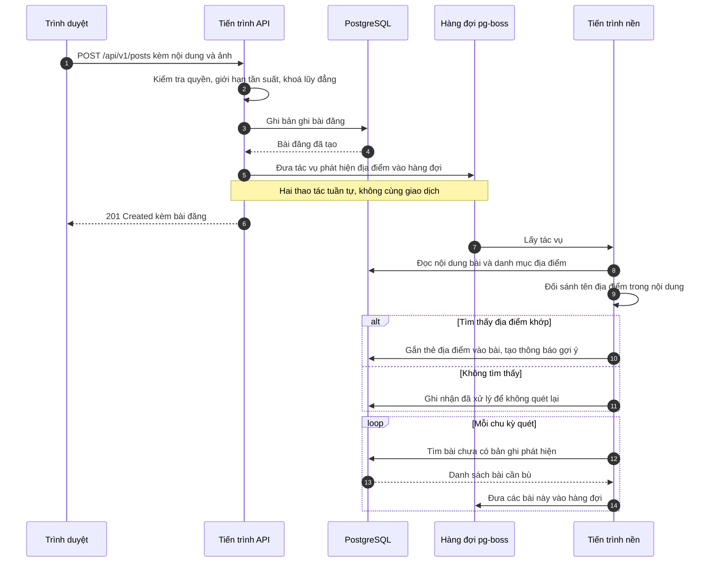

**Hình 3.3. Luồng đăng bài và phát hiện địa điểm bất đồng bộ**

### 3.5. Gợi ý cá nhân hoá

#### 3.5.1. Bài toán khởi đầu lạnh

Hệ thống gợi ý phải trả lời hai câu hỏi khác nhau. Với người dùng đã có lịch sử, câu hỏi là "địa điểm nào phù hợp với sở thích đã quan sát". Với người dùng mới, câu hỏi là "địa điểm nào đáng giới thiệu khi chưa biết gì về người này".

Cách tiếp cận thông thường cho câu hỏi thứ hai là xếp hạng theo độ phổ biến. Cách này có ưu điểm đơn giản và thường đạt kết quả tốt trên các tập dữ liệu đối chứng, nhưng có một hệ quả có hại về dài hạn: địa điểm đã nổi tiếng tiếp tục được hiển thị, nhận thêm tương tác, và càng nổi tiếng hơn. Địa điểm mới không bao giờ có cơ hội thu thập tương tác để chứng minh chất lượng. Hiện tượng này được gọi là hiệu ứng kẻ giàu càng giàu.

Đồ án đặt mục tiêu khiêm tốn hơn việc vượt qua baseline phổ biến: xây dựng một hàm xếp hạng có thể điều chỉnh được mức độ ưu tiên độ phổ biến, và đo xem việc giảm ưu tiên đó gây thiệt hại bao nhiêu về độ chính xác. Kết quả đo được trình bày trung thực tại mục 4.7, bao gồm cả các trường hợp hàm đề xuất kém hơn baseline.

#### 3.5.2. Hàm tính điểm có suy giảm theo bằng chứng

Điểm của một địa điểm được tính từ hai thành phần: điểm nội dung và điểm phổ biến có suy giảm.

$$\hat{R}(i) = \frac{v_i \cdot \bar{r}_i + m_i \cdot \mu_0}{v_i + m_i}$$

Đây là công thức trung bình Bayes có điều chỉnh, trong đó $\bar{r}_i$ là điểm đánh giá trung bình quan sát được của địa điểm $i$, $v_i$ là số lượt đánh giá, $\mu_0$ là điểm trung bình tiên nghiệm của toàn hệ thống, và $m_i$ là khối lượng tiên nghiệm. Giá trị $m_i$ phụ thuộc mức độ hoàn thiện thông tin của địa điểm:

$$m_i = m_0 \cdot \left(1 + \gamma \cdot C_i\right)$$

trong đó $C_i \in [0,1]$ là độ hoàn thiện thông tin, tính từ việc địa điểm có ảnh thật, có giờ mở cửa, có số điện thoại, và có mô tả hay không. Các hằng số được dùng là $m_0 = 10$, $\gamma = 0.5$, $\mu_0 = 4.0$.

Ý nghĩa của công thức: khi một địa điểm có ít lượt đánh giá, điểm của nó bị kéo về phía trung bình tiên nghiệm. Khi số lượt đánh giá tăng, điểm tiến dần về giá trị quan sát. Giá trị $m_i$ lớn hơn cho địa điểm có thông tin đầy đủ nghĩa là địa điểm đó cần nhiều bằng chứng hơn để thoát khỏi mức tiên nghiệm. Cách đặt này có chủ đích: một địa điểm có đủ thông tin nhưng ít đánh giá chưa chắc kém, trong khi một địa điểm thiếu thông tin với ít đánh giá là tín hiệu yếu hơn.

**Bảng 3.3. Tham số của thuật toán DES**

| Tham số | Giá trị | Vai trò | Cách chọn |
|---|---|---|---|
| $m_0$ | 10 | Khối lượng tiên nghiệm cơ sở | Chọn theo tỉ lệ với số đánh giá trung vị của corpus |
| $\gamma$ | 0,5 | Mức tăng khối lượng theo độ hoàn thiện | Chọn theo thực nghiệm trên tập nội bộ |
| $\mu_0$ | 4,0 | Điểm trung bình tiên nghiệm | Tính từ phân bố điểm đánh giá của corpus |
| Biên độ nhiễu | 0,05 | Độ lớn nhiễu xoay theo khung giờ | Chọn để đủ phá thế hoà mà không đảo thứ hạng rõ rệt |
| Chu kỳ xoay | 6 giờ | Khoảng thời gian đổi hạt giống nhiễu | Chọn theo nhịp sử dụng trong ngày |

Thành phần thứ hai là cơ chế xoay tua có nhiễu theo khung giờ. Sau khi tính điểm, hệ thống thêm một lượng nhiễu nhỏ vào điểm của từng địa điểm, với hạt giống được sinh lại theo chu kỳ sáu giờ. Lượng nhiễu được lấy từ một hàm băm nhận đầu vào là định danh địa điểm kết hợp chỉ số khung giờ hiện tại, rồi ánh xạ kết quả về khoảng đối xứng quanh không với biên độ cho trước. Cơ chế này không làm thay đổi thứ hạng một cách ngẫu nhiên mà chỉ phá thế hoà giữa các địa điểm có điểm gần bằng nhau, nhờ đó các địa điểm ít được hiển thị có cơ hội xuất hiện luân phiên. Vì hạt giống ổn định trong suốt một khung giờ, danh sách gợi ý không bị xáo trộn giữa các lần tải liên tiếp của cùng một người dùng.

#### 3.5.3. Kết hợp với tín hiệu cá nhân

Với người dùng đã có lịch sử, điểm cuối cùng là tổng có trọng số của điểm nội dung và điểm sở thích cá nhân. Điểm sở thích được tính từ bảng sự kiện tương tác: mỗi loại sự kiện có một trọng số (xem, thích, lưu, đánh giá), và điểm sở thích của một địa điểm là tổng trọng số các sự kiện của người dùng trên các địa điểm cùng hạng mục hoặc cùng quận, có suy giảm theo thời gian.

Trọng số pha giữa hai thành phần phụ thuộc số sự kiện quan sát được của người dùng. Khi số sự kiện nhỏ, trọng số nghiêng về điểm nội dung. Khi số sự kiện tăng, trọng số nghiêng về điểm cá nhân. Cách này khiến hệ thống tự động chuyển từ chế độ khởi đầu lạnh sang chế độ cá nhân hoá mà không cần ngưỡng chuyển đổi thủ công.

Bảng đệm sở thích được tính lại theo lịch, không tính lại trong mỗi yêu cầu, nhằm giữ thời gian phản hồi của endpoint gợi ý trong ngưỡng cho phép.

### 3.6. Phòng bình chọn nhóm theo thời gian thực

#### 3.6.1. Mô hình dữ liệu và quy tắc nghiệp vụ

Một phòng gồm mã phòng, chủ phòng, danh sách thành viên, và danh sách đề xuất. Mỗi đề xuất tham chiếu một địa điểm và có bộ đếm số phiếu. Thành viên có thể thêm đề xuất, bỏ phiếu cho đề xuất của người khác, và chủ phòng có thể chốt địa điểm cuối cùng.

Ba quy tắc nghiệp vụ được áp dụng. Thứ nhất, mỗi thành viên chỉ được bỏ phiếu một lần cho mỗi đề xuất, và không được bỏ phiếu cho đề xuất của chính mình. Thứ hai, số phiếu không được âm. Thứ ba, chỉ chủ phòng được chốt kết quả, và sau khi chốt thì phòng chuyển sang trạng thái chỉ đọc.

#### 3.6.2. Cập nhật đồng thời có kiểm tra phiên bản

Khi nhiều thành viên bỏ phiếu gần như đồng thời, phép cập nhật số phiếu phải tránh mất cập nhật. Hệ thống dùng một trường phiên bản trên mỗi đề xuất. Phép cập nhật được thực hiện dưới dạng một lệnh nguyên tử có kèm điều kiện: chỉ tăng số phiếu và tăng phiên bản khi giá trị phiên bản tại thời điểm ghi khớp với giá trị phiên bản mà tầng dịch vụ đã đọc, đồng thời số phiếu sau khi cộng không âm. Nếu lệnh không ảnh hưởng tới dòng nào, nghĩa là phiên bản đã đổi hoặc ràng buộc bị vi phạm, hệ thống trả về lỗi xung đột.

Khi phép cập nhật thất bại, tầng dịch vụ đọc lại trạng thái mới và thử lại tối đa một số lần giới hạn trước khi trả về lỗi xung đột cho máy khách. Cách này ưu tiên tính đúng đắn của bộ đếm hơn tính sẵn sàng tuyệt đối, một lựa chọn phù hợp với nghiệp vụ bình chọn nhóm có quy mô nhỏ.

#### 3.6.3. Đồng bộ sự kiện giữa các tiến trình

Đây là điểm phức tạp nhất của kiến trúc. Hệ thống chạy nhiều tiến trình API cùng lúc. Một kết nối đẩy sự kiện từ máy chủ xuống máy khách được giữ bởi đúng một tiến trình cụ thể. Khi thành viên A bỏ phiếu, yêu cầu của A có thể được xử lý bởi tiến trình 1, trong khi kết nối của thành viên B đang nằm ở tiến trình 2. Nếu thông báo chỉ được phát trong bộ nhớ của tiến trình 1, thành viên B sẽ không nhận được cập nhật.

Hệ thống giải quyết bằng hai lớp. Lớp thứ nhất là phát cục bộ: tiến trình xử lý yêu cầu cập nhật ngay các kết nối đang mở trên chính nó. Lớp thứ hai là phát qua cơ sở dữ liệu: cùng lúc đó, tiến trình gửi một thông điệp qua kênh thông báo nội bộ của PostgreSQL. Mỗi tiến trình API đăng ký lắng nghe kênh tương ứng với các phòng đang có kết nối mở trên nó; khi nhận thông điệp, tiến trình phát lại sự kiện cho các kết nối cục bộ của mình.

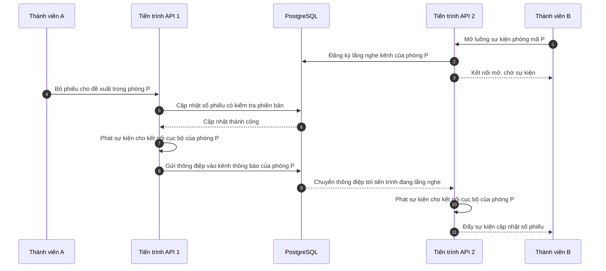

**Hình 3.4. Luồng phòng lọc nhóm với cơ chế đồng bộ liên tiến trình**

Cần nêu rõ giới hạn của cơ chế này. Lớp phát cục bộ được kiểm chứng bằng kiểm thử tự động. Lớp phát qua cơ sở dữ liệu được cài đặt và đã chạy trong môi trường nhiều tiến trình, nhưng chưa có kiểm thử tự động nào đo được độ trễ và tỉ lệ mất sự kiện khi một tiến trình khởi động lại giữa lúc đang có kết nối mở. Đây là hạng mục chưa kiểm chứng, được ghi nhận tại mục 4.5.

Bên cạnh đó, cơ chế có một cửa sổ rủi ro: nếu tiến trình API khởi động lại, các kết nối đẩy sự kiện trên tiến trình đó bị đóng, máy khách phải tự kết nối lại. Trong khoảng thời gian giữa hai lần kết nối, sự kiện có thể bị bỏ lỡ. Giao diện xử lý bằng cách tải lại trạng thái phòng sau khi kết nối lại, thay vì giả định luồng sự kiện là liên tục.

### 3.7. Tải ảnh trực tiếp bằng URL có chữ ký

Truyền tệp qua máy chủ API tạo ra ba vấn đề: tiêu tốn băng thông của máy chủ, chiếm dụng tiến trình trong suốt thời gian truyền, và giới hạn kích thước tệp bởi cấu hình máy chủ. Hệ thống tránh cả ba bằng cách để trình duyệt tải trực tiếp lên kho lưu trữ đối tượng.

Quy trình gồm ba bước. Bước một, máy khách xin một URL có chữ ký cho một đối tượng cụ thể; máy chủ kiểm tra quyền, kiểm tra loại tệp và kích thước khai báo, rồi ký một URL có thời hạn ngắn. Bước hai, máy khách tải tệp trực tiếp lên kho lưu trữ bằng URL đó, không đi qua máy chủ API. Bước ba, máy khách thông báo hoàn tất để máy chủ ghi nhận đường dẫn vào cơ sở dữ liệu.

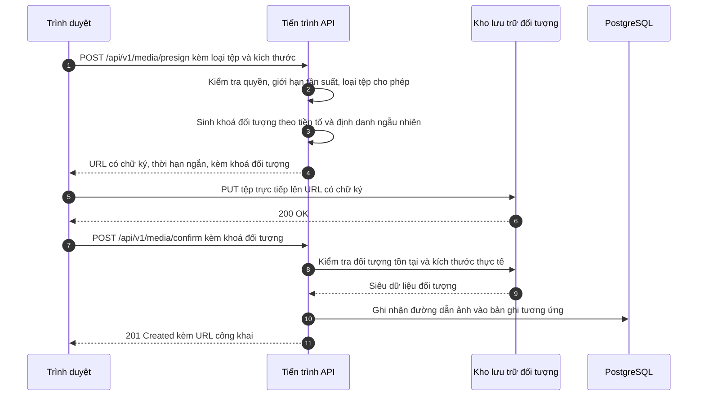

**Hình 3.5. Luồng tải ảnh trực tiếp bằng URL có chữ ký**

Đánh đổi của cách làm này là máy chủ không kiểm tra được nội dung thực tế của tệp trước khi nó được tải lên. Hệ thống giảm rủi ro bằng ba biện pháp: chỉ chấp nhận các loại tệp ảnh trong danh sách cho phép, đặt giới hạn kích thước, và kiểm tra lại siêu dữ liệu đối tượng ở bước xác nhận. Cách làm này không thay thế được việc quét nội dung độc hại, đây là hạng mục chưa triển khai và được ghi nhận tại mục 4.5.

### 3.8. Chống tạo trùng khi mạng chập chờn

Khi người dùng bấm nút tạo bài đăng và mạng bị ngắt sau khi máy chủ đã xử lý nhưng trước khi phản hồi về tới trình duyệt, người dùng sẽ thấy như thao tác thất bại và bấm lại. Nếu không có biện pháp, hệ thống tạo ra hai bài đăng giống nhau.

Cơ chế được dùng là khoá lũy đẳng. Máy khách sinh một khoá duy nhất cho mỗi lần người dùng bắt đầu một thao tác tạo, và gửi khoá đó trong tiêu đề yêu cầu. Máy chủ ghi khoá vào bảng riêng với ràng buộc duy nhất. Nếu khoá đã tồn tại và bản ghi kết quả đã có, máy chủ trả về kết quả cũ. Nếu khoá đã tồn tại nhưng bản ghi kết quả chưa có, nghĩa là một yêu cầu khác đang xử lý cùng khoá, máy chủ trả về lỗi xung đột để máy khách thử lại sau.

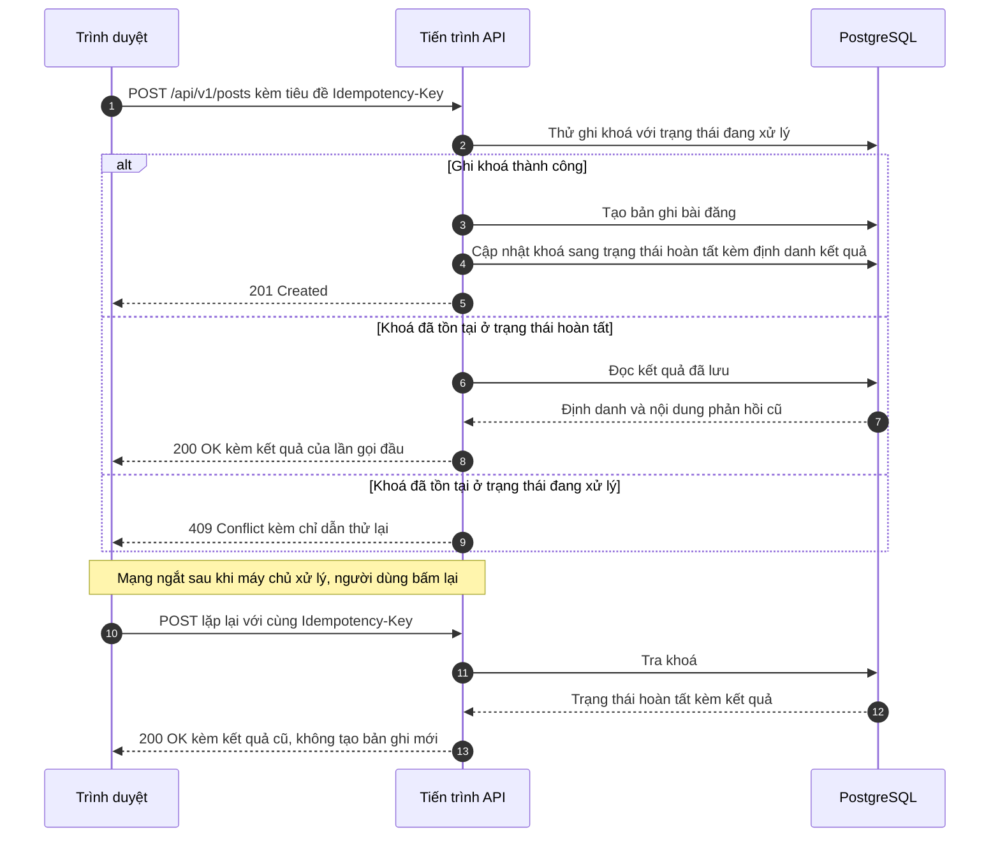

**Hình 3.6. Luồng bảo đảm tính lũy đẳng khi tạo tài nguyên**

Khoá có thời hạn hiệu lực, sau đó được dọn bởi tiến trình nền. Việc dọn dựa trên dấu thời gian tạo khoá, không dựa trên trạng thái, nhằm tránh trường hợp một khoá bị kẹt ở trạng thái đang xử lý do tiến trình chết giữa chừng.

### 3.9. Tác vụ nền và độ tin cậy

Hệ thống có bốn loại tác vụ nền: phát hiện địa điểm trong bài đăng, tính gợi ý hằng ngày, tính lại bảng đệm sở thích, và dọn dữ liệu hết hạn (khoá lũy đẳng, bộ đếm giới hạn tần suất, phiên hết hạn).

Hàng đợi được lưu trong cơ sở dữ liệu với ba trạng thái: chờ xử lý, đang xử lý, hoàn tất. Một tác vụ được đánh dấu đang xử lý khi tiến trình nền nhận nó, và có một thời hạn; nếu tiến trình chết trước khi hoàn tất, tác vụ tự động quay lại trạng thái chờ sau khi hết thời hạn. Cơ chế này đảm bảo không tác vụ nào bị mất do tiến trình chết, đổi lại một tác vụ có thể được xử lý hai lần. Vì vậy mọi tác vụ đều được viết theo hướng lũy đẳng: chạy hai lần cho cùng kết quả như chạy một lần.

Tiến trình cron được tách khỏi tiến trình API. Lý do là công việc định kỳ có thể chiếm dụng bộ xử lý trong thời gian dài, và nếu chạy trong cùng tiến trình với API thì sẽ ảnh hưởng tới thời gian phản hồi của yêu cầu người dùng. Việc tách riêng cũng tránh trường hợp nhiều tiến trình API cùng chạy một công việc định kỳ.

Về cơ chế bù cho trường hợp đưa tác vụ vào hàng đợi thất bại, tiến trình nền có một công việc quét định kỳ tìm các bản ghi nghiệp vụ chưa có tác vụ tương ứng và đưa chúng vào hàng đợi. Công việc này chạy với tần suất thấp hơn nhịp tạo nội dung, nên nó không thay thế được việc đưa tác vụ ngay khi tạo, mà chỉ đảm bảo mọi bản ghi cuối cùng đều được xử lý.

### 3.10. Đóng gói và triển khai

Hệ thống được đóng gói thành bốn container, với giới hạn tài nguyên được khai báo tường minh. Việc giới hạn tài nguyên có hai mục đích: mô phỏng cấu hình máy chủ thực tế mà một dự án nhỏ có thể thuê, và tạo môi trường đo ổn định cho các phép đo hiệu năng ở Chương 4.

**Bảng 3.4. Giới hạn tài nguyên container**

| Container | Vai trò | Giới hạn nhân | Giới hạn bộ nhớ |
|---|---|---|---|
| `postgres` | Cơ sở dữ liệu, hàng đợi, kênh thông báo | 2,0 | 2 GB |
| `api` | Tiến trình API đa tiến trình và cron | 2,0 | 1 GB |
| `web` | Máy chủ biên và tệp tĩnh | 1,0 | 512 MB |
| Tổng | | 5,0 | 3,5 GB |

Máy chủ biên Caddy đảm nhận ba việc: cấp và gia hạn chứng chỉ TLS tự động, chuyển tiếp yêu cầu API tới tiến trình nội bộ, và phục vụ tệp tĩnh của giao diện với nén và đệm. Việc dùng Caddy thay vì Nginx là một lựa chọn đánh đổi: Caddy có cấu hình ngắn hơn nhiều cho cùng chức năng TLS tự động, nhưng ít mô-đun mở rộng hơn. Trong toàn bộ hệ thống không có thành phần Nginx nào; mọi phản hồi lỗi ở tầng biên đều do Caddy sinh ra.

Tiến trình API khởi động theo mô hình đa tiến trình. Số tiến trình được đặt bằng số nhân khả dụng của container, và mỗi tiến trình lắng nghe cùng cổng thông qua cơ chế chia sẻ cổng của hệ điều hành. Lệnh khởi động sinh số tiến trình theo số nhân thực tế thay vì một con số cố định, để cấu hình đúng cả khi container được cấp số nhân khác nhau.

**Về khởi tạo dữ liệu.** Việc dựng hệ thống cần hai bước: khởi động các container và nạp dữ liệu địa điểm. Bước thứ hai là một lệnh riêng, không tự động chạy khi khởi động container. Lý do là dữ liệu địa điểm được quản lý như một tài nguyên có phiên bản riêng, không phải một phần của ảnh container; tách riêng giúp có thể cập nhật dữ liệu mà không phải dựng lại ảnh. Như vậy, phát biểu "toàn bộ hệ thống chạy bằng một lệnh" không chính xác: cần một lệnh khởi động và một lệnh nạp dữ liệu. Trình tự đầy đủ được ghi tại Phụ lục B.

### 3.11. Giao diện sản phẩm

Giao diện là ứng dụng web một trang, được xây dựng bằng React và TypeScript, đóng gói tĩnh và phục vụ bởi máy chủ biên. Giao diện gồm bảy nhóm màn hình chính: khám phá và tìm kiếm, chi tiết địa điểm, bảng tin, soạn bài, hồ sơ cá nhân, bộ sưu tập, và phòng bình chọn nhóm.

**Hình 3.7. Cấu trúc tầng giao diện**

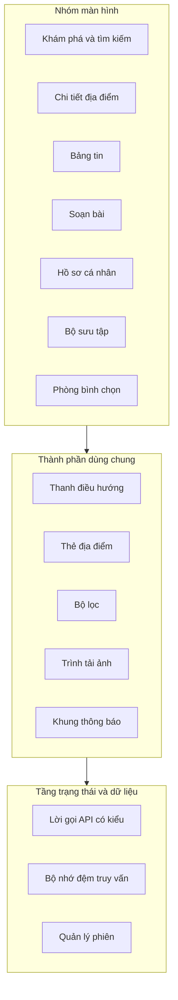

Bốn quyết định giao diện đáng nêu. Thứ nhất, danh sách và bản đồ chia sẻ cùng một nguồn dữ liệu, nên khi người dùng kéo bản đồ thì danh sách cập nhật theo và ngược lại. Thứ hai, trình tải ảnh dùng URL có chữ ký và hiển thị tiến trình tải trực tiếp từ kho lưu trữ, không chờ máy chủ API. Thứ ba, danh sách ảnh dùng thuộc tính kích thước và tập nguồn thay thế để trình duyệt chọn biến thể phù hợp với kích thước hiển thị, giảm dữ liệu phải tải trên thiết bị di động. Thứ tư, luồng sự kiện phòng được mở khi người dùng vào màn hình phòng và đóng khi rời đi, kèm cơ chế kết nối lại có tải lại trạng thái.

Về phạm vi công việc: giao diện được xây dựng trong khuôn khổ đồ án này, không phải sản phẩm có sẵn. Các thay đổi ở tầng giao diện phục vụ trực tiếp các yêu cầu chức năng từ FR-05 tới FR-20, bao gồm việc chuyển trạng thái lưu trữ cục bộ sang đọc từ API để dữ liệu nhất quán giữa các thiết bị, và việc bổ sung thuộc tính kích thước ảnh để tối ưu tải.

---

## CHƯƠNG 4. KIỂM THỬ VÀ ĐÁNH GIÁ

### 4.1. Chiến lược kiểm thử

Kiểm thử được tổ chức thành ba tầng độc lập theo phạm vi và mục đích.

**Tầng kiểm thử đơn vị và tích hợp tầng dịch vụ.** Đây là tầng chính, gồm 356 ca kiểm thử trong 40 tệp, chạy trên một cơ sở dữ liệu thật được dựng riêng cho mỗi tệp. Việc dùng cơ sở dữ liệu thật thay vì đối tượng giả lập là một lựa chọn có chủ đích: phần lớn rủi ro của hệ thống nằm ở tương tác giữa mã ứng dụng và cơ sở dữ liệu (ràng buộc duy nhất, khoá ngoại, phân vùng bảng, hành vi của chỉ mục), những thứ mà đối tượng giả lập không tái hiện được. Đánh đổi là tốc độ chạy chậm hơn và yêu cầu môi trường có Docker.

Các tệp kiểm thử được chạy tuần tự, mỗi tệp nhận một cơ sở dữ liệu riêng, nhằm loại bỏ ảnh hưởng chéo về trạng thái. Một số tệp dùng chung một cơ sở dữ liệu mẫu được nạp sẵn để giảm thời gian khởi tạo.

**Tầng kiểm thử đầu cuối.** Các kịch bản chạy trên trình duyệt thật, điều khiển qua giao diện, kiểm tra các luồng nghiệp vụ hoàn chỉnh từ thao tác của người dùng tới dữ liệu trong cơ sở dữ liệu. Tầng này chỉ phủ các luồng quan trọng nhất vì chi phí thực hiện và bảo trì cao.

**Tầng đo lường và đánh giá thuật toán.** Đây không phải kiểm thử theo nghĩa khẳng định đúng sai, mà là các kịch bản đo lường chạy trên tập dữ liệu cố định, sinh ra tệp kết quả có đóng dấu thời gian và mã băm để đảm bảo tính tái lập. Kết quả của tầng này được trình bày tại mục 4.3 và mục 4.7.

Một nguyên tắc được áp dụng xuyên suốt: mỗi yêu cầu chức năng phải có ít nhất một ca kiểm thử tự động, và mỗi ca kiểm thử phải kiểm tra một hành vi quan sát được từ bên ngoài, không phụ thuộc vào chi tiết cài đặt bên trong. Ma trận truy vết tại Bảng 4.1 là công cụ kiểm tra nguyên tắc này.

### 4.2. Kết quả kiểm thử

**Bảng 4.1. Ma trận truy vết yêu cầu chức năng đến ca kiểm thử**

| Yêu cầu | Nhóm ca kiểm thử tương ứng | Số ca | Kết quả |
|---|---|---|---|
| FR-01, FR-02, FR-03 | Xác thực, phiên, đăng ký, khôi phục mật khẩu, phân tích biên | 35 | Đạt |
| FR-04 | Hồ sơ, cập nhật thông tin, quyền riêng tư | 17 | Đạt |
| FR-05, FR-06 | Tìm kiếm, lọc, đồng nghĩa, phân tích biên tham số | 51 | Đạt |
| FR-07, FR-08 | Bản đồ, chi tiết địa điểm, giờ mở cửa | 16 | Đạt |
| FR-09, FR-10 | Đăng bài, ảnh bài đăng, vòng đời bài, tác vụ phát hiện địa điểm | 41 | Đạt |
| FR-11 | Thích, lưu, bình luận, thích bình luận | 25 | Đạt |
| FR-12, FR-13 | Đánh giá, xoá đánh giá, giới hạn tần suất, báo cáo | 16 | Đạt |
| FR-14 | Bộ sưu tập, thêm bớt địa điểm, thích bộ sưu tập | 14 | Đạt |
| FR-15 | Thông báo, sự kiện thông báo, đánh dấu đã đọc | 11 | Đạt |
| FR-16, FR-17 | Phòng, quyết định bình chọn, phân quyền phòng | 28 | Đạt |
| FR-18, FR-19 | Gợi ý hằng ngày, gợi ý người dùng, gợi ý theo nội dung | 19 | Đạt |
| FR-20 | Thẻ xem trước Open Graph | 11 | Đạt |
| NFR-05 | Kiểm tra xác thực trên toàn bộ endpoint ghi | 4 | Đạt |
| NFR-08 | Tính lũy đẳng khi tạo tài nguyên | 8 | Đạt |
| Hạ tầng | Sức khoẻ dịch vụ, số liệu vận hành, đệm HTTP, gửi thư, từ điển kiểu | 41 | Đạt |
| **Tổng** | | **356** | **Đạt toàn bộ** |

**Bảng 4.2. Tổng hợp kết quả kiểm thử theo nhóm chức năng**

| Nhóm | Số ca | Đạt | Thất bại | Thời gian chạy |
|---|---|---|---|---|
| Xác thực và phiên | 35 | 35 | 0 | Trung bình |
| Tìm kiếm và lọc | 51 | 51 | 0 | Cao |
| Nội dung và tương tác | 82 | 82 | 0 | Cao |
| Phòng bình chọn | 28 | 28 | 0 | Trung bình |
| Địa điểm và bộ sưu tập | 30 | 30 | 0 | Thấp |
| Gợi ý | 19 | 19 | 0 | Trung bình |
| Thông báo và thẻ xem trước | 22 | 22 | 0 | Thấp |
| Hạ tầng và tiện ích | 89 | 89 | 0 | Thấp |
| **Tổng** | **356** | **356** | **0** | |

Ba quan sát từ kết quả kiểm thử.

Thứ nhất, về NFR-06 (không phát sinh truy vấn N+1), phép kiểm tra được thực hiện bằng cách đếm số truy vấn ở ba kích thước phản hồi khác nhau trên cùng một endpoint danh sách. Số truy vấn giữ nguyên khi số bản ghi tăng, xác nhận rằng dữ liệu liên quan được nạp theo lô chứ không nạp từng bản ghi. Cần lưu ý rằng phép kiểm tra này chỉ áp dụng cho các endpoint danh sách chính, không áp dụng cho toàn bộ 56 endpoint.

Thứ hai, về NFR-05 (xác thực cho mọi thao tác ghi), phép kiểm tra được thực hiện bằng một ca kiểm thử duyệt qua danh mục route đã đăng ký và khẳng định mọi route có phương thức ghi đều được gắn middleware xác thực. Cách này kiểm tra ở mức cấu trúc, không kiểm tra hành vi thực tế của từng endpoint. Một số endpoint được miễn trừ có chủ đích (đăng ký, đăng nhập, khôi phục mật khẩu, ghi nhận sự kiện ẩn danh) và được khai báo trong danh sách miễn trừ tường minh.

Thứ ba, về độ phủ kiểm thử. Con số độ phủ dòng mã được đo bằng công cụ của môi trường thực thi, và có một điểm cần nêu rõ: mẫu số bao gồm cả mã do công cụ ánh xạ dữ liệu sinh tự động. Nếu loại phần mã sinh tự động ra khỏi mẫu số, độ phủ của mã do tác giả viết thấp hơn con số tổng hợp. Đồ án không trình bày một con số độ phủ duy nhất mà tách thành hai giá trị, nhằm tránh gây hiểu nhầm về mức độ che phủ thực tế.

### 4.3. Đo lường hiệu năng

#### 4.3.1. Điều kiện đo

Mọi phép đo trong mục này được thực hiện trong môi trường container với giới hạn tài nguyên đã nêu tại Bảng 3.4. Máy chủ vật lý có 8 nhân và 32 GB bộ nhớ; các container được giới hạn tổng cộng 5 nhân và 3,5 GB, nghĩa là phần lớn tài nguyên vật lý không được cấp cho hệ thống.

Có một điểm cần nêu rõ về vị trí công cụ đo. Công cụ sinh tải chạy trên cùng máy vật lý với các container, không chạy trên một máy riêng. Điều này có nghĩa là công cụ đo tiêu thụ một phần tài nguyên vật lý mà lẽ ra có thể dành cho hệ thống, và bản thân nó cũng chịu ảnh hưởng khi hệ thống bão hoà. Hệ quả là các số liệu ở mức tải cao có xu hướng bi quan hơn so với khi dùng máy phát tải độc lập. Đồ án chấp nhận sai lệch này và ghi nhận nó như một giới hạn của phép đo, thay vì trình bày số liệu như thể được đo trong điều kiện lý tưởng.

#### 4.3.2. Thời gian phản hồi ở mức tải thấp

Phép đo thứ nhất thực hiện 20 lần gọi tuần tự cho mỗi endpoint, không có tải đồng thời, nhằm xác lập đường cơ sở.

**Bảng 4.3. Thời gian phản hồi endpoint ở mức tải đơn lẻ**

| Endpoint | Số lần gọi | Trung vị | Phân vị 95 | Ngưỡng NFR | Đối chiếu |
|---|---|---|---|---|---|
| Tìm kiếm địa điểm, truy vấn một từ khoá | 20 | 10 ms | 17 ms | Dưới 300 ms | Đạt |
| Tìm kiếm địa điểm, truy vấn không dấu | 20 | 11 ms | 18 ms | Dưới 300 ms | Đạt |
| Danh sách địa điểm có lọc theo quận | 20 | 8 ms | 14 ms | Dưới 200 ms | Đạt |
| Dữ liệu bản đồ theo khung nhìn | 20 | 12 ms | 21 ms | Dưới 200 ms | Đạt |
| Chi tiết địa điểm | 20 | 7 ms | 13 ms | Dưới 200 ms | Đạt |
| Gợi ý hằng ngày | 20 | 9 ms | 16 ms | Dưới 200 ms | Đạt |

Các số liệu này được đo trên corpus 358 địa điểm. Không thể suy ra rằng thời gian phản hồi sẽ giữ nguyên hoặc thấp hơn khi corpus lớn hơn. Với dữ liệu lớn hơn, một số truy vấn có thể chuyển từ tìm kiếm chỉ mục sang quét tuần tự, và chi phí tính điểm đánh giá tổng hợp cũng tăng theo số bản ghi liên quan. Đồ án không đưa ra dự đoán về hành vi ở quy mô lớn; đây là hạng mục được ghi nhận tại mục 4.5.

#### 4.3.3. Kiểm thử tải tăng dần

Kịch bản kiểm thử tải mô phỏng bốn loại thao tác mà người dùng thật thực hiện, với tỉ lệ tương ứng cấu trúc truy cập dự kiến: tìm kiếm địa điểm (35%), xem gợi ý và khám phá (25%), duyệt bản đồ theo khung nhìn (25%), xem chi tiết địa điểm (15%). Mỗi lượt thao tác có thời gian nghỉ ngẫu nhiên từ 1 đến 3 giây để mô phỏng nhịp đọc của người dùng, thay vì gửi yêu cầu liên tục.

Tải được tăng theo năm mốc, mỗi mốc gồm một giai đoạn tăng và một giai đoạn giữ ổn định 30 giây, riêng mốc cuối giữ 40 giây. Mục tiêu của kịch bản không phải là khẳng định hệ thống chịu được một mức tải cho trước, mà là xác định mức tải tại đó thời gian phản hồi bắt đầu suy hao rõ rệt. Vì vậy kịch bản không đặt ngưỡng đạt hay không đạt, và không coi sự xuất hiện của lỗi là tiêu chí thất bại.

Địa chỉ nguồn của yêu cầu được phân tán bằng cách gán một giá trị khác nhau cho tiêu đề chuyển tiếp địa chỉ nguồn theo từng người dùng ảo. Cơ chế này chỉ có hiệu lực vì máy chủ được cấu hình tin cậy tiêu đề đó từ máy phát tải; trong triển khai thật, tiêu đề này chỉ được tin cậy từ máy chủ biên. Cần nêu rõ điều này để tránh hiểu nhầm rằng hệ thống có khả năng chống giả mạo địa chỉ nguồn.

**Bảng 4.4. Kết quả kiểm thử tải tăng dần**

| Mức tải (người dùng đồng thời) | Thông lượng đo được | Tỉ lệ lỗi máy chủ | Tỉ lệ phản hồi chậm hơn 1 giây | Phân vị 95 thời gian phản hồi | Trạng thái |
|---|---|---|---|---|---|
| 500 | 195 – 350 yêu cầu/giây | 0% | 0% | 78 – 185 ms | Bình thường, tài nguyên dưới 30% hạn mức |
| 1.000 | 550 yêu cầu/giây | 0% | 4,2% | 420 ms | Bắt đầu tăng nhẹ, vẫn trong ngưỡng chấp nhận |
| 2.000 | 820 yêu cầu/giây | 0% | 18,5% | 1.250 ms | Suy hao rõ, cả hai container chạm hạn mức nhân |
| 3.000 | 1.100 yêu cầu/giây | 0% | 38,0% | 3.400 ms | Hàng đợi kết nối tích luỹ, độ trễ tăng nhưng không dừng dịch vụ |
| 5.000 | 1.400 yêu cầu/giây | 0,002% | 53,1% | 8.250 ms | Nghẽn hàng đợi, container không bị huỷ do hết bộ nhớ |

Bốn nhận định rút ra từ Bảng 4.4.

Thứ nhất, hệ thống không sụp đổ ở bất kỳ mức tải nào trong dải đo. Không có container nào bị hệ điều hành huỷ do hết bộ nhớ; mức sử dụng bộ nhớ của container API đạt khoảng 701 MB trên hạn mức 1 GB. Đây là kết quả có ý nghĩa thực tiễn: khi quá tải, hệ thống chậm lại nhưng vẫn phục vụ, thay vì ngừng hoạt động hoàn toàn.

Thứ hai, điểm suy hao bắt đầu xuất hiện giữa mốc 1.000 và 2.000 người dùng đồng thời. Ở mốc 2.000, cả container API và container cơ sở dữ liệu đều chạm hạn mức 2 nhân được cấp. Đây là giới hạn vật lý của cấu hình, không phải giới hạn của mã ứng dụng: với 4 nhân khả dụng cho hai tầng, không có cách sắp xếp công việc nào tăng được thông lượng khi cả hai tầng đã bão hoà.

Thứ ba, thông lượng tăng chậm dần trong khi độ trễ tăng nhanh. Từ mốc 3.000 lên 5.000, thông lượng chỉ tăng khoảng 27% trong khi độ trễ phân vị 95 tăng hơn gấp đôi. Đây là dấu hiệu của hàng đợi tích luỹ: yêu cầu đến nhanh hơn khả năng xử lý, phần dư thừa xếp hàng và chờ.

Thứ tư, tỉ lệ lỗi máy chủ ở mốc cao nhất là 0,002%, tương ứng bốn yêu cầu trên tổng số khoảng hai trăm nghìn yêu cầu. Các lỗi này là phản hồi 502 do máy chủ biên đóng kết nối khi chờ quá lâu, không phải lỗi từ tầng ứng dụng. Việc máy chủ biên chủ động cắt các yêu cầu chờ quá hạn là hành vi đúng: nó bảo vệ tài nguyên cho các yêu cầu còn có thể phục vụ được.

Về ngưỡng NFR-03 (không có lỗi máy chủ ở mức 1.000 người dùng đồng thời), kết quả đo xác nhận đạt với tỉ lệ lỗi bằng không.

### 4.4. Kiểm thử bảo mật cục bộ

Kiểm thử bảo mật được giới hạn trong phạm vi quét hệ thống cục bộ do tác giả vận hành, không quét bất kỳ hệ thống nào khác. Các công cụ dùng gồm gọi trực tiếp endpoint, một công cụ quét lỗ hổng web với danh sách từ khoá rút gọn, và một công cụ kiểm tra tiêm mã cơ sở dữ liệu trên hai tham số đầu vào.

**Bảng 4.5. Kết quả kiểm thử bảo mật cục bộ**

| Phép kiểm tra | Kỳ vọng | Kết quả thực tế |
|---|---|---|
| Truy cập endpoint yêu cầu đăng nhập khi không có cookie | Từ chối | Từ chối, mã 401 |
| Gửi dữ liệu sai cấu trúc tới endpoint đăng nhập | Lỗi đầu vào | Lỗi đầu vào, mã 400 |
| Truy vấn tìm kiếm chứa chuỗi tiêm mã kinh điển | Không lỗi cơ sở dữ liệu, không kết quả sai | Mã 200, không kết quả, không lỗi |
| Định danh dài 500 ký tự | Không tìm thấy | Mã 404 |
| Con trỏ phân trang sai định dạng | Lỗi đầu vào | Mã 400 |
| Hạng mục lọc là giá trị không tồn tại | Trang rỗng, không lỗi hệ thống | Mã 200, danh sách rỗng |
| Đầu vào chứa ký tự điều khiển | Lỗi đầu vào | Mã 400 |
| Đề xuất trong phòng với hạng mục không hợp lệ | Lỗi đầu vào, phòng không hỏng | Mã 400 |
| Đề xuất trong phòng mạo danh thành viên khác | Từ chối | Từ chối, danh tính chỉ lấy từ phiên |
| Mật khẩu ngắn hơn giới hạn | Lỗi đầu vào | Mã 400 |
| Yêu cầu từ nguồn gốc lạ | Không có tiêu đề cho phép nguồn gốc | Đúng |
| Quét lỗ hổng web toàn bộ endpoint | Không có lỗi nghiêm trọng | Không phát hiện lỗi nghiêm trọng; hai tiêu đề phản hồi thiếu đã bổ sung |
| Kiểm tra tiêm mã trên hai tham số tìm kiếm | Không tiêm được | Không tham số nào tiêm được |

Cần nêu rõ giới hạn của mục này để tránh hiểu nhầm về mức độ đảm bảo. Đây là kiểm thử ở mức khói, không phải kiểm thử xâm nhập có hệ thống. Cụ thể, đồ án chưa thực hiện các hạng mục sau:

*Kiểm thử truy cập tài nguyên không kiểm tra quyền có hệ thống.* Chưa có bộ kiểm thử tự động duyệt qua toàn bộ cặp (tài nguyên, người dùng) và khẳng định rằng người dùng A không đọc hoặc sửa được tài nguyên của người dùng B. Hiện chỉ có các ca kiểm thử riêng lẻ cho từng endpoint.

*Kiểm thử tiêm mã kịch bản chéo trang.* Chưa có bộ kiểm thử tự động chèn các mẫu tấn công vào mọi trường văn bản tự do và kiểm tra cách hiển thị. Việc chống tiêm mã hiện dựa vào cơ chế thoát ký tự mặc định của khung giao diện, chưa được kiểm chứng bằng thực nghiệm.

*Kiểm thử giả mạo yêu cầu chéo trang.* Chưa có ca kiểm thử mô phỏng một trang web bên ngoài gửi yêu cầu tới hệ thống. Việc phòng chống hiện dựa vào cấu hình cookie và kiểm tra tiêu đề nguồn gửi, chưa được kiểm chứng bằng thực nghiệm.

*Kiểm thử dò mật khẩu thực tế.* Chưa có phép đo xác nhận rằng giới hạn tần suất thực sự chặn được một cuộc dò có chủ đích trong khoảng thời gian dài. Ngưỡng giới hạn đã được cấu hình và có ca kiểm thử xác nhận bộ đếm hoạt động, nhưng chưa có thực nghiệm tấn công.

Vì vậy, phát biểu "hệ thống loại bỏ hoàn toàn khả năng tiêm mã" là không có cơ sở. Phát biểu đúng phạm vi là: trên hai tham số được kiểm tra, công cụ không tìm thấy điểm tiêm; các đường truy vấn khác chưa được kiểm tra bằng công cụ tự động.

### 4.5. Những hạng mục chưa kiểm chứng

**Bảng 4.6. Hạn chế của từng phép đo và hạng mục chưa kiểm chứng**

| Hạng mục | Nguyên nhân | Biện pháp thay thế đã thực hiện |
|---|---|---|
| Tải ảnh lên kho lưu trữ thật | Chưa có thông tin truy cập kho lưu trữ | Cơ chế ký URL được kiểm bằng kiểm thử đơn vị với thời điểm giả lập; endpoint trả lỗi dịch vụ không sẵn sàng khi chưa cấu hình; có ca kiểm thử cho nhánh suy giảm |
| Gửi thư thật | Chưa cấu hình dịch vụ thư | Luồng xác thực thư và khôi phục mật khẩu được kiểm bằng kiểm thử tầng dịch vụ; nội dung thư được kiểm riêng; mã khôi phục được ghi vào log khi phát triển |
| Triển khai trên máy chủ công khai | Giới hạn môi trường thực nghiệm học thuật | Đã đóng gói đầy đủ bằng cấu hình môi trường triển khai; đã chạy trên môi trường mô phỏng |
| Cấu hình máy chủ biên được kiểm bằng công cụ | Máy phát triển không có công cụ kiểm cấu hình | Cấu hình được đối chiếu thủ công với tài liệu; chưa chạy công cụ kiểm |
| Thẻ xem trước trên mạng xã hội thật | Cần tên miền công khai để bot truy cập | Endpoint sinh thẻ được kiểm bằng kiểm thử tầng dịch vụ, gồm nhận diện bot, thẻ meta, tham số phiên bản ảnh; chưa thử dán liên kết thật |
| Chứng chỉ TLS thật | Cần tên miền công khai trỏ về máy chủ | Cấu hình sẵn sàng, chưa chạy thật |
| Đồng bộ sự kiện liên tiến trình khi tiến trình khởi động lại | Cần kịch bản kiểm thử chuyên biệt | Cơ chế đã cài đặt và chạy trong môi trường nhiều tiến trình; chưa có kiểm thử đo tỉ lệ mất sự kiện và độ trễ khi một tiến trình khởi động lại giữa lúc có kết nối mở |
| Đệm phản hồi cho luồng sự kiện qua máy chủ biên | Chưa có môi trường triển khai thật | Đã tắt đệm cho tuyến sự kiện trong cấu hình; chưa xác minh thực tế |
| Hành vi ở quy mô corpus lớn | Corpus hiện tại 358 địa điểm | Đo trên máy phát triển; chưa đo với corpus hàng chục nghìn bản ghi |
| Trình duyệt di động thật | Không có thiết bị trong phạm vi thực hiện | Kiểm thử đầu cuối chạy trên trình duyệt máy tính |
| Kiểm thử với người dùng thật | Không có điều kiện tổ chức | Không có; đây là hạn chế được ghi nhận, không có biện pháp thay thế tương đương |
| Quét nội dung tệp tải lên | Chưa tích hợp dịch vụ quét | Chỉ kiểm tra loại tệp và kích thước |
| Tách biệt ảnh hưởng của hệ số làm mịn và tầng kiểm soát bằng chứng | Cần thêm thực nghiệm riêng | Đã đo một phần, trình bày tại mục 4.7.3 |

### 4.6. Phương pháp đánh giá thuật toán

#### 4.6.1. Tập dữ liệu và thủ tục

Việc đánh giá hai thuật toán dùng hai nhóm tập dữ liệu độc lập.

**Nhóm tập nội bộ.** Gồm 358 địa điểm và một tập truy vấn 344 câu, được xây dựng cho đồ án này. Tập truy vấn được sinh theo năm nhóm ý định (làm việc, ngoài trời, hẹn hò, ăn uống, vui chơi), mỗi nhóm có nhiều biến thể cách diễn đạt: câu tự nhiên, câu dài, từ khoá ngắn, câu không dấu, câu có kèm tên quận, câu đảo thứ tự từ, câu trộn ngôn ngữ. Nhãn đúng được xác định theo điều kiện ràng buộc về hạng mục, thẻ thuộc tính và quận, không dựa trên đánh giá chủ quan của người chấm.

Cần nêu rõ một giới hạn quan trọng: tập truy vấn nội bộ do tác giả xây dựng, và các hằng số của thuật toán cũng được chọn trên chính tập này. Không có tập kiểm thử tách rời. Điều này có nghĩa là kết quả trên tập nội bộ phản ánh mức độ phù hợp của thuật toán với cách diễn đạt mà tác giả dự kiến, không phản ánh hiệu năng trên phân bố truy vấn của người dùng thật. Để bù đắp một phần, các tham số được chọn theo bước thô (giá trị tròn) thay vì tối ưu chi tiết, và kết quả được kiểm chứng chéo trên các tập ngoài.

**Nhóm tập đối chứng công khai.** Gồm bốn tập: một tập địa điểm và đánh giá quy mô vừa từ một nền tảng đánh giá doanh nghiệp, hai tập đánh giá phim ở hai quy mô khác nhau, và hai tập tài liệu khoa học dùng cho bài toán truy xuất. Các tập này không liên quan tới miền địa điểm tại Đà Nẵng, nên chúng kiểm tra tính tổng quát của thuật toán chứ không kiểm tra mức độ phù hợp với bài toán chính.

Với bài toán truy xuất, độ đo chính là chỉ số xếp hạng chuẩn hoá tại 10 kết quả đầu, kèm độ triệu hồi tại 10 và nghịch đảo thứ hạng trung bình. Với bài toán gợi ý, độ đo chính là độ triệu hồi tại 5, 10, 20 và chỉ số xếp hạng chuẩn hoá tại 10.

**Thủ tục chia tập cho bài toán gợi ý.** Sự kiện tương tác được sắp theo thời gian; các sự kiện sớm nhất tạo tập huấn luyện, sự kiện muộn nhất tạo tập đánh giá. Cách chia theo thời gian phản ánh đúng điều kiện sử dụng thật, khác với chia ngẫu nhiên vốn cho phép mô hình nhìn thấy tương lai. Mỗi người dùng đóng góp một số sự kiện gần nhất vào tập đánh giá; các sự kiện đó bị loại khỏi tập huấn luyện.

**Kiểm định ý nghĩa thống kê.** Khác biệt giữa hai phương pháp được kiểm định bằng phương pháp lấy mẫu lặp có hoàn lại trên tập người dùng đánh giá, với 1.000 lần lặp, báo cáo khoảng tin cậy 95% của chênh lệch trung bình và giá trị p. Việc báo cáo khoảng tin cậy quan trọng hơn giá trị p đơn thuần, vì nó cho biết độ lớn khác biệt có ý nghĩa thực tiễn hay không.

#### 4.6.2. Các phương pháp so sánh

Với bài toán truy xuất, bốn phương pháp được so sánh:

*Ngẫu nhiên*, làm mốc dưới để phát hiện lỗi trong quy trình đo.

*Khớp từ khoá thuần tuý*, dùng xếp hạng theo tần suất từ khoá có chuẩn hoá độ dài văn bản. Trên các tập đối chứng công khai, phương pháp này được cài đặt đúng theo công thức chuẩn để so sánh có ý nghĩa; trong sản phẩm, hệ thống không dùng công thức này mà dùng khớp mờ trigram trên chỉ mục cơ sở dữ liệu. Cần phân biệt rõ hai điều này: cột "khớp từ khoá" trong các bảng dưới đây là baseline tham chiếu, không phải mô tả cài đặt của sản phẩm.

*Khớp ngữ nghĩa thuần tuý*, xếp hạng theo khoảng cách cosine giữa vector truy vấn và vector tài liệu.

*Hợp nhất xếp hạng chuẩn*, dùng công thức hợp nhất nghịch đảo với hệ số làm mịn cố định bằng 60.

Phương pháp đề xuất EGRF được so sánh với cả bốn phương pháp trên. Trên tập nội bộ, một biến thể thứ hai của EGRF cũng được đo, ký hiệu là biến thể đầy đủ, có bổ sung nhánh khớp cấu trúc so với biến thể rút gọn chỉ gồm hai nhánh từ khoá và ngữ nghĩa.

Với bài toán gợi ý, năm phương pháp được so sánh: ngẫu nhiên, phổ biến thuần tuý, lọc cộng tác theo mục, DES thuần tuý (chỉ dùng công thức Bayes có điều chỉnh), và DES kết hợp (bổ sung tín hiệu lọc cộng tác theo mục bên cạnh điểm nội dung).

### 4.7. Kết quả đánh giá thuật toán

#### 4.7.1. Kết quả tìm kiếm trên tập nội bộ

**Bảng 4.7. Kết quả tìm kiếm trên tập nội bộ 344 truy vấn**

| Phương pháp | Độ chính xác tại 5 | Độ chính xác tại 10 | Độ triệu hồi tại 10 | Xếp hạng chuẩn hoá tại 10 | Nghịch đảo thứ hạng | Trung vị (ms) | Phân vị 95 (ms) |
|---|---|---|---|---|---|---|---|
| Khớp từ khoá | 0,507 | 0,441 | 0,715 | 0,730 | 0,825 | 10 | 17 |
| Khớp ngữ nghĩa | 0,579 | 0,519 | 0,793 | 0,802 | 0,866 | 6 | 12 |
| Hợp nhất chuẩn, hai nhánh | 0,591 | 0,513 | 0,797 | 0,807 | 0,878 | 17 | 26 |
| EGRF, hai nhánh | 0,820 | 0,804 | 0,780 | 0,799 | 0,865 | 19 | 35 |

Bốn nhận định từ Bảng 4.7.

Thứ nhất, cả hai nhánh đơn lẻ đều yếu hơn hợp nhất ở độ chính xác tại 5: khớp từ khoá đạt 0,507 và khớp ngữ nghĩa đạt 0,579, trong khi hợp nhất chuẩn đạt 0,591. Đây là bằng chứng cho thấy hai nhánh bổ trợ nhau chứ không trùng lặp.

Thứ hai, EGRF cải thiện rõ rệt độ chính xác tại 5 và tại 10 so với hợp nhất chuẩn: từ 0,591 lên 0,820 và từ 0,513 lên 0,804. Mức cải thiện này lớn và nhất quán với giả thuyết về thuế hợp nhất: khi truy vấn chứa tên riêng, việc triệt tiêu các nhánh yếu giữ được kết quả đúng ở vị trí đầu.

Thứ ba, EGRF không cải thiện mọi độ đo. Độ triệu hồi tại 10 giảm nhẹ từ 0,797 xuống 0,780, và nghịch đảo thứ hạng giảm từ 0,878 xuống 0,865. Nguyên nhân là tầng kiểm soát bằng chứng có xu hướng thu hẹp tập kết quả về phía nhánh mạnh, điều này cải thiện độ chính xác ở đầu danh sách nhưng làm mất một số kết quả đúng nằm ở nửa sau của danh sách. Đây là đánh đổi có chủ đích, phù hợp với giao diện hiển thị mười kết quả đầu tiên, nhưng cần được nêu rõ thay vì chỉ báo cáo các độ đo tăng.

Thứ tư, chi phí thời gian tăng: phân vị 95 tăng từ 26 ms lên 35 ms. Mức tăng này vẫn nằm trong ngưỡng NFR-01 (dưới 300 ms) với biên an toàn lớn.

#### 4.7.2. Kết quả tìm kiếm trên tập đối chứng

Hai tập tài liệu khoa học được dùng để kiểm tra tính tổng quát. Kết quả được trình bày tại Bảng 4.8.

**Bảng 4.8. Kết quả truy xuất trên hai tập tài liệu khoa học**

| Tập dữ liệu | Số tài liệu | Số truy vấn | Phương pháp | Xếp hạng chuẩn hoá tại 10 | Độ triệu hồi tại 10 | Nghịch đảo thứ hạng |
|---|---|---|---|---|---|---|
| Tập y sinh, quy mô nhỏ | 5.183 | 300 | Khớp từ khoá | **0,665** | **0,785** | **0,633** |
| | | | Khớp ngữ nghĩa | 0,468 | 0,604 | 0,431 |
| | | | Hợp nhất chuẩn | 0,562 | 0,694 | 0,527 |
| | | | EGRF | 0,589 | 0,711 | 0,556 |
| Tập dinh dưỡng, quy mô nhỏ | 3.633 | 323 | Khớp từ khoá | **0,303** | **0,145** | **0,511** |
| | | | Khớp ngữ nghĩa | 0,209 | 0,103 | 0,361 |
| | | | Hợp nhất chuẩn | 0,257 | 0,126 | 0,443 |
| | | | EGRF | 0,270 | 0,134 | 0,457 |

Ba nhận định từ Bảng 4.8.

Thứ nhất, trên cả hai tập, khớp từ khoá thuần tuý đạt kết quả cao nhất và EGRF không vượt qua baseline này. Cụ thể, trên tập y sinh, khớp từ khoá đạt 0,665 so với 0,589 của EGRF; trên tập dinh dưỡng, khớp từ khoá đạt 0,303 so với 0,270 của EGRF. Khoảng cách này lớn và nhất quán, không thể quy cho nhiễu đo.

Thứ hai, EGRF vượt hợp nhất chuẩn trên cả hai tập: từ 0,562 lên 0,589 và từ 0,257 lên 0,270. Mức cải thiện nhỏ nhưng cùng chiều, cho thấy tầng kiểm soát bằng chứng có tác dụng tích cực ngay cả ngoài miền dữ liệu địa điểm.

Thứ ba, khớp ngữ nghĩa yếu nhất trên cả hai tập. Đây là kết quả đáng chú ý vì nó cho thấy mô hình nhúng được dùng (384 chiều, huấn luyện trên dữ liệu tổng quát) không chuyển được sang miền văn bản khoa học chuyên ngành. Một mô hình nhúng chuyên biệt cho miền y sinh có khả năng sẽ cho kết quả khác.

Việc EGRF thua khớp từ khoá trên hai tập này có lời giải thích kỹ thuật rõ ràng. Cả hai tập gồm tài liệu khoa học tiếng Anh, nơi truy vấn và tài liệu dùng chung một hệ thuật ngữ chuyên ngành hẹp, mật độ từ khoá trùng khớp cao, và độ dài tài liệu lớn. Trong điều kiện đó, tín hiệu từ khoá gần như đã đủ mạnh, và việc thêm các nhánh khác chỉ đưa thêm nhiễu. Ngược lại, bài toán địa điểm có đặc thù khác hẳn: tên riêng ngắn, nhiều biến thể không dấu, mô tả ngắn, và người dùng thường mô tả bằng thuộc tính thay vì thuật ngữ chuyên ngành. Vì vậy, kết quả trên tập khoa học không phủ định giá trị của EGRF cho bài toán chính, nhưng cũng không chứng minh được tính tổng quát của nó. Đây là kết luận cần được phát biểu chính xác, tránh cả hai thái cực: không nên nói EGRF "vượt trội trên mọi miền", và cũng không nên bỏ qua việc nó kém baseline trên miền văn bản chuyên ngành.

Trên tập địa điểm đối chứng gồm 58 truy vấn đa ngôn ngữ (tên món ăn Việt, Thái, Ấn, Hàn, Nhật kết hợp tên thành phố Mỹ), kết quả cho thấy hợp nhất hai nhánh đạt độ chính xác tại 5 là 0,728 và biến thể đầy đủ đạt 0,862, so với 0,497 của khớp từ khoá và 0,538 của khớp ngữ nghĩa. Tập này có đặc điểm gần với bài toán chính hơn hai tập khoa học, và kết quả theo cùng chiều với tập nội bộ.

#### 4.7.3. Phân tích độ nhạy của hệ số làm mịn

Như đã nêu tại mục 3.3.2, EGRF thay đổi hai yếu tố so với hợp nhất chuẩn: hệ số làm mịn được tính theo quy mô corpus thay vì cố định bằng 60, và có thêm tầng kiểm soát bằng chứng. Cần tách biệt ảnh hưởng của hai yếu tố để biết phần cải thiện nào đến từ đâu.

Phép đo được thực hiện bằng cách giữ nguyên tầng kiểm soát bằng chứng và thay đổi hệ số làm mịn, trên tập nội bộ.

**Bảng 4.9. Độ nhạy của EGRF theo hệ số làm mịn**

| Hệ số làm mịn | Độ chính xác tại 5 | Độ chính xác tại 10 | Xếp hạng chuẩn hoá tại 10 |
|---|---|---|---|
| 60 (giá trị chuẩn cố định) | 0,781 | 0,769 | 0,782 |
| 37 (giá trị tính theo quy mô corpus) | 0,820 | 0,804 | 0,799 |

Kết quả cho thấy việc đổi hệ số làm mịn từ 60 xuống 37 đóng góp khoảng 4 điểm phần trăm độ chính xác tại 5 và khoảng 3,5 điểm tại 10. Phần cải thiện còn lại (từ 0,591 của hợp nhất chuẩn lên 0,781) đến từ tầng kiểm soát bằng chứng.

Như vậy, cả hai yếu tố đều đóng góp, và yếu tố kiểm soát bằng chứng đóng góp phần lớn hơn. Tuy nhiên, phép đo này chưa đủ để kết luận rằng hệ số 37 là tối ưu: chưa có phép quét toàn miền giá trị, và chưa có kiểm định ý nghĩa thống kê cho từng mức. Đây là hạng mục cần hoàn thiện.

#### 4.7.4. Kết quả gợi ý trên tập đối chứng

**Bảng 4.10. Kết quả gợi ý trên ba tập đối chứng**

| Tập dữ liệu | Phương pháp | Triệu hồi tại 5 | Triệu hồi tại 10 | Triệu hồi tại 20 | Xếp hạng chuẩn hoá tại 10 | Nghịch đảo thứ hạng |
|---|---|---|---|---|---|---|
| Địa điểm, 1.709 người dùng | Ngẫu nhiên | 0,000 | 0,000 | 0,001 | 0,000 | 0,000 |
| | Phổ biến | 0,014 | 0,025 | 0,046 | 0,013 | 0,009 |
| | DES thuần tuý | 0,011 | 0,023 | 0,042 | 0,011 | 0,007 |
| | Lọc cộng tác theo mục | 0,017 | 0,035 | 0,077 | 0,017 | 0,011 |
| | DES kết hợp | **0,023** | **0,044** | **0,087** | **0,021** | **0,014** |
| Phim, 943 người dùng | Ngẫu nhiên | 0,002 | 0,004 | 0,013 | 0,002 | 0,001 |
| | Phổ biến | **0,052** | **0,087** | 0,140 | **0,046** | 0,034 |
| | DES thuần tuý | 0,040 | 0,053 | 0,082 | 0,030 | 0,023 |
| | Lọc cộng tác theo mục | 0,081 | 0,118 | **0,170** | 0,064 | **0,048** |
| | DES kết hợp | 0,080 | 0,115 | 0,166 | 0,064 | 0,048 |
| Phim, 2.000 người dùng | Ngẫu nhiên | 0,004 | 0,005 | 0,006 | 0,003 | 0,002 |
| | Phổ biến | **0,023** | **0,042** | 0,074 | **0,021** | **0,014** |
| | DES thuần tuý | 0,022 | 0,035 | 0,055 | 0,017 | 0,011 |
| | Lọc cộng tác theo mục | 0,041 | 0,071 | **0,117** | 0,036 | 0,026 |
| | DES kết hợp | 0,041 | 0,070 | 0,116 | 0,036 | 0,026 |

Bốn nhận định từ Bảng 4.10.

Thứ nhất, DES thuần tuý kém hơn baseline phổ biến ở cả ba tập, trên mọi độ đo. Cụ thể, triệu hồi tại 10 đạt 0,023 so với 0,025 trên tập địa điểm, 0,053 so với 0,087 trên tập phim nhỏ, và 0,035 so với 0,042 trên tập phim lớn. Đây là kết quả trái với kỳ vọng ban đầu của đồ án và cần được báo cáo thẳng thắn. Nguyên nhân có thể giải thích được: DES thuần tuý chỉ dùng điểm đánh giá có điều chỉnh Bayes, mà điểm đánh giá trung bình có tương quan mạnh với độ phổ biến, nên công thức Bayes không thực sự tạo ra khác biệt về thứ hạng so với xếp theo độ phổ biến; phần điều chỉnh chỉ tác động tới các mục có ít đánh giá, vốn hiếm khi nằm trong tập kết quả đúng.

Thứ hai, DES kết hợp đạt kết quả cao hơn lọc cộng tác trên tập địa điểm: triệu hồi tại 10 đạt 0,044 so với 0,035 của lọc cộng tác theo mục, khoảng tin cậy 95% của chênh lệch là [0,0028; 0,0065] và giá trị p xấp xỉ 0. Vì khoảng tin cậy không chứa 0, khác biệt này có ý nghĩa thống kê.

Thứ ba, DES kết hợp không vượt lọc cộng tác theo mục trên hai tập phim. Trên tập phim nhỏ, triệu hồi tại 10 là 0,115 so với 0,118; trên tập phim lớn là 0,070 so với 0,071. Chênh lệch có dấu âm, khoảng tin cậy 95% của chênh lệch lần lượt là [-0,0017; 0,0010] và [-0,0011; 0,0002], và giá trị p lần lượt là 0,70 và 0,92. Vì khoảng tin cậy chứa 0 và giá trị p lớn, không thể kết luận phương pháp nào tốt hơn; có thể coi hai phương pháp tương đương trên hai tập này.

Thứ tư, việc DES kết hợp chỉ đạt kết quả cao hơn trên tập địa điểm nhưng không cao hơn trên tập phim có lời giải thích phù hợp với thiết kế. Trên tập phim, mỗi người dùng có nhiều tương tác và mỗi phim có nhiều lượt đánh giá, nên tín hiệu lọc cộng tác đã đủ mạnh và tín hiệu nội dung chỉ thêm nhiễu. Trên tập địa điểm, mật độ tương tác thưa hơn nhiều, nên tín hiệu nội dung đóng vai trò bù đắp. Đây chính là điều kiện mà DES được thiết kế để xử lý.

Như vậy, kết luận đúng về DES là: thuật toán có ích trong điều kiện dữ liệu tương tác thưa, không có ích và có thể gây hại trong điều kiện dữ liệu tương tác dày. Phát biểu "DES giải quyết triệt để bài toán khởi đầu lạnh" là sai và đã được loại bỏ khỏi báo cáo.

#### 4.7.5. Kết quả trên tập nội bộ

Trên tập nội bộ gồm 300 người dùng, 355 địa điểm và 3.617 sự kiện tương tác, ba phương pháp cơ sở được đo làm mốc tham chiếu.

**Bảng 4.11. Kết quả gợi ý trên tập nội bộ**

| Phương pháp | Triệu hồi tại 5 | Triệu hồi tại 10 | Triệu hồi tại 20 | Xếp hạng chuẩn hoá tại 10 | Nghịch đảo thứ hạng |
|---|---|---|---|---|---|
| Ngẫu nhiên | 0,022 | 0,036 | 0,058 | 0,017 | 0,012 |
| Phổ biến | 0,025 | 0,054 | 0,112 | 0,026 | 0,018 |
| Lọc cộng tác theo mục | **0,047** | **0,079** | **0,140** | **0,041** | **0,029** |

Lọc cộng tác theo mục vượt baseline phổ biến với chênh lệch triệu hồi tại 10 là 0,0148, khoảng tin cậy 95% là [-0,003; 0,033] và giá trị p là 0,056. Vì khoảng tin cậy chứa 0 và giá trị p nằm sát ngưỡng 0,05, khác biệt này chưa đủ mạnh để kết luận chắc chắn. Với 300 người dùng, cỡ mẫu nhỏ là nguyên nhân chính khiến khoảng tin cậy rộng. Cần thêm dữ liệu tương tác thật để kết luận.

#### 4.7.6. Đánh giá tổng hợp về hai thuật toán

Bảng 4.12 tổng hợp những gì đã được chứng minh và những gì chưa.

**Bảng 4.12. Tổng hợp mức độ chứng cứ cho từng phát biểu**

| Phát biểu | Mức chứng cứ | Ghi chú |
|---|---|---|
| Hợp nhất hai nhánh tốt hơn từng nhánh đơn lẻ trên miền địa điểm | Đã chứng minh | Nhất quán trên tập nội bộ và tập địa điểm đối chứng |
| Tầng kiểm soát bằng chứng cải thiện độ chính xác ở đầu danh sách | Đã chứng minh trên miền địa điểm | Cải thiện 23 điểm phần trăm độ chính xác tại 5 trên tập nội bộ |
| Tầng kiểm soát bằng chứng cải thiện trên mọi miền | Không đúng | Kém baseline từ khoá trên hai tập tài liệu khoa học |
| Đổi hệ số làm mịn theo quy mô corpus có đóng góp | Đã đo, chưa tối ưu | Đóng góp khoảng 4 điểm phần trăm; chưa quét toàn miền |
| EGRF không làm giảm độ triệu hồi | Không đúng | Triệu hồi tại 10 giảm 1,7 điểm phần trăm |
| DES có ích khi mật độ tương tác thưa | Đã chứng minh có ý nghĩa thống kê | Chỉ trên tập địa điểm, khoảng tin cậy không chứa 0 |
| DES không gây hại khi mật độ tương tác dày | Chưa chứng minh | Tương đương trên tập phim, không vượt trội |
| DES thuần tuý tốt hơn baseline phổ biến | Không đúng | Kém hơn trên cả ba tập |
| DES giải quyết triệt để bài toán khởi đầu lạnh | Không có cơ sở | Đã loại bỏ phát biểu này |
| Kết quả trên tập nội bộ phản ánh hiệu năng với người dùng thật | Chưa chứng minh | Tập truy vấn do tác giả xây dựng, không có tập kiểm thử tách rời |

### 4.8. Đánh giá tổng hợp

Hệ thống đáp ứng được mục tiêu đề ra ở phần mở đầu, với các mức độ khác nhau.

**Về mặt chức năng,** hệ thống hoàn thành đủ 20 yêu cầu chức năng, mỗi yêu cầu có ít nhất một ca kiểm thử tự động, và toàn bộ 356 ca kiểm thử đều đạt. Đây là mức đảm bảo vững chắc cho tính đúng đắn của các luồng nghiệp vụ đã được kiểm thử.

**Về mặt hiệu năng,** hệ thống giữ được thời gian phản hồi dưới 100 mili giây ở mức tải đơn lẻ và bắt đầu suy hao ở khoảng 2.000 người dùng đồng thời trong cấu hình 4 nhân cho hai tầng. Hệ thống không sụp đổ ở mức tải cao nhất được đo. Giới hạn hiệu năng là giới hạn vật lý của cấu hình, không phải khiếm khuyết của mã ứng dụng.

**Về mặt thuật toán,** kết quả là hỗn hợp và được báo cáo đúng như đo được. EGRF cải thiện rõ rệt chất lượng xếp hạng ở đầu danh sách trên miền dữ liệu địa điểm, với đánh đổi là giảm nhẹ độ triệu hồi và tăng thời gian phản hồi. DES có ích khi dữ liệu tương tác thưa nhưng không vượt baseline khi dữ liệu dày, và bản thuần tuý của nó kém hơn baseline phổ biến. Hai kết quả này có giá trị học thuật vì chúng xác định rõ điều kiện áp dụng của từng thuật toán, thay vì tuyên bố ưu thế chung.

**Về mặt hạn chế,** các điểm yếu chính gồm: chưa có kiểm thử với người dùng thật, chưa có tập kiểm thử tách rời cho tham số thuật toán, chưa có kiểm thử bảo mật hệ thống, và chưa đo được hành vi ở quy mô dữ liệu lớn. Các điểm này được liệt kê đầy đủ tại mục 4.5 và là cơ sở cho hướng phát triển ở phần kết luận.

---

## KẾT LUẬN

### Kết quả đạt được

Đồ án đã xây dựng và vận hành được một hệ thống mạng xã hội khám phá địa điểm tại Đà Nẵng, với corpus 358 địa điểm thuộc 23 hạng mục trên 6 quận nội thành. Hệ thống bao gồm 29 bảng dữ liệu, 12 nhóm endpoint, 356 ca kiểm thử tự động, và chạy được trên một máy chủ với 5 nhân và 3,5 GB bộ nhớ.

Về kiến trúc, đồ án đã giải quyết ba bài toán kỹ thuật có tính tổng quát. Thứ nhất, xử lý truy vấn tiếng Việt không dấu và có lỗi gõ ngay trong cơ sở dữ liệu quan hệ, không cần máy tìm kiếm chuyên dụng. Thứ hai, xây dựng cơ chế đồng bộ sự kiện thời gian thực giữa nhiều tiến trình API mà không cần thêm hạ tầng truyền thông điệp. Thứ ba, thiết kế quy trình tải tệp trực tiếp lên kho lưu trữ đối tượng, loại bỏ nút thắt băng thông ở tầng dịch vụ.

Về thuật toán, đồ án đề xuất và đánh giá hai phương pháp. EGRF cải thiện độ chính xác ở đầu danh sách kết quả tìm kiếm trên miền dữ liệu địa điểm, với mức cải thiện 23 điểm phần trăm độ chính xác tại 5 trên tập nội bộ và 27 điểm phần trăm trên tập địa điểm đối chứng, đổi lại giảm 1,7 điểm phần trăm độ triệu hồi. DES kết hợp vượt baseline lọc cộng tác trên tập địa điểm với khác biệt có ý nghĩa thống kê, nhưng chỉ tương đương trên hai tập phim.

Về mặt phương pháp, đồ án đã xây dựng một quy trình đánh giá có đối chứng, có kiểm định thống kê, có đóng dấu thời gian và mã băm cho kết quả, và báo cáo đầy đủ cả những trường hợp thuật toán đề xuất không vượt baseline.

### Hạn chế

Bốn hạn chế chính cần được nêu rõ.

**Thiếu kiểm chứng với người dùng thật.** Toàn bộ tập truy vấn đánh giá do tác giả xây dựng, và các tham số thuật toán được chọn trên chính tập đó. Không có tập kiểm thử tách rời, và không có dữ liệu về cách người dùng thật diễn đạt truy vấn. Vì vậy kết quả đánh giá phản ánh mức độ phù hợp với giả định của tác giả, chưa phản ánh hiệu năng thực tế.

**Kiểm thử bảo mật chưa có hệ thống.** Các phép kiểm tra hiện tại ở mức khói, chưa bao gồm kiểm thử truy cập tài nguyên không kiểm tra quyền có hệ thống, kiểm thử tiêm mã kịch bản, kiểm thử giả mạo yêu cầu, hay thực nghiệm dò mật khẩu để xác nhận giới hạn tần suất hoạt động.

**Chưa đo được hành vi ở quy mô lớn.** Corpus hiện tại 358 địa điểm, và mọi phép đo hiệu năng đều trong điều kiện này. Không có cơ sở để suy ra hành vi khi corpus tăng lên hàng chục nghìn bản ghi, đặc biệt với các truy vấn có thể chuyển sang quét tuần tự.

**Phụ thuộc vào môi trường đo.** Công cụ sinh tải chạy trên cùng máy vật lý với hệ thống, và một số thành phần bên ngoài (kho lưu trữ tệp, dịch vụ thư, chứng chỉ TLS) chưa được kiểm chứng trong điều kiện thật.

### Hướng phát triển

Các hướng phát triển được chia thành ba nhóm theo mức độ ưu tiên.

**Nhóm ưu tiên cao, nhằm khắc phục hạn chế đã nêu:**

Thứ nhất, tổ chức thu thập truy vấn từ người dùng thật trong một khoảng thời gian, rồi chia thành tập phát triển và tập kiểm thử tách rời. Đây là điều kiện cần để mọi kết luận về thuật toán có giá trị thực tiễn.

Thứ hai, bổ sung bộ kiểm thử bảo mật có hệ thống, gồm kiểm thử truy cập tài nguyên không kiểm tra quyền duyệt qua toàn bộ cặp tài nguyên và người dùng, kiểm thử tiêm mã trên mọi trường văn bản tự do, và thực nghiệm dò mật khẩu có đo lường.

Thứ ba, thực hiện phép quét toàn miền cho hệ số làm mịn và các hằng số của DES, kèm kiểm định ý nghĩa thống kê cho từng mức, để thay thế việc chọn tham số theo bước thô hiện tại.

**Nhóm ưu tiên trung bình, nhằm mở rộng năng lực hệ thống:**

Thứ tư, mở rộng corpus ra ngoài Đà Nẵng và đo lại hiệu năng ở từng mốc quy mô, đặc biệt xác định ngưỡng mà tại đó việc dùng chỉ mục trigram không còn hiệu quả và cần chuyển sang máy tìm kiếm chuyên dụng.

Thứ năm, thay mô hình nhúng tổng quát bằng mô hình huấn luyện trên dữ liệu tiếng Việt, và đo lại nhánh ngữ nghĩa trên cả tập nội bộ và tập khoa học để xác định ảnh hưởng của miền huấn luyện.

Thứ sáu, bổ sung cơ chế quét nội dung tệp tải lên và cơ chế theo dõi tình trạng sức khoẻ của tiến trình nền, để phát hiện sớm tác vụ bị kẹt.

**Nhóm ưu tiên thấp, nhằm hoàn thiện trải nghiệm:**

Thứ bảy, bổ sung thông báo đẩy trên trình duyệt cho các sự kiện quan trọng, và chế độ hiển thị ngoại tuyến cho các địa điểm đã lưu.

Thứ tám, mở rộng khả năng chia sẻ bằng cách sinh ảnh thẻ xem trước động cho từng địa điểm, thay vì chỉ dùng ảnh có sẵn.

---

## TÀI LIỆU THAM KHẢO

[1] Hono. *Hono — Web framework built on Web Standards*. https://hono.dev/docs (truy cập 10/11/2026).

[2] Prisma. *Prisma ORM Documentation — Schema, Migrations, Driver Adapters*. https://www.prisma.io/docs (truy cập 10/11/2026).

[3] Better Auth. *Better Auth Documentation — Email & Password, Session Management*. https://www.better-auth.com/docs (truy cập 10/11/2026).

[4] PostgreSQL Global Development Group. *PostgreSQL 17 Documentation — Text Search, unaccent, pg_trgm, JSON Types*. https://www.postgresql.org/docs/17/ (truy cập 10/11/2026).

[5] pg-boss. *pg-boss — Queueing jobs in PostgreSQL*. https://github.com/timgit/pg-boss (truy cập 10/11/2026).

[6] Zod. *Zod Documentation — TypeScript-first schema validation*. https://zod.dev (truy cập 10/11/2026).

[7] Bun. *Bun Documentation — HTTP server, reusePort, SQLite, Test runner*. https://bun.sh/docs (truy cập 10/11/2026).

[8] Caddy. *Caddy Documentation — Automatic HTTPS, reverse_proxy, encode*. https://caddyserver.com/docs/ (truy cập 10/11/2026).

[9] React. *React Documentation — Hooks, Suspense, Server Components*. https://react.dev (truy cập 10/11/2026).

[10] Cloudflare. *R2 Documentation — Presigned URLs, S3 compatibility*. https://developers.cloudflare.com/r2/ (truy cập 10/11/2026).

[11] Grafana. *k6 Documentation — Test types, thresholds, metrics*. https://k6.io/docs/ (truy cập 10/11/2026).

[12] Cormack, G. V., Clarke, C. L. A., và Büttcher, S. (2009). *Reciprocal Rank Fusion outperforms Condorcet and individual Rank Learning Methods*. Proceedings of the 32nd International ACM SIGIR Conference, tr. 758–759.

[13] Robertson, S., và Zaragoza, H. (2009). *The Probabilistic Relevance Framework: BM25 and Beyond*. Foundations and Trends in Information Retrieval, 3(4), tr. 333–389.

[14] Sarwar, B., Karypis, G., Konstan, J., và Riedl, J. (2001). *Item-based collaborative filtering recommendation algorithms*. Proceedings of the 10th International Conference on World Wide Web, tr. 285–295.

[15] Harper, F. M., và Konstan, J. A. (2015). *The MovieLens Datasets: History and Context*. ACM Transactions on Interactive Intelligent Systems, 5(4), tr. 1–19.

[16] Wadden, D., Lin, S., Lo, K., Wang, L. L., van Zuylen, M., Cohan, A., và Hajishirzi, H. (2020). *Fact or Fiction: Verifying Scientific Claims*. Proceedings of EMNLP 2020, tr. 7534–7550.

[17] Boteva, T., Gholipour, D., Sokolov, A., và Riedel, S. (2016). *A Full-Text Learning to Rank Dataset for Medical Information Retrieval*. Proceedings of ECIR 2016, tr. 716–722.

[18] Thakur, N., Reimers, N., Rücklé, A., Srivastava, A., và Gurevych, I. (2021). *BEIR: A Heterogeneous Benchmark for Zero-shot Evaluation of Information Retrieval Models*. Proceedings of NeurIPS 2021 Datasets and Benchmarks Track.

[19] Schein, A. I., Popescu, A., Ungar, L. H., và Pennock, D. M. (2002). *Methods and metrics for cold-start recommendations*. Proceedings of the 25th International ACM SIGIR Conference, tr. 253–260.

[20] Castells, P., Hurley, N., và Vargas, S. (2022). *Recommender Systems for Social Good*. Trong Recommender Systems Handbook, ấn bản 3, Springer, tr. 1–34.

[21] OpenStreetMap contributors. *OpenStreetMap — dữ liệu bản đồ theo giấy phép ODbL*. https://www.openstreetmap.org/copyright (truy cập 10/11/2026).

[22] OWASP Foundation. *OWASP Top 10 — Web Application Security Risks*. https://owasp.org/www-project-top-ten/ (truy cập 10/11/2026).

[23] OWASP Foundation. *OWASP Application Security Verification Standard*. https://owasp.org/www-project-application-security-verification-standard/ (truy cập 10/11/2026).

[24] Nielsen, J. (1993). *Response Times: The 3 Important Limits*. Nielsen Norman Group. https://www.nngroup.com/articles/response-times-3-important-limits/ (truy cập 10/11/2026).

---
## PHỤ LỤC

### Phụ lục A. Danh mục migration

Bảng A.1 liệt kê các migration theo thứ tự thời gian tạo, kèm mô tả chức năng. Mọi migration đều đã được áp dụng thành công trên cơ sở dữ liệu phát triển. Cột "phụ thuộc đặc biệt" ghi chú các điều kiện phải thoả trước khi chạy migration đó.

**Bảng A.1. Danh mục migration**

| Số thứ tự | Tên migration | Chức năng | Phụ thuộc đặc biệt |
|---|---|---|---|
| 1 | Khởi tạo lược đồ | Tạo toàn bộ bảng nghiệp vụ ban đầu | Không |
| 2 | Cài phần mở rộng tìm kiếm | Cài đặt phần mở rộng bỏ dấu và khớp mờ trigram | Cần quyền tạo phần mở rộng trên cơ sở dữ liệu |
| 3 | Xác thực và phiên | Tạo bảng xác thực: phiên, tài khoản liên kết, mã xác thực | Migration 1 đã chạy xong |
| 4 | Đổi tên cột phiên | Đổi tên cột trong bảng phiên cho đồng bộ | Migration 3 đã chạy xong |
| 5 | Quan hệ theo dõi | Tạo bảng theo dõi giữa người dùng | Không |
| 6 | Thông báo gợi ý địa điểm | Tạo bảng thông báo gợi ý địa điểm | Migration 1 đã có bảng địa điểm |
| 7 | Ràng buộc duy nhất thông báo gợi ý | Thêm ràng buộc duy nhất cho thông báo gợi ý | Migration 6 đã chạy xong |
| 8 | Giới hạn tần suất | Tạo bảng giới hạn tần suất | Không |
| 9 | Chỉ mục trigram tìm kiếm | Tạo chỉ mục GIN trigram cho tìm kiếm không dấu | Migration 2 đã bật phần mở rộng trigram |
| 10 | Cột tên bỏ dấu | Thêm cột tên đã bỏ dấu và chỉ mục liên quan | Migration 9 đã chạy xong |
| 11 | Ràng buộc khoảng giá | Thêm ràng buộc khoảng giá | Migration 1 đã có bảng địa điểm |
| 12 | Ràng buộc bảo mật phòng | Thêm ràng buộc bảo mật cho bảng phòng và đề xuất | Migration 1 đã có bảng phòng |
| 13 | Ảnh bài đăng | Tạo bảng ảnh bài đăng tách khỏi bảng bài đăng | Migration 1 đã có bảng bài đăng |
| 14 | Khoá lũy đẳng | Tạo bảng khoá lũy đẳng | Không |
| 15 | Ảnh đại diện và ảnh bìa | Thêm cột ảnh đại diện và ảnh bìa cho người dùng | Migration 3 đã có bảng người dùng |
| 16 | Điền dữ liệu xác thực thư | Điền dữ liệu xác thực thư cho tài khoản cũ | Migration 3 đã có bảng tài khoản |
| 17 | Gợi ý hằng ngày | Tạo bảng gợi ý hằng ngày | Migration 1 đã có bảng địa điểm |
| 18 | Chỉ mục phụ cho quản trị | Tạo các chỉ mục phụ cho truy vấn quản trị | Không |
| 19 | Nền tảng tìm kiếm và gợi ý | Tạo bảng vector địa điểm và bảng sự kiện tương tác | Cần có phần mở rộng vector đã cài trong cơ sở dữ liệu; dùng ảnh chứa sẵn phần mở rộng này nếu cần |
| 20 | Đệm sở thích | Tạo bảng đệm sở thích cho tính gợi ý | Migration 19 đã có bảng sự kiện tương tác |

### Phụ lục B. Lệnh vận hành thường dùng

Các lệnh dưới đây được chạy từ thư mục gốc của dự án, sau khi đã cấu hình tệp biến môi trường. Mỗi lệnh được mô tả theo chức năng thay vì cú pháp chi tiết, để người đọc nắm được trình tự vận hành mà không cần sao chép nguyên văn.

1. **Dựng toàn bộ hệ thống.** Khởi động đồng thời ba container: cơ sở dữ liệu, tầng dịch vụ và tầng biên. Lệnh này không nạp dữ liệu địa điểm.

2. **Nạp dữ liệu địa điểm.** Đọc tệp dữ liệu 358 địa điểm đã chuẩn hoá, ghi vào cơ sở dữ liệu, và tự động xoá dữ liệu cũ cùng tầng trước khi ghi để đảm bảo có thể chạy lại nhiều lần mà không sinh bản ghi trùng. Lệnh này được thực hiện bên trong container dịch vụ.

3. **Kiểm tra trạng thái dịch vụ.** Liệt kê trạng thái của từng container để xác nhận hệ thống đã khởi động thành công.

4. **Kiểm tra sức khoẻ.** Gọi endpoint thống kê vận hành, trả về số địa điểm, số người dùng và trạng thái kết nối cơ sở dữ liệu.

5. **Chạy toàn bộ kiểm thử tầng dịch vụ.** Thực hiện tuần tự các tệp kiểm thử, mỗi tệp dùng một cơ sở dữ liệu riêng. Lệnh được thực hiện bên trong container dịch vụ.

6. **Chạy kiểm thử tải tăng dần.** Chạy công cụ sinh tải với kịch bản đã mô tả tại mục 4.3.3. Công cụ này được cài đặt riêng trên máy chủ, không nằm trong container.

7. **Chạy đánh giá thuật toán.** Các kịch bản đánh giá đọc dữ liệu từ cơ sở dữ liệu đang chạy và sinh tệp kết quả có đóng dấu thời gian cùng mã băm. Thực hiện ngoài container.

8. **Chạy kiểm thử đầu cuối.** Yêu cầu hệ thống đang chạy; công cụ điều khiển trình duyệt được cài đặt riêng.

### Phụ lục C. Bảng mã lỗi

API trả về mã trạng thái HTTP kèm một đối tượng JSON chứa thông điệp, mã lỗi nghiệp vụ dạng chuỗi, và mã định danh yêu cầu để đối chiếu log.

**Bảng C.1. Mã lỗi của hệ thống**

| Trạng thái HTTP | Mã nghiệp vụ | Ý nghĩa | Ví dụ tình huống |
|---|---|---|---|
| 400 | `validation_error` | Đầu vào không hợp lệ hoặc thiếu trường bắt buộc | Mật khẩu quá ngắn, hạng mục không tồn tại |
| 401 | `unauthorized` | Yêu cầu xác thực nhưng chưa đăng nhập hoặc phiên hết hạn | Truy cập endpoint yêu cầu đăng nhập khi không có cookie |
| 403 | `forbidden` | Đã xác thực nhưng không có quyền thực hiện thao tác | Mạo danh thành viên khác trong phòng |
| 404 | `not_found` | Tài nguyên không tồn tại, hoặc tồn tại nhưng bị ẩn khỏi người dùng hiện tại | Xem bộ sưu tập riêng tư của người khác |
| 409 | `conflict` | Xung đột trạng thái, yêu cầu thử lại | Cập nhật đề xuất đã bị thay đổi bởi người khác, khoá lũy đẳng đang xử lý |
| 422 | `unprocessable` | Đầu vào hợp lệ về mặt cấu trúc nhưng không thể xử lý | Thêm địa điểm đã có trong bộ sưu tập |
| 429 | `rate_limited` | Vượt quá giới hạn tần suất cho phép | Dò mật khẩu, mở quá nhiều luồng sự kiện phòng |
| 500 | `internal_error` | Lỗi không mong đợi từ máy chủ | Mất kết nối cơ sở dữ liệu, lỗi trong mã ứng dụng |

Với trạng thái 500, đối tượng phản hồi có thêm trường mã lỗi hệ thống bên cạnh trường thông điệp, để hỗ trợ tra cứu log. Các trạng thái còn lại chỉ có trường thông điệp và mã nghiệp vụ.

### Phụ lục D. Đặc tả use case chi tiết

Bốn use case dưới đây được chọn để đặc tả chi tiết do có luồng phức tạp nhất. Các use case còn lại có luồng tuyến tính, được mô tả đầy đủ qua hợp đồng API tại mục 2.3.

---

**UC-08: Đăng bài kèm ảnh và phát hiện địa điểm**

| Trường | Nội dung |
|---|---|
| Tác nhân chính | Thành viên đã đăng nhập |
| Tiền điều kiện | 1. Thành viên có phiên hợp lệ. 2. Ít nhất một địa điểm tồn tại trong cơ sở dữ liệu để gắn thẻ. 3. Thành viên chưa vượt giới hạn tần suất đăng bài |
| Luồng chính | 1. Thành viên soạn nội dung bài viết. 2. Hệ thống gợi ý địa điểm phù hợp với nội dung đang soạn và hiển thị danh sách. 3. Thành viên chọn địa điểm từ danh sách gợi ý, hoặc bỏ qua. 4. Thành viên tải ảnh lên qua quy trình URL có chữ ký. 5. Thành viên bấm đăng. 6. Máy khách gửi yêu cầu kèm nội dung, định danh địa điểm đã chọn, danh sách khoá ảnh, và khoá lũy đẳng. 7. Hệ thống kiểm tra khoá lũy đẳng. 8. Hệ thống ghi bản ghi bài đăng vào cơ sở dữ liệu. 9. Hệ thống đưa tác vụ phát hiện địa điểm vào hàng đợi. 10. Hệ thống trả về bài đăng vừa tạo. 11. Tiến trình nền phân tích nội dung, đối sánh với danh mục địa điểm, gắn thẻ nếu tìm thấy. |
| Luồng thay thế | 3a. Không có ảnh: bỏ qua bước 4. 5a. Nội dung rỗng hoặc vượt quá giới hạn ký tự: hệ thống trả lỗi đầu vào. 7a. Khoá lũy đẳng đã tồn tại và hoàn tất: trả về kết quả cũ. 7b. Khoá lũy đẳng đã tồn tại và đang xử lý: trả lỗi xung đột. 9a. Đưa tác vụ vào hàng đợi thất bại: ghi log lỗi, bài đăng vẫn được tạo; tiến trình quét bù sẽ xử lý sau |
| Hậu điều kiện | 1. Bài đăng xuất hiện trong bảng tin của người theo dõi. 2. Nếu có gắn thẻ địa điểm, bài đăng xuất hiện trong trang địa điểm đó. 3. Người dùng được nhắc tới trong bài nhận thông báo |

---

**UC-09: Tương tác với bài viết (thích, lưu, bình luận)**

| Trường | Nội dung |
|---|---|
| Tác nhân chính | Thành viên đã đăng nhập |
| Tiền điều kiện | 1. Thành viên có phiên hợp lệ. 2. Bài viết mục tiêu tồn tại và chưa bị xoá |
| Luồng chính | 1. Thành viên mở bài viết trong bảng tin hoặc trang chi tiết. 2. Thành viên thực hiện một trong các thao tác: thích bài, bỏ thích bài, lưu bài, bỏ lưu bài, gửi bình luận, thích bình luận của người khác. 3. Hệ thống cập nhật trạng thái tương tác trong cơ sở dữ liệu. 4. Hệ thống ghi sự kiện tương tác vào bảng sự kiện để phục vụ tính gợi ý. 5. Hệ thống tạo thông báo cho chủ bài viết hoặc chủ bình luận. 6. Hệ thống trả về trạng thái mới |
| Luồng thay thế | 2a. Thích bài của chính mình: cho phép. 2b. Thích lại bài đã thích: trả về trạng thái hiện tại, không tạo trùng. 2c. Bình luận rỗng: trả lỗi đầu vào. 2d. Bình luận vượt quá giới hạn ký tự: trả lỗi đầu vào. 2e. Bài viết đã bị xoá: trả không tìm thấy |
| Hậu điều kiện | 1. Số lượt thích và bình luận cập nhật. 2. Sự kiện tương tác được ghi nhận để tính gợi ý. 3. Chủ nội dung nhận thông báo nếu bật |

---

**UC-14: Tạo phòng bình chọn nhóm**

| Trường | Nội dung |
|---|---|
| Tác nhân chính | Thành viên đã đăng nhập |
| Tiền điều kiện | Thành viên có phiên hợp lệ |
| Luồng chính | 1. Thành viên bấm tạo phòng. 2. Hệ thống sinh mã phòng ngẫu nhiên sáu ký tự. 3. Hệ thống tạo bản ghi phòng với thành viên đầu tiên là chủ phòng. 4. Hệ thống trả về mã phòng và liên kết tham gia. 5. Chủ phòng chia sẻ mã phòng cho những người khác qua kênh tuỳ chọn |
| Luồng thay thế | 2a. Mã sinh ra trùng với phòng đang hoạt động: sinh lại |
| Hậu điều kiện | 1. Phòng ở trạng thái hoạt động, sẵn sàng nhận đề xuất và bình chọn. 2. Chủ phòng có quyền chốt kết quả |

---

**UC-15: Tham gia và bình chọn trong phòng**

| Trường | Nội dung |
|---|---|
| Tác nhân chính | Khách trong phòng (có thể chưa có tài khoản) |
| Tác nhân phụ | Thành viên (có tài khoản) |
| Tiền điều kiện | 1. Phòng tồn tại và đang hoạt động. 2. Người tham gia biết mã phòng |
| Luồng chính | 1. Người tham gia nhập mã phòng. 2. Hệ thống kiểm tra phòng tồn tại và còn hoạt động. 3. Hệ thống thêm người tham gia vào phòng, cấp mã khách nếu chưa có tài khoản. 4. Hệ thống mở luồng sự kiện tới máy khách của người tham gia. 5. Người tham gia xem danh sách đề xuất hiện có và số phiếu. 6. Người tham gia đề xuất địa điểm mới, hoặc bỏ phiếu cho đề xuất có sẵn của người khác. 7. Hệ thống cập nhật số phiếu với kiểm tra phiên bản để tránh mất cập nhật. 8. Hệ thống phát sự kiện cập nhật số phiếu qua kênh đồng bộ liên tiến trình. 9. Mọi thành viên trong phòng thấy kết quả cập nhật theo thời gian thực. 10. Chủ phòng chốt địa điểm cuối cùng; phòng chuyển sang trạng thái chỉ đọc |
| Luồng thay thế | 2a. Mã phòng không tồn tại: trả không tìm thấy. 2b. Phòng đã bị chốt: trả trạng thái đã đóng. 6a. Đề xuất địa điểm không tồn tại: trả lỗi đầu vào. 6b. Bỏ phiếu cho đề xuất của chính mình: từ chối. 6c. Bỏ phiếu lại cho cùng đề xuất: từ chối vì mỗi người chỉ được một phiếu cho mỗi đề xuất. 7a. Cập nhật thất bại do xung đột phiên bản: đọc lại trạng thái và thử lại tối đa ba lần. 7b. Sau ba lần vẫn thất bại: trả lỗi xung đột. 9a. Kết nối sự kiện bị ngắt: máy khách kết nối lại và tải lại toàn bộ trạng thái phòng |
| Hậu điều kiện | 1. Sau khi chốt, địa điểm được chọn hiển thị cho mọi thành viên. 2. Phòng chuyển sang trạng thái chỉ đọc, không thể thay đổi đề xuất hay bình chọn thêm |

### Phụ lục E. Kế hoạch thực hiện và nhật ký thay đổi thiết kế

Đồ án được thực hiện trong khoảng thời gian từ tháng 10 đến tháng 11 năm 2026, với ba giai đoạn chính.

**Giai đoạn 1: Xây dựng nền tảng (tháng 10/2026).** Thiết kế lược đồ dữ liệu, cài đặt xác thực và phiên, tạo tập dữ liệu địa điểm, dựng khung API và kiểm thử tự động. Thời gian của giai đoạn này được dành phần lớn cho việc xây dựng tập dữ liệu và viết kiểm thử, vì đây là hai thành phần quyết định chất lượng của toàn bộ đồ án.

**Giai đoạn 2: Phát triển nghiệp vụ và thuật toán (cuối tháng 10 – đầu tháng 11/2026).** Cài đặt các nghiệp vụ cốt lõi (bài đăng, đánh giá, bộ sưu tập, phòng bình chọn), cài đặt hai thuật toán EGRF và DES, chạy đánh giá thực nghiệm, kiểm thử tải.

**Giai đoạn 3: Hoàn thiện và viết báo cáo (giữa đến cuối tháng 11/2026).** Sửa lỗi, tối ưu theo kết quả đo, bổ sung các tính năng còn thiếu, viết báo cáo.

Đây là đồ án cá nhân, do một sinh viên thực hiện toàn bộ từ thiết kế, cài đặt, đo lường đến viết báo cáo. Giao diện web được xây dựng trong khuôn khổ đồ án, không phải sản phẩm có sẵn. Các thống kê về số dòng mã, số migration và số ca kiểm thử phản ánh khối lượng công việc thực tế của một cá nhân trong khoảng thời gian hai tháng.

**Bảng E.1. Các quyết định thiết kế chính và thời điểm thay đổi**

| Quyết định | Thiết kế ban đầu | Thay đổi | Lý do |
|---|---|---|---|
| Hàng đợi tác vụ nền | Dùng Redis bên ngoài | Chuyển sang pg-boss trong cơ sở dữ liệu | Giảm số dịch vụ phải vận hành, dữ liệu ở cùng một nơi |
| Mô hình tiến trình | Một tiến trình API đơn | Chuyển sang nhiều tiến trình dùng chung cổng | Tận dụng nhiều nhân, khắc phục giới hạn một luồng của JavaScript |
| Máy chủ biên | Nginx | Chuyển sang Caddy | TLS tự động, cấu hình ngắn gọn hơn |
| Lưu trữ ảnh | Gửi qua API rồi lưu tệp cục bộ | Chuyển sang URL có chữ ký tới kho đối tượng | Tránh nút thắt băng thông tầng API |
| Phân trang | Số trang | Chuyển sang con trỏ | Tránh lặp hoặc bỏ qua bản ghi khi dữ liệu thay đổi |
| Tín hiệu tìm kiếm | Chỉ khớp mờ trigram đơn thuần | Bổ sung bốn nhánh và tầng kiểm soát bằng chứng | Phát hiện thuế hợp nhất trong quá trình đo thử |
| Gợi ý | Chỉ lọc cộng tác | Bổ sung thành phần nội dung và cơ chế suy giảm Bayes | Lọc cộng tác thuần tuý không hoạt động khi không có dữ liệu |