# BÁO CÁO ĐỒ ÁN MÔN HỌC

**Đề tài:** Xây dựng hệ thống mạng xã hội ẩm thực & du lịch địa phương “RendeZ — Đà Nẵng Ăn & Đi”

| | |
| --- | --- |
| Sinh viên thực hiện | [Họ và tên sinh viên] |
| Mã số sinh viên | [MSSV] |
| Lớp | [Lớp] |
| Giảng viên hướng dẫn | [Giảng viên] |
| Môn học | [Tên môn học] |
| Khoa | [Khoa] |
| Trường | [Trường] |
| Thời gian thực hiện | Học kỳ [..], năm học 2026–2027 |

> Ghi chú: các trường trong ngoặc vuông ở trang bìa là thông tin hành chính cần điền;
> toàn bộ nội dung còn lại của báo cáo không có chỗ trống.

---

## MỤC LỤC

1. [Phần mở đầu](#phần-mở-đầu)
2. [Chương 1. Tổng quan về đề tài](#chương-1-tổng-quan-về-đề-tài)
3. [Chương 2. Phân tích và thiết kế hệ thống](#chương-2-phân-tích-và-thiết-kế-hệ-thống)
4. [Chương 3. Triển khai hệ thống](#chương-3-triển-khai-hệ-thống)
5. [Chương 4. Kiểm thử và đánh giá](#chương-4-kiểm-thử-và-đánh-giá)
6. [Kết luận](#kết-luận)
7. [Tài liệu tham khảo](#tài-liệu-tham-khảo)
8. [Phụ lục](#phụ-lục)

---

## PHẦN MỞ ĐẦU

### 1. Lý do chọn đề tài

Đà Nẵng là một trong những trung tâm du lịch và ẩm thực lớn của Việt Nam, nhưng thông tin về
quán ăn, quán cà phê địa phương vẫn phân tán trên nhiều nền tảng: bài viết blog, nhóm mạng xã
hội, bản đồ trực tuyến và các video ngắn. Người dùng — đặc biệt là du khách — gặp ba khó khăn
chính: (i) khó tìm được địa điểm phù hợp với **nhóm bạn** có khẩu vị và ngân sách khác nhau;
(ii) thông tin thiếu cấu trúc, không lọc được theo loại hình, khu vực, mức giá; (iii) thiếu
công cụ để lưu lại, đánh giá và chia sẻ trải nghiệm một cách có tổ chức.

Từ thực tế đó, đề tài xây dựng **RendeZ — Đà Nẵng Ăn & Đi**, một ứng dụng web kết hợp bản đồ
địa điểm, mạng xã hội chia sẻ trải nghiệm và tính năng **lọc nhóm theo thời gian thực** — cho
phép nhiều người cùng đề xuất và thống nhất tiêu chí chọn quán.

### 2. Mục đích nghiên cứu

- Xây dựng một **hệ thống backend hoàn chỉnh** (API, cơ sở dữ liệu, xác thực, phân quyền,
  tác vụ nền, lưu trữ ảnh) phục vụ ứng dụng đã có giao diện.
- Thiết kế **cơ sở dữ liệu quan hệ** đủ mô hình hoá: địa điểm, đánh giá, bài đăng, bình luận,
  bộ sưu tập, theo dõi người dùng, thông báo và phòng lọc nhóm.
- Vận dụng quy trình kỹ thuật phần mềm: đặc tả hợp đồng API, kiểm thử tự động nhiều tầng,
  đóng gói bằng Docker và viết tài liệu vận hành.

### 3. Đối tượng và phạm vi nghiên cứu

- **Đối tượng:** hệ thống thông tin web phục vụ khám phá địa điểm ẩm thực và chia sẻ trải
  nghiệm theo nhóm.
- **Phạm vi chức năng:** đăng ký/đăng nhập, khám phá và lọc địa điểm (danh sách, bản đồ, gợi ý
  theo nội dung đang soạn), đánh giá và báo cáo địa điểm, đăng bài và tương tác, bộ sưu tập,
  trang cá nhân và theo dõi, thông báo, phòng lọc nhóm có đồng bộ thời gian thực, tải ảnh.
- **Phạm vi dữ liệu:** bộ dữ liệu cold-start **491 địa điểm thật tại Đà Nẵng** — 86 địa điểm
  tuyển chọn thủ công (34 curated + 52 curated-v2 từ báo chí ẩm thực và khảo sát), 405 điểm
  từ OpenStreetMap; 29 ảnh cho 20 địa điểm.
- **Phạm vi kỹ thuật:** backend + cơ sở dữ liệu; giao diện frontend đã hoàn thiện trước và được
  dùng làm **đặc tả hành vi** cho API.

### 4. Phương pháp nghiên cứu

- **Phương pháp khảo sát và đặc tả:** đọc mã nguồn frontend và mock server in-memory để trích
  ra hợp đồng API thực tế (41 route của mock), chuyển các schema kiểm tra dữ liệu thành gói dùng chung.
- **Phương pháp thiết kế dữ liệu:** mô hình hoá thực thể–liên hệ, chuẩn hoá đến 3NF, đánh index
  theo truy vấn thực tế.
- **Phương pháp thực nghiệm:** kiểm thử tự động (unit/integration với Postgres thật qua
  Testcontainers, e2e Playwright), đo thời gian phản hồi, quét bảo mật cục bộ bằng nikto.
- **Phương pháp đóng gói:** Docker multi-stage, docker compose, migration có phiên bản.

### 5. Ý nghĩa khoa học và thực tiễn

- **Khoa học:** minh hoạ quy trình “hợp đồng trước — hiện thực sau” (contract-first), cách tổ
  chức phân trang keyset, cách xử lý tác vụ nền idempotent và đồng bộ thời gian thực.
- **Thực tiễn:** sản phẩm chạy được với dữ liệu thật, có thể triển khai cho người dùng tại
  Đà Nẵng; bộ tài liệu API và runbook giúp bảo trì, mở rộng.

### 6. Kết cấu của đồ án

Báo cáo gồm 4 chương: Chương 1 tổng quan bài toán và công nghệ; Chương 2 phân tích yêu cầu,
thiết kế kiến trúc, cơ sở dữ liệu và hợp đồng API; Chương 3 trình bày triển khai các luồng
nghiệp vụ, tác vụ nền, bảo mật và đóng gói; Chương 4 trình bày kết quả kiểm thử, đo lường và
đánh giá. Cuối cùng là kết luận, tài liệu tham khảo và phụ lục.

---

## CHƯƠNG 1. TỔNG QUAN VỀ ĐỀ TÀI

### 1.1. Bài toán nghiệp vụ

Hệ thống phục vụ ba nhóm người dùng:

| Nhóm | Nhu cầu chính | Chức năng tương ứng |
| --- | --- | --- |
| Khách vãng lai (chưa có tài khoản) | Tìm quán theo khu vực/loại hình, xem bản đồ, xem chi tiết | Danh sách + bản đồ + chi tiết địa điểm, đọc đánh giá |
| Thành viên | Lưu quán, đăng bài, bình luận, theo dõi bạn bè, nhận thông báo | Bộ sưu tập, bài đăng, tương tác, hồ sơ, thông báo |
| Nhóm bạn đang đi chơi | Thống nhất tiêu chí chọn quán nhanh | Phòng lọc nhóm: tạo phòng, mời bằng mã, đề xuất/áp dụng tiêu chí, đồng bộ SSE |

### 1.2. Yêu cầu chức năng (tóm tắt)

1. **Xác thực:** đăng ký email + mật khẩu, đăng nhập, đăng xuất, xem/sửa hồ sơ.
2. **Địa điểm:** danh sách có lọc (từ khoá không dấu, loại hình, khu vực, mức giá, trạng thái),
   phân trang; bản đồ theo khung nhìn; gợi ý theo nội dung đang soạn; chi tiết kèm ảnh, đánh giá.
3. **Đánh giá & báo cáo:** mỗi người một đánh giá/địa điểm (ghi đè khi sửa); báo cáo sai thông
   tin/đóng cửa/trùng lặp, chống trùng theo (địa điểm, lý do, người báo cáo).
4. **Bài đăng:** tạo bài kèm địa điểm (tuỳ chọn), like, lưu, bình luận (có trả lời), like bình luận.
5. **Bộ sưu tập:** CRUD, thêm/bớt địa điểm, like bộ sưu tập công khai, chặn xem bộ sưu tập riêng.
6. **Hồ sơ & theo dõi:** xem hồ sơ theo handle, tab bài đăng/đã lưu/ghim, theo dõi/bỏ theo dõi.
7. **Thông báo:** like, bình luận, theo dõi, đề xuất địa điểm do hệ thống phát hiện, thông báo hệ thống.
8. **Phòng lọc nhóm:** tạo phòng (mã 6 ký tự), tham gia bằng mã (không bắt buộc tài khoản),
   đề xuất tiêu chí, áp dụng/bỏ qua, rời phòng, đồng bộ tức thời qua SSE.
9. **Ảnh:** xin URL tải lên có chữ ký (presigned PUT) tới Cloudflare R2.

### 1.3. Yêu cầu phi chức năng

| Mã | Yêu cầu | Cách đáp ứng |
| --- | --- | --- |
| NFR-1 | Phản hồi nhanh với dữ liệu vừa và nhỏ | Truy vấn một lượt, index theo truy vấn, phân trang keyset |
| NFR-2 | Nhất quán dữ liệu | Ràng buộc khoá ngoại, unique, transaction cho thao tác nhiều bảng |
| NFR-3 | An toàn | Cookie HttpOnly, rate limit, kiểm tra quyền ở từng route, tham số hoá SQL |
| NFR-4 | Dễ vận hành | Migration có phiên bản, Docker compose, healthcheck, runbook |
| NFR-5 | Dễ mở rộng | Tách gói schema dùng chung, tác vụ nền qua queue, SSE tách module |

### 1.4. Công nghệ sử dụng

| Thành phần | Công nghệ | Lý do chọn |
| --- | --- | --- |
| Runtime backend | Bun 1.3.14 | Khởi động nhanh, chạy TypeScript trực tiếp, có sẵn test runner |
| Web framework | Hono 4.13.17 | Nhẹ, chuẩn Web API, middleware phong phú (CORS, secure headers, SSE) |
| Kiểm tra dữ liệu | Zod 4.6.7 + `@hono/zod-openapi` | Một nguồn schema cho cả frontend và backend |
| ORM | Prisma 7.10.1 + `@prisma/adapter-pg` | Type-safe, migration có phiên bản, hỗ trợ raw SQL khi cần |
| Cơ sở dữ liệu | PostgreSQL 17 | Hỗ trợ `unaccent`, `pg_trgm`, JSONB, transaction mạnh |
| Xác thực | better-auth 1.7.19 | Chuẩn hoá phiên bằng cookie, hỗ trợ email + mật khẩu |
| Tác vụ nền | pg-boss 12.38.1 | Queue trên chính Postgres, không cần hạ tầng thêm |
| Lưu trữ ảnh | Cloudflare R2 (S3-compatible) | Presigned PUT, không truyền file qua API |
| Kiểm thử | `bun test` + Testcontainers + Playwright | Postgres thật cho integration, trình duyệt thật cho e2e |
| Đóng gói | Docker multi-stage + docker compose | Tái lập môi trường, tách bước migration |

### 1.5. Kiến trúc tổng thể

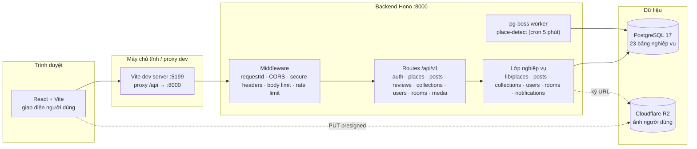

**Giải thích luồng:** trình duyệt gọi API qua proxy của Vite (dev) hoặc cùng origin (production
tĩnh), nên không vướng CORS. Middleware xử lý các mối quan tâm cắt ngang trước khi vào route;
route chỉ điều phối, logic truy vấn nằm trong `lib/`. Worker pg-boss chạy cùng tiến trình API,
đọc/ghi trực tiếp Postgres. Ảnh không đi qua API: client xin URL có chữ ký rồi PUT thẳng lên R2.

---

## CHƯƠNG 2. PHÂN TÍCH VÀ THIẾT KẾ HỆ THỐNG

### 2.1. Tác nhân và use case

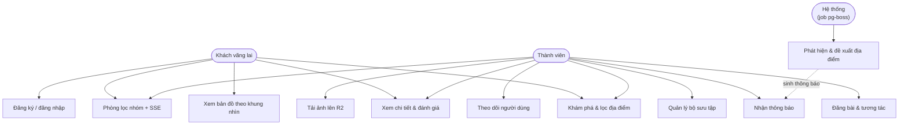

Khách vãng lai **không cần tài khoản** vẫn tạo/tham gia phòng lọc nhóm (quyết định D5): thành
viên phòng chỉ cần tên hiển thị, giảm ma sát khi cả nhóm đang đứng trước quán.

### 2.2. Thiết kế cơ sở dữ liệu

Cơ sở dữ liệu gồm **23 bảng nghiệp vụ** (cộng bảng `_prisma_migrations` của công cụ migration),
chia bốn vùng: người dùng & xác thực, địa điểm & đánh giá, nội dung xã hội, phòng lọc nhóm.

#### 2.2.1. Sơ đồ thực thể–liên hệ: người dùng, địa điểm, đánh giá

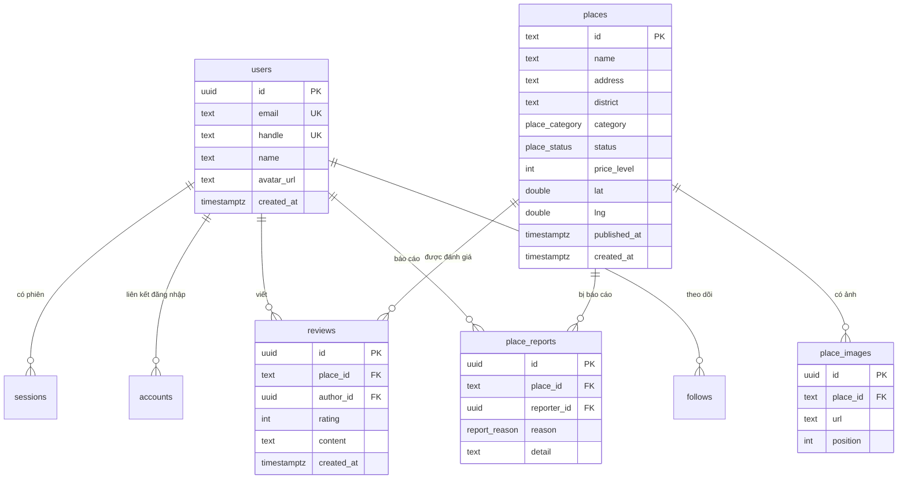

Ràng buộc quan trọng: `reviews` có unique `(place_id, author_id)` — mỗi người một đánh giá cho
mỗi quán, sửa thì ghi đè; `place_reports` có unique `(place_id, reason, reporter_id)` — chống
gửi trùng cùng lý do.

#### 2.2.2. Sơ đồ thực thể–liên hệ: nội dung xã hội

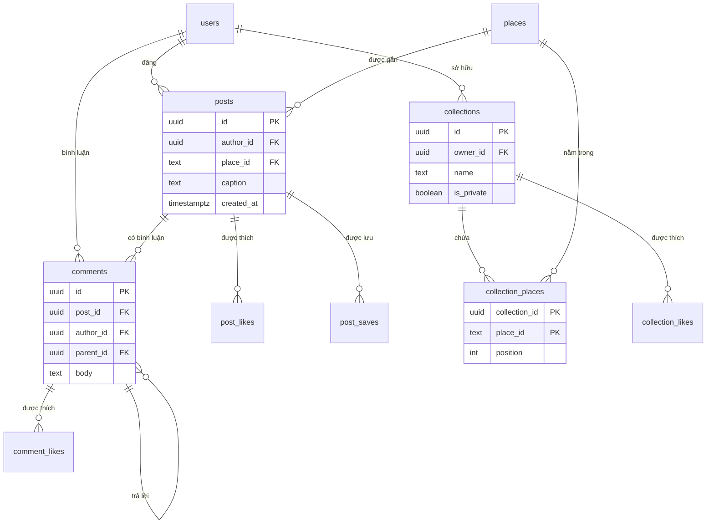

`post_likes`, `post_saves`, `comment_likes`, `collection_likes` đều dùng **khoá chính ghép**
`(đối tượng, người dùng)` — thao tác like/unlike là idempotent tự nhiên ở tầng dữ liệu.
`collection_places.position` cho phép sắp xếp thủ công; khi thêm lại một địa điểm, bản ghi được
đẩy xuống cuối thay vì nhân đôi.

#### 2.2.3. Sơ đồ thực thể–liên hệ: phòng lọc nhóm và thông báo

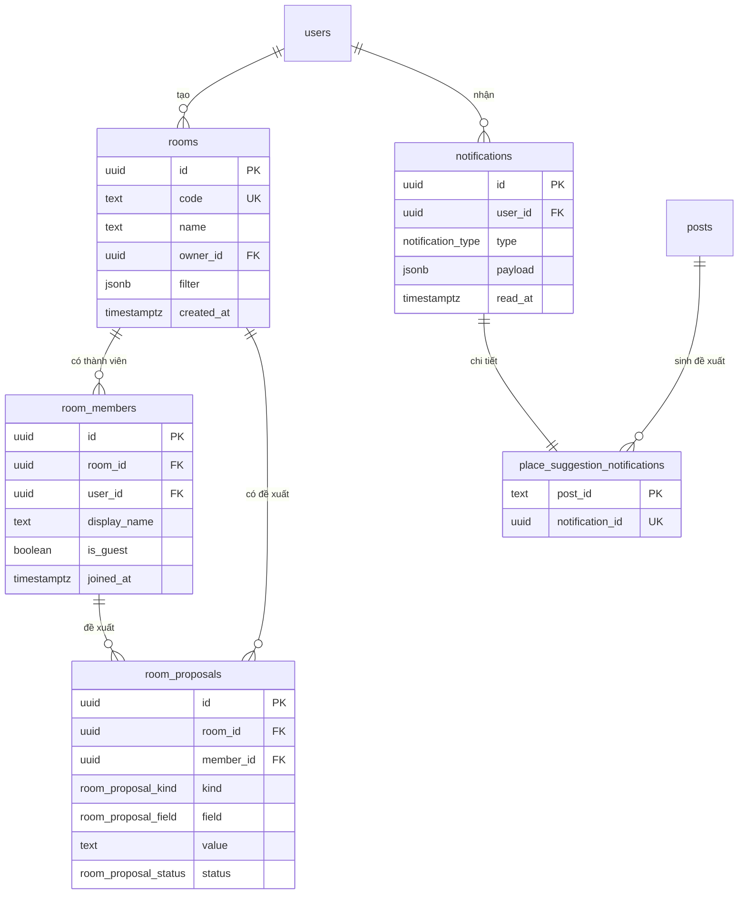

`rooms.filter` là JSONB (bộ lọc chung của phòng), `notifications.payload` là JSONB theo từng
loại thông báo. `place_suggestion_notifications` là **bảng dấu idempotence**: khoá chính
`post_id` bảo đảm một bài chỉ sinh một thông báo đề xuất, kể cả khi nhiều worker chạy song song.

### 2.3. Thiết kế hợp đồng API

Hợp đồng API được trích từ mock server của frontend (đặc tả hành vi) và chuyển thành gói
`packages/schema` dùng chung. Các quyết định thiết kế chính:

| Mã | Quyết định | Lý do |
| --- | --- | --- |
| D1 | Dùng Zod 4 cho mọi schema | Một nguồn kiểm tra cho FE/BE, suy ra kiểu TypeScript |
| D2 | Phân trang **cursor opaque base64** theo keyset `(created_at, id)` | Ổn định khi dữ liệu thay đổi, không bị nhảy trang như offset |
| D3 | Đếm `rating`/`reviewCount`/`likeCount` bằng `COUNT`/aggregate | Tránh cột đếm bị lệch, dữ liệu nhỏ nên chi phí chấp nhận |
| D4 | Xác thực email + mật khẩu trước | Đơn giản, đủ cho đồ án; mở rộng OAuth sau |
| D5 | Thành viên phòng lọc không cần tài khoản | Giảm ma sát cho nhóm đang đi chơi |
| D6 | Lỗi luôn có dạng `{ "message": string }` | Frontend hiển thị trực tiếp, không lộ chi tiết nội bộ |
| D7 | Monorepo Bun workspaces | Chia sẻ schema, chạy một lệnh cho cả hai phía |

Bảng nhóm endpoint (50 endpoint nghiệp vụ tự viết + 2 health check, cộng thêm mount xác thực
của better-auth):

| Nhóm | Số endpoint | Ví dụ |
| --- | --- | --- |
| Hạ tầng | 2 | `GET /healthz`, `GET /readyz` |
| Xác thực & hồ sơ | 5 | `POST /register`, `POST /session`, `DELETE /session`, `GET/PATCH /me` |
| Địa điểm | 6 | `GET /places`, `/places/map`, `/places/suggestions`, `/places/:id`, `/places/:id/posts`, `/places/saved` |
| Đánh giá & báo cáo | 3 | `GET/POST /places/:id/reviews`, `POST /places/:id/reports` |
| Bài đăng & bình luận | 10 | `GET/POST /posts`, like/save/gắn địa điểm, comments, like comment, xoá comment |
| Bộ sưu tập | 8 | CRUD, `PATCH /collections/:id/places`, like |
| Người dùng | 6 | `GET /users`, `/users/:handle`, `/users/:handle/posts`, `/users/:handle/collections`, follow |
| Thông báo | 3 | `GET /notifications`, đánh dấu đã đọc, đọc tất cả |
| Phòng lọc nhóm | 8 | tạo, xem, join, proposal, apply, dismiss, rời phòng, SSE |
| Media | 1 | `POST /media` (presigned PUT) |

### 2.4. Thiết kế bảo mật

- **Phiên:** cookie `HttpOnly; SameSite=Lax; Path=/; Max-Age=604800`, ký bằng secret ≥ 32 ký tự;
  backend từ chối khởi động nếu production dùng secret dev.
- **Phân quyền:** route ghi bắt buộc `requireAuth`; route đọc công khai tự xác định người xem để
  tính `isMine`, `likedByMe` mà không rò rỉ dữ liệu riêng tư (bộ sưu tập riêng của người khác
  trả 404, không phải 403 — không tiết lộ sự tồn tại).
- **Chống lạm dụng:** rate limit theo IP cho đăng nhập/đăng ký (20/phút) và theo người dùng cho
  tải ảnh (10/giờ); giới hạn body 1 MB.
- **SQL:** mọi truy vấn dùng tham số hoá (`Prisma.sql`), không nối chuỗi.
- **Header:** HSTS, `X-Content-Type-Options`, `X-Frame-Options`, `Referrer-Policy`,
  CSP `default-src 'none'`, Permissions-Policy tắt camera/micro/định vị.

---

## CHƯƠNG 3. TRIỂN KHAI HỆ THỐNG

### 3.1. Cấu trúc mã nguồn

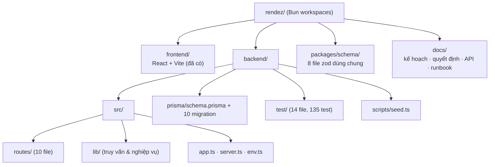

Backend có 35 file TypeScript trong `src/`, khoảng 4.440 dòng. Nguyên tắc: **route mỏng, lib dày**
— route lo kiểm tra đầu vào và mã HTTP, mọi truy vấn nằm trong `lib/` để tái sử dụng và dễ test.

### 3.2. Luồng đăng nhập và phiên

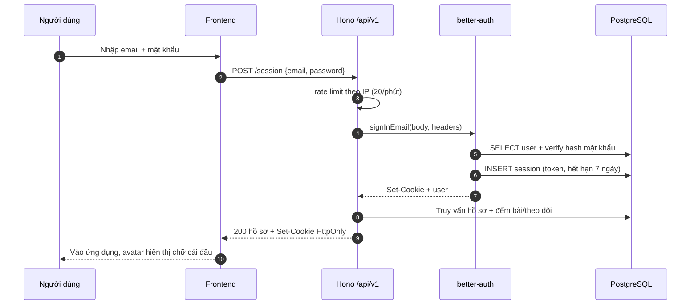

Các request sau chỉ cần cookie; middleware `requireAuth` gọi `getSession` và gắn `userId` vào
context. Route đọc công khai dùng `getViewer` để biết “có phải của tôi không” mà không bắt buộc
đăng nhập.

### 3.3. Luồng khám phá và lọc địa điểm

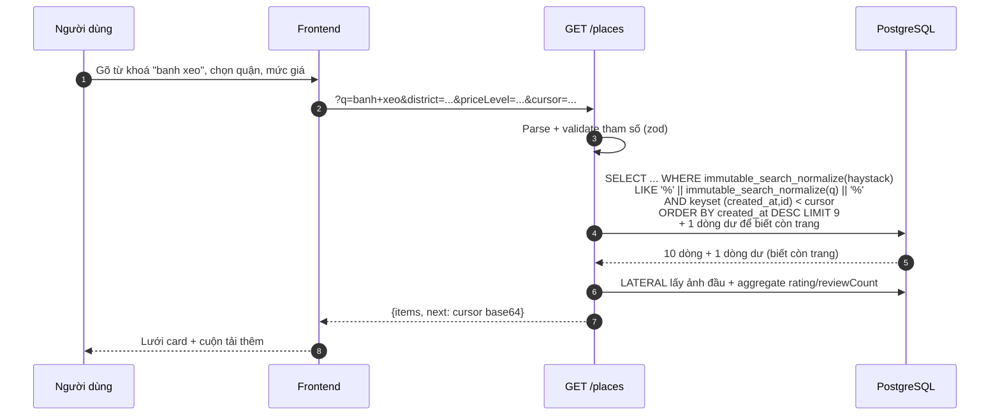

Điểm thiết kế: tìm kiếm không dấu dùng `unaccent()` của Postgres để “banh xeo” khớp “Bánh Xèo”;
phân trang keyset tránh trùng/sót khi dữ liệu thay đổi; ảnh và điểm đánh giá lấy trong cùng một
truy vấn (LATERAL + aggregate) nên không phát sinh N+1. Vì `unaccent()` là STABLE (không dùng
được trong biểu thức index), migration 9 bọc nó thành `immutable_unaccent()` và tạo GIN index
`pg_trgm` trên đúng biểu thức haystack — `EXPLAIN` xác nhận `Bitmap Index Scan on
places_search_trgm_idx` thay vì quét tuần tự khi dữ liệu lớn.

Migration 10 hoàn thiện phần còn thiếu: chuẩn hoá **cả hai phía** (haystack và từ khoá) bằng
`immutable_search_normalize()` — bỏ dấu, lowercase, dấu câu thành khoảng trắng, gộp khoảng
trắng — đúng quy tắc `normalizeText()` của mock. Trước đó `?q=bánh xèo` không khớp vì haystack
đã bỏ dấu còn từ khoá thì chưa; đây là lỗi hành vi thật được phát hiện khi đối chiếu mock, không
phải khác biệt chấp nhận được. Index GIN được dựng lại trên biểu thức mới và test
`q có dấu khớp tên` giữ hành vi này. Cùng hàm đó được dùng cho `?q=` của `/posts` (caption) và
`/users` (name/handle) để ba route tìm kiếm có chung một quy tắc chuẩn hoá.

### 3.4. Luồng đăng bài và thông báo

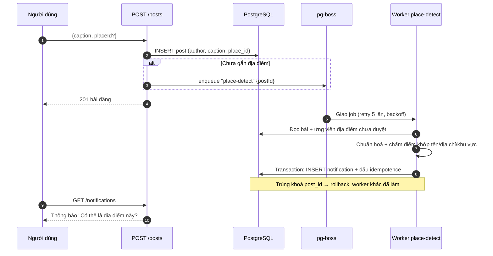

Job chạy theo hai kích hoạt: cron 5 phút (quét bài tồn đọng) và enqueue ngay khi tạo bài chưa
gắn địa điểm. Tính idempotent đặt ở tầng dữ liệu (khoá chính `post_id`) chứ không dựa vào bộ nhớ
worker — đúng nguyên tắc “một nghiệp vụ xử lý một nơi, an toàn khi chạy song song”.

### 3.5. Luồng phòng lọc nhóm với SSE

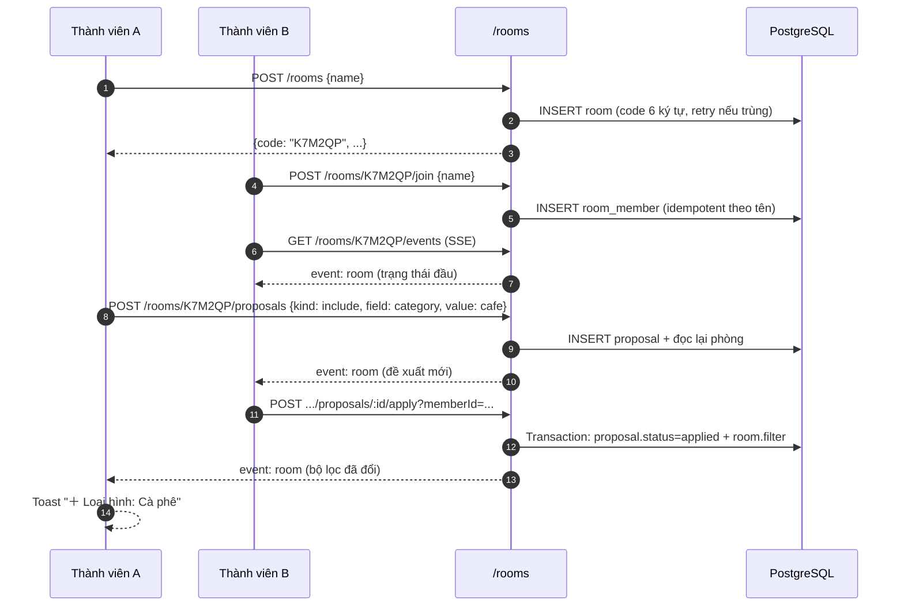

Mã phòng bỏ các ký tự dễ nhầm khi đọc qua điện thoại (O/0, I/1). SSE giữ kết nối mở với
heartbeat 15 giây để proxy không cắt; trạng thái phòng là nguồn sự thật duy nhất, client chỉ
hiển thị lại.

### 3.6. Luồng tải ảnh bằng presigned URL

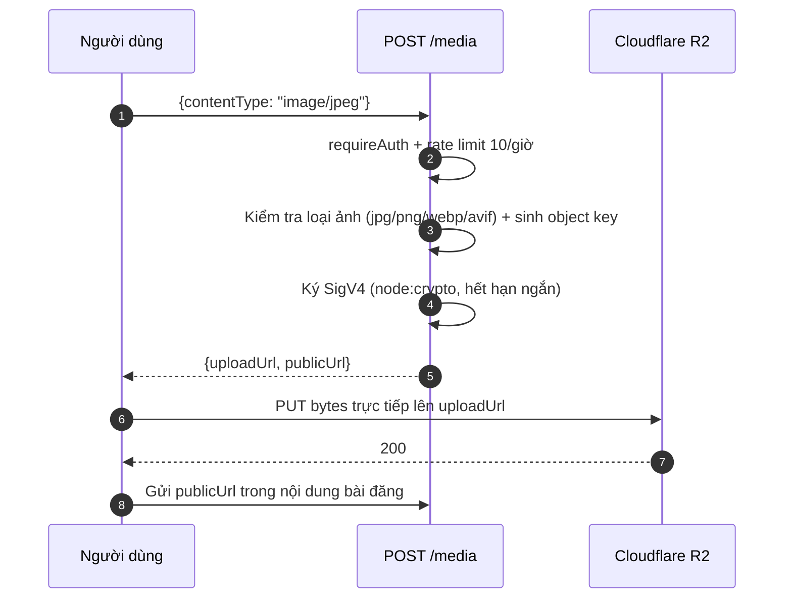

File không đi qua API nên không tốn băng thông máy chủ; API chỉ giữ vai trò cấp quyền có thời
hạn. Khi chưa cấu hình R2, route trả 503 kèm thông báo thay vì làm sập ứng dụng.

### 3.7. Tác vụ nền và độ tin cậy

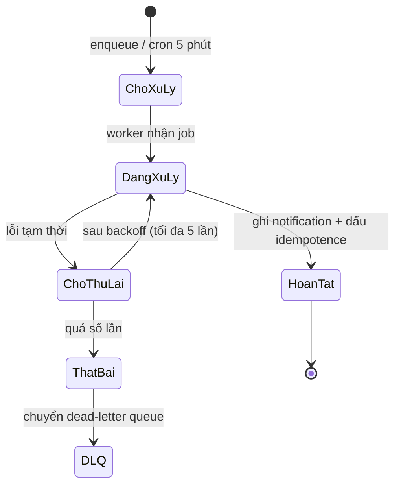

### 3.8. Đóng gói và triển khai

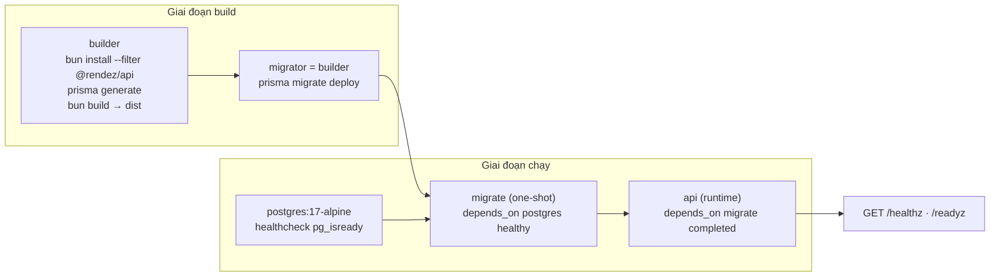

Compose tách service `migrate` khỏi `api` để API không bao giờ chạy trên schema cũ; `api` chỉ
khởi động khi migration hoàn tất (`service_completed_successfully`). Healthcheck dùng chính
`fetch` của Bun nên image không cần cài `curl`.

### 3.9. Giao diện sản phẩm

Ảnh chụp từ phiên bản đang chạy (mock bật ở dev, dữ liệu cold-start thật):

| Trang | Ảnh |
| --- | --- |
| Khám phá — lưới địa điểm | 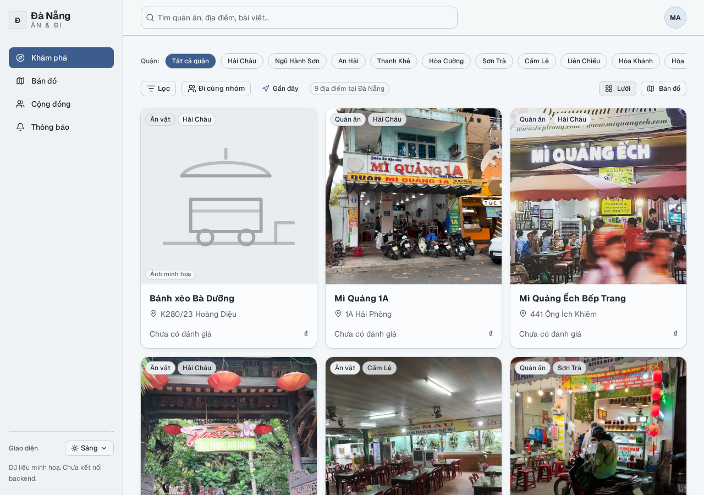 |
| Bản đồ theo khung nhìn | 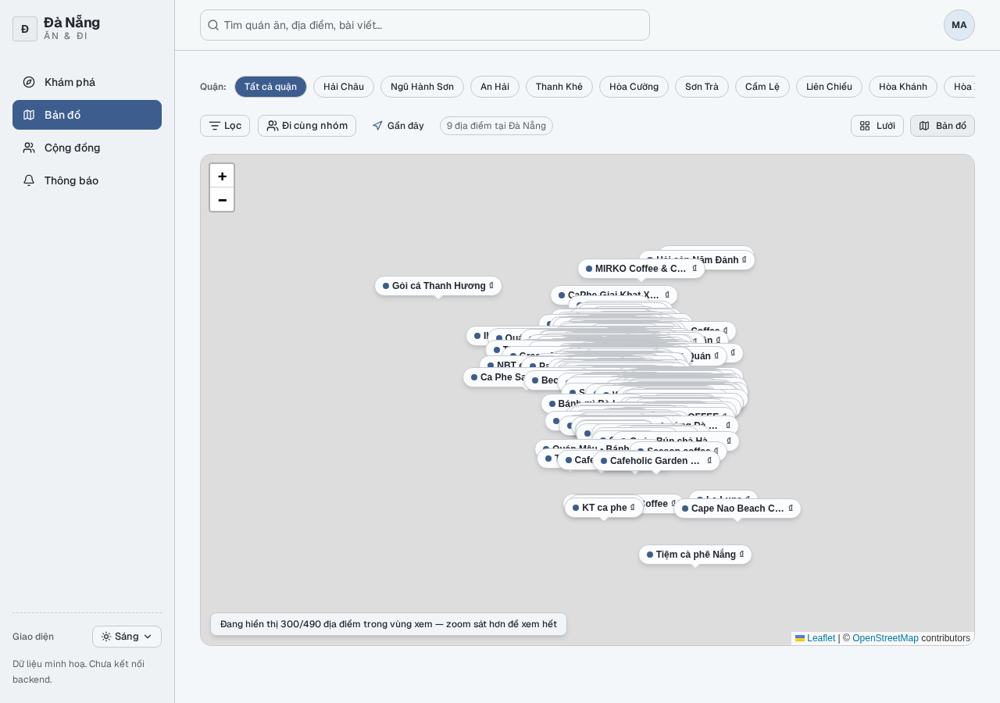 |
| Chi tiết địa điểm |  |
| Cộng đồng — bảng tin bài đăng |  |

---

## CHƯƠNG 4. KIỂM THỬ VÀ ĐÁNH GIÁ

### 4.1. Chiến lược kiểm thử

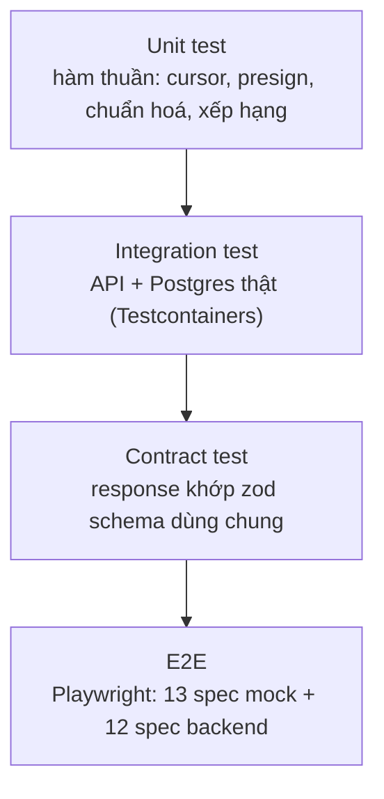

Mỗi file integration tự dựng một container Postgres riêng, chạy migration rồi seed dữ liệu tối
thiểu; bộ test chạy tuần tự (`--parallel=1`) để tránh tranh chấp tài nguyên.

### 4.2. Kết quả kiểm thử

| Bộ test | Số lượng | Kết quả | Thời gian |
| --- | --- | --- | --- |
| Backend integration/unit | 135 test / 14 file | **135 pass, 0 fail** | ~95 giây |
| E2E với backend thật | 12 spec | **12 pass** | ~9 giây |
| E2E với mock (hồi quy FE) | 13 spec | **13 pass** | ~15,8 giây |
| Typecheck (FE + BE) | — | 0 lỗi | ~5 giây |

Phân bố test backend theo vùng chức năng:

| File | Số test | Nội dung |
| --- | --- | --- |
| `places.test.ts` | 25 | danh sách, lọc, bản đồ, gợi ý, chi tiết, saved, bài gắn địa điểm |
| `posts.test.ts` | 24 | feed, phân trang, like, save, bình luận, like bình luận |
| `notifications.test.ts` | 6 | danh sách, đánh dấu đã đọc, đọc tất cả, 401 |
| `collections.test.ts` | 14 | CRUD, quyền riêng tư, thêm/bớt địa điểm, like |
| `rooms.test.ts` | 14 | tạo/join, đề xuất, áp dụng, rời phòng, SSE |
| `auth.test.ts` | 9 | đăng ký, đăng nhập, đăng xuất, hồ sơ, rate limit |
| `reviews.test.ts` | 8 | upsert đánh giá, báo cáo, chống trùng |
| `profile.test.ts` | 7 | hồ sơ theo handle, tab bài, theo dõi |
| `infra.test.ts` | 6 | body limit, presign, media 503, rate limit |
| `suggestions-job.test.ts` | 5 | job phát hiện địa điểm, idempotence |
| `enums.test.ts` | 5 | quy đổi enum API ↔ Prisma (round-trip, giá trị lạ) |
| `users.test.ts` | 6 | tìm kiếm người dùng |
| `health.test.ts` | 3 | healthz, readyz |
| `media.test.ts` | 3 | presign PUT khi R2 cấu hình, chặn SVG, folder lạ |

Đo độ phủ bằng `bun test --coverage` (52 file đo được, gồm cả gói schema dùng chung và
client Prisma sinh sẵn):

| Chỉ số | Trung bình | Ghi chú |
| --- | --- | --- |
| Độ phủ hàm | 92,4% | 30/52 file đạt 100% |
| Độ phủ dòng | 96,1% | |

Các vùng thấp nhất đều có lý do rõ: `lib/queue.ts` (50% hàm — worker chỉ chạy khi pg-boss
được bật trong server thật, test gọi trực tiếp job), `routes/media.ts` (nhánh chưa cấu hình
R2 trả 503 được test riêng, nhánh presign thật cần credentials), `routes/index.ts` (33% —
file chỉ gắn router, 100% dòng).

### 4.3. Đo lường hiệu năng

Đo bằng `curl -w` trên máy dev (API trong Docker, Postgres cùng máy, dữ liệu 491 địa điểm),
mỗi endpoint gọi 20 lần liên tiếp sau 3 lần khởi động nóng:

| Endpoint | Trung bình | Chậm nhất |
| --- | --- | --- |
| `GET /healthz` | 1 ms | 1 ms |
| `GET /places?limit=9` | 8 ms | 31 ms |
| `GET /places?q=banh+xeo` | 7 ms | 8 ms |
| `GET /places/map` (khung nhìn trung tâm) | 11 ms | 15 ms |
| `GET /places/:id` | 3 ms | 5 ms |
| `GET /notifications` (tài khoản mới, 0 thông báo) | 8 ms | 18 ms |

> Số liệu mang tính tham chiếu trên máy cá nhân, không phải benchmark tải cao.

### 4.4. Kiểm thử bảo mật cục bộ

| Kiểm tra | Kết quả mong đợi | Kết quả thực tế |
| --- | --- | --- |
| Truy cập `/me`, `/places/saved` không cookie | 401 | 401 |
| JSON hỏng ở `POST /session` | 400 | 400 |
| Tham số `q=' OR 1=1 --` | Không lỗi SQL, 0 kết quả | 200, 0 kết quả |
| `id` dài 500 ký tự | 404 | 404 |
| `cursor` sai định dạng | 400 | 400 |
| `category` là giá trị lạ | Không 500, trả trang rỗng | 200, `{items: [], next: null}` |
| Query/body chứa ký tự NUL (`%00`) | 400, không lỗi hệ thống | 400 "Dữ liệu chứa ký tự không hợp lệ" |
| Đề xuất phòng lọc `category=hack` | 400, phòng không hỏng | 400 "Giá trị đề xuất không hợp lệ" |
| Mật khẩu 3 ký tự | 400 | 400 |
| Cookie phiên | HttpOnly, SameSite | `HttpOnly; SameSite=Lax` |
| CORS từ origin lạ | Không có `Access-Control-Allow-Origin` | Đúng |
| Quét nikto (7.948 request) | Không có lỗi nghiêm trọng | 0 lỗi nghiêm trọng; 2 header thiếu đã bổ sung |
| Quét sqlmap `GET /places?q=&district=` | Không injectable | "all tested parameters do not appear to be injectable" |

### 4.5. Chưa xác minh

Các hạng mục sau **chưa kiểm chứng được** trong khuôn khổ đồ án, kèm nguyên nhân:

| Hạng mục | Nguyên nhân | Đã làm gì thay thế |
| --- | --- | --- |
| Tải ảnh lên Cloudflare R2 thật | Chưa có credentials R2 | Presigned URL được kiểm bằng unit test với thời điểm giả lập; route trả 503 khi chưa cấu hình |
| Gửi email thật | Chưa có SMTP provider | Đã thiết kế bảng `verifications` theo schema của better-auth; auth hiện chỉ email+password |
| Triển khai lên máy chủ công khai | Người dùng không xác nhận target deploy | Chạy được bằng `docker compose up` trên máy dev; có runbook từng bước |
| SSE nhiều instance | Pub/sub trong bộ nhớ | Ghi rõ hạn chế; hướng phát triển dùng Redis pub/sub |
| Hiệu năng ở quy mô lớn | Dataset chỉ 491 địa điểm | Đo latency thực tế trên máy dev; benchmark `pg_trgm` ghi BACKLOG cho ≥ 50k dòng |
| Trình duyệt mobile thật | Không có thiết bị trong phiên | e2e chạy trên Chromium desktop |

### 4.6. Đánh giá

**Ưu điểm**

- Hợp đồng API được kiểm chứng hai chiều: frontend thật chạy với backend thật qua 12 spec e2e,
  không phải viết lại giao diện.
- Dữ liệu nhất quán nhờ ràng buộc ở tầng DB (unique, khoá ngoại, khoá ghép) thay vì kiểm tra
  thủ công trong code.
- Tác vụ nền idempotent, có DLQ; migration có phiên bản; có runbook vận hành.
- Bảo mật cơ bản đầy đủ: phiên HttpOnly, rate limit, kiểm quyền từng route, header bảo mật.
- Quá trình audit tự rà soát đã phát hiện và sửa triệt để 9 lỗi thật (quyền gắn địa điểm, 500
  do enum rác/ký tự NUL/cursor giả mạo, thiếu `?sort=top`, chuẩn hoá tìm kiếm 3 route, batch
  job, `COUNT` cho bản đồ, thứ tự bình luận, đề xuất phòng nhận giá trị rác, code chết trong
  `onError`) — mỗi lỗi đều có test chặn hồi quy.

**Hạn chế**

- Chưa có giao diện đăng nhập email + mật khẩu ở frontend (API đã sẵn sàng), nên một spec e2e
  đăng xuất/đăng nhập lại chưa chạy được với backend thật.
- SSE dùng pub/sub trong bộ nhớ, chỉ đúng khi chạy một instance API.
- Chưa tích hợp R2 thật và email thật do thiếu credentials.
- Chưa có phân quyền quản trị (duyệt địa điểm, xử lý báo cáo) — mới dừng ở việc ghi nhận báo cáo.

---

## KẾT LUẬN

### Kết quả đạt được

Đồ án đã hoàn thiện **backend và cơ sở dữ liệu** cho ứng dụng RendeZ: 23 bảng nghiệp vụ, 10
migration, 50 endpoint nghiệp vụ + 2 health check, 135 test backend và 12 spec e2e chạy với
backend thật đều đạt; toàn bộ
hệ thống chạy được bằng một lệnh `docker compose up` với dữ liệu 491 địa điểm thật tại Đà Nẵng.
Báo cáo cũng đã hệ thống hoá quy trình: từ đặc tả hợp đồng API, thiết kế dữ liệu, triển khai,
đến kiểm thử và đóng gói.

### Hạn chế

Các hạng mục chưa kiểm chứng gồm: tích hợp Cloudflare R2 thật, gửi email thật, triển khai lên
máy chủ công khai, đồng bộ SSE nhiều instance và benchmark ở quy mô dữ liệu lớn. Giao diện
đăng nhập email + mật khẩu ở frontend chưa có nên một luồng e2e còn bỏ ngỏ.

### Hướng phát triển

1. Bổ sung giao diện đăng nhập/đăng ký và trang quản trị duyệt địa điểm, xử lý báo cáo.
2. Thay pub/sub trong bộ nhớ bằng Redis pub/sub để chạy nhiều instance API.
3. Tích hợp R2 thật, nén ảnh phía client trước khi tải lên.
4. Bổ sung tìm kiếm toàn văn tiếng Việt (`pg_trgm` + `tsvector`) và đo lại hiệu năng ở ≥ 50.000 địa điểm.
5. Viết CI (lint, typecheck, test, build image) và triển khai thử trên Fly.io/Railway.

---

## TÀI LIỆU THAM KHẢO

1. Hono. *Hono — Web framework built on Web Standards*. https://hono.dev/docs (truy cập 10/11/2026).
2. Prisma. *Prisma ORM Documentation — Schema, Migrations, Driver Adapters*.
   https://www.prisma.io/docs (truy cập 10/11/2026).
3. Better Auth. *Better Auth Documentation — Email & Password, Session Management*.
   https://www.better-auth.com/docs (truy cập 10/11/2026).
4. PostgreSQL Global Development Group. *PostgreSQL 17 Documentation — Text Search, unaccent, JSON Types*.
   https://www.postgresql.org/docs/17/ (truy cập 10/11/2026).
5. pg-boss. *pg-boss — Queueing jobs in PostgreSQL*. https://github.com/timgit/pg-boss (truy cập 10/11/2026).
6. Zod. *Zod Documentation — Schema validation*. https://zod.dev (truy cập 10/11/2026).
7. Playwright. *Playwright Documentation — Test configuration, Global setup, Storage state*.
   https://playwright.dev/docs (truy cập 10/11/2026).
8. Cloudflare. *R2 Documentation — S3 API, Presigned URLs*.
   https://developers.cloudflare.com/r2/ (truy cập 10/11/2026).
9. OpenStreetMap contributors. *OpenStreetMap — Dữ liệu bản đồ mở*. https://www.openstreetmap.org
   (dữ liệu POI dùng cho bộ cold-start, truy cập 09/11/2026).
10. Fielding, R. T. (2000). *Architectural Styles and the Design of Network-based Software Architectures*.
    University of California, Irvine.

---

## PHỤ LỤC

### Phụ lục A. Danh sách migration

| # | Tên migration | Nội dung |
| --- | --- | --- |
| 1 | `20261110182222_init` | 18 bảng nghiệp vụ ban đầu, enum, index |
| 2 | `20261110182227_extensions` | Bật `unaccent`, `pg_trgm` |
| 3 | `20261110200401_auth_better_auth` | Bảng `users`, `sessions`, `accounts`, `verifications` |
| 4 | `20261110200700_session_token_rename` | Đổi cột token phiên theo better-auth |
| 5 | `20261111050000_follows` | Bảng `follows`, index `following_id` |
| 6 | `20261111051500_place_suggestion_notifications` | Bảng dấu idempotence job đề xuất |
| 7 | `20261111052000_psn_notification_unique` | Unique `notification_id` (quan hệ 1-1) |
| 8 | `20261111054500_rate_limits` | Bảng đếm rate limit theo cửa sổ thời gian |
| 9 | `20261111080000_places_search_trgm` | GIN `pg_trgm` cho tìm kiếm không dấu (hàm `immutable_unaccent`, `immutable_array_to_string`) |
| 10 | `20261111090000_places_search_normalize` | Hàm `immutable_search_normalize` (bỏ dấu + dấu câu, khớp `normalizeText` của mock), dựng lại index trên biểu thức chuẩn hoá 2 phía |

### Phụ lục B. Lệnh vận hành thường dùng

```bash
# Dựng toàn bộ hệ thống (Postgres + migration + API)
docker compose up -d

# Kiểm tra sức khoẻ
curl -s http://localhost:8000/healthz
curl -s http://localhost:8000/readyz

# Nạp dữ liệu cold-start (491 địa điểm)
cd backend && bun run db:seed

# Chạy test backend (tuần tự, mỗi file một container Postgres)
cd backend && bun test --parallel=1

# Chạy e2e với backend thật
cd frontend && E2E_BACKEND_URL=http://localhost:8000 bun run e2e --project=backend
```

### Phụ lục C. Bảng mã lỗi

| Mã HTTP | Khi nào | Dạng body |
| --- | --- | --- |
| 400 | Dữ liệu đầu vào sai, vi phạm quy tắc nghiệp vụ | `{ "message": "..." }` |
| 401 | Chưa đăng nhập hoặc phiên hết hạn | `{ "message": "..." }` |
| 403 | Không đủ quyền (ví dụ xoá bình luận/bộ sưu tập của người khác) | `{ "message": "..." }` |
| 404 | Không tìm thấy tài nguyên hoặc không được phép thấy | `{ "message": "..." }` |
| 409 | Trùng dữ liệu (email đã dùng) | `{ "message": "..." }` |
| 413 | Body vượt 1 MB | `{ "message": "..." }` |
| 429 | Vượt rate limit | `{ "message": "..." }` + `Retry-After` |
| 500 | Lỗi không lường trước — không lộ stack/SQL ra ngoài | `{ "message": "...", "code": "INTERNAL" }` |
| 503 | Tính năng chưa cấu hình (R2) hoặc DB không sẵn sàng | `{ "message": "..." }` |
