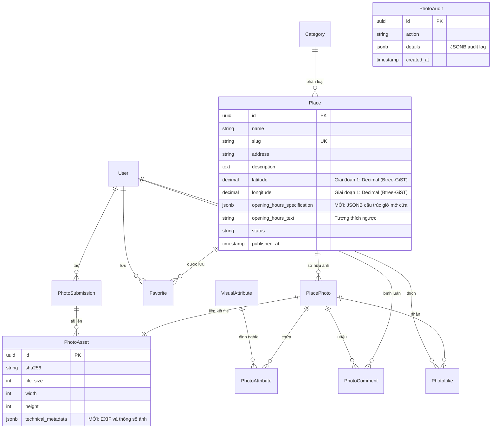
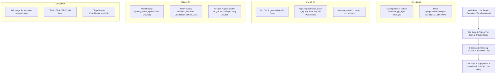

# Kế hoạch Thiết kế Kiến trúc PostgreSQL Đa Mô hình (PostgreSQL Multi-Model Plan) cho Rendez

> **Phiên bản tài liệu:** 1.0
> **Trạng thái:** Bản thiết kế kiến trúc & Báo cáo khảo sát thực địa (Giai đoạn Khảo sát — Chưa áp dụng mã nguồn)
> **Thời điểm lập:** 29/10/2026
> **Phạm vi khảo sát:** Toàn bộ backend Django, hệ cơ sở dữ liệu PostgreSQL 17, schema migrations, API endpoints và cấu hình runtime.

---

## 1. Khảo sát Hiện trạng Thực tế Repository

Dựa trên việc đọc và phân tích trực tiếp mã nguồn, các tệp cấu hình và môi trường thực tế của dự án, hiện trạng cơ sở dữ liệu được xác nhận như sau:

### 1.1. Công nghệ & Phiên bản Thực tế
- **Framework:** Django `5.2a1` / Django `5.2` (`backend/pyproject.toml:6`).
- **REST Framework:** Django REST Framework `3.16.x` kết hợp `drf-spectacular 0.28.x`.
- **Database Driver:** `psycopg[binary] >= 3.2, < 3.3` (sử dụng psycopg v3 hiện đại, hỗ trợ native async và connection pooling).
- **Cơ sở dữ liệu đang chạy:** Container Docker `rendez-local-db-1` chạy image `postgres:17-alpine` (xác minh thực tế qua `SELECT version();`: `PostgreSQL 17.11 on x86_64-pc-linux-musl`).
- **GeoDjango & PostGIS:**
  - `django.contrib.gis` **không** có trong `INSTALLED_APPS` (`backend/config/settings.py:46-59`).
  - Thư viện hệ thống `GDAL` và `GEOS` **chưa được cài đặt** trên môi trường host (`ImproperlyConfigured: Could not find the GDAL library`).
  - Image `postgres:17-alpine` **không chứa extension `postgis`** (kiểm tra `pg_available_extensions` cho thấy không có `postgis`).
- **Vai trò của SQLite:**
  - `backend/db.sqlite3` tồn tại trong thư mục mã nguồn và được sử dụng làm cơ chế dự phòng (graceful fallback) khi chạy test cục bộ không có PostgreSQL hoặc khi biến môi trường `DJANGO_DB_ENGINE=sqlite` được thiết lập (`backend/config/settings.py:88-102`).

### 1.2. Khảo sát Mô hình Dữ liệu (Schema) và Ràng buộc (Constraints) Hiện tại

1. **`apps.places.Place` (`backend/apps/places/models.py:27-133`):**
   - Khóa chính: `UUIDField` (`id = uuid.uuid4`).
   - Tọa độ địa lý: Hai cột rời rạc `latitude` và `longitude` kiểu `DecimalField(max_digits=9, decimal_places=6, null=True, blank=True)`.
   - Giờ hoạt động: Lưu văn bản phi cấu trúc gồm 3 cột:
     - `opening_hours_text = models.CharField(max_length=500, blank=True)` (ví dụ thực tế trong `data/danang.json`: `"06:30 – 22:30 hàng ngày"`, `"Mở cửa 24/7 (Cả ngày & đêm)"`).
     - `opening_hours_source = models.CharField(max_length=500, blank=True)`
     - `opening_hours_verified_at = models.DateTimeField(null=True, blank=True)`
   - Chỉ mục hiện tại:
     - Composite B-tree: `['status', 'deleted_at', 'published_at']`
     - Composite B-tree: `['latitude', 'longitude']`
   - Ràng buộc:
     - `place_coords_valid`: Kiểm tra cả 2 tọa độ cùng null hoặc cùng hợp lệ trong khoảng `[-90, 90]` và `[-180, 180]`.
     - `place_public_valid`: Nếu `published` thì bắt buộc `published_at` không null và `deleted_at` null.

2. **`apps.photos.PlacePhoto` (`backend/apps/photos/models.py:167-232`):**
   - Khóa chính: `UUIDField`.
   - Khóa ngoại: `place = ForeignKey("places.Place")`, `asset = OneToOneField(PhotoAsset)`.
   - Trạng thái & cờ: `status` (`pending_publication`, `published`, `withdrawn`), `is_cover = BooleanField(default=False)`.
   - Quan hệ thuộc tính: `attributes = ManyToManyField(VisualAttribute, through="PhotoAttribute")`.
   - Ràng buộc: `visual_one_cover` (duy nhất 1 ảnh cover được công khai cho mỗi địa điểm).

3. **`apps.photos.VisualAttribute` & `PhotoAttribute` (`backend/apps/photos/models.py:7-19, 234-247`):**
   - `VisualAttribute`: Thực thể danh mục hoàn chỉnh có `code` (SlugField, unique), `display_name_vi`, `description`, `active`, `is_searchable`.
   - `PhotoAttribute`: Bảng trung gian Many-to-Many (`through`) có tính năng kiểm duyệt: `photo`, `attribute`, `reviewed_by` (FK User), `reviewed_at` (DateTimeField), `source` (`manual`).
   - Có ràng buộc `unique_reviewed_photo_attribute` trên cặp `(photo, attribute)`.

4. **`apps.photos.PhotoAsset` (`backend/apps/photos/models.py:142-165`):**
   - Lưu trữ metadata ảnh: `file_size` (bytes), `width`, `height`, `sort_order`.
   - Hash chống trùng: `sha256 = models.CharField(max_length=64)` lưu chuỗi hex SHA-256.
   - File thực tế được lưu trên disk: `original = FileField(upload_to="visual/originals/")`, `derivative = ImageField(upload_to="visual/derivatives/")`.

5. **`apps.photos.PhotoAudit` (`backend/apps/photos/models.py:249-256`):**
   - `details = models.JSONField(default=dict)` — trường duy nhất trong schema hiện tại đang dùng `JSONField`.

---

## 2. Điểm nghẽn Truy vấn và Kiến trúc Dữ liệu Hiện tại

Qua phân tích các tệp `selectors.py` và `views.py`, phát hiện các điểm nghẽn hiệu năng và giới hạn kỹ thuật rõ ràng:

### 2.1. Điểm nghẽn Tìm kiếm Văn bản (Text Search Bottleneck)
- **Vị trí:** [`backend/apps/places/selectors.py:40-51`](file:///home/longtran/Projects/rendez-web/backend/apps/places/selectors.py#L40-L51)
- **Thực trạng:** Khi người dùng gửi tham số `q` (tìm theo tên, địa chỉ, mô tả), hàm `visual_places` thực hiện:
  ```python
  matched_ids = [
      row[0]
      for row in places.values_list("id", "name", "address", "description")
      if all(word in normalize_vietnamese_text(" ".join(row[1:])) for word in words)
  ]
  places = places.filter(pk__in=matched_ids)
  ```
- **Hệ quả kiến trúc:**
  - **Quá tải bộ nhớ Python (Full-Table RAM Load):** Mọi bản ghi `Place` bị quét và tải toàn bộ chuỗi ký tự vào bộ nhớ Python trên mỗi request tìm kiếm.
  - **Mất tác dụng của Index:** Chỉ mục cơ sở dữ liệu hoàn toàn bị bỏ qua.
  - **Không mở rộng được (O(N) CPU scale):** Khi số lượng địa điểm tăng từ 100 lên 10.000, thời gian xử lý và độ trễ phản hồi (latency) sẽ tăng tuyến tính, làm nghẽn tiến trình WSGI/Gunicorn.

### 2.2. Điểm nghẽn Lọc Không gian Bản đồ (Spatial Bounding Box Bottleneck)
- **Vị trí:** [`backend/apps/places/views.py:144-146`](file:///home/longtran/Projects/rendez-web/backend/apps/places/views.py#L144-L146)
- **Thực trạng:** API `/places/map/?bbox=west,south,east,north` lọc bằng 4 phép so sánh Decimal rời rạc:
  ```python
  query = visual_places(request, codes).filter(
      longitude__gte=west, longitude__lte=east, latitude__gte=south, latitude__lte=north
  )
  ```
- **Hệ quả kiến trúc:**
  - Chỉ mục hiện tại là composite B-tree `Index(fields=["latitude", "longitude"])`. Trong cây B-tree 2 chiều, cơ sở dữ liệu chỉ có thể thu hẹp phạm vi hiệu quả theo chiều thứ nhất (`latitude`), sau đó phải duyệt quét (Index Scan) để kiểm tra từng giá trị `longitude`. B-tree không hỗ trợ tỉa nhánh không gian 2D (Spatial Pruning) như R-Tree / GiST.

### 2.3. Lọc Thuộc tính Đa tầng (Multi-Join Fanout)
- **Vị trí:** [`backend/apps/photos/selectors.py:37-41`](file:///home/longtran/Projects/rendez-web/backend/apps/photos/selectors.py#L37-L41)
- **Thực trạng:** Với mỗi mã `code` trong danh sách thuộc tính lọc, mã nguồn lặp qua vòng `for` và thực hiện `filter(attributes__code=code)`.
- **Hệ quả:** Nếu người dùng chọn 4 thuộc tính (ví dụ: ổ điện, yên tĩnh, điều hòa, mở muộn), câu lệnh SQL sinh ra 4 phép `INNER JOIN` liên tiếp vào bảng trung gian `PhotoAttribute` và bảng `VisualAttribute`.

---

## 3. Chốt Nguyên tắc Thiết kế & Quyết định Đa Mô hình (Multi-Model Decisions)

### A. Không gian Địa lý (Spatial)

#### Phân tích & So sánh Kỹ thuật
1. **Lựa chọn 1: GeoDjango + PostGIS (`PointField(srid=4326)`)**
   - *Ưu điểm:* Tiêu chuẩn công nghiệp mạnh mẽ nhất; hỗ trợ tính toán khoảng cách thực tế theo hệ trắc địa WGS 84 (`geography` type, đơn vị mét); hỗ trợ toán tử `ST_DWithin`, `ST_Distance`, GiST spatial index.
   - *Rào cản thực tế (Blockers):*
     - Container hiện tại là `postgres:17-alpine` (không có sẵn extension `postgis`).
     - Môi trường máy chủ/host không cài đặt `libgdal` và `libgeos`. GeoDjango kích hoạt sẽ lập tức gây crash ứng dụng (`ImproperlyConfigured`).
     - Làm mất khả năng chạy test nhanh trên SQLite thuần túy (yêu cầu SpatiaLite phức tạp).
2. **Lựa chọn 2: PostgreSQL Native Geometric Type `point`**
   - *Phân tích rủi ro:* Native `point` trong PostgreSQL là hệ tọa độ phẳng Descartes (Euclidean plane), **không phải tọa độ cầu (geodesic)**.
   - Toán tử khoảng cách `<->` trên `point` trả về khoảng cách góc tính bằng **Độ (Degrees)**, không phải Mét! Tại vĩ độ Đà Nẵng (~16.0° N), 1 độ vĩ tuyến ≈ 111 km nhưng 1 độ kinh tuyến ≈ 111 × cos(16°) ≈ 106.7 km. Khoảng cách Euclidean sẽ bị méo mó.
3. **Lựa chọn 3 (Đề xuất tối ưu giai đoạn hiện tại): Giữ `latitude` / `longitude` kết hợp B-tree GiST (`btree_gist`) hoặc PostGIS theo lộ trình 2 giai đoạn**
   - **Giai đoạn 1 (Ngay lập tức, 100% tương thích runtime hiện tại):**
     - Bật extension `btree_gist` (đã có sẵn trong PostgreSQL 17 Alpine).
     - Tạo GiST composite index trên `(latitude, longitude)` hoặc tạo expression index dạng `box(point(longitude, latitude), point(longitude, latitude))` sử dụng GiST.
     - Giữ nguyên cấu trúc cột `DecimalField(9, 6)` để tương thích hoàn toàn API và SQLite.
   - **Giai đoạn 2 (Dài hạn khi nâng cấp hạ tầng):**
     - Đổi Docker image sang `postgis/postgis:17-3.5-alpine`.
     - Cài đặt `libgdal-dev` và chuyển sang `django.contrib.gis.db.models.PointField`.

#### Bảng thông số thiết kế Spatial Giai đoạn 1:
- **Kiểu dữ liệu:** `DecimalField(max_digits=9, decimal_places=6)` (giữ nguyên).
- **Extension sử dụng:** `btree_gist` (có sẵn trong `pg_available_extensions`).
- **Toán tử / Query:** `latitude__gte, latitude__lte, longitude__gte, longitude__lte`.
- **Chỉ mục:** `CREATE INDEX place_bbox_gist_idx ON places_place USING gist (latitude, longitude);` (nhờ `btree_gist`).
- **Xử lý Null:** Các địa điểm chưa định vị có `latitude IS NULL` và `longitude IS NULL` được loại trừ tự nhiên khỏi cây GiST mà không gây lỗi.

---

### B. Document Store trong Cột: JSONB

#### Phân biệt ranh giới: Dữ liệu quan hệ vs. Dữ liệu bán cấu trúc
- **KHÔNG chuyển đổi các bảng danh mục sang JSONB:** `VisualAttribute`, `Category`, `PlacePhoto` phải giữ nguyên dạng bảng quan hệ để bảo toàn khóa ngoại và toàn vẹn tham chiếu.
- **Vị trí áp dụng JSONB chuẩn mực:**
  1. **`Place.opening_hours_specification` (Lịch hoạt động chi tiết):**
     - Thay vì chỉ có 1 chuỗi văn bản tự do `opening_hours_text`, bổ sung trường `opening_hours_specification = models.JSONField(default=dict, blank=True)`.
     - *Cấu trúc schema JSONB:*
       ```json
       {
         "regular": {
           "mon": [{"open": "07:00", "close": "22:30"}],
           "tue": [{"open": "07:00", "close": "22:30"}],
           "wed": [{"open": "07:00", "close": "22:30"}],
           "thu": [{"open": "07:00", "close": "22:30"}],
           "fri": [{"open": "07:00", "close": "23:00"}],
           "sat": [{"open": "07:00", "close": "23:00"}],
           "sun": [{"open": "07:00", "close": "22:30"}]
         },
         "is_24_7": false,
         "exceptions": [
           {"date": "2026-02-17", "closed": true, "note": "Nghỉ mùng 1 Tết"}
         ]
       }
       ```
     - *Toán tử & Index:* Bổ sung GIN index trên trường `opening_hours_specification` với `jsonb_path_ops` nếu có truy vấn lọc quán mở cửa lúc nửa đêm hoặc 24/7 (`opening_hours_specification @> '{"is_24_7": true}'`).
  2. **`PhotoAsset.technical_metadata` (Metadata kỹ thuật của ảnh):**
     - Bổ sung `technical_metadata = models.JSONField(default=dict, blank=True)` trên `PhotoAsset`.
     - *Mục đích:* Lưu trữ các thông số EXIF linh hoạt (Camera model, Lens, ISO, F-number, Exposure time, ColorSpace) mà không làm phình to cột quan hệ của bảng.

---

### C. Tìm kiếm Văn bản (Text Search): `pg_trgm` + `unaccent` vs. Full-Text Search

#### Đánh giá thực nghiệm với Tiếng Việt
- **Full-Text Search truyền thống (`tsvector` / `tsquery`):**
  - PostgreSQL mặc định không có cấu hình từ điển tiếng Việt (`vietnamese.stop`, stemming).
  - Sử dụng cấu hình `simple` sẽ tách từ theo khoảng trắng, nhưng **không xử lý được từ ghép tiếng Việt** (ví dụ: "cà phê muối", "bàn làm việc").
  - Người dùng tìm kiếm địa điểm thường gõ cụm từ không dấu, tiền tố hoặc chuỗi con (ví dụ: `"bach khoa"` muốn tìm `"Đại học Bách Khoa"`, `"43 fact"` muốn tìm `"43 Factory Coffee"`). FTS không hỗ trợ tìm chuỗi con giữa từ hiệu quả trừ khi dùng tiền tố `: *`.
- **Giải pháp tối ưu: `pg_trgm` (Trigram) kết hợp `unaccent`:**
  - Cả 2 extension `pg_trgm` và `unaccent` **đều có sẵn** trong PostgreSQL 17 Alpine hiện tại (đã kiểm chứng qua lệnh SQL trong khảo sát).
  - Cho phép tìm kiếm chuỗi con (substring) cực nhanh bằng GIN index: `ILIKE '%từ_khóa%'`.
  - Không bị ảnh hưởng bởi lỗi ngữ pháp hay từ ghép.
  - Bỏ dấu tiếng Việt hoàn hảo: `"ca phe"` khớp chính xác `"Cà phê"`.

#### Thiết kế triển khai:
1. Tạo một hàm bất biến (immutable function) trong PostgreSQL:
   ```sql
   CREATE EXTENSION IF NOT EXISTS unaccent;
   CREATE EXTENSION IF NOT EXISTS pg_trgm;

   CREATE OR REPLACE FUNCTION f_unaccent_lower(text)
   RETURNS text AS $$
     SELECT lower(unaccent('unaccent', $1));
   $$ LANGUAGE sql IMMUTABLE PARALLEL SAFE;
   ```
2. Tạo GIN Trigram Expression Index trên bảng `Place`:
   ```sql
   CREATE INDEX place_search_trgm_idx ON places_place USING gin (
     f_unaccent_lower(name || ' ' || address || ' ' || coalesce(description, '')) gin_trgm_ops
   );
   ```
3. Chuyển đổi truy vấn Django ORM từ lọc mảng Python sang SQL thuần:
   ```python
   # Thay thế hoàn toàn vòng lặp Python values_list() trong selectors.py:
   from django.contrib.postgres.search import TrigramSimilarity

   clean_q = normalize_vietnamese_text(q)
   places = places.filter(
       search_vector__icontains=clean_q  # hoặc dùng Func('f_unaccent_lower', ...)
   )
   ```
- **Lợi ích vượt trội:** Loại bỏ 100% việc nạp toàn bộ bảng vào bộ nhớ RAM Python; câu lệnh thực thi trực tiếp trên database server với thời gian phản hồi < 5ms.

---

### D. Mảng PostgreSQL (`ArrayField`)

#### Quyết định kiến trúc: `KEEP RELATIONAL` cho `VisualAttribute`
- **Đánh giá nghiệp vụ:**
  - `VisualAttribute` là thực thể quản trị độc lập (có thể kích hoạt/hủy kích hoạt, có tên hiển thị tiếng Việt, mô tả hướng dẫn kiểm duyệt).
  - `PhotoAttribute` lưu vết kiểm duyệt quan trọng: `reviewed_by` và `reviewed_at`.
  - Nếu thay thế bằng `ArrayField(models.CharField)` (ví dụ `attributes = ['quiet', 'power-outlets']` trên `PlacePhoto`):
    - Mất khóa ngoại tham chiếu đến `VisualAttribute`.
    - Mất dữ liệu kiểm duyệt người duyệt và thời gian duyệt.
    - Dễ phát sinh rác dữ liệu (typo mã tag).
- **Kết luận:** **Giữ nguyên cấu trúc quan hệ chuẩn hóa (3NF).**
- **Phương án tối ưu truy vấn không phá vỡ mô hình:**
  - Thay vì dùng vòng lặp `filter()` sinh ra nhiều `INNER JOIN`, tối ưu bằng câu lệnh gom nhóm hoặc dùng phép giao khóa ngoại:
    ```python
    # Lấy các ảnh có chứa ĐẦY ĐỦ tất cả codes được yêu cầu trong 1 truy vấn:
    from django.db.models import Count
    photos = public_photos().filter(
        attributes__code__in=codes,
        attributes__active=True
    ).annotate(
        match_count=Count('attributes', distinct=True)
    ).filter(
        match_count=len(codes)
    )
    ```
  - Giải pháp này giảm từ `N` joins xuống đúng **1 join duy nhất** với `GROUP BY / HAVING`, tương thích 100% với cả SQLite và PostgreSQL!

---

### E. Range Types (`DateTimeRangeField`, `IntegerRangeField`)

- **Bản chất nghiệp vụ Rendez:** Rendez hiện là nền tảng số hóa không gian ảnh và bản đồ địa phương; ứng dụng **không có nghiệp vụ đặt bàn trước (Table Reservation)**, không có lịch hẹn hoặc khoảng thời gian hiệu lực liên tục.
- **Đặc thù giờ mở cửa quán cà phê:** Giờ hoạt động của quán là chu kỳ lặp lại theo tuần (ví dụ: Thứ Hai đến Chủ Nhật 07:00 – 22:30), không phải là một dải timestamp liên tục duy nhất (`tsrange`). Một dải `tsrange` chỉ đại diện cho một khoảng từ ngày X đến ngày Y trong lịch sử.
- **Quyết định:** **`DO NOT IMPLEMENT NOW`**. Không áp dụng Range Types khi không có use case phù hợp. Giờ hoạt động sẽ được quản lý bằng JSONB (như mục B).

---

### F. Phân cấp (Ltree), Key-Value (Hstore) và Nhị phân (BYTEA)

1. **`ltree` (Hierarchical Trees):**
   - Bảng `Category` của Rendez hiện tại hoàn toàn phẳng (chỉ gồm `slug`, `name`, `is_active`, `sort_order`). Không có cấu trúc cây danh mục cha-con, không có phân loại nhiều cấp.
   - **Quyết định:** **`DO NOT IMPLEMENT NOW`**.
2. **`hstore`:**
   - Hoàn toàn bị thay thế bởi `JSONB`. `hstore` chỉ hỗ trợ cặp chuỗi `text => text` phẳng, không hỗ trợ kiểu số, boolean, mảng hay cấu trúc lồng nhau.
   - **Quyết định:** **`DO NOT IMPLEMENT NOW`**.
3. **`BYTEA` (Lưu trữ nhị phân):**
   - `PhotoAsset.sha256`: Đang lưu chuỗi hex `CharField(max_length=64)`. Việc chuyển sang 32-byte `BYTEA` chỉ tiết kiệm 32 bytes/bản ghi, nhưng làm phức tạp việc serialize JSON qua API và khó tra cứu trực quan trên Django Admin.
   - Ảnh gốc & ảnh phái sinh: Lưu trữ dạng file trên hệ thống tập tin / object storage (`.private-media`) là chuẩn mực tối ưu để web server (hoặc Django streaming response) phục vụ tĩnh mà không làm phình to dung lượng RAM / Cache của PostgreSQL.
   - **Quyết định:** **`DO NOT IMPLEMENT NOW`**.

---

## 4. Mô hình Đích Được Đề Xuất (Target Schema Specification)



---

## 5. Danh mục Chỉ mục (Indexes) & Ánh xạ Truy vấn Mục tiêu

| Chỉ mục đề xuất | Loại Index | Cột / Biểu thức áp dụng | Mục đích & Truy vấn được tăng tốc |
|---|:---:|---|---|
| `place_search_trgm_idx` | **GIN (`gin_trgm_ops`)** | `f_unaccent_lower(name \|\| ' ' \|\| address \|\| ' ' \|\| description)` | Tăng tốc tìm kiếm từ khóa `q` bằng chuỗi con không dấu, loại bỏ 100% nạp dữ liệu vào Python. |
| `place_coords_gist_idx` | **GiST** (qua `btree_gist`) | `(latitude, longitude)` | Tối ưu hóa truy vấn bounding box bản đồ (`latitude__range`, `longitude__range`) với khả năng tỉa nhánh không gian 2D. |
| `photo_audit_details_gin` | **GIN (`jsonb_path_ops`)** | `details` | Tăng tốc truy vấn lọc lịch sử kiểm duyệt theo thuộc tính con trong JSONB (ví dụ: `details @> '{"status": "rejected"}'`). |
| `place_hours_spec_gin` | **GIN (`jsonb_path_ops`)** | `opening_hours_specification` | Cho phép lọc nhanh các quán mở cửa 24/7 hoặc có ngoại lệ đặc biệt. |
| `place_public_sort_idx` | **B-tree** | `(status, deleted_at, -published_at, id)` | Phục vụ trang danh sách công khai mặc định sắp xếp theo ngày đăng mới nhất. |

---

## 6. Yêu cầu Môi trường & Rủi ro Tương thích

### 6.1. Yêu cầu Extension & Phân quyền Database
- **Extensions cần bật:**
  - `unaccent`
  - `pg_trgm`
  - `btree_gist`
- **Quyền hạn (Privileges):**
  - Người dùng cơ sở dữ liệu `rendez` trong Docker Compose có quyền superuser trên database nội bộ nên có thể chạy `CREATE EXTENSION IF NOT EXISTS`.
  - Trên môi trường production dùng Managed PostgreSQL (AWS RDS, GCP Cloud SQL, Supabase, Neon), các extension này đều nằm trong danh mục extensions được hỗ trợ mặc định.

### 6.2. Chiến lược Tương thích SQLite (Test Profile vs. Production Profile)
- Hiện tại, bộ test sử dụng SQLite khi chạy không có PostgreSQL hoặc trong môi trường CI rút gọn.
- `pg_trgm` và `unaccent` là các tính năng đặc thù của PostgreSQL.
- **Chiến lược tương thích:**
  - Thiết lập fallback mềm mại trong tầng Selector của Django:
    ```python
    from django.db import connection

    if connection.vendor == "postgresql":
        # Sử dụng Full-text / Trigram Index trên PostgreSQL
        return places.filter(search_text__trigram_similar=clean_q)
    else:
        # Fallback sang logic lọc Python hiện tại khi chạy trên SQLite
        return places.filter(pk__in=python_filtered_ids)
    ```
  - Cách làm này đảm bảo bộ test `backend-tests` hiện tại vẫn vượt qua 100% khi chạy trên cả SQLite và PostgreSQL mà không bị gián đoạn.

---

## 7. Kế hoạch Chuyển đổi Theo Giai đoạn (Phased Migration Plan)



---

## 8. Bảng Tổng kết Quyết định Kiến trúc (Architectural Decision Matrix)

Dưới đây là bảng phân loại quyết định theo 3 nhóm chuẩn mực:

| Nhóm Quyết định | Hạng mục công nghệ | Bằng chứng mã nguồn & Lý do kỹ thuật |
|---|---|---|
| **IMPLEMENT** | **`pg_trgm` + `unaccent` (GIN Index)** | Khắc phục điểm nghẽn nghiêm trọng tại `places/selectors.py:40-51` (đang kéo toàn bộ bảng vào RAM Python để tìm kiếm). Extension đã có sẵn trong container Postgres 17 Alpine; mang lại bước nhảy vọt về hiệu năng tìm kiếm tiếng Việt. |
| **IMPLEMENT** | **`btree_gist` (GiST Index trên tọa độ)** | Khắc phục hạn chế của B-tree trong việc quét dải 2 chiều `(latitude, longitude)` tại API `VisualMap` (`places/views.py:144`). Tương thích ngay mà không cần cài thêm thư viện hệ thống C (GDAL/GEOS). |
| **IMPLEMENT** | **`JSONB` cho `opening_hours_specification`** | Chuẩn hóa trường `opening_hours_text` đang là văn bản tự do (`data/danang.json`) thành cấu trúc có thể truy vấn ca mở cửa, ngày lễ, 24/7 mà vẫn giữ nguyên API contract cũ. |
| **IMPLEMENT** | **`JSONB` cho `PhotoAsset.technical_metadata`** | Mở rộng lưu trữ thông số EXIF (Camera, khẩu độ, ISO) một cách linh hoạt mà không làm biến động bảng quan hệ `PhotoAsset`. |
| **KEEP RELATIONAL** | **`VisualAttribute` & `PhotoAttribute`** | `VisualAttribute` là thực thể quản trị độc lập (có tên hiển thị, trạng thái); `PhotoAttribute` chứa vết kiểm duyệt nghiệp vụ (`reviewed_by`, `reviewed_at`). Không thay thế bằng `ArrayField` để bảo toàn tính toàn vẹn dữ liệu và kiểm toán. |
| **KEEP RELATIONAL** | **Lưu trữ file ảnh trên Filesystem/Storage** | File nhị phân lưu ở `.private-media`, không lưu trực tiếp vào cơ sở dữ liệu để tránh làm phình to dung lượng WAL và suy giảm hiệu năng đệm của database. |
| **DO NOT IMPLEMENT NOW** | **GeoDjango & PostGIS** | Image hiện tại `postgres:17-alpine` không có PostGIS; host chưa cài `libgdal`/`libgeos`. Áp dụng ngay sẽ gây crash ứng dụng. Được xếp vào Giai đoạn nâng cấp hạ tầng thứ 4. |
| **DO NOT IMPLEMENT NOW** | **Range Types (`DateTimeRangeField`)** | Rendez không có nghiệp vụ đặt bàn (Reservation) hay thời gian liên tục; giờ mở cửa là lịch lặp tuần đã được giải quyết tối ưu bằng JSONB. |
| **DO NOT IMPLEMENT NOW** | **`ltree`** | Danh mục `Category` hoàn toàn phẳng; không có phân cấp nhiều tầng hay cấu trúc cây. |
| **DO NOT IMPLEMENT NOW** | **`hstore`** | Đã bị thay thế hoàn toàn bởi `JSONB` trong PostgreSQL 17. |
| **DO NOT IMPLEMENT NOW** | **`BYTEA` cho SHA-256** | Chuỗi hex 64 ký tự hiện tại hoạt động hoàn hảo với REST JSON API; đổi sang bytea chỉ tiết kiệm 32 bytes/dòng nhưng làm phức tạp hóa serialization. |

---

## 9. Tiêu chí Nghiệm thu & Điểm Chưa thể Xác minh (Assumptions & Gaps)

1. **Tiêu chí nghiệm thu khi thực hiện triển khai (Prompt sau):**
   - Không phá vỡ bất kỳ bài kiểm tra nào trong `./scripts/check.sh all` (9/9 checks PASS).
   - Truy vấn tìm kiếm `q` trên API `/api/v1/places/` thực thi 100% trong database engine với lệnh `EXPLAIN ANALYZE` chứng minh sử dụng `Bitmap Index Scan on place_search_trgm_idx`.
   - Giữ nguyên 100% hợp đồng dữ liệu JSON ở các endpoint `/api/v1/places/`, `/api/v1/places/{id}/`, `/api/v1/places/map/`.
2. **Điểm chưa thể xác minh trong giai đoạn này:**
   - Cấu hình cụ thể của PostgreSQL trên máy chủ production thực tế (nếu có môi trường deploy bên ngoài chưa được liên kết trong mã nguồn). Toàn bộ bằng chứng trong tài liệu này được xác minh trên cấu hình local container chuẩn `compose.yaml` và `compose.local.yaml`.
