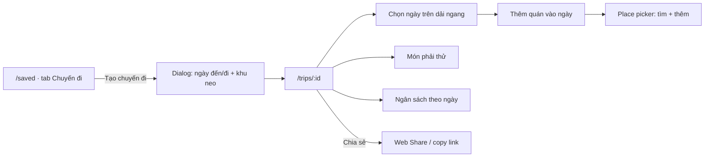

# KẾ HOẠCH THIẾT KẾ — Gói "Lên kế hoạch chuyến đi Đà Nẵng"

> Thiết kế chi tiết cho 5 hạng mục đã chốt ở
> [TONG-HOP-2.md §9](../proposals/TONG-HOP-2.md): DX-10.1, DX-10.4 + DX-10.5, DX-6.1 (+6.2, 6.3),
> DX-8.1 (+8.5), và hạ tầng `shareText`.
>
> Tài liệu này **chưa phải code**. Mọi component nêu tên đều đã có trong
> `src/components/ui/` (30 file, base-nova trên `@base-ui/react`) — không thêm dependency nào.

## 0. Nguyên tắc thiết kế

1. **Không tự chế UI**: mọi khối dùng component trong danh sách
   [CONVENTIONS.md §1](../CONVENTIONS.md). Bảng đối chiếu ở §6.
2. **Form chuẩn**: `react-hook-form` + `zod` + `zodResolver` + `Field`/`FieldLabel`/`FieldError`,
   đúng pattern của [edit-collection-dialog.tsx](../../src/features/collections/components/edit-collection-dialog.tsx).
   `Switch` của base-ui không nhận `ref` → bắt buộc đi qua `Controller`.
3. **Dialog trên desktop, Drawer trên mobile**: `useMediaQuery("(min-width: 768px)")` từ
   `@uidotdev/usehooks`, đúng pattern [comment-thread.tsx:31](../../src/features/social/components/comment-thread.tsx#L31).
4. **Không thêm thư viện kéo thả**: sắp thứ tự bằng `DropdownMenu` "Lên/Xuống". Kéo thả cần
   `dnd-kit` (dependency mới) → chỉ làm khi có quyết định riêng trong `docs/DECISIONS.md`.
5. **Chọn ngày bằng `Calendar` của shadcn** (`react-day-picker` + `date-fns`) — quyết định đã
   chốt (D-026) nhưng **chưa cài được** vì `shadcn add` treo do mạng (L-008). Chờ cài lại bằng
   tool; nếu cài không được, phương án dự phòng là `<Input type="date">` native (phải chốt lại
   với người dùng, không tự đổi).
6. **Kéo thả bằng `dnd-kit`** (`@dnd-kit/core` + `@dnd-kit/sortable` + `@dnd-kit/utilities` — đã
   cài theo D-027) cho sắp thứ tự chặng; **giữ nút Lên/Xuống trong `DropdownMenu`** làm phương án
   bàn phím/a11y.
7. **Tiền là số nguyên đồng**, không số thực. Giờ trong ngày là **số phút từ nửa đêm**.
8. **Một nghiệp vụ một chỗ**: ước lượng di chuyển, format giờ/tiền, chia sẻ text đều nằm ở
   `src/lib/` hoặc `src/features/places/lib/`, không viết lại trong component.

## 1. Hạ tầng dùng chung (làm trước, 0,5 ngày)

### 1.1 `format.ts` — thêm 2 hàm

| Hàm                                    | Hành vi                           | Ghi chú                                   |
| -------------------------------------- | --------------------------------- | ----------------------------------------- |
| `formatClock(minutes: number): string` | `540 → "09:00"`, `1470 → "00:30"` | Lấy modulo 1440; không bao giờ in "24:30" |
| `formatVnd(amount: number): string`    | `450000 → "450.000 đ"`            | Tái dùng `numberFormat` đã có trong file  |

### 1.2 `share.ts` — thêm `shareText`

```ts
export async function shareText(input: {
  title: string
  text: string
  url?: string
}): Promise<ShareResult>
```

- Mobile: `navigator.share({ title, text, url })`.
- Desktop/không hỗ trợ: `navigator.clipboard.writeText(text + (url ? "\n" + url : ""))`.
- Trả cùng enum `ShareResult` của `shareLink` — `ShareButton` hiện tại không đổi.
- Dùng chung cho DX-6.5 (lịch trình) và DX-8.4 (quyết toán) sau này.

### 1.3 Lưu trữ FE — dùng hook có sẵn, không tự viết

`@uidotdev/usehooks` đã export `useLocalStorage<T>(key, initialValue)` (đã verify trong
`node_modules/@uidotdev/usehooks/index.d.ts`). Dùng trực tiếp:

| Tính năng             | Key (có version)    | Kiểu                      |
| --------------------- | ------------------- | ------------------------- |
| Chuyến đi             | `danang-trip-v1`    | `Trip[]`                  |
| Lịch trình bộ sưu tập | `danang-dayplan-v1` | `Record<string, DayPlan>` |
| Bill gần đây          | `danang-bill-v1`    | `Bill[]` (LRU 20)         |

Quy ước: đổi shape → đổi version key (bỏ dữ liệu cũ), không viết migrate ở giai đoạn này.

### 1.4 `places/lib/travel.ts` — một hàm ước lượng dùng chung

```ts
/** Ước lượng phút di chuyển nội thành Đà Nẵng từ khoảng cách chim bay. */
export function estimateTravelMinutes(
  distanceKm: number,
  mode: "scooter" | "walk" = "scooter",
): number
```

- Xe máy 20 km/h, đi bộ 4,5 km/h, nhân hệ số bảo thủ 1,5 (đúng DX-6.2/10.2).
- Làm tròn lên bội số 5 phút. UI luôn ghi "ước lượng".

### 1.5 `constants.ts` — thêm hằng số

```ts
export const MAX_TRIP_NAME_LENGTH = 80
export const MAX_TRIP_DAYS = 30
export const MAX_DAY_PLAN_STOPS = 20
export const MAX_BILL_AMOUNT = 100_000_000
export const MAX_BILL_PEOPLE = 20
export const MUST_TRY_DISHES: { label: string; tag: string }[] = [
  { label: "Mì Quảng", tag: "mì quảng" },
  { label: "Bánh xèo", tag: "bánh xèo" },
  { label: "Bún chả cá", tag: "bún chả cá" },
  { label: "Bánh tráng thịt heo", tag: "bánh tráng thịt heo" },
  { label: "Cà phê muối", tag: "cà phê muối" },
  { label: "Bánh canh cá nục", tag: "bánh canh cá nục" },
  { label: "Bê thui", tag: "bê thui" },
  { label: "Gà nướng lu", tag: "gà nướng lu" },
  { label: "Ốc hút", tag: "ốc hút" },
  { label: "Hải sản", tag: "hải sản" },
]
```

Tất cả tag trên đã có thật trong `src/mocks/fixtures/places.ts` (đã đối chiếu).

## 2. DX-10.1 — Chuyến đi (Trip)

### 2.1 Luồng người dùng



### 2.2 Route & điểm vào

- `/saved` thêm `TabsTrigger value="trips"` → "Chuyến đi" (tab thứ 4, cạnh 3 tab hiện có).
- Route mới `/trips/:id` trong [routes.tsx](../../src/app/router/routes.tsx), đặt trong nhóm `AppShell`.
- Không thêm mục nav thứ 4 ở bottom bar mobile (giữ nguyên lý do của agent 8: thanh đã chật).

### 2.3 Màn hình A — tab "Chuyến đi" (`/saved`)

```
┌──────────────────────────────────────────────────────────┐
│ [Bài đăng] [Địa điểm] [Bộ sưu tập] [Chuyến đi]           │
│                                                          │
│  Chuyến đi của bạn                        [+ Tạo chuyến] │
│  ┌────────────────┐  ┌────────────────┐                  │
│  │ Đà Nẵng 11–14  │  │ Huế 20–22/12   │                  │
│  │ 11/11–14/11    │  │ 20/12–22/12    │                  │
│  │ 4 ngày · 9 quán│  │ 3 ngày · 0 quán│                  │
│  │ [Hải Châu] [⋯] │  │ [—]        [⋯] │                  │
│  └────────────────┘  └────────────────┘                  │
└──────────────────────────────────────────────────────────┘
```

| Thành phần             | Component                                                                                                          |
| ---------------------- | ------------------------------------------------------------------------------------------------------------------ |
| Hàng tiêu đề + nút tạo | `div` + `Button` (`PlusIcon`)                                                                                      |
| Lưới thẻ               | `ul`/`li` + `TripCard`                                                                                             |
| Thẻ chuyến đi          | `Card` + `CardHeader` + `CardTitle` + `CardDescription` + `CardContent` + `Badge` + `DropdownMenu` (Sửa/Xoá)       |
| Rỗng                   | `Empty` + `EmptyHeader` + `EmptyMedia` (`MapIcon`) + `EmptyTitle` + `EmptyDescription` + `EmptyContent` + `Button` |
| Đang tải               | `Skeleton` (3 thẻ `h-40`) — dù localStorage đọc đồng bộ, giữ nhịp với tab khác                                     |

`TripCard`:

- `CardTitle` chứa `Link to={/trips/${id}}` với `after:absolute after:inset-0` (đúng pattern
  [collection-card.tsx](../../src/features/collections/components/collection-card.tsx)).
- `CardDescription`: `{formatDate(startDate)} – {formatDate(endDate)}`.
- `CardContent`: `Badge variant="outline"` số ngày · số quán; `Badge variant="secondary"` khu neo
  (nếu có); `DropdownMenu` ở góc phải (`CardAction`).

### 2.4 Dialog tạo / sửa chuyến đi

Component dùng chung `TripFormDialog({ trip?, children })`:

- Desktop: `Dialog` + `DialogContent className="sm:max-w-md"`; mobile: `Drawer` + `DrawerContent`
  (cùng `useMediaQuery`). Nội dung form là **một component con** để không nhân đôi.
- Form (zod):
  - `name`: 1–80 ký tự (`Input`).
  - `startDate`, `endDate`: `Calendar` trong `Popover` (desktop) / `Drawer` (mobile), chế độ
    `mode="range"` — một lần chọn ra cả khoảng, không phải 2 ô rời. `PopoverTrigger` là
    `Button variant="outline"` hiển thị `formatDate(startDate) – formatDate(endDate)`.
    Chặn: `endDate >= startDate`, tối đa `MAX_TRIP_DAYS` ngày (`disabled` các ngày vượt).
    Lỗi hiện ở `FieldError`.
  - `arrivalAt`, `departureAt`: `Input type="datetime-local"` (tuỳ chọn) — chỉ dùng để gắn nhãn
    ngày, không dựng timeline giờ. Giữ native vì không cần lịch cho giờ.
  - `baseDistrict`: `ToggleGroup` một-trong-nhiều, 6 quận từ `DANANG_DISTRICTS` + item
    "Chưa chọn" (`value="none"`). Bọc trong `Field` + `FieldTitle` + `FieldDescription`.
  - `baseLabel`: `Input` tuỳ chọn ("Khách sạn ABC, Mỹ Khê").
- Footer: `DialogFooter`/`DrawerFooter` — `Button variant="ghost"` Huỷ + `Button` submit
  (`CheckIcon`). Không có async → không cần `Spinner`, chỉ `toast.success` rồi đóng.
- Sửa chuyến: cùng dialog, `defaultValues` từ `trip`; đổi ngày → chạy `resizeDays()` (mục 2.7).

### 2.5 Màn hình B — chi tiết chuyến đi (`/trips/:id`)

```
┌──────────────────────────────────────────────────────────────┐
│ Lưu / Chuyến đi / Đà Nẵng 11–14                              │
│ ┌──────────────────────────────────────────────────────────┐ │
│ │ Đà Nẵng 11–14            [Chia sẻ] [⋯ Sửa/Xoá]           │ │
│ │ 11/11/2026 – 14/11/2026 · 4 ngày · 9 quán                │ │
│ │ [Đang diễn ra] [Hải Châu] [5/9 quán mức ₫₫₫]             │ │
│ └──────────────────────────────────────────────────────────┘ │
│ [!] 2 địa điểm chưa xếp do bạn đổi ngày đi.  [Xếp lại]       │
│                                                              │
│ ‹ Ngày 1 · 11/11 (3) │ Ngày 2 · 12/11 (0) │ Ngày 3 … ›      │
│ ┌──────────────────────────────────────────────────────────┐ │
│ │ Ngày 1 · 11/11        Khu: Hải Châu        [⋯ Đổi khu]   │ │
│ │ Mức chi hôm nay:  [₫ Bình dân] [₫₫ Vừa] [₫₫₫ Thoải mái]  │ │
│ │                                                          │ │
│ │ ① Bánh Xèo Bà Dưỡng        Hải Châu · 2,1 km      [⋯]    │ │
│ │    ~10 phút di chuyển (ước lượng)                        │ │
│ │ ② Mì Quảng 1A              Hải Châu · 1,4 km      [⋯]    │ │
│ │                                                          │ │
│ │ [+ Thêm quán vào ngày]                                   │ │
│ └──────────────────────────────────────────────────────────┘ │
│                                                              │
│ ┌─ Món phải thử Đà Nẵng ───────────────────────────────────┐ │
│ │ ✓ Mì Quảng   Đã có · Ngày 1 — Mì Quảng 1A                │ │
│ │ ○ Bánh xèo   Chưa có trong kế hoạch        [Tìm quán]    │ │
│ └──────────────────────────────────────────────────────────┘ │
└──────────────────────────────────────────────────────────────┘
```

| Khối                        | Component                                                                                                                                                                                                                                                                       |
| --------------------------- | ------------------------------------------------------------------------------------------------------------------------------------------------------------------------------------------------------------------------------------------------------------------------------- |
| Điều hướng                  | `Breadcrumb` + `BreadcrumbList` + `BreadcrumbItem` + `BreadcrumbLink` + `BreadcrumbSeparator` + `BreadcrumbPage`                                                                                                                                                                |
| Thẻ đầu trang               | `Card` + `CardContent` + `Badge` + `Button` + `DropdownMenu` + `ShareButton`                                                                                                                                                                                                    |
| Cảnh báo quán chưa xếp      | `Alert` + `AlertTitle` + `AlertAction` (`Button variant="outline" size="sm"`)                                                                                                                                                                                                   |
| Dải ngày                    | `ScrollArea` + `ScrollBar orientation="horizontal"` bọc `ToggleGroup` một-trong-nhiều; mỗi ngày là `ToggleGroupItem` chứa text 2 dòng + `Badge` đếm                                                                                                                             |
| Thẻ ngày                    | `Card` + `CardHeader` + `CardTitle` + `CardDescription` + `CardAction` + `CardContent`                                                                                                                                                                                          |
| Mức chi                     | `Field` + `FieldTitle` + `ToggleGroup` (3 mức)                                                                                                                                                                                                                                  |
| Danh sách chặng             | `DndContext` + `SortableContext` (`@dnd-kit/core` + `@dnd-kit/sortable`); mỗi chặng `Item variant="outline"` bọc `useSortable`, tay cầm `ItemMedia` chứa `GripVerticalIcon`; transform qua `CSS.Transform.toString` (`@dnd-kit/utilities`); thả xong `arrayMove` đổi `placeIds` |
| Sắp thứ tự dự phòng         | `ItemActions` + `DropdownMenu`: Lên / Xuống / Bỏ khỏi ngày — phương án bàn phím + a11y, giữ song song (D-027)                                                                                                                                                                   |
| Dòng di chuyển giữa 2 chặng | `Item size="xs" variant="muted"` + `ItemMedia` (`NavigationIcon`) + `ItemDescription` "~10 phút di chuyển · 2,1 km (ước lượng)"                                                                                                                                                 |
| Ngày trống                  | `Empty` + `EmptyHeader` + `EmptyMedia` (`MapPinIcon`) + `EmptyTitle` + `EmptyDescription` + `EmptyContent` + `Button`                                                                                                                                                           |
| Cảnh báo vượt mức chi       | `Alert` + `AlertTitle` (mô tả, không chặn)                                                                                                                                                                                                                                      |
| Toast                       | `sonner` (`toast.success` / `toast.error`)                                                                                                                                                                                                                                      |

Ảnh thu nhỏ trong `ItemMedia`: `SeedImage` với `height={48}` + `className="size-12 rounded-thumb"`.

### 2.6 Place picker — thêm quán vào ngày

`TripPlacePicker({ tripId, dayDate, open, onOpenChange })`:

- Desktop `Dialog`, mobile `Drawer` (snap mặc định).
- `DialogHeader`: "Thêm quán vào Ngày 1 · 11/11".
- `InputGroup` + `InputGroupAddon` (`SearchIcon`) + `InputGroupInput` tìm theo tên/món
  (`useDebouncedValue` 300ms, đúng pattern `/discover`).
- Kết quả: `ItemGroup` + `Item` (ảnh, tên, `Badge` quận, `₫` mức giá) + `ItemActions` +
  `Button size="sm"` "Thêm".
- Đang tải: 4 `Skeleton` hàng. Không có kết quả: `Empty` nhỏ.
- Nguồn dữ liệu: `useDiscoverPlaces({ query })` — tái dùng hook hiện có, không viết API mới.
- Thêm xong: đóng dialog, `toast.success("Đã thêm vào Ngày 1")`, không điều hướng.
- Chặn trùng: quán đã có trong ngày → nút "Đã thêm" disabled + `Tooltip` giải thích.

### 2.7 Mô hình dữ liệu & quy tắc

```ts
interface Trip {
  id: string
  name: string
  startDate: string // "2026-11-11" (local date, KHÔNG dùng ISO UTC)
  endDate: string // "2026-11-14"
  arrivalAt?: string // ISO datetime — chỉ để gắn nhãn ngày
  departureAt?: string
  baseDistrict?: string
  baseLabel?: string
  days: TripDay[]
  /** Quán bị rơi khỏi ngày khi rút ngắn chuyến — không xoá im lặng. */
  unscheduledPlaceIds: string[]
  createdAt: string
}

interface TripDay {
  date: string // "2026-11-11"
  district?: string // mặc định kế thừa baseDistrict khi tạo
  placeIds: string[]
  budgetTier?: 1 | 2 | 3
  note?: string
}
```

Hàm thuần trong `features/trips/lib/trip.ts`:

| Hàm                                              | Việc                                                                       |
| ------------------------------------------------ | -------------------------------------------------------------------------- |
| `generateDays(startDate, endDate, baseDistrict)` | Sinh `TripDay[]` theo ngày local                                           |
| `resizeDays(trip, newStart, newEnd)`             | Giữ ngày còn lại; quán của ngày bị cắt dồn vào `unscheduledPlaceIds`       |
| `tripStatus(trip, today)`                        | `"upcoming" \| "ongoing" \| "ended"` — so chuỗi `YYYY-MM-DD`, không so UTC |
| `tripStats(trip)`                                | số ngày, số quán, số quán theo bậc giá                                     |
| `matchDishes(trip, placesById)`                  | `MUST_TRY_DISHES` × `Place.tags` → món đã có + ngày + quán đầu tiên        |

### 2.8 Trạng thái & edge case

| Tình huống                     | Xử lý                                                                                       |
| ------------------------------ | ------------------------------------------------------------------------------------------- |
| Chưa có chuyến nào             | `Empty` + nút "Tạo chuyến đi"                                                               |
| Ngày đến > ngày đi             | `FieldError` ở `endDate`, không submit                                                      |
| Chuyến > 30 ngày               | Chặn ở zod + `FieldDescription` ghi rõ giới hạn                                             |
| Rút ngắn chuyến                | Quán của ngày bị bỏ → `unscheduledPlaceIds` + `Alert` "N địa điểm chưa xếp" + nút mở picker |
| Quán không có `district`       | Hiện `Badge` "Chưa rõ quận"; không tham gia cảnh báo khu                                    |
| Quán không có `lat/lng`        | Không hiện dòng di chuyển; ghi "chưa có toạ độ" trong `ItemDescription`                     |
| Ngày trống                     | `Empty` trong thẻ ngày                                                                      |
| Xoá chuyến                     | `AlertDialog` xác nhận, xoá khỏi `Trip[]`, `toast.success`, điều hướng về `/saved`          |
| localStorage hỏng/khác version | `useLocalStorage` trả `initialValue`; không crash                                           |

### 2.9 Tiêu chí nghiệm thu

- [ ] Tạo chuyến 3 ngày → tab Chuyến đi có thẻ đúng số ngày, mở được chi tiết.
- [ ] Chuyển ngày trên dải ngang → thẻ ngày đổi đúng, không mất dữ liệu ngày khác.
- [ ] Thêm quán vào ngày → xuất hiện cuối danh sách, có dòng di chuyển ước lượng tới chặng trước.
- [ ] Lên/Xuống đổi thứ tự, `placeIds` đổi theo, reload vẫn giữ.
- [ ] Rút ngắn chuyến → quán của ngày bị cắt hiện trong `Alert` "chưa xếp", không mất.
- [ ] Xoá chuyến có `AlertDialog`, xoá xong không còn trong tab.
- [ ] Toàn bộ nút icon có `aria-label` tiếng Việt; bàn phím đi hết luồng được.

## 3. DX-10.4 — Món phải thử & DX-10.5 — Ngân sách bậc

### 3.1 Món phải thử (thẻ trong trang chuyến đi)

```
┌─ Món phải thử Đà Nẵng ──────────────────────────────┐
│ ✓  Mì Quảng       Đã có · Ngày 1 — Mì Quảng 1A      │
│ ✓  Bánh xèo       Đã có · Ngày 2 — Bánh Xèo Bà Dưỡng│
│ ○  Bánh canh      Chưa có trong kế hoạch  [Tìm quán]│
└─────────────────────────────────────────────────────┘
```

| Thành phần    | Component                                                                                                   |
| ------------- | ----------------------------------------------------------------------------------------------------------- |
| Thẻ           | `Card` + `CardHeader` + `CardTitle` + `CardDescription` + `CardContent`                                     |
| Danh sách món | `ItemGroup` + `Item size="sm"`                                                                              |
| Trạng thái    | `ItemMedia` chứa `CheckIcon` (đã có) hoặc `CircleIcon` (chưa có) — `text-muted-foreground` cho món chưa có  |
| Nội dung      | `ItemTitle` tên món; `ItemDescription` "Đã có · Ngày 1 — Quán X" hoặc "Chưa có trong kế hoạch"              |
| Hành động     | `ItemActions` + `Button variant="ghost" size="sm"` "Tìm quán" (`render={<Link to={/discover?q=${tag}} />}`) |
| Rỗng          | Không cần — danh sách curated luôn có 10 món                                                                |

- Không đếm %, không progress bar, không badge thành tích (ràng buộc cấm gamification).
- "Tìm quán" cần `DiscoverPage` đọc `q` từ URL: thêm `useSearchParams` khởi tạo `query`
  (thay đổi ~3 dòng, không đổi kiến trúc). Nếu chưa làm bước này, nút dẫn `/discover` trơn.
- Match là exact theo `tags`; không khớp → "Chưa có", không bao giờ khẳng định sai.

### 3.2 Ngân sách theo bậc (trong thẻ ngày)

- `Field` + `FieldTitle` "Mức chi hôm nay" + `ToggleGroup` một-trong-nhiều, 3 item:
  `1` → "₫ Bình dân", `2` → "₫₫ Vừa", `3` → "₫₫₫ Thoải mái". Bấm lại item đang chọn → bỏ chọn
  (`undefined`).
- Nhãn dùng `priceLevelLabel()` có sẵn — không tạo hàm mới.
- Khi có quán vượt mức: `Alert` + `AlertTitle` "Ngày này có 2 quán mức ₫₫₫ cao hơn mức bạn chọn" —
  chỉ mô tả, không chặn, không đổi thứ tự.
- Tổng chuyến: dòng `CardDescription` "5/9 quán mức ₫₫₫" — số đếm bậc, không quy đổi VND.
- Cấm viết hàm `priceLevel → VND` (quyết định TONG-HOP §5 giữ nguyên).

### 3.3 Tiêu chí nghiệm thu

- [ ] Thêm quán có tag "mì quảng" vào ngày → món "Mì Quảng" chuyển sang "Đã có · Ngày N — tên quán".
- [ ] "Tìm quán" mở `/discover?q=mì quảng` và danh sách đã lọc đúng.
- [ ] Chọn mức chi thấp hơn mức giá của quán → hiện `Alert` mô tả đúng số quán.
- [ ] Không có chỗ nào hiện số tiền VND cho ngân sách.

## 4. DX-6.1 — Chế độ "Lịch trình" trên bộ sưu tập (+6.2, +6.3)

### 4.1 Điểm vào

Trang `/collections/:id` hiện chỉ có lưới. Thêm `ToggleGroup` chế độ xem cạnh các nút hành động
trong `Card` đầu trang:

```
[Lưới] [Lịch trình]   ← ToggleGroup một-trong-nhiều, aria-label="Chế độ xem bộ sưu tập"
```

- `grid`: giữ nguyên `ItemGroup` + `PlaceCard` hiện tại.
- `timeline`: render `CollectionDayPlan` (mục 4.2).
- Chỉ chủ sở hữu thấy chế độ Lịch trình? Không — người xem cũng xem được (chỉ đọc). Nút sửa
  (giờ/thời lượng) chỉ hiện khi `collection.isMine`.

### 4.2 Bố cục chế độ Lịch trình

```
┌──────────────────────────────────────────────────────────────┐
│ [Lưới] [Lịch trình]                                          │
│ ┌─ Thiết lập ──────────────────────────────────────────────┐ │
│ │ Bắt đầu từ:  (•) Vị trí của tôi   ( ) Quán đầu tiên      │ │
│ │ [Sắp giờ gợi ý]  [Sao chép lịch trình]                   │ │
│ └──────────────────────────────────────────────────────────┘ │
│ [!] Chặng 2 và 3 chồng nhau 20 phút.                         │
│ [!] Từ Bánh xèo Bà Dư tới quán này ~4,2 km — cần ~25 phút…   │
│                                                              │
│ 08:30  ┌ Bánh Xèo Bà Dưỡng ──────────────────────── [⋯] ┐    │
│        │ Hải Châu · 45 phút · bắt đầu từ vị trí của tôi   │    │
│        └─────────────────────────────────────────────────┘    │
│        ↕ ~15 phút di chuyển · 2,1 km (ước lượng)             │
│ 09:30  ┌ Mì Quảng 1A ─────────────────────────────── [⋯] ┐    │
│        │ Hải Châu · 75 phút                              │    │
│        └─────────────────────────────────────────────────┘    │
│                                                              │
│ Kết thúc dự kiến 21:10 · 6 chặng                             │
└──────────────────────────────────────────────────────────────┘
```

| Khối              | Component                                                                                                                                                  |
| ----------------- | ---------------------------------------------------------------------------------------------------------------------------------------------------------- |
| Chuyển chế độ xem | `ToggleGroup` + `ToggleGroupItem` (`LayoutGridIcon`, `CalendarClockIcon`)                                                                                  |
| Khung thiết lập   | `Card` + `CardContent` + `FieldSet` + `FieldLegend` + `RadioGroup` + `RadioGroupItem`                                                                      |
| Nút hành động     | `Button variant="outline" size="sm"` (`WandSparklesIcon`, `CopyIcon`)                                                                                      |
| Cảnh báo          | `Alert` + `AlertTitle` + `AlertDescription` (danh sách `ul` bên trong)                                                                                     |
| Timeline          | `ItemGroup` + `Item variant="outline"`                                                                                                                     |
| Giờ bắt đầu       | `ItemMedia` chứa `Input type="time"` (`className="w-24"`, `aria-label="Giờ bắt đầu chặng N"`) — chỉ chủ sở hữu sửa được, người xem thấy text `formatClock` |
| Nội dung chặng    | `ItemContent` + `ItemTitle` (Link tới `/discover/:id`) + `ItemDescription` (quận · thời lượng · ghi chú)                                                   |
| Thời lượng        | `ItemActions` + `DropdownMenu` + `DropdownMenuRadioGroup` + `DropdownMenuRadioItem` (15/30/45/60/90/120 phút)                                              |
| Sắp thứ tự / bỏ   | `DndContext` + `useSortable` (kéo thả, D-027) + `DropdownMenu`: Lên, Xuống, `DropdownMenuSeparator`, "Bỏ khỏi lịch trình" (dự phòng bàn phím)              |
| Dòng di chuyển    | `Item size="xs" variant="muted"` + `ItemMedia` (`NavigationIcon`) + `ItemDescription`                                                                      |
| Tổng kết          | `ItemDescription` cuối `ItemGroup`                                                                                                                         |
| Rỗng              | `Empty` + `EmptyMedia` (`CalendarClockIcon`) + `EmptyTitle` "Chưa có lịch trình" + `EmptyContent` + `Button` "Sắp giờ gợi ý"                               |

### 4.3 Quy tắc giờ & thời lượng

- Giờ lưu **số phút từ nửa đêm**; `Input type="time"` ↔ phút qua 2 hàm trong
  `features/collections/lib/day-plan.ts` (`minutesToTimeInput`, `timeInputToMinutes`).
- Thời lượng mặc định theo `PlaceCategory` (DX-6.3):
  `cafe` 45', `bakery` 30', `restaurant` 75', `street-food` 45', `dessert` 30', `bar` 90'.
- "Sắp giờ gợi ý" (DX-6.3):
  - Chặng đầu: `cafe|bakery` → 08:30; `restaurant|street-food` → 11:00; `dessert` → 15:00;
    `bar` → 17:30.
  - Chặng sau: `start = trước + duration + estimateTravelMinutes(khoảng cách)`.
  - Không ghi đè chặng có `manual: true`; hiện `toast.success("Đã điền giờ gợi ý, bạn chỉnh lại được")`.
- Chặng qua nửa đêm: `formatClock` modulo 1440; nếu tổng vượt 1440, thêm ghi chú "qua ngày hôm sau"
  trong dòng tổng kết, không in "25:30".

### 4.4 Kiểm tra khả thi (DX-6.2)

Hàm thuần `validateDayPlan(plan, placesById): DayPlanWarning[]`:

```ts
interface DayPlanWarning {
  kind: "overlap" | "travel" | "too-many-stops" | "missing-coords" | "late-finish"
  message: string // tiếng Việt, do lib sinh
}
```

| Kiểm tra            | Điều kiện                                                          | Thông điệp                                                                          |
| ------------------- | ------------------------------------------------------------------ | ----------------------------------------------------------------------------------- |
| Chồng giờ           | `start_i + duration_i > start_{i+1}`                               | "Chặng 2 và 3 chồng nhau 20 phút"                                                   |
| Không kịp di chuyển | `estimateTravelMinutes(km) > start_{i+1} − (start_i + duration_i)` | "Từ X tới Y ~4,2 km — cần ~25 phút đi máy, đang chỉ chừa 10 phút"                   |
| Quá nhiều điểm      | `stops.length > 10`                                                | "Kế hoạch có 12 điểm — Google Maps chỉ nhận 10 điểm dừng khi mở chỉ đường cả tuyến" |
| Thiếu toạ độ        | `place.lat/lng` undefined                                          | "1 địa điểm chưa có toạ độ nên không ước lượng được di chuyển"                      |
| Kết thúc muộn       | kết thúc > 23:00                                                   | "Chuyến kết thúc 23:40" (thông tin, không phải lỗi)                                 |

Hiển thị: `Alert` cho 3 loại đầu (cảnh báo), dòng text thường cho 2 loại sau. Không chặn thao tác.

### 4.5 Chia sẻ lịch trình (DX-6.5 — dùng `shareText`)

`dayPlanToText(plan, placesById, collectionName): string` sinh:

```
Lịch trình Đà Nẵng — Bộ sưu tập "Quán ngon 1 ngày"
08:30  Bánh Xèo Bà Dưỡng (45 phút)
09:30  Mì Quảng 1A (75 phút)
...
Kết thúc dự kiến 21:10 · 6 chặng
```

Nút "Sao chép lịch trình" gọi `shareText({ title, text })` → toast theo `ShareResult`.
Không nhúng link rút gọn/QR (overengineering).

### 4.6 Dữ liệu

```ts
interface DayPlanStop {
  placeId: string
  startTime: number // phút từ nửa đêm
  durationMin: number
  /** Người dùng đã sửa tay → "Sắp giờ gợi ý" không ghi đè. */
  manual?: boolean
}

interface DayPlan {
  collectionId: string
  startFrom: "me" | "first"
  stops: DayPlanStop[]
  updatedAt: string
}
```

Lưu `Record<collectionId, DayPlan>` ở `danang-dayplan-v1`. Không đổi shape `Collection`.

### 4.7 Tiêu chí nghiệm thu

- [ ] Chuyển Lưới ↔ Lịch trình không mất dữ liệu, không reload.
- [ ] "Sắp giờ gợi ý" điền giờ đúng heuristic; sửa tay 1 chặng rồi bấm lại → chặng đó giữ nguyên.
- [ ] Đặt 2 chặng chồng giờ → hiện đúng `Alert` chồng giờ.
- [ ] Quán cách 4 km mà chừa 10 phút → hiện cảnh báo di chuyển.
- [ ] 12 chặng → hiện cảnh báo giới hạn Google Maps.
- [ ] "Sao chép lịch trình" → clipboard đúng format, toast "Đã sao chép".
- [ ] Người xem (không phải chủ) không sửa được giờ/thời lượng nhưng xem được timeline.

## 5. DX-8.1 — Chia đều nhanh (+ DX-8.5 lưu bill)

### 5.1 Điểm vào & route

- Route `/bill` trong `AppShell`.
- `DropdownMenuItem` "Chia tiền" trong menu avatar
  ([app-shell.tsx:198-230](../../src/components/layout/app-shell.tsx#L198-L230)), cạnh "Đã lưu".
- Không thêm mục bottom bar thứ 4 (lý do đã chốt ở agent 8).

### 5.2 Bố cục

```
┌─ Chia đều hóa đơn ─────────────────────────────────┐
│ Tổng bill                                          │
│ [ 600.000                                        đ ]│
│                                                    │
│ Số người                                           │
│ [ − ] [   4   ] [ + ]  người                       │
│                                                    │
│ Người trả                                          │
│ (•) Tôi trả hết      ( ) Người khác: [ Tên     ]   │
│                                                    │
│ Làm tròn xuống 1.000 đ, phần lẻ dồn về người trả.  │
│ ┌────────────────────────────────────────────────┐ │
│ │ Mỗi người trả            150.000 đ             │ │
│ │ Người trả nhận lại        0 đ                  │ │
│ │ [Sao chép kết quả]                             │ │
│ └────────────────────────────────────────────────┘ │
└────────────────────────────────────────────────────┘

┌─ Bill gần đây ─────────────────────────────────────┐
│ Chia đều · 4 người · 600.000 đ · 2 giờ trước   [⋯] │
│ Chia đều · 3 người · 285.000 đ · hôm qua       [⋯] │
└────────────────────────────────────────────────────┘
```

| Khối           | Component                                                                                                                                                                     |
| -------------- | ----------------------------------------------------------------------------------------------------------------------------------------------------------------------------- |
| Form           | `Card` + `CardHeader` + `CardContent` + `FieldGroup` + `Field` + `FieldLabel` + `FieldDescription` + `FieldError`                                                             |
| Tổng bill      | `InputGroup` + `InputGroupInput` (`inputMode="numeric"`) + `InputGroupAddon align="inline-end"` + `InputGroupText` "đ"                                                        |
| Số người       | `InputGroup` + `InputGroupButton` (`MinusIcon`/`PlusIcon`, `aria-label`) + `Input` (`type="number"`, `min=2`, `max=20`, `className="text-center"`) + `InputGroupText` "người" |
| Người trả      | `RadioGroup` + `RadioGroupItem` + `Label`; chọn "Người khác" → hiện `Input` tên (điều kiện)                                                                                   |
| Kết quả        | `Card` + `CardContent` + `Item` + `ItemContent` + `ItemTitle` + `ItemDescription` + `ItemActions` + `Button`                                                                  |
| Danh sách bill | `ItemGroup` + `Item` + `ItemContent` + `ItemTitle` + `ItemDescription` + `ItemActions` (`DropdownMenu`: Mở lại, Xoá)                                                          |
| Rỗng           | `Empty` + `EmptyMedia` (`ReceiptIcon`) + `EmptyTitle` "Chưa có bill nào"                                                                                                      |
| Toast          | `sonner`                                                                                                                                                                      |

### 5.3 Quy tắc tính

- Input tiền: người dùng gõ số thô (`600000`), hiển thị `formatNumber` khi blur; lưu **số nguyên**.
- `perPerson = Math.floor(total / people / 1000) * 1000`; `remainder = total − perPerson * people`.
- Hiển thị: "Mỗi người trả 150.000 đ" + nếu `remainder > 0`: "Người trả nhận lại 0 đ" (làm tròn
  xuống thì người trả chịu phần lẻ; nếu làm tròn lên thì ghi rõ "thu thêm").
- Validate: `total` 1.000–100.000.000; `people` 2–20; tên người trả ≤ 40 ký tự.
- Kết quả tính **trực tiếp khi gõ** (không cần nút "Tính") — mục tiêu "3 chạm".
- "Sao chép kết quả" → `shareText`:

```
Chia đều 600.000 đ cho 4 người
Mỗi người: 150.000 đ
Người trả: Tôi
```

### 5.4 Lưu bill (DX-8.5)

```ts
interface Bill {
  id: string
  mode: "even" // mở rộng "items" ở DX-8.2, không đổi field cũ
  title?: string
  totalAmount: number
  participantNames: string[]
  paidByName: string
  perPersonAmount: number
  createdAt: string
}
```

- Lưu `Bill[]` ở `danang-bill-v1`, **LRU 20** (thêm mới → cắt cuối).
- Chỉ lưu khi người dùng bấm "Lưu bill" (không tự lưu mọi lần gõ — tránh rác).
- "Mở lại" nạp lại form; "Xoá" xoá ngay + toast (không cần `AlertDialog` — dữ liệu nháp, có thể
  nhập lại; nếu muốn chặt tay thì dùng `AlertDialog`).
- Nháp tự lưu: `useLocalStorage("danang-bill-draft-v1", ...)` debounce 500ms — tuỳ chọn P2.

### 5.5 Tiêu chí nghiệm thu

- [ ] Nhập 600.000 / 4 người → hiện 150.000 đ ngay khi gõ, không cần bấm Tính.
- [ ] 100.000 / 3 người → 33.000 đ/người, dư 1.000 đ ghi rõ thuộc người trả.
- [ ] Không nhập được số âm, số người < 2, tiền > 100 triệu.
- [ ] "Sao chép kết quả" → clipboard đúng, toast thành công.
- [ ] Lưu bill → xuất hiện đầu danh sách; quá 20 bill → bill cũ nhất biến mất.
- [ ] Mở lại bill cũ → form đúng dữ liệu; xoá bill → biến mất + toast.

## 6. Bảng tổng hợp component shadcn theo màn hình

| Màn hình              | Component shadcn dùng                                                                                                                                                                                                                                                                                                               |
| --------------------- | ----------------------------------------------------------------------------------------------------------------------------------------------------------------------------------------------------------------------------------------------------------------------------------------------------------------------------------- |
| Tab Chuyến đi         | `Tabs`/`TabsList`/`TabsTrigger`/`TabsContent`, `Card` (+Header/Title/Description/Content/Action), `Badge`, `Button`, `DropdownMenu` (+Item/Separator), `Empty` (+Header/Media/Title/Description/Content), `Skeleton`                                                                                                                |
| Dialog tạo/sửa chuyến | `Dialog` (+Content/Header/Title/Description/Footer), `Drawer` (+Content/Header/Title/Footer) cho mobile, `Field` (+Group/Label/Description/Error/Title), `Input`, **`Calendar`** (`mode="range"`, bọc `Popover` desktop / `Drawer` mobile — D-026, **chờ cài lại**), `ToggleGroup`/`ToggleGroupItem`, `Button`, `Spinner` (nếu cần) |
| Chi tiết chuyến       | `Breadcrumb` (+List/Item/Link/Separator/Page), `Card`, `Badge`, `Button`, `DropdownMenu`, `Alert` (+Title/Action), `ScrollArea`/`ScrollBar`, `ToggleGroup`, `ItemGroup`/`Item`/`ItemMedia`/`ItemContent`/`ItemTitle`/`ItemDescription`/`ItemActions`, `Empty`, `Tooltip`, `Separator` (qua `ItemSeparator`)                         |
| Place picker          | `Dialog`/`Drawer`, `InputGroup` (+Addon/Input), `ItemGroup`/`Item`, `Badge`, `Button`, `Skeleton`, `Empty`, `Tooltip`                                                                                                                                                                                                               |
| Món phải thử          | `Card`, `ItemGroup`/`Item`, `Button`, `Badge` (nếu cần)                                                                                                                                                                                                                                                                             |
| Ngân sách bậc         | `Field`/`FieldTitle`, `ToggleGroup`, `Alert`                                                                                                                                                                                                                                                                                        |
| Lịch trình bộ sưu tập | `ToggleGroup`, `Card`, `FieldSet`/`FieldLegend`, `RadioGroup`/`RadioGroupItem`, `Button`, `Alert`, `ItemGroup`/`Item`, `Input type="time"`, `DropdownMenu` (+RadioGroup/RadioItem), `Empty`, `Tooltip`                                                                                                                              |
| Chia tiền             | `Card`, `FieldGroup`/`Field`/`FieldLabel`/`FieldDescription`/`FieldError`, `InputGroup` (+Input/Button/Text/Addon), `Input`, `RadioGroup`/`RadioGroupItem`, `Label`, `ItemGroup`/`Item`, `Button`, `Empty`, `DropdownMenu`                                                                                                          |
| Toàn cục              | `sonner` (toast), `Tooltip`, `Spinner`, `Skeleton`, `Separator`, `Badge`                                                                                                                                                                                                                                                            |

**Không dùng / không cần cài thêm:** `select`, `checkbox`, `slider`,
`progress`, `command`, `form`, `sheet`, `table`, `pagination`, `chart`, `carousel`, `sidebar`.
Lý do: `ToggleGroup`/`RadioGroup` đủ cho lựa chọn; không có nhu cầu bảng/phân trang. `calendar`
và `dnd-kit` **đã cài** (D-027); `calendar` **chưa cài được** (D-026 — tool treo, L-008).

## 7. Thứ tự thực hiện & kế hoạch file

| Bước | Việc                                                                                                  | File chính                                                                                                | Ước lượng |
| ---- | ----------------------------------------------------------------------------------------------------- | --------------------------------------------------------------------------------------------------------- | --------- |
| 1    | Hạ tầng: `formatClock`, `formatVnd`, `shareText`, `estimateTravelMinutes`, constants                  | `src/lib/format.ts`, `src/lib/share.ts`, `src/features/places/lib/travel.ts`, `src/lib/constants.ts`      | 0,5 ngày  |
| 2    | Trip: types + lib + hook + tab + card + form (`Calendar` chờ cài lại — D-026)                         | `src/features/trips/**`, `src/features/saved/pages/saved-page.tsx`                                        | 1,5 ngày  |
| 3    | Trip detail: header + dải ngày + thẻ ngày + picker + reorder                                          | `src/features/trips/pages/trip-detail-page.tsx`, `src/features/trips/components/*`                        | 2 ngày    |
| 4    | Món phải thử + ngân sách bậc (+ đọc `q` từ URL ở `/discover`)                                         | `src/features/trips/components/trip-dishes-card.tsx`, `trip-budget-toggle.tsx`, `discover-page.tsx`       | 1 ngày    |
| 5    | Lịch trình bộ sưu tập: DayPlan lib + timeline + validate + sắp giờ + share (kéo thả `dnd-kit` đã cài) | `src/features/collections/components/collection-day-plan.tsx`, `src/features/collections/lib/day-plan.ts` | 2,5 ngày  |
| 6    | Chia tiền: page + form + kết quả + lưu bill + menu avatar                                             | `src/features/bill/**`, `src/components/layout/app-shell.tsx`, `routes.tsx`                               | 1,5 ngày  |
| 7    | Rà soát: `tsc`, eslint, prettier, kiểm a11y, thử tay toàn luồng                                       | —                                                                                                         | 1 ngày    |

Tổng ~10 ngày cho 1 dev. Không có dependency mới, không sửa `src/mocks/**`.

## 8. Chưa xác minh

- Chưa chạy app; kích thước thật của dải ngày, timeline và form trên mobile 360px chưa đo.
- `Calendar` trong `Popover`/`Drawer` trên mobile 360px chưa render thử; `react-day-picker@10`
  mới phát hành, chưa kiểm tương thích với ví dụ của base-nova ngoài registry.
- Kéo thả `dnd-kit` chưa thử trên thiết bị cảm ứng thật; xung đột kéo dọc vs cuộn trang chưa đo.
- `useLocalStorage` của `@uidotdev/usehooks` xử lý JSON và lỗi parse như thế nào chưa đọc hết
  source; nếu nó ném lỗi khi dữ liệu hỏng thì cần bọc try/catch hoặc tự viết helper.
- Heuristic giờ ăn theo `PlaceCategory` và ước lượng 20 km/h × 1,5 là suy luận, chưa đối chiếu
  Google Maps cho các cặp quán trong fixture.
- Chưa kiểm `DropdownMenuRadioGroup` của base-nova hoạt động đúng trong `ItemActions` (chưa có
  chỗ nào trong dự án dùng radio item trong menu).
- Chi phí render timeline 20 chặng + 20 `SeedImage` chưa đo.
