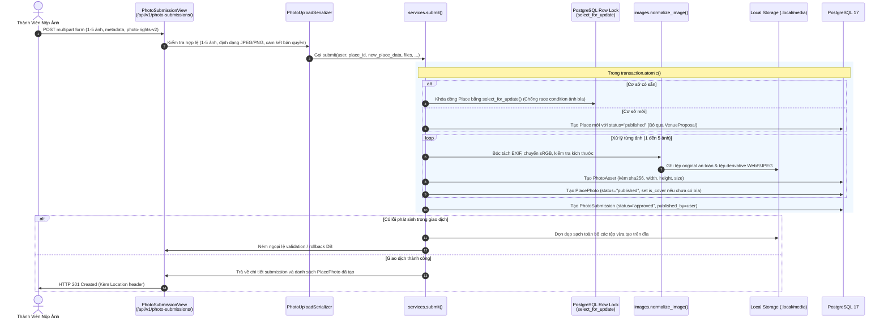
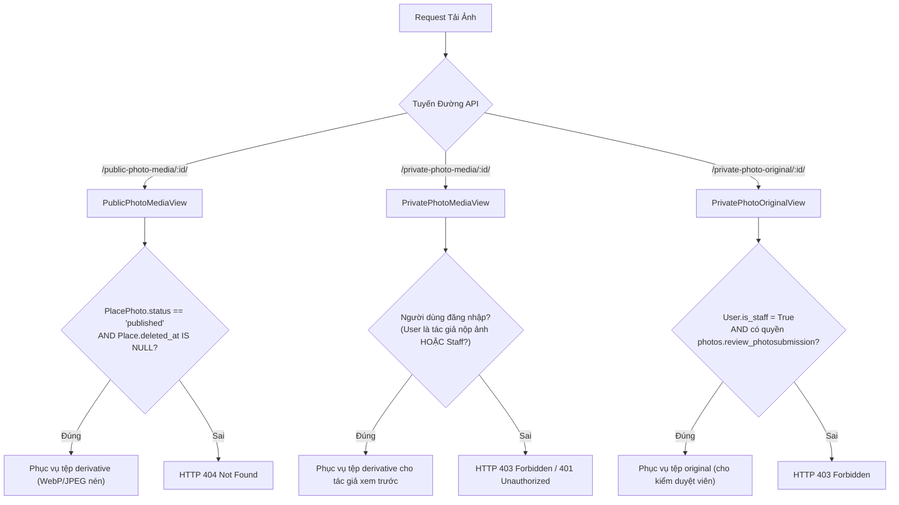

# Rendez — Kiến Trúc Hệ Thống (System Architecture)

Tài liệu này đặc tả kiến trúc tổng thể, các ranh giới tầng ứng dụng, luồng dữ liệu nghiệp vụ, cơ chế phân quyền và giải pháp phục vụ tệp tin an toàn của nền tảng Rendez.

---

## 1. Triết Lý Kiến Trúc: Clean Monolith

Rendez được thiết kế theo mô hình **Monolith phân tầng sạch (Clean Monolith)**, tự vận hành hoàn chỉnh trong môi trường máy chủ cục bộ hoặc container độc lập. Hệ thống không sử dụng microservices, không sử dụng hàng đợi tác vụ ngoài (Celery/Redis), không sử dụng worker nền bất đồng bộ và không phụ thuộc vào các dịch vụ AI đám mây bên ngoài.

### Sơ Đồ Kiến Trúc Hệ Thống Toàn Cục

```mermaid
graph TD
    subgraph Client_Layer [Tầng Trình Duyệt / Client]
        Browser["Trình duyệt Web (Desktop / Mobile)"]
        MapLibre["MapLibre GL 5 (Renderer Client-side)"]
        TanStack["TanStack Query v5 + Router v7"]
    end

    subgraph Gateway_WSGI_Layer [Tầng Web Server & Phục Vụ Tệp]
        Gunicorn["WSGI Server (Gunicorn)"]
        WhiteNoise["WhiteNoise Middleware<br/>(Phục vụ Frontend Build & Admin Static)"]
    end

    subgraph Django_Application_Layer [Tầng Ứng Dụng Django 5.2 Core + DRF 3.16]
        Middleware["SessionMiddleware + CsrfViewMiddleware"]

        subgraph Django_Apps [Mô-đun Nghiệp Vụ Cốt Lõi]
            AppAccounts["apps.accounts<br/>(User, Session, Creator Profile)"]
            AppPlaces["apps.places<br/>(Place, Category, Geocoding, Map BBox)"]
            AppPhotos["apps.photos<br/>(PlacePhoto, Asset, Submit Service, Social)"]
            AppFavorites["apps.favorites<br/>(SavedPlace / Bookmarks)"]
        end

        ServicesLayer["Tầng Dịch Vụ Nghiệp Vụ (services.py)<br/>- submit() với select_for_update<br/>- change_publication()<br/>- set_tags()"]
        ImagePipeline["Pipeline Chuẩn Hóa Ảnh (images.py)<br/>- normalize_image() tháo gỡ EXIF<br/>- Sinh ảnh phái sinh WebP/JPEG<br/>- Băm SHA-256 an toàn"]
    end

    subgraph Data_Storage_Layer [Tầng Lưu Trữ Cục Bộ]
        PostgreSQL[("PostgreSQL 17 + PostGIS Engine<br/>(Docker Port 55433, Volume .local/postgres)")]
        LocalMedia[("Hệ Thống Tệp Cục Bộ<br/>.local/media/ (Tệp gốc & phái sinh)")]
        MapAssets[("Tài Nguyên Bản Đồ Nội Bộ<br/>frontend/public/map/region.geojson")]
    end

    subgraph External_Network_Layer [Phụ Thuộc Mạng Bên Ngoài (Tối Thiểu)]
        EsriTiles["Esri ArcGIS Online<br/>(Lớp gạch raster nền vệ tinh/bản đồ)"]
        Geocoders["Photon / Nominatim OSM<br/>(Dịch vụ Geocoding gợi ý địa chỉ)"]
    end

    Browser <-->|HTTP/HTTPS Sessions + CSRF Token| Gunicorn
    Gunicorn --> WhiteNoise
    WhiteNoise --> Middleware
    Middleware --> Django_Apps
    AppPhotos --> ServicesLayer
    ServicesLayer --> ImagePipeline
    Django_Apps <-->|psycopg 3 Connection Pool| PostgreSQL
    ImagePipeline <-->|Ghi tệp có bảo vệ phân quyền| LocalMedia
    AppPhotos <-->|Phục vụ ảnh qua DRF Views| LocalMedia
    MapLibre <-->|Tải GeoJSON nội bộ| MapAssets
    MapLibre -.->|Tải raster tiles trực tiếp| EsriTiles
    AppPlaces -.->|Truy vấn gợi ý tọa độ khi nộp quán| Geocoders
```

---

## 2. Các Ranh Giới Ứng Dụng (Application Boundaries)

Hệ thống được chia thành 4 Django apps cốt lõi:

| Ứng dụng | Trách nhiệm chính | Models trực thuộc |
|---|---|---|
| **`apps.accounts`** | Quản lý người dùng, định danh, xác thực phiên làm việc, hồ sơ tác giả ảnh | `User` |
| **`apps.places`** | Quản lý địa điểm, danh mục, thông tin giờ mở cửa, truy vấn không gian `bbox`, geocoding | `Place`, `Category`, `PlaceOpeningHoursSpecification` |
| **`apps.photos`** | Quản lý ảnh tư liệu, tệp nhị phân, quy trình upload, đặc tính thị giác, bình luận, lượt thích, kiểm duyệt | `PlacePhoto`, `PhotoAsset`, `VisualAttribute`, `PhotoAttribute`, `PhotoSubmission`, `VenueProposal`, `PhotoComment`, `PhotoLike`, `ContentReport`, `PhotoAudit` |
| **`apps.favorites`** | Quản lý tính năng lưu quán yêu thích của từng tài khoản | `Favorite` |

### Dọn Dẹp Mã Nguồn Cũ (Cleaned Legacy)
Các module cũ liên quan đến menu giá và hóa đơn (`pricing`, `contributions`) đã được **loại bỏ hoàn toàn khỏi mã nguồn** và không còn xuất hiện trong `INSTALLED_APPS` hay cấu hình URL.

---

## 3. Luồng Dữ Liệu Nghiệp Vụ Cốt Lõi (Key Execution Flows)

### 3.1. Luồng Nộp Ảnh Tư Liệu & Tự Động Xuất Bản (Photo Submission & Auto-Publication)

Hàm dịch vụ `submit()` trong `apps.photos.services.py` là trung tâm của luồng này. Mọi thao tác ghi dữ liệu và xử lý file được đặt trong một khối giao dịch nguyên tử (`transaction.atomic()`):



### 3.2. Luồng Phục Vụ Tệp Phương Tiện Có Bảo Vệ (Protected Media Serving)

Khác với các ứng dụng web thông thường lưu ảnh công khai trên thư mục static hoặc S3 bucket mở, Rendez áp dụng cơ chế phục vụ media thông qua các DRF Streaming Views chuyên biệt để bảo đảm tính toàn vẹn bản quyền và quyền riêng tư:



---

## 4. Ranh Giới Xác Thực & Phân Quyền (Auth & Permissions)

### 4.1. Cơ Chế Xác Thực (Authentication Mechanism)
Hệ thống sử dụng cơ chế **Session-based Authentication** kết hợp bắt buộc kiểm tra mã chống giả mạo **CSRF Token** (`CsrfViewMiddleware`):
- Endpoint lấy CSRF Token: `GET /api/v1/auth/csrf/`
- Endpoint đăng nhập: `POST /api/v1/auth/login/` (tạo `sessionid` cookie HttpOnly)
- Endpoint đăng xuất: `POST /api/v1/auth/logout/` (hủy phiên làm việc)
- Mọi thao tác ghi dữ liệu (POST, PATCH, PUT, DELETE) bắt buộc phải gửi kèm header `X-CSRFToken`.

### 4.2. Ma Trận Phân Quyền Truy Cập (Access Matrix)

| Endpoint / Nhóm Chức Năng | Khách (Anonymous) | Thành Viên (Authenticated) | Tác Giả Sở Hữu Ảnh/Bình Luận | Kiểm Duyệt Viên (Moderator) | Quản Trị Viên (Staff) |
|---|---|---|---|---|---|
| Đăng ký, Đăng nhập, CSRF, Health check | Cho phép | Cho phép | Cho phép | Cho phép | Cho phép |
| Xem Feed, Chi tiết Quán, Tải ảnh công khai | Yêu cầu Session | Cho phép | Cho phép | Cho phép | Cho phép |
| Bản đồ tương tác & Geocoding | Yêu cầu Session | Cho phép | Cho phép | Cho phép | Cho phép |
| Nộp ảnh tư liệu mới (`photo-submissions/`) | Từ chối (401) | Cho phép (1–5 ảnh) | Cho phép | Cho phép | Cho phép |
| Thích ảnh, Đánh dấu lưu quán (`/saved`) | Từ chối (401) | Cho phép | Cho phép | Cho phép | Cho phép |
| Viết bình luận dưới ảnh | Từ chối (401) | Cho phép | Cho phép | Cho phép | Cho phép |
| Sửa mô tả ảnh / Xóa bình luận | Từ chối (401) | Từ chối (403) | Cho phép | Cho phép | Cho phép |
| Tải tệp ảnh gốc sạch (`private-photo-original/`) | Từ chối (401) | Từ chối (403) | Từ chối (403) | Cho phép | Cho phép |
| Rút ảnh (`withdrawn`), Gán nhãn đặc tính (`tags`) | Từ chối (401) | Từ chối (403) | Từ chối (403) | Cho phép | Cho phép |
| Truy cập Django Admin (`/admin/`) | Từ chối (Redirect) | Từ chối (Redirect) | Từ chối (Redirect) | Cho phép | Cho phép |

---

## 5. Ranh Giới Phụ Thuộc Ngoại Vi (External Dependencies)

Hệ thống hướng tới tối đa hóa tính tự chủ dữ liệu cục bộ (Local-First), tuy nhiên trong triển khai thực tế As-Is có các phụ thuộc ngoại vi sau:

1. **Lớp gạch Raster Bản đồ (Esri ArcGIS Online):**
   - *Thực trạng:* Lớp nền bản đồ đường phố/vệ tinh hiện được tải trực tiếp từ endpoint công khai của Esri (`https://server.arcgisonline.com/ArcGIS/rest/services/World_Topo_Map/...`) được cấu hình trong `frontend/public/map/style.json`.
   - *Phần tự chủ nội bộ:* Lớp vector đường bộ chi tiết tại Đà Nẵng được phục vụ nội bộ từ tệp GeoJSON `frontend/public/map/region.geojson`; bộ phông chữ tiếng Việt Noto Sans được lưu trữ cục bộ tại `frontend/public/map/glyphs/`.
2. **Dịch vụ Geocoding Gợi ý Tọa độ (Photon / Nominatim):**
   - *Thực trạng:* Tệp `backend/apps/places/geocoding.py` hỗ trợ truy vấn các dịch vụ mã nguồn mở Photon và OpenStreetMap Nominatim khi người dùng nhập địa chỉ mới để tự động điền kinh độ/vĩ độ. Hệ thống có cơ chế fallback sang nhà cung cấp kế tiếp nếu có lỗi mạng.
