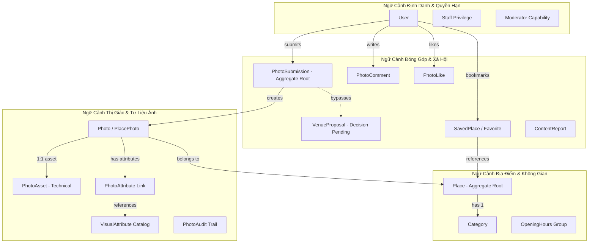
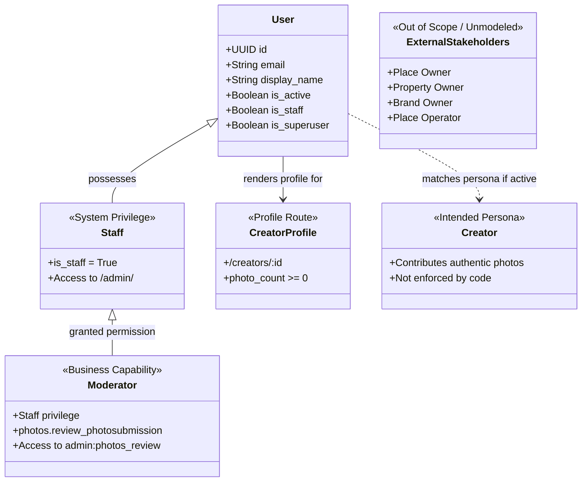

# Rendez — Mô Hình Nghiệp Vụ Chuyên Sâu (Domain Model)

Tài liệu này giải thích chi tiết cấu trúc mô hình nghiệp vụ của hệ thống Rendez, phân tích các thực thể cốt lõi, quan hệ tương tác, vòng đời trạng thái, bất biến nghiệp vụ (business invariants) và ranh giới phân quyền.

Tài liệu tuân thủ tuyệt đối từ điển nghiệp vụ chuẩn mực [GLOSSARY.md](file:///home/longtran/Projects/rendez-web/GLOSSARY.md).

---

## 1. Bản Đồ Ngữ Cảnh Nghiệp Vụ (Bounded Contexts)

Hệ thống nghiệp vụ của Rendez được chia thành 4 ngữ cảnh chức năng chính:

---

## 2. Các Thực Thể & Khái Niệm Miền Cốt Lõi

### 2.1. Nhóm Địa Điểm & Không Gian

#### `Place` (Địa điểm / Cơ sở)
- **Bản chất nghiệp vụ:** Entity (Ứng viên Aggregate Root của không gian cơ sở).
- **Mã nguồn triển khai:** Model `apps.places.models.Place` ([backend/apps/places/models.py:23](file:///home/longtran/Projects/rendez-web/backend/apps/places/models.py#L23)).
- **Trường dữ liệu quan trọng:**
  - `name`: Tên cơ sở (chuỗi ký tự, tối đa 255 ký tự).
  - `slug`: Chuỗi định danh URL thân thiện (tự động sinh từ tên, unique).
  - `category`: Khóa ngoại trỏ tới `Category` (`null=False`, `on_delete=PROTECT`).
  - `address`: Địa chỉ cơ sở ngoài đời thực.
  - `latitude`, `longitude`: Tọa độ địa lý WGS-84 (`DecimalField` độ chính xác cao).
  - `location`: Đối tượng hình học PostGIS `PointField(srid=4326)` (tự động đồng bộ từ lat/lon).
  - `status`: Trạng thái hiển thị (`draft`, `published`, `hidden`).
  - `deleted_at`: Dấu mốc xóa mềm kỹ thuật (`DateTimeField`, nullable).
  - `verified_at`: Ngày đối chiếu thông tin thực địa (`DateField`, nullable).
- **Vòng đời & Bất biến (Invariants):**
  1. *Xóa mềm kỹ thuật:* Khi bản ghi bị xóa mềm (`deleted_at IS NOT NULL`), nó bị loại khỏi các truy vấn công khai. Tuy nhiên, **`deleted_at` không biểu diễn việc cơ sở đóng cửa ngoài đời thực**. Hiện hệ thống chưa có trạng thái `closed`.
  2. *Toàn vẹn danh mục:* Một Place chỉ được xuất bản khi Category tham chiếu đang ở trạng thái hoạt động (`is_active = True`). Ràng buộc này được kiểm tra tại tầng ứng dụng (`Place.clean()`), không phải DB SQL constraint.
  3. *Tọa độ hợp lệ:* Tọa độ phải nằm trong dải vĩ độ $[-90, 90]$ và kinh độ $[-180, 180]$.
- **Mô hình Danh tính Không gian (Place Identity Continuity - Đề xuất):**
  Danh tính của một Place được cấu thành từ 3 yếu tố: **Mặt bằng vật lý** (Physical Location), **Cơ sở kinh doanh** (Business Identity) và **Không gian thực tế** (Visual Space). Khi cơ sở chuyển địa chỉ mới hoặc một quán mới tiếp quản mặt bằng cũ, danh tính bị phá vỡ và bắt buộc phải khởi tạo một Place mới.

#### `Category` (Loại địa điểm)
- **Bản chất nghiệp vụ:** Entity danh mục phân loại mô hình hoạt động cốt lõi.
- **Mã nguồn triển khai:** Model `apps.places.models.Category` ([backend/apps/places/models.py:13](file:///home/longtran/Projects/rendez-web/backend/apps/places/models.py#L13)).
- **Trường dữ liệu:** `name`, `slug`, `icon_name`, `is_active`.
- **Ràng buộc:** Quan hệ $1-N$ với `Place`. Database cưỡng chế `on_delete=PROTECT`, không cho phép xóa danh mục khi còn địa điểm tham chiếu.

#### `OpeningHours` (Thông tin giờ mở cửa)
- **Bản chất nghiệp vụ:** Domain Attribute Group / Tiềm năng là Value Object.
- **Mã nguồn triển khai:** Nhóm trường trên `Place`: `opening_hours_text` (chuỗi đọc tự nhiên), `opening_hours_specification` (đặc tả JSON có cấu trúc từng ngày trong tuần), `opening_hours_source` (nguồn kiểm chứng) và `opening_hours_verified_at` (ngày xác minh).
- **Quy tắc hiển thị:** Giờ mở cửa chỉ được hiển thị trên giao diện người dùng khi đồng thời có nguồn đối chiếu và ngày xác minh thực địa hợp lệ.

#### `District` (Địa bàn tìm kiếm)
- **Bản chất nghiệp vụ:** Legacy District-name Tokens / Address Search Filter.
- **Hiện trạng:** Không phải Entity trong cơ sở dữ liệu. Được bóc tách từ chuỗi `Place.address` qua regex phía client (`extractDistrict` trong [frontend/src/app/discovery.tsx:96](file:///home/longtran/Projects/rendez-web/frontend/src/app/discovery.tsx#L96)) để tạo nhãn giao diện và tham số lọc URL.

---

### 2.2. Nhóm Thị Giác & Hình Ảnh

#### `Photo` (`PlacePhoto` - Ảnh tư liệu địa điểm)
- **Bản chất nghiệp vụ:** Entity (Bản ghi ảnh gắn với một cơ sở cụ thể).
- **Mã nguồn triển khai:** Model `apps.photos.models.PlacePhoto` ([backend/apps/photos/models.py:168](file:///home/longtran/Projects/rendez-web/backend/apps/photos/models.py#L168)).
- **Quan hệ Cardinality:**
  - Mỗi `PlacePhoto` liên kết với đúng một `Place` (`on_delete=CASCADE`).
  - Mỗi `PlacePhoto` liên kết đúng $1-1$ với một `PhotoAsset` (`asset = OneToOneField(PhotoAsset, on_delete=PROTECT)`).
- **Vòng đời & Trạng thái (`PlacePhoto.status`):**
  - `pending_publication`: Chờ xuất bản (khai báo trong enum).
  - `published`: Đang công khai trên feed và bản đồ.
  - `withdrawn`: Bị rút khỏi hiển thị công khai.
- **Bất biến nghiệp vụ:**
  - *Withdrawn Rule:* Khi ảnh chuyển sang trạng thái `withdrawn`, trường `withdrawn_at` phải được ghi nhận thời điểm, và cờ ảnh đại diện bắt buộc bị gỡ bỏ (`is_cover = False`).
  - *Single Cover per Place:* Mỗi địa điểm tại một thời điểm chỉ có tối đa một ảnh đại diện đang công khai (`UniqueConstraint` có điều kiện trên DB).

#### `Archived Photo` (Ảnh tư liệu lịch sử)
- **Bản chất nghiệp vụ:** Accepted Domain Concept / Unimplemented Lifecycle State (Decision Pending #3).
- **Định nghĩa:** Ảnh tư liệu chụp không gian trong quá khứ, hoàn toàn trung thực nhưng không còn phản ánh đúng nội thất của quán sau cải tạo. Ảnh được giữ lại làm tư liệu dòng thời gian (timeline), tách khỏi feed khám phá tức thời.
- **Hiện trạng kỹ thuật:** Chưa có cột trạng thái riêng trong DB schema; chưa có giao diện timeline.

#### `PhotoAsset` (Tệp tư liệu nhị phân)
- **Bản chất nghiệp vụ:** Technical Supporting Entity.
- **Mã nguồn triển khai:** Model `apps.photos.models.PhotoAsset` ([backend/apps/photos/models.py:133](file:///home/longtran/Projects/rendez-web/backend/apps/photos/models.py#L133)).
- **Cấu trúc tệp:**
  - `original`: Tệp ảnh lưu trữ an toàn. **Lưu ý:** Đây là tệp đã qua hàm chuẩn hóa `normalize_image()` (tái tạo từ pixel thô, loại bỏ EXIF), không phải file upload nguyên bản chưa qua xử lý.
  - `derivative`: Tệp ảnh phái sinh tối ưu hiển thị (WebP/JPEG nén an toàn).
  - Metadata: `sha256` (checksum 64 ký tự chống trùng), `width`, `height`, `file_size`.

#### `VisualAttribute` & `PhotoAttribute` (Đặc tính thị giác)
- **`VisualAttribute`:** Danh mục các đặc điểm tiện ích nhìn thấy trực tiếp (Bàn học & Ổ cắm, Trong nhà & Máy lạnh, Cây xanh & Vườn, View thoáng đãng, Mở cửa muộn). Model `apps.photos.models.VisualAttribute`.
- **`PhotoAttribute`:** Bản ghi liên kết gán giữa `PlacePhoto` và `VisualAttribute`, có thể gắn thêm với `PostMedia`. Mang metadata hậu kiểm thủ công: `reviewed_by` (Staff thực hiện), `reviewed_at` và `source = "manual"`. Model `apps.photos.models.PhotoAttribute` ([backend/apps/photos/models.py:235](file:///home/longtran/Projects/rendez-web/backend/apps/photos/models.py#L235)).

#### `PhotoAudit` (Nhật ký kiểm toán ảnh)
- **Bản chất nghiệp vụ:** Audit Trail Entity.
- **Mã nguồn triển khai:** Model `apps.photos.models.PhotoAudit` ([backend/apps/photos/models.py:246](file:///home/longtran/Projects/rendez-web/backend/apps/photos/models.py#L246)).
- **Trách nhiệm:** Lưu vết các thao tác quản trị ảnh phát sinh qua tầng dịch vụ (`services.py`: thay đổi trạng thái công khai `change_publication`, gắn/gỡ nhãn đặc tính `set_tags`), ghi nhận `actor`, `action`, `payload_before`, `payload_after`.

---

### 2.3. Nhóm Đóng Góp Cộng Đồng & Xã Hội

#### `PhotoSubmission` (Lượt đóng góp ảnh)
- **Bản chất nghiệp vụ:** Entity (Ứng viên Aggregate Root trong ngữ cảnh đóng góp).
- **Mã nguồn triển khai:** Model `apps.photos.models.PhotoSubmission` ([backend/apps/photos/models.py:53](file:///home/longtran/Projects/rendez-web/backend/apps/photos/models.py#L53)).
- **Bất biến nghiệp vụ:**
  - Giới hạn từ 1 đến 5 ảnh cho mỗi lần nộp. **Lưu ý triển khai:** Giới hạn này được kiểm tra chặt chẽ ở tầng API Serializer (`PhotoUploadSerializer`); tầng Database chỉ chặn cận trên qua ràng buộc kiểm tra `sort_order <= 4`, không tự chặn cận dưới tối thiểu 1 ảnh.
  - Bắt buộc phải có xác nhận điều khoản sử dụng của người nộp: `PhotoUploadSerializer` yêu cầu `consent = True` và `consent_version = "photo-rights-v2"`; thời điểm xác nhận lưu ở `consent_at`.
- **Thực tế mã nguồn As-Is:** Luồng nộp ảnh hiện tại thực hiện **Auto-Publication** — tự động gán `status = "approved"`, `published_at = now()` và xuất bản ngay lập tức ảnh sang `PlacePhoto(status="published")`.

#### `VenueProposal` (Đề xuất cơ sở mới)
- **Bản chất:** Model có trong schema ([backend/apps/photos/models.py:21](file:///home/longtran/Projects/rendez-web/backend/apps/photos/models.py#L21)), nhưng **không được sử dụng trong luồng nộp ảnh hiện tại** (Decision Pending #2).
- **Thực tế mã nguồn:** Khi người dùng gửi ảnh cho một cơ sở mới chưa có trên hệ thống, hàm `submit()` tạo thẳng một bản ghi `Place(status="published")` và liên kết ảnh vào đó (được chứng minh qua test [backend/tests/test_auto_publication.py:59](file:///home/longtran/Projects/rendez-web/backend/tests/test_auto_publication.py#L59)).

#### `PhotoComment` & `PhotoLike`
- **`PhotoComment`:** Ý kiến trao đổi dạng văn bản dưới một ảnh cụ thể. Bắt buộc nội dung không được để trống (`photo_comment_non_empty_body`). Chỉ tác giả bình luận hoặc Staff mới có quyền xóa.
- **`PhotoLike`:** Hành vi biểu đạt yêu thích góc ảnh. Ràng buộc toàn vẹn cơ sở dữ liệu: mỗi cặp `(photo, user)` là duy nhất (`unique_photo_like`).

#### `SavedPlace` (Địa điểm đã lưu)
- **Bản chất nghiệp vụ:** Associative Entity đại diện cho hành vi đánh dấu (bookmark) cơ sở.
- **Mã nguồn triển khai:** Model `apps.favorites.models.Favorite` ([backend/apps/favorites/models.py:5](file:///home/longtran/Projects/rendez-web/backend/apps/favorites/models.py#L5)). Giao diện người dùng hiển thị nhãn `Lưu` (`SaveButton`, trang `/saved`).

#### `ContentReport` (Báo cáo vi phạm)
- **Bản chất nghiệp vụ:** Entity tiếp nhận phản ánh về sai lệch vị trí, quyền riêng tư hoặc nội dung không an toàn. Model `apps.photos.models.ContentReport`.

---

### 2.4. Nhóm Tác Nhân, Đặc Quyền & Vai Trò (Actors & Privileges)

| Tác nhân / Vai trò | Phân loại | Triển khai trong mã nguồn | Quyền hạn thực tế |
|---|---|---|---|
| **`User`** | Identity Entity | Model `apps.accounts.models.User` | Đăng nhập session, nộp ảnh, like, bình luận, lưu quán |
| **`Staff`** | System Privilege | `User.is_staff = True` | Đăng nhập giao diện Django Admin (`/admin/`) |
| **`Moderator`** | Business Capability | `user.is_staff and user.has_perm("photos.review_photosubmission")` | Hậu kiểm ảnh công khai: rút ảnh, chọn ảnh bìa, sửa nhãn và mô tả tại view `admin:photos_review` |
| **`Creator Profile`** | Technical Route | Tuyến đường `/creators/:id` | Hiển thị hồ sơ công khai của bất kỳ User nào (`photo_count >= 0`) |
| **`Creator`** | Intended Persona | Ý định sản phẩm | Chưa có quy tắc chặn tài khoản có 0 ảnh truy cập profile |
| **`Photo Contributor`** | Attribution Metadata | `PhotoSubmission.submitted_by` | Ghi nhận tài khoản đã nộp chùm ảnh |
| **`Place Creator`** | Attribution Metadata | `Place.created_by` | Ghi nhận tài khoản tạo địa điểm ban đầu |
| **`Place Owner`** | External Stakeholder | Chưa có model | Chủ thể sở hữu cơ sở ngoài đời thực; chưa được mô hình hóa |
| **`Property Owner`** | External Stakeholder | Nằm ngoài phạm vi | Chủ sở hữu bất động sản/mặt bằng |
| **`Brand Owner`** | External Stakeholder | Nằm ngoài phạm vi | Đơn vị sở hữu thương hiệu |
| **`Place Operator`** | External Stakeholder | Chưa có model | Đơn vị/cá nhân trực tiếp điều hành cơ sở |

---

## 3. Ma Trận Đăng Ký Trạng Thái Miền (Domain Decision Register)

Bảng phân loại mức độ chắc chắn của các khái niệm nghiệp vụ:

| Khái niệm / Quyết định | Phân loại | Bằng chứng mã nguồn / Ghi chú |
|---|---|---|
| **Place & Category lifecycle** | **Verified** | `apps.places.models.Place`, `Category` |
| **Photo & PhotoAsset 1:1** | **Verified** | `PlacePhoto.asset = OneToOneField(PhotoAsset)` |
| **Withdrawn Photo state** | **Verified** | `PlacePhoto.status == "withdrawn"`, `is_cover=False` |
| **Auto-Publication in submission** | **Verified** | `apps.photos.services.submit()`, test `test_auto_publication.py` |
| **Moderator capability boundary** | **Verified** | `apps.photos.services.check_reviewer()` |
| **SavedPlace mapping to Favorite** | **Verified** | `apps.favorites.models.Favorite` $\leftrightarrow$ `/saved` |
| **Visual Truth Principle** | **Accepted** | `PRODUCT.md` § Product Principles |
| **Archived Photo Concept** | **Accepted** | Khái niệm đã duyệt; trạng thái DB chưa làm (Decision Pending #3) |
| **Place Identity Continuity** | **Proposed** | Đề xuất tách Place khi chuyển địa điểm/đại tu (Decision Pending #1) |
| **VenueProposal Re-activation** | **Decision Pending** | Đang chờ quyết định khôi phục hàng duyệt hay xóa bỏ model (#2) |
| **Place Owner Claim System** | **Unimplemented** | Chưa có mô hình hóa hoặc luồng xác minh chủ quán |
| **District as Administrative Entity** | **Deprecated / Out of Scope** | Thay bằng chuỗi token lọc địa chỉ phía client |

---

## Implementation Status — Post Domain Model (2026-10-31)

Target Post/PostMedia schema and data migration have been implemented. New apps: `apps.posts`. Legacy tables retained for compatibility; `LegacyPhotoMapping` resolves legacy `PlacePhoto` IDs. Backend tests (22) and frontend typecheck/build/tests pass. Frontend UI remains PlacePhoto-centric pending full migration; API adapters preserve legacy URLs.
