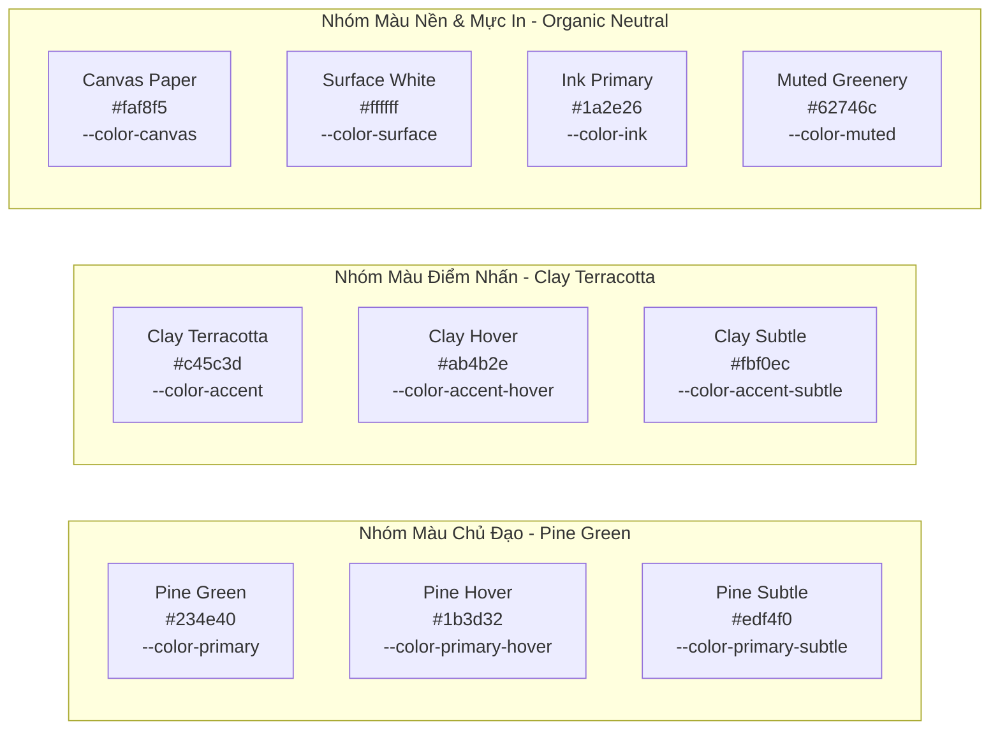

# Rendez — Hệ Thống Thiết Kế & Hướng Dẫn UI/UX (Design Guide)

Tài liệu này hệ thống hóa toàn bộ triết lý thiết kế, bảng màu, thang chữ, quy tắc đổ bóng thực vật, thiết kế thành phần và các quy tắc giao diện của nền tảng Rendez.

Tài liệu được xây dựng dựa trên đặc tả chuẩn mực tại [DESIGN.md](file:///home/longtran/Projects/rendez-web/DESIGN.md) và phản ánh trung thực hiện trạng triển khai trong mã nguồn CSS.

---

## 1. Hướng Đi Thiết Kế: Warm Botanical Pine & Clay

Phong cách thiết kế của Rendez là sự giao thoa hài hòa giữa sắc xanh thông rừng đại ngàn miền Trung (**Pine Green**), chất giấy ngà thô mộc ấm áp (**Canvas Paper**) và sắc đỏ đất nung đặc trưng của kiến trúc Đà Nẵng (**Clay Terracotta**).

### Triết Lý Thiết Kế Cốt Lõi
- **Visual-First & Content-First:** Giao diện đóng vai trò là một khung nền tĩnh lặng, khiêm tốn và thanh lịch, nhường trọn vẹn sự chú ý cho vẻ đẹp chân thực của ảnh chụp không gian và bản đồ địa phương.
- **Tôn Trọng Sự Thật Không Gian:** Giữ nguyên 100% tỷ lệ khung hình tự nhiên của ảnh chụp. Tuyệt đối không dùng khung cắt cúp vuông cưỡng bức làm biến dạng không gian.
- **Cảm Giác Bản Địa & Mộc Mạc:** Loại bỏ hoàn toàn màu đen chết `#000000` và xám tro công nghiệp `#888888`. Toàn bộ văn bản và bóng đổ đều mang sắc thái hữu cơ tự nhiên.

---

## 2. Hệ Thống Màu Sắc (Color Tokens)

Màu sắc được định nghĩa dưới dạng các biến CSS tùy biến (CSS Custom Properties) trong tệp `frontend/src/styles/theme.css`:

### Chi Tiết Token Màu Sắc

| Tên Token CSS | Giá Trị Hex | Vai Trò & Vị Trí Áp Dụng |
|---|---|---|
| `--color-primary` | `#234e40` | Sắc xanh thông rừng đại ngàn. Nút bấm chính (Primary CTA), biểu tượng nhận diện, viền focus |
| `--color-primary-hover` | `#1b3d32` | Trạng thái rê chuột (hover) của nút chính |
| `--color-primary-subtle` | `#edf4f0` | Nền xanh lá non nhạt cho chip thuộc tính đã chọn hoặc badge trạng thái tích cực |
| `--color-accent` | `#c45c3d` | Sắc đỏ ngói đất nung miền Trung. Dấu chấm logo `r.rendez`, nút Lưu active, marker bản đồ active |
| `--color-accent-hover` | `#ab4b2e` | Trạng thái hover cho thành phần điểm nhấn |
| `--color-accent-subtle` | `#fbf0ec` | Nền ngói nhạt dùng cho badge cảnh báo nhẹ hoặc thông báo nổi bật |
| `--color-canvas` | `#faf8f5` | Màu nền toàn trang lấy cảm hứng từ giấy ngà thô mộc, tạo chiều sâu thị giác ấm áp |
| `--color-surface` | `#ffffff` | Màu nền của thẻ ảnh (Cards), thanh điều hướng và cửa sổ modal |
| `--color-ink` | `#1a2e26` | Màu mực chính pha ánh xanh thông sẫm, độ tương phản cực cao (> 12:1) trên nền canvas |
| `--color-ink-secondary` | `#3b5047` | Màu mực thứ cấp dùng cho tiêu đề phụ và nhãn thông tin |
| `--color-muted` | `#62746c` | Màu xám cỏ cây dùng cho địa chỉ quán, ngày đăng, thông số phụ trợ |
| `--color-line` | `#e6e8e1` | Đường kẻ phân cách siêu mảnh, tiệp màu với nền giấy |
| `--color-line-strong` | `#cfd4c8` | Viền thẻ ảnh và khung nhập liệu ở trạng thái nghỉ |

### Quy Tắc Đặt Tên: The Botanical Restraint Rule
> [!IMPORTANT]
> **Quy tắc Tiết Chế Thực Vật (The Botanical Restraint Rule):**
> Sắc đỏ ngói đất nung (`#c45c3d`) **không bao giờ được chiếm quá 5% diện tích giao diện** trên bất kỳ màn hình nào. Sự đắt giá của màu đỏ ngói đến từ tính hiếm hoi, tập trung hoàn toàn vào việc dẫn dắt thị giác tới hành động lưu yêu thích hoặc điểm ghim đang được chọn trên bản đồ.

---

## 3. Hệ Thống Phông Chữ (Typography Hierarchy)

Hệ thống sử dụng bộ phông chữ hệ thống gốc (`system-ui`) nhằm đạt tốc độ nạp trang tức thì và sự hòa hợp hoàn hảo với thiết bị của người dùng:
`-apple-system, BlinkMacSystemFont, "Segoe UI", Roboto, "Helvetica Neue", Arial, sans-serif`

| Cấp Bậc (Level) | Kích Thước (Font Size) | Độ Đậm (Weight) | Chiều Cao Dòng (Line Height) | Ứng Dụng Thực Tế |
|---|---|---|---|---|
| **Display** | `clamp(28px, 3.2vw, 42px)` | `700` (Bold) | `1.18` (Letter-spacing: `-1.2px`) | Tiêu đề trang chính, khẩu hiệu thương hiệu, áp dụng `text-wrap: balance` |
| **Headline (H2)** | `22px` | `650` (Semi-bold) | `1.3` (Letter-spacing: `-0.5px`) | Tiêu đề khối danh sách quán, tiêu đề nhóm bộ lọc |
| **Title (H3)** | `16px` | `650` (Semi-bold) | `1.4` (Letter-spacing: `-0.2px`) | Tên quán cà phê trên thẻ ảnh Masonry, tiêu đề popup bản đồ |
| **Body** | `15px` | `400` (Regular) | `1.55` | Đoạn văn mô tả địa điểm, nội dung bình luận, thông báo hệ thống |
| **Label / Small** | `13px` | `600` (Medium) | `1.4` (Letter-spacing: `0.1px`) | Nhãn thuộc tính thị giác, nhãn form, khoảng cách địa lý |

---

## 4. Bán Kính Bo Cong & Đổ Bóng Thực Vật (Shapes & Elevation)

### 4.1. Thang Bo Cong (Radii Scale)
- `--radius-sm: 8px`: Hộp checkbox, radio, các thẻ badge nhỏ.
- `--radius-md: 12px`: Khung nhập liệu (inputs, select, textarea).
- `--radius-lg: 16px`: Thẻ ảnh Masonry, panel bản đồ, khối chi tiết địa điểm.
- `--radius-xl: 20px`: Khối nổi bao quanh modal và ngăn kéo trượt xem ảnh.
- `--radius-full: 9999px`: Dạng viên thuốc tròn cho toàn bộ nút bấm chính (`.button`), chip danh mục và nhãn thuộc tính.

### 4.2. Hệ Thống Đổ Bóng Mềm Pha Sắc Xanh Thông (Soft Botanical Shadows)
Hệ thống loại bỏ hoàn toàn bóng đen đục thô cứng. Toàn bộ bóng đổ đều pha sắc xanh thông rừng `rgba(20, 38, 30, ...)`:
- `--shadow-xs: 0 1px 2px rgba(20, 38, 30, 0.04)`: Viền nổi nhẹ cho nút phụ.
- `--shadow-sm: 0 2px 6px -1px rgba(20, 38, 30, 0.06), 0 1px 4px -1px rgba(20, 38, 30, 0.03)`: Trạng thái nghỉ của thẻ ảnh và chip bộ lọc.
- `--shadow-md: 0 6px 16px -2px rgba(20, 38, 30, 0.08), 0 2px 6px -1px rgba(20, 38, 30, 0.04)`: Trạng thái hover của thẻ ảnh hoặc nút điều khiển nổi trên bản đồ.
- `--shadow-lg: 0 12px 28px -4px rgba(20, 38, 30, 0.12), 0 4px 10px -2px rgba(20, 38, 30, 0.06)`: Cửa sổ xem ảnh nhanh (`PhotoViewer`).
- `--shadow-floating: 0 16px 36px -6px rgba(20, 38, 30, 0.16), 0 6px 14px -2px rgba(20, 38, 30, 0.08)`: Hộp thoại xác nhận quan trọng (`ConfirmDialog`).

### Quy Tắc: The Grounded Rest Rule
Ở trạng thái nghỉ, thẻ ảnh nằm phẳng và tiệp nhẹ với nền canvas giấy ngà. Đổ bóng chỉ nâng cao lên như một phản hồi xúc giác tinh tế khi người dùng rê chuột hoặc chạm tay vào thẻ.

---

## 5. Quy Chuẩn Thành Phần (Component Standards)

### 5.1. Nút Bấm (Buttons)
- Bo cong hình viên thuốc tuyệt đối (`border-radius: 9999px`).
- Chiều cao vùng chạm tối thiểu **44px** (`min-height: 44px`) bảo đảm tiêu chuẩn trợ năng trên màn hình cảm ứng di động.
- Hiệu ứng vi mô: Khi bấm kích hoạt hiệu ứng thu nhỏ nhẹ `transform: scale(0.97)`, tạo phản hồi xúc giác nảy tự nhiên.

### 5.2. Thẻ Ảnh Masonry (Photo Pins)
- Bo góc lớn 16px, ẩn góc tràn (`overflow: hidden`).
- Trang bị lớp phủ chuyển màu nhẹ ở chân ảnh (Gradient Scrim) để bảo đảm thông tin tên quán và tác giả luôn đọc rõ ràng trên mọi sắc độ của ảnh chụp.
- Nút Lưu (Bookmark) dạng đĩa tròn nổi ở góc trên bên phải ảnh, áp dụng hiệu ứng kính mờ (`backdrop-filter: blur(8px)`).

### 5.3. Khung Nhập Liệu (Inputs & Forms)
- Bo góc vừa 12px, chiều cao tối thiểu 46px.
- Trạng thái Focus: Tuyệt đối không dùng viền đen mặc định của trình duyệt; chuyển sang viền xanh thông rừng (`#234e40`) kèm quầng sáng êm dịu `box-shadow: 0 0 0 3px rgba(35, 78, 64, 0.12)`.

---

## 6. Bố Cục Thích Ứng Đa Thiết Bị (Responsive Breakpoints)

- **Desktop (Màn hình rộng $\ge 1024\text{px}$):**
  - Sử dụng **Desktop Left Rail** — thanh điều hướng cố định bên trái rộng 80px, giải phóng tối đa chiều ngang cho ảnh và bản đồ.
  - Lưới ảnh Masonry trải rộng từ 3 đến 5 cột tùy theo độ phân giải màn hình.
- **Mobile (Màn hình di động $< 768\text{px}$):**
  - Chuyển sang **Mobile Bottom Tab Bar** — thanh điều hướng nổi cao 64px ở đáy màn hình với nền kính mờ (`backdrop-filter: blur(16px)`), đặt toàn bộ hành động cốt lõi vào đúng vùng ngón tay cái dễ chạm (Thumb Zone).
  - Lưới ảnh tự động co lại còn 1 hoặc 2 cột.
