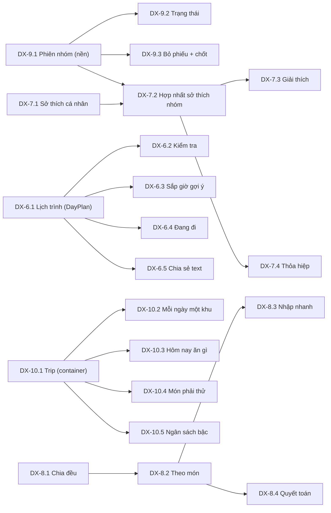

# TỔNG HỢP ĐỢT 2 — Lập kế hoạch & đi nhóm

> 5 agent nghiên cứu đợt 2 (agent 6–10), kế thừa 24 đề xuất của
> [TONG-HOP.md](./TONG-HOP.md) đợt 1. Agent chính (tổng hợp này) đã đọc đủ 5 file,
> kiểm chứng chéo bằng chứng code, khử trùng lặp và xếp làn sóng triển khai.
>
> Phạm vi đợt 2: **chỉ nghiên cứu, không sửa code**. Đầu ra: 5 file
> `docs/proposals/agent-{6..10}-*.md` + file tổng hợp này.

## 0. Phương pháp và giới hạn

- Mỗi agent đọc code độc lập theo 1 góc rời nhau, bắt buộc đọc `TONG-HOP.md` trước để không lặp
  đề xuất đợt 1 (DX-1.x, DX-2.x, DX-3.x, DX-4.x, DX-5.x, DX-A).
- Công cụ tìm kiếm web **không dùng được trong các phiên agent** (lỗi model) — mọi so sánh với
  sản phẩm ngoài (Splitwise, Wanderlog, Google Maps) là phân tích logic, không có trích dẫn nguồn.
  Xem mục "Chưa xác minh" từng file.
- Agent 7 và agent 8 chết giữa phiên do lỗi mạng (TLS handshake timeout) **sau khi đã ghi xong
  file** — file là nguồn sự thật; báo cáo tóm tắt của 2 agent này không có, không ảnh hưởng
  deliverable. Agent chính đã đọc đủ và kiểm chứng thay.

## 1. Kế thừa từ đợt 1

Mỗi agent khai báo rõ phần kế thừa; không đề xuất nào lặp đợt 1. Bảng đối chiếu:

| Đề xuất đợt 1                                                          | Được kế thừa ở đợt 2                                                              |
| ---------------------------------------------------------------------- | --------------------------------------------------------------------------------- |
| DX-4.1 bản đồ nhiều điểm, DX-4.2 chỉ đường cả tuyến, DX-4.3 sắp thứ tự | DX-6.1 (chế độ Lịch trình), DX-10.2 (bản đồ/chỉ đường per-day)                    |
| DX-4.4 ghi chú + "Đã đi"                                               | DX-6.4 (phân biệt trạng thái trong chuyến), DX-10.3 (quán chưa đi hôm nay)        |
| DX-4.5 tab "Địa điểm" ở `/saved`                                       | DX-10.1 (tab "Chuyến đi" cạnh nó)                                                 |
| DX-A giờ mở cửa                                                        | DX-7.5, DX-10.3 (phụ thuộc dữ liệu — khai báo rõ, không hứa trước)                |
| DX-1.1 sort, DX-1.2 "Gần đây"                                          | DX-7.2 (danh sách nhóm tái dùng sort/filter)                                      |
| DX-5.4 khối "Khẩu vị" trên profile                                     | DX-7.1 (form chỉnh được cho cá nhân/nhóm, không nhân bản UI)                      |
| DX-3.3 review có cấu trúc                                              | DX-7.5 (nguồn dietary sau này), DX-8 (điền bill từ review — bị loại, chờ dữ liệu) |
| Quyết định TONG-HOP §5 loại "ngân sách VND"                            | DX-10.5 **hoá giải** bằng ngân sách theo bậc giá (không quy đổi tiền)             |

## 2. Danh mục 25 đề xuất đợt 2

| Agent | Đề xuất                              | Tóm tắt                                                                               | Phạm vi                | Cỡ  |
| ----- | ------------------------------------ | ------------------------------------------------------------------------------------- | ---------------------- | --- |
| 6     | [DX-6.1](./agent-6-ke-hoach-ngay.md) | Chế độ "Lịch trình" trên bộ sưu tập — timeline một ngày có giờ/thời lượng (`DayPlan`) | FE (localStorage) → BE | M   |
| 6     | DX-6.2                               | Kiểm tra khả thi: chồng giờ, không kịp di chuyển, vượt 10 điểm Maps                   | FE-only                | S   |
| 6     | DX-6.3                               | "Sắp giờ gợi ý" theo loại quán + khoảng cách                                          | FE-only                | S   |
| 6     | DX-6.4                               | Chế độ "Đang đi": trễ thì dồn chặng, gợi ý bỏ chặng                                   | FE-only                | S/M |
| 6     | DX-6.5                               | Chia sẻ lịch trình dạng text (copy / `navigator.share`)                               | FE-only                | S   |
| 7     | [DX-7.1](./agent-7-so-thich-nhom.md) | Hồ sơ mong muốn cá nhân "Sở thích của tôi"                                            | BE + FE                | S/M |
| 7     | DX-7.2                               | Hợp nhất mong muốn nhóm → danh sách "hợp cả nhóm"                                     | BE + FE                | M   |
| 7     | DX-7.3                               | Giải thích từng kết quả: "vì sao hợp / ai bị vi phạm"                                 | BE + FE                | S/M |
| 7     | DX-7.4                               | Chế độ thỏa hiệp khi kết quả rỗng — 3 phương án nới ràng buộc                         | BE + FE                | M   |
| 7     | DX-7.5                               | Chiều ăn chay / dị ứng                                                                | **DATA**               | M   |
| 8     | [DX-8.1](./agent-8-chia-hoa-don.md)  | Chia đều nhanh: tổng + số người + ai trả                                              | FE-only                | S   |
| 8     | DX-8.2                               | Nhập theo món + gán người + phí chung + người ứng tiền                                | FE-only                | M   |
| 8     | DX-8.3                               | Nhập siêu nhanh "phở 45k, trà đá 5k" (parser token-cuối)                              | FE-only                | M   |
| 8     | DX-8.4                               | Quyết toán tối thiểu giao dịch + text gửi Zalo                                        | FE-only                | S   |
| 8     | DX-8.5                               | Lưu bill gần đây (LRU 20) + nháp tự lưu                                               | FE-only                | S   |
| 9     | [DX-9.1](./agent-9-phien-nhom.md)    | Tạo phiên nhóm + mã mời 6 ký tự, khách vào bằng tên                                   | BE (mock)              | M   |
| 9     | DX-9.2                               | Trạng thái chung: ai đang xem / đã bỏ phiếu                                           | BE                     | S   |
| 9     | DX-9.3                               | Bỏ phiếu kín 3–5 quán + 1 phiếu phủ quyết + host chốt                                 | BE                     | M   |
| 9     | DX-9.4                               | Hết hạn lazy + "chốt thay host" khi host offline                                      | BE                     | S   |
| 9     | DX-9.5                               | Dòng sự kiện trong phiên (suy từ state, không spam thông báo)                         | FE                     | S   |
| 10    | [DX-10.1](./agent-10-nhieu-ngay.md)  | Trip — khung ngày + điểm neo (arrivalAt/departureAt, baseDistrict)                    | FE + localStorage      | S/M |
| 10    | DX-10.2                              | Mỗi ngày = một khu: cảnh báo "đi vòng" theo quận                                      | FE-only                | M   |
| 10    | DX-10.3                              | "Hôm nay ăn gì quanh đây" — thẻ ngày đang diễn ra trên `/discover`                    | FE-only                | S/M |
| 10    | DX-10.4                              | Món phải thử Đà Nẵng — checklist curated map qua `tags`                               | FE-only                | S   |
| 10    | DX-10.5                              | Ngân sách theo bậc giá (`budgetTier` 1\|2\|3, không quy đổi VND)                      | FE-only                | S   |

## 3. Kết quả kiểm chứng (agent chính rà soát)

Agent chính đã đọc đủ cả 5 file và đối chiếu bằng chứng `file:dòng` với code thật. **~35 khẳng
định then chốt, tất cả khớp** — không phát hiện khẳng định sai nào. Các nhóm kiểm chứng chính:

| Khẳng định trong đề xuất                                                                          | Kết quả đối chiếu                                                                                                                                                                                                                                                                                                                             |
| ------------------------------------------------------------------------------------------------- | --------------------------------------------------------------------------------------------------------------------------------------------------------------------------------------------------------------------------------------------------------------------------------------------------------------------------------------------- |
| `Collection` chỉ có `placeIds: string[]`, 1 owner, không có ngày/thành viên                       | ✅ [collection.ts:10-24](file:///home/longtran/Projects/frontend/src/features/collections/types/collection.ts#L10-L24)                                                                                                                                                                                                                        |
| `Place` không có `openingHours`/dietary; `PlaceCategory` 6 loại; `priceLevel` 1–3                 | ✅ [place.ts](file:///home/longtran/Projects/frontend/src/features/places/types/place.ts#L1-L23) + grep `openingHours` = 0                                                                                                                                                                                                                    |
| Haversine `calculateDistanceKm`, 6 quận `DANANG_DISTRICTS`                                        | ✅ [danang-districts.ts](file:///home/longtran/Projects/frontend/src/features/places/lib/danang-districts.ts#L1-L34)                                                                                                                                                                                                                          |
| `format.ts` chưa có formatter giờ trong ngày (`formatClock` cần thêm) và chưa có `formatCurrency` | ✅ [format.ts](file:///home/longtran/Projects/frontend/src/lib/format.ts) — chỉ có `formatRelativeTime`/`formatDate`/`formatDistance`                                                                                                                                                                                                         |
| localStorage chỉ dùng ở skin provider (tiền lệ lưu FE)                                            | ✅ [skin-provider.tsx:8,23](file:///home/longtran/Projects/frontend/src/app/providers/skin-provider.tsx#L8)                                                                                                                                                                                                                                   |
| `QueryClient` mặc định, không polling → `refetchInterval` dùng được ngay                          | ✅ [query-provider.tsx:4](file:///home/longtran/Projects/frontend/src/app/providers/query-provider.tsx#L4), grep `refetchInterval` = 0                                                                                                                                                                                                        |
| `shareLink` chỉ nhận `{title, url}`, không gửi text                                               | ✅ [share.ts:24-43](file:///home/longtran/Projects/frontend/src/lib/share.ts#L24-L43)                                                                                                                                                                                                                                                         |
| Mock adapter in-memory per tab; chỉ 1 user `ME`; mutation gắn cứng `CURRENT_USER`                 | ✅ [server.ts:1069-1083](file:///home/longtran/Projects/frontend/src/mocks/server.ts#L1069-L1083), [server.ts:16](file:///home/longtran/Projects/frontend/src/mocks/server.ts#L16)                                                                                                                                                            |
| Lazy job lúc GET (`syncPlaceSuggestions` trong handler notifications)                             | ✅ [server.ts:172-198](file:///home/longtran/Projects/frontend/src/mocks/server.ts#L172-L198), gọi ở [server.ts:1043](file:///home/longtran/Projects/frontend/src/mocks/server.ts#L1043)                                                                                                                                                      |
| `GET /places` chỉ lọc category/district/q, không nhận `priceLevel`, không sort                    | ✅ [server.ts:125-150](file:///home/longtran/Projects/frontend/src/mocks/server.ts#L125-L150)                                                                                                                                                                                                                                                 |
| Thêm/bớt địa điểm bộ sưu tập = push xuống cuối, không có thứ tự đi                                | ✅ [server.ts:574-595](file:///home/longtran/Projects/frontend/src/mocks/server.ts#L574-L595), [collections.ts:59-70](file:///home/longtran/Projects/frontend/src/features/collections/api/collections.ts#L59-L70)                                                                                                                            |
| Fixture: 30 quán, 27 đã duyệt (p-01…p-27) + 3 chưa duyệt (p-28…p-30), đủ `lat/lng`                | ✅ đếm grep: 30 id, 27 published, 3 null                                                                                                                                                                                                                                                                                                      |
| Phân bố giá 12×₫, 13×₫₫, 5×₫₫₫; quận 12/5/4/3/3/3                                                 | ✅ đếm grep khớp cả hai agent 7 và 10                                                                                                                                                                                                                                                                                                         |
| Tags chứa đúng tên món đặc sản (bánh xèo, mì quảng, bún chả cá, cà phê muối…)                     | ✅ [places.ts:24,41,58,75,92,215,270,359,414](file:///home/longtran/Projects/frontend/src/mocks/fixtures/places.ts#L24)                                                                                                                                                                                                                       |
| 5 user giả lập đầy đủ hồ sơ trong fixture                                                         | ✅ [users.ts:9-97](file:///home/longtran/Projects/frontend/src/mocks/fixtures/users.ts#L9-L97)                                                                                                                                                                                                                                                |
| `/saved` có 3 tab; route gom dưới `AppShell`; Empty state /discover chỉ gợi ý xoá bộ lọc          | ✅ [saved-page.tsx:24-29](file:///home/longtran/Projects/frontend/src/features/saved/pages/saved-page.tsx#L24-L29), [routes.tsx:23-47](file:///home/longtran/Projects/frontend/src/app/router/routes.tsx#L23-L47), [discover-page.tsx:345-361](file:///home/longtran/Projects/frontend/src/features/places/pages/discover-page.tsx#L345-L361) |

**Sửa trong lúc rà soát (chỉ tài liệu, không đụng code):**

1. `agent-8-chia-hoa-don.md` dòng 314: lỗi lẫn tiếng Trung `引入 store` → sửa thành
   "Thêm store cho một trang là overengineering" (giữ nguyên ý).
2. `agent-7-so-thich-nhom.md`: thiếu mục bắt buộc "Chưa xác minh" → agent chính bổ sung
   (4 dòng: chưa chạy app, số liệu fixture có thể đổi, quy tắc hợp nhất là thiết kế đề xuất,
   chưa đo hiệu năng).

Không phát hiện bug code mới trong lúc kiểm chứng → `docs/BACKLOG.md` không đổi ở đợt này.

## 4. Quan hệ giữa các đề xuất (khử trùng lặp)

### 4.1 Trùng hạ tầng — gộp thành một thay đổi dùng chung

- **Chia sẻ text** (khác `shareLink` chỉ gửi URL): DX-6.5 (lịch trình) và DX-8.4 (quyết toán)
  cùng cần 1 hàm `shareText({ title, text, url? })` thêm vào [share.ts](file:///home/longtran/Projects/frontend/src/lib/share.ts).
  Làm **một lần**, hai tính năng dùng chung — không mỗi bên tự chế.
- **Ước lượng thời gian di chuyển** từ Haversine: DX-6.2 (cảnh báo không kịp) và DX-10.2 (cảnh
  báo đi vòng) cùng cần công thức "khoảng cách × hệ số bảo thủ". Phải là **một hàm thuần dùng
  chung** (ví dụ `estimateTravelMinutes`), không mỗi agent một hệ số.
- **Lưu localStorage có version**: DX-6.1 (`dayplan:<collectionId>`), DX-10.1 (`danang-trip-v1`),
  DX-8.5 (bill gần đây) cùng dùng pattern [skin-provider.tsx](file:///home/longtran/Projects/frontend/src/app/providers/skin-provider.tsx#L8).
  Nên tách 1 helper nhỏ dùng chung (key version hoá, try/catch) thay vì 3 nơi tự viết — đây là
  việc nhỏ, không phải abstraction sớm vì đã có 3 caller thật.

### 4.2 Phụ thuộc — thứ tự triển khai

- **DX-9.1 là cửa vào bắt buộc** của DX-7.2 (phiên nhóm để hợp nhất) — agent 9 và agent 7 cùng
  xác nhận độc lập. DX-8 giai đoạn 1 **không** cần phiên (người trả tiền nhập một mình rồi gửi
  text) — đúng ranh giới agent 8 tự vạch.
- **DX-6.1 là nền** của DX-6.2/6.3/6.4/6.5 (cùng một nguồn dữ liệu `DayPlan`).
- **DX-10.1 là container** của DX-10.2–10.5; DX-6 là "tầng trong một ngày" của DX-10 nếu cả hai
  cùng làm (agent 10 khai báo rõ, không chồng lấn).

### 4.3 Ranh giới giữa các agent — giữ nguyên khi tổng hợp

| Ranh giới                                                      | Phân định                                                                                                                                                                                                                                             |
| -------------------------------------------------------------- | ----------------------------------------------------------------------------------------------------------------------------------------------------------------------------------------------------------------------------------------------------- |
| DX-6 (một ngày, trục giờ) ↔ DX-10 (nhiều ngày, điểm neo)       | DX-10.1 chỉ gắn nhãn ngày đến/đi, không dựng timeline giờ; timeline giờ là việc của DX-6                                                                                                                                                              |
| DX-7 (hợp nhất sở thích) ↔ DX-9 (cơ chế phiên/chốt)            | DX-7 chỉ làm "preference → danh sách"; mời/tham gia/bỏ phiếu/chốt là của DX-9. Hai agent cùng đặt tên `GroupSession` — khi implement phải **chốt một shape duy nhất** (khuyến nghị shape của DX-9.1 vì đầy đủ hơn, DX-7.2 nhúng `preferences` vào đó) |
| DX-8 (chia tiền sau khi ăn) ↔ DX-10.5 (ngân sách trước khi đi) | Hai dữ liệu khác nhau, không gộp; DX-10.5 cấm viết hàm quy đổi `priceLevel → VND`                                                                                                                                                                     |
| DX-6.4 "Đang đi" ↔ DX-4.4 "Đã đi"                              | Trạng thái trong chuyến ≠ trạng thái tích luỹ — hai dữ liệu, không gộp                                                                                                                                                                                |

## 5. Phân loại phạm vi

- **FE-only, chạy được ngay với mock hiện tại (15):** DX-6.2, 6.3, 6.4, 6.5 · DX-8.1, 8.2, 8.3,
  8.4, 8.5 · DX-10.1, 10.2, 10.3, 10.4, 10.5 · DX-9.5 (sau khi có DX-9.1). Nhóm Trip của agent 10
  là nhóm **không cần sửa `src/mocks/**`** duy nhất.
- **Cần thêm route/logic vào mock (7):** DX-6.1 (giai đoạn BE) · DX-7.1, 7.2, 7.3, 7.4 ·
  DX-9.1, 9.2, 9.3, 9.4. Mọi hợp đồng API mới phải ghi `docs/DECISIONS.md` trước (quy ước D-011).
- **Cần dữ liệu thật chưa tồn tại (1):** DX-7.5 dietary — không hứa trước khi có dữ liệu,
  quán thiếu dữ liệu hiển thị "chưa rõ" thay vì bị loại im lặng.

## 6. Ba làn sóng đề xuất

**Làn sóng 1 — giá trị tức thì, thuần FE, cỡ S (làm được trong 1–2 ngày mỗi mục):**

- `shareText` vào [share.ts](file:///home/longtran/Projects/frontend/src/lib/share.ts) (hạ tầng dùng chung của DX-6.5 + DX-8.4).
- DX-10.1 Trip (container du lịch) → ngay sau đó DX-10.4, DX-10.5 (S, dựng trên container).
- DX-8.1 chia đều nhanh + DX-8.5 lưu bill gần đây.
- DX-6.2 kiểm tra khả thi (toán thuần trên dữ liệu có sẵn).
- DX-6.3 "sắp giờ gợi ý" (nếu làm cùng cụm với DX-6.1).

**Làn sóng 2 — tính năng trung tâm, cỡ M:**

- DX-6.1 chế độ Lịch trình (+ DX-6.4 "Đang đi").
- DX-8.2 nhập theo món (+ DX-8.3 nhập siêu nhanh).
- DX-10.2 "mỗi ngày một khu" (+ DX-10.3 "hôm nay ăn gì quanh đây").
- DX-9.1 tạo phiên + mời (+ DX-9.2 trạng thái) — mock demo bằng bot server.
- DX-7.1 hồ sơ sở thích cá nhân.

**Làn sóng 3 — nhóm hoàn chỉnh + dữ liệu (cần mock BE nhiều hơn hoặc dữ liệu mới):**

- DX-9.3 bỏ phiếu + chốt, DX-9.4 hết hạn/host offline.
- DX-7.2 hợp nhất sở thích nhóm, DX-7.3 giải thích, DX-7.4 thỏa hiệp.
- DX-7.5 dietary (DATA — chờ dữ liệu).
- Đa thiết bị thật cho phiên nhóm — **bắt buộc backend thật**, mock per-tab không quanh được
  (giới hạn đã nói thẳng ở agent-9).

## 7. Top 5 đề xuất mạnh nhất (chọn của agent chính)

1. **DX-9.1 — Tạo phiên nhóm + link mời**: cửa vào của cả nhánh nhóm (DX-7, DX-8 giai đoạn sau);
   tái dùng gần hết hạ tầng sẵn có (`ShareButton`, Dialog/Drawer, react-hook-form + zod);
   giải quyết đúng "cãi nhau 20 phút trong nhóm chat".
2. **DX-10.1 — Trip khung ngày + điểm neo**: container cho 4 đề xuất còn lại của agent 10,
   thuần FE + localStorage, biến app "tra một lần" thành app dùng hằng ngày trong chuyến đi.
3. **DX-8.1 + DX-8.2 — Chia hóa đơn**: nhu cầu thật mỗi tuần, thuần client 100%, nguyên tắc kỹ
   thuật chặt (tiền là số nguyên đồng, một model `Bill` duy nhất).
4. **DX-6.1 — Chế độ Lịch trình**: chuyển đổi cốt lõi "danh sách → kế hoạch", nền cho cả cụm
   DX-6.2–6.5; là phần còn thiếu sau DX-4.3 (thứ tự) và DX-4.2 (đường đi).
5. **DX-7.2 — Hợp nhất sở thích nhóm**: đúng yêu cầu gốc "mỗi người có 1 mong muốn khác nhau";
   rule-based giải thích được (lợi thế so với AI hộp đen); cần DX-9.1 và DX-7.1 trước.

## 8. Rủi ro và điều kiện chốt trước khi implement

- **Hợp đồng API mới** (sessions, day-plans, preferences, groups/match): ghi `docs/DECISIONS.md`
  trước khi viết code — quy ước D-011 đã có.
- **Mock per-tab**: mọi tính năng "nhiều người" chỉ demo được bằng bot server hoặc
  BroadcastChannel giữa các tab cùng máy; UI phải ghi rõ "thành viên khác là mô phỏng" khi demo.
- **localStorage versioning**: key phải có version (`danang-trip-v1`…), schema đổi phải migrate
  hoặc bỏ, không đọc im lặng dữ liệu cũ sai shape.
- **Tiền**: số nguyên đồng, cấm số thực; làm tròn phần lẻ dồn về người trả (DX-8).
- **Thời gian**: số phút từ nửa đêm (không ISO string) cho giờ trong ngày; so ngày theo múi giờ
  địa phương `Asia/Ho_Chi_Minh` (DX-10.3) — không so ISO UTC trực tiếp.
- **Ước lượng**: mọi con số suy từ Haversine phải ghi "ước lượng/xấp xỉ" trong UI, dùng hệ số
  bảo thủ, không hứa chính xác.

## 9. Chốt lựa chọn (2026-11-08)

Sau 2 đợt nghiên cứu (49 đề xuất: 24 đợt 1 + 25 đợt 2), chốt phương hướng như sau.

### 9.1 Trục sản phẩm được chọn: **"Lên kế hoạch cho chuyến đi Đà Nẵng"**

Lý do: (1) đúng định vị app — thành phố du lịch, người dùng chính là khách 2–4 ngày;
(2) toàn bộ cụm này chạy được **thuần FE với mock hiện tại**, không vướng giới hạn mock 1 user /
per-tab; (3) là vùng chưa có đối thủ trong các đề xuất — nhánh xã hội đã có nền, nhánh nhóm bị
chặn bởi hạ tầng mock.

### 9.2 Gói chốt cho đợt triển khai kế tiếp

| #   | Đề xuất                                                         | Vì sao chốt                                                                                       | Cỡ  |
| --- | --------------------------------------------------------------- | ------------------------------------------------------------------------------------------------- | --- |
| 1   | **DX-10.1 Trip** — khung ngày + điểm neo                        | Container của cả cụm kế hoạch; FE + localStorage; biến app "tra một lần" thành app dùng hằng ngày | S/M |
| 2   | **DX-10.4 Món phải thử** + **DX-10.5 Ngân sách bậc**            | Dựng trên Trip với chi phí S; tái dùng `tags` và `priceLevel` đang bỏ phí                         | S   |
| 3   | **DX-6.1 Lịch trình** (+ DX-6.2 kiểm tra, DX-6.3 sắp giờ gợi ý) | Phần còn thiếu của bộ sưu tập sau DX-4.2/4.3; `DayPlan` là tầng trong ngày của Trip               | M   |
| 4   | **DX-8.1 Chia đều nhanh** (+ DX-8.5 lưu bill)                   | Quick win nhu cầu thật mỗi tuần; thuần client 100%                                                | S   |
| 5   | **`shareText`** trong `share.ts`                                | Hạ tầng dùng chung của DX-6.5 + DX-8.4 — làm một lần ngay từ đầu                                  | S   |

### 9.3 Chờ — làm khi có điều kiện

- **DX-9.1 + DX-9.2/9.3 (phiên nhóm)**: giá trị cao nhất về mặt sản phẩm nhưng bị chặn bởi mock
  per-tab (chỉ demo được bằng bot server). Làm khi quyết định đầu tư backend thật, hoặc chấp nhận
  demo hạn chế.
- **DX-7.1 + DX-7.2 (sở thích nhóm)**: phụ thuộc DX-9.1; thuật toán hợp nhất đã thiết kế xong,
  giữ nguyên thiết kế để implement sau.
- **DX-10.2 + DX-10.3 (mỗi ngày một khu, "hôm nay ăn gì")**: dựng trên Trip — làm ngay sau gói
  chốt, không phải chờ gì khác.
- **DX-7.5 dietary, DX-A giờ mở cửa**: chờ dữ liệu thật (DATA).

### 9.4 Không theo đuổi

- Đa thiết bị thật cho phiên nhóm trên mock (không thể quanh giới hạn adapter per-tab).
- AI/LLM gợi ý (chưa có backend/model; rule-based giải thích được là lợi thế).
- Ngân sách quy đổi VND, timeline giờ trong Trip, chat trong phiên, gamification (cấm).

## 10. Chưa xác minh

- Toàn bộ 5 file dựa trên **đọc code**, chưa chạy app trong trình duyệt; chưa đo UI thật của
  timeline/tab mới/form sở thích.
- Không có trích dẫn nguồn web nào (công cụ tìm kiếm lỗi trong các phiên agent) — so sánh với
  Splitwise/Wanderlog/Yelp/Google Maps là phân tích logic của agent, chưa đối chiếu sản phẩm thật.
- Giả định sản phẩm là suy luận từ đề bài: "phần lớn người dùng là khách du lịch 2–4 ngày"
  (agent 10), "80% bữa ăn chỉ cần chia đều" (agent 8), "đi ăn nhóm luôn trễ" (agent 6) — chưa có
  số liệu hành vi thật.
- Chi phí polling 5 giây (DX-9) và hành vi `refetchInterval` với axios adapter có delay 320 ms
  chưa đo trên thiết bị thật.
- Ước lượng thời gian di chuyển (máy 20 km/h, bộ 4,5 km/h, hệ số 1,5) chưa đối chiếu với
  Google Maps cho các cặp điểm trong fixture.
- Deep link Google Maps nhiều waypoint chưa thử trên thiết bị Android/iOS thật (kế thừa cảnh báo
  của DX-4.2 từ đợt 1).
