# BÁO CÁO ĐỒ ÁN PBL6 — DỰ ÁN CHUYÊN NGÀNH 1

## THÔNG TIN CHUNG VỀ ĐỒ ÁN

| Hạng mục | Nội dung |
|---|---|
| Đơn vị đào tạo | Trường Đại học Bách khoa — Đại học Đà Nẵng |
| Khoa | Khoa Công nghệ Thông tin |
| Học phần | PBL6 — Dự án chuyên ngành 1 |
| Mã học phần | `[CẦN BỔ SUNG]` |
| Tên đề tài | Nghiên cứu và xây dựng nền tảng khám phá không gian học tập và làm việc qua hình ảnh thực tế và bản đồ số tại khu vực Đại học Bách khoa Đà Nẵng (Hệ thống Rendez) |
| Tên tiếng Anh | Research and Development of a Visual-First Local Discovery Platform around Danang University of Science and Technology (Rendez System) |
| Giảng viên hướng dẫn | `[CẦN BỔ SUNG]` |
| Sinh viên thực hiện | 1. `[CẦN BỔ SUNG]` — MSSV `[CẦN BỔ SUNG]` — Lớp `[CẦN BỔ SUNG]` |
| Năm học / Học kỳ | Học kỳ 1, Năm học 2026–2027 |
| Phiên bản báo cáo | 3.1 — ngày 2026-11-01 |

## NHẬN XÉT CỦA GIẢNG VIÊN HƯỚNG DẪN

`[CẦN BỔ SUNG]`

Đà Nẵng, ngày …… tháng …… năm 2026

Giảng viên hướng dẫn
(Ký và ghi rõ họ tên)

## LỜI CẢM ƠN

`[CẦN BỔ SUNG]`

## TÓM TẮT ĐỒ ÁN

Đồ án xây dựng Rendez, một nền tảng web giúp sinh viên tìm không gian học tập, làm việc và sinh hoạt quanh khu vực Đại học Bách khoa Đà Nẵng. Ý tưởng cốt lõi xuất phát từ một vấn đề rất đời thường: ảnh quảng cáo trên mạng thường đã qua chỉnh sửa, trong khi người học chỉ cần biết quán đó trông thật ra thế nào, có chỗ ngồi không, có mở khuya không. Rendez vì thế đặt hình ảnh thực tế lên vị trí trung tâm: ảnh giữ nguyên tỷ lệ gốc, gắn chặt với địa điểm, và đi kèm bản đồ tương tác.

Hệ thống gồm hai phần: máy chủ dựng trên Django REST Framework với 5 ứng dụng, 23 mô hình dữ liệu và 38 điểm cuối API; máy khách dựng trên React với 9 mô-đun tính năng. Luồng nội dung vận hành theo chu trình: người dùng đóng góp ảnh qua gói đóng góp, nội dung được chuẩn hóa và công khai vào địa điểm trong cùng một giao dịch, sau đó phục vụ chính hoạt động khám phá của những người dùng khác và chịu hậu kiểm bởi người kiểm duyệt. Chất lượng được kiểm chứng bằng ba tầng kiểm thử tự động với tổng cộng 311 bài, tất cả đạt.

Người dùng xem nội dung qua trang khám phá, dòng trải nghiệm và bản đồ tương tác.

| Chỉ số tổng hợp | Giá trị |
|---|---|
| Điểm cuối API | 38 |
| Mô hình dữ liệu | 23 |
| Bài kiểm thử tự động đạt | 312/312 (222 máy chủ + 61 máy khách + 29 đầu-cuối) |
| Ca sử dụng / luồng nghiệp vụ đặc tả | 9 ca sử dụng, 14 luồng |
| Dữ liệu hạt giống | 6 phân loại, 12 địa điểm, 36 ảnh |

## DANH MỤC CÁC HÌNH VẼ VÀ BIỂU ĐỒ

| Ký hiệu | Tên hình |
|---|---|
| Hình 1.1 | Sơ đồ ca sử dụng tổng quát |
| Hình 1.2 | Sơ đồ ca sử dụng nhóm đóng góp và kiểm duyệt |
| Hình 1.3 | Luồng dịch vụ tổng quát của hệ thống |
| Hình 2.1 | Kiến trúc phân tầng của hệ thống |
| Hình 2.2 | Sơ đồ quan hệ thực thể |
| Hình 2.3 | Sơ đồ lớp tổng quát nhóm đóng góp ảnh |
| Hình 2.4 | Chuyển trạng thái của PlacePhoto |
| Hình 2.5 | Chuyển trạng thái của PhotoSubmission |
| Hình 3.1 | Luồng UC-02: Xác thực và phiên |
| Hình 3.2 | Luồng UC-03: Duyệt danh mục, lọc phân loại, tìm kiếm |
| Hình 3.3 | Luồng UC-04: Xem chi tiết địa điểm |
| Hình 3.4 | Luồng UC-05: Nạp bản đồ và dữ liệu điểm |
| Hình 3.5 | Luồng UC-06: Tạo bài viết kèm ảnh và định vị |
| Hình 3.6 | Luồng UC-07: Nộp 1–5 ảnh với khóa bất biến |
| Hình 3.7 | Luồng UC-08: Hậu kiểm ảnh đã công khai |
| Hình 3.8 | Luồng UC-09: Rút ảnh, ẩn tức thời, báo cáo |
| Hình 3.9 | Luồng bổ trợ: Thích, bình luận, chia sẻ, lượt xem |
| Hình 3.10 | Luồng bổ trợ: Thích ảnh, bình luận ảnh, ảnh tương tự, thuộc tính |
| Hình 3.11 | Luồng bổ trợ: Lưu địa điểm, lưu bài viết, danh mục yêu thích |
| Hình 3.12 | Luồng bổ trợ: Chuỗi dự phòng ba bước định vị địa chỉ |
| Hình 3.13 | Luồng bổ trợ: Ba view phương tiện và kiểm tra quyền |
| Hình 3.14 | Luồng bổ trợ: Hồ sơ người đóng góp và chặn hành động của khách |
| Hình 4.1 | Cấu trúc định tuyến máy khách |
| Hình 5.1 | Kim tự tháp kiểm thử |

## DANH MỤC BẢNG BIỂU

| Ký hiệu | Tên bảng |
|---|---|
| Bảng 1.1 | Bài toán thực tế và phản hồi thiết kế |
| Bảng 1.2 | Phân vai người dùng trên mã nguồn |
| Bảng 1.3 | Mô tả ca sử dụng UC-07: Nộp gói đóng góp ảnh |
| Bảng 1.4 | Yêu cầu phi chức năng |
| Bảng 2.1 | Cấu trúc mô-đun máy chủ |
| Bảng 2.2 | Cấu trúc mô-đun máy khách |
| Bảng 2.3 | Quy tắc dữ liệu bắt buộc cho nhóm đóng góp ảnh |
| Bảng 2.4 | Quy ước API |
| Bảng 2.5 | Nhóm điểm cuối API |
| Bảng 2.6 | Giới hạn tần suất theo phạm vi |
| Bảng 3.1 | Tham số luồng UC-07 |
| Bảng 3.2 | Tổng hợp luồng và cơ chế bảo vệ |
| Bảng 4.1 | Thành phần nền tảng máy khách |
| Bảng 4.2 | Cấu trúc token kiểu dáng |
| Bảng 4.3 | Yêu cầu khả năng tiếp cận theo WCAG 2.1 AA |
| Bảng 5.1 | Kết quả kiểm thử ngày 2026-11-01 |
| Bảng 5.2 | Quy trình kiểm thử 9 bước |
| Bảng 5.3 | Dữ liệu hạt giống `data/danang.json` |
| Bảng 5.4 | Tổng hợp kết quả đồ án |
| Bảng 5.5 | Hạn chế và hướng phát triển |

## DANH MỤC CHỮ VIẾT TẮT

| Chữ viết tắt | Nghĩa đầy đủ |
|---|---|
| API | Application Programming Interface |
| CSRF | Cross-Site Request Forgery (giả mạo yêu cầu chéo trang) |
| ERD | Entity–Relationship Diagram (sơ đồ quan hệ thực thể) |
| EXIF | Exchangeable Image File Format (siêu dữ liệu ảnh) |
| GFM | GitHub Flavored Markdown |
| IDOR | Insecure Direct Object Reference (tham chiếu đối tượng trực tiếp không an toàn) |
| ORM | Object–Relational Mapping |
| PostGIS | Phần mở rộng dữ liệu không gian cho PostgreSQL |
| UML | Unified Modeling Language |
| UUID | Universally Unique Identifier |

## MỤC LỤC

1. Phân tích bài toán và tư duy thiết kế
2. Thiết kế kiến trúc và thiết kế dữ liệu
3. Thiết kế chức năng và các luồng nghiệp vụ
4. Thiết kế giao diện người dùng
5. Triển khai, kiểm thử và kết quả
- Kết luận
- Tài liệu tham khảo
- Phụ lục A: Danh mục thuật ngữ Anh–Việt

---

# CHƯƠNG 1. PHÂN TÍCH BÀI TOÁN VÀ TƯ DUY THIẾT KẾ

## 1.1 Bài toán và phản hồi thiết kế

Sinh viên quanh khu vực Bách khoa tìm chỗ học, chỗ làm việc bằng cách lướt ảnh trên các trang quảng cáo. Vấn đề là ảnh đó thường không phải ảnh thật. Nhiều quán chụp một lần rồi dùng suốt năm, góc chụp chọn lọc, thêm filter, thậm chí lấy ảnh của quán khác. Người học đến nơi mới phát hiện chỗ ngồi chật, ánh sáng không hợp, hay quán đã đóng cửa sớm. Thông tin lại nằm rải rác: một nền tảng có giờ mở cửa, nền tảng khác có đánh giá, còn bản đồ thì gần như chỉ để chỉ đường.

Bảng 1.1 đối chiếu từng vấn đề với cách hệ thống phản hồi và cơ chế kiểm chứng tương ứng.

**Bảng 1.1 — Bài toán thực tế và phản hồi thiết kế**

| Vấn đề thực tế | Phản hồi thiết kế | Cơ chế kiểm chứng |
|---|---|---|
| Ảnh quảng cáo bị chỉnh sửa, không phản ánh địa điểm thật | Lưới ảnh giữ nguyên tỷ lệ khung hình gốc, không cắt cúp cố định | Kiểm thử trực quan trên 4 bề rộng màn hình |
| Thông tin phân tán trên nhiều nền tảng | Một nguồn duy nhất: địa điểm, trải nghiệm và ảnh chung một cơ sở dữ liệu | Sơ đồ quan hệ thực thể Hình 2.2 |
| Thiếu tiêu chí đặc thù nhu cầu học tập | 6 phân loại nghiệp vụ: học bài, mở 24/7, mộc hoài niệm, sân vườn, sống ảo, cà phê cóc | Dữ liệu hạt giống 12 địa điểm, 36 ảnh |
| Địa chỉ khó định vị chính xác | Chuỗi định vị 3 nguồn dự phòng, có bộ nhớ đệm | Luồng bổ trợ định vị, Hình 3.12 |
| Ảnh người dùng có thể rò rỉ vị trí (EXIF/GPS) | Chuẩn hóa ảnh khi nộp: sinh bản phái sinh, loại siêu dữ liệu, tính mã băm SHA-256 | Luồng UC-07, Hình 3.6 |
| Truy cập trái phép vào ảnh riêng (IDOR) | Phương tiện phục vụ qua view có phân quyền, không qua máy chủ tĩnh công khai | Luồng bổ trợ phương tiện, Hình 3.13 |
| Ghi trùng lặp khi gửi lại biểu mẫu | Khóa bất biến `idempotency_key` duy nhất theo người dùng | Luồng UC-07, Hình 3.6 |
| Ghi đồng thời gây mất nhất quán | Khóa hàng ở mức cơ sở dữ liệu khi ghi | Luồng UC-07, Hình 3.6 |
| Nội dung không phù hợp | Hậu kiểm ảnh đã công khai kèm báo cáo nội dung | Luồng UC-08, Hình 3.7 |
| Nội dung đã rút vẫn truy cập được | Rút ảnh → toàn hệ thống trả 404 tức thời | Luồng UC-09, Hình 3.8 |
| Lạm dụng API | Giới hạn tần suất theo 11 phạm vi nghiệp vụ | Bảng 2.6, áp dụng trên mọi luồng ghi |

## 1.2 Phân vai người dùng

Hệ thống phục vụ ba vai trò, phân biệt bằng trạng thái phiên làm việc và quyền kiểm duyệt. Bảng 1.2 tóm tắt theo mã nguồn.

**Bảng 1.2 — Phân vai người dùng trên mã nguồn**

| Vai trò | Cơ sở phân vai | Hành động được phép |
|---|---|---|
| Khách (chưa đăng nhập) | `AllowAny` trên các view công khai | Xem dòng trải nghiệm, chi tiết bài viết, bình luận, chia sẻ, ghi nhận lượt xem |
| Thành viên đã đăng nhập | `IsAuthenticated` | Mọi hành động của khách, thêm: nộp gói ảnh, tạo bài viết, thích, lưu, yêu thích, quản lý ảnh của mình |
| Người kiểm duyệt | `is_staff` và quyền `photos.review_photosubmission` | Rút ảnh công khai, chọn ảnh bìa, sửa nhãn và mô tả, xử lý báo cáo nội dung |

## 1.3 Ca sử dụng tổng quát

Hình 1.1 vẽ các ca sử dụng chính theo ba tác nhân. Các ca đọc nội dung công khai (UC-01) không cần phiên làm việc; các ca ghi nội dung (UC-02 đến UC-07) yêu cầu đăng nhập; ca hậu kiểm (UC-08) yêu cầu thêm quyền chuyên trách.

**Hình 1.1 — Sơ đồ ca sử dụng tổng quát**

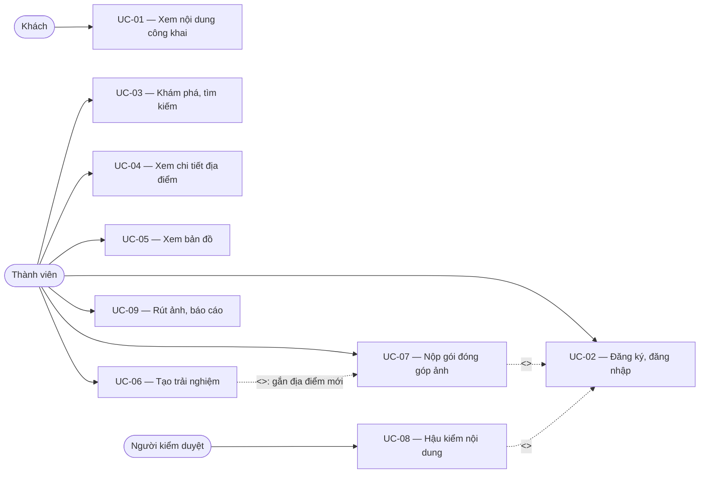

Hình 1.2 đi vào nhóm đóng góp và kiểm duyệt, nơi có quan hệ chặt nhất giữa hai vai trò.

**Hình 1.2 — Sơ đồ ca sử dụng nhóm đóng góp và kiểm duyệt**

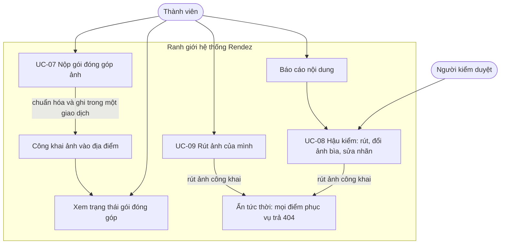

## 1.4 Mô tả ca sử dụng trọng yếu

Bảng 1.3 mô tả chi tiết ca sử dụng UC-07, là luồng phức tạp nhất của hệ thống.

**Bảng 1.3 — Mô tả ca sử dụng UC-07: Nộp gói đóng góp ảnh**

| Hạng mục | Nội dung |
|---|---|
| Tên | Nộp gói đóng góp ảnh |
| Tác nhân chính | Thành viên đã đăng nhập |
| Mục tiêu | Gửi 1–5 ảnh thực tế kèm chú thích để bổ sung cho một địa điểm |
| Tiền điều kiện | Đã đăng nhập; có ít nhất một tệp ảnh hợp lệ |
| Luồng sự kiện chính | 1. Chọn địa điểm hoặc đề xuất địa điểm mới. 2. Chọn 1–5 tệp ảnh. 3. Hệ thống chuẩn hóa từng ảnh (loại EXIF/GPS, sinh bản phái sinh, tính mã băm). 4. Ghi gói, ảnh và bản công khai trong một giao dịch, kèm khóa bất biến. 5. Gói ở trạng thái `approved`, ảnh công khai ngay. |
| Luồng ngoại lệ | Ảnh vượt 5 tệp → từ chối; khóa bất biến trùng → trả về gói hiện có, không ghi trùng; mất kết nối giữa chừng → gửi lại an toàn nhờ khóa bất biến |
| Hậu điều kiện | Gói và ảnh công khai cùng lúc; người kiểm duyệt có thể rút ảnh hoặc sửa nhãn về sau |
| Yêu cầu phi chức năng | Giới hạn 10 yêu cầu/phút; bộ nhớ tải lên tối đa 55 MiB |

## 1.5 Nguyên tắc thiết kế

Năm nguyên tắc dưới đây dẫn dắt toàn bộ quyết định về sau. Nguyên tắc đầu là quan trọng nhất: nội dung do người dùng tạo ra chỉ phục vụ công khai khi trạng thái của nó cho phép, và trạng thái đó được cơ sở dữ liệu tự bảo vệ thay vì trông chờ vào tầng ứng dụng. Bốn nguyên tắc còn lại phục vụ khả năng vận hành và bảo trì: hậu kiểm thay vì chặn trước, một nguồn sự thật cho mỗi khái niệm miền, phân quyền theo vai trò, và dự phòng khi phụ thuộc dịch vụ ngoài.

| Nguyên tắc | Biểu hiện trong thiết kế |
|---|---|
| Trạng thái quyết định khả năng hiển thị | Mọi truy vấn công khai lọc theo trạng thái; ảnh `withdrawn` trả 404 ở mọi điểm phục vụ (Hình 2.4) |
| Hậu kiểm thay vì chặn trước | Ảnh công khai ngay khi nộp; người kiểm duyệt rút ảnh, đổi ảnh bìa, sửa nhãn (Hình 3.7) |
| Một nguồn sự thật | Mỗi khái niệm miền một mô hình dữ liệu; đặc tả API thống nhất theo tài nguyên |
| Phân quyền theo vai trò | Khách đọc công khai; thành viên ghi nội dung; kiểm duyệt viên hậu kiểm (Bảng 1.2) |
| Dịch vụ ngoài có dự phòng | Định vị địa chỉ thử lần lượt 3 nguồn, có bộ nhớ đệm (Hình 3.12) |

## 1.6 Luồng dịch vụ tổng quát

Hình 1.3 mô tả luồng dịch vụ từ khi người dùng tiếp cận hệ thống đến khi nội dung được công khai và phục vụ người khác.

**Hình 1.3 — Luồng dịch vụ tổng quát của hệ thống**

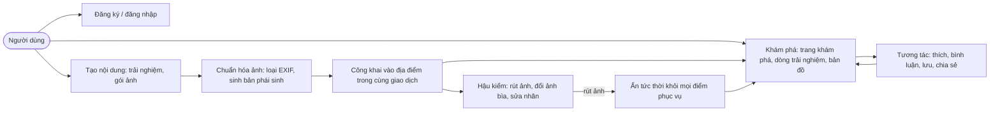

Hệ thống hoạt động theo chu trình: người dùng vừa là người xem vừa là người đóng góp; nội dung mới được chuẩn hóa rồi công khai ngay, làm giàu thêm dữ liệu khám phá cho chính những người dùng đó, đồng thời nằm trong tầm hậu kiểm của người kiểm duyệt.

## 1.7 Yêu cầu phi chức năng

Bảng 1.4 tập hợp các ràng buộc định lượng mà thiết kế phải thỏa, tách khỏi chức năng để kiểm thử được độc lập.

**Bảng 1.4 — Yêu cầu phi chức năng**

| Nhóm | Yêu cầu | Cách đáp ứng |
|---|---|---|
| Hiệu năng | Trang khám phá hiển thị nội dung đầu tiên trong thời gian người dùng còn đang đọc tiêu đề | Phân trang 20, ảnh tải lười, bản phái sinh đã chuẩn hóa kích thước |
| Hiệu năng | Bản đồ không làm chậm các trang khác | Tải lười gói MapLibre, chỉ nạp khi mở `/map` |
| Dung lượng | Một gói đóng góp tối đa 5 ảnh, mỗi ảnh tối đa 10 MiB, tổng 30 MiB | Kiểm tra số lượng và dung lượng ở serializer; ràng buộc cơ sở dữ liệu chặn gói vượt 5 ảnh |
| An toàn | Mọi hành động ghi đều giới hạn tần suất | 11 phạm vi theo nhóm hành động (Bảng 2.6) |
| An toàn | Ảnh chưa công khai không truy cập được qua đường dẫn trực tiếp | Phục vụ qua view kiểm tra trạng thái và quyền sở hữu |
| Toàn vẹn | Gửi lại biểu mẫu không sinh bản ghi trùng | Khóa bất biến theo người dùng |
| Khả dụng | Giao diện dùng được từ 360 px tới 1440 px | Kiểm thử trực quan bốn bề rộng |
| Tiếp cận | Điều khiển có nhãn, ảnh có văn bản thay thế, vùng chạm tối thiểu 44 px | Tiêu chuẩn WCAG 2.1 mức AA, kiểm thử thành phần |
| Bảo trì | Đặc tả API không lệch khỏi mã nguồn | Sinh tự động trong quy trình kiểm tra, chặn khi lệch |


---

# CHƯƠNG 2. THIẾT KẾ KIẾN TRÚC VÀ THIẾT KẾ DỮ LIỆU

## 2.1 Kiến trúc tổng thể

Hệ thống chia thành bốn cụm: máy khách, máy chủ, lưu trữ và nguồn ngoài. Máy khách không bao giờ chạm vào cơ sở dữ liệu; mọi trao đổi đi qua tầng API. Riêng ảnh đi một đường riêng qua các view phương tiện, vì ảnh cần kiểm tra trạng thái công khai và quyền sở hữu trước khi trả tệp về. Bản đồ đọc kiểu và dữ liệu vector từ tài nguyên nội bộ, chỉ nạp lớp gạch nền từ nguồn ngoài.

**Hình 2.1 — Kiến trúc phân tầng của hệ thống**

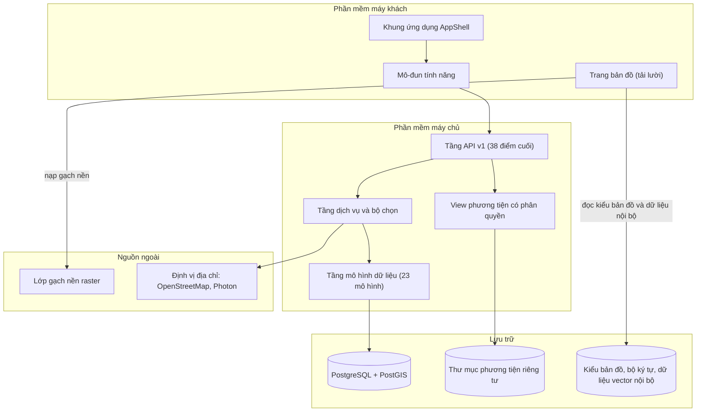

Mỗi ứng dụng máy chủ giữ một nhóm trách nhiệm riêng, không chéo tay vào nhau.

**Bảng 2.1 — Cấu trúc mô-đun máy chủ**

| Ứng dụng | Số mô hình | Trách nhiệm |
|---|---|---|
| `accounts` | 1 | Người dùng, phiên làm việc, chuẩn hóa thư điện tử |
| `places` | 2 | Địa điểm, phân loại, định vị địa chỉ, dữ liệu bản đồ |
| `photos` | 10 | Đóng góp, kiểm duyệt, phương tiện, báo cáo, tương tác ảnh |
| `posts` | 8 | Trải nghiệm cộng đồng, tương tác bài viết |
| `favorites` | 2 | Lưu và yêu thích |

Máy khách tổ chức theo mô-đun tính năng, mỗi mô-đun tự chứa trang, thành phần và truy vấn của mình.

**Bảng 2.2 — Cấu trúc mô-đun máy khách**

| Thư mục | Vai trò |
|---|---|
| `app/` | Khung ứng dụng, định tuyến, màn hình dùng chung |
| `features/` | 9 mô-đun tính năng: khám phá, trải nghiệm, địa điểm, đóng góp, kiểm duyệt, hồ sơ, lưu, tìm kiếm, khung |
| `components/ui/` | Thư viện thành phần nền tảng (5 tệp) |
| `lib/` | Máy khách HTTP, bộ truy vấn, phiên, chủ đề, định dạng |
| `styles/` | Token kiểu dáng và biểu mẫu kiểu dáng (21 tệp CSS, 9 381 dòng) |

## 2.2 Thiết kế dữ liệu

Hình 2.2 vẽ các quan hệ chính. Trục trung tâm là `PhotoAsset`: một tệp ảnh nộp lên có thể trở thành ảnh địa điểm công khai, hoặc được tái sử dụng làm phương tiện của bài viết, mà không cần nạp lại. Nhánh `VenueProposal` là phần dự phòng của mô hình: luồng nộp hiện hành luôn gắn gói với một `Place`, nên mọi bản ghi `PhotoSubmission` đều thỏa vế `place` của ràng buộc "đúng một đích".

**Hình 2.2 — Sơ đồ quan hệ thực thể**

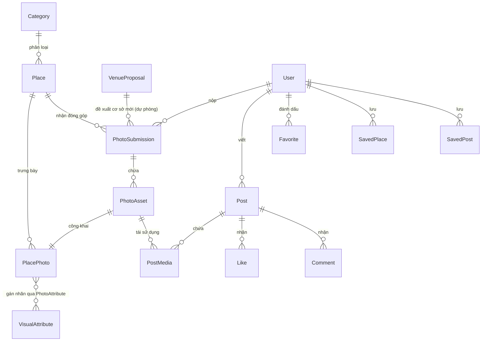

Hình 2.3 chuyển nhóm thực thể đóng góp ảnh sang dạng sơ đồ lớp, thể hiện cấu trúc tĩnh kèm thuộc tính và phương thức chính.

**Hình 2.3 — Sơ đồ lớp tổng quát nhóm đóng góp ảnh**

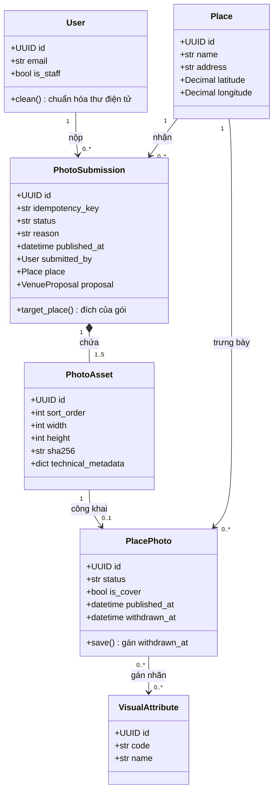

Trạng thái của `PlacePhoto` là phần dữ liệu cần bảo vệ nhất, vì nó quyết định ảnh có ai nhìn thấy hay không. Hình 2.4 vẽ máy trạng thái kèm điều kiện chuyển; luồng nộp hiện hành tạo thẳng `PlacePhoto` ở trạng thái `published`, còn `pending_publication` là trạng thái mặc định của mô hình dùng cho nhánh chặn trước.

**Hình 2.4 — Chuyển trạng thái của PlacePhoto**

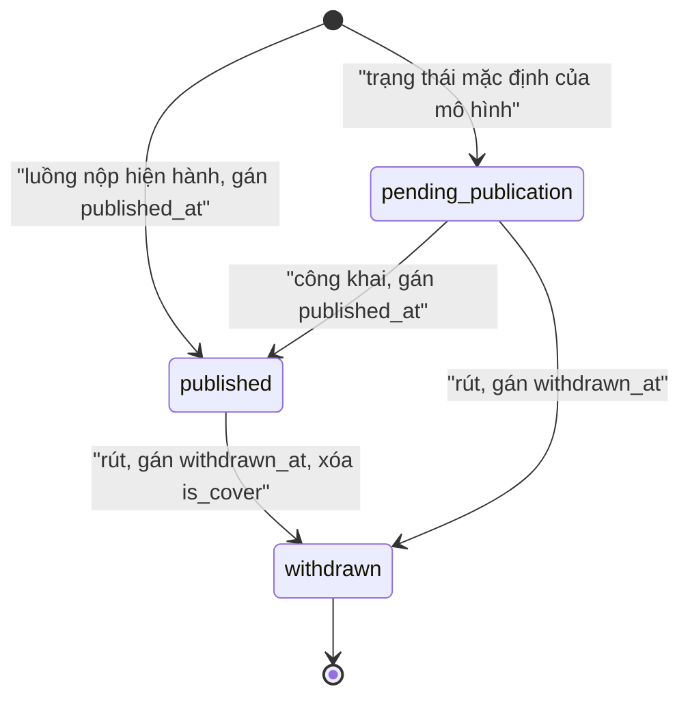

Gói đóng góp có vòng đời riêng, được ghi trước khi sinh ra ảnh công khai trong cùng một giao dịch. Hình 2.5 vẽ máy trạng thái mà mô hình `PhotoSubmission` cho phép; luồng nộp hiện hành đi thẳng vào nhánh `approved`, còn các nhánh `pending_review` và `rejected` là phần dự phòng của mô hình khi cần chặn trước.

**Hình 2.5 — Chuyển trạng thái của PhotoSubmission**

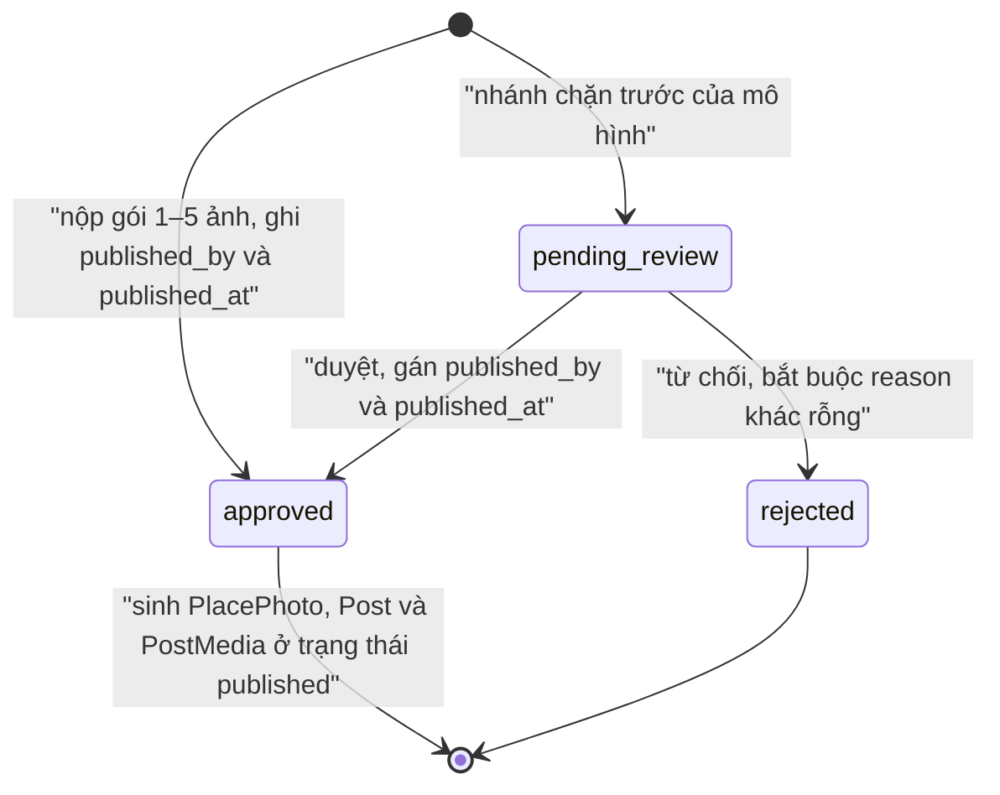

Mọi chuyển trạng thái đều có ràng buộc ở cơ sở dữ liệu đứng sau. Toàn hệ thống có 34 ràng buộc khai báo trên 17 mô hình; Bảng 2.3 liệt kê nhóm ràng buộc bảo vệ vòng đời gói đóng góp và ảnh công khai.

**Bảng 2.3 — Quy tắc dữ liệu bắt buộc cho nhóm đóng góp ảnh**

| Ràng buộc | Mô hình | Ý nghĩa |
|---|---|---|
| `photo_submission_one_target` | `PhotoSubmission` | Mỗi gói trỏ đúng một đích: địa điểm có sẵn hoặc đề xuất cơ sở mới |
| `unique_photo_upload_key` | `PhotoSubmission` | Mỗi người dùng chỉ có một gói cho một khóa bất biến |
| `photo_review_fields` | `PhotoSubmission` | Gói chưa đăng không có người đăng; gói đã đăng hoặc đã gỡ phải có người và thời điểm đăng |
| `photo_rejection_reason` | `PhotoSubmission` | Gói bị từ chối phải kèm lý do |
| `photo_asset_order_unique` | `PhotoAsset` | Thứ tự ảnh trong gói không trùng nhau |
| `photo_asset_max_five` | `PhotoAsset` | Mỗi gói tối đa 5 ảnh |
| `photo_asset_positive_metrics` | `PhotoAsset` | Chiều rộng, chiều cao và dung lượng ảnh phải dương |
| `visual_one_cover` | `PlacePhoto` | Mỗi địa điểm chỉ có một ảnh bìa |
| `place_photo_cover_published` | `PlacePhoto` | Ảnh bìa phải ở trạng thái công khai |
| `published_photo_fields` | `PlacePhoto` | Ảnh công khai phải ghi thời điểm công khai |
| `place_photo_withdrawn_timestamp` | `PlacePhoto` | Ảnh đã rút phải ghi thời điểm rút |
| `place_photo_pending_timestamps` | `PlacePhoto` | Ảnh chờ công khai chưa có dấu thời gian công khai hoặc rút |

## 2.3 Thiết kế API

Đặc tả API sinh tự động từ mã nguồn thành tệp `backend/openapi.yaml`, nên tài liệu không thể lệch khỏi thực tế. Bảng 2.4 nêu quy ước chung, Bảng 2.5 nhóm 38 điểm cuối theo tài nguyên.

**Bảng 2.4 — Quy ước API**

| Hạng mục | Quy ước |
|---|---|
| Tiền tố | `/api/v1/` |
| Định danh tài nguyên | UUID |
| Định dạng | JSON, phong bì lỗi chuẩn `detail` + `code` |
| Phân trang | Kích thước trang mặc định 20 |
| Xác thực | Phiên làm việc qua cookie `HttpOnly`, `SameSite=Lax`, kèm lớp CSRF |
| Giới hạn tần suất | Theo 11 phạm vi nghiệp vụ (Bảng 2.6) |

**Bảng 2.5 — Nhóm điểm cuối API**

| Tài nguyên | Điểm cuối chính | Quyền truy cập |
|---|---|---|
| Xác thực | `/auth/csrf/`, `/auth/login/`, `/auth/logout/`, `/auth/me/`, `/auth/register/`, `/auth/password/` | Công khai |
| Phân loại | `/categories/` | Đã đăng nhập |
| Địa điểm | `/places/`, `/places/{id}/`, `/places/{id}/photos/`, `/places/{id}/saved/`, `/places/{id}/report/`, `/places/map/`, `/places/geocode/` | Đọc đã đăng nhập; định vị công khai |
| Ảnh | `/photos/{id}/`, `/photos/{id}/comments/`, `/photos/{id}/likes/`, `/photos/{id}/manage/`, `/photos/{id}/report/`, `/photos/{id}/similar/`, `/attributes/` | Đã đăng nhập |
| Đóng góp | `/photo-submissions/`, `/photo-submissions/{id}/` | Đã đăng nhập |
| Trải nghiệm | `/feed/`, `/posts/`, `/posts/{id}/`, `/posts/{id}/comments/`, `/posts/{id}/likes/`, `/posts/{id}/saved/`, `/posts/{id}/shares/`, `/posts/{id}/views/`, `/posts/saved/`, `/comments/{id}/` | Đọc công khai; ghi đã đăng nhập |
| Người đóng góp | `/creators/{id}/`, `/creators/{id}/photos/` | Đã đăng nhập |
| Lưu và yêu thích | `/favorites/`, `/favorites/{id}/` | Đã đăng nhập |
| Phương tiện | `/public-photo-media/{id}/`, `/private-photo-media/{id}/`, `/private-photo-original/{id}/`, `/public-post-media/{id}/` | Theo trạng thái và quyền sở hữu |

Một điểm đáng chú ý trong thiết kế quyền: các điểm đọc dòng trải nghiệm cho phép khách truy cập (`AllowAny`), nhưng hành động ghi trên cùng điểm cuối vẫn kiểm tra phiên ngay trong thân xử lý và trả 401 nếu chưa đăng nhập. Nhờ vậy dòng trải nghiệm có thể lan truyền công khai mà không mở cửa cho ghi rác.

**Bảng 2.6 — Giới hạn tần suất theo phạm vi**

| Phạm vi | Giới hạn | Phạm vi | Giới hạn |
|---|---|---|---|
| `login` | 20/phút | `like` | 60/phút |
| `register` | 10/phút | `favorite` | 60/phút |
| `password` | 5/phút | `comment` | 30/phút |
| `upload` | 10/phút | `share` | 30/phút |
| `report` | 10/phút | `view` | 120/phút |
| `geocode` | 30/phút | | |


---

# CHƯƠNG 3. THIẾT KẾ CHỨC NĂNG VÀ CÁC LUỒNG NGHIỆP VỤ

Chương này đặc tả các ca sử dụng bằng sơ đồ luồng, mỗi ca một mục. Ba luồng bổ trợ (tương tác bài viết, tương tác ảnh, lưu và yêu thích) cùng ba luồng hạ tầng (định vị địa chỉ; phục vụ phương tiện; hồ sơ người đóng góp kèm luồng khách) trình bày cuối chương.

## 3.1 Luồng UC-02 — Đăng ký, đăng nhập và phiên làm việc

**Hình 3.1 — Luồng UC-02: Xác thực và phiên**

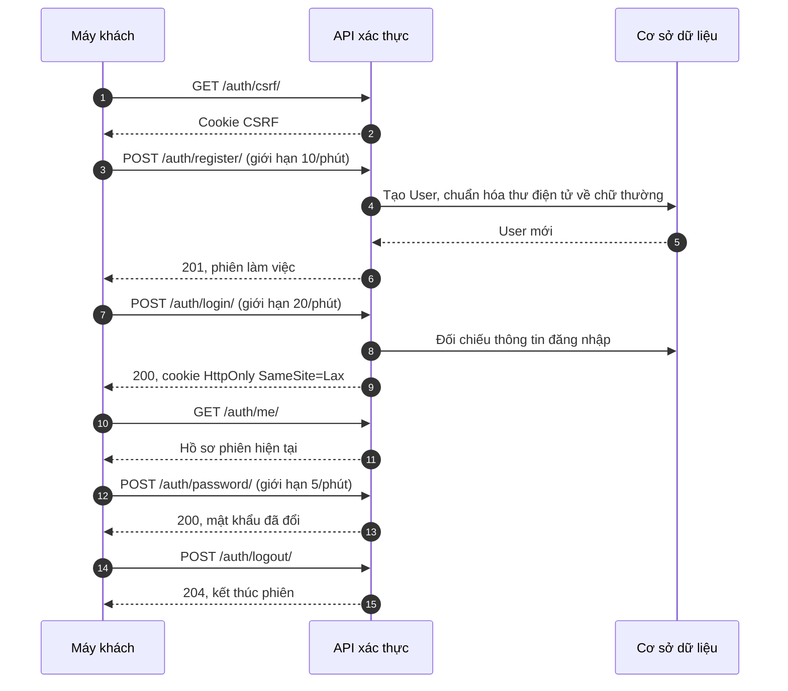

## 3.2 Luồng UC-03 — Khám phá và tìm kiếm địa điểm

**Hình 3.2 — Luồng UC-03: Duyệt danh mục, lọc phân loại, tìm kiếm**

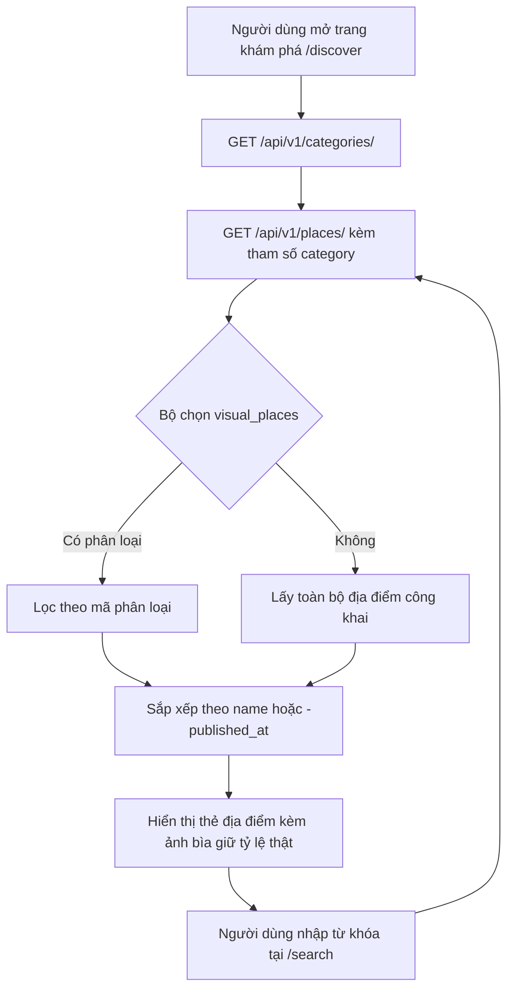

## 3.3 Luồng UC-04 — Chi tiết địa điểm

**Hình 3.3 — Luồng UC-04: Xem chi tiết địa điểm**

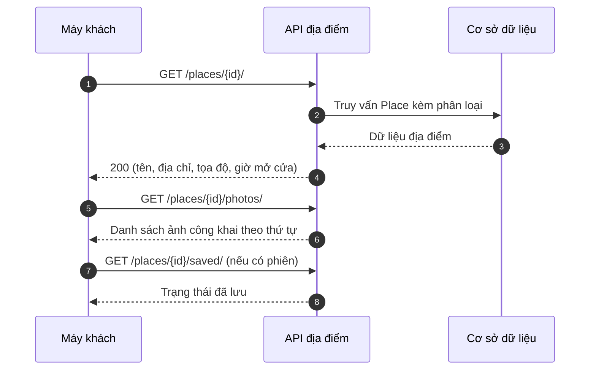

## 3.4 Luồng UC-05 — Bản đồ tương tác

**Hình 3.4 — Luồng UC-05: Nạp bản đồ và dữ liệu điểm**

```mermaid
flowchart TD
    open["Người dùng mở /map (tải lười)"] --> style["Nạp kiểu bản đồ cục bộ /map/style.json"]
    style --> glyphs["Nạp bộ ký tự /map/glyphs/{fontstack}/{range}.pbf"]
    style --> tiles["Nạp ô bản đồ từ nguồn cấu hình"]
    open --> pts["GET /api/v1/places/map/"]
    pts --> pins["Vẽ điểm địa điểm theo tọa độ"]
    pins --> filter["Bộ lọc phân loại cập nhật điểm"]
    filter --> detail["Chọn điểm → mở thẻ tóm tắt địa điểm"]
```

## 3.5 Luồng UC-06 — Tạo trải nghiệm

**Hình 3.5 — Luồng UC-06: Tạo bài viết kèm ảnh và định vị**

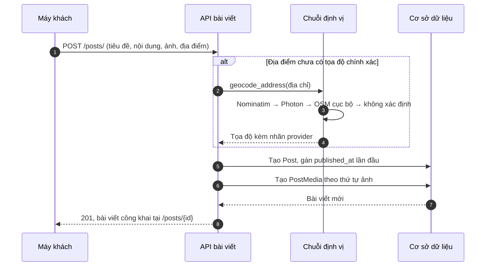

## 3.6 Luồng UC-07 — Nộp gói đóng góp ảnh

**Hình 3.6 — Luồng UC-07: Nộp 1–5 ảnh với khóa bất biến**

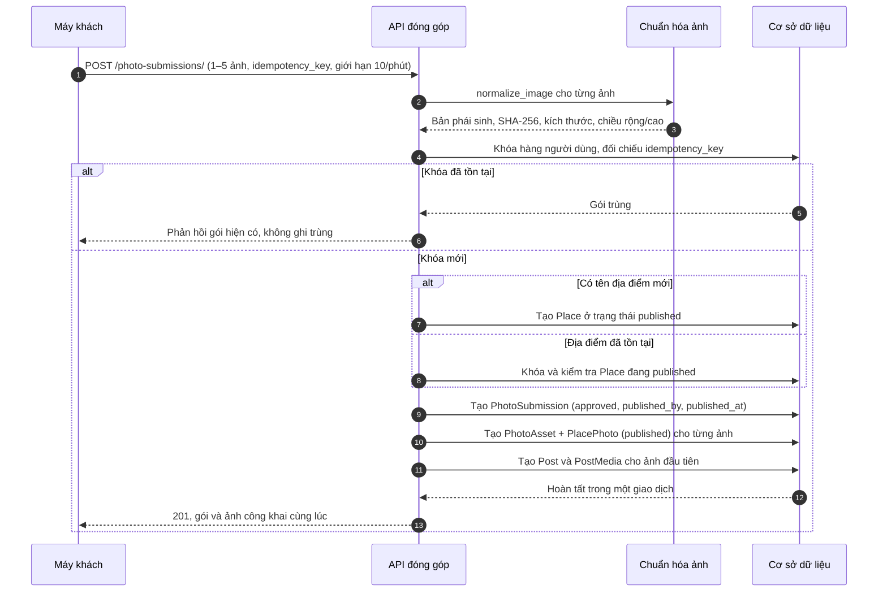

**Bảng 3.1 — Tham số luồng UC-07**

| Tham số | Giá trị | Ràng buộc |
|---|---|---|
| Số ảnh | 1–5 | `photo_asset_max_five`, thứ tự 0–4 |
| Khóa bất biến | `idempotency_key` | `unique_photo_upload_key` theo người dùng |
| Siêu dữ liệu | Loại EXIF/GPS khi chuẩn hóa | `technical_metadata` |
| Kích thước tải lên | Bộ nhớ 55 MiB, tệp quá 1 MiB ghi đĩa | Thiết lập máy chủ |

## 3.7 Luồng UC-08 — Hậu kiểm nội dung

**Hình 3.7 — Luồng UC-08: Hậu kiểm ảnh đã công khai**

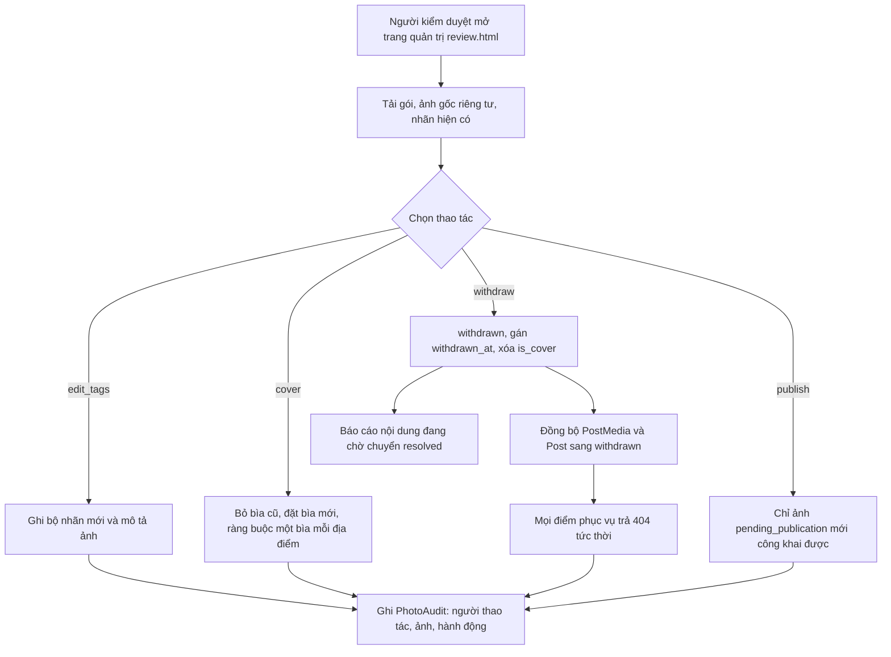

## 3.8 Luồng UC-09 — Rút ảnh và báo cáo nội dung

**Hình 3.8 — Luồng UC-09: Rút ảnh, ẩn tức thời, báo cáo**

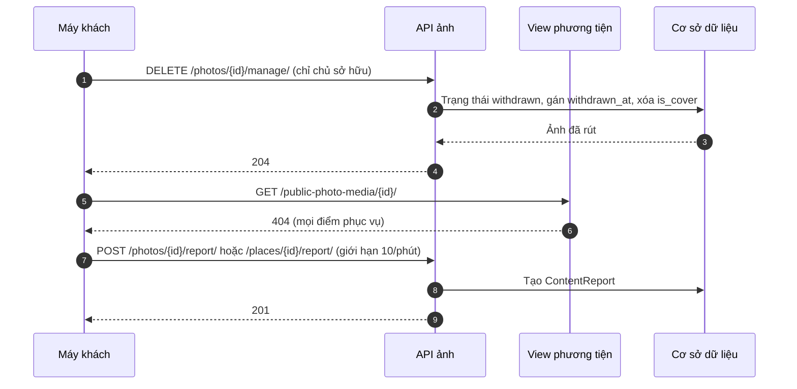

## 3.9 Luồng bổ trợ — Tương tác bài viết

**Hình 3.9 — Luồng bổ trợ: Thích, bình luận, chia sẻ, lượt xem**

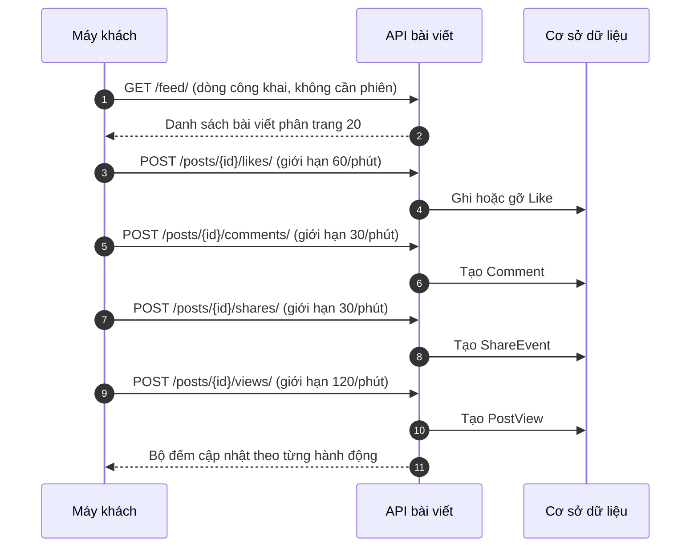

## 3.10 Luồng bổ trợ — Tương tác ảnh

**Hình 3.10 — Luồng bổ trợ: Thích ảnh, bình luận ảnh, ảnh tương tự, thuộc tính**

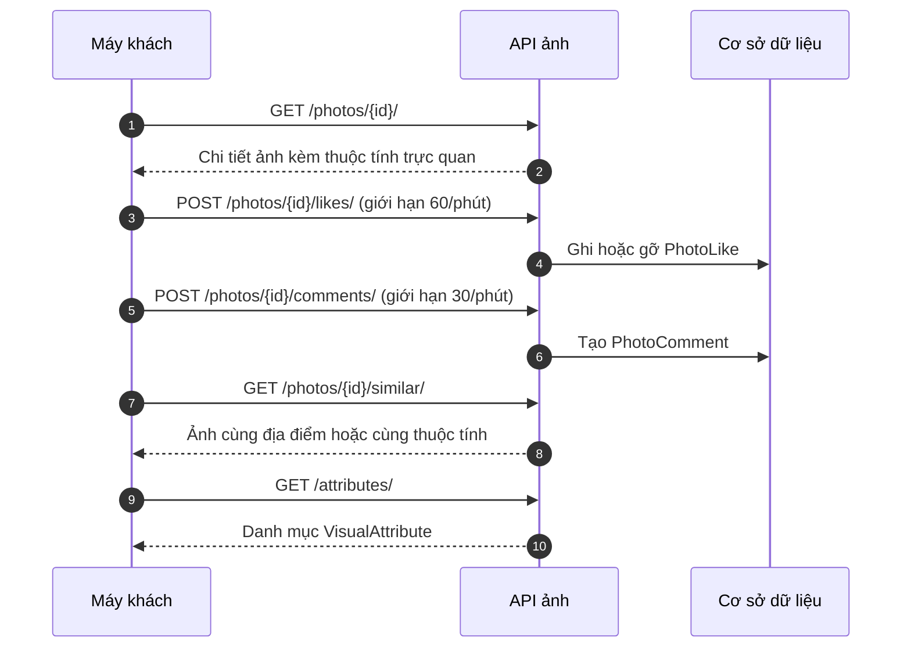

## 3.11 Luồng bổ trợ — Lưu và yêu thích

**Hình 3.11 — Luồng bổ trợ: Lưu địa điểm, lưu bài viết, danh mục yêu thích**

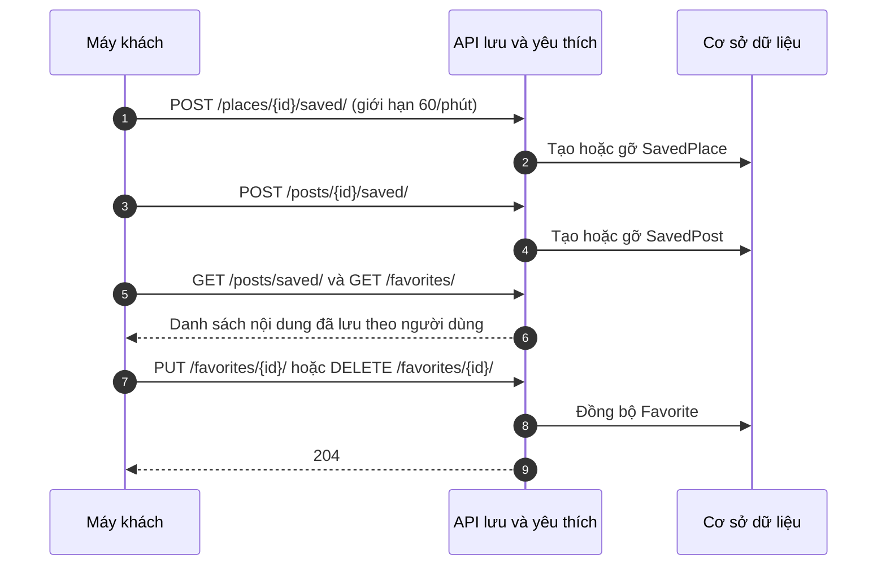

## 3.12 Luồng bổ trợ — Định vị địa chỉ đa nguồn

**Hình 3.12 — Luồng bổ trợ: Chuỗi dự phòng ba bước định vị địa chỉ**

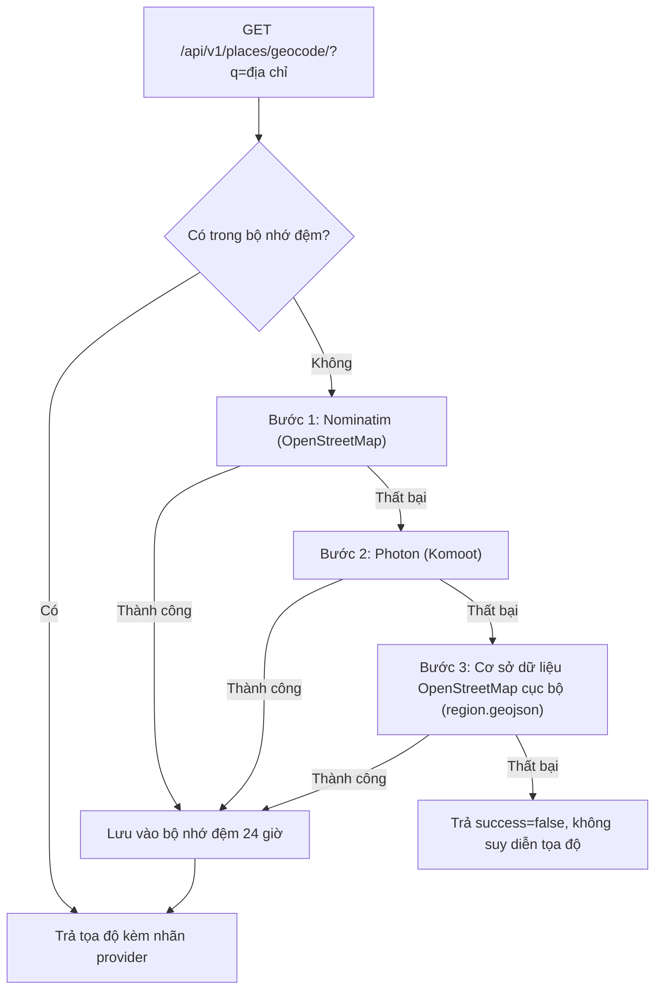

Khi không nguồn nào xác định được địa chỉ, hệ thống trả về thất bại thay vì gán một tọa độ mặc định. Nhờ vậy một địa điểm không định vị được sẽ không bị xuất bản với vị trí sai, và người tạo chủ động chọn lại điểm trên bản đồ. Biểu mẫu đóng góp phân biệt hai trạng thái này: thành công thì hiện địa chỉ đã chuẩn hóa kèm tên nguồn, thất bại thì báo rõ địa điểm sẽ được gửi mà không có ghim bản đồ.

## 3.13 Luồng bổ trợ — Phục vụ phương tiện có phân quyền

**Hình 3.13 — Luồng bổ trợ: Ba view phương tiện và kiểm tra quyền**

```mermaid
flowchart TD
    req["Yêu cầu tải ảnh"] --> which{"Điểm yêu cầu"}
    which -- "/public-photo-media/" --> pub{"Ảnh published?"}
    pub -- "Có" --> serve["Trả bản phái sinh công khai"]
    pub -- "Không" --> nf["404"]
    which -- "/public-post-media/" --> pm{"Ảnh bài viết công khai?"}
    pm -- "Có" --> serve
    pm -- "Không" --> nf
    which -- "/private-photo-media/" --> priv{"Người yêu cầu là chủ sở hữu?"}
    priv -- "Có" --> servep["Trả bản phái sinh riêng tư"]
    priv -- "Không" --> nf
    which -- "/private-photo-original/" --> orig{"Chủ sở hữu?"}
    orig -- "Có" --> servo["Trả bản gốc"]
    orig -- "Không" --> nf
```

## 3.14 Luồng bổ trợ — Hồ sơ người đóng góp và luồng khách

**Hình 3.14 — Luồng bổ trợ: Hồ sơ người đóng góp và chặn hành động của khách**

```mermaid
flowchart TD
    open["Mở /creators/{id}"] --> prof["GET /api/v1/creators/{id}/"]
    prof --> photos["GET /api/v1/creators/{id}/photos/"]
    photos --> grid["Lưới đóng góp của người đó"]
    guest["Khách chưa đăng nhập"] --> act["Thử hành động ghi (thích, bình luận, lưu)"]
    act --> api{"API kiểm tra phiên"}
    api -- "Không có phiên" --> denied["401 + cổng RequireLogin chuyển hướng /login"]
    api -- "Có phiên" --> ok["Thực hiện hành động"]
    unknown["Đường dẫn không tồn tại"] --> nf["Trang 404"]
```

**Bảng 3.2 — Tổng hợp luồng và cơ chế bảo vệ**

| Luồng | Điểm cuối chính | Giới hạn tần suất | Cơ chế bảo vệ |
|---|---|---|---|
| UC-02 Xác thực | `/auth/*` | 5–20/phút | Cookie `HttpOnly`, CSRF |
| UC-03 Khám phá | `/places/`, `/categories/` | — | Chỉ dữ liệu công khai |
| UC-04 Chi tiết địa điểm | `/places/{id}/*` | — | Lọc trạng thái công khai |
| UC-05 Bản đồ | `/places/map/` | — | Kiểu bản đồ cục bộ |
| UC-06 Tạo trải nghiệm | `/posts/` | — | Yêu cầu phiên |
| UC-07 Nộp gói ảnh | `/photo-submissions/` | 10/phút | Khóa bất biến, khóa hàng |
| UC-08 Hậu kiểm | quản trị Django | — | Quyền `photos.review_photosubmission` |
| UC-09 Rút và báo cáo | `/photos/{id}/manage/`, `/report/` | 10/phút cho báo cáo | Quyền sở hữu, 404 tức thời |
| Bổ trợ: tương tác bài viết | `/posts/{id}/*` | 30–120/phút | Yêu cầu phiên khi ghi |
| Bổ trợ: tương tác ảnh | `/photos/{id}/*` | 30–60/phút | Yêu cầu phiên |
| Bổ trợ: lưu và yêu thích | `/saved/`, `/favorites/` | 60/phút | Yêu cầu phiên |
| Bổ trợ: định vị | `/places/geocode/` | 30/phút | 3 nguồn dự phòng, bộ nhớ đệm 24 giờ |
| Bổ trợ: phương tiện | 3 view phương tiện | — | Phân quyền, trạng thái |
| Bổ trợ: hồ sơ và khách | `/creators/{id}/*` | — | Cổng `RequireLogin` |


---

# CHƯƠNG 4. THIẾT KẾ GIAO DIỆN NGƯỜI DÙNG

## 4.1 Bản đồ định tuyến

**Hình 4.1 — Cấu trúc định tuyến máy khách**

```mermaid
flowchart TD
    root["/"] -->|"chuyển hướng"| discover["/discover"]
    root --> login["/login"]
    root --> register["/register"]
    root --> shell["AppShell"]
    shell --> posts["/posts (công khai)"]
    shell --> postDetail["/posts/:id (công khai)"]
    shell --> terms["/terms (công khai)"]
    shell --> gate{"Cổng phiên RequireLogin"}
    gate --> discover
    gate --> search["/search"]
    gate --> map["/map (tải lười)"]
    gate --> place["/places/:id"]
    gate --> photo["/photos/:id"]
    gate --> creator["/creators/:id"]
    gate --> saved["/saved"]
    gate --> create["/create"]
    gate --> profile["/profile"]
    gate --> settings["/settings"]
    gate --> submissions["/submissions, /submissions/new, /submissions/:id"]
    gate --> nf["Trang 404"]
```

Cổng phiên `RequireLogin` chỉ chặn các mặt liên quan đến địa điểm. Dòng trải nghiệm và trang điều khoản sử dụng là công khai vì người đọc cần xem nội dung trước khi có tài khoản; trang bản đồ tải lười vì MapLibre là gói nặng nhất, người dùng chỉ tải khi thật sự mở bản đồ.

## 4.2 Thư viện thành phần nền tảng

**Bảng 4.1 — Thành phần nền tảng máy khách**

| Tệp | Thành phần | Vai trò |
|---|---|---|
| `button.tsx` | `Button` | Nút hành động chính |
| `primitives.tsx` | `IconButton`, `Field`, `Input`, `Textarea`, `Select`, `Chip`, `Badge`, `Avatar` | Biểu mẫu và nhãn |
| `states.tsx` | `LoadingState`, `ErrorState`, `EmptyState`, `AsyncState` | Trạng thái tải, lỗi, rỗng |
| `safe-image.tsx` | `SafeImage`, `ratioOf` | Ảnh an toàn, giữ tỷ lệ thật |
| `confirm-dialog.tsx` | `ConfirmDialog` | Xác nhận hành động |

## 4.3 Hệ thống token kiểu dáng

**Bảng 4.2 — Cấu trúc token kiểu dáng**

| Nhóm tệp | Tệp và số dòng | Tổng |
|---|---|---|
| Nền tảng | `tokens.css` 215, `typography.css` 179, `theme.css` 237, `reset.css` 107, `globals.css` 356 | 1 094 |
| Bố cục và khung | `layout.css` 357, `shell.css` 343, `styles.css` 44 | 744 |
| Thành phần dùng chung | `components.css` 3 056, `ui.css` 653 | 3 709 |
| Màn hình khám phá | `discover.css` 322, `search.css` 218, `map.css` 1 217, `place.css` 334, `cards.css` 334 | 2 425 |
| Màn hình nội dung | `experiences.css` 501, `create.css` 346, `profile.css` 223, `saved.css` 110, `auth.css` 186 | 1 366 |
| Trang điều khoản | `legal.css` 43 | 43 |

Tổng cộng 21 tệp CSS với 9 381 dòng. Máy khách có ba lựa chọn chủ đề: sáng, tối và theo hệ điều hành.

## 4.4 Khả năng tiếp cận

Chuẩn đối chiếu là WCAG 2.1 mức AA. Bảng 4.3 đối chiếu từng yêu cầu với cơ chế đáp ứng và cách kiểm chứng.

**Bảng 4.3 — Yêu cầu khả năng tiếp cận theo WCAG 2.1 AA**

| Tiêu chí | Yêu cầu | Cơ chế | Kiểm chứng |
|---|---|---|---|
| 1.1.1 | Ảnh có văn bản thay thế | `alt` lấy từ chú thích ảnh; ảnh trang trí để `alt=""`; biểu tượng gắn `aria-hidden` | `image_perf.test.tsx` |
| 1.4.3 | Độ tương phản văn bản tối thiểu 4,5:1 | Cặp màu chữ và nền trong token kiểu dáng | Kiểm tra thủ công trên hai chủ đề |
| 2.1.1 | Mọi chức năng dùng được bằng bàn phím | Thứ tự tab tự nhiên, không bẫy tiêu điểm | `accessibility.test.tsx` |
| 2.4.7 | Tiêu điểm bàn phím nhìn thấy rõ | Vành tiêu điểm dùng chung trong `globals.css` | `accessibility.test.tsx` |
| 2.5.8 | Vùng chạm tối thiểu 24 × 24 px | Nút biểu tượng đặt 44 px; liên kết trong câu văn được miễn trừ theo chuẩn | `globals.css`, kiểm thử thành phần |
| 4.1.2 | Tên, vai trò, trạng thái cho mọi thành phần | Nhãn ARIA trên điều khiển bản đồ, bộ lọc, hộp thoại | `accessibility.test.tsx` |

Văn bản thay thế cho ảnh do người dùng nhập hiện lấy từ chú thích; trường hợp chú thích trống thì ảnh không có mô tả riêng. Đây là điểm chưa đạt trọn vẹn tiêu chí 1.1.1 và được ghi ở Bảng 5.5.

## 4.5 Điều khoản sử dụng

Trang `/terms` là tài liệu công khai, nằm ngoài cổng phiên để người chưa có tài khoản vẫn đọc được trước khi đăng ký. Nội dung gồm mười một phần, nhóm lại thành năm nhóm nghĩa vụ:

| Nhóm | Phần | Nội dung |
|---|---|---|
| Định vị dịch vụ | 1 | Phạm vi nền tảng và nguồn gốc nội dung do cộng đồng đóng góp |
| Tài khoản và nội dung của bạn | 2, 3 | Trách nhiệm bảo mật tài khoản; quyền sở hữu nội dung; phạm vi cấp phép cho nền tảng; cơ chế hậu kiểm sau khi ảnh công khai |
| Giới hạn và hành vi | 4, 6 | Sáu nhóm nội dung không được đăng; năm nhóm hành vi bị cấm, gắn với giới hạn tần suất của hệ thống |
| Dữ liệu và nội dung của người khác | 5, 7, 8 | Loại siêu dữ liệu ảnh ở bản công khai; bản gốc chỉ phục vụ chủ sở hữu; quy trình báo cáo; thời hạn lưu bản sao lưu |
| Trách nhiệm và thay đổi | 9, 10, 11 | Giới hạn trách nhiệm về độ chính xác của thông tin cộng đồng; cách thông báo khi điều khoản thay đổi; kênh liên hệ |

Ba điểm vào đều liên kết tới tài liệu này: trang đăng ký, biểu mẫu đóng góp trong luồng trải nghiệm và biểu mẫu đóng góp trong luồng gói ảnh. Nhờ vậy nghĩa vụ được nêu đúng tại thời điểm người dùng chấp nhận. Mã phiên bản xác nhận (`photo-rights-v2`) và thời điểm xác nhận được lưu cùng mỗi gói đóng góp, cho phép đối chiếu về sau.

---

# CHƯƠNG 5. TRIỂN KHAI, KIỂM THỬ VÀ KẾT QUẢ

## 5.1 Kim tự tháp kiểm thử

**Hình 5.1 — Kim tự tháp kiểm thử**

```mermaid
flowchart TD
    e2e["Kiểm thử đầu-cuối — 29 bài (Playwright, 8 tệp đặc tả)"]
    visual["Kiểm thử trực quan — 4 bề rộng 360/390/768/1440"]
    fe["Kiểm thử máy khách — 61 bài (Vitest, 10 tệp)"]
    be["Kiểm thử máy chủ — 222 bài (pytest, 199 hàm)"]
    e2e --> visual
    e2e --> fe
    fe --> be
```

## 5.2 Kết quả đo lường

**Bảng 5.1 — Kết quả kiểm thử ngày 2026-11-01**

| Bộ kiểm thử | Số bài | Kết quả | Thời lượng |
|---|---|---|---|
| Máy chủ (pytest) | 222 | 222 đạt, 0 thất bại | 91,28 giây |
| Máy khách (Vitest) | 61 | 61 đạt, 0 thất bại | 1,66 giây |
| Đầu-cuối (Playwright) | 29 | 29 đạt, 0 thất bại | 1 phút 18 giây |
| Dựng gói máy khách | — | Thành công | 3,73 giây |

## 5.3 Quy trình kiểm thử tự động

**Bảng 5.2 — Quy trình kiểm thử 9 bước**

| Bước | Nội dung |
|---|---|
| 1 | Kiểm tra cú pháp và quy tắc mã Python |
| 2 | Kiểm tra định dạng Python |
| 3 | Kiểm tra tính nhất quán của các tệp di trú cơ sở dữ liệu |
| 4 | Chạy bộ kiểm thử máy chủ |
| 5 | Kiểm tra cú pháp và quy tắc mã TypeScript |
| 6 | Kiểm tra định dạng máy khách |
| 7 | Chạy bộ kiểm thử máy khách |
| 8 | Dựng gói máy khách |
| 9 | Chạy bộ kiểm thử đầu-cuối |

## 5.4 Dữ liệu và nội dung

**Bảng 5.3 — Dữ liệu hạt giống `data/danang.json`**

| Hạng mục | Giá trị |
|---|---|
| Phân loại | 6: `study` (Học bài & Deadline), `night` (Mở 24/7 & Cày đêm), `vintage` (Mộc & Hoài niệm), `garden` (Sân vườn & Chill), `checkin` (Sống ảo & Trẻ trung), `classic` (Cà phê Cóc & Vỉa hè) |
| Địa điểm | 12, mỗi địa điểm có định danh, tên, phân loại, địa chỉ, tọa độ, mô tả, giờ mở cửa |
| Ảnh | 36, mỗi ảnh có tệp, chú thích, nhãn |
| Nguồn ảnh | Ảnh minh hoạ sinh bằng `scripts/generate_coffee_photos.py` ở kích thước 1600 × 1067, dùng thay cho ảnh thực địa trong giai đoạn dựng giao diện |
| Nguồn bản đồ | OpenStreetMap khu vực Đà Nẵng, trích xuất qua `scripts/download_map.py` |

Quy trình nạp dữ liệu gồm năm kịch bản: tải ô bản đồ (`download_map.py`), tải bộ ký tự (`download_glyphs.py`), nạp địa điểm và ảnh (`prepare_content.py`), sinh ảnh minh họa phân loại cà phê (`generate_coffee_photos.py`) và tạo tài khoản kiểm duyệt (`create-admin.py`).

## 5.5 Tổng hợp kết quả

**Bảng 5.4 — Tổng hợp kết quả đồ án**

| Nhóm kết quả | Chỉ số | Giá trị |
|---|---|---|
| Chức năng | Tính năng vận hành đầy đủ | 11 nhóm vấn đề thực tế được phản hồi bằng thiết kế (Bảng 1.1) |
| Kiến trúc | Ứng dụng máy chủ | 5 |
| Kiến trúc | Mô hình dữ liệu | 23 |
| Kiến trúc | Điểm cuối API | 38 |
| Kiến trúc | Ca sử dụng / luồng đặc tả | 9 ca sử dụng, 14 luồng |
| Chất lượng | Bài kiểm thử đạt | 311/311 |
| Chất lượng | Ràng buộc dữ liệu ở cơ sở dữ liệu | 34, trong đó 12 bảo vệ nhóm đóng góp ảnh (Bảng 2.3) |
| Chất lượng | Giới hạn tần suất | 11 phạm vi nghiệp vụ |
| Hiệu năng | Dựng gói máy khách | 3,73 giây |
| Hiệu năng | Bộ kiểm thử máy chủ | 91,28 giây |

## 5.6 Hạn chế và hướng phát triển

**Bảng 5.5 — Hạn chế và hướng phát triển**

| Hạn chế | Ảnh hưởng | Hướng phát triển |
|---|---|---|
| Phạm vi dữ liệu hạt giống còn nhỏ (12 địa điểm) | Trải nghiệm khám phá hạn chế | Mở rộng dữ liệu theo từng phân loại |
| Triển khai cục bộ | Chưa phục vụ nhiều người dùng đồng thời | Chuyển môi trường công khai khi đồ án mở rộng |
| Tìm kiếm dùng phép so khớp chuỗi, chưa có chỉ mục văn bản | Chậm dần khi số địa điểm tăng lên hàng nghìn | Thêm chỉ mục GIN hoặc tìm kiếm toàn văn của PostgreSQL |
| Định vị địa chỉ phụ thuộc dịch vụ ngoài, có bộ nhớ đệm 24 giờ | Địa chỉ mới chưa từng tra cứu cần mạng | Tự vận hành máy chủ định vị khi triển khai công khai |
| Chưa đo thời gian phản hồi API và điểm hiệu năng trang | Chưa có số liệu định lượng cho tuyên bố về tốc độ | Đo p95 của các điểm cuối chính và điểm Lighthouse |
| Văn bản thay thế cho ảnh do người dùng nhập, chưa bắt buộc | Ảnh thiếu mô tả gây khó cho trình đọc màn hình | Bắt buộc mô tả ảnh khi nộp hoặc sinh từ chú thích |

---

# KẾT LUẬN

Đồ án đã xây dựng được nền tảng khám phá địa điểm theo hình ảnh thực tế, hoàn chỉnh từ thiết kế đến triển khai và kiểm thử. Người dùng có thể khám phá địa điểm qua trang khám phá, dòng trải nghiệm và bản đồ tương tác; đóng góp ảnh thực tế cho địa điểm qua gói đóng góp có hậu kiểm; và tương tác với nội dung qua thích, bình luận, lưu và chia sẻ.

Hệ thống được đặc tả đầy đủ bằng bộ sơ đồ thiết kế: sơ đồ ca sử dụng cho ba vai trò người dùng, sơ đồ quan hệ thực thể và sơ đồ lớp cho dữ liệu, sơ đồ trình tự cho tám luồng và sơ đồ dòng chảy cho sáu luồng còn lại, hai sơ đồ chuyển trạng thái cho vòng đời gói đóng góp và ảnh công khai. Chất lượng được kiểm chứng bằng 311 bài kiểm thử tự động ở ba tầng, tất cả đạt.

Ở giai đoạn tiếp theo, hướng phát triển tập trung vào mở rộng dữ liệu hạt giống theo từng phân loại và chuyển môi trường triển khai công khai để phục vụ nhiều người dùng đồng thời.

---

# TÀI LIỆU THAM KHẢO

[1] Django Software Foundation. *Django documentation (version 5.2)*. https://docs.djangoproject.com/en/5.2/
[2] Django REST Framework. *Django REST Framework documentation*. https://www.django-rest-framework.org/
[3] OpenAPI Initiative. *OpenAPI Specification 3.1*. https://spec.openapis.org/oas/v3.1.0
[4] Mermaid. *Mermaid Diagramming and Charting Documentation*. https://mermaid.js.org/intro/
[5] GitHub. *GitHub Flavored Markdown Spec*. https://github.github.com/gfm/
[6] PostGIS. *PostGIS Documentation*. https://postgis.net/documentation/
[7] MapLibre. *MapLibre GL JS Documentation*. https://maplibre.org/maplibre-gl-js/docs/
[8] OWASP Foundation. *OWASP Top 10:2021*. https://owasp.org/Top10/
[9] W3C. *Web Content Accessibility Guidelines (WCAG) 2.1*. https://www.w3.org/TR/WCAG21/
[10] Object Management Group. *UML Specification v2.5.1*. https://www.omg.org/spec/UML/2.5.1
[11] PRODUCT.md — Tài liệu sản phẩm dự án Rendez, kho mã nguồn `rendez-web`.
[12] GLOSSARY.md — Ngôn ngữ miền dự án Rendez, kho mã nguồn `rendez-web`.

# PHỤ LỤC A — DANH MỤC THUẬT NGỮ ANH–VIỆT

| Thuật ngữ | Nghĩa tiếng Việt |
|---|---|
| Bind mount | Thư mục gắn kết trực tiếp |
| Check constraint | Ràng buộc kiểm tra |
| Cover photo | Ảnh bìa |
| Endpoint | Điểm cuối |
| Fallback | Dự phòng |
| Feature module | Mô-đun tính năng |
| Idempotency key | Khóa bất biến (chống ghi trùng) |
| Lazy load | Tải lười |
| Migration | Di trú cơ sở dữ liệu |
| ORM (Object–Relational Mapping) | Ánh xạ đối tượng–quan hệ |
| Provider | Nhà cung cấp |
| Query key | Khóa truy vấn |
| Rate limit | Giới hạn tần suất |
| Seed data | Dữ liệu hạt giống |
| Selector | Bộ chọn truy vấn dữ liệu |
| Session | Phiên làm việc |
| State machine | Máy trạng thái |
| Throttle scope | Phạm vi giới hạn tần suất |
| Token (design token) | Token kiểu dáng |
| Unique constraint | Ràng buộc duy nhất |
| Visual-first | Hình ảnh trước |

---

**Hết báo cáo.** Phiên bản 3.1, ngày 2026-11-01.
