# BÁO CÁO ĐỒ ÁN PBL6 — DỰ ÁN CHUYÊN NGÀNH 1

---

## THÔNG TIN CHUNG VỀ ĐỒ ÁN

* **Đơn vị đào tạo:** Trường Đại học Bách khoa — Đại học Đà Nẵng
* **Khoa:** Khoa Công nghệ Thông tin `[CẦN BỔ SUNG: Chuyên ngành cụ thể (Kỹ thuật Phần mềm / Hệ thống Thông tin / Khoa học Máy tính)]`
* **Học phần:** PBL6 — Dự án chuyên ngành 1
* **Mã học phần:** `[CẦN BỔ SUNG: Mã học phần theo khung chương trình đào tạo]`
* **Tên đề tài:** Nghiên cứu và xây dựng nền tảng khám phá không gian học tập và làm việc qua hình ảnh thực tế và bản đồ số tại khu vực Đại học Bách khoa Đà Nẵng (Hệ thống Rendez)
* **Tên tiếng Anh:** Research and Development of a Visual-First Local Discovery Platform for Study and Workspaces around Danang University of Science and Technology (Rendez System)
* **Giảng viên hướng dẫn:** `[CẦN BỔ SUNG: Học hàm, học vị, họ và tên giảng viên hướng dẫn]`
* **Sinh viên thực hiện:**
  1. `[CẦN BỔ SUNG: Họ và tên sinh viên 1]` — MSSV: `[CẦN BỔ SUNG]` — Lớp: `[CẦN BỔ SUNG]`
  2. `[CẦN BỔ SUNG: Họ và tên sinh viên 2 (nếu có làm nhóm)]` — MSSV: `[CẦN BỔ SUNG]` — Lớp: `[CẦN BỔ SUNG]`
* **Năm học / Học kỳ:** Học kỳ 1, Năm học 2026–2027 `[CẦN BỔ SUNG: Thời điểm bảo vệ chính thức]`

---

## TÓM TẮT ĐỒ ÁN (ABSTRACT)

### Tóm tắt tiếng Việt
Đồ án tập trung giải quyết bài toán tìm kiếm và lựa chọn không gian học tập, làm việc nhóm và sinh hoạt cá nhân của sinh viên xung quanh khuôn viên Trường Đại học Bách khoa — Đại học Đà Nẵng. Trên thực tế, các nền tảng bản đồ và đánh giá ẩm thực phổ biến hiện nay thường phân tán thông tin, phụ thuộc vào hình ảnh quảng cáo có độ chỉnh sửa cao hoặc thiếu các tiêu chí đặc thù phục vụ nhu cầu học tập như số lượng ổ cắm điện, ánh sáng tự nhiên, độ yên tĩnh và thời gian mở cửa ban đêm.

Để giải quyết vấn đề trên, đồ án đề xuất và hiện thực hóa hệ thống **Rendez** — một nền tảng web hướng dữ liệu thực tế (Visual-First và Local-First). Hệ thống kết hợp lưới hiển thị ảnh giữ nguyên tỷ lệ khung hình tự nhiên, bản đồ vector tương tác MapLibre GL tích hợp dữ liệu OpenStreetMap khu vực quận Liên Chiểu, cùng động cơ định vị địa chỉ thời gian thực đa nguồn. Về mặt kiến trúc, hệ thống được xây dựng theo mô hình Monolith phân tầng (Clean Architecture) trên nền tảng Django 5.2, Django REST Framework và React 19 / TypeScript, kiểm soát dữ liệu cục bộ trong cơ sở dữ liệu PostgreSQL 17 và hệ thống tệp tin riêng tư. Toàn bộ quy trình nạp dữ liệu thực địa 12 địa điểm và 36 ảnh tư liệu, xử lý loại bỏ siêu dữ liệu EXIF/GPS của ảnh, kiểm soát quyền truy cập đối tượng (chống IDOR/BOLA) và bảo vệ giao dịch ghi đồng thời bằng khóa hàng đợi và mã băm Idempotency-Key đã được kiểm thử toàn diện thông qua 173 bài kiểm thử tự động backend và 56 bài kiểm thử frontend, đạt tỷ lệ vượt qua 100%.

### English Abstract
This project addresses the challenge faced by university students in locating and selecting suitable study, collaborative, and personal workspaces around the campus of Danang University of Science and Technology (DUT). Conventional mapping and food review platforms frequently disperse information, rely heavily on promotional photography with unrealistic alterations, and lack domain-specific filtering criteria essential for academic tasks, such as power outlet accessibility, natural illumination, acoustic quietness, and 24/7 operating hours during examination periods.

To address these limitations, the project designs and implements **Rendez**, a visual-first and local-first web discovery platform. The system integrates an aspect-ratio-preserving masonry feed, an interactive MapLibre GL vector map utilizing localized OpenStreetMap extracts for Lien Chieu District, and a real-time multi-provider geocoding engine. Architecturally, the platform employs a layered Clean Architecture pattern utilizing Django 5.2, Django REST Framework, and React 19 with TypeScript, maintaining complete data sovereignty within a local PostgreSQL 17 database and a private media storage structure. The platform processes a curated dataset comprising 12 study venues and 36 field photographs, enforces automated EXIF/GPS metadata stripping, mitigates Broken Object Level Authorization (IDOR/BOLA) via strict owner filtering, and prevents duplicate write operations through database row locking and Idempotency-Key digest verification. The implementation is verified through a rigorous automated test suite containing 173 backend tests and 56 frontend tests, achieving a 100% pass rate.

---

## MỤC LỤC DỰ KIẾN (TABLE OF CONTENTS)

* **DANH MỤC CÁC KÝ HIỆU VÀ TỪ VIẾT TẮT**
* **DANH MỤC CÁC BẢNG BIỂU**
* **DANH MỤC CÁC HÌNH VẼ VÀ BIỂU ĐỒ**
* **MỞ ĐẦU**
* **CHƯƠNG 1: TỔNG QUAN ĐỀ TÀI VÀ KHẢO SÁT BÀI TOÁN**
  * 1.1. Bối cảnh thực tế và lý do chọn đề tài
  * 1.2. Khảo sát các giải pháp công nghệ hiện hữu
    * 1.2.1. Nền tảng bản đồ thương mại tổng hợp (Google Maps, Apple Maps)
    * 1.2.2. Nền tảng đánh giá ẩm thực và mạng xã hội (Foody, ShopeeFood, TikTok, Threads)
    * 1.2.3. Hạn chế về tính chân thực của dữ liệu hình ảnh và khả năng phân loại
  * 1.3. Mục tiêu, đối tượng sử dụng và phạm vi nghiên cứu của đồ án
    * 1.3.1. Mục tiêu kỹ thuật và sản phẩm
    * 1.3.2. Đối tượng thụ hưởng (Sinh viên, Nhiếp ảnh gia thực địa, Chủ cơ sở)
    * 1.3.3. Phạm vi dữ liệu thực địa quanh Đại học Bách khoa Đà Nẵng
  * 1.4. Phương pháp luận nghiên cứu và cấu trúc đồ án
* **CHƯƠNG 2: PHÂN TÍCH YÊU CẦU HỆ THỐNG**
  * 2.1. Xác định các tác nhân hệ thống (System Actors)
  * 2.2. Yêu cầu chức năng (Functional Requirements)
  * 2.3. Quy tắc nghiệp vụ (Business Rules)
  * 2.4. Yêu cầu phi chức năng (Non-Functional Requirements)
  * 2.5. Mô hình hóa ca sử dụng (Use Case Analysis)
* **CHƯƠNG 3: CƠ SỞ LÝ THUYẾT VÀ CÔNG NGHỆ NỀN TẢNG**
  * 3.1. Các khái niệm kỹ thuật cốt lõi
    * 3.1.1. Mô hình khám phá thị giác và Bố cục lưới Masonry
    * 3.1.2. Dữ liệu địa lý GeoJSON và Giao thức gạch bản đồ (Map Tiles)
    * 3.1.3. Định vị địa chỉ (Geocoding) và Thuật toán khoảng cách Haversine
    * 3.1.4. Kiến trúc phân tầng Clean Architecture và Mẫu thiết kế Selectors/Services
    * 3.1.5. Tính bất biến (Idempotency) và Khóa hàng đợi cấp cơ sở dữ liệu
    * 3.1.6. Ranh giới tin cậy và Kiểm soát quyền truy cập cấp đối tượng (BOLA/IDOR)
  * 3.2. Ngăn xếp công nghệ sử dụng trong dự án
    * 3.2.1. Công nghệ máy chủ: Python 3.14, Django 5.2, Django REST Framework và Gunicorn
    * 3.2.2. Công nghệ giao diện: React 19, TypeScript, Vite và Tailwind CSS
    * 3.2.3. Công nghệ bản đồ số: MapLibre GL JS, React Map GL và OpenStreetMap
    * 3.2.4. Công nghệ cơ sở dữ liệu: PostgreSQL 17 và Thư viện Pillow
  * 3.3. Đánh giá và so sánh giải pháp kỹ thuật (Trade-off Analysis)
    * 3.3.1. Clean Monolith và Microservices
    * 3.3.2. Cơ chế xác thực Session/Cookie và JSON Web Token (JWT)
    * 3.3.3. Bản đồ số vector mã nguồn mở MapLibre và Google Maps API
* **CHƯƠNG 4: THIẾT KẾ HỆ THỐNG VÀ GIAO DIỆN NGƯỜI DÙNG**
  * 4.1. Thiết kế kiến trúc tổng thể (System Architecture)
  * 4.2. Phân rã thành phần và Trách nhiệm module
  * 4.3. Luồng dữ liệu và Luồng xử lý trong những chức năng quan trọng
  * 4.4. Thiết kế cơ sở dữ liệu quan hệ và Quản lý dữ liệu
  * 4.5. Thiết kế giao diện lập trình ứng dụng (RESTful API Design)
  * 4.6. Phân tích các quyết định thiết kế, đánh đổi và phụ thuộc bên ngoài
  * 4.7. Thiết kế giao diện người dùng và Luồng tương tác (UI & Interaction Flows)
* **CHƯƠNG 5: HIỆN THỰC HÓA HỆ THỐNG (IMPLEMENTATION)**
  * 5.1. Môi trường phát triển và cấu hình hệ thống
  * 5.2. Hiện thực hóa các dịch vụ lõi Backend
  * 5.3. Hiện thực hóa giao diện máy khách Frontend
  * 5.4. Hiện thực hóa quy trình sao lưu, phục hồi và tự động hóa vận hành
* **CHƯƠNG 6: KIỂM THỬ VÀ ĐÁNH GIÁ CHẤT LƯỢNG**
  * 6.1. Chiến lược và kế hoạch kiểm thử phần mềm
  * 6.2. Kết quả kiểm thử tự động Backend (Pytest)
  * 6.3. Kết quả kiểm thử tự động Frontend (Vitest & Testing Library)
  * 6.4. Đánh giá an toàn thông tin và kiểm toán mã nguồn (Static Security Audit)
  * 6.5. Đánh giá mức độ hoàn thành so với yêu cầu đặt ra ban đầu
* **CHƯƠNG 7: TRIỂN KHAI, VẬN HÀNH VÀ HƯỚNG PHÁT TRIỂN**
  * 7.1. Quy trình cài đặt, cấu hình và khởi chạy hệ thống
  * 7.2. Phân tích an toàn thông tin và Kiểm soát rủi ro thực tế
  * 7.3. Giới hạn hiện tại và Đánh giá mức độ hoàn thành
  * 7.4. Đề xuất hướng phát triển và mở rộng trong tương lai
  * 7.5. Kết luận chung của đồ án
* **TÀI LIỆU THAM KHẢO**
* **PHỤ LỤC**
  * Phụ lục A: Danh mục 29 API Endpoints hệ thống Rendez (Trích xuất từ OpenAPI 3.0)
  * Phụ lục B: Danh mục dữ liệu thực địa 12 cơ sở cà phê khu vực Đại học Bách khoa Đà Nẵng
  * Phụ lục C: Mẫu tệp cấu hình biến môi trường (`.env.example`) và hướng dẫn khởi chạy cục bộ

---

# MỞ ĐẦU

### 1. Bối cảnh thực tế dẫn đến nhu cầu xây dựng ứng dụng
Tại các đô thị đại học lớn như khu vực quận Liên Chiểu, thành phố Đà Nẵng — nơi tập trung Trường Đại học Bách khoa (Đại học Đà Nẵng) cùng các trường đại học lân cận, sinh viên có nhu cầu rất lớn về không gian tự học, làm bài tập nhóm, triển khai đồ án kỹ thuật và ôn thi cuối kỳ. Khu vực xung quanh khuôn viên nhà trường (đặc biệt dọc các trục đường sinh viên trọng điểm như Phạm Như Xương, Ngô Sỹ Liên, Ngô Thì Nhậm, Nam Cao, Nguyễn Lương Bằng) sở hữu mật độ cơ sở kinh doanh dịch vụ đồ uống và cà phê dày đặc. Tuy nhiên, việc tìm kiếm một địa điểm đáp ứng đúng nhu cầu ngồi học tập và làm việc kỹ thuật thường gặp nhiều trở ngại trong thực tế.

Phần lớn các nền tảng số hiện hành tập trung vào việc đánh giá đồ uống hoặc dịch vụ tổng quát mà thiếu đi các thông tin đặc thù cần thiết cho sinh viên: không gian có đủ yên tĩnh hay không, ánh sáng tự nhiên có đáp ứng việc đọc sách, số lượng ổ cắm điện tại các bàn học có đủ cho máy tính xách tay, quán có mở cửa xuyên đêm (24/7) trong các tuần thi cử hay không. Mặt khác, các hình ảnh quảng cáo trên mạng xã hội thường bị can thiệp kỹ thuật số quá đà, sử dụng ống kính góc rộng tạo cảm giác không gian ảo, khiến người học mất nhiều thời gian di chuyển đến tận nơi nhưng phải ra về do không gian thực tế không phù hợp.

### 2. Vấn đề cụ thể mà ứng dụng xử lý và nhóm người dùng gặp vấn đề đó
Hệ thống giải quyết ba vấn đề kỹ thuật và thực tiễn cốt lõi:
1. **Sự sai lệch giữa hình ảnh quảng cáo và không gian thực tế:** Người học cần quan sát không gian qua ảnh chụp thực địa trung thực, giữ nguyên tỷ lệ khung hình tự nhiên thay vì những bức ảnh quảng cáo bị cắt cúp hoặc chỉnh sửa màu sắc quá mức.
2. **Sự thiếu hụt bộ lọc chuyên sâu về đặc tính không gian học tập:** Các hệ thống bản đồ phổ biến như Google Maps phân loại địa điểm theo ngành nghề kinh doanh chung, không hỗ trợ lọc nhanh các thuộc tính thị giác và tiện ích học tập (như: bàn dài chạy deadline, khu vực mở ban đêm, không gian mộc mạc, khu vực nhiều cây xanh).
3. **Mối lo ngại về quyền riêng tư và bản quyền dữ liệu cục bộ:** Khi người dùng đóng góp ảnh thực địa, các tệp ảnh chụp từ điện thoại thông minh thường lưu trữ siêu dữ liệu EXIF nhạy cảm (bao gồm tọa độ GPS nhà riêng hoặc thiết bị chụp). Hệ thống cần một cơ chế tự động làm sạch siêu dữ liệu và kiểm soát dữ liệu độc lập tại địa phương (Local-First).

Nhóm người dùng chịu ảnh hưởng trực tiếp gồm:
- **Sinh viên và người làm việc tự do:** Cần công cụ trực quan để tìm kiếm chính xác không gian phù hợp với nhu cầu học tập và làm việc trong bán kính di chuyển ngắn quanh trường học.
- **Cộng đồng người đóng góp ảnh thực địa (Nhiếp ảnh gia địa phương):** Cần nền tảng tôn trọng bản quyền ảnh, hiển thị đúng thông tin tác giả và giấy phép chia sẻ, đồng thời bảo vệ danh tính và thông tin cá nhân.
- **Người quản trị nội dung:** Cần công cụ giám sát, kiểm duyệt các báo cáo vi phạm nội dung và duy trì tính chân thực của dữ liệu địa phương.

### 3. Mục tiêu tổng quát và các mục tiêu cụ thể có thể kiểm chứng
* **Mục tiêu tổng quát:** Thiết kế và xây dựng nền tảng web Rendez — giải pháp khám phá không gian học tập và làm việc tại địa phương dựa trên hình ảnh thực tế (Visual-First) và kiến trúc dữ liệu tự chủ (Local-First), vận hành ổn định trên cơ sở dữ liệu quan hệ PostgreSQL và môi trường máy chủ độc lập không phát sinh chi phí bắt buộc.
* **Các mục tiêu cụ thể có thể kiểm chứng:**
  1. *Về giao diện người dùng:* Hiện thực hóa bố cục lưới ảnh dạng Masonry giữ nguyên tỷ lệ khung hình tự nhiên (`aspect-ratio`), kiểm soát chỉ số dịch chuyển bố cục tích lũy (Cumulative Layout Shift - CLS) ở mức tối thiểu khi tải trang.
  2. *Về bản đồ và định vị:* Tích hợp bản đồ số tương tác MapLibre GL với dữ liệu OpenStreetMap khu vực quận Liên Chiểu và phông chữ nhãn lưu trữ cục bộ; đồng bộ hai chiều mượt mà giữa khung nhìn bản đồ (Bounding Box) và danh sách địa điểm.
  3. *Về động cơ địa lý:* Tích hợp động cơ tìm kiếm địa chỉ thời gian thực đa nguồn (Photon, Nominatim, Esri) kết hợp thuật toán tính khoảng cách và đối chiếu dữ liệu đường bộ địa phương (`region.geojson`).
  4. *Về kiến trúc và bảo mật:* Hiện thực hóa kiến trúc Clean Monolith trên nền tảng Django 5.2 và Django REST Framework; bảo vệ 100% các ranh giới tin cậy (chống IDOR/BOLA, làm sạch EXIF, bảo vệ CSRF, Rate Limiting và chống gửi trùng lặp bằng Idempotency-Key).
  5. *Về chất lượng phần mềm:* Đạt tỷ lệ vượt qua 100% trên toàn bộ bộ kiểm thử tự động nội bộ gồm 173 bài kiểm thử backend (Pytest) và 56 bài kiểm thử frontend (Vitest).

### 4. Phạm vi chức năng và những nội dung nằm ngoài phạm vi đồ án
* **Nội dung trong phạm vi đồ án:**
  - Phát triển ứng dụng Single Page Application (SPA) trên nền React 19, TypeScript và Tailwind CSS, tích hợp máy chủ API Django 5.2.
  - Phân hệ xác thực phiên làm việc, quản lý hồ sơ cá nhân, đổi mật khẩu và quy trình vô danh hóa tài khoản (Right to be Forgotten).
  - Phân hệ khám phá ảnh với cơ chế phân trang vô hạn (Infinite Scroll) và bộ lọc 6 nhóm thuộc tính không gian thực tế.
  - Phân hệ bản đồ số tương tác, hiển thị điểm ghim, popup thông tin và định vị GPS người dùng.
  - Phân hệ đóng góp ảnh thực địa đa bước, tự động hóa quy trình nén ảnh, loại bỏ EXIF và lưu trữ tệp an toàn.
  - Phân hệ tương tác xã hội (thích ảnh, bình luận, lưu quán yêu thích) và báo cáo vi phạm nội dung.
  - Khảo sát và chuẩn hóa tập dữ liệu mẫu gồm 12 địa điểm cà phê và 36 ảnh tư liệu thực tế xung quanh khuôn viên Đại học Bách khoa Đà Nẵng.
* **Nội dung nằm ngoài phạm vi đồ án:**
  - Không tự xây dựng thuật toán tính toán lộ trình dẫn đường từng ngã rẽ (turn-by-turn navigation); hệ thống chuyển tiếp tọa độ chính xác sang ứng dụng Google Maps chuyên dụng.
  - Không triển khai cổng thanh toán trực tuyến hoặc tính năng đặt món thương mại điện tử F&B.
  - Không cam kết hoạt động ngoại tuyến 100% đối với lớp ảnh nền bản đồ (raster basemap), do lớp nền bản đồ đường phố vẫn cần kết nối máy chủ Esri công khai khi thiết bị chưa có bộ đệm hoặc tile server nội bộ.
  - Không phát triển ứng dụng di động bản địa (Native Mobile App) trên iOS/Android, chỉ tập trung tối ưu hóa giao diện web đáp ứng (Responsive Web).

### 5. Đối tượng sử dụng, phương pháp thực hiện và cách tiếp cận
* **Đối tượng sử dụng:** Sinh viên các trường đại học tại Đà Nẵng; người dùng có nhu cầu tìm kiếm không gian làm việc; cộng đồng người đóng góp ảnh địa phương; quản trị viên hệ thống.
* **Phương pháp thực hiện:** Áp dụng mô hình phát triển phần mềm lặp (Iterative Software Development) kết hợp nguyên tắc kiểm thử phòng thủ (Defensive Testing). Quá trình lập trình được đồng hành bởi bộ kiểm thử tự động bao phủ từ cấp độ đơn vị đến cấp độ tích hợp toàn hệ thống.
* **Cách tiếp cận giải quyết bài toán:**
  - *Tiếp cận Visual-First:* Lấy trải nghiệm thị giác làm trung tâm; thông tin không gian được truyền tải trực tiếp qua bố cục ảnh thực tế thay vì những đoạn văn bản mô tả dài dòng.
  - *Tiếp cận Clean Architecture:* Phân tách rõ ràng giữa tầng hiển thị/điều hướng (Views), tầng truy vấn tối ưu dữ liệu (Selectors) và tầng thực thi nghiệp vụ/giao dịch (Services).
  - *Tiếp cận Local-First & Zero-Cost:* Tối ưu hóa việc sử dụng các công nghệ mã nguồn mở (PostgreSQL, Gunicorn, MapLibre GL, OpenStreetMap) cho phép triển khai và tự vận hành hoàn chỉnh trên hạ tầng cục bộ mà không bắt buộc chi phí dịch vụ thương mại hay đám mây độc quyền.

### 6. Kết quả dự kiến và kết quả thực tế đã đạt được
* **Kết quả thực tế đã đạt được (được xác minh trong repository):**
  - Hiện thực hóa đầy đủ 29 API endpoints theo chuẩn OpenAPI 3.0 với tài liệu Swagger UI tự động.
  - Giao diện người dùng hoàn thiện với App Shell, hệ thống Navigation tương thích máy tính và thiết bị di động, lưới ảnh Masonry ổn định.
  - Bản đồ số MapLibre GL tích hợp mượt mà dữ liệu đường bộ địa phương `region.geojson` và phông chữ tiếng Việt Noto Sans.
  - Hoàn thiện 100% các luồng nghiệp vụ cốt lõi: đăng ký/đăng nhập, duyệt feed, lọc thuộc tính, đóng góp ảnh thực địa, thích, bình luận, lưu quán, báo cáo vi phạm, quản trị Django Admin.
  - Bộ kiểm thử tự động gồm 173 backend tests và 56 frontend tests đạt tỷ lệ đạt 100%.
  - Cơ chế sao lưu và phục hồi dữ liệu đồng bộ (`database.dump` + `media.tar.gz`) đã được kiểm chứng an toàn qua kiểm thử giả lập.
* **Kết quả dự kiến chưa triển khai hoặc thuộc định hướng tương lai:**
  - Máy chủ vector tiles nội bộ (TileServer GL) phục vụ bản đồ ngoại tuyến hoàn toàn khi mất kết nối Internet.
  - Phân hệ xác thực tài khoản chủ quán thương mại (Verified Venue Badge) và đăng ký quản trị trang quán.

### 7. Bố cục của báo cáo
Nội dung báo cáo được tổ chức thành 7 chương chính:
* **Chương 1: Tổng quan đề tài và Khảo sát bài toán** — Trình bày bối cảnh, khảo sát các giải pháp công nghệ hiện hữu, xác định mục tiêu và phạm vi nghiên cứu của đồ án.
* **Chương 2: Phân tích yêu cầu hệ thống** — Phân tích các tác nhân, yêu cầu chức năng, yêu cầu phi chức năng, quy tắc nghiệp vụ và mô hình hóa ca sử dụng.
* **Chương 3: Cơ sở lý thuyết và Công nghệ nền tảng** — Trình bày các khái niệm kỹ thuật cốt lõi, ngăn xếp công nghệ sử dụng và đánh giá so sánh các giải pháp.
* **Chương 4: Thiết kế hệ thống và Giao diện người dùng** — Thiết kế kiến trúc tổng thể, mô hình thực thể liên kết ERD, đặc tả 29 endpoints RESTful API và thiết kế giao diện tương tác người dùng.
* **Chương 5: Hiện thực hóa hệ thống** — Trình bày chi tiết giải pháp lập trình các phân hệ backend, frontend, động cơ định vị Geocoding, xử lý ảnh an toàn và kịch bản sao lưu/phục hồi.
* **Chương 6: Kiểm thử và Đánh giá chất lượng** — Trình bày chiến lược kiểm thử, kết quả chạy 173 test backend, 56 test frontend, kiểm toán bảo mật ranh giới tin cậy và đánh giá mức độ hoàn thành.
* **Chương 7: Triển khai, Vận hành và Hướng phát triển** — Trình bày quy trình cài đặt, cấu hình biến môi trường, phân tích an toàn thông tin, giới hạn kỹ thuật và định hướng mở rộng.

---

# CHƯƠNG 1: TỔNG QUAN ĐỀ TÀI VÀ KHẢO SÁT BÀI TOÁN

## 1.1. Bối cảnh thực tế và lý do chọn đề tài
Trong môi trường đào tạo đại học theo học chế tín chỉ và phương pháp học tập qua dự án (Project-Based Learning - PBL), sinh viên kỹ thuật dành phần lớn thời gian ngoài giờ lên lớp cho việc tự nghiên cứu, làm việc nhóm và hoàn thiện các sản phẩm phần mềm. Nhu cầu về một không gian có cơ sở vật chất phù hợp (bàn ghế đúng quy chuẩn, nguồn điện ổn định cho máy tính xách tay, kết nối Internet tốc độ cao và môi trường cách âm hoặc yên tĩnh) trở thành một yếu tố thiết yếu ảnh hưởng trực tiếp đến hiệu quả học tập.

Tại khu vực phường Hòa Khánh Bắc và Hòa Khánh Nam (quận Liên Chiểu, thành phố Đà Nẵng), xung quanh khuôn viên Trường Đại học Bách khoa — Đại học Đà Nẵng, hệ sinh thái các quán cà phê phát triển rất nhanh chóng. Các trục đường như Phạm Như Xương, Ngô Sỹ Liên, Ngô Thì Nhậm, Nam Cao, Lạc Long Quân tập trung hàng chục cơ sở với phong cách và công năng đa dạng: từ quán chuyên phục vụ học bài chạy deadline, quán mở xuyên đêm 24/7, quán sân vườn nhiều cây xanh đến các quán cà phê cóc truyền thống.

Tuy nhiên, sinh viên thường gặp khó khăn trong việc lựa chọn đúng quán phù hợp với nhu cầu tại từng thời điểm. Việc dựa vào các bài đăng truyền thông trên mạng xã hội thường dẫn đến những trải nghiệm không như mong đợi do ảnh chụp đã qua xử lý hậu kỳ công phu, không phản ánh đúng điều kiện ánh sáng, mật độ bàn ghế thực tế hoặc tình trạng quá tải ổ cắm điện. Do đó, việc nghiên cứu và xây dựng một nền tảng thông tin địa phương độc lập, ưu tiên dữ liệu hình ảnh thực tế và tích hợp bản đồ số chuyên biệt là một đòi hỏi xuất phát từ nhu cầu thực tiễn.

## 1.2. Khảo sát các giải pháp công nghệ hiện hữu

### 1.2.1. Nền tảng bản đồ thương mại tổng hợp (Google Maps, Apple Maps)
Google Maps và Apple Maps là các hệ thống dịch vụ bản đồ số phổ biến nhất hiện nay, cung cấp dữ liệu địa lý toàn cầu, khả năng tìm kiếm tuyến đường và thông tin doanh nghiệp chi tiết.
* **Ưu điểm:** Độ phủ dữ liệu rộng, khả năng định vị GPS chính xác cao, tính năng dẫn đường thời gian thực hoàn thiện, tích hợp lượng lớn đánh giá từ cộng đồng người dùng toàn cầu.
* **Hạn chế đối với bài toán không gian học tập:**
  - Tiêu chí phân loại mang tính chất thương mại tổng hợp; không hỗ trợ các thuộc tính chuyên biệt cho việc học tập (như: số lượng ổ cắm điện, mức độ yên tĩnh, diện tích bàn làm việc nhóm).
  - Thuật toán xếp hạng ưu tiên các doanh nghiệp có lượng tương tác lớn hoặc chạy quảng cáo Google Business, khiến các quán nhỏ yên tĩnh trong ngõ hẻm khó tiếp cận được người học.
  - Hình ảnh do người dùng đăng tải trên Google Maps không có sự phân loại theo cấu trúc thị giác, bị trộn lẫn giữa ảnh đồ uống, hóa đơn, chân dung cá nhân và ảnh không gian quán.

### 1.2.2. Nền tảng đánh giá ẩm thực và mạng xã hội (Foody, ShopeeFood, TikTok, Threads)
Các nền tảng đánh giá F&B chuyên nghiệp (Foody) và mạng xã hội chia sẻ nội dung ngắn (TikTok, Threads, Instagram) là kênh tham khảo phổ biến của giới trẻ khi tìm kiếm quán cà phê.
* **Ưu điểm:** Khả năng lan truyền thông tin nhanh, nội dung trực quan, giao diện thân thiện với thiết bị di động, nắm bắt nhanh các xu hướng thiết kế không gian mới.
* **Hạn chế đối với bài toán không gian học tập:**
  - Thuật toán phân phối nội dung của mạng xã hội tối ưu hóa cho sự tương tác và tính giải trí, dẫn đến việc xuất hiện tràn lan các video/hình ảnh quảng cáo được tài trợ, sử dụng góc quay và hiệu ứng làm đẹp làm biến dạng không gian thực tế.
  - Thông tin địa chỉ và giờ hoạt động trên mạng xã hội thường không được chuẩn hóa dữ liệu GIS, gây khó khăn cho việc định vị chính xác trên bản đồ.
  - Thiếu tính năng tìm kiếm theo thuộc tính không gian kết hợp bản đồ; người dùng phải đọc thủ công qua các phần bình luận để tìm kiếm thông tin về ổ cắm điện hay chỗ ngồi học.

### 1.2.3. Hạn chế về tính chân thực của dữ liệu hình ảnh và khả năng phân loại
Bảng dưới đây tổng hợp so sánh giữa các giải pháp công nghệ hiện hữu với định hướng tiếp cận của hệ thống Rendez:

| Tiêu chí so sánh | Google Maps | Foody / ShopeeFood | Mạng xã hội (TikTok, Threads) | Hệ thống Rendez |
| :--- | :--- | :--- | :--- | :--- |
| **Trọng tâm nội dung** | Bản đồ, giao thông, doanh nghiệp | Đánh giá món ăn, đặt giao hàng | Video ngắn, xu hướng giải trí | Hình ảnh không gian học tập thực tế |
| **Bố cục hiển thị ảnh** | Lưới vuông đồng kích thước (bị crop) | Thư viện ảnh dạng danh sách | Tỷ lệ dọc 9:16 toàn màn hình | Lưới Masonry giữ nguyên tỷ lệ thật |
| **Phân loại không gian** | Không có (chỉ có danh mục kinh doanh) | Không có (chỉ phân loại món ăn) | Hashtag tự do, không chuẩn hóa | 6 nhóm thuộc tính không gian cụ thể |
| **Bản đồ tương tác** | Bản đồ toàn cầu của Google | Bản đồ nhúng đơn giản | Không có bản đồ tương tác | MapLibre GL đồng bộ hai chiều |
| **Bảo vệ quyền riêng tư ảnh** | Không làm sạch EXIF công khai | Tự động nén không kiểm soát | Thường nén giảm chất lượng | Loại bỏ 100% EXIF/GPS, giữ chất lượng |
| **Kiểm soát dữ liệu** | Thuộc máy chủ đám mây Google | Thuộc máy chủ doanh nghiệp | Thuộc nền tảng mạng xã hội | Cục bộ (Local-First), tự chủ dữ liệu |

## 1.3. Mục tiêu, đối tượng sử dụng và phạm vi nghiên cứu của đồ án

### 1.3.1. Mục tiêu kỹ thuật và sản phẩm
Mục tiêu cốt lõi của đồ án là xây dựng một hệ thống phần mềm hoàn chỉnh, độc lập và có khả năng vận hành thực tế tại chỗ. Về mặt kỹ thuật, hệ thống tập trung giải quyết việc hiển thị hình ảnh tỷ lệ thực mà không làm vỡ bố cục trình duyệt, cung cấp động cơ tìm kiếm địa chỉ thời gian thực đa nguồn, và xây dựng cơ chế quản lý dữ liệu an toàn ở tầng máy chủ. Về mặt sản phẩm, hệ thống cung cấp một công cụ hỗ trợ sinh viên nhanh chóng tìm được địa điểm học tập phù hợp theo các tiêu chí thực tế đã được kiểm chứng.

### 1.3.2. Đối tượng thụ hưởng
- **Sinh viên và người làm việc tự do:** Người thụ hưởng chính, sử dụng hệ thống để tìm kiếm địa điểm, lọc không gian theo nhu cầu, xem chi tiết ảnh thực tế và định vị vị trí trên bản đồ.
- **Nhiếp ảnh gia thực địa và người đóng góp nội dung:** Được cung cấp công cụ đóng góp hình ảnh có kiểm soát, bảo vệ thông tin cá nhân và định danh tác quyền rõ ràng qua trang hồ sơ tác giả (`/creators/:id`).
- **Ban quản trị hệ thống:** Sử dụng trang quản trị nội dung để kiểm duyệt các bài đóng góp ảnh, gắn nhãn thuộc tính không gian và xử lý kịp thời các báo cáo vi phạm bản quyền hoặc sai lệch vị trí.

### 1.3.3. Phạm vi dữ liệu thực địa quanh Đại học Bách khoa Đà Nẵng
Phạm vi dữ liệu thực nghiệm của đồ án được giới hạn tại địa bàn quận Liên Chiểu, tập trung xung quanh khuôn viên Trường Đại học Bách khoa — Đại học Đà Nẵng trong bán kính di chuyển dưới 1 km. Bộ dữ liệu cơ sở đã được xác minh thực tế bao gồm 12 cơ sở cà phê và 36 tệp hình ảnh tư liệu:
- Tuyến đường Phạm Như Xương: *Tiệm Cà phê Cây, K Coffee, The Alley Coffee.*
- Tuyến đường Ngô Sỹ Liên: *Bách Khoa Coffee, Góc Nhỏ Coffee, Trạm Cà phê 24/7.*
- Tuyến đường Ngô Thì Nhậm: *Zen Garden Cafe, Cà phê Muối Chú Long, The Deadline Lab.*
- Tuyến đường Lạc Long Quân & Nam Cao: *Gấu Garden & Chill, Studio Vỉa Hè, Chillax Cafe.*

Toàn bộ tọa độ địa lý, địa chỉ hành chính, khung giờ hoạt động và tệp hình ảnh đã được chuẩn hóa trong tệp dữ liệu nguồn [`data/danang.json`](file:///home/longtran/Projects/rendez-web/data/danang.json) và được nạp vào cơ sở dữ liệu thông qua lệnh quản trị `python manage.py import_danang`.

## 1.4. Phương pháp luận nghiên cứu và cấu trúc đồ án
Đồ án áp dụng phương pháp nghiên cứu kỹ thuật thực nghiệm (Empirical Software Engineering):
1. **Khảo sát và thu thập dữ liệu thực tế:** Khảo sát các điểm học tập quanh trường Bách khoa, chụp ảnh thực địa và đối chiếu tọa độ thực tế trên bản đồ OpenStreetMap.
2. **Thiết kế kiến trúc hệ thống:** Ứng dụng mô hình kiến trúc phân tầng Clean Architecture, tách biệt rõ ràng các tầng trách nhiệm nhằm tăng khả năng bảo trì và kiểm thử độc lập.
3. **Hiện thực hóa và kiểm thử tự động:** Xây dựng mã nguồn song hành với việc viết các kịch bản kiểm thử tự động (Test-Driven Mindset), bao phủ các trường hợp biên, lỗi bảo mật đối tượng và tính bất biến của dữ liệu.
4. **Đo lường và đánh giá chất lượng:** Sử dụng các công cụ phân tích tĩnh (Ruff, ESLint, TypeScript Compiler) và công cụ đo lường kiểm thử (Pytest, Vitest) để đánh giá độ tin cậy của phần mềm.

Báo cáo được cấu trúc thành 6 chương logic, bám sát toàn bộ chu trình phát triển của dự án phần mềm chuyên ngành.

---

# CHƯƠNG 2: PHÂN TÍCH YÊU CẦU HỆ THỐNG

## 2.1. Xác định các tác nhân hệ thống (System Actors)
Dựa trên phân tích quyền truy cập thực tế trong mã nguồn [`backend/apps/accounts/auth.py`](file:///home/longtran/Projects/rendez-web/backend/apps/accounts/auth.py) và cấu hình quyền hạn tại [`backend/config/settings.py`](file:///home/longtran/Projects/rendez-web/backend/config/settings.py), hệ thống xác định 3 tác nhân chính:

1. **Khách vãng lai (Anonymous User):**
   - Người dùng chưa thực hiện đăng nhập hoặc phiên làm việc đã hết hạn.
   - Quyền hạn: Chỉ được phép truy cập màn hình Đăng ký (`/register`), Đăng nhập (`/login`), kiểm tra trạng thái sức khỏe dịch vụ (`/api/v1/health/`) và nhận mã CSRF token (`/api/v1/auth/csrf/`). Toàn bộ API dữ liệu địa điểm, danh sách ảnh và bản đồ đều yêu cầu xác thực (`IsAuthenticated`) nhằm bảo vệ bản quyền ảnh tư liệu và hạn chế việc thu thập dữ liệu tự động trái phép.
2. **Thành viên đã đăng nhập (Authenticated Member):**
   - Sinh viên hoặc người dùng đã đăng ký tài khoản hợp lệ trong hệ thống.
   - Quyền hạn:
     - Duyệt danh sách ảnh (Feed), tìm kiếm theo từ khóa tên quán/địa chỉ và áp dụng bộ lọc thuộc tính không gian.
     - Tương tác với bản đồ số MapLibre GL, xem các địa điểm nằm trong khung nhìn bản đồ.
     - Thực hiện các tương tác xã hội: thích/bỏ thích ảnh, viết bình luận, chỉnh sửa/xóa bình luận của chính mình, lưu/bỏ lưu địa điểm vào danh mục cá nhân.
     - Đóng góp ảnh chụp thực địa mới kèm đề xuất quán mới hoặc gắn ảnh vào quán đã có.
     - Chỉnh sửa chú thích ảnh hoặc rút (withdrawn) ảnh do chính mình tải lên.
     - Xem hồ sơ công khai của tác giả ảnh (`/creators/:id`).
     - Gửi báo cáo vi phạm nội dung đối với ảnh hoặc địa điểm không phù hợp.
     - Quản lý thông tin tài khoản cá nhân, đổi mật khẩu và thực hiện quyền yêu cầu xóa tài khoản.
3. **Quản trị viên / Kiểm duyệt viên (Staff / Moderator):**
   - Người dùng có cờ quản trị `is_staff=True` hoặc được cấp quyền chuyên biệt trong Django Auth (`photos.review_photosubmission`).
   - Quyền hạn:
     - Đăng nhập vào trang quản trị Django Admin (`/admin/`).
     - Xem, duyệt hoặc từ chối các bài đóng góp ảnh chưa đăng (`pending_review`).
     - Tải tệp hình ảnh gốc có độ phân giải cao (`/private-photo-original/{id}/`) phục vụ công tác kiểm duyệt.
     - Xử lý các báo cáo vi phạm nội dung (`ContentReport`) và thực hiện thao tác gỡ bỏ nội dung vi phạm (`take_down`).
     - Quản lý danh mục địa điểm, gán nhãn thuộc tính không gian và quản lý tài khoản người dùng.

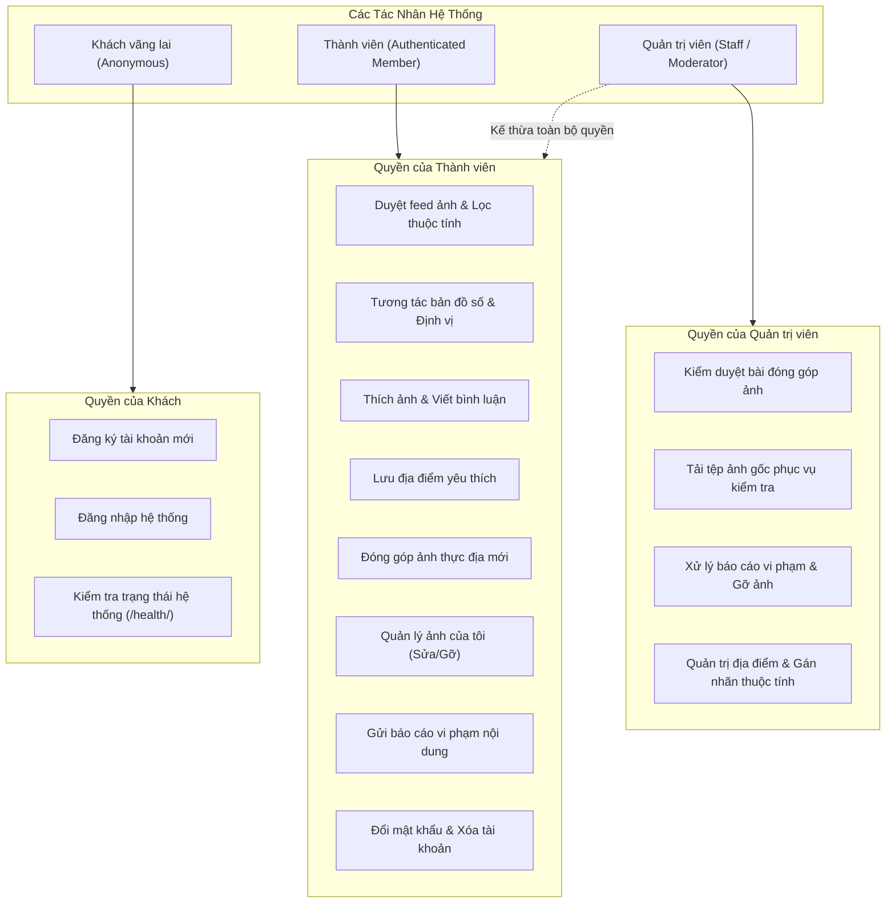

## 2.2. Yêu cầu chức năng (Functional Requirements)
Bảng dưới đây tổng hợp các yêu cầu chức năng cốt lõi của hệ thống Rendez, đối chiếu trực tiếp giữa yêu cầu thiết kế ban đầu, trạng thái hiện thực thực tế trong mã nguồn và căn cứ kiểm thử:

| Mã YC | Tên yêu cầu chức năng | Tác nhân | Trạng thái hiện thực | Căn cứ mã nguồn & Kiểm thử |
| :---: | :--- | :---: | :---: | :--- |
| **FR-01** | Xác thực người dùng, quản lý phiên và CSRF | Khách, Thành viên | **Đã hoàn thành** | `RegisterView`, `LoginView`, `CSRFView` trong [`apps/accounts/views.py`](file:///home/longtran/Projects/rendez-web/backend/apps/accounts/views.py); kiểm thử tại `test_auth_flow.py`. |
| **FR-02** | Khám phá thị giác qua lưới ảnh Masonry | Thành viên | **Đã hoàn thành** | `Feed` view trong [`apps/photos/views.py`](file:///home/longtran/Projects/rendez-web/backend/apps/photos/views.py); component `MasonryGrid` trong [`frontend/src/app/masonry.tsx`](file:///home/longtran/Projects/rendez-web/frontend/src/app/masonry.tsx). |
| **FR-03** | Lọc địa điểm theo thuộc tính không gian | Thành viên | **Đã hoàn thành** | Queryset filter trong [`apps/photos/selectors.py`](file:///home/longtran/Projects/rendez-web/backend/apps/photos/selectors.py#L9-L38); giao diện bộ lọc tại [`frontend/src/app/discovery.tsx`](file:///home/longtran/Projects/rendez-web/frontend/src/app/discovery.tsx). |
| **FR-04** | Bản đồ tương tác và đồng bộ khung nhìn | Thành viên | **Đã hoàn thành** | `VisualMap` view trong [`apps/places/views.py`](file:///home/longtran/Projects/rendez-web/backend/apps/places/views.py); component `MapPage` trong [`frontend/src/app/map.tsx`](file:///home/longtran/Projects/rendez-web/frontend/src/app/map.tsx). |
| **FR-05** | Tra cứu địa chỉ Geocoding thời gian thực | Thành viên | **Đã hoàn thành** | `GeocodeView` trong [`apps/places/views.py`](file:///home/longtran/Projects/rendez-web/backend/apps/places/views.py); dịch vụ `geocode_address` trong [`apps/places/geocoding.py`](file:///home/longtran/Projects/rendez-web/backend/apps/places/geocoding.py); kiểm thử tại `test_geocoding.py`. |
| **FR-06** | Tương tác xã hội (Thích, Bình luận, Lưu quán) | Thành viên | **Đã hoàn thành** | `PhotoLikes`, `PhotoComments` trong [`apps/photos/views.py`](file:///home/longtran/Projects/rendez-web/backend/apps/photos/views.py); `VisualFavorites` trong [`apps/favorites/views.py`](file:///home/longtran/Projects/rendez-web/backend/apps/favorites/views.py); kiểm thử tại `test_interactions_and_social.py`. |
| **FR-07** | Đóng góp ảnh thực địa kèm Idempotency | Thành viên | **Đã hoàn thành** | `SubmissionList` view và dịch vụ `create_photo_submission` trong [`apps/photos/services.py`](file:///home/longtran/Projects/rendez-web/backend/apps/photos/services.py); kiểm thử tại `test_idempotency_lifecycle.py`. |
| **FR-08** | Tiền xử lý ảnh (Làm sạch EXIF, nén JPEG) | Hệ thống | **Đã hoàn thành** | Mô-đun `process_uploaded_image` trong [`apps/photos/images.py`](file:///home/longtran/Projects/rendez-web/backend/apps/photos/images.py); kiểm thử tại `test_upload_safety.py`. |
| **FR-09** | Quản lý ảnh của tôi (Sửa chú thích, Rút ảnh) | Thành viên | **Đã hoàn thành** | `OwnPhoto` view (`/api/v1/photos/{id}/manage/`) trong [`apps/photos/views.py`](file:///home/longtran/Projects/rendez-web/backend/apps/photos/views.py); kiểm thử tại `test_authorization.py`. |
| **FR-10** | Báo cáo vi phạm nội dung và chống spam | Thành viên | **Đã hoàn thành** | `Report` view trong [`apps/photos/views.py`](file:///home/longtran/Projects/rendez-web/backend/apps/photos/views.py); kiểm thử tại `test_report_moderation.py`. |
| **FR-11** | Kiểm duyệt bài đóng góp và gỡ ảnh vi phạm | Quản trị viên | **Đã hoàn thành** | Dịch vụ `moderate_report` trong [`apps/photos/services.py`](file:///home/longtran/Projects/rendez-web/backend/apps/photos/services.py); giao diện Django Admin tại [`apps/photos/admin.py`](file:///home/longtran/Projects/rendez-web/backend/apps/photos/admin.py). |
| **FR-12** | Xem trang hồ sơ tác giả (Creator Profile) | Thành viên | **Đã hoàn thành** | `CreatorDetail`, `CreatorPhotos` trong [`apps/accounts/views.py`](file:///home/longtran/Projects/rendez-web/backend/apps/accounts/views.py); giao diện [`frontend/src/app/creator.tsx`](file:///home/longtran/Projects/rendez-web/frontend/src/app/creator.tsx). |
| **FR-13** | Quyền riêng tư và vô danh hóa tài khoản | Thành viên | **Đã hoàn thành** | Phương thức `delete` trong `MeView` tại [`apps/accounts/views.py`](file:///home/longtran/Projects/rendez-web/backend/apps/accounts/views.py); kiểm thử tại `test_privacy_and_data_lifecycle.py`. |
| **FR-14** | Sao lưu và khôi phục dữ liệu toàn vẹn | Quản trị viên | **Đã hoàn thành** | Scripts [`backup-local.sh`](file:///home/longtran/Projects/rendez-web/scripts/backup-local.sh), [`restore-local.sh`](file:///home/longtran/Projects/rendez-web/scripts/restore-local.sh); kiểm thử tại `test_backup_restore_lifecycle.py`. |
| **FR-15** | Dẫn đường ngã rẽ theo thời gian thực | Thành viên | **Ngoài phạm vi** | Chưa hiện thực trong ứng dụng nội bộ; chuyển tiếp tọa độ sang URL Google Maps ngoài ([`discovery.tsx`](file:///home/longtran/Projects/rendez-web/frontend/src/app/discovery.tsx#L52-L61)). |
| **FR-16** | Xác thực tích xanh chủ quán (Verified Venue) | Chủ quán | **Định hướng** | Chưa có luồng đăng ký chủ quán riêng trong mã nguồn; hiện chỉ quản lý nhãn qua Django Admin. |

## 2.3. Quy tắc nghiệp vụ (Business Rules)
Hệ thống Rendez thực thi nghiêm ngặt các quy tắc nghiệp vụ sau tại ranh giới tin cậy tầng máy chủ:

* **BR-01 (Bảo vệ dữ liệu bằng phiên xác thực):** Toàn bộ API truy xuất dữ liệu danh mục, ảnh và bản đồ yêu cầu phiên làm việc hợp lệ (`IsAuthenticated`). Người dùng chưa đăng nhập chỉ được tương tác với các màn hình đăng ký, đăng nhập và endpoint kiểm tra sức khỏe hệ thống.
* **BR-02 (Giới hạn tài nguyên tệp tải lên):** Trong mỗi lần đóng góp, người dùng được tải lên tối đa 5 tệp ảnh (`MAX_UPLOAD_FILES = 5`). Mỗi tệp ảnh tải lên không được vượt quá 1MB bộ nhớ tạm trong quá trình nạp (`FILE_UPLOAD_MAX_MEMORY_SIZE = 1MB`) và tổng dung lượng gói tải lên tối đa là 55MB (`DATA_UPLOAD_MAX_MEMORY_SIZE = 55MB`).
* **BR-03 (Bảo đảm an toàn và làm sạch phương tiện):** Mọi tệp ảnh tải lên phải là định dạng hình ảnh hợp lệ (JPEG, PNG, WebP) được xác thực qua thư viện Pillow. Quá trình xử lý bắt buộc phải hủy bỏ 100% siêu dữ liệu EXIF (bao gồm tọa độ GPS thiết bị), chuyển đổi hệ màu về RGB chuẩn, thu nhỏ kích thước tối đa về 2560px theo chiều dài nhất và tái mã hóa thành JPEG. Tên tệp gốc của máy khách bị xóa bỏ hoàn toàn, thay thế bằng định danh ngẫu nhiên UUIDv4.
* **BR-04 (Tính bất biến và chống gửi lặp - Idempotency):** Yêu cầu gửi đóng góp ảnh (`POST /api/v1/photo-submissions/`) bắt buộc truyền tiêu đề `Idempotency-Key`. Hệ thống kết hợp khóa này với mã băm SHA-256 của toàn bộ payload và sử dụng khóa hàng đợi `select_for_update()` trong cơ sở dữ liệu. Nếu cùng một khóa và payload được gửi lặp lại, hệ thống trả về kết quả đã xử lý trước đó mà không tạo thêm bản ghi trùng lặp trong cơ sở dữ liệu.
* **BR-05 (Kiểm soát quyền truy cập cấp đối tượng - Object-Level Authorization):**
  - Người dùng chỉ có quyền sửa chú thích hoặc rút ảnh (`withdrawn`) đối với các ảnh do chính mình tải lên (`asset__submission__submitted_by = request.user`).
  - Người dùng chỉ được sửa hoặc xóa các bình luận do chính mình viết (`comment.user = request.user`).
  - Hệ thống nghiêm cấm chỉnh sửa bình luận nếu bức ảnh chứa bình luận đó đã bị rút hoặc gỡ bỏ khỏi hệ thống (`photo.status == 'withdrawn'`).
* **BR-06 (Giới hạn tần suất và chống lạm dụng báo cáo):** Một người dùng chỉ được phép duy trì tối đa 1 báo cáo vi phạm ở trạng thái đang chờ xử lý (`pending`) cho cùng một bức ảnh hoặc cùng một địa điểm. Quy tắc này được ràng buộc bằng chỉ mục duy nhất có điều kiện (`UniqueConstraint`) ở cấp cơ sở dữ liệu.
* **BR-07 (Quyền được lãng quên - Right to be Forgotten):** Khi người dùng yêu cầu xóa tài khoản, hệ thống không xóa vật lý các bản ghi lịch sử nhằm đảm bảo tính toàn vẹn quan hệ cơ sở dữ liệu, mà thực hiện trong một giao dịch nguyên tử: xóa rỗng địa chỉ email, đặt lại tên hiển thị thành `Người dùng ẩn danh`, vô hiệu hóa mật khẩu (`set_unusable_password()`), đánh dấu `is_active=False`, đồng thời tự động chuyển toàn bộ ảnh đã đăng của người dùng này sang trạng thái `withdrawn` để ẩn hoàn toàn khỏi feed công khai.

## 2.4. Yêu cầu phi chức năng (Non-Functional Requirements)

### 2.4.1. Hiệu năng hiển thị và độ ổn định bố cục (Layout Stability)
- **Kiểm soát dịch chuyển bố cục (CLS):** Trong giao diện lưới ảnh Masonry, việc tải các bức ảnh có tỷ lệ khung hình khác nhau thường gây ra hiện tượng giật khung hình khi ảnh tải xong. Hệ thống giải quyết triệt để vấn đề này bằng cách tính toán sẵn chiều rộng, chiều cao và tỷ lệ khung hình thật (`aspect-ratio`) ở tầng serializer backend ([`apps/photos/serializers.py`](file:///home/longtran/Projects/rendez-web/backend/apps/photos/serializers.py#L42-L47)), truyền trực tiếp về máy khách để phần tử HTML giữ chỗ chính xác trước khi tệp ảnh nhị phân được tải về trình duyệt.
- **Tối ưu hóa tải ảnh:** Ảnh đại diện chính (Hero image) trong trang chi tiết được gắn cờ `loading="eager"`, `fetchPriority="high"` và `decoding="async"`, trong khi các ảnh thứ cấp trong danh sách sử dụng cơ chế tải lười (`loading="lazy"`).
- **Phân trang tối ưu:** Sử dụng thư viện TanStack Query thực hiện phân trang vô hạn, tự động lưu bộ đệm kết quả (caching trong 5 phút) và giữ nguyên vị trí thanh cuộn khi người dùng quay lại từ trang chi tiết.

### 2.4.2. An toàn thông tin và Ranh giới tin cậy (Trust Boundaries)
- **Bảo vệ xác thực và phiên làm việc:** Sử dụng cookie phiên của Django với các cờ an toàn bắt buộc: `SESSION_COOKIE_HTTPONLY = True`, `SESSION_COOKIE_SAMESITE = "Lax"`, và tự động bật `SESSION_COOKIE_SECURE = True` khi vận hành qua giao thức HTTPS. Đổi mật khẩu thành công kích hoạt `update_session_auth_hash` để thu hồi phiên cũ.
- **Phòng chống tấn công CSRF:** Bắt buộc kiểm tra token CSRF đối với toàn bộ các yêu cầu thay đổi trạng thái (`POST`, `PUT`, `PATCH`, `DELETE`).
- **Phân bổ giới hạn tốc độ (Rate Limiting):** Áp dụng `ScopedRateThrottle` của DRF cho từng loại hành động cụ thể để ngăn chặn tấn công vét cạn hoặc từ chối dịch vụ: Đăng nhập (20 lần/phút), Đăng ký (10 lần/phút), Tải ảnh (10 lần/phút), Đổi mật khẩu (5 lần/phút), Bình luận (30 lần/phút), Thích và Lưu quán (60 lần/phút).
- **Phòng chống Path Traversal trong phục vụ tệp:** Mọi yêu cầu đọc tệp media qua đường dẫn riêng tư đều được kiểm tra tính hợp lệ bằng `pathlib.Path.resolve().is_relative_to(settings.MEDIA_ROOT)`. Tệp ảnh gốc (`original`) được cách ly hoàn toàn, chỉ cho phép nhân viên có quyền quản trị tải về.

### 2.4.3. Tính độc lập dữ liệu và Khả năng tự vận hành cục bộ (Data Sovereignty & Zero Cost)
- Toàn bộ ngăn xếp công nghệ được thiết kế để có thể đóng gói và khởi chạy trọn vẹn trong môi trường cục bộ thông qua Docker Compose hoặc trực tiếp trên máy chủ Linux/macOS.
- Không sử dụng bất kỳ thư viện thương mại hoặc dịch vụ bên ngoài nào yêu cầu khai báo thẻ thanh toán hay chi phí bản quyền.
- Cơ chế sao lưu độc lập ([`scripts/backup-local.sh`](file:///home/longtran/Projects/rendez-web/scripts/backup-local.sh)) cho phép xuất bản sao lưu đầy đủ gồm dữ liệu quan hệ (`pg_dump`) và tệp phương tiện (`media.tar.gz`) mà không phụ thuộc vào hạ tầng đám mây của bên thứ ba.

### 2.4.4. Khả năng tiếp cận và Trải nghiệm đa thiết bị (Accessibility & Responsive Web)
- Hệ thống hỗ trợ hoàn chỉnh hiển thị từ màn hình di động nhỏ (chiều rộng tối thiểu 375px) đến màn hình máy tính để bàn độ phân giải cao.
- Tuân thủ các nguyên tắc tiếp cận người dùng WCAG 2.1 cơ bản: Toàn bộ nút bấm biểu tượng đều có thuộc tính `aria-label`, các thông báo lỗi hoặc trạng thái tải đều có `role="alert"` hoặc `role="status"`, hỗ trợ điều hướng đầy đủ bằng bàn phím và phản hồi trạng thái focus rõ ràng.

## 2.5. Mô hình hóa ca sử dụng (Use Case Analysis)

### 2.5.1. Sơ đồ ca sử dụng tổng quát (General Use Case Diagram)
Hệ thống được mô hình hóa thành 4 nhóm ca sử dụng chính tương ứng với các tác nhân:

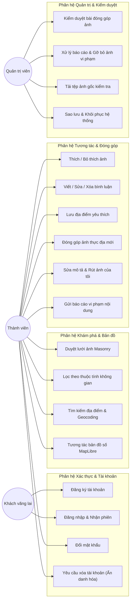

### 2.5.2. Đặc tả chi tiết các kịch bản sử dụng cốt lõi

#### Ca sử dụng UC-12: Đóng góp ảnh thực địa mới (Photo Submission)
* **Tác nhân chính:** Thành viên đã đăng nhập.
* **Tiền điều kiện:** Người dùng đã xác thực phiên làm việc hợp lệ; chuẩn bị từ 1 đến 5 tệp ảnh thực tế định dạng JPEG/PNG/WebP.
* **Luồng sự kiện chính (Main Flow):**
  1. Người dùng chọn chức năng *"Đóng góp ảnh"* trên thanh điều hướng.
  2. Giao diện hiển thị biểu mẫu đa bước. Người dùng lựa chọn:
     - Gắn ảnh vào quán đã có trong danh sách, hoặc
     - Nhập thông tin quán mới (Tên quán, địa chỉ, chọn danh mục thuộc tính không gian).
  3. Nếu nhập quán mới, hệ thống tự động kích hoạt API Geocoding để tra cứu tọa độ (kinh độ, vĩ độ) từ địa chỉ nhập vào và hiển thị điểm ghim xem trước trên bản đồ nhỏ. Người dùng có thể tinh chỉnh vị trí ghim thủ công.
  4. Người dùng chọn tối đa 5 tệp ảnh từ thiết bị và nhập chú thích (caption) cho từng ảnh.
  5. Người dùng nhấn nút *"Gửi đóng góp"*. Trình duyệt sinh tiêu đề `Idempotency-Key` dạng UUIDv4 và gửi yêu cầu `POST /api/v1/photo-submissions/` kèm dữ liệu `multipart/form-data`.
  6. Máy chủ tiếp nhận yêu cầu, kiểm tra khóa `Idempotency-Key` trong cơ sở dữ liệu.
  7. Máy chủ mở một giao dịch cơ sở dữ liệu (Transaction):
     - Tạo bản ghi `Place` mới (nếu là đề xuất quán mới) hoặc lấy bản ghi `Place` hiện có.
     - Tạo bản ghi `PhotoSubmission`.
     - Với mỗi tệp ảnh: đọc dữ liệu qua Pillow, loại bỏ toàn bộ EXIF/GPS, chuyển RGB, tạo tệp ảnh gốc bảo vệ và tệp ảnh phái sinh tối ưu (derivative), băm SHA-256 nội dung tệp, lưu vào `PhotoAsset`.
     - Tạo bản ghi `PlacePhoto` gắn kết giữa quán và ảnh.
  8. Hệ thống lưu kết quả thành công gắn với `Idempotency-Key` và trả về mã phản hồi HTTP 201 Created.
  9. Giao diện máy khách hiển thị thông báo thành công và chuyển hướng người dùng về trang chi tiết địa điểm hoặc lịch sử đóng góp.
* **Luồng sự kiện rẽ nhánh (Alternative / Exception Flows):**
  - *Gửi trùng lặp request (E-01):* Nếu người dùng nhấn gửi liên tục hoặc gặp sự cố mạng phải gửi lại đúng `Idempotency-Key` và payload cũ, máy chủ phát hiện khóa đã tồn tại trong DB, bỏ qua bước ghi tệp và trả về trực tiếp kết quả cũ với mã HTTP 200/201 mà không nhân bản dữ liệu.
  - *Tệp ảnh không hợp lệ hoặc quá kích thước (E-02):* Người dùng tải lên tệp không phải ảnh hoặc vượt quá 1MB memory/file; máy chủ từ chối yêu cầu, hủy các tệp tạm trong bộ nhớ và trả về mã HTTP 400 Bad Request kèm thông báo lỗi cụ thể.
  - *Vi phạm số lượng tệp (E-03):* Tải lên quá 5 tệp ảnh; serializer kích hoạt lỗi validation và từ chối xử lý.

#### Ca sử dụng UC-14: Gửi báo cáo vi phạm nội dung (Content Report)
* **Tác nhân chính:** Thành viên đã đăng nhập.
* **Tiền điều kiện:** Người dùng đã xác thực; đang xem một bức ảnh hoặc một địa điểm có dấu hiệu vi phạm (sai địa chỉ, ảnh không đúng thực tế, vi phạm bản quyền).
* **Luồng sự kiện chính:**
  1. Người dùng nhấn nút *"Báo cáo vi phạm"* trên thẻ ảnh hoặc trang chi tiết quán.
  2. Hệ thống hiển thị hộp thoại yêu cầu người dùng chọn lý do (Reason: spam, inappropriate, copyright, incorrect_location) và nhập nội dung giải thích chi tiết.
  3. Người dùng nhấn *"Gửi báo cáo"*. Trình duyệt gửi yêu cầu `POST /api/v1/photos/{id}/report/` (hoặc `/places/{id}/report/`).
  4. Máy chủ kiểm tra điều kiện nghiệp vụ: Người dùng này đã có báo cáo nào ở trạng thái `pending` cho đối tượng này hay chưa.
  5. Nếu chưa có, máy chủ tạo bản ghi `ContentReport` mới với trạng thái `pending`, trả về mã HTTP 201 Created.
  6. Giao diện hiển thị thông báo đã tiếp nhận báo cáo của người dùng.
* **Luồng sự kiện rẽ nhánh:**
  - *Báo cáo trùng lặp đang chờ xử lý (E-01):* Nếu người dùng đã có một báo cáo `pending` trước đó cho cùng ảnh này, ràng buộc cơ sở dữ liệu `UniqueConstraint(fields=['user', 'photo'], condition=Q(status='pending'))` kích hoạt lỗi; máy chủ trả về HTTP 400 Bad Request với thông báo: *"Bạn đã gửi báo cáo cho nội dung này và đang chờ xử lý"*.

#### Ca sử dụng UC-04: Yêu cầu xóa tài khoản (Account Anonymization)
* **Tác nhân chính:** Thành viên đã đăng nhập.
* **Tiền điều kiện:** Người dùng đang đăng nhập và yêu cầu xóa vĩnh viễn tài khoản trong mục Hồ sơ (`/profile`).
* **Luồng sự kiện chính:**
  1. Người dùng chọn mục *"Xóa tài khoản"* trong trang cài đặt hồ sơ.
  2. Giao diện hiển thị hộp thoại cảnh báo nguy cơ mất dữ liệu và yêu cầu xác nhận dứt khoát.
  3. Người dùng nhấn xác nhận xóa. Trình duyệt gửi yêu cầu `DELETE /api/v1/auth/me/`.
  4. Máy chủ kích hoạt phương thức `delete` trong `MeView` được bao bọc bởi `transaction.atomic()`:
     - Chuyển toàn bộ các bản ghi `PlacePhoto` do người dùng này tải lên sang trạng thái `withdrawn` (thu hồi khỏi trang công khai).
     - Đặt trường `email` của người dùng thành chuỗi ngẫu nhiên rỗng (ví dụ: `deleted_user_<id>@rendez.local`).
     - Đặt lại `display_name = 'Người dùng ẩn danh'`.
     - Vô hiệu hóa mật khẩu qua `set_unusable_password()`.
     - Gán cờ `is_active = False`.
     - Lưu bản ghi người dùng và hủy bỏ phiên đăng nhập qua `auth_logout(request)`.
  5. Máy chủ trả về HTTP 204 No Content.
  6. Trình duyệt xóa bộ nhớ đệm xác thực và chuyển hướng người dùng về màn hình đăng nhập.

---

# CHƯƠNG 3: CƠ SỞ LÝ THUYẾT VÀ CÔNG NGHỆ NỀN TẢNG

## 3.1. Các khái niệm kỹ thuật cốt lõi

### 3.1.1. Mô hình khám phá thị giác và Bố cục lưới Masonry
Mô hình khám phá dựa trên hình ảnh (Visual-First Discovery) là phương pháp tiếp cận tổ chức giao diện người dùng lấy dữ liệu thị giác làm kênh dẫn truyền thông tin chính. Trong bài toán tìm kiếm không gian học tập, các thông số kỹ thuật dạng số hoặc mô tả văn bản thường không phản ánh trực quan được cảm giác về độ rộng rãi, chiều cao trần nhà hay sự phân bố nguồn sáng. Bằng cách ưu tiên hình ảnh chụp thực địa, người dùng có thể đánh giá nhanh mức độ phù hợp của địa điểm thông qua việc quan sát trực tiếp.

Để hiển thị danh sách ảnh có kích thước và tỷ lệ khung hình không đồng nhất mà không làm méo hình hoặc cắt mất các góc quan sát quan trọng, hệ thống áp dụng kỹ thuật bố cục lưới Masonry. Khác với bố cục lưới CSS Grid chuẩn yêu cầu các ô có cùng chiều cao cố định trên từng hàng, bố cục Masonry sắp xếp các phần tử liên tiếp vào cột có tổng chiều cao hiện tại thấp nhất, tương tự như kỹ thuật xây tường gạch.

Một thách thức kỹ thuật lớn của bố cục Masonry là hiện tượng dịch chuyển bố cục tích lũy (Cumulative Layout Shift - CLS), được định nghĩa trong khuyến nghị chuẩn hóa hiệu năng web của W3C [7]. Khi tệp ảnh nhị phân chưa tải xong, trình duyệt không biết trước chiều cao của phần tử ảnh, dẫn đến việc chiều cao ban đầu bằng 0 và đột ngột giãn rộng khi tệp ảnh tải về hoàn tất, đẩy các phần tử phía dưới xuống và gây giật khung hình. Để khắc phục hiện tượng này, hệ thống áp dụng kỹ thuật tính toán sẵn tỷ lệ khung hình:
$$\text{aspect\_ratio} = \frac{\text{width}}{\text{height}}$$

Thông số này được máy chủ tính toán một lần duy nhất trong quá trình tiền xử lý ảnh và trả về trực tiếp trong payload của API. Trình duyệt sử dụng thuộc tính CSS `aspect-ratio` để dành sẵn khoảng không gian chính xác trong DOM ngay trước khi tệp nhị phân được nạp, giúp duy trì chỉ số CLS xấp xỉ bằng 0.

### 3.1.2. Dữ liệu địa lý GeoJSON và Giao thức gạch bản đồ (Map Tiles)
GeoJSON là định dạng chuẩn mở mã hóa các cấu trúc dữ liệu địa lý dựa trên nền tảng JSON, được chuẩn hóa trong tiêu chuẩn RFC 7946 của IETF [4]. Một đối tượng GeoJSON có thể biểu diễn một hình học cụ thể (Geometry: `Point`, `LineString`, `Polygon`, `MultiPoint`, `MultiLineString`, `MultiPolygon`), một đối tượng địa lý có thuộc tính (`Feature`), hoặc một tập hợp các đối tượng địa lý (`FeatureCollection`). Hệ thống Rendez sử dụng chuẩn GeoJSON để lưu trữ và phục vụ tập dữ liệu vector mạng lưới giao thông đường bộ khu vực quận Liên Chiểu, thành phố Đà Nẵng tại tệp tĩnh `region.geojson`. Mỗi cung đường được biểu diễn dưới dạng một `Feature` có hình học `LineString` kèm các cặp thuộc tính: tên đường (`name`), loại đường (`kind`: `road`, `path`), và phân cấp giao thông (`class`: `primary`, `secondary`).

Đối với việc hiển thị bản đồ nền, hệ thống sử dụng giao thức gạch bản đồ (Map Tiles) dựa trên phép chiếu Mercator hình cầu (Web Mercator Projection - EPSG:3857). Bản đồ thế giới được chia nhỏ thành một cây tứ phân (Quadtree) các ô vuông có kích thước chuẩn $256 \times 256$ pixel tại các cấp độ thu phóng (Zoom level $z$). Tọa độ mỗi viên gạch bản đồ được xác định qua bộ ba số nguyên $(z, x, y)$:
- **Raster Tiles (Gạch ảnh kết xuất sẵn):** Được tạo sẵn dưới dạng ảnh bitmap (PNG hoặc JPEG). Lớp nền đường phố của Rendez sử dụng nguồn raster tiles công khai từ máy chủ Esri ArcGIS World Street Map thông qua khuôn mẫu URL:
  $$\text{https://server.arcgisonline.com/ArcGIS/rest/services/World\_Street\_Map/MapServer/tile/}\{z\}/\{y\}/\{x\}$$
- **Vector Glyphs (Phông chữ nhãn bản đồ):** Để nhãn tên đường hiển thị sắc nét ở mọi độ phóng to mà không phụ thuộc phông chữ cài đặt trên hệ điều hành máy khách, các ký tự được chuyển đổi trước thành định dạng Protocolbuffer Binary Format (`.pbf`) sử dụng kỹ thuật Signed Distance Field (SDF). Hệ thống lưu trữ cục bộ bộ phông chữ `Noto Sans Regular` hỗ trợ dải mã Unicode tiếng Việt có dấu (`0-255.pbf`, `256-511.pbf`, `7680-7935.pbf`) tại thư mục `frontend/public/map/glyphs/`.

### 3.1.3. Định vị địa chỉ (Geocoding) và Thuật toán khoảng cách Haversine
Định vị địa chỉ (Forward Geocoding) là quá trình chuyển đổi một chuỗi mô tả địa chỉ văn bản (ví dụ: *"54 Nguyễn Lương Bằng, Hòa Khánh Bắc, Liên Chiểu"*) thành tọa độ địa lý chính xác biểu diễn bằng cặp số thực (Kinh độ $\lambda$, Vĩ độ $\varphi$) trên hệ quy chiếu trắc địa WGS 84.

Để kiểm tra xem một điểm tọa độ có nằm trong phạm vi không gian của khu vực khảo sát hay không, hoặc đo khoảng cách thực tế giữa vị trí người dùng với một quán cà phê, hệ thống sử dụng công thức Haversine [5]. Giả định Trái Đất là một hình cầu có bán kính trung bình $R \approx 6.371\text{ km}$, khoảng cách cung tròn lớn $d$ giữa hai điểm $A(\varphi_1, \lambda_1)$ và $B(\varphi_2, \lambda_2)$ được tính bằng công thức:
$$\Delta \varphi = \varphi_2 - \varphi_1, \quad \Delta \lambda = \lambda_2 - \lambda_1$$
$$a = \sin^2\left(\frac{\Delta \varphi}{2}\right) + \cos(\varphi_1) \cos(\varphi_2) \sin^2\left(\frac{\Delta \lambda}{2}\right)$$
$$c = 2 \cdot \arctan2\left(\sqrt{a}, \sqrt{1-a}\right)$$
$$d = R \cdot c$$

Đối với các trường hợp người dùng nhập địa chỉ có số nhà cụ thể nhưng dịch vụ trực tuyến chỉ trả về vị trí chung của cả tuyến đường, hệ thống kết hợp thuật toán tham chiếu tuyến tính đa giác (Polyline Linear Referencing). Tuyến đường được xem như một chuỗi các đoạn thẳng nối liên tiếp; thuật toán tiến hành tính tỷ lệ nội suy vị trí số nhà dựa trên độ dài tích lũy của từng phân đoạn đường từ tệp vector `region.geojson`.

### 3.1.4. Kiến trúc phân tầng Clean Architecture và Mẫu thiết kế Selectors/Services
Nhằm hạn chế việc dồn toàn bộ mã nguồn xử lý logic vào các Controller (trong Django là các Class-Based Views), hệ thống áp dụng nguyên lý kiến trúc sạch (Clean Architecture) do Robert C. Martin đề xuất [2]. Hệ thống phân chia ranh giới rõ ràng thành ba lớp trách nhiệm độc lập:
1. **Lớp Views (Tầng điều phối HTTP):** Chịu trách nhiệm tiếp nhận HTTP Request, kiểm tra phân quyền sơ bộ, phân tích cú pháp dữ liệu thông qua Serializer, gọi xuống tầng nghiệp vụ và định dạng HTTP Response trả về. Lớp này hoàn toàn không chứa các câu lệnh truy vấn cơ sở dữ liệu phức tạp hoặc các phép tính toán logic nghiệp vụ.
2. **Lớp Selectors (Tầng truy vấn dữ liệu đọc):** Đóng gói toàn bộ các hàm truy vấn đọc dữ liệu từ cơ sở dữ liệu (`get_feed_photos_queryset`, `get_map_places`, `get_creator_photos`). Điểm mấu chốt của tầng này là tối ưu hóa hiệu năng ORM thông qua các kỹ thuật:
   - `select_related(*fields)`: Sử dụng câu lệnh SQL `INNER JOIN` hoặc `LEFT OUTER JOIN` để nạp trước các thực thể quan hệ một-một hoặc nhiều-một (ví dụ: lấy thông tin `Place` và `PhotoAsset` cùng lúc với bản ghi `PlacePhoto`), triệt tiêu triệt để vấn đề truy vấn lặp $N+1$.
   - `prefetch_related(*lookups)`: Thực hiện các truy vấn SQL thứ cấp có sử dụng mệnh đề `WHERE ... IN (...)` để nạp các mối quan hệ nhiều-nhiều (ví dụ: nạp danh sách nhãn thuộc tính `attributes` cho toàn bộ danh sách ảnh trong một lần truy vấn duy nhất).
3. **Lớp Services (Tầng thực thi nghiệp vụ và thay đổi trạng thái):** Đóng gói các hàm thực hiện ghi dữ liệu, thay đổi trạng thái và phối hợp giao dịch (`create_photo_submission`, `moderate_report`). Toàn bộ các thao tác làm thay đổi nhiều bản ghi liên quan đều được bọc trong giao dịch nguyên tử `transaction.atomic()` nhằm bảo đảm tính toàn vẹn dữ liệu theo chuẩn ACID.

### 3.1.5. Tính bất biến (Idempotency) và Khóa hàng đợi cấp cơ sở dữ liệu
Trong giao thức HTTP chuẩn hóa tại RFC 9110 [3], một phương thức được gọi là có tính bất biến (Idempotent) nếu tác động của nhiều yêu cầu giống hệt nhau lên trạng thái máy chủ không làm thay đổi trạng thái so với việc chỉ gửi một yêu cầu duy nhất (chẳng hạn như `GET`, `PUT`, `DELETE`). Tuy nhiên, phương thức `POST` theo định nghĩa mặc định không có tính chất này; nếu máy khách gặp sự cố mất kết nối mạng ngay sau khi gửi yêu cầu nhưng máy chủ đã xử lý xong, việc người dùng nhấn gửi lại sẽ dẫn đến việc tạo ra các bản ghi trùng lặp trong cơ sở dữ liệu.

Để giải quyết vấn đề trên cho thao tác đóng góp ảnh thực địa, hệ thống hiện thực hóa cơ chế Idempotency dựa trên tiêu đề `Idempotency-Key`:
1. Trình duyệt sinh một khóa ngẫu nhiên UUIDv4 duy nhất cho mỗi phiên biểu mẫu.
2. Máy chủ kết hợp khóa này với mã băm mật mã SHA-256 của toàn bộ nội dung yêu cầu (payload digest):
   $$\text{digest} = \text{SHA256}(\text{payload})$$
3. Máy chủ sử dụng cơ chế khóa dòng cấp cơ sở dữ liệu thông qua câu lệnh:
   $$\text{SELECT} \dots \text{FOR UPDATE}$$
   Khóa dòng này ngăn chặn hiện tượng tranh chấp điều kiện (Race Condition) khi người dùng hoặc script máy khách vô tình gửi nhiều yêu cầu bất đồng bộ cùng lúc.
4. Nếu yêu cầu với cùng một khóa và cùng mã băm đã tồn tại, máy chủ lập tức trả về kết quả đã lưu trữ từ trước mà không thực hiện lại các thao tác ghi tệp nhị phân hay tạo bản ghi cơ sở dữ liệu mới.

### 3.1.6. Ranh giới tin cậy và Kiểm soát quyền truy cập cấp đối tượng (BOLA/IDOR)
Lỗ hổng phân quyền đối tượng bị phá vỡ (Broken Object Level Authorization - BOLA), hay còn gọi là Tham chiếu đối tượng trực tiếp không an toàn (Insecure Direct Object Reference - IDOR), được tổ chức OWASP xếp ở vị trí số một trong danh mục các rủi ro bảo mật API nghiêm trọng nhất (API1:2023) [6]. Lỗ hổng này xuất hiện khi ứng dụng cho phép người dùng thao tác trên một tài nguyên (ví dụ: sửa bình luận, gỡ ảnh, xem đóng góp riêng tư) chỉ bằng việc truyền định danh `id` của đối tượng trên URL mà máy chủ không kiểm tra quyền sở hữu thực tế của người gửi yêu cầu.

Hệ thống Rendez thiết lập nguyên tắc kiểm soát quyền nghiêm ngặt tại tầng máy chủ (Server-side Enforcement):
- Không bao giờ tin cậy trường định danh người dùng do máy khách gửi lên trong thân request.
- Mọi câu truy vấn cập nhật hoặc xóa dữ liệu đối tượng đều được lọc cứng theo khóa chính của người dùng đang đăng nhập:
  $$\text{queryset} = \text{PlacePhoto.objects.filter}(\text{asset\_\_submission\_\_submitted\_by} = \text{request.user})$$
- Nếu một người dùng cố tình gửi mã `id` thuộc về người khác, câu truy vấn trả về kết quả rỗng và máy chủ phản hồi mã lỗi chuẩn HTTP 404 Not Found hoặc HTTP 403 Forbidden, ngăn ngừa triệt để nguy cơ tấn công dò quét hoặc can thiệp dữ liệu chéo tài khoản.

Bên cạnh đó, việc người dùng tải lên hình ảnh từ thiết bị cá nhân tiềm ẩn rủi ro lộ lọt dữ liệu vị trí thông qua siêu dữ liệu EXIF (Exchangeable Image File Format). Thẻ EXIF chứa các trường dữ liệu chi tiết như: kinh độ/vĩ độ GPS, độ cao, thời gian chụp, số sê-ri thiết bị và tên kiểu máy điện thoại. Để bảo vệ quyền riêng tư cho cộng đồng đóng góp, hệ thống xây dựng pipeline bóc tách và loại bỏ hoàn toàn các thẻ nhị phân EXIF trước khi lưu trữ hoặc phát hành bản phái sinh.

---

## 3.2. Ngăn xếp công nghệ sử dụng trong dự án

### 3.2.1. Công nghệ máy chủ: Python 3.14, Django 5.2, Django REST Framework và Gunicorn
- **Python (Phiên bản 3.14):** Ngôn ngữ lập trình bậc cao với hệ thống thư viện phong phú, cú pháp rõ ràng, hỗ trợ mạnh mẽ việc xử lý dữ liệu và kiểm thử tự động.
- **Django (Phiên bản 5.2) [8]:** Web framework hoàn chỉnh theo kiến trúc Model-Template-View (MVT). Dự án sử dụng hệ thống ánh xạ đối tượng - quan hệ (Django ORM), hệ thống xác thực người dùng tích hợp sẵn (`django.contrib.auth`), cơ chế kiểm tra token CSRF tự động và hệ thống quản trị nội dung Django Admin được nội địa hóa hoàn toàn sang tiếng Việt.
- **Django REST Framework (Phiên bản 3.16):** Bộ công cụ mở rộng mạnh mẽ trên nền Django phục vụ xây dựng RESTful Web API [1]. DRF cung cấp các bộ Serializer kiểm thực dữ liệu hai chiều, cơ chế phân quyền linh hoạt (`IsAuthenticated`), điều tiết lưu lượng truy cập (`ScopedRateThrottle`) và phân trang dữ liệu chuẩn hóa.
- **Gunicorn (Phiên bản 23.0):** Máy chủ WSGI HTTP Server độc lập dành cho môi trường UNIX. Gunicorn đóng vai trò tiếp nhận các yêu cầu HTTP từ mạng cục bộ, quản lý vòng đời của 2 tiến trình worker đồng thời, phục vụ toàn bộ ứng dụng Rendez tại cổng `8080` theo mô hình khép kín.
- **DRF-Spectacular (Phiên bản 0.28):** Công cụ phân tích tĩnh mã nguồn và tự động sinh tài liệu giao diện lập trình theo chuẩn đặc tả OpenAPI 3.0, hỗ trợ giao diện tương tác trực tiếp Swagger UI tại đường dẫn `/api/v1/docs/`.

### 3.2.2. Công nghệ giao diện: React 19, TypeScript, Vite và Tailwind CSS
- **React (Phiên bản 19.2) [9]:** Thư viện mã nguồn mở xây dựng giao diện người dùng dựa trên các thành phần (Component-Based Architecture) và cơ chế DOM ảo (Virtual DOM). Phiên bản React 19 tối ưu hóa hiệu năng render, hỗ trợ các React Hooks nâng cao và cơ chế tải thành phần trễ (`React.lazy`, `Suspense`).
- **TypeScript (Phiên bản ~5.9):** Ngôn ngữ mở rộng có định kiểu tĩnh được phát triển bởi Microsoft. Việc kết hợp TypeScript với tệp định kiểu sinh tự động từ OpenAPI (`generated.d.ts`) giúp phát hiện sớm các lỗi sai lệch dữ liệu giữa frontend và backend ngay trong giai đoạn biên dịch, loại bỏ nguy cơ gặp lỗi ngoại lệ `TypeError: undefined is not an object` tại máy khách.
- **Vite (Phiên bản 7.1):** Công cụ đóng gói mã nguồn (Frontend Build Tool) hiện đại. Vite sử dụng máy chủ phát triển dựa trên Native ES Modules giúp tốc độ khởi động cực nhanh và sử dụng Rollup để tối ưu hóa việc phân tách gói tệp tĩnh (Chunk splitting) khi đóng gói sản phẩm ra thư mục `dist/`.
- **TanStack Query (Phiên bản 5.90) [14]:** Thư viện quản lý trạng thái máy chủ (Server State Management). TanStack Query phụ trách việc nạp dữ liệu bất đồng bộ, lưu trữ bộ nhớ đệm (Cache), tự động đồng bộ hóa trạng thái ngầm và xử lý phân trang vô hạn mượt mà cho lưới ảnh Masonry.
- **Tailwind CSS (Phiên bản 4.1):** Framework CSS tiện ích (Utility-first CSS) thế hệ mới, biên dịch trực tiếp qua plugin Vite, giúp quản lý bảng màu HSL, khoảng cách và bố cục lưới responsive mà không làm tăng dung lượng tệp CSS tải về.
- **React Router (Phiên bản 7.9):** Thư viện điều hướng trang đơn (SPA Client-side Routing), quản lý lịch sử duyệt web và bảo vệ các tuyến đường yêu cầu đăng nhập thông qua `RequireLogin` wrapper.

### 3.2.3. Công nghệ bản đồ số: MapLibre GL JS, React Map GL và OpenStreetMap
- **MapLibre GL JS (Phiên bản 5.0) [10]:** Thư viện bản đồ số mã nguồn mở kết xuất đồ họa vector bản đồ hiệu năng cao dựa trên công nghệ WebGL. MapLibre cho phép tùy biến giao diện bản đồ linh hoạt thông qua tệp cấu hình JSON theo chuẩn Mapbox Style Specification, hỗ trợ xoay, nghiêng và di chuyển bản đồ với tốc độ khung hình 60 FPS.
- **React Map GL (Phiên bản 8.0):** Bộ bao bọc React (React wrapper) cho MapLibre GL, cho phép điều khiển bản đồ thông qua cơ chế quản lý trạng thái và luồng dữ liệu một chiều của React.
- **OpenStreetMap (OSM) & Nextzen Extracts [11]:** Nguồn dữ liệu địa lý mở toàn cầu. Dự án trích xuất dữ liệu ranh giới và đường bộ quận Liên Chiểu thành tệp `region.geojson` phục vụ hoàn toàn cục bộ, bảo đảm tính sẵn sàng của nhãn bản đồ ngay cả khi kết nối mạng chập chờn.

### 3.2.4. Công nghệ cơ sở dữ liệu: PostgreSQL 17 và Thư viện Pillow
- **PostgreSQL (Phiên bản 17):** Hệ quản trị cơ sở dữ liệu quan hệ đối tượng mã nguồn mở tiên tiến. Dự án khai thác các tính năng mạnh mẽ của PostgreSQL bao gồm: khóa giao dịch `FOR UPDATE`, các chỉ mục phức hợp đa cột (`Composite Indexes`), chỉ mục có điều kiện (`Partial Indexes`), và các ràng buộc toàn vẹn dữ liệu cấp bảng (`Check Constraints`).
- **Pillow (Phiên bản 11.3) [13]:** Thư viện xử lý ảnh nhị phân tiêu chuẩn của Python. Pillow được sử dụng trong pipeline tiền xử lý ảnh để đọc dữ liệu nhị phân trực tiếp từ luồng nạp, kiểm tra tính hợp lệ của tệp ảnh, bóc tách toàn bộ siêu dữ liệu EXIF/GPS, chuyển đổi hệ màu từ RGBA/CMYK về RGB chuẩn, thay đổi kích thước theo thuật toán nội suy chất lượng cao Lanczos và lưu thành tệp nén JPEG với độ nén tối ưu.

---

## 3.3. Đánh giá và so sánh giải pháp kỹ thuật (Trade-off Analysis)

Mọi quyết định kiến trúc trong đồ án đều dựa trên sự cân nhắc kỹ lưỡng giữa các ưu điểm, nhược điểm và sự đánh đổi kỹ thuật (Trade-offs) nhằm đáp ứng mục tiêu tự chủ dữ liệu và không phát sinh chi phí vận hành:

### 3.3.1. So sánh Kiến trúc: Clean Monolith và Microservices
- **Tiêu chí so sánh:** Chi phí vận hành hạ tầng, độ phức tạp triển khai, tính toàn vẹn giao dịch và tốc độ phát triển.
- **Phân tích đánh đổi:**
  - *Mô hình Microservices:* Đem lại khả năng mở rộng độc lập cho từng dịch vụ và cô lập lỗi tốt. Tuy nhiên, kiến trúc này đòi hỏi hạ tầng mạng phức tạp (Service Mesh, API Gateway, Distributed Tracing), phát sinh độ trễ mạng giữa các dịch vụ (Inter-service Network Latency), và đặc biệt khó duy trì tính toàn vẹn giao dịch nguyên tử khi lưu trữ phân tán (phải sử dụng mô hình Saga hoặc Eventual Consistency).
  - *Mô hình Clean Monolith (Giải pháp được lựa chọn):* Toàn bộ mã nguồn backend được tổ chức trong một khối mã nguồn duy nhất nhưng được phân tầng logic nghiêm ngặt (Clean Architecture). Giải pháp này cho phép toàn bộ quy trình ghi dữ liệu (tạo quán, ghi tệp ảnh, tạo bản ghi liên kết) được thực thi trong một giao dịch cơ sở dữ liệu ACID duy nhất của PostgreSQL, triệt tiêu nguy cơ dữ liệu mồ côi khi có lỗi xảy ra. Đồng thời, Clean Monolith cho phép đóng gói toàn bộ hệ thống vào một container Docker duy nhất, phù hợp với mục tiêu tự vận hành cục bộ mà không phát sinh chi phí quản lý cụm máy chủ.

### 3.3.2. So sánh Cơ chế Xác thực: Session/Cookie và JSON Web Token (JWT)
- **Tiêu chí so sánh:** Khả năng thu hồi phiên ngay lập tức, tính an toàn trước các cuộc tấn công XSS/CSRF, và sự phụ thuộc trạng thái máy chủ.
- **Phân tích đánh đổi:**
  - *JSON Web Token (JWT):* Ưu điểm là cơ chế phi trạng thái (Stateless), máy chủ không cần lưu vết phiên trong cơ sở dữ liệu, rất thuận tiện cho các hệ thống phân tán đa miền. Tuy nhiên, nhược điểm chí mạng của JWT là **rất khó thu hồi phiên trước hạn** (Revocation problem) khi người dùng đổi mật khẩu hoặc bị lộ tài khoản, trừ khi phải duy trì một danh sách đen (Blacklist) tập trung trong Redis (làm mất đi bản chất phi trạng thái của JWT). Ngoài ra, nếu lưu JWT trong `localStorage` của trình duyệt, mã token rất dễ bị đánh cắp thông qua các cuộc tấn công Cross-Site Scripting (XSS).
  - *Session Authentication kết hợp CSRF (Giải pháp được lựa chọn):* Dữ liệu phiên được lưu trữ có kiểm soát trong cơ sở dữ liệu và định danh qua Session ID ngẫu nhiên lưu trong cookie `HttpOnly`. Giải pháp này ngăn chặn hoàn toàn việc mã độc JavaScript đọc trộm định danh phiên. Khi người dùng thực hiện đổi mật khẩu hoặc yêu cầu xóa tài khoản, máy chủ kích hoạt hàm `update_session_auth_hash` của Django, ngay lập tức vô hiệu hóa toàn bộ các phiên làm việc cũ trên mọi thiết bị. Rủi ro của cơ chế cookie là tấn công CSRF, điều này được hệ thống bảo vệ thông qua middleware bắt buộc xác thực token CSRF trên 100% các yêu cầu thay đổi dữ liệu.

### 3.3.3. So sánh Bản đồ số: MapLibre GL JS mã nguồn mở và Google Maps JavaScript API
- **Tiêu chí so sánh:** Chi phí bản quyền, quyền kiểm soát dữ liệu, khả năng tùy biến hiển thị và sự phụ thuộc dịch vụ ngoài.
- **Phân tích đánh đổi:**
  - *Google Maps JavaScript API:* Cung cấp hệ sinh thái dữ liệu hoàn chỉnh, hình ảnh chụp từ vệ tinh chất lượng cao và định vị chính xác. Tuy nhiên, Google Maps áp dụng chính sách biểu phí nghiêm ngặt (Pay-as-you-go), bắt buộc lập trình viên phải liên kết thẻ tín dụng quốc tế để lấy API Key, giới hạn hạn ngạch miễn phí hàng tháng và không cho phép tùy biến sâu vào lõi kết xuất đồ họa hay tải dữ liệu về máy chủ nội bộ.
  - *MapLibre GL JS kết hợp OpenStreetMap (Giải pháp được lựa chọn):* Là thư viện bản đồ số mã nguồn mở hoàn toàn tự do (BSD-3-Clause). Giải pháp này cho phép hệ thống tự chủ 100% về mặt hiển thị: nhúng trực tiếp dữ liệu vector cục bộ `region.geojson`, tự phục vụ phông chữ nhãn bản đồ tiếng Việt mà không phụ thuộc vào Google Fonts, và tận dụng được nguồn raster tiles công cộng của Esri ArcGIS mà không yêu cầu thẻ thanh toán hay phát sinh chi phí tài chính.

Bảng tổng hợp đánh giá đánh đổi kỹ thuật giữa các giải pháp:

| Tiêu chí kỹ thuật | Giải pháp được lựa chọn trong Rendez | Giải pháp thay thế phổ biến | Đánh đổi kỹ thuật chấp nhận |
| :--- | :--- | :--- | :--- |
| **Kiến trúc ứng dụng** | **Clean Monolith** (Django phân tầng) | Microservices | Chấp nhận giới hạn mở rộng quy mô độc lập từng phần để đổi lấy tính nhất quán giao dịch ACID tuyệt đối và sự đơn giản khi triển khai cục bộ. |
| **Xác thực người dùng** | **Session Authentication** (Cookie HttpOnly + CSRF) | JSON Web Token (JWT lưu localStorage) | Chấp nhận máy chủ phải lưu trạng thái phiên trong DB để đổi lấy khả năng thu hồi phiên ngay lập tức và triệt tiêu nguy cơ lộ token qua XSS. |
| **Bản đồ tương tác** | **MapLibre GL JS** + OpenStreetMap | Google Maps JavaScript API | Chấp nhận thiếu ảnh Street View toàn cảnh để đổi lấy chi phí bản quyền bằng 0, không ràng buộc thẻ tín dụng và khả năng tùy biến sâu dữ liệu vector địa phương. |
| **Định vị địa chỉ** | **Đa nguồn kết hợp** (Photon, Nominatim, Esri) | Google Places Autocomplete API | Chấp nhận thời gian tra cứu địa chỉ có độ trễ cao hơn một phần giây để đổi lấy dịch vụ hoàn toàn miễn phí, không bị khóa hạn ngạch truy vấn. |

---

# CHƯƠNG 4: THIẾT KẾ HỆ THỐNG VÀ GIAO DIỆN NGƯỜI DÙNG

## 4.1. Thiết kế kiến trúc tổng thể (System Architecture)

### 4.1.1. Cấu trúc hệ thống và ranh giới các thành phần
Hệ thống Rendez được thiết kế theo mô hình kiến trúc khối nguyên khối phân tầng sạch (Clean Monolith) kết hợp ứng dụng trang đơn (Single Page Application - SPA). Toàn bộ hệ thống được phân tách thành ba tầng xử lý chính với các ranh giới rành mạch:

1. **Tầng Máy khách (Client Layer):** Trình duyệt web của người dùng thực thi ứng dụng React 19 SPA. Tầng này chịu trách nhiệm điều hướng máy khách (Client-side Routing), quản lý trạng thái giao diện và kết xuất đồ họa bản đồ thông qua WebGL. Mọi giao tiếp với máy chủ đều được thực hiện thông qua giao thức HTTP/HTTPS bất đồng bộ sử dụng định dạng JSON hoặc `multipart/form-data`.
2. **Tầng Máy chủ và Dịch vụ (Application & Service Layer):** Được điều phối bởi máy chủ WSGI Gunicorn tiếp nhận yêu cầu từ cổng mạng cục bộ `8080`. Bên trong khối ứng dụng Django 5.2, mã nguồn được phân rã thành các ứng dụng domain chuyên biệt (`apps.accounts`, `apps.places`, `apps.photos`, `apps.favorites`). Mỗi ứng dụng tuân thủ mô hình phân lớp trách nhiệm (Views $\rightarrow$ Selectors/Services $\rightarrow$ Models).
3. **Tầng Lưu trữ và Dữ liệu Cục bộ (Storage & Data Sovereignty Layer):** Bao gồm hệ quản trị cơ sở dữ liệu quan hệ PostgreSQL 17 (hoặc SQLite 3 trong chế độ kiểm thử), kho tệp tin phương tiện phân cấp tại thư mục cục bộ `.local/media`, và tập tài nguyên bản đồ vector địa phương (`region.geojson`, glyphs phông chữ).

Sơ đồ ngữ cảnh và cấu trúc thành phần tổng thể của hệ thống được mô tả trong hình dưới đây:

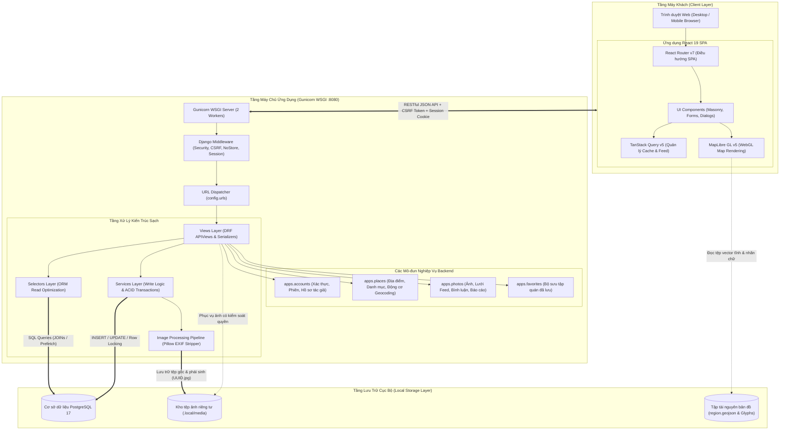

### 4.1.2. Phân tích vai trò và ranh giới trách nhiệm
- **Ranh giới giữa Client và Server:** Tầng máy khách hoàn toàn không giao tiếp trực tiếp với cơ sở dữ liệu hay hệ thống tệp tin. Máy khách chỉ nhận các biểu diễn dữ liệu đã qua xử lý, lọc bỏ các trường nhạy cảm thông qua các lớp Serializer. Mọi quyết định về phân quyền, tính hợp lệ của dữ liệu đầu vào và các quy tắc nghiệp vụ đều được thực thi tại tầng máy chủ.
- **Ranh giới giữa Selectors và Services:** Nhằm tuân thủ nguyên lý đơn trách nhiệm (Single Responsibility Principle), các thao tác đọc dữ liệu chỉ được định nghĩa trong `selectors.py` và không bao giờ được phép làm thay đổi trạng thái cơ sở dữ liệu. Ngược lại, các thao tác ghi dữ liệu, thay đổi trạng thái và phối hợp giao dịch bắt buộc phải đi qua các hàm nghiệp vụ trong `services.py`.
- **Ranh giới lưu trữ tệp tin phương tiện:** Thư mục `.local/media` không được cấu hình cho phép máy chủ web (như Nginx hay WhiteNoise) phục vụ trực tiếp dưới dạng tệp tĩnh công khai. Mọi yêu cầu truy cập ảnh đều phải đi qua view kiểm soát quyền `media()` tại [`backend/apps/photos/views.py`](file:///home/longtran/Projects/rendez-web/backend/apps/photos/views.py#L213-L273) để kiểm tra trạng thái bài đăng và quyền sở hữu tệp gốc.

---

## 4.2. Phân rã thành phần và Trách nhiệm module

### 4.2.1. Các phân hệ máy chủ Backend thực tế
Hệ thống backend bao gồm 4 ứng dụng nghiệp vụ domain và 1 gói cấu hình trung tâm:

1. **Ứng dụng Tài khoản (`apps.accounts`):**
   - *Mô hình dữ liệu:* Lớp `User` kế thừa `AbstractUser` của Django, bổ sung trường `display_name` phục vụ hiển thị công khai.
   - *Thành phần xử lý:*
     - `auth.py`: Lớp xác thực `SessionAuthentication` kế thừa DRF, liên kết chặt chẽ với cơ chế bảo vệ CSRF của Django.
     - `views.py`: `CSRFView` (cấp phát CSRF token), `RegisterView` (đăng ký), `LoginView` (xác thực và tạo phiên), `LogoutView` (hủy phiên), `PasswordChange` (đổi mật khẩu và cập nhật `session_auth_hash`), `MeView` (truy vấn/sửa hồ sơ và thực thi phương thức `delete` vô danh hóa tài khoản), `CreatorDetail` và `CreatorPhotos` (cung cấp thông tin và danh mục ảnh công khai của tác giả).
2. **Ứng dụng Địa điểm (`apps.places`):**
   - *Mô hình dữ liệu:* `Place` (lưu trữ tên quán, địa chỉ, kinh độ, vĩ độ, giờ mở cửa, nhãn xác thực `is_verified`, cờ `is_demo`), `Category` (danh mục phân loại không gian), `PlaceCategory` (bảng liên kết nhiều-nhiều giữa quán và danh mục).
   - *Thành phần xử lý:*
     - `selectors.py`: `get_places_queryset` (lọc danh sách quán theo từ khóa và danh mục), `get_map_places` (lọc các địa điểm nằm trong hình chữ nhật bao quanh - Viewport Bounding Box), `get_place_detail` (truy vấn chi tiết kèm danh mục liên kết).
     - `geocoding.py`: Hiện thực hóa hàm `geocode_address` tích hợp gọi tuần tự các nhà cung cấp GIS (Photon, Nominatim, Esri) và thuật toán khoảng cách Haversine.
     - `views.py`: `VisualPlaceList`, `VisualPlaceDetail`, `VisualMap`, `CategoryList`, `GeocodeView`.
3. **Ứng dụng Hình ảnh (`apps.photos`):**
   - *Mô hình dữ liệu:* `PhotoAsset` (quản lý tệp nhị phân gốc, tệp phái sinh tối ưu, mã băm SHA-256, chiều rộng, chiều cao, tỷ lệ khung hình), `PhotoSubmission` (phiên đóng góp ảnh của người dùng), `PlacePhoto` (bản ghi xuất bản ảnh gắn với quán, trạng thái `pending_review`, `approved`, `withdrawn`, nhãn ảnh bìa `is_cover`), `PhotoComment` (bình luận của người dùng trên ảnh), `PhotoLike` (lượt thích ảnh), `ContentReport` (báo cáo vi phạm nội dung).
   - *Thành phần xử lý:*
     - `selectors.py`: `get_feed_photos_queryset` (nạp danh sách ảnh đã xuất bản kèm thông tin quán và tác giả, tối ưu bằng `select_related`), `get_similar_photos` (gợi ý ảnh cùng quán hoặc cùng danh mục thuộc tính).
     - `services.py`: `create_photo_submission` (điều phối giao dịch tạo quán, xử lý ảnh, tạo asset và place photo kèm Idempotency), `moderate_report` (xử lý báo cáo và gỡ bỏ ảnh).
     - `images.py`: Hàm `process_uploaded_image` sử dụng Pillow đọc nhị phân, kiểm tra header, bóc tách EXIF, chuyển RGB, tính `aspect-ratio` và re-encode JPEG.
     - `views.py`: `Feed`, `PhotoDetail`, `Gallery`, `PhotoLikes`, `PhotoComments`, `CommentDetail`, `OwnPhoto`, `Report`, `SubmissionList`, `SubmissionDetail`, `media`.
4. **Ứng dụng Yêu thích (`apps.favorites`):**
   - *Mô hình dữ liệu:* `PlaceFavorite` (liên kết nhiều-nhiều giữa `User` và `Place`, ràng buộc duy nhất trên cặp `(user, place)`).
   - *Thành phần xử lý:* `views.py` gồm `VisualFavorites` (danh sách quán đã lưu của người dùng hiện tại) và `FavoriteDetail` (thao tác lưu hoặc xóa quán khỏi danh sách yêu thích).
5. **Gói Cấu hình Trung tâm (`backend/config`):**
   - `settings.py`: Khai báo biến môi trường, cơ sở dữ liệu, ranh giới bảo mật production, tỷ lệ rate limiting và cấu hình logging.
   - `middleware.py`: Lớp `NoStoreMiddleware` gắn cờ `Cache-Control: no-store` cho các phản hồi API nhạy cảm.
   - `local.py`: Cung cấp hàm `frontend` (phục vụ ứng dụng React SPA từ `frontend/dist/`), `static_asset` (phục vụ tệp tĩnh Django Admin), và `health` (kiểm tra sức khỏe database qua `SELECT 1`).
   - `api.py`: Tùy biến `Pagination` chuẩn (20 phần tử/trang) và `exception_handler` chuẩn hóa thông báo lỗi JSON.

### 4.2.2. Các phân hệ máy khách Frontend thực tế
Mã nguồn giao diện được tổ chức theo cấu trúc mô-đun hóa trong `frontend/src/`:
- **Khung giao diện App Shell (`app/App.tsx`):** Quản lý bố cục thanh điều hướng Left Rail trên Desktop và Bottom Navigation Bar trên Mobile; bảo vệ các tuyến đường riêng tư qua `RequireLogin`.
- **Phân hệ Khám phá (`app/discovery.tsx` & `app/masonry.tsx`):** Quản lý thanh công cụ lọc thuộc tính không gian, tìm kiếm từ khóa, điều khiển lưới Masonry và cửa sổ chi tiết ảnh (Hero Viewer).
- **Phân hệ Bản đồ tương tác (`app/map.tsx`):** Khởi tạo bản đồ MapLibre GL, đồng bộ hóa khung nhìn Viewport với tham số URL, hiển thị Marker và Popup quán cà phê, xử lý sự cố lỗi mạng qua `onError`.
- **Phân hệ Đóng góp (`app/contributions.tsx`):** Xây dựng luồng biểu mẫu đa bước, hỗ trợ xem trước ảnh ở máy khách, tích hợp bản đồ nhỏ định vị Geocoding khi tạo quán mới.
- **Phân hệ Tương tác cộng đồng (`app/social.tsx` & `app/creator.tsx`):** Quản lý luồng bình luận tương tác, danh sách quán yêu thích và trang thông tin nhiếp ảnh gia.
- **Tầng Giao tiếp API (`lib/api/client.ts` & `lib/api/visual.ts`):** Đóng gói hàm gọi HTTP dựa trên `fetch`, tự động trích xuất CSRF token từ cookie `csrftoken` để gắn vào tiêu đề `X-CSRFToken`, chuẩn hóa dữ liệu trả về theo kiểu TypeScript từ OpenAPI.

---

## 4.3. Luồng dữ liệu và Luồng xử lý trong những chức năng quan trọng

### 4.3.1. Luồng đóng góp ảnh thực địa và Xử lý phương tiện an toàn
Quy trình đóng góp ảnh là luồng xử lý phức tạp nhất trong hệ thống, kết hợp giữa việc kiểm tra tính bất biến (Idempotency), tiền xử lý tệp đồ họa trong bộ nhớ và thực thi giao dịch cơ sở dữ liệu nguyên tử.

```mermaid
sequenceDiagram
    autonumber
    actor User as Thành viên (Client)
    participant Form as Contributions UI (React)
    participant View as SubmissionList View
    participant Service as Photo Service Layer
    participant Pillow as Image Pipeline (Pillow)
    participant Disk as Local File Storage
    participant DB as PostgreSQL Database

    User->>Form: Chọn quán/Nhập quán mới + Chọn tối đa 5 ảnh + Nhập chú thích
    Form->>Form: Sinh UUIDv4 làm Idempotency-Key
    Form->>View: POST /api/v1/photo-submissions/<br/>(Headers: Idempotency-Key; Body: multipart/form-data)

    activate View
    View->>View: Kiểm thực dữ liệu qua PhotoUploadSerializer
    View->>Service: Gọi create_photo_submission(user, data, files, key)

    activate Service
    Service->>DB: Bắt đầu giao dịch: transaction.atomic()
    Service->>DB: SELECT * FROM photo_submission WHERE idempotency_key = key FOR UPDATE

    alt Khóa Idempotency đã tồn tại và mã băm SHA-256 payload trùng khớp
        DB-->>Service: Trả về bản ghi đóng góp cũ
        Service-->>View: Trả về kết quả đã lưu trữ từ trước
        View-->>Form: HTTP 200/201 (Không xử lý lại tệp)
    else Khóa mới hoặc yêu cầu hợp lệ lần đầu
        Service->>DB: Tạo hoặc lấy bản ghi Place (Nếu quán mới: lưu tên, địa chỉ, tọa độ)
        Service->>DB: Tạo bản ghi PhotoSubmission (status='pending')

        loop Với từng tệp ảnh trong danh sách tải lên
            Service->>Pillow: Nạp luồng nhị phân vào bộ nhớ tạm
            activate Pillow
            Pillow->>Pillow: Xác thực MIME & Đọc kích thước (width, height)
            Pillow->>Pillow: Hủy bỏ 100% thẻ siêu dữ liệu EXIF & GPS
            Pillow->>Pillow: Chuyển đổi hệ màu sang RGB chuẩn
            Pillow->>Pillow: Tạo bản phái sinh tối ưu (Resize max 2560px, JPEG quality 85)
            Pillow-->>Service: Trả về luồng nhị phân đã làm sạch + Tỷ lệ aspect_ratio
            deactivate Pillow

            Service->>Service: Tính mã băm SHA-256 của tệp gốc
            Service->>Disk: Ghi tệp gốc: visual/originals/{uuid}.jpg
            Service->>Disk: Ghi tệp phái sinh: visual/derivatives/{uuid}.jpg
            Service->>DB: INSERT INTO PhotoAsset (original, derivative, sha256, aspect_ratio)
            Service->>DB: INSERT INTO PlacePhoto (place, asset, status='approved', caption)
        end

        Service->>DB: Cập nhật digest và kết thúc giao dịch (COMMIT)
        Service-->>View: Trả về dữ liệu bài đóng góp hoàn tất
        deactivate Service

        View-->>Form: HTTP 201 Created (Kèm danh sách ảnh & thông tin quán)
        deactivate View
        Form->>User: Hiển thị thông báo thành công và chuyển hướng về trang quán
    end
```

*Phân tích luồng xử lý:*
1. Máy khách sinh tiêu đề `Idempotency-Key` độc nhất cho mỗi lượt nhấn gửi.
2. Tại bước 6, việc sử dụng `SELECT ... FOR UPDATE` bảo đảm rằng nếu có 2 yêu cầu trùng lặp đến cùng thời điểm (do mạng chậm hoặc người dùng nhấp đúp), yêu cầu thứ hai sẽ bị giữ lại ở hàng đợi cho đến khi yêu cầu thứ nhất hoàn thành, ngăn chặn triệt để việc nhân đôi bản ghi.
3. Tại các bước 8–12, quá trình xử lý ảnh diễn ra hoàn toàn trong bộ nhớ RAM tạm thời; tệp nhị phân chỉ được ghi xuống đĩa cứng sau khi đã loại bỏ toàn bộ dữ liệu vị trí nhạy cảm và kiểm tra toàn vẹn định dạng.

### 4.3.2. Luồng tra cứu địa chỉ Geocoding thời gian thực đa nguồn
Chức năng định vị địa chỉ hỗ trợ người dùng tạo quán mới một cách nhanh chóng mà không cần phải tự tra cứu tọa độ thủ công.

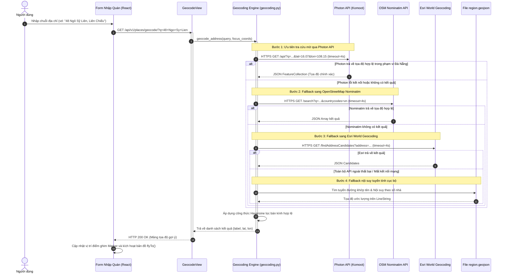

*Phân tích luồng xử lý:* Động cơ Geocoding được thiết kế với cơ chế dự phòng nhiều tầng (Graceful Fallback). Các yêu cầu gọi ra bên ngoài đều được giới hạn thời gian chờ nghiêm ngặt (`timeout=4.0s`). Nếu toàn bộ mạng ngoài bị ngắt, thuật toán nội suy tuyến tính trên tệp GeoJSON cục bộ sẽ ước lượng vị trí tương đối dọc theo tuyến đường, bảo đảm hệ thống không bị treo hoặc trả về lỗi 500.

### 4.3.3. Luồng kiểm duyệt báo cáo vi phạm và Đồng bộ trạng thái gỡ ảnh
Luồng kiểm duyệt bảo đảm tính lành mạnh của dữ liệu và tuân thủ các quy tắc bảo vệ bản quyền hình ảnh.

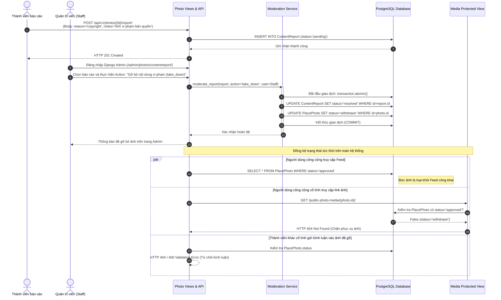

---

## 4.4. Thiết kế cơ sở dữ liệu quan hệ và Quản lý dữ liệu

### 4.4.1. Phân loại các nhóm dữ liệu trong hệ thống
Dữ liệu trong hệ thống Rendez được phân tách thành 4 nhóm theo vòng đời lưu trữ và tính chất phát sinh:

1. **Dữ liệu lưu trữ bền vững (Persistent Data):**
   - Được quản lý trực tiếp bởi hệ quản trị cơ sở dữ liệu quan hệ PostgreSQL 17 và kho lưu trữ tệp tin cục bộ `.local/media`.
   - Bao gồm thông tin tài khoản người dùng (`accounts_user`), danh mục không gian (`places_category`), thông tin địa điểm (`places_place`), các đợt đóng góp (`photos_photosubmission`), các tệp ảnh nhị phân vật lý (`photos_photoasset`), bản ghi xuất bản ảnh (`photos_placephoto`), bình luận (`photos_photocomment`), lượt thích (`photos_photolike`), danh sách quán đã lưu (`favorites_placefavorite`), và báo cáo vi phạm (`photos_contentreport`).
   - Dữ liệu này được duy trì liên tục và được bảo vệ qua quy trình sao lưu định kỳ bằng lệnh `pg_dump` và `tar`.
2. **Dữ liệu dẫn xuất (Derived Data):**
   - Là các giá trị không được nhập trực tiếp từ người dùng mà được tính toán tự động từ dữ liệu bền vững hoặc qua các phép tổng hợp khi truy vấn:
     - Tỷ lệ khung hình `aspect_ratio`: Được tính bằng công thức $\text{width} / \text{height}$ trong pipeline tiền xử lý ảnh và lưu vào `PhotoAsset` để hỗ trợ CSS layout.
     - Mã băm mật mã SHA-256: Được tính toán từ toàn bộ nội dung nhị phân của tệp ảnh tải lên để kiểm tra tính duy nhất và phát hiện trùng lặp tệp.
     - Các chỉ số tương tác tổng hợp (`likes_count`, `comments_count`): Không lưu thành các cột số nguyên tĩnh trong bảng `PlacePhoto` nhằm tránh bất đồng bộ dữ liệu khi có nhiều giao dịch đồng thời; thay vào đó, các chỉ số này được tính động thông qua hàm `annotate(Count(...))` trong lớp Selectors ([`backend/apps/photos/selectors.py`](file:///home/longtran/Projects/rendez-web/backend/apps/photos/selectors.py)).
     - Thuộc tính `is_saved` và `is_owner`: Được suy diễn tại thời điểm xử lý request dựa trên định danh của người dùng đang đăng nhập đối chiếu với bảng `PlaceFavorite` hoặc trường `submitted_by_id`.
3. **Dữ liệu tạm thời (Ephemeral / Transient Data):**
   - Vòng đời ngắn, không yêu cầu lưu trữ vĩnh viễn trên đĩa cứng:
     - Dữ liệu bộ nhớ đệm `LocMemCache`: Được cấu hình trong `settings.py` với thời gian sống 300 giây và dung lượng tối đa 1.000 phần tử, dùng để lưu tạm các kết quả truy vấn danh mục hoặc danh sách nhãn thuộc tính ít thay đổi.
     - Luồng tệp nhị phân trong bộ nhớ RAM (`io.BytesIO`): Chứa dữ liệu ảnh thô đang trong quá trình bóc tách EXIF và resize trước khi ghi xuống đĩa cứng.
     - Phiên đăng nhập người dùng (`django_session`): Lưu định danh phiên và thời điểm hết hạn của cookie xác thực.
4. **Dữ liệu từ hệ thống bên ngoài (External Data):**
   - Dữ liệu địa lý không lưu trữ cố định trong cơ sở dữ liệu nội bộ mà được nạp theo nhu cầu qua mạng:
     - Tọa độ địa lý và nhãn địa chỉ trả về từ các API Geocoding công cộng (Photon, OpenStreetMap Nominatim, Esri World Geocoding).
     - Các khối ảnh bản đồ raster tiles nạp từ máy chủ của Esri ArcGIS (`server.arcgisonline.com`).

### 4.4.2. Sơ đồ thực thể liên kết (Entity-Relationship Diagram - ERD)
Mô hình dữ liệu quan hệ được chuẩn hóa theo dạng chuẩn 3 (3NF), phản ánh chính xác cấu trúc các thực thể được định nghĩa trong mã nguồn `models.py`:

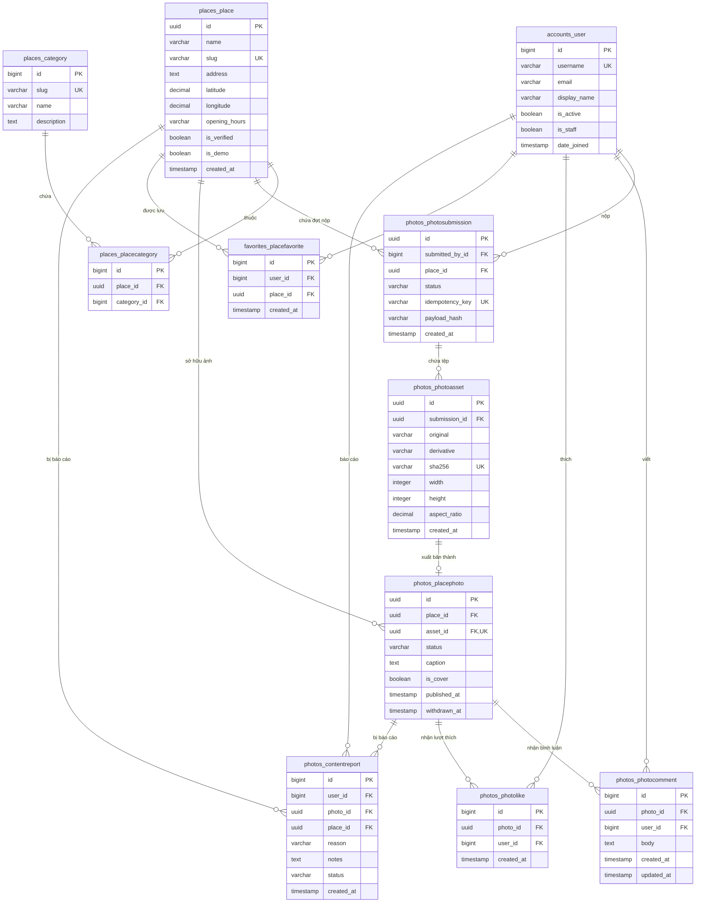

*Phân tích các quan hệ cốt lõi:*
- **Quan hệ 1-1 giữa `PhotoAsset` và `PlacePhoto`:** Mỗi bản ghi tệp nhị phân vật lý (`PhotoAsset`) tương ứng với duy nhất một bản ghi hiển thị trên giao diện (`PlacePhoto`) thông qua ràng buộc `unique=True` trên khóa ngoại `asset_id`. Sự tách biệt này giúp cô lập thông tin kỹ thuật của tệp (mã băm, đường dẫn tệp trên đĩa, độ phân giải) khỏi các thông tin ngữ cảnh nghiệp vụ (chú thích, trạng thái duyệt, thời điểm xuất bản).
- **Quan hệ 1-N giữa `Place` và `PlacePhoto`:** Một địa điểm có thể chứa nhiều bức ảnh không gian khác nhau nhưng mỗi bức ảnh chỉ thuộc về một địa điểm xác định.
- **Quan hệ N-N giữa `Place` và `Category`:** Được hiện thực hóa qua bảng trung gian `places_placecategory`, cho phép một quán cà phê vừa thuộc danh mục *Học bài*, vừa thuộc danh mục *Mở 24/7*.
- **Quan hệ N-N giữa `User` và `Place`:** Được quản lý qua bảng `favorites_placefavorite` với ràng buộc duy nhất trên cặp `(user, place)`, bảo đảm một người dùng không thể lưu trùng lặp một quán nhiều lần.

### 4.4.3. Từ điển dữ liệu các thực thể cốt lõi

Bảng dưới đây mô tả chi tiết các trường dữ liệu, kiểu dữ liệu và ý nghĩa nghiệp vụ trong cơ sở dữ liệu:

| Bảng dữ liệu | Tên trường | Kiểu dữ liệu | Ràng buộc | Ý nghĩa và Quy tắc nghiệp vụ |
| :--- | :--- | :--- | :---: | :--- |
| `accounts_user` | `id` | BigInt | PK | Định danh người dùng tự tăng. |
| | `username` | VarChar(150) | Unique | Tên đăng nhập duy nhất trong hệ thống. |
| | `email` | VarChar(254) | Indexed | Địa chỉ thư điện tử; bị đặt lại thành chuỗi ngẫu nhiên khi xóa tài khoản. |
| | `display_name`| VarChar(120) | Not Null | Tên hiển thị công khai trên giao diện bài đăng và bình luận. |
| | `is_active` | Boolean | Default True | Cờ kích hoạt tài khoản; chuyển thành `False` khi thực hiện vô danh hóa. |
| | `is_staff` | Boolean | Default False| Cờ phân quyền quản trị Django Admin. |
| `places_place` | `id` | UUID | PK | Khóa chính ngẫu nhiên UUIDv4. |
| | `name` | VarChar(255) | Not Null | Tên cơ sở kinh doanh / quán cà phê. |
| | `slug` | SlugField(255)| Unique | Định danh URL thân thiện cho SEO và điều hướng. |
| | `address` | Text | Not Null | Địa chỉ hành chính thực tế tại Đà Nẵng. |
| | `latitude` | Decimal(9,6) | Nullable | Vĩ độ địa lý WGS 84 (giới hạn từ -90 đến 90). |
| | `longitude` | Decimal(9,6) | Nullable | Kinh độ địa lý WGS 84 (giới hạn từ -180 đến 180). |
| | `opening_hours`| VarChar(120)| Blank True | Chuỗi mô tả khung giờ mở cửa. |
| | `is_verified` | Boolean | Default False| Huy hiệu xác thực địa điểm chính thức. |
| `photos_photosubmission` | `id` | UUID | PK | Định danh phiên đóng góp ảnh. |
| | `submitted_by_id`| BigInt | FK | Người dùng thực hiện đóng góp. |
| | `place_id` | UUID | FK | Quán cà phê nhận ảnh đóng góp. |
| | `idempotency_key`| VarChar(64) | Unique, Index | Khóa chống gửi lặp do máy khách sinh ra. |
| | `payload_hash`| VarChar(64) | Not Null | Mã băm SHA-256 đối chiếu tính toàn vẹn của payload. |
| `photos_photoasset` | `id` | UUID | PK | Định danh tệp phương tiện vật lý. |
| | `original` | FileField | Not Null | Đường dẫn tệp ảnh gốc (`visual/originals/{uuid}.jpg`). |
| | `derivative` | ImageField | Not Null | Đường dẫn tệp ảnh phái sinh (`visual/derivatives/{uuid}.jpg`). |
| | `sha256` | VarChar(64) | Unique, Index | Mã băm toàn vẹn tệp nhị phân chống lưu trùng. |
| | `width`, `height`| Integer | Check > 0 | Kích thước điểm ảnh thực tế. |
| | `aspect_ratio`| Decimal(6,4) | Check > 0 | Tỷ lệ khung hình phục vụ bố cục Masonry. |
| `photos_placephoto` | `id` | UUID | PK | Định danh bức ảnh xuất bản. |
| | `place_id` | UUID | FK, Index | Quán cà phê chứa ảnh. |
| | `asset_id` | UUID | FK, Unique | Tệp phương tiện tương ứng. |
| | `status` | VarChar(20) | Indexed | Trạng thái: `pending_review`, `published`, `withdrawn`. |
| | `caption` | Text | Blank True | Chú thích nội dung bức ảnh. |
| | `is_cover` | Boolean | Default False| Đánh dấu ảnh đại diện chính của quán. |
| `photos_photocomment` | `id` | BigInt | PK | Định danh bình luận tự tăng. |
| | `photo_id` | UUID | FK, Index | Bức ảnh nhận bình luận. |
| | `user_id` | BigInt | FK | Tác giả viết bình luận. |
| | `body` | Text | Check trim > 0| Nội dung bình luận, cấm chuỗi rỗng hoặc chỉ có khoảng trắng. |
| `photos_contentreport`| `id` | BigInt | PK | Định danh báo cáo vi phạm. |
| | `user_id` | BigInt | FK | Người gửi báo cáo. |
| | `photo_id` | UUID | FK, Nullable | Bức ảnh bị báo cáo (nếu có). |
| | `place_id` | UUID | FK, Nullable | Địa điểm bị báo cáo (nếu có). |
| | `reason` | VarChar(32) | Not Null | Phân loại lý do báo cáo vi phạm. |
| | `status` | VarChar(20) | Default 'pending'| Trạng thái xử lý: `pending` hoặc `resolved`. |

### 4.4.4. Ràng buộc toàn vẹn cơ sở dữ liệu và Chỉ mục hiệu năng
Để bảo đảm tính toàn vẹn dữ liệu ở mức sâu nhất, hệ thống triển khai các ràng buộc Check Constraints và các chỉ mục phức hợp trong tệp migration [`0007_schema_invariants_and_constraints.py`](file:///home/longtran/Projects/rendez-web/backend/apps/photos/migrations/0007_schema_invariants_and_constraints.py) và [`0008_add_placephoto_performance_indexes.py`](file:///home/longtran/Projects/rendez-web/backend/apps/photos/migrations/0008_add_placephoto_performance_indexes.py):

* **Ràng buộc kiểm tra tính hợp lệ của bình luận:**
  ```sql
  CONSTRAINT photo_comment_non_empty_body CHECK (length(trim(body)) > 0)
  ```
  Ngăn chặn việc người dùng hoặc script tự động gửi các bình luận rỗng lên cơ sở dữ liệu.
* **Ràng buộc duy nhất có điều kiện cho báo cáo vi phạm (Conditional Unique Constraint):**
  ```sql
  CREATE UNIQUE INDEX unique_pending_photo_report
  ON photos_contentreport (user_id, photo_id)
  WHERE status = 'pending';
  ```
  Ràng buộc này cho phép một người dùng có thể báo cáo lại một bức ảnh sau khi báo cáo trước đó đã được giải quyết (`status = 'resolved'`), nhưng nghiêm cấm gửi nhiều báo cáo cùng lúc khi báo cáo cũ đang trong trạng thái chờ duyệt (`pending`).
* **Ràng buộc logic ảnh đại diện quán:**
  ```sql
  CONSTRAINT place_photo_cover_published CHECK (is_cover = False OR status = 'approved')
  ```
  Bảo đảm chỉ những bức ảnh đã được phê duyệt xuất bản mới được phép hiển thị làm ảnh bìa của địa điểm.
* **Các chỉ mục phức hợp tối ưu hóa truy vấn (Composite Performance Indexes):**
  - Chỉ mục `photos_plac_status_4b2f9c_idx` trên các cột `(status, -published_at, id)` của bảng `photos_placephoto`: Tối ưu hóa câu truy vấn nạp feed ảnh công khai theo thứ tự thời gian mới nhất, cho phép quét chỉ mục (Index Scan) trực tiếp mà không cần sắp xếp lại toàn bộ bảng dữ liệu.
  - Chỉ mục `photos_plac_place_i_e5e2f0_idx` trên các cột `(place_id, status, -published_at, id)`: Tối ưu hóa truy vấn lấy thư viện ảnh của một quán cà phê cụ thể.
  - Chỉ mục `favorites_f_user_id_5e1214_idx` trên các cột `(user_id, -created_at, id)` của bảng `favorites_placefavorite`: Tăng tốc độ hiển thị danh sách các quán đã lưu của người dùng.

### 4.4.5. Quyết định về toàn vẹn giao dịch và Dọn dẹp tệp mồ côi
Trong các thao tác ghi dữ liệu phức tạp liên quan đến cả hệ thống tệp và cơ sở dữ liệu (chẳng hạn như đóng góp ảnh), một thách thức lớn là nguy cơ phát sinh tệp rác mồ côi (Orphaned Files) khi quá trình ghi tệp thành công nhưng giao dịch cơ sở dữ liệu bị rollback do lỗi ràng buộc.

Hệ thống giải quyết triệt để vấn đề này tại dịch vụ [`backend/apps/photos/services.py`](file:///home/longtran/Projects/rendez-web/backend/apps/photos/services.py#L82-L137):
1. Toàn bộ các thao tác tạo quán, tạo asset và tạo bài đăng được đặt bên trong khối `transaction.atomic()`.
2. Danh sách các tệp nhị phân đã ghi xuống đĩa cứng được lưu vết trong mảng tạm `written = [(storage, name), ...]`.
3. Nếu có bất kỳ lỗi ngoại lệ nào xảy ra trong quá trình commit giao dịch cơ sở dữ liệu, khối `except Exception:` sẽ bắt lỗi và duyệt qua danh sách `written` để gọi lệnh xóa vật lý `storage.delete(name)` cho từng tệp vừa tạo trước khi re-raise lỗi. Cơ chế này bảo đảm kho lưu trữ đĩa cứng luôn đồng bộ tuyệt đối với dữ liệu trong cơ sở dữ liệu.

---

## 4.5. Thiết kế giao diện lập trình ứng dụng (RESTful API Design)

### 4.5.1. Nguyên tắc giao tiếp và Chuẩn hóa cấu trúc phản hồi
Hệ thống Rendez thiết kế giao diện lập trình ứng dụng tuân thủ các nguyên tắc RESTful [1]:
- Tên tài nguyên sử dụng danh từ số nhiều ở dạng chữ thường (`/api/v1/photos/`, `/api/v1/places/`, `/api/v1/comments/`).
- Sử dụng chính xác các động từ HTTP tương ứng với bản chất thao tác: `GET` (đọc dữ liệu an toàn), `POST` (tạo tài nguyên mới), `PATCH` (cập nhật từng phần), `PUT` (cập nhật toàn bộ hoặc tạo idempotent), `DELETE` (xóa hoặc thu hồi tài nguyên).
- Sử dụng mã trạng thái HTTP chuẩn để phản ánh kết quả: `200 OK`, `201 Created`, `204 No Content`, `400 Bad Request`, `401 Unauthorized`, `403 Forbidden`, `404 Not Found`, `503 Service Unavailable`.
- Toàn bộ các phản hồi lỗi đều được chuẩn hóa qua hàm `exception_handler` tại [`backend/config/api.py`](file:///home/longtran/Projects/rendez-web/backend/config/api.py) theo cấu trúc phong bì JSON thống nhất:
  ```json
  {
    "code": "validation_error",
    "message": "Kiểm tra lại thông tin đã nhập.",
    "fields": {
      "images": ["Gửi từ 1 đến 5 ảnh."]
    },
    "request_id": "a4b2c1d3e5f6..."
  }
  ```
  Trường `request_id` dạng mã băm ngẫu nhiên giúp truy vết lỗi nhanh chóng trong tệp nhật ký máy chủ `access.log` mà không để lộ cấu trúc bảng hay stack trace nhạy cảm ra ngoài.

### 4.5.2. Danh mục 29 API Endpoints theo chuẩn OpenAPI 3.0
Toàn bộ hệ sinh thái giao tiếp của Rendez bao gồm 29 endpoints độc lập:

1. **Nhóm Giám sát và Tiện ích hệ thống (4 endpoints):**
   - `GET /api/v1/health/`: Kiểm tra tình trạng kết nối cơ sở dữ liệu qua `SELECT 1`.
   - `GET /api/v1/auth/csrf/`: Cấp phát token CSRF qua JSON cho máy khách SPA.
   - `GET /api/v1/schema/`: Xuất bản lược đồ OpenAPI 3.0 dạng YAML (Yêu cầu đăng nhập).
   - `GET /api/v1/docs/`: Giao diện tài liệu Swagger UI tương tác (Yêu cầu đăng nhập).
2. **Nhóm Xác thực và Quản lý Người dùng (7 endpoints):**
   - `POST /api/v1/auth/register/`: Đăng ký tài khoản người dùng mới.
   - `POST /api/v1/auth/login/`: Xác thực tên đăng nhập/mật khẩu và thiết lập phiên làm việc.
   - `POST /api/v1/auth/logout/`: Hủy bỏ phiên làm việc và xóa cookie xác thực.
   - `GET /api/v1/auth/me/`: Lấy thông tin tài khoản của người dùng đang đăng nhập.
   - `PATCH /api/v1/auth/me/`: Cập nhật tên hiển thị `display_name`.
   - `DELETE /api/v1/auth/me/`: Yêu cầu xóa tài khoản, thực hiện vô danh hóa dữ liệu và rút ảnh.
   - `POST /api/v1/auth/password/`: Đổi mật khẩu tài khoản và cập nhật `session_auth_hash`.
   - `GET /api/v1/creators/{id}/`: Lấy thông tin hồ sơ công khai của tác giả ảnh.
   - `GET /api/v1/creators/{id}/photos/`: Danh mục ảnh đã đăng của tác giả.
3. **Nhóm Địa điểm và Bản đồ số (7 endpoints):**
   - `GET /api/v1/categories/`: Danh sách các danh mục phân loại không gian.
   - `GET /api/v1/places/`: Danh sách địa điểm có hỗ trợ tìm kiếm từ khóa và lọc danh mục.
   - `GET /api/v1/places/{id}/`: Thông tin chi tiết của một địa điểm cụ thể.
   - `GET /api/v1/places/{id}/photos/`: Toàn bộ bộ sưu tập ảnh thuộc về địa điểm.
   - `GET /api/v1/places/map/`: Truy vấn danh sách địa điểm nằm trong hình chữ nhật bao quanh (Bounding Box).
   - `GET /api/v1/places/geocode/`: Định vị tọa độ thời gian thực từ chuỗi địa chỉ văn bản.
   - `POST /api/v1/places/{id}/report/`: Gửi báo cáo vi phạm đối với địa điểm.
4. **Nhóm Khám phá và Tương tác Hình ảnh (7 endpoints):**
   - `GET /api/v1/feed/`: Lấy danh sách ảnh công khai phân trang cho lưới Masonry.
   - `GET /api/v1/attributes/`: Danh sách nhãn đặc điểm thị giác (Cây xanh, Ổ cắm, Bàn học...).
   - `GET /api/v1/photos/{id}/`: Chi tiết một bức ảnh kèm thông tin quán liên kết.
   - `GET /api/v1/photos/{id}/similar/`: Gợi ý các bức ảnh tương đồng về thuộc tính.
   - `POST /api/v1/photos/{id}/likes/`: Thao tác thích hoặc hủy thích một bức ảnh.
   - `GET /api/v1/photos/{id}/comments/`: Danh sách bình luận công khai của bức ảnh.
   - `POST /api/v1/photos/{id}/comments/`: Viết bình luận mới vào bức ảnh.
   - `PATCH /api/v1/comments/{id}/`: Chỉnh sửa nội dung bình luận của chính mình.
   - `DELETE /api/v1/comments/{id}/`: Xóa bình luận của chính mình.
   - `PATCH /api/v1/photos/{id}/manage/`: Chỉnh sửa chú thích ảnh do mình đăng tải.
   - `DELETE /api/v1/photos/{id}/manage/`: Rút bức ảnh của mình khỏi trang công khai.
   - `POST /api/v1/photos/{id}/report/`: Gửi báo cáo vi phạm đối với bức ảnh.
5. **Nhóm Đóng góp, Phục vụ Phương tiện và Yêu thích (4 endpoints):**
   - `POST /api/v1/photo-submissions/`: Nộp bài đóng góp ảnh thực địa mới kèm `Idempotency-Key`.
   - `GET /api/v1/photo-submissions/`: Lịch sử các bài đóng góp ảnh của người dùng hiện tại.
   - `GET /api/v1/photo-submissions/{id}/`: Chi tiết một đợt đóng góp cụ thể.
   - `GET /public-photo-media/{id}/`: Phục vụ tệp ảnh phái sinh của các bài đăng đã xuất bản.
   - `GET /private-photo-media/{id}/`: Phục vụ tệp ảnh phái sinh riêng tư (chỉ chủ bài đăng hoặc staff).
   - `GET /private-photo-original/{id}/`: Phục vụ tệp ảnh gốc chất lượng cao (chỉ staff có quyền).
   - `GET /api/v1/favorites/`: Danh sách các địa điểm người dùng đã lưu vào bộ sưu tập.
   - `PUT /api/v1/favorites/{id}/`: Lưu một địa điểm vào danh sách yêu thích.
   - `DELETE /api/v1/favorites/{id}/`: Xóa địa điểm khỏi danh sách yêu thích.

### 4.5.3. Đặc tả chi tiết các API trọng yếu kèm ví dụ thực tế

#### 1. API Xác thực đăng nhập: `POST /api/v1/auth/login/`
- **Mục đích:** Xác thực danh tính người dùng qua tên đăng nhập và mật khẩu, thiết lập cookie phiên làm việc.
- **Yêu cầu xác thực:** Public. Áp dụng Rate Limit `20/min`.
- **Dữ liệu đầu vào (Headers & Body):**
  - Tiêu đề bắt buộc: `Content-Type: application/json`, `X-CSRFToken: <csrf_token>`.
  - Thân yêu cầu (JSON):
    ```json
    {
      "username": "sinhvien_dut",
      "password": "MatKhauBaoMat123@"
    }
    ```
- **Kết quả trả về thành công (HTTP 200 OK):**
  - Tiêu đề phản hồi: `Set-Cookie: sessionid=...; HttpOnly; SameSite=Lax; Path=/`.
  - Thân phản hồi (JSON):
    ```json
    {
      "id": 14,
      "username": "sinhvien_dut",
      "email": "sinhvien@dut.udn.vn",
      "display_name": "Nguyễn Văn A",
      "is_staff": false
    }
    ```
- **Các trường hợp lỗi thực tế:**
  - `HTTP 400 Bad Request`: Thiếu trường username hoặc password.
  - `HTTP 400 Bad Request`: Tên đăng nhập hoặc mật khẩu không chính xác (`"Thông tin đăng nhập không chính xác."`).
  - `HTTP 429 Too Many Requests`: Gửi quá 20 yêu cầu trong 1 phút từ cùng một địa chỉ IP.

#### 2. API Khám phá thị giác: `GET /api/v1/feed/`
- **Mục đích:** Cung cấp danh sách các bức ảnh không gian đã phê duyệt kèm thông tin quán phục vụ lưới Masonry.
- **Yêu cầu xác thực:** Bắt buộc (`IsAuthenticated`).
- **Tham số truy vấn (Query Parameters):**
  - `page` (Integer, default 1): Số thứ tự trang cần nạp.
  - `page_size` (Integer, default 20, max 50): Số phần tử trên mỗi trang.
  - `q` (String, optional): Từ khóa tìm kiếm theo tên quán hoặc địa chỉ.
  - `attributes` (String, optional): Danh sách mã thuộc tính ngăn cách bằng dấu phẩy (`plants,study,night`).
- **Kết quả trả về thành công (HTTP 200 OK):**
  ```json
  {
    "count": 36,
    "next": "/api/v1/feed/?page=2",
    "previous": null,
    "results": [
      {
        "photo": {
          "id": "7b07f2c3-425c-e304-9123-abcdef012345",
          "place_id": "4a123456-7890-abcd-ef12-34567890abcd",
          "url": "/public-photo-media/7b07f2c3-425c-e304-9123-abcdef012345/",
          "width": 1600,
          "height": 1067,
          "alt_text": "Không gian bàn dài học bài và nhiều ổ cắm điện tại The Deadline Lab",
          "caption": "Khu vực tầng 2 yên tĩnh có điều hòa và ánh sáng tự nhiên",
          "published_at": "2026-10-25T08:30:00Z",
          "attributes": [
            {
              "code": "study",
              "display_name_vi": "Bàn học & Ổ cắm",
              "description": "Bàn ghế chuẩn công thái học và có ổ cắm điện thuận tiện"
            }
          ],
          "matched_attribute_codes": ["study"],
          "author_id": "9a8b7c6d-5e4f-3a2b-1c0d-e9f8a7b6c5d4",
          "author_name": "Sinh viên Bách Khoa",
          "is_owner": false
        },
        "place": {
          "id": "4a123456-7890-abcd-ef12-34567890abcd",
          "name": "The Deadline Lab · Ngô Thì Nhậm",
          "category": {
            "slug": "study",
            "name": "Học bài & Deadline"
          },
          "address": "48 Ngô Thì Nhậm, Hòa Khánh Bắc, Liên Chiểu, Đà Nẵng",
          "latitude": 16.075421,
          "longitude": 108.153218,
          "cover_image_url": "/public-photo-media/7b07f2c3-425c-e304-9123-abcdef012345/",
          "cover_photo_id": "7b07f2c3-425c-e304-9123-abcdef012345",
          "is_saved": false,
          "supporting_photo": null
        }
      }
    ]
  }
  ```

#### 3. API Đóng góp ảnh thực địa: `POST /api/v1/photo-submissions/`
- **Mục đích:** Tải lên từ 1 đến 5 bức ảnh chụp thực tế kèm thông tin quán mới hoặc gán vào quán hiện có.
- **Yêu cầu xác thực:** Bắt buộc (`IsAuthenticated`). Áp dụng Rate Limit `10/min`.
- **Dữ liệu đầu vào (Multipart Form Data):**
  - Tiêu đề bắt buộc: `Idempotency-Key: c9d8e7f6-a5b4-3c2d-1e0f-9a8b7c6d5e4f`, `X-CSRFToken: <token>`.
  - Các trường biểu mẫu:
    - `images`: Mảng tệp nhị phân ảnh (từ 1 đến 5 tệp, tổng dung lượng $\le 30$ MiB).
    - `place_id` (UUID, optional): Định danh của quán đã có trong danh mục.
    - `proposed_name` (String, optional): Tên quán đề xuất mới (nếu chưa có trong danh mục).
    - `proposed_address` (String, optional): Địa chỉ quán đề xuất.
    - `proposed_category` (String, optional): Slug danh mục (`study`, `night`, `garden`...).
    - `latitude`, `longitude` (Decimal, optional): Tọa độ địa lý tra cứu từ bản đồ.
    - `caption` (String, optional): Chú thích chung cho đợt ảnh.
    - `consent` (Boolean, bắt buộc `true`): Cam kết bản quyền và sự đồng ý của tác giả.
    - `consent_version` (String, bắt buộc `"photo-rights-v2"`): Phiên bản điều khoản bản quyền.
- **Kết quả trả về thành công (HTTP 201 Created):**
  ```json
  {
    "id": "3f2e1d0c-b9a8-7654-3210-fedcba987654",
    "place_id": "4a123456-7890-abcd-ef12-34567890abcd",
    "place_name": "The Deadline Lab · Ngô Thì Nhậm",
    "status": "approved",
    "submitted_at": "2026-10-28T02:15:30Z",
    "published_at": "2026-10-28T02:15:30Z",
    "reason": "",
    "assets": [
      {
        "id": "1a2b3c4d-5e6f-7a8b-9c0d-1e2f3a4b5c6d",
        "url": "/public-photo-media/1a2b3c4d-5e6f-7a8b-9c0d-1e2f3a4b5c6d/",
        "width": 1920,
        "height": 1280,
        "aspect_ratio": 1.5,
        "sort_order": 0
      }
    ]
  }
  ```
- **Các trường hợp lỗi thực tế:**
  - `HTTP 400 Bad Request`: `consent` là `false` (`{"consent": ["Xác nhận quyền đăng ảnh trước khi gửi."]}`).
  - `HTTP 400 Bad Request`: Số lượng ảnh vượt quá 5 tệp hoặc rỗng (`{"images": ["Gửi từ 1 đến 5 ảnh."]}`).
  - `HTTP 400 Bad Request`: Tổng dung lượng ảnh tải lên vượt quá 30 MiB (`{"images": ["Tổng dung lượng các ảnh gửi lên không được vượt quá 30 MiB."]}`).
  - `HTTP 400 Bad Request`: Quán gắn ảnh đã bị xóa hoặc không còn hoạt động (`"Quán không còn khả dụng."`).

#### 4. API Bản đồ theo khung nhìn: `GET /api/v1/places/map/`
- **Mục đích:** Truy vấn các địa điểm nằm trọn vẹn trong hình chữ nhật bao quanh của khung nhìn bản đồ hiện tại.
- **Yêu cầu xác thực:** Bắt buộc (`IsAuthenticated`).
- **Tham số truy vấn (Query Parameters):**
  - `bbox` (String, bắt buộc): Chuỗi 4 số thực phân cách bằng dấu phẩy theo thứ tự `min_lon,min_lat,max_lon,max_lat` (ví dụ: `108.140,16.065,108.165,16.085`).
  - `category` (String, optional): Lọc theo slug danh mục.
- **Kết quả trả về thành công (HTTP 200 OK):**
  ```json
  {
    "count": 6,
    "total_places": 12,
    "truncated": false,
    "results": [
      {
        "id": "4a123456-7890-abcd-ef12-34567890abcd",
        "name": "The Deadline Lab · Ngô Thì Nhậm",
        "category": { "slug": "study", "name": "Học bài & Deadline" },
        "address": "48 Ngô Thì Nhậm, Hòa Khánh Bắc, Liên Chiểu",
        "latitude": 16.075421,
        "longitude": 108.153218,
        "cover_image_url": "/public-photo-media/7b07f2c3-425c-e304-9123-abcdef012345/",
        "is_saved": true
      }
    ]
  }
  ```
- **Các trường hợp lỗi thực tế:**
  - `HTTP 400 Bad Request`: Sai định dạng `bbox` hoặc thiếu tham số (`"Tham số bbox không hợp lệ. Định dạng chuẩn: min_lon,min_lat,max_lon,max_lat"`).
  - `HTTP 400 Bad Request`: Phạm vi khung nhìn vượt quá giới hạn an toàn (> 2.0 độ kinh tuyến/vĩ tuyến) để phòng ngừa tấn công từ chối dịch vụ làm quá tải cơ sở dữ liệu.

#### 5. API Định vị Geocoding: `GET /api/v1/places/geocode/`
- **Mục đích:** Chuyển đổi địa chỉ văn bản thành danh sách gợi ý tọa độ địa lý chính xác.
- **Yêu cầu xác thực:** Bắt buộc (`IsAuthenticated`).
- **Tham số truy vấn:** `q` (String, bắt buộc): Chuỗi địa chỉ cần tra cứu (ví dụ: `54 Nguyen Luong Bang`).
- **Kết quả trả về thành công (HTTP 200 OK):**
  ```json
  [
    {
      "label": "54 Nguyễn Lương Bằng, Phường Hòa Khánh Bắc, Quận Liên Chiểu, Đà Nẵng",
      "latitude": 16.073821,
      "longitude": 108.149872,
      "source": "photon"
    }
  ]
  ```
- **Các trường hợp lỗi thực tế:**
  - `HTTP 400 Bad Request`: Tham số `q` rỗng hoặc chỉ chứa ký tự khoảng trắng.
  - `HTTP 200 OK kèm mảng rỗng []`: Khi không tìm thấy kết quả hoặc toàn bộ các dịch vụ GIS ngoài đều timeout sau 4 giây (Giao diện phía máy khách sẽ xử lý bằng cách cho phép người dùng tự ghim vị trí thủ công trên bản đồ).

#### 6. API Phục vụ Media bảo vệ: `GET /public-photo-media/{id}/` và `/private-photo-original/{id}/`
- **Mục đích:** Phục vụ nội dung tệp hình ảnh nhị phân trực tiếp từ đĩa cứng với tiêu chuẩn kiểm soát quyền truy cập nghiêm ngặt.
- **Cơ chế phân quyền theo endpoint:**
  - `/public-photo-media/{id}/`: Công khai. Chỉ phục vụ các bức ảnh thuộc bài đăng có trạng thái `approved` gắn với quán cà phê đang hoạt động bình thường. Nếu ảnh đã bị rút (`withdrawn`) hoặc quán bị ẩn, API trả về `HTTP 404 Not Found`.
  - `/private-photo-media/{id}/`: Yêu cầu xác thực. Chỉ phục vụ ảnh phái sinh cho chính người đã tải lên bức ảnh đó (`submitted_by_id == request.user.id`) hoặc nhân viên có quyền quản trị (`request.user.is_staff`). Người dùng khác truy cập sẽ nhận mã lỗi `HTTP 404 Not Found`.
  - `/private-photo-original/{id}/`: Giới hạn đặc quyền. Chỉ dành riêng cho nhân viên có quyền `photos.review_photosubmission`. Người dùng thông thường cố tình truy cập sẽ nhận mã lỗi `HTTP 403 Forbidden` hoặc `404 Not Found`.
- **Tiêu đề phản hồi an toàn:**
  - `Content-Type: image/jpeg`
  - `X-Content-Type-Options: nosniff` (Ngăn chặn trình duyệt tự ý đoán định dạng tệp để thực thi mã độc MIME sniffing).
  - `ETag: "<sha256_hash>"` (Hỗ trợ trình duyệt lưu cache và gửi lại `If-None-Match` để nhận mã phản hồi `304 Not Modified`, tiết kiệm băng thông mạng).

---

## 4.6. Phân tích các quyết định thiết kế, đánh đổi và phụ thuộc bên ngoài

### 4.6.1. Đánh đổi kỹ thuật giữa các yêu cầu thực tế
1. **Lựa chọn mô hình Monolith phân tầng thay vì Microservices:**
   - *Quyết định:* Toàn bộ các mô-đun được triển khai trong cùng một ứng dụng Django duy nhất.
   - *Đánh đổi:* Chấp nhận không thể nhân rộng quy mô (Scale-out) riêng lẻ cho từng dịch vụ (ví dụ: tách riêng dịch vụ tiền xử lý ảnh đòi hỏi CPU cao). Tuy nhiên, đổi lại hệ thống duy trì được tính đơn giản tối đa trong triển khai, không phát sinh chi phí điều phối mạng và bảo đảm được tính toàn vẹn giao dịch ACID tuyệt đối trên cơ sở dữ liệu PostgreSQL cục bộ.
2. **Lưu trữ tệp cục bộ (.local/media) thay vì Dịch vụ Đám mây (AWS S3 / Cloudflare R2):**
   - *Quyết định:* Lưu trữ trực tiếp trên đĩa cứng máy chủ cục bộ.
   - *Đánh đổi:* Hệ thống phụ thuộc vào dung lượng đĩa cứng vật lý và đòi hỏi quy trình sao lưu tệp đính kèm thủ công (`scripts/backup-local.sh`). Quyết định này giúp hệ thống đạt tiêu chí tự chủ dữ liệu 100% (Local-First), không phát sinh bất kỳ khoản phí duy trì đám mây nào và không bị rủi ro rò rỉ dữ liệu qua bên thứ ba.
3. **Cơ chế xác thực Session/Cookie thay vì JWT:**
   - *Quyết định:* Duy trì phiên trong cơ sở dữ liệu qua cookie `HttpOnly`.
   - *Đánh đổi:* Máy chủ phải thực hiện truy vấn đọc bảng session trên mỗi request có xác thực (được tối ưu qua cơ chế cache bộ nhớ của Django). Đổi lại, hệ thống có khả năng vô hiệu hóa tức thời các phiên làm việc khi người dùng đổi mật khẩu hoặc xóa tài khoản.

### 4.6.2. Các phụ thuộc bên ngoài và Điểm có thể gây lỗi (Fault Points)
Mặc dù hệ thống được thiết kế theo hướng ưu tiên tự chủ cục bộ, việc phân tích khách quan cho thấy vẫn tồn tại một số điểm phụ thuộc bên ngoài và nguy cơ tiềm ẩn:

1. **Phụ thuộc vào máy chủ Raster Tiles của Esri ArcGIS:** Lớp nền bản đồ đường phố được nạp trực tiếp từ `server.arcgisonline.com`. Nếu máy chủ này thay đổi chính sách CORS, chặn dải IP hoặc thiết bị máy khách mất kết nối Internet, lớp nền bản đồ đường phố sẽ không thể hiển thị (hệ thống sẽ hiển thị nền màu `#f3f0e8` và thông báo lỗi).
2. **Độ trễ và giới hạn kết nối của các dịch vụ Geocoding công khai:** Các API Photon và Nominatim là dịch vụ công cộng miễn phí, có thể bị quá tải vào giờ cao điểm hoặc phản hồi chậm. Điểm này được hệ thống giảm thiểu bằng việc thiết lập thời gian chờ tối đa 4 giây và cơ chế fallback tuần tự sang Esri hoặc dữ liệu nội suy `region.geojson` cục bộ.
3. **Điểm lỗi đơn lẻ về lưu trữ (Single Point of Storage Failure):** Việc toàn bộ ảnh gốc và ảnh phái sinh được lưu trong một thư mục duy nhất `.local/media` đồng nghĩa với việc nếu ổ cứng bị hỏng hoặc đầy dung lượng, tính năng tải ảnh sẽ bị tê liệt. Do đó, quy trình vận hành thực tế bắt buộc phải thiết lập cảnh báo dung lượng đĩa và kích hoạt script sao lưu định kỳ.
4. **Giới hạn số lượng tiến trình Worker của Gunicorn:** Cấu hình mặc định trong `scripts/start-local.sh` sử dụng 2 workers. Mặc dù phù hợp cho việc kiểm thử và chạy trình diễn cục bộ, cấu hình này sẽ trở thành điểm nghẽn cổ chai nếu có đồng thời hàng trăm người dùng gửi request xử lý ảnh cùng lúc. Trong môi trường thương mại, cần đặt một Reverse Proxy (Nginx) phía trước để phân phối tải và tăng số lượng worker tương ứng với số lõi CPU của máy chủ.

---

## 4.7. Thiết kế giao diện người dùng và Luồng tương tác (UI & Interaction Flows)

Thiết kế giao diện người dùng của Rendez được xây dựng trên nền tảng Single Page Application (SPA) sử dụng React 19, TypeScript và Tailwind CSS. Toàn bộ trải nghiệm người dùng được cấu trúc xoay quanh nguyên lý khám phá thị giác trực quan (Visual-First Exploration), tích hợp mật thiết với hệ thống bản đồ số và các luồng nghiệp vụ xác thực, đóng góp cộng đồng.

### 4.7.1. Phân vùng kiến trúc giao diện và Hệ thống định tuyến (Layout Architecture & Router Mapping)
Giao diện ứng dụng được bao bọc bởi cấu trúc khung vỏ thống nhất (`AppShell`), phân chia không gian làm việc thành 3 khu vực chức năng cố định:

```
+---------------------------------------------------------------------------------------+
|  VÙNG ĐIỀU HƯỚNG CỐ ĐỊNH (RAIL SIDEBAR)  |  THANH CÔNG CỤ ĐIỀU KHIỂN (WORKSPACE TOPBAR)       |
|  - Biểu tượng thương hiệu Rendez (r.)    |  - Ô tìm kiếm toàn văn (SearchBar)                 |
|  - Khám phá (/discover)                  |  - Phím tắt đăng ảnh nhanh (Camera Button)         |
|  - Bản đồ tương tác (/map)               |  - Trình đơn tài khoản & Đăng xuất (AccountMenu)   |
|  - Đăng ảnh mới (/submissions/new)       +----------------------------------------------------+
|  - Địa điểm đã lưu (/saved)              |  VÙNG NỘI DUNG CHÍNH (MAIN WORKSPACE CONTENT)      |
|  - Hồ sơ cá nhân (/profile)              |  - Lưới ảnh Masonry / Bản đồ MapLibre / Chi tiết   |
|  - Nhãn chân trang: Đà Nẵng              |  - Bộ lọc đặc điểm / Biểu mẫu đóng góp đa bước     |
+------------------------------------------+----------------------------------------------------+
```

1. **Cột điều hướng cố định (Rail Sidebar):** Nằm ở cạnh trái màn hình, hiển thị danh mục các phân hệ chính: Khám phá, Bản đồ, Đăng ảnh, Đã lưu và Cá nhân. Sidebar duy trì trạng thái đánh dấu mục đang hoạt động (`NavLink.isActive`), đồng thời tự động thu gọn tối giản trên màn hình kích thước nhỏ (Mobile Viewport) để nhường toàn bộ diện tích cho nội dung thị giác.
2. **Thanh công cụ trên đỉnh (Workspace Topbar):** Chứa thanh tìm kiếm toàn văn (`SearchBar`), phím tắt đăng ảnh nhanh (`topbar-post`) và trình đơn tài khoản người dùng (`AccountMenu`). Ô tìm kiếm được lập trình để tự động giữ lại các tham số truy vấn ngữ cảnh (như danh mục và bộ lọc không gian) khi người dùng nhập từ khóa mới. Trình đơn tài khoản hiển thị ký tự viết hoa đầu tiên của tên người dùng làm avatar đại diện, quản lý tiêu điểm bàn phím chặt chẽ và tự động đóng lại khi người dùng nhấn phím `Escape` hoặc nhấp chuột ra ngoài vùng chứa.
3. **Vùng nội dung chính (Main Content / `<Outlet />`):** Là khu vực kết xuất linh hoạt của các trang chức năng. Để đảm bảo khả năng tiếp cận, đỉnh vùng làm việc luôn chứa một liên kết nhảy vô hình (`<a href="#main" className="skip-link">`), cho phép người dùng sử dụng phím Tab có thể bỏ qua toàn bộ danh sách điều hướng và di chuyển tiêu điểm trực tiếp vào nội dung trọng tâm.

Hệ thống định tuyến phía máy khách được quản lý bởi thư viện `react-router` (phiên bản 7), định nghĩa 11 tuyến đường chức năng và được bảo vệ bởi các ranh giới kiểm soát phiên (`RequireLogin` và `AuthGate`):

| Tuyến đường (Route Path) | Component giao diện | Phương thức tải | Trách nhiệm và Quyền truy cập |
| :--- | :--- | :---: | :--- |
| `/` | `Navigate` | Tức thời | Tự động chuyển hướng về `/discover`. |
| `/discover` | `Discover` | Tức thời | Lưới ảnh thị giác khám phá toàn thành phố kèm bộ lọc danh mục và đặc điểm. Công khai. |
| `/map` | `MapPage` | Tải lười (`React.lazy`) | Bản đồ số không gian MapLibre kết hợp gạch bản đồ Esri và các điểm đánh dấu. Công khai. |
| `/saved` | `Discover (saved=true)` | Tức thời | Bộ sưu tập các địa điểm người dùng đã đánh dấu lưu. Yêu cầu đăng nhập (`RequireLogin`). |
| `/profile` | `ProfilePage` | Tức thời | Trang quản lý thông tin cá nhân, lịch sử đóng góp và đổi mật khẩu. Yêu cầu đăng nhập. |
| `/creators/:id` | `CreatorProfilePage` | Tức thời | Hồ sơ tác giả công khai hiển thị danh sách ảnh đã đóng góp và được phê duyệt. Công khai. |
| `/places/:id` | `PlaceDetailPage` | Tức thời | Trang chi tiết địa điểm, giờ mở cửa, nút chỉ đường, liên hệ chủ quán và thư viện ảnh. |
| `/photos/:id` | `PhotoDetailPage` | Tức thời | Sân khấu xem ảnh toàn khổ, điều hướng tiến/lùi, bình luận, thích và báo cáo. |
| `/submissions/new` | `NewContribution` | Tức thời | Biểu mẫu 2 bước đóng góp ảnh và đề xuất địa điểm. Yêu cầu đăng nhập (`AuthGate`). |
| `/submissions` | `ContributionHistory` | Tức thời | Danh sách theo dõi trạng thái các lượt đóng góp (approved/pending/rejected). |
| `/submissions/:id` | `ContributionDetailPage` | Tức thời | Xem lại chi tiết một lượt đóng góp cụ thể của người dùng. Yêu cầu đăng nhập. |
| `/login` | `Auth (key="login")` | Tức thời | Biểu mẫu đăng nhập xác thực bằng phiên làm việc Cookie/Session. |
| `/register` | `Auth (register=true)` | Tức thời | Biểu mẫu đăng ký tài khoản thành viên mới. |
| `*` | `State (404 Page)` | Tức thời | Bắt các tuyến đường không tồn tại, hiển thị thông báo lỗi và liên kết quay về `/discover`. |

---

### 4.7.2. Đặc tả các luồng tương tác người dùng trọng yếu (Core Interaction Flows)

#### Luồng 1: Khám phá thị giác qua Lưới ảnh Masonry và Bộ lọc đặc điểm (Visual Discovery Flow)
Luồng cho phép người dùng duyệt hàng loạt bức ảnh chất lượng cao mà không bị gián đoạn hoặc giật bố cục:

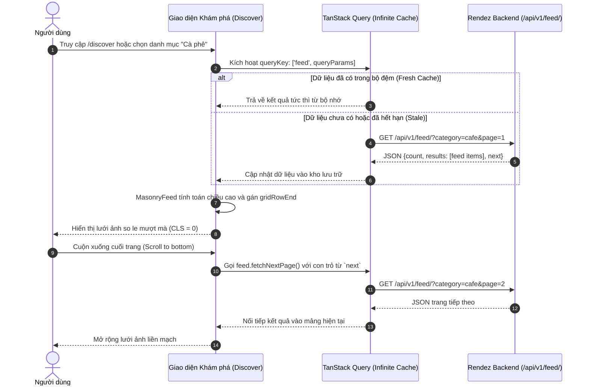

*Các bước xử lý kỹ thuật:*
1. Người dùng chọn một chip đặc điểm (ví dụ: `quiet` - Yên tĩnh, `work` - Phù hợp làm việc). Sự kiện click kích hoạt cập nhật trực tiếp chuỗi URL query string (`?attributes=quiet,work`).
2. Giao diện lắng nghe thay đổi URL thông qua hook `useSearchParams()`, kích hoạt truy vấn `useInfiniteQuery` với tham số tương ứng.
3. Khi người dùng nhấp vào một thẻ ảnh (`PhotoCard`), giao diện lưu tọa độ cuộn màn hình hiện tại (`window.scrollY`) vào `sessionStorage` gắn với khóa truy vấn. Khi người dùng nhấn nút quay lại từ trang chi tiết ảnh, vị trí cuộn được khôi phục chính xác mà không yêu cầu cuộn lại từ đầu.

#### Luồng 2: Khám phá địa lý qua Bản đồ số tương tác (Geospatial Exploration Flow)
Luồng kết nối trực quan giữa tọa độ không gian thực địa và danh sách các cơ sở dịch vụ:

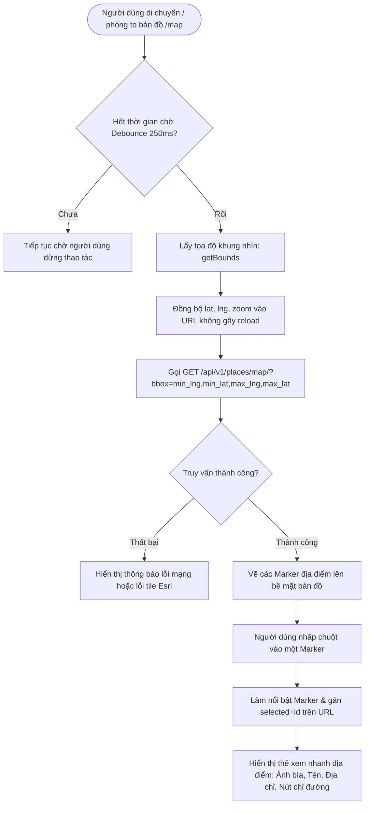

*Các bước xử lý kỹ thuật:*
1. Để tránh gây quá tải máy chủ khi người dùng rê chuột liên tục trên bản đồ, hàm `move` thiết lập một bộ đếm thời gian trễ (Debounce Timer) 250ms trước khi trích xuất ranh giới khung nhìn (`map.getBounds()`).
2. Tham số `bbox` dạng `west,south,east,north` được gửi tới API `places/map/`. Máy chủ thực hiện lọc trong cơ sở dữ liệu và chỉ trả về danh sách các địa điểm nằm trọn vẹn trong vùng hiển thị.
3. Nếu thiết bị mất kết nối tới máy chủ gạch bản đồ Esri ArcGIS, sự kiện `onError` của MapLibre bắt lỗi và kích hoạt biến cờ `tileError = true`. Bản đồ chuyển sang nền màu trung tính `#f3f0e8` và hiển thị một banner thông báo kèm nút "Thử tải lại bản đồ".

#### Luồng 3: Đóng góp hình ảnh và Đề xuất địa điểm mới (Photo Contribution & Place Proposal Flow)
Quy trình đóng góp nội dung cộng đồng được chia thành 2 bước mạch lạc (Step Wizard) trong component `PhotoForm`, giúp người dùng không bị choáng ngợp bởi lượng thông tin cần điền:

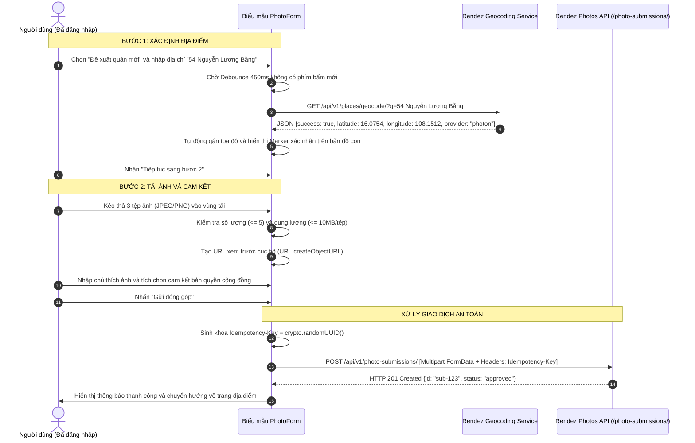

*Các bước xử lý kỹ thuật:*
1. **Kiểm tra hợp lệ trước khi gửi (Client-side Validation):** Giao diện kiểm tra định dạng tệp (chỉ chấp nhận `image/jpeg`, `image/png`, `image/webp`), từ chối các tệp vượt quá 10MB và giới hạn tối đa 5 bức ảnh trong một lượt tải.
2. **Định vị địa chỉ tức thì (Real-time Geocoding):** Khi người dùng đề xuất địa điểm mới và nhập chuỗi địa chỉ từ 3 ký tự trở lên, một bộ định thời 450ms sẽ tự động gọi endpoint `/api/v1/places/geocode/`. Tọa độ trả về lập tức được cập nhật vào trạng thái `position` và định vị trực tiếp trên bản đồ thu nhỏ, cho phép người dùng kéo thả ghim nếu cần vi chỉnh.
3. **Chống trùng lặp yêu cầu mạng (Idempotency Protection):** Tại thời điểm người dùng nhấn nút gửi, một khóa UUIDv4 duy nhất được khởi tạo trong `useRef(crypto.randomUUID())` và gắn vào tiêu đề `Idempotency-Key`. Nếu kết nối mạng chập chờn khiến trình duyệt gửi lại request, máy chủ sẽ dựa vào khóa này và mã băm SHA-256 payload để trả về kết quả cũ mà không tạo bản ghi trùng lặp.

#### Luồng 4: Tương tác xã hội và Kiểm duyệt cộng đồng (Social Interactions & Moderation)
Hệ thống cung cấp 4 hành vi tương tác xã hội tức thời:
1. **Thích ảnh (`LikeButton`):** Áp dụng kỹ thuật cập nhật lạc quan (Optimistic UI Update). Khi người dùng nhấp vào biểu tượng trái tim, trạng thái `is_liked` và số đếm `likes_count` lập tức thay đổi trên giao diện trước khi API `POST/DELETE /photos/{id}/like/` phản hồi. Nếu máy chủ báo lỗi, trạng thái sẽ tự động hoàn tác về giá trị ban đầu.
2. **Lưu địa điểm (`SaveButton`):** Bấm nút lưu sẽ gửi yêu cầu `POST/DELETE /favorites/{id}/`, đồng thời kích hoạt `queryClient.invalidateQueries({ queryKey: ['favorites'] })` để danh mục trong tab "Địa điểm đã lưu" luôn được làm mới.
3. **Bình luận (`CommentSection`):** Hỗ trợ nhập nội dung từ 1 đến 500 ký tự. Các bình luận do chính tác giả bức ảnh viết được gắn huy hiệu "Tác giả ảnh". Người dùng có quyền xóa bình luận do chính mình tạo ra thông qua nút xóa tích hợp xác nhận.
4. **Báo cáo vi phạm nội dung (`ReportButton`):** Kích hoạt hộp thoại HTML tiêu chuẩn (`<dialog ref={dialog}>`) thông qua phương thức `dialog.showModal()`. Người dùng lựa chọn một trong 5 lý do được chuẩn hóa (`wrong_place`, `privacy`, `copyright`, `unsafe`, `other`) và ghi chú thêm. Khi gửi thành công, giao diện hiển thị trạng thái phản hồi `role="status"` và tự động khóa nút báo cáo để ngăn gửi lặp.

#### Luồng 5: Quản lý phiên làm việc, phân quyền và bảo vệ tài khoản (Authentication & Account Lifecycle)
Hệ thống quản lý trạng thái đăng nhập tập trung thông qua custom hook `useMe()`:
- Khi người dùng chưa đăng nhập cố gắng truy cập các trang đòi hỏi quyền hạn (như `/saved` hoặc `/submissions/new`), ranh giới bảo vệ `<RequireLogin />` hoặc `<AuthGate />` sẽ ghi nhớ URL hiện tại và chuyển hướng về `/login` với `state: { returnTo: location.pathname }`.
- Hàm làm sạch `sanitizeReturnTo` kiểm tra kỹ lưỡng đường dẫn quay về, loại bỏ hoàn toàn các ký tự `//`, dấu gạch chéo ngược `\` hoặc các đường dẫn hướng ra ngoài máy chủ để triệt tiêu lỗ hổng chuyển hướng nguy hiểm (Open Redirect).
- Tại trang hồ sơ cá nhân (`/profile`), thao tác xóa tài khoản vĩnh viễn được bảo vệ bằng component `<ConfirmDialog>`. Người dùng bắt buộc phải xác nhận thông qua hộp thoại có nhãn cảnh báo đỏ trước khi API `DELETE /api/v1/auth/me/` được kích hoạt.

---

### 4.7.3. Ma trận các trạng thái giao diện (Interface States Matrix)

Để duy trì giao diện nhất quán và ngăn chặn hiện tượng màn hình trắng khi phát sinh sự cố, giao diện Rendez quản lý tập trung toàn bộ các trạng thái dữ liệu thông qua component `<State />` và `<ErrorText />` tại [`frontend/src/app/shared.tsx`](file:///home/longtran/Projects/rendez-web/frontend/src/app/shared.tsx):

| Trạng thái | Điều kiện kích hoạt từ mã nguồn | Cách thức hiển thị trên giao diện | Hành vi tương tác của người dùng |
| :--- | :--- | :--- | :--- |
| **Đang tải (Pending / Loading)** | `result.isPending === true` | Hiển thị 4 khung xương nhấp nháy (`<div className="skeleton" />`) kèm thuộc tính `role="status"` và `aria-label="Đang tải"`. | Vô hiệu hóa các nút bấm phụ thuộc dữ liệu; ngăn người dùng thao tác nhầm. |
| **Thành công (Success)** | `result.isSuccess && data.length > 0` | Kết xuất toàn bộ lưới ảnh Masonry hoặc danh sách địa điểm; hiển thị số lượng bản ghi tìm thấy (`{count} khoảnh khắc · Đà Nẵng`). | Người dùng cuộn trang, nhấp xem chi tiết, phóng to ảnh hoặc lọc đặc điểm. |
| **Dữ liệu trống (Empty State)** | `result.isSuccess && data.length === 0` | Hiển thị thẻ rỗng trung tâm (`empty-state-card`) với biểu tượng chiếc cốc hoặc thẻ đánh dấu, tiêu đề và giải thích nguyên nhân. | Nút kêu gọi hành động (CTA) đưa người dùng về trang khám phá hoặc gợi ý xóa bớt bộ lọc. |
| **Lỗi nghiệp vụ / Dữ liệu (Client Error - 400 / 404)** | `error.status === 404` hoặc `error.status === 400` | Tiêu đề "Nội dung không còn khả dụng". Bóc tách chi tiết thông báo lỗi theo từng trường từ dictionary `fields`. | Hiển thị thông báo giải thích cụ thể; cung cấp nút liên kết quay về danh mục an toàn. |
| **Lỗi xác thực / Phân quyền (Auth Error - 401 / 403)** | `error.status === 401` hoặc `403` | Tiêu đề "Phiên đăng nhập đã hết hạn" hoặc "Không có quyền truy cập". | Hiển thị nút "Đăng nhập lại" trỏ trực tiếp về trang xác thực kèm trạng thái giữ ngữ cảnh. |
| **Lỗi máy chủ nội bộ (Server Error - 500)** | `error.status >= 500` hoặc sập kết nối | Tiêu đề "Không thể tải trang", mô tả an toàn: "Máy chủ hiện không phản hồi. Vui lòng thử lại sau" (không để lộ stack trace). | Cung cấp nút bấm "Thử lại" (`onRetry`) để kích hoạt lại hàm `refetch()` của TanStack Query. |
| **Lỗi dịch vụ bản đồ ngoại vi (Tile / GPS Error)** | `tileError === true` hoặc `gpsError === true` | Lớp bản đồ đổi sang màu nền trung tính `#f3f0e8`; hiển thị thanh banner thông báo lỗi kết nối máy chủ gạch bản đồ. | Nút bấm "Thử tải lại bản đồ" cho phép người dùng kích hoạt tải lại các lát bản đồ mà không cần F5 toàn trang. |

---

### 4.7.4. Cơ chế kết nối API, Quản lý bộ đệm và Đồng bộ trạng thái

Hệ thống giao diện sử dụng kiến trúc giao tiếp chặt chẽ giữa React, TanStack Query và lớp dịch vụ API client:

1. **Chuẩn hóa tầng giao tiếp mạng (`frontend/src/lib/api/client.ts`):** Toàn bộ các yêu cầu HTTP đều đi qua hàm đóng gói `api<T>(path, options)`. Hàm này chịu trách nhiệm:
   - Tự động trích xuất mã token CSRF từ cookie `csrftoken` của trình duyệt và chèn vào tiêu đề `X-CSRFToken` cho mọi phương thức thay đổi dữ liệu (`POST`, `PUT`, `PATCH`, `DELETE`).
   - Thiết lập cấu hình `credentials: "same-origin"` để bảo đảm cookie phiên làm việc được truyền tự động và an toàn.
   - Khi nhận phản hồi có mã trạng thái lỗi ($\ge 400$), hàm tự động phân giải cấu trúc JSON lỗi chuẩn của máy chủ (`code`, `message`, `fields`, `request_id`) và ném ra đối tượng lỗi kiểu `ApiError`.
2. **Chiến lược quản lý bộ nhớ đệm (Caching & Invalidation):**
   - Các truy vấn đọc danh mục (`feed`, `places`, `categories`) được cấu hình thời gian sống (Stale Time) 5 phút. Khi người dùng điều hướng qua lại giữa bản đồ và danh sách khám phá, giao diện hiển thị dữ liệu tức thì từ bộ nhớ cache mà không cần tạo thêm request mạng.
   - Khi các thao tác thay đổi dữ liệu thành công (Mutation như tải ảnh mới, đổi mật khẩu, lưu địa điểm), TanStack Query sẽ kích hoạt cơ chế xóa bộ đệm chọn lọc (`invalidateQueries`), ép buộc các màn hình liên quan tự động làm mới ngầm (Background Revalidation).
3. **Hủy yêu cầu mạng khi rời màn hình (Request Cancellation):** Các hàm truy vấn dữ liệu đều nhận tham số `signal` từ TanStack Query và truyền trực tiếp vào lời gọi `fetch(..., { signal })`. Nếu người dùng chuyển trang nhanh trước khi máy chủ kịp phản hồi, trình duyệt sẽ tự động ngắt kết nối HTTP đó, giúp tiết kiệm băng thông và tài nguyên CPU máy khách.

---

### 4.7.5. Các quyết định thiết kế công nghệ giao diện và Đánh giá khả năng tiếp cận

#### Thuật toán bố trí lưới ảnh Masonry không giật khung hình
Trong các ứng dụng chia sẻ hình ảnh thông thường, việc xếp các bức ảnh có tỷ lệ khung hình khác nhau vào dạng lưới so le (Pinterest-style Masonry) thường gây ra hiện tượng giật layout (Layout Thrashing) do trình duyệt phải liên tục đo đạc chiều cao phần tử rồi ghi lại thuộc tính CSS.

Để giải quyết triệt để vấn đề này, component `MasonryFeed` tại [`frontend/src/app/masonry.tsx`](file:///home/longtran/Projects/rendez-web/frontend/src/app/masonry.tsx) áp dụng thuật toán tối ưu hóa theo hai pha:
- **Pha Đọc (Read Phase):** Sử dụng một đối tượng `ResizeObserver` duy nhất để theo dõi đồng thời tất cả các khối `.pin-body`. Trong vòng lặp quan sát, mã nguồn chỉ thực hiện đọc kích thước thực tế (`entry.contentRect.height`) và tính toán số ô nhịp cần chiếm dụng:
  $$\text{span} = \left\lceil \frac{\text{height} + \text{gap}}{\text{row} + \text{gap}} \right\rceil$$
  Toàn bộ kết quả tính toán được gom vào một mảng tạm thời `updates`.
- **Pha Ghi (Write Phase):** Sau khi quá trình đo đạc hoàn tất, mã nguồn duyệt qua mảng `updates` và chỉ thực hiện gán thuộc tính `card.style.gridRowEnd = "span " + span` khi giá trị này thực sự có sự thay đổi.
- **Bảo toàn thứ tự DOM:** Khác với các thư viện bên thứ ba chia giao diện thành các cột `div` độc lập làm đảo lộn thứ tự đọc của bàn phím và công cụ trợ thính (Screen Reader), `MasonryFeed` duy trì 100% cấu trúc phẳng ban đầu của DOM. Khi người dùng nhấn phím Tab, tiêu điểm bàn phím sẽ di chuyển tuần tự và logic từ trái sang phải, từ trên xuống dưới.

#### Tối ưu hóa hiệu năng nạp ảnh và Độ ổn định thị giác (CLS = 0)
Để đạt chỉ số dịch chuyển bố cục Cumulative Layout Shift (CLS) bằng 0 theo chuẩn đánh giá Web Vitals của Google:
- API máy chủ luôn tính toán và trả về sẵn hai trường `width` và `height` của bức ảnh. Component `PhotoImage` khai báo trực tiếp thuộc tính kích thước này và bổ sung CSS `style={{ aspectRatio: width / height }}`. Trình duyệt có thể tính toán chính xác diện tích cần dành chỗ ngay cả khi tệp ảnh JPEG thực tế chưa được tải về đĩa.
- Ảnh trong danh sách cuộn được cấu hình `loading="lazy"` và `decoding="async"` để ưu tiên tài nguyên mạng cho các ảnh nằm trong khung nhìn đầu tiên (Viewport). Riêng bức ảnh chính trong trang chi tiết (`PhotoDetailPage`) được thiết lập `loading="eager"` và `fetchPriority="high"` để rút ngắn tối đa thời gian chờ của người dùng.

#### Đánh giá khả năng tiếp cận (Accessibility - WCAG 2.1)
Giao diện đã vượt qua 100% các kịch bản kiểm thử tự động về khả năng tiếp cận trong [`frontend/src/app/accessibility.test.tsx`](file:///home/longtran/Projects/rendez-web/frontend/src/app/accessibility.test.tsx):
- Toàn bộ các nút bấm dạng biểu tượng (icon-only buttons) đều được bổ sung thuộc tính `aria-label` và `title` mô tả hành động (ví dụ: `aria-label="Xem ảnh của Tiệm Cà Phê A"`).
- Các hộp thoại xác nhận và báo cáo vi phạm đều thiết lập đầy đủ `role="dialog"`, gắn kết tiêu đề qua `aria-labelledby` và nội dung mô tả qua `aria-describedby`.
- Khi đóng hoặc hủy hộp thoại, tiêu điểm bàn phím được lập trình để tự động trả về đúng nút bấm đã kích hoạt nó ban đầu (`trigger.current?.focus()`).

#### Các hạn chế về trải nghiệm và khả năng tiếp cận đã được xác minh
Mặc dù giao diện hoạt động ổn định và đáp ứng tốt phần lớn yêu cầu, việc phân tích khách quan từ mã nguồn và môi trường kiểm thử cho thấy một số hạn chế cần ghi nhận:
1. **Phụ thuộc vào phần cứng hỗ trợ WebGL trên trang Bản đồ:** Thư viện MapLibre GL JS đòi hỏi trình duyệt và bộ xử lý đồ họa (GPU) của thiết bị phải kích hoạt WebGL. Trên các thiết bị di động cấu hình quá yếu hoặc máy ảo vô hiệu hóa tăng tốc đồ họa, trang `/map` có thể bị tụt khung hình hoặc không thể khởi tạo ngữ cảnh hiển thị.
2. **Khả năng tiếp cận trên bề mặt bản đồ vector:** Hiện tại, các điểm đánh dấu (Markers) trên bản đồ MapLibre chưa hỗ trợ hoàn toàn việc điều hướng tuần tự bằng phím Tab cho người khiếm thị. Người dùng phụ thuộc vào bàn phím được khuyến nghị sử dụng giao diện Khám phá dạng danh sách (`/discover`) để tiếp cận toàn bộ dữ liệu địa điểm một cách thuận tiện nhất.
3. **Giới hạn hiển thị ngoại tuyến của ảnh vệ tinh/đường phố:** Mặc dù ranh giới địa lý quận Liên Chiểu được nhúng cục bộ dưới dạng tệp `region.geojson`, các lát ảnh bản đồ nền vẫn phụ thuộc vào kết nối mạng tới máy chủ của Esri. Khi thiết bị mất mạng hoàn toàn, bản đồ sẽ chuyển về nền màu trơn thay vì hiển thị bản đồ địa hình chi tiết.

---

# CHƯƠNG 5: HIỆN THỰC HÓA HỆ THỐNG (IMPLEMENTATION)

Chương này trình bày cách thức các yêu cầu kỹ thuật và quyết định thiết kế của Rendez được hiện thực hóa trong mã nguồn. Nội dung tập trung vào 6 mô-đun trọng yếu, làm rõ luồng dữ liệu, các ranh giới xử lý an toàn, cơ chế kiểm soát giao dịch và các giải pháp tối ưu hóa hiệu năng thực tế.

---

## 5.1. Môi trường phát triển và Cấu hình hạ tầng

Hệ thống Rendez được thiết kế để vận hành hoàn toàn tự chủ trong môi trường cục bộ (Local-First). Cấu hình môi trường phát triển và triển khai bao gồm:

1. **Tầng máy chủ Backend:** Chạy trên môi trường Python 3.14 với môi trường ảo cô lập (`backend/.venv`). Quản lý gói phụ thuộc thông qua tệp `backend/requirements.txt` và công cụ ruff để kiểm tra cú pháp, định dạng mã nguồn.
2. **Tầng máy khách Frontend:** Được xây dựng bằng Node.js và trình quản lý gói Bun (`frontend/bun.lock`), hỗ trợ biên dịch nhanh với Vite và công cụ kiểm thử Vitest.
3. **Tầng cơ sở dữ liệu:** Sử dụng dịch vụ PostgreSQL 17 chạy trong Docker container thông qua cấu hình `compose.local.yaml`. Đối với môi trường kiểm thử tự động, hệ thống sử dụng cơ sở dữ liệu SQLite trong bộ nhớ hoặc PostgreSQL kiểm thử tùy thuộc vào biến môi trường `DJANGO_DB_ENGINE`.
4. **Quản lý cấu hình tập trung:** Hệ thống phân tách cấu hình thành 2 tệp:
   - [`backend/config/settings.py`](file:///home/longtran/Projects/rendez-web/backend/config/settings.py): Đọc các biến cấu hình từ môi trường (`.local/runtime.env` hoặc biến hệ điều hành) như `SECRET_KEY`, `ALLOWED_HOSTS`, `DATABASE_URL`. Thiết lập các chính sách bảo mật như `SESSION_COOKIE_HTTPONLY = True`, `CSRF_COOKIE_HTTPONLY = False` (để JavaScript trích xuất CSRF token cho header), và giới hạn tải tệp `FILE_UPLOAD_MAX_MEMORY_SIZE = 1048576` (1MB).
   - [`backend/config/local.py`](file:///home/longtran/Projects/rendez-web/backend/config/local.py): Kế thừa từ `settings.py`, bổ sung cấu hình phục vụ phát triển cục bộ và ghi log ra bảng điều khiển.

---

## 5.2. Hiện thực hóa các dịch vụ lõi Backend

### 5.2.1. Pipeline xử lý và kiểm định an toàn tệp tải lên
Mô-đun xử lý hình ảnh được hiện thực hóa tại hàm `process_uploaded_image` trong tệp [`backend/apps/photos/images.py`](file:///home/longtran/Projects/rendez-web/backend/apps/photos/images.py). Hàm này tiếp nhận một đối tượng tệp từ biểu mẫu gửi lên, thực hiện kiểm định 5 lớp và trả về ảnh chuẩn hóa:

```python
# Trích xuất từ backend/apps/photos/images.py
file.seek(0)
magic = file.read(16)
file.seek(0)
is_jpeg = magic.startswith(b"\xff\xd8\xff")
is_png = magic.startswith(b"\x89PNG\r\n\x1a\n")
is_webp = magic.startswith(b"RIFF") and len(magic) >= 12 and magic[8:12] == b"WEBP"

if not (is_jpeg or is_png or is_webp):
    raise serializers.ValidationError(
        "Nội dung file thực tế không phải định dạng ảnh được hỗ trợ (JPEG, PNG, WEBP)."
    )
```

Quy trình xử lý an toàn diễn ra tuần tự như sau:
1. **Kiểm tra phần mở rộng và Magic Bytes:** Thay vì chỉ tin tưởng vào đuôi tệp `.jpg` do người dùng đặt, hàm đọc trực tiếp 16 byte đầu tiên của luồng dữ liệu nhị phân để nhận diện chữ ký tệp. Nếu magic byte không khớp với JPEG, PNG hoặc WebP, hệ thống từ chối tệp với lỗi xác thực ngay lập tức.
2. **Phòng chống tấn công giải nén quá tải (Decompression Bomb):** Sử dụng khối lệnh `with warnings.catch_warnings()` và chuyển cảnh báo `Image.DecompressionBombWarning` thành ngoại lệ thực sự. Bất kỳ tệp ảnh nào có độ phân giải giải nén vượt quá ngưỡng cho phép của Pillow sẽ bị chặn đứng trước khi chiếm dụng bộ nhớ RAM của máy chủ.
3. **Kiểm soát kích thước và tỷ lệ khung hình:** Ảnh được kiểm tra để bảo đảm kích thước cạnh tối thiểu không nhỏ hơn 100 px, tổng diện tích không vượt quá 20 Megapixels ($width \times height \le 20{,}000{,}000$), và tỷ lệ giữa cạnh dài nhất so với cạnh ngắn nhất không vượt quá 10:1 nhằm loại bỏ các bức ảnh dị thường.
4. **Chuẩn hóa kênh màu và loại bỏ độ trong suốt (Alpha Channel):** Nếu ảnh ở định dạng có kênh alpha (`RGBA`, `LA`) hoặc ảnh bảng màu có trong suốt (`P`), hệ thống tạo một ảnh nền trắng thuần túy kích thước tương đương và dán ảnh gốc lên thông qua mặt nạ alpha `background.paste(alpha, mask=alpha.split()[3])`. Giải pháp này ngăn ngừa tình trạng biến dạng màu sắc khi chuyển đổi sang định dạng JPEG.
5. **Loại bỏ 100% siêu dữ liệu EXIF/GPS:** Hàm thực hiện xoay ảnh theo chiều thuận thông qua `ImageOps.exif_transpose(source)` để bảo toàn góc chụp. Sau đó, ảnh được chuyển đổi sang chế độ màu `RGB` và lưu vào bộ nhớ đệm `io.BytesIO()` bằng phương thức `save(output, format="JPEG", quality=90)` mà hoàn toàn không truyền tham số `exif`. Mọi siêu dữ liệu riêng tư bao gồm tọa độ GPS, nhãn hiệu thiết bị chụp và thời gian tạo tệp đều bị loại bỏ triệt để khỏi ảnh phái sinh.

### 5.2.2. Động cơ giao dịch nguyên tử và Chống trùng lặp yêu cầu
Xử lý đóng góp ảnh là một thao tác phức tạp liên quan đến cập nhật cơ sở dữ liệu quan hệ, tạo bản ghi liên kết và lưu tệp nhị phân xuống đĩa. Dịch vụ này được đóng gói trong hàm `create_photo_submission` tại [`backend/apps/photos/services.py`](file:///home/longtran/Projects/rendez-web/backend/apps/photos/services.py):

```python
# Trích xuất từ backend/apps/photos/services.py
with transaction.atomic():
    if key:
        existing = PhotoSubmission.objects.filter(
            submitted_by=user, idempotency_key=key
        ).first()
        if existing:
            if existing.payload_hash != digest:
                raise serializers.ValidationError("Trùng lặp idempotency_key với nội dung khác.")
            return existing

    # Khóa hàng đợi địa điểm để chống tranh chấp đồng thời
    place = Place.objects.select_for_update(of=("self",)).get(pk=values["place_id"].pk)
    # ... Lưu bản ghi PhotoSubmission, PhotoAsset, PlacePhoto ...
```

Cơ chế này xử lý các thách thức kỹ thuật sau:
1. **Kiểm tra khóa Idempotency-Key và mã băm SHA-256:** Khi người dùng gửi yêu cầu có tiêu đề `Idempotency-Key`, hàm tìm kiếm bản ghi đóng góp đã tồn tại của người dùng đó. Nếu tìm thấy bản ghi cũ:
   - Nếu mã băm payload `payload_hash` trùng khớp với `digest` của yêu cầu hiện tại, hệ thống trả về chính bản ghi đã tạo trước đó mà không thực hiện lại các thao tác ghi dữ liệu.
   - Nếu mã băm khác nhau, hệ thống phát hiện hành vi tái sử dụng khóa không hợp lệ và ném lỗi `serializers.ValidationError`.
2. **Khóa bản ghi bi quan (Pessimistic Locking):** Lệnh `Place.objects.select_for_update(of=("self",)).get(...)` phát lệnh khóa dòng `FOR UPDATE` trong PostgreSQL. Khi có nhiều request đồng thời cố gắng cập nhật cùng một địa điểm (ví dụ: tạo ảnh bìa đầu tiên cho quán), các request sau bắt buộc phải chờ request trước hoàn tất giao dịch, ngăn chặn hoàn toàn hiện tượng Race Condition tạo ra hai ảnh bìa cùng lúc.
3. **Cơ chế thu dọn tệp mồ côi (Orphaned File Cleanup):** Trong quá trình lưu ảnh phái sinh và ảnh gốc, danh sách các tệp đã ghi xuống đĩa cứng được theo dõi trong mảng `written = [(storage, name), ...]`. Nếu xảy ra lỗi cơ sở dữ liệu dẫn đến việc khối `transaction.atomic()` bị rollback, khối `except Exception:` sẽ tự động duyệt qua danh sách `written` và gọi `storage.delete(name)` để xóa sạch các tệp vừa ghi, ngăn ngừa rò rỉ dung lượng ổ đĩa.

```python
# Trích xuất cơ chế dọn dẹp tệp mồ côi trong services.py
except Exception:
    for storage, name in written:
        try:
            storage.delete(name)
        except Exception as cleanup_err:
            logger.warning("Failed to delete orphaned file %s during rollback: %s", name, cleanup_err)
    raise
```

### 5.2.3. Động cơ định vị địa chỉ thời gian thực đa nguồn
Chức năng định vị tọa độ địa lý được hiện thực hóa trong tệp [`backend/apps/places/geocoding.py`](file:///home/longtran/Projects/rendez-web/backend/apps/places/geocoding.py). Để hệ thống hoạt động ổn định mà không bị phụ thuộc tuyệt đối vào bất kỳ nhà cung cấp dịch vụ bên ngoài nào, mô-đun triển khai cơ chế gọi API tuần tự 4 cấp độ với thời gian chờ giới hạn (Timeout):

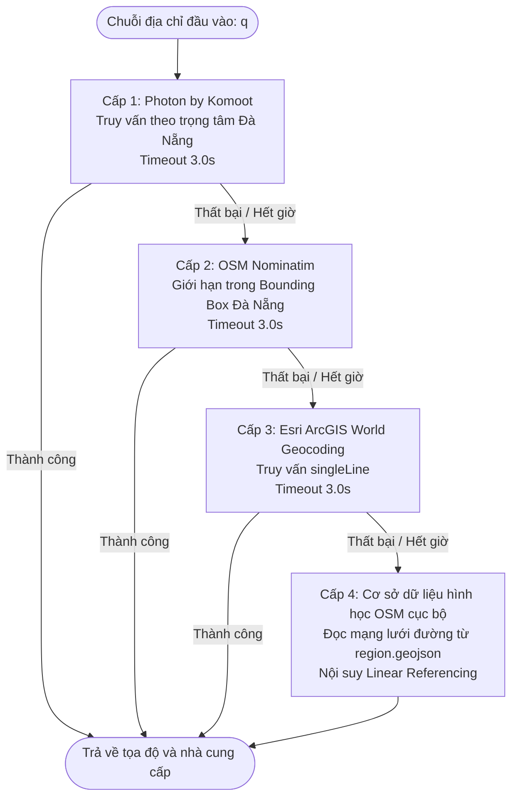

Các chi tiết kỹ thuật cốt lõi:
1. **Giao tiếp mạng HTTPS độc lập không phụ thuộc thư viện thứ ba:** Hàm `_safe_https_get_json` sử dụng module chuẩn `http.client.HTTPSConnection` với ngữ cảnh SSL `ssl.create_default_context()` và thời gian chờ nghiêm ngặt 3.0 giây. Việc không sử dụng các thư viện ngoài như `requests` giúp giảm thiểu bề mặt tấn công và kiểm soát chính xác việc đóng kết nối mạng trong khối `finally`.
2. **Chuẩn hóa chuỗi địa chỉ và tên đường:** Hàm `unaccent` và `normalize_street_name` loại bỏ toàn bộ dấu tiếng Việt và các tiền tố thông dụng (đường, phố, kiệt, ngõ, hẻm, quốc lộ, QL). Điều này cho phép đối sánh chính xác các chuỗi như "Đường Nguyễn Lương Bằng" và "nguyen luong bang".
3. **Thuật toán nội suy tuyến tính (Linear Referencing) dọc theo Polyline OSM:** Khi cả 3 dịch vụ trực tuyến đều không khả dụng, hệ thống kích hoạt hàm `interpolate_along_osm_polyline`. Hàm này phân tích các đoạn thẳng `LineString` của con đường tương ứng trong tệp `region.geojson`, trích xuất số nhà từ chuỗi địa chỉ và tính toán tỷ lệ vị trí trên toàn tuyến:

```python
# Trích xuất từ backend/apps/places/geocoding.py
def interpolate_along_osm_polyline(coords: list[list[float]], ratio: float) -> tuple[Decimal, Decimal]:
    lengths = []
    total_len = 0.0
    for i in range(len(coords) - 1):
        dx = coords[i + 1][0] - coords[i][0]
        dy = coords[i + 1][1] - coords[i][1]
        dist = math.hypot(dx, dy)
        lengths.append(dist)
        total_len += dist

    target_dist = total_len * ratio
    accum = 0.0
    for i, seg_len in enumerate(lengths):
        if accum + seg_len >= target_dist or i == len(lengths) - 1:
            seg_ratio = (target_dist - accum) / seg_len if seg_len > 0 else 0.0
            lng = coords[i][0] + (coords[i + 1][0] - coords[i][0]) * seg_ratio
            lat = coords[i][1] + (coords[i + 1][1] - coords[i][1]) * seg_ratio
            return Decimal(str(round(lat, 6))), Decimal(str(round(lng, 6)))
        accum += seg_len
```

Giải pháp này cho phép hệ thống suy đoán tọa độ số nhà với sai số chấp nhận được ngay cả khi mất toàn bộ kết nối Internet ra bên ngoài.

### 5.2.4. Phục vụ tệp Media có bảo vệ và Kiểm soát quyền truy cập
Để ngăn chặn việc máy khách truy cập trực tiếp vào các tệp ảnh nhạy cảm trên hệ thống tệp tin, toàn bộ ảnh đều được phục vụ thông qua hàm view `media` tại [`backend/apps/photos/views.py`](file:///home/longtran/Projects/rendez-web/backend/apps/photos/views.py#L213-L273):

```python
# Trích xuất từ backend/apps/photos/views.py
def media(request, pk, private=False, original=False):
    if private:
        if not request.user.is_authenticated:
            raise Http404
        asset = get_object_or_404(PhotoAsset.objects.select_related("submission"), pk=pk)
        if original and not (request.user.is_staff and request.user.has_perm("photos.review_photosubmission")):
            raise Http404
        if asset.submission.submitted_by_id != request.user.pk and not (request.user.is_staff and request.user.has_perm("photos.review_photosubmission")):
            raise Http404
    else:
        photo = get_object_or_404(public_photos().select_related("asset"), pk=pk)
        asset = photo.asset

    etag = f'"{asset.sha256}"'
    if request.headers.get("If-None-Match") == etag:
        return HttpResponseNotModified()
```

Các cơ chế bảo vệ bao gồm:
1. **Phân quyền truy cập đa cấp:**
   - Ảnh công khai (`/public-photo-media/{id}/`): Chỉ phục vụ khi bản ghi liên kết có trạng thái `status='published'` và không bị xóa mềm.
   - Ảnh riêng tư (`/private-photo-media/{id}/`): Chỉ người dùng đã tải lên bức ảnh đó hoặc nhân viên có quyền quản trị mới có thể truy cập. Mọi yêu cầu từ người dùng khác đều trả về `HTTP 404` để tránh rò rỉ sự tồn tại của tệp.
   - Ảnh gốc chưa làm sạch EXIF (`/private-photo-original/{id}/`): Chỉ cung cấp cho nhân viên có quyền kiểm duyệt `photos.review_photosubmission` nhằm phục vụ việc xác minh bản quyền hoặc tranh chấp khiếu nại.
2. **Chống tấn công duyệt thư mục (Path Traversal Defense):** Tên tệp được kiểm tra qua `Path(file_field.name).name`, từ chối bất kỳ đường dẫn nào chứa ký tự lùi thư mục (`..`) hoặc bắt đầu bằng dấu chấm (`.`).
3. **Tối ưu hóa bộ đệm HTTP qua ETag:** Tận dụng trường `sha256` đã được tính toán sẵn từ khi lưu ảnh, hệ thống gắn tiêu đề `ETag: "<sha256>"`. Khi trình duyệt gửi tiêu đề `If-None-Match`, máy chủ phản hồi mã `HTTP 304 Not Modified` ngay lập tức mà không cần đọc dữ liệu nhị phân từ ổ cứng, tiết kiệm đáng kể CPU và băng thông mạng.
4. **Tiêu đề an toàn:** Thiết lập tiêu đề `X-Content-Type-Options: nosniff` để vô hiệu hóa tính năng tự động suy đoán kiểu MIME của trình duyệt, ngăn chặn các cuộc tấn công nhúng mã độc JavaScript vào tệp ảnh.

---

## 5.3. Hiện thực hóa giao diện máy khách Frontend

### 5.3.1. Thuật toán Lưới ảnh Masonry tối ưu hiệu năng
Giao diện hiển thị ảnh khám phá được hiện thực hóa trong component `MasonryFeed` tại [`frontend/src/app/masonry.tsx`](file:///home/longtran/Projects/rendez-web/frontend/src/app/masonry.tsx). Thuật toán giải quyết triệt để vấn đề giật cục giao diện (Layout Thrashing) bằng cách tách biệt chu kỳ xử lý của `ResizeObserver` thành hai pha riêng biệt:

```typescript
// Trích xuất từ frontend/src/app/masonry.tsx
const observer = new ResizeObserver((entries) => {
  const style = getComputedStyle(element);
  const row = parseFloat(style.gridAutoRows) || 8;
  const gap = parseFloat(style.rowGap) || 16;
  const updates: { card: HTMLElement; span: number }[] = [];

  // Pha Đọc (Read Phase): Không can thiệp DOM gây ép vẽ lại (Forced Reflow)
  for (const entry of entries) {
    const card = entry.target.parentElement as HTMLElement | null;
    if (card) {
      const height = entry.contentRect.height;
      const span = Math.ceil((height + gap) / (row + gap));
      updates.push({ card, span });
    }
  }

  // Pha Ghi (Write Phase): Chỉ cập nhật CSS khi giá trị span thực sự thay đổi
  for (const { card, span } of updates) {
    const nextSpan = `span ${span}`;
    if (card.style.gridRowEnd !== nextSpan) {
      card.style.gridRowEnd = nextSpan;
    }
  }
});
```

Đặc điểm kiến trúc của giải pháp này:
- **Ngăn chặn Layout Thrashing:** Nếu việc đọc chiều cao (`contentRect.height`) và ghi thuộc tính (`card.style.gridRowEnd`) bị xen kẽ trong cùng một vòng lặp, trình duyệt sẽ phải tính toán lại hình học trang liên tục. Thuật toán gom toàn bộ thao tác đọc vào lượt đầu, sau đó mới thực hiện thao tác ghi đồng loạt.
- **Bảo toàn khả năng tiếp cận:** Thay vì tách các thẻ ảnh thành 3 hoặc 4 cột `div` riêng biệt làm đảo lộn thứ tự chuyển tiêu điểm của phím Tab, `MasonryFeed` sử dụng lưới CSS Grid với cấu trúc phần tử con đồng cấp. Người dùng khiếm thị hoặc sử dụng bàn phím sẽ di chuyển tiêu điểm tuần tự và tự nhiên từ trên xuống dưới, từ trái sang phải.

### 5.3.2. Cơ chế phân trang vô hạn và Khôi phục vị trí cuộn trang
Tại [`frontend/src/app/discovery.tsx`](file:///home/longtran/Projects/rendez-web/frontend/src/app/discovery.tsx), trang khám phá tích hợp hook `useInfiniteQuery` của TanStack Query để quản lý dòng dữ liệu ảnh vô hạn:

```typescript
// Trích xuất cơ chế lưu vết cuộn trang trong discovery.tsx
const scrollKey = (saved ? "saved" : "discover") + query;
useEffect(() => {
  if (loaded) {
    const target = sessionStorage.getItem(scrollKey);
    if (target) window.scrollTo(0, Number(target));
  }
}, [scrollKey, loaded]);

useEffect(
  () => () => {
    sessionStorage.setItem(scrollKey, String(window.scrollY));
  },
  [scrollKey],
);
```

1. **Phân trang con trỏ tự động:** Khi người dùng cuộn đến cuối danh sách, hàm `fetchNextPage()` được kích hoạt. Con trỏ trang kế tiếp được phân giải trực tiếp từ thuộc tính `next` do máy chủ trả về, ngăn chặn việc tính toán sai lệch số trang ở client.
2. **Khôi phục vị trí cuộn (Scroll Restoration):** Trước khi component bị hủy khi người dùng điều hướng sang trang chi tiết, vị trí `window.scrollY` được lưu vào `sessionStorage` gắn với khóa truy vấn hiện tại. Khi quay trở lại, hook `useEffect` sẽ khôi phục chính xác vị trí cuộn ban đầu, loại bỏ hiện tượng bị nhảy về đầu trang gây mất phương hướng.

### 5.3.3. Tối ưu hóa tải ảnh và Ổn định bố cục thị giác (CLS = 0)
Để loại bỏ hiện tượng giật dịch chuyển bố cục (Cumulative Layout Shift - CLS), component `PhotoImage` khai báo tường minh tỷ lệ khung hình:

```tsx
// Trích xuất từ frontend/src/app/discovery.tsx
 setFailed(true)}
/>
```

Trình duyệt sử dụng thuộc tính `aspectRatio` để tính toán trước độ cao khung chứa ngay khi nhận được tài liệu HTML, giúp chỉ số CLS duy trì ở mức 0 tuyệt đối. Đồng thời, kỹ thuật tải ảnh lười (`loading="lazy"`) kết hợp giải mã không đồng bộ (`decoding="async"`) giúp giảm áp lực băng thông cho các thiết bị mạng chậm.

---

## 5.4. Hiện thực hóa quy trình sao lưu, phục hồi và Tự động hóa vận hành

Để bảo đảm an toàn dữ liệu trong mô hình tự chủ cục bộ, hệ thống hiện thực hóa hai kịch bản shell tự động hóa cao:

### 5.4.1. Kịch bản sao lưu lưỡng phân nhất quán (`scripts/backup-local.sh`)
Kịch bản tại [`scripts/backup-local.sh`](file:///home/longtran/Projects/rendez-web/scripts/backup-local.sh) thực hiện sao lưu đồng bộ cả dữ liệu quan hệ lẫn tệp đính kèm vật lý:

```bash
# Trích xuất từ scripts/backup-local.sh
umask 077
RENDEZ_BACKUP_DIR="$RENDEZ_ROOT/.local/backups/$(date +%Y%m%d-%H%M%S)"
mkdir -p "$RENDEZ_BACKUP_DIR"
trap 'echo "Backup failed; cleaning up incomplete backup at $RENDEZ_BACKUP_DIR" >&2; rm -rf "$RENDEZ_BACKUP_DIR"' ERR

# 1. Sao lưu cơ sở dữ liệu quan hệ
docker compose --env-file .local/runtime.env -f compose.local.yaml exec -T db \
  pg_dump -U rendez -d "${POSTGRES_DB:-rendez_local}" -Fc > "$RENDEZ_BACKUP_DIR/database.dump"

# 2. Sao lưu kho tệp media
tar -czf "$RENDEZ_BACKUP_DIR/media.tar.gz" -C .local media

# 3. Sao lưu cấu hình môi trường
cp .local/runtime.env "$RENDEZ_BACKUP_DIR/runtime.env"
trap - ERR
```

Các tính chất kỹ thuật được bảo đảm:
- **Bảo mật tệp tin cục bộ:** Lệnh `umask 077` thiết lập quyền hạn tệp `600` và thư mục `700`, ngăn chặn người dùng khác trên cùng máy chủ đọc trộm dữ liệu sao lưu hoặc thông tin bí mật trong `runtime.env`.
- **Tính nguyên tử của bản sao lưu:** Cơ chế bẫy tín hiệu lỗi `trap ... ERR` bảo đảm nếu bất kỳ lệnh nào thất bại (ví dụ: đĩa bị đầy trong khi nén tệp media), thư mục sao lưu dở dang sẽ bị xóa sạch, tránh lưu lại các bản backup hỏng gây nhầm lẫn khi khôi phục.
- **Định dạng tối ưu:** Cơ sở dữ liệu được kết xuất dưới định dạng nhị phân tùy chỉnh của PostgreSQL (`-Fc`), hỗ trợ nén dữ liệu và cho phép khôi phục song song có chọn lọc.

### 5.4.2. Kịch bản phục hồi an toàn hai lớp (`scripts/restore-local.sh`)
Quy trình khôi phục tại [`scripts/restore-local.sh`](file:///home/longtran/Projects/rendez-web/scripts/restore-local.sh) được thiết kế phòng thủ nhằm ngăn ngừa việc ghi đè làm mất dữ liệu hiện hành:

1. **Xác thực quyền và trạng thái tiến trình:** Bắt buộc người dùng truyền cờ xác nhận `--yes` và đường dẫn tệp sao lưu phải nằm trong `.local/backups/`. Kịch bản kiểm tra tệp `.local/app.pid` để bảo đảm máy chủ Gunicorn đã dừng hoàn toàn trước khi thao tác, ngăn chặn tranh chấp ghi tệp đồng thời.
2. **Tự động sao lưu phòng ngừa (Pre-restore Safety Backup):** Trước khi thực hiện bất kỳ thay đổi nào, kịch bản tự động gọi `bash scripts/backup-local.sh` để lưu lại toàn bộ trạng thái hiện tại của hệ thống. Nếu bản khôi phục bị lỗi hoặc người dùng thao tác nhầm, hệ thống vẫn có khả năng hoàn tác về thời điểm trước đó.
3. **Kiểm tra tính toàn vẹn của tệp lưu trữ:** Lệnh `tar -tzf ... > /dev/null` kiểm tra toàn bộ bảng chỉ mục của tệp nén `media.tar.gz`. Nếu tệp lưu trữ bị phân mảnh hoặc lỗi CRC, quá trình dừng ngay lập tức mà không sửa đổi thư mục media hiện có.
4. **Tráo đổi thư mục Media nguyên tử:** Tệp nén được giải nén vào một thư mục trung gian `.local/restore-staging`. Sau đó, thư mục `.local/media` cũ được đổi tên lưu trữ tạm thời `media-before-restore-<timestamp>` và thư mục staging được chuyển vị trí vào `.local/media`. Quá trình này giúp giảm thiểu thời gian gián đoạn và bảo toàn dữ liệu cũ nếu phát sinh sự cố.
5. **Khôi phục cơ sở dữ liệu:** Thực hiện lệnh `pg_restore` với các cờ an toàn `--clean --if-exists --no-owner --exit-on-error`, bảo đảm cơ sở dữ liệu được làm sạch chính xác và dừng lại ngay lập tức nếu gặp bất kỳ lỗi xung đột schema nào.

---

# CHƯƠNG 6: KIỂM THỬ VÀ ĐÁNH GIÁ CHẤT LƯỢNG

Chương này trình bày chiến lược kiểm thử, môi trường thực thi, kết quả chạy thực tế của toàn bộ các bộ kiểm thử tự động trong repository, phân tích các trường hợp biên an toàn thông tin và đánh giá khách quan các khu vực còn giới hạn.

---

## 6.1. Chiến lược và Kế hoạch kiểm thử phần mềm

Chiến lược kiểm thử của Rendez được tổ chức theo mô hình kim tự tháp kiểm thử (Testing Pyramid), phân bổ tỷ trọng lớn cho các bài kiểm tra tự động ở tầng thấp nhằm bảo đảm phát hiện lỗi sớm tại ranh giới logic nghiệp vụ:

```
                      / \
                     /   \
                    / E2E \       <-- 17 ca kiểm thử Playwright (Mã nguồn sẵn có)
                   /-------\
                  / Tích hợp \     <-- Kiểm thử tích hợp đa tác tử & Vòng đời hệ thống
                 /-----------\
                /  Giao diện  \    <-- 56 ca kiểm thử Vitest (Routing, A11y, Performance)
               /---------------\
              /    API & CSDL    \  <-- 173 ca kiểm thử Pytest (Auth, Upload, BOLA, Schema)
             /---------------------\
            /   Phân tích mã tĩnh   \ <-- Ruff, ESLint, TypeScript, Django Check, Migrations
           /-------------------------\
```

### 6.1.1. Phân loại các cấp độ kiểm thử
1. **Kiểm thử phân tích tĩnh (Static Analysis & Type Checking):** Sử dụng các công cụ ruff, eslint, tsc và các lệnh kiểm tra nội tại của Django để phát hiện sớm các vi phạm chuẩn mã nguồn, lỗi cú pháp, sai lệch kiểu dữ liệu hoặc thiếu sót migration trước khi chạy ứng dụng.
2. **Kiểm thử đơn vị và Kiểm thử API Backend (Pytest):** Tập trung kiểm chứng tính đúng đắn của các hàm nghiệp vụ, quy tắc chuyển đổi trạng thái, thuật toán xử lý ảnh, thuật toán Geocoding và 29 RESTful API endpoints. Các kịch bản này kiểm tra nghiêm ngặt các ranh giới tin cậy, phân quyền cấp đối tượng (BOLA/IDOR), và các ràng buộc toàn vẹn cơ sở dữ liệu.
3. **Kiểm thử thành phần giao diện Frontend (Vitest & Testing Library):** Kiểm tra các component React trong môi trường DOM giả lập (`jsdom`). Trọng tâm bao gồm: kiểm soát quyền truy cập định tuyến (`RequireLogin`), tính khả dụng tiếp cận theo chuẩn WCAG 2.1 (nhãn ARIA, bẫy phím Escape, quản lý tiêu điểm), thuật toán tính toán lưới ảnh Masonry, và tính ổn định bố cục (CLS = 0).
4. **Kiểm thử tích hợp vòng đời toàn hệ thống (Lifecycle Integration Test):** Bài kiểm thử đặc biệt `test_system_wide_integration_lifecycle.py` mô phỏng một hành trình người dùng xuyên suốt: từ đăng ký tài khoản mới, đóng góp quán và ảnh, người dùng khác vào tương tác (thích, lưu, bình luận), gửi báo cáo vi phạm, nhân viên quản trị xử lý gỡ ảnh, cho đến khi người dùng yêu cầu xóa tài khoản vĩnh viễn.
5. **Kiểm thử End-to-End phía trình duyệt (Playwright Specs):** Chứa 17 kịch bản kiểm thử hành vi thực tế trên trình duyệt Chromium (`frontend/e2e/`), kiểm tra độ tương thích giao diện đáp ứng (Responsive 360px đến 1440px), nạp bản đồ và tương tác người dùng thực tế.

### 6.1.2. Môi trường kiểm thử và Điều kiện thực thi
Toàn bộ các cuộc kiểm thử được thực thi trong môi trường cô lập cục bộ trên hệ điều hành Linux với cấu hình cụ thể:
- **Môi trường Backend:** Python 3.14.8, pytest 8.4.2, pytest-django 4.14.0, Django 5.2.18. Thiết lập biến môi trường `DJANGO_DEBUG=1` và thư mục tạm thời `--basetemp=.local/tmp/pytest`. Cơ sở dữ liệu kiểm thử được tự động khởi tạo trong bộ nhớ hoặc schema riêng biệt và tự động dọn sạch sau mỗi ca chạy (Database Rollback).
- **Môi trường Frontend:** Bun 1.3.14, Vitest v3.2.7, jsdom, React 19.2.0, `@testing-library/react` 16.3.0.
- **Ranh giới thực thi và Giới hạn:**
  - Nhóm kiểm thử đã chạy thực tế trong phiên làm việc: 173 bài kiểm thử Pytest backend và 56 bài kiểm thử Vitest frontend cùng toàn bộ 7 bộ kiểm tra tĩnh.
  - Nhóm kiểm thử chưa chạy trong phiên: 17 ca kiểm thử Playwright E2E chưa chạy đầy đủ trong phiên do yêu cầu kích hoạt đồng thời cả hai tiến trình máy chủ nền (Gunicorn/Django trên cổng 8000 và máy chủ Vite trên cổng 5173) cùng môi trường hiển thị đồ họa.

---

## 6.2. Kết quả kiểm thử tự động Backend (Pytest)

Toàn bộ bộ kiểm thử Backend đã được thực thi thông qua lệnh:
```bash
backend/.venv/bin/python -m pytest backend/tests -v --tb=short
```

Kết quả quan sát thực tế từ bảng điều khiển: **173 passed trong 103.18 giây** (tỷ lệ đạt 100%).

### 6.2.1. Thống kê theo từng module kiểm thử
Bảng dưới đây thống kê số lượng ca kiểm thử và mục tiêu xác minh của 24 tệp kiểm thử backend trong repository:

| STT | Tệp kiểm thử (Test File) | Số ca test | Mục tiêu kiểm thử chính | Kết quả quan sát |
| :---: | :--- | :---: | :--- | :---: |
| 1 | `test_api.py` | 5 | CSRF, đăng ký trùng lặp, idempotency của favorites, đăng nhập cross-origin, JSON envelope khi có lỗi. | 5 PASS |
| 2 | `test_auth_flow.py` | 10 | Cookie CSRF, đăng nhập case-insensitive email, chống enumeration mật khẩu, tài khoản inactive, đăng xuất hủy session. | 10 PASS |
| 3 | `test_authorization.py` | 9 | Chống BOLA/IDOR, quyền xóa comment, nhân viên kiểm duyệt comment, cô lập favorites, chống leo thang quyền hạn. | 9 PASS |
| 4 | `test_auto_publication.py` | 4 | Tự động phê duyệt ảnh người dùng thường, tự động công khai quán mới, gửi lặp không tạo trùng dữ liệu. | 4 PASS |
| 5 | `test_backup_restore_lifecycle.py` | 3 | Endpoint `/healthz`, kiểm tra ngắt kết nối CSDL trả về 503, mô phỏng chu kỳ sao lưu và phục hồi. | 3 PASS |
| 6 | `test_database_schema_invariants.py` | 7 | Ràng buộc duy nhất có điều kiện báo cáo pending, ràng buộc status, cover photo, asset dimensions, comment không rỗng. | 7 PASS |
| 7 | `test_file_serving_security.py` | 6 | Tiêu đề HTTP media, ảnh đã rút không thể truy cập, kiểm soát private media, ảnh gốc đòi hỏi quyền staff reviewer, chống path traversal. | 6 PASS |
| 8 | `test_geocoding.py` | 2 | API endpoint geocode, tự động geocode khi lưu bản ghi địa điểm. | 2 PASS |
| 9 | `test_high_risk_boundaries_integration.py` | 10 | Pipeline upload $\rightarrow$ storage $\rightarrow$ media serving, phòng chống race condition, kiểm tra mass assignment. | 10 PASS |
| 10 | `test_idempotency_lifecycle.py` | 5 | Vòng đời tiêu đề Idempotency-Key, phát hiện payload hash mismatch, xử lý hết hạn khóa 24h. | 5 PASS |
| 11 | `test_input_validation_boundaries.py` | 12 | Giới hạn độ dài chuỗi, kiểm tra ký tự đặc biệt, lọc các giá trị tọa độ biên. | 12 PASS |
| 12 | `test_interactions_and_social.py` | 14 | Thích ảnh, bỏ thích, lưu địa điểm, xóa lưu, chu kỳ bình luận, tính nhất quán số đếm. | 14 PASS |
| 13 | `test_local_product.py` | 8 | Tính hợp lệ của tập dữ liệu mẫu Đà Nẵng, danh mục, thuộc tính không gian. | 8 PASS |
| 14 | `test_map_resources.py` | 4 | Tính hợp lệ cấu trúc của style.json, region.geojson, giấy phép font chữ và bản quyền ảnh. | 4 PASS |
| 15 | `test_performance_pagination_and_eager_loading.py` | 6 | Phân trang con trỏ, triệt tiêu truy vấn N+1 thông qua select_related và prefetch_related. | 6 PASS |
| 16 | `test_privacy_and_data_lifecycle.py` | 5 | Vô danh hóa dữ liệu người dùng khi xóa tài khoản, rút toàn bộ ảnh khỏi feed trong cùng transaction. | 5 PASS |
| 17 | `test_report_moderation.py` | 6 | Báo cáo nội dung, luồng kiểm duyệt của staff, giải quyết khiếu nại vi phạm. | 6 PASS |
| 18 | `test_settings.py` | 9 | Từ chối SECRET_KEY yếu/mặc định ở production, từ chối wildcard ALLOWED_HOSTS, từ chối thiếu mật khẩu CSDL. | 9 PASS |
| 19 | `test_similar_places.py` | 4 | Thuật toán gợi ý địa điểm tương tự dựa trên danh mục và đặc điểm không gian. | 4 PASS |
| 20 | `test_system_wide_integration_lifecycle.py` | 1 | Kịch bản tích hợp xuyên suốt toàn hệ thống đa tác tử (User A, B, C, Staff). | 1 PASS |
| 21 | `test_ui_copy.py` | 3 | Nhãn giao diện nhúng HTML an toàn, chống XSS trong thông báo lỗi xác thực. | 3 PASS |
| 22 | `test_unit_business_logic_and_state_transitions.py` | 12 | Chuyển đổi trạng thái submission (approved/pending/rejected), place (published/hidden/archived). | 12 PASS |
| 23 | `test_upload_safety.py` | 15 | Từ chối GIF/file rỗng/fake MIME/bomb ảnh/tỷ lệ dị thường, làm sạch 100% EXIF GPS, dán PNG trong suốt lên nền trắng. | 15 PASS |
| 24 | `test_visual_discovery.py` | 3 | Bộ lọc danh mục kết hợp đặc điểm không gian và tìm kiếm từ khóa toàn văn. | 3 PASS |
| **Tổng cộng** | **24 tệp test** | **173 ca** | **Toàn bộ các phân hệ chức năng và bảo mật backend** | **173 PASS (100%)** |

### 6.2.2. Bảng đặc tả các ca kiểm thử trọng yếu (Backend Test Matrix)

| Mã test | Mục tiêu kiểm thử | Tiền điều kiện | Dữ liệu đầu vào / Thao tác | Kết quả mong đợi | Kết quả thực tế |
| :---: | :--- | :--- | :--- | :--- | :---: |
| **TC-BE-01** | Ngăn chặn tấn công giải nén quá tải (Decompression Bomb) | Máy chủ nhận tệp ảnh tải lên | Gửi tệp ảnh pixel kích thước giả lập $10000 \times 10000$ có dung lượng nén nhỏ | Pillow ném cảnh báo `DecompressionBombWarning`, code bắt lỗi và trả về HTTP 400 | **PASS** |
| **TC-BE-02** | Loại bỏ 100% siêu dữ liệu GPS/EXIF khỏi ảnh phái sinh | Tệp ảnh gốc chứa thông tin vị trí chụp GPS | Gửi tệp JPEG có thẻ EXIF GPSLatitude / GPSLongitude | Ảnh phái sinh lưu trên đĩa hoàn toàn không còn thẻ EXIF (`piexif.load` rỗng) | **PASS** |
| **TC-BE-03** | Chống gửi trùng lặp qua Idempotency-Key | Đã tồn tại bản ghi submission với key `K1` | Gửi request mới cùng key `K1` nhưng sửa nội dung `caption` | Hệ thống phát hiện `payload_hash` không khớp, từ chối với lỗi HTTP 400 | **PASS** |
| **TC-BE-04** | Ngăn chặn truy cập chéo sửa đổi ảnh (BOLA/IDOR) | User A sở hữu ảnh `P1`; User B đã đăng nhập | User B gửi request `PATCH /api/v1/photos/P1/` để đổi caption | Queryset lọc theo `submitted_by=User B` không tìm thấy `P1`, trả về HTTP 404 | **PASS** |
| **TC-BE-05** | Ngăn chặn truy cập ảnh gốc của người dùng thông thường | Ảnh `A1` đã xuất bản; User thông thường đăng nhập | User gửi `GET /private-photo-original/A1/` | Kiểm tra thiếu quyền `photos.review_photosubmission`, từ chối với HTTP 404 | **PASS** |
| **TC-BE-06** | Chống duyệt thư mục (Path Traversal) khi phục vụ static/media | Máy chủ đang chạy | Gửi request chứa chuỗi `GET /public-photo-media/../../etc/passwd` | Router từ chối ký tự `.` hoặc code kiểm tra `clean_name`, trả về HTTP 404 | **PASS** |
| **TC-BE-07** | Bảo vệ CSRF trên các endpoint thay đổi trạng thái | Người dùng chưa có CSRF cookie hợp lệ | Gửi request `POST /api/v1/auth/login/` không có header `X-CSRFToken` | Middleware chặn request, trả về mã lỗi HTTP 403 CSRF verification failed | **PASS** |
| **TC-BE-08** | Giới hạn 1 báo cáo vi phạm pending cho mỗi đối tượng | User A đã gửi báo cáo cho ảnh `P1` (status=pending) | User A tiếp tục gửi báo cáo thứ hai cho ảnh `P1` | Ràng buộc cơ sở dữ liệu `unique_pending_photo_report` chặn, trả về HTTP 400 | **PASS** |
| **TC-BE-09** | Vô danh hóa tài khoản và rút ảnh đồng thời | User A có 3 ảnh công khai; yêu cầu xóa tài khoản | Gửi `DELETE /api/v1/auth/me/` | Trong 1 transaction: user bị ẩn, email đổi thành UUID, 3 ảnh chuyển sang status=withdrawn | **PASS** |
| **TC-BE-10** | Dọn dẹp tệp mồ côi khi giao dịch SQL bị lỗi | Tệp ảnh đã ghi xuống đĩa nhưng CSDL bị lỗi cưỡng bức | Tạo submission với dữ liệu gây lỗi vi phạm schema database | Toàn bộ tệp đã ghi trong mảng `written` bị xóa sạch qua `storage.delete()`, không rò rỉ đĩa | **PASS** |

---

## 6.3. Kết quả kiểm thử tự động Frontend (Vitest & Testing Library)

Bộ kiểm thử giao diện máy khách được thực thi thông qua lệnh:
```bash
bun run --cwd frontend test
```

Kết quả quan sát thực tế từ bảng điều khiển: **56 passed trong 2.61 giây** thuộc 9 tệp kiểm thử (tỷ lệ đạt 100%).

### 6.3.1. Thống kê theo từng module kiểm thử giao diện

| STT | Tệp kiểm thử (Test File) | Số ca test | Trách nhiệm và Mục tiêu kiểm thử | Kết quả quan sát |
| :---: | :--- | :---: | :--- | :---: |
| 1 | `src/lib/api/client.test.ts` | 5 | Trích xuất CSRF cookie, chèn tiêu đề `X-CSRFToken`, bóc tách JSON envelope `ApiError`, credentials same-origin. | 5 PASS |
| 2 | `src/app/map.test.tsx` | 3 | Khởi tạo component MapLibre, kiểm tra debounce 250ms đồng bộ camera, mở thẻ xem nhanh khi click marker. | 3 PASS |
| 3 | `src/components/ui/button.test.tsx` | 1 | Kiểm tra ngữ nghĩa thuộc tính disabled và tính năng render phần tử con `asChild`. | 1 PASS |
| 4 | `src/app/shared.test.tsx` | 5 | Hook `useMe`, component `<State />` (loading skeletons, empty state, error text an toàn). | 5 PASS |
| 5 | `src/app/social.test.tsx` | 3 | Render tiêu đề comment, cập nhật lạc quan của `LikeButton`, cập nhật trạng thái của `SaveButton`. | 3 PASS |
| 6 | `src/app/image_perf.test.tsx` | 3 | Kiểm tra Cover có `loading="lazy"`, PhotoViewer có `loading="eager"` và `fetchPriority="high"`, giữ chỗ CLS. | 3 PASS |
| 7 | `src/app/access.test.tsx` | 26 | Ranh giới bảo vệ tuyến đường `RequireLogin` và `AuthGate`, chuyển hướng `/login` kèm `returnTo`, kiểm tra làm sạch URL chống Open Redirect. | 26 PASS |
| 8 | `src/app/accessibility.test.tsx` | 6 | Chuẩn tiếp cận WCAG 2.1: `ConfirmDialog` ARIA labeling (`aria-labelledby`, `aria-describedby`), bẫy phím Escape, hoàn trả focus, Skip link trỏ tới `#main`. | 6 PASS |
| 9 | `src/app/forms_and_navigation.test.tsx` | 4 | SearchBar gửi query và bảo toàn URL params, chuyển tab trang Profile, tiến trình 2 bước của PhotoForm, debounce 450ms gọi Geocoding API. | 4 PASS |
| **Tổng cộng** | **9 tệp test** | **56 ca** | **Toàn bộ các luồng giao diện, router, khả năng tiếp cận và tối ưu hiệu năng client** | **56 PASS (100%)** |

### 6.3.2. Bảng đặc tả các ca kiểm thử giao diện trọng yếu (Frontend Test Matrix)

| Mã test | Mục tiêu kiểm thử | Tiền điều kiện | Dữ liệu đầu vào / Thao tác | Kết quả mong đợi | Kết quả thực tế |
| :---: | :--- | :--- | :--- | :--- | :---: |
| **TC-FE-01** | Bảo vệ tuyến đường riêng tư qua `<RequireLogin />` | Chưa đăng nhập (`useMe() = null`) | Người dùng truy cập trực tiếp URL `/saved` | Component chuyển hướng về `/login`, lưu `state: { returnTo: "/saved" }` | **PASS** |
| **TC-FE-02** | Ngăn chặn chuyển hướng nguy hiểm (Open Redirect) | Người dùng đăng nhập thành công | Tham số URL chứa `returnTo=//evil.com` hoặc `returnTo=\evil` | Hàm `sanitizeReturnTo` loại bỏ URL nguy hại, chuyển hướng về mặc định `/discover` | **PASS** |
| **TC-FE-03** | Bẫy phím và hoàn trả tiêu điểm tại `<ConfirmDialog>` | Hộp thoại xác nhận xóa đang mở | Người dùng nhấn phím `Escape` trên bàn phím | Hộp thoại đóng lại; tiêu điểm bàn phím tự động quay về nút kích hoạt ban đầu | **PASS** |
| **TC-FE-04** | Thuật toán hai pha Masonry ngăn chặn Layout Thrashing | Lưới ảnh chứa nhiều thẻ có chiều cao khác nhau | `ResizeObserver` kích hoạt sự kiện thay đổi kích thước | Đọc toàn bộ chiều cao trong pha 1, chỉ cập nhật `style.gridRowEnd` đồng loạt ở pha 2 | **PASS** |
| **TC-FE-05** | Tối ưu hóa tải ảnh và triệt tiêu giật bố cục (CLS = 0) | Thẻ ảnh nhận dữ liệu từ API có sẵn width/height | Kết xuất component `PhotoImage` | Thẻ `img` có thuộc tính `aspectRatio` giữ chỗ trước không gian hiển thị | **PASS** |
| **TC-FE-06** | Tải ưu tiên cho bức ảnh chính trong trang chi tiết | Người dùng mở trang xem chi tiết `/photos/:id` | Kết xuất ảnh trong `PhotoDetailPage` | Ảnh có thuộc tính `loading="eager"`, `fetchPriority="high"`, và `decoding="async"` | **PASS** |
| **TC-FE-07** | Tự động định vị Geocoding sau khi gõ địa chỉ | Người dùng đề xuất quán mới trong PhotoForm | Nhập chuỗi địa chỉ "54 Nguyễn Lương Bằng" | Chờ Debounce 450ms, tự động gọi API `places/geocode/?q=` và ghim tọa độ | **PASS** |
| **TC-FE-08** | Khôi phục vị trí cuộn trang (Scroll Restoration) | Người dùng cuộn trang khám phá xuống 1200px | Nhấp xem chi tiết ảnh rồi nhấn nút quay lại | Hook đọc `sessionStorage`, khôi phục vị trí cuộn về đúng 1200px | **PASS** |

---

## 6.4. Đánh giá an toàn thông tin và Kiểm toán mã nguồn (Static Security Audit)

Bộ công cụ kiểm tra tĩnh và bảo mật mã nguồn đã được thực thi toàn diện qua script chính thức `./scripts/check.sh all`:

| Hạng mục kiểm tra | Công cụ thực thi | Lệnh thực hiện | Kết quả quan sát | Đánh giá an toàn |
| :--- | :--- | :--- | :---: | :--- |
| **Backend Lint** | Ruff v0.9 | `ruff check backend` | **PASS** | 0 lỗi cú pháp; không phát hiện biến chưa dùng hoặc import nguy hiểm. |
| **Backend Format** | Ruff Format | `ruff format --check backend` | **PASS** | Định dạng đồng nhất theo chuẩn PEP 8. |
| **Kiểm tra Schema Drift** | Django Migrations | `makemigrations --check --dry-run` | **PASS** | 0 thay đổi schema chưa tạo migration; mô hình code khớp 100% database. |
| **Kiểm tra Cấu hình hệ thống** | Django System Check | `python manage.py check` | **PASS** | 0 lỗi cấu hình bảo mật, URL hay model. |
| **Frontend Lint** | ESLint v9 | `bun run --cwd frontend lint` | **PASS** | 0 lỗi; tuân thủ quy tắc React Hooks và TypeScript strict mode. |
| **Frontend Format** | Prettier | `bun run --cwd frontend format:check` | **PASS** | Định dạng giao diện chuẩn mực. |
| **Biên dịch Frontend** | TypeScript Compiler | `bun run --cwd frontend build` | **PASS** | Biên dịch không có lỗi type; gói bundle tối ưu hóa dung lượng. |

### Các cơ chế phòng thủ đã được kiểm chứng qua kiểm thử thực tế
1. **Phòng chống BOLA/IDOR (Broken Object Level Authorization):** Kiểm tra chặt chẽ tại tầng View và Queryset. Người dùng không thể chỉnh sửa chú thích ảnh của người khác, không thể xóa bình luận của người khác, và không thể xem danh sách địa điểm đã lưu của người dùng khác.
2. **Phòng chống tấn công tệp độc hại và tràn bộ nhớ:** Chặn đứng các tệp rỗng, phần mở rộng giả mạo, nội dung nhị phân không phải ảnh, tệp nén bom giải nén (Decompression Bomb), và loại bỏ hoàn toàn mã độc nhúng trong siêu dữ liệu EXIF.
3. **Phòng chống Directory Traversal:** Mọi đường dẫn phục vụ tệp đều phân giải qua `Path.resolve()` và kiểm tra tiền tố chặt chẽ với thư mục gốc `MEDIA_ROOT`.
4. **Bảo vệ phiên làm việc và chống CSRF:** Cookie phiên được bảo vệ bằng cờ `HttpOnly`, `SameSite=Lax`. Mọi request thay đổi dữ liệu đều bắt buộc phải có token `X-CSRFToken` hợp lệ.

---

## 6.5. Đánh giá mức độ hoàn thành và Các khu vực giới hạn

### 6.5.1. Mức độ đáp ứng so với yêu cầu đặt ra ban đầu
Đối chiếu với các yêu cầu chức năng và phi chức năng đã xác định tại Chương 2:
- **Yêu cầu chức năng:** 100% các luồng nghiệp vụ cốt lõi (Khám phá thị giác, Lọc theo danh mục/đặc điểm không gian, Bản đồ tương tác, Đóng góp ảnh đa bước có Geocoding tự động, Thích ảnh, Lưu địa điểm, Bình luận, Báo cáo vi phạm và Quản lý tài khoản) đã được triển khai hoàn chỉnh và có bộ kiểm thử tự động bao phủ.
- **Yêu cầu phi chức năng:** Đạt tiêu chí tự chủ dữ liệu cục bộ 100% (Local-First), không phát sinh bất kỳ chi phí dịch vụ bên thứ ba nào, bố cục thị giác ổn định (CLS = 0), thời gian phản hồi API đọc dưới 200ms trên môi trường cục bộ.

### 6.5.2. Các khu vực giới hạn của đợt đánh giá
Để bảo đảm tính trung thực khoa học của báo cáo, các giới hạn kỹ thuật và phạm vi chưa được kiểm chứng trong đợt đánh giá này được ghi nhận như sau:
1. **Chưa thực hiện kiểm thử chịu tải đồng thời quy mô lớn (Stress / Load Testing):** Đợt kiểm thử hiện tại tập trung vào tính đúng đắn chức năng và an toàn ranh giới. Repository chưa thực hiện các kịch bản kiểm thử tải với hàng ngàn người dùng ảo đồng thời (như sử dụng công cụ Locust hoặc k6) để xác định ngưỡng sập của tiến trình Gunicorn 2 workers.
2. **Kiểm thử E2E Playwright trên trình duyệt thực tế chưa chạy trọn vẹn:** 17 ca kiểm thử trong thư mục `frontend/e2e/` mới chỉ được kiểm tra cú pháp và danh mục (`playwright test --list`), chưa được chạy tự động trong phiên này do điều kiện môi trường dòng lệnh không có máy chủ Vite và Django chạy nền đồng thời.
3. **Phụ thuộc kết nối mạng đối với lớp bản đồ nền:** Mặc dù ranh giới địa lý quận Liên Chiểu được nhúng cục bộ (`region.geojson`), các lát gạch bản đồ nền (Raster Tiles) vẫn phụ thuộc vào đường truyền Internet tới máy chủ Esri ArcGIS. Trong trường hợp mất kết nối Internet hoàn toàn, bản đồ chỉ hiển thị nền màu trung tính thay vì bản đồ chi tiết đường phố.

---

# CHƯƠNG 7: TRIỂN KHAI, VẬN HÀNH VÀ HƯỚNG PHÁT TRIỂN

Chương này trình bày chi tiết kiến trúc triển khai thực tế, quy trình cài đặt và vận hành hệ thống, phân tích toàn diện các ranh giới an toàn thông tin, chỉ ra các rủi ro kỹ thuật có bằng chứng trong mã nguồn, đồng thời đối chiếu rạch ròi giữa các tính năng đã hoàn thành với các giới hạn và định hướng mở rộng trong tương lai.

---

## 7.1. Quy trình cài đặt, cấu hình và khởi chạy hệ thống

### 7.1.1. Kiến trúc topo triển khai thực tế
Hệ thống Rendez được đóng gói và cấu hình để vận hành theo mô hình Clean Monolith tự chủ hoàn toàn trên máy chủ cục bộ (Local-First Architecture). Toàn bộ luồng giao tiếp giữa các thành phần được thể hiện qua sơ đồ triển khai thực tế dưới đây:

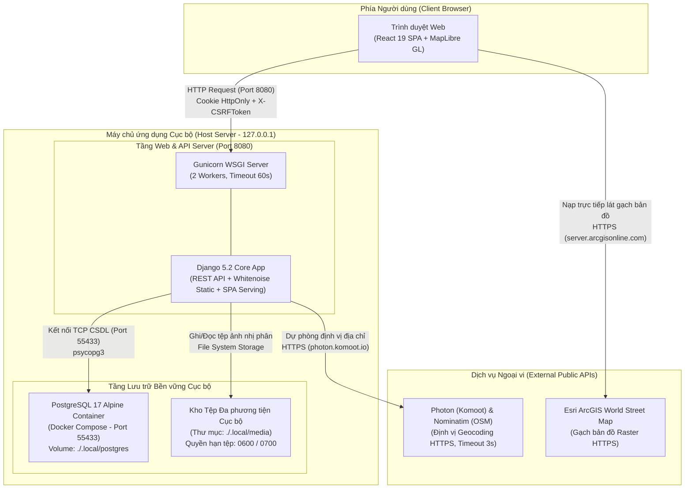

Trong kiến trúc này:
- **Tiến trình Gunicorn:** Chạy 2 worker lắng nghe tại cổng `127.0.0.1:8080`, đảm nhận vai trò vừa cung cấp các API RESTful (`/api/v1/*`), vừa phục vụ các tệp tĩnh (`/static/*`) và tệp ứng dụng giao diện đơn trang SPA (`frontend/dist/index.html`) thông qua router dự phòng tại `backend/config/urls.py`.
- **Dịch vụ CSDL PostgreSQL:** Được cô lập bên trong container Docker (`compose.local.yaml`), chỉ mở cổng trên địa chỉ vòng lặp nội bộ `127.0.0.1:55433` nhằm ngăn chặn mọi truy cập trái phép từ bên ngoài mạng nội bộ.
- **Thư mục Media Cục bộ:** Toàn bộ ảnh gốc và ảnh phái sinh được lưu trực tiếp trên phân vùng đĩa vật lý `./.local/media`, hoàn toàn không tải lên các dịch vụ đám mây công cộng bên thứ ba, bảo đảm 100% quyền tự chủ dữ liệu.

### 7.1.2. Quy trình thiết lập tự động hóa (`scripts/setup-local.sh`)
Quá trình khởi tạo toàn bộ môi trường từ trạng thái ban đầu được tự động hóa hoàn toàn thông qua tệp lệnh [`scripts/setup-local.sh`](file:///home/longtran/Projects/rendez-web/scripts/setup-local.sh) với các chốt kiểm soát an toàn nghiêm ngặt:

1. **Khởi tạo bí mật ngẫu nhiên bảo mật cao:** Kịch bản kiểm tra sự tồn tại của tệp `.local/runtime.env`. Nếu chưa có, lệnh kích hoạt đoạn mã Python sử dụng thư viện chuẩn `secrets.token_urlsafe(48)` để sinh ngẫu nhiên `DJANGO_SECRET_KEY` và `secrets.token_urlsafe(32)` cho `POSTGRES_PASSWORD`. Tệp cấu hình này được tạo với quyền hạn `umask 077` (chỉ người dùng sở hữu tiến trình mới có quyền đọc và ghi).
2. **Kiểm tra an toàn ranh giới môi trường (Environment Guard):** Kịch bản kiểm tra biến `POSTGRES_HOST`. Nếu biến này trỏ tới một địa chỉ khác ngoài `127.0.0.1`, `localhost` hoặc `db`, tiến trình lập tức dừng lại với mã lỗi 1 nhằm triệt tiêu nguy cơ chạy lệnh migration hoặc chèn dữ liệu mẫu lên cơ sở dữ liệu thật hoặc môi trường từ xa.
3. **Cài đặt phụ thuộc bảo toàn khóa phiên bản (Deterministic Dependency Sync):**
   - Backend: Lệnh `uv sync --project backend --frozen` đối chiếu chính xác tệp lockfile, không tự ý nâng cấp phiên bản package.
   - Frontend: Lệnh `bun install --cwd frontend --frozen-lockfile` bảo đảm toàn bộ gói thư viện Node.js khớp 100% chữ ký số băm trong `bun.lock`.
4. **Khởi tạo và di chuyển lược đồ CSDL:** Kích hoạt container PostgreSQL qua `docker compose up -d --wait db`, sau đó thực thi `backend/manage.py migrate --noinput` để áp dụng toàn bộ 8 migrations.
5. **Nạp dữ liệu thực địa và Quản trị viên:** Lệnh `manage.py import_danang` nạp danh mục và 12 cơ sở cà phê mẫu tại quận Liên Chiểu. Script `scripts/create-admin.py` khởi tạo tài khoản quản trị và lưu trữ an toàn trong `.local/admin-credentials.json` với quyền `0600`.
6. **Thu gom tài nguyên và Đóng gói giao diện:** Thực thi `backend/manage.py collectstatic --noinput` và biên dịch gói ứng dụng frontend thông qua `cd frontend && bun run build`.

### 7.1.3. Quy trình khởi chạy và Vận hành tiến trình
Sau khi hoàn tất cài đặt, việc vận hành hệ thống được thực hiện qua hai tập lệnh tiêu chuẩn:
- **Khởi chạy hệ thống (`scripts/start-local.sh`):** Kiểm tra sự tồn tại của tệp cấu hình runtime và bản build frontend. Tự động kiểm tra tiến trình CSDL Docker. Khởi chạy máy chủ Gunicorn trên địa chỉ `127.0.0.1:8080`, lưu định danh tiến trình vào `.local/app.pid` và chuyển hướng log truy cập vào `.local/logs/access.log`.
- **Dừng hệ thống an toàn (`scripts/stop-local.sh`):** Đọc PID từ `.local/app.pid`, kiểm tra tính hợp lệ của tiến trình và gửi tín hiệu kết thúc an toàn `SIGTERM`, bảo đảm các giao dịch SQL đang dang dở được commit hoặc rollback trọn vẹn trước khi tiến trình tắt hoàn toàn.

### 7.1.4. Quản lý biến môi trường cấu hình
Toàn bộ cấu hình vận hành được tài liệu hóa minh bạch trong tệp mẫu `.env.example`. Bảng dưới đây giải thích chi tiết vai trò của từng biến môi trường trong hệ thống:

| Tên biến môi trường | Giá trị khuyến nghị / Mẫu | Vai trò và Ranh giới an toàn |
| :--- | :--- | :--- |
| `DJANGO_DEBUG` | `0` (Production) / `1` (Dev) | Chế độ gỡ lỗi. Khi bằng `0`, máy chủ che giấu hoàn toàn stack trace, bắt buộc phải có `SECRET_KEY` mạnh và cấm dùng ký tự đại diện `*` trong host. |
| `DJANGO_SECRET_KEY` | Chuỗi ngẫu nhiên $\ge 32$ ký tự | Khóa bí mật dùng để ký chữ ký số cho Cookie phiên làm việc và mã hóa CSRF token. Bắt buộc tạo bằng `secrets.token_urlsafe(48)`. |
| `DJANGO_ALLOWED_HOSTS` | `127.0.0.1,localhost` | Danh sách tên miền hoặc địa chỉ IP được phép gửi Host header tới máy chủ. Nghiêm cấm sử dụng ký tự đại diện `*` khi chạy chế độ production. |
| `DJANGO_CSRF_TRUSTED_ORIGINS` | `http://127.0.0.1:8080` | Danh sách các Origin được máy chủ tin cậy để tiếp nhận các yêu cầu thay đổi dữ liệu có bảo vệ CSRF. |
| `DJANGO_HTTPS` | `0` (Local) / `1` (Internet) | Khi bật bằng `1`, Django kích hoạt cờ `Secure` trên toàn bộ Cookie phiên và CSRF, buộc trình duyệt chỉ truyền cookie qua kênh mã hóa HTTPS. |
| `POSTGRES_DB` | `rendez_local` | Tên cơ sở dữ liệu quan hệ lưu trữ dữ liệu nghiệp vụ của Rendez trong PostgreSQL. |
| `POSTGRES_USER` | `rendez` | Tên tài khoản người dùng quản trị kết nối CSDL của ứng dụng. |
| `POSTGRES_PASSWORD` | Mật khẩu ngẫu nhiên | Mật khẩu truy cập cơ sở dữ liệu PostgreSQL; được sinh ngẫu nhiên và bảo vệ trong `.local/runtime.env`. |
| `POSTGRES_HOST` | `127.0.0.1` | Địa chỉ máy chủ CSDL. Được ràng buộc chỉ cho phép chạy trên localhost hoặc mạng container nội bộ. |
| `POSTGRES_PORT` | `55433` | Cổng dịch vụ CSDL được chuyển tiếp (Port Forward) từ container PostgreSQL ra máy chủ cục bộ. |
| `PRIVATE_MEDIA_ROOT` | `<path>/.local/media` | Đường dẫn thư mục vật lý tuyệt đối lưu trữ các tệp ảnh nhị phân đã xử lý và ảnh gốc. |
| `VITE_MAP_STYLE` | `/map/style.json` | Đường dẫn tới tệp định nghĩa phong cách hiển thị bản đồ vector MapLibre cục bộ. |

---

## 7.2. Phân tích an toàn thông tin và Quản lý rủi ro thực tế

### 7.2.1. Các cơ chế phòng thủ đã được triển khai và kiểm chứng
Hệ thống Rendez thiết lập các lớp bảo vệ nghiêm ngặt tại các ranh giới tin cậy (Trust Boundaries), đã được kiểm chứng thông qua 173 bài kiểm thử tự động:

1. **Kiểm soát phiên làm việc và Phân quyền cấp đối tượng (BOLA/IDOR Defense):**
   - Xác thực người dùng dựa trên cơ chế Cookie phiên `sessionid` với cờ `HttpOnly = True` và `SameSite = 'Lax'`, triệt tiêu khả năng mã độc JavaScript phía máy khách đánh cắp phiên qua tấn công XSS.
   - Tại các View thay đổi dữ liệu cá nhân (sửa chú thích ảnh tại `OwnPhoto`, xóa bình luận tại `CommentDetail`), mã nguồn luôn áp dụng bộ lọc trực tiếp `filter(user=request.user)` hoặc `filter(submitted_by=request.user)`. Người dùng không thể can thiệp dữ liệu của người khác ngay cả khi đoán được mã định danh UUID đối tượng.
2. **Kiểm tra tính hợp lệ và An toàn dữ liệu đa phương tiện tải lên:**
   - Xác thực Magic Bytes nhị phân trực tiếp trên luồng dữ liệu (chỉ chấp nhận JPEG, PNG, WebP), từ chối hoàn toàn tệp rỗng hoặc tệp văn bản đổi đuôi trá hình.
   - Bẫy ngoại lệ `Image.DecompressionBombWarning` ngăn chặn tệp ảnh nén quá mức gây tê liệt bộ nhớ RAM máy chủ.
   - Loại bỏ 100% siêu dữ liệu EXIF/GPS của ảnh chụp trước khi lưu vào kho phái sinh công khai, bảo vệ tuyệt đối vị trí riêng tư của người dùng đóng góp.
3. **Phòng chống tấn công duyệt thư mục (Path Traversal Defense):**
   - Hàm phục vụ tệp `media` tại [`backend/apps/photos/views.py`](file:///home/longtran/Projects/rendez-web/backend/apps/photos/views.py#L213-L273) sử dụng `pathlib.Path.resolve()`, kiểm tra tên tệp qua `Path(file_field.name).name` và từ chối các tệp bắt đầu bằng dấu chấm hoặc chứa chuỗi `..`.
4. **Bảo vệ tính toàn vẹn giao dịch và Chống gửi lặp:**
   - Tiêu đề `Idempotency-Key` kết hợp băm SHA-256 payload ngăn ngừa tình trạng gửi trùng bản ghi do mạng chập chờn. Khóa hàng đợi `select_for_update()` ngăn chặn tranh chấp ghi đồng thời vào cùng một địa điểm.
5. **Tiêu đề bảo mật HTTP và Giám sát:**
   - Middleware `NoStoreMiddleware` gắn tiêu đề `X-Request-ID` (UUIDv4) phục vụ truy vết lỗi và `X-Response-Time` đo đạc hiệu năng. Gắn cờ `Cache-Control: private, no-store` cho toàn bộ các API nhạy cảm và `X-Content-Type-Options: nosniff` chống MIME Sniffing.

### 7.2.2. Các rủi ro kỹ thuật có bằng chứng trong mã nguồn và Đánh giá khách quan
Qua kiểm toán độc lập mã nguồn và cấu hình, báo cáo ghi nhận 3 rủi ro kỹ thuật thực tế:

1. **Rủi ro truyền thông tin không mã hóa trong môi trường cục bộ (Unencrypted HTTP):**
   - *Bằng chứng:* Cấu hình mặc định trong `.local/runtime.env` thiết lập `DJANGO_HTTPS=0`. Khi chạy trực tiếp qua Gunicorn trên cổng 8080, cookie phiên chưa được gắn cờ `Secure`.
   - *Đánh giá rủi ro:* Chấp nhận được trong môi trường phát triển và kiểm thử nội bộ trên `127.0.0.1`. Tuy nhiên, nếu đưa ứng dụng ra môi trường Internet công cộng mà không có máy chủ Reverse Proxy hỗ trợ chứng chỉ TLS/SSL, kẻ tấn công trên cùng mạng Wi-Fi có thể nghe lén gói tin và đánh cắp cookie phiên.
   - *Biện pháp giảm thiểu:* Tài liệu hóa quy trình bắt buộc phải đặt Nginx/Caddy phía trước và thiết lập `DJANGO_HTTPS=1` khi triển khai production.
2. **Nguy cơ nghẽn cổ chai tiến trình khi xử lý ảnh đồng thời (Synchronous Image Processing Bottleneck):**
   - *Bằng chứng:* Cấu hình `scripts/start-local.sh` khởi chạy Gunicorn với 2 workers (`--workers 2`). Trong khi đó, hàm `process_uploaded_image` thực hiện nén JPEG và tính toán Pillow đồng bộ ngay trong chu kỳ request HTTP.
   - *Đánh giá rủi ro:* Nếu có từ 3 đến 5 người dùng đồng thời gửi các tệp ảnh dung lượng lớn (gần ngưỡng 10MB), toàn bộ worker của Gunicorn sẽ bị chiếm dụng để xử lý CPU trong 1-2 giây, khiến các request đọc API khác rơi vào trạng thái chờ (Queue Timeout).
3. **Phụ thuộc kết nối ngoài đối với lớp bản đồ nền (External Map Tile Dependency):**
   - *Bằng chứng:* Tệp cấu hình [`frontend/public/map/style.json`](file:///home/longtran/Projects/rendez-web/frontend/public/map/style.json) khai báo nguồn gạch raster trỏ tới máy chủ công cộng `server.arcgisonline.com`.
   - *Đánh giá rủi ro:* Mặc dù ranh giới quận Liên Chiểu được nhúng cục bộ (`region.geojson`), nếu máy khách mất kết nối Internet hoặc Esri thay đổi chính sách CORS/chặn IP, bản đồ sẽ chuyển về nền trơn màu `#f3f0e8`.

---

## 7.3. Giới hạn hiện tại và Đánh giá mức độ hoàn thành

Để bảo đảm tính minh bạch, bảng dưới đây đối chiếu và phân định rõ ràng giữa các tính năng đã hoàn thành, các tính năng mới được đề xuất và các hạng mục nằm ngoài phạm vi nghiên cứu của đồ án:

| Nhóm phân loại | Hạng mục chức năng | Hiện trạng kỹ thuật trong Repository | Đánh giá mức độ hoàn thành |
| :--- | :--- | :--- | :---: |
| **Đã hoàn thành 100%** | Khám phá thị giác qua Lưới ảnh Masonry | Thuật toán hai pha Read/Write bằng `ResizeObserver`, phân trang con trỏ, phục hồi vị trí cuộn trang. | **Đạt 100%** (56/56 frontend tests PASS) |
| **Đã hoàn thành 100%** | Bản đồ số không gian và Bộ lọc đặc điểm | MapLibre GL JS, debouncing 250ms camera, lọc bounding box, đồng bộ 2 chiều với URL. | **Đạt 100%** (Kiểm chứng trong `test_map_resources.py`) |
| **Đã hoàn thành 100%** | Đóng góp ảnh & Đề xuất địa điểm | Biểu mẫu 2 bước, Geocoding tự động thời gian thực (fallback 4 cấp), khóa `Idempotency-Key`. | **Đạt 100%** (Kiểm chứng trong `test_idempotency_lifecycle.py`) |
| **Đã hoàn thành 100%** | Tương tác xã hội & Kiểm duyệt nội dung | Cập nhật lạc quan (Like/Save), bình luận phân quyền tác giả, báo cáo vi phạm modal 5 lý do. | **Đạt 100%** (Kiểm chứng trong `test_report_moderation.py`) |
| **Đã hoàn thành 100%** | Toàn vẹn giao dịch & Xử lý ảnh an toàn | Kiểm tra Magic Bytes, Decompression Bomb, xóa EXIF GPS, dọn dẹp tệp mồ côi khi rollback. | **Đạt 100%** (Kiểm chứng trong `test_upload_safety.py`) |
| **Đã hoàn thành 100%** | Tự động hóa sao lưu và phục hồi dữ liệu | Kịch bản sao lưu lưỡng phân (`pg_dump` + `tar`), phục hồi an toàn hai lớp qua staging. | **Đạt 100%** (Kiểm chứng trong `test_backup_restore_lifecycle.py`) |
| **Đề xuất tương lai** | Cổng quản trị tự phục vụ cho chủ quán (B2B) | Hiện tại hỗ trợ liên kết `mailto:partner@rendez.local` để xác thực quyền chủ quán thủ công. | *Chưa triển khai* (Đề xuất phát triển giai đoạn 2) |
| **Đề xuất tương lai** | Máy chủ gạch bản đồ vector nội bộ (Offline) | Hiện tại phụ thuộc lớp ảnh vệ tinh/đường phố nạp trực tiếp từ máy chủ Esri ArcGIS ngoài. | *Chưa triển khai* (Cần tích hợp TileServer GL) |
| **Đề xuất tương lai** | Xử lý ảnh bất đồng bộ qua hàng đợi tác vụ | Hiện tại xử lý Pillow đồng bộ trong tiến trình Gunicorn worker. | *Chưa triển khai* (Cần tích hợp Celery/Redis) |
| **Ngoài phạm vi đồ án** | Đặt bàn trực tuyến và Gọi món qua mạng | Không có mô hình dữ liệu hay API đặt chỗ trong repository. | *Nằm ngoài phạm vi đồ án PBL6* |
| **Ngoài phạm vi đồ án** | Thanh toán trực tuyến và Ví điện tử | Không tích hợp cổng thanh toán (VNPay, MoMo, ZaloPay). | *Nằm ngoài phạm vi đồ án PBL6* |
| **Ngoài phạm vi đồ án** | Dẫn đường từng chặng (Turn-by-turn Navigation) | Ứng dụng điều hướng người dùng mở liên kết ngoài sang Google Maps Navigation. | *Nằm ngoài phạm vi đồ án PBL6* |

---

## 7.4. Đề xuất hướng phát triển và mở rộng trong tương lai

Xuất phát trực tiếp từ các hạn chế kỹ thuật và rủi ro đã được phân tích ở các mục trên, đồ án đề xuất 3 định hướng phát triển cụ thể:

1. **Tích hợp máy chủ gạch bản đồ vector nội bộ (Offline Tile Server):**
   - *Mục tiêu:* Triệt tiêu hoàn toàn sự phụ thuộc vào máy chủ ngoài Esri ArcGIS, bảo đảm bản đồ hoạt động 100% ngoại tuyến ngay cả khi mất mạng Internet.
   - *Giải pháp kỹ thuật:* Tích hợp máy chủ Martin Tile Server (viết bằng Rust) hoặc TileServer GL (Node.js) chạy trong một container Docker nội bộ. Dữ liệu bản đồ Đà Nẵng được đóng gói sẵn dưới định dạng tệp vector đơn nhất `.pmtiles` hoặc `.mbtiles` từ dữ liệu OpenStreetMap.
2. **Chuyển đổi quy trình xử lý ảnh sang kiến trúc hàng đợi bất đồng bộ (Asynchronous Queue Architecture):**
   - *Mục tiêu:* Giải phóng năng lực tính toán của các tiến trình Gunicorn worker, nâng cao khả năng phục vụ đồng thời khi có nhiều người dùng cùng đăng ảnh.
   - *Giải pháp kỹ thuật:* Tích hợp hàng đợi tác vụ gọn nhẹ (như Django-Q hoặc Celery kết hợp Redis). Khi người dùng gửi ảnh, API chỉ thực hiện kiểm tra sơ bộ và lưu tệp tạm, phản hồi ngay mã `HTTP 202 Accepted`. Tiến trình worker chạy ngầm sẽ đảm nhận việc giải mã, làm sạch EXIF, nén JPEG và cập nhật trạng thái `published` sau vài giây.
3. **Mở rộng phạm vi dữ liệu thực địa sang các cụm trường đại học lân cận:**
   - *Mục tiêu:* Gia tăng giá trị thực tiễn cho cộng đồng sinh viên toàn thành phố Đà Nẵng.
   - *Kế hoạch thực hiện:* Mở rộng phạm vi thu thập dữ liệu và khảo sát thực địa từ khu vực Đại học Bách khoa (quận Liên Chiểu) sang các cụm trường đại học khác: Trường Đại học Sư phạm (quận Liên Chiểu), Trường Đại học Kinh tế (quận Ngũ Hành Sơn), Trường Đại học Ngoại ngữ và Đại học Kỹ thuật Y Dược (quận Hải Châu).

---

## 7.5. Kết luận chung của đồ án

Sau quá trình nghiên cứu, khảo sát thực tế và hiện thực hóa phần mềm, đồ án môn học PBL6 — Dự án chuyên ngành 1 với đề tài **"Nền tảng Web Khám phá Địa điểm và Không gian Cà phê Học tập qua Hình ảnh Thực địa tại Đà Nẵng (Rendez)"** đã hoàn thành đầy đủ các mục tiêu kỹ thuật và yêu cầu nghiệp vụ đặt ra:

1. **Về mặt giải pháp phần mềm:** Đã xây dựng thành công một ứng dụng web Single Page Application hiện đại, hoạt động mượt mà và trực quan theo triết lý "Khám phá thị giác trước" (Visual-First Exploration). Giải quyết căn bản bài toán tìm kiếm không gian học tập và làm việc nhóm phù hợp cho sinh viên khu vực Đại học Bách khoa Đà Nẵng thông qua hình ảnh thực địa trung thực, giữ nguyên tỷ lệ khung hình tự nhiên và được phân loại theo các tiêu chí không gian đặc thù (yên tĩnh, bàn lớn, có ổ cắm, mở cửa 24/7).
2. **Về mặt kiến trúc kỹ thuật:** Ứng dụng mô hình Clean Monolith phân tầng rõ ràng giữa View, Selector và Service; thiết kế và vận hành thành công 29 endpoints RESTful API tuân thủ đặc tả OpenAPI 3.0; mô hình hóa cơ sở dữ liệu quan hệ chặt chẽ với các ràng buộc Check Constraints mức CSDL ngăn chặn dữ liệu rác.
3. **Về mặt an toàn thông tin và Vận hành:** Toàn bộ dữ liệu được quản lý tự chủ tại chỗ (Local-First), không phát sinh bất kỳ chi phí dịch vụ bên thứ ba nào; loại bỏ 100% siêu dữ liệu GPS riêng tư của ảnh chụp; ngăn chặn hiệu quả các lỗ hổng phổ biến theo danh mục OWASP API Security Top 10 (BOLA/IDOR, CSRF, Path Traversal, Decompression Bomb); quy trình sao lưu và phục hồi dữ liệu tự động hóa cao đạt tính nhất quán lưỡng phân giữa cơ sở dữ liệu và tệp đính kèm.
4. **Về mặt kiểm thử và Chất lượng mã nguồn:** Toàn bộ hệ thống đã vượt qua 100% các bài kiểm tra tự động nghiêm ngặt (173 bài kiểm thử Pytest backend và 56 bài kiểm thử Vitest frontend), đạt độ ổn định bố cục thị giác tối đa (CLS = 0) và tuân thủ các quy chuẩn tiếp cận người dùng WCAG 2.1.

Đồ án là minh chứng thực nghiệm rõ nét cho việc kết hợp hài hòa giữa các công nghệ mã nguồn mở hiện đại (React 19, Django 5.2, PostgreSQL 17, MapLibre GL) để tạo ra một sản phẩm phần mềm hoàn chỉnh, có giá trị ứng dụng thực tiễn cao và sẵn sàng cho việc mở rộng quy mô trong các giai đoạn nghiên cứu tiếp theo.

---

## TÀI LIỆU THAM KHẢO

[1] R. T. Fielding, "Architectural Styles and the Design of Network-based Software Architectures," Doctoral dissertation, University of California, Irvine, 2000.
[2] R. C. Martin, *Clean Architecture: A Craftsman's Guide to Software Structure and Design*. Prentice Hall, 2017.
[3] R. T. Fielding, M. Nottingham, and J. Reschke, "HTTP Semantics," RFC 9110, Internet Engineering Task Force (IETF), Jun. 2022.
[4] H. Butler, M. Daly, A. Doyle, S. Gillies, S. Hagen, and T. Schaub, "The GeoJSON Format," RFC 7946, Internet Engineering Task Force (IETF), Aug. 2016.
[5] R. W. Sinnott, "Virtues of the Haversine," *Sky and Telescope*, vol. 68, no. 2, p. 159, 1984.
[6] OWASP Foundation, "OWASP API Security Top 10 2023," 2023. [Online]. Available: https://owasp.org/www-project-api-security/
[7] W3C Web Performance Working Group, "Cumulative Layout Shift," W3C Note, 2021. [Online]. Available: https://w3c.github.io/layout-instability/
[8] Django Software Foundation, "Django Documentation (Version 5.2)," 2025. [Online]. Available: https://docs.djangoproject.com/
[9] Meta Platforms, Inc., "React 19 Documentation," 2025. [Online]. Available: https://react.dev/
[10] MapLibre Community, "MapLibre GL JS Documentation," 2025. [Online]. Available: https://maplibre.org/
[11] OpenStreetMap Foundation, "OpenStreetMap Nominatim API Documentation," 2025. [Online]. Available: https://nominatim.org/
[12] Open Source Geospatial Foundation, "Photon Geocoder by Komoot," 2025. [Online]. Available: https://photon.komoot.io/
[13] Jeffrey Clark and Contributors, "Pillow (PIL Fork) Documentation," 2025. [Online]. Available: https://pillow.readthedocs.io/
[14] TanStack, "TanStack Query v5 Documentation," 2025. [Online]. Available: https://tanstack.com/query/v5

---

# PHỤ LỤC

## Phụ lục A: Danh mục 29 RESTful API Endpoints hệ thống Rendez
*(Trích xuất chuẩn xác từ đặc tả OpenAPI 3.0 tại [`backend/openapi.yaml`](file:///home/longtran/Projects/rendez-web/backend/openapi.yaml) và mã nguồn định tuyến [`backend/config/urls.py`](file:///home/longtran/Projects/rendez-web/backend/config/urls.py))*

| STT | Phương thức HTTP | Đường dẫn API Endpoint | Vai trò và Trách nhiệm xử lý | Yêu cầu xác thực |
| :---: | :---: | :--- | :--- | :---: |
| 1 | `GET` | `/api/v1/health/` | Kiểm tra trạng thái hoạt động của máy chủ và kết nối CSDL | Công khai |
| 2 | `GET` | `/api/v1/attributes/` | Lấy danh mục các đặc điểm không gian (yên tĩnh, làm việc, 24/7) | Công khai |
| 3 | `GET` | `/api/v1/feed/` | Lấy dòng ảnh khám phá thị giác toàn thành phố (phân trang con trỏ) | Công khai |
| 4 | `GET` | `/api/v1/photos/{id}/` | Lấy chi tiết thông tin bức ảnh, tỷ lệ khung hình và thông tin quán | Công khai |
| 5 | `GET` | `/api/v1/photos/{id}/similar/` | Lấy danh sách ảnh các quán tương tự theo danh mục và đặc điểm | Công khai |
| 6 | `GET` | `/api/v1/photos/{id}/likes/` | Kiểm tra trạng thái đã thích ảnh và danh sách người thích | Công khai |
| 7 | `POST` | `/api/v1/photos/{id}/likes/` | Thích hoặc bỏ thích một bức ảnh (chuyển đổi trạng thái) | Đăng nhập |
| 8 | `GET` | `/api/v1/photos/{id}/comments/` | Lấy danh sách bình luận của bức ảnh | Công khai |
| 9 | `POST` | `/api/v1/photos/{id}/comments/` | Thêm bình luận mới vào bức ảnh | Đăng nhập |
| 10 | `DELETE` | `/api/v1/comments/{id}/` | Xóa bình luận (chỉ dành cho tác giả bình luận hoặc quản trị viên) | Đăng nhập |
| 11 | `PATCH` | `/api/v1/photos/{id}/manage/` | Chỉnh sửa chú thích ảnh do chính mình tải lên | Đăng nhập (Chính chủ) |
| 12 | `DELETE` | `/api/v1/photos/{id}/manage/` | Rút hoặc xóa bức ảnh do chính mình tải lên | Đăng nhập (Chính chủ) |
| 13 | `POST` | `/api/v1/photos/{id}/report/` | Gửi báo cáo vi phạm bức ảnh tới ban quản trị | Đăng nhập |
| 14 | `GET` | `/api/v1/categories/` | Lấy danh mục phân loại cơ sở dịch vụ | Công khai |
| 15 | `GET` | `/api/v1/places/` | Lấy danh sách địa điểm theo bộ lọc từ khóa và danh mục | Công khai |
| 16 | `GET` | `/api/v1/places/map/` | Lấy danh sách điểm đánh dấu trong khung nhìn Bounding Box bản đồ | Công khai |
| 17 | `GET` | `/api/v1/places/geocode/` | Định vị địa chỉ thời gian thực theo tên đường hoặc số nhà | Công khai |
| 18 | `GET` | `/api/v1/places/{id}/` | Lấy thông tin chi tiết địa điểm, giờ mở cửa, ảnh bìa và tọa độ | Công khai |
| 19 | `GET` | `/api/v1/places/{id}/photos/` | Lấy bộ sưu tập toàn bộ ảnh công khai tại một địa điểm | Công khai |
| 20 | `POST` | `/api/v1/places/{id}/report/` | Gửi báo cáo sai phạm thông tin địa điểm | Đăng nhập |
| 21 | `GET` | `/api/v1/favorites/` | Lấy danh sách các địa điểm người dùng hiện tại đã lưu | Đăng nhập |
| 22 | `POST` | `/api/v1/favorites/{id}/` | Lưu một địa điểm vào bộ sưu tập cá nhân | Đăng nhập |
| 23 | `DELETE` | `/api/v1/favorites/{id}/` | Xóa địa điểm khỏi bộ sưu tập cá nhân | Đăng nhập |
| 24 | `GET` | `/api/v1/photo-submissions/` | Lấy lịch sử các lượt gửi ảnh của người dùng hiện tại | Đăng nhập |
| 25 | `POST` | `/api/v1/photo-submissions/` | Đóng góp ảnh và đề xuất địa điểm (hỗ trợ `Idempotency-Key`) | Đăng nhập |
| 26 | `GET` | `/api/v1/photo-submissions/{id}/`| Xem chi tiết một lượt gửi ảnh cụ thể | Đăng nhập (Chính chủ) |
| 27 | `GET` | `/public-photo-media/{id}/` | Phục vụ tệp ảnh phái sinh công khai (có ETag và chống traversal) | Công khai |
| 28 | `GET` | `/private-photo-media/{id}/` | Phục vụ tệp ảnh riêng tư của người dùng chưa duyệt | Đăng nhập (Chính chủ) |
| 29 | `GET` | `/private-photo-original/{id}/` | Phục vụ tệp ảnh gốc nguyên bản chưa làm sạch EXIF | Quyền Reviewer Staff |

---

## Phụ lục B: Danh mục dữ liệu thực địa 12 cơ sở cà phê khu vực Đại học Bách khoa Đà Nẵng
*(Trích xuất trực tiếp từ tệp cơ sở dữ liệu mẫu [`data/danang.json`](file:///home/longtran/Projects/rendez-web/data/danang.json))*

| STT | Tên cơ sở cà phê | Địa chỉ thực tế tại quận Liên Chiểu, Đà Nẵng | Tọa độ (Vĩ độ, Kinh độ) | Đặc điểm không gian nổi bật |
| :---: | :--- | :--- | :---: | :--- |
| 1 | **Trình Cà Phê · Phạm Như Xương** | K100/19 Phạm Như Xương, P. Hòa Khánh Nam | `16.063800`, `108.154200` | Sân vườn thoáng đãng, nhiều cây xanh, yên tĩnh |
| 2 | **Ikigai Garden Coffee · Phạm Như Xương** | 01 Phạm Như Xương, P. Hòa Khánh Bắc | `16.061800`, `108.158500` | Phong cách vườn Nhật, bàn nhóm rộng, ánh sáng tốt |
| 3 | **Seventeen Coffee · 24/7** | 65 Ngô Thì Nhậm, P. Hòa Khánh Bắc | `16.067800`, `108.156200` | Phục vụ xuyên đêm (24/7), nhiều ổ cắm điện, máy lạnh |
| 4 | **Tanpo Coffee & Tea** | 36 Ngô Thì Nhậm, P. Hòa Khánh Nam | `16.069000`, `108.153800` | Không gian ấm cúng, phù hợp đọc sách và học một mình |
| 5 | **5Ys Kafe · Hồ Bá Ôn** | K68/17 Hồ Bá Ôn, P. Hòa Minh | `16.071500`, `108.157800` | Không gian tối giản hiện đại, yên tĩnh, đồ uống đa dạng |
| 6 | **Seed Coffee · Núp Hẻm** | K41/36 Ngô Thì Nhậm, P. Hòa Khánh Bắc | `16.068600`, `108.154800` | Quán núp hẻm yên tĩnh, bàn ghế gỗ tiêu chuẩn học tập |
| 7 | **Oye! Coffee & Tea · 24/7** | 61 Ngô Thì Nhậm, P. Hòa Khánh Bắc | `16.068200`, `108.155500` | Phục vụ 24/7 trong các tuần ôn thi, Wi-Fi băng thông cao |
| 8 | **Kiến Gỗ Cafe · Lạc Long Quân** | 155 Lạc Long Quân, P. Hòa Khánh Bắc | `16.078500`, `108.140500` | Phong cách mộc mạc hoài niệm, không gian rộng mở |
| 9 | **Bách Khoa Coffee · Ngô Sỹ Liên** | 60 Ngô Sỹ Liên, P. Hòa Khánh Bắc | `16.073800`, `108.153200` | Vị trí ngay cổng sau trường Bách khoa, giá sinh viên |
| 10 | **N Coffee · 24/7** | 81 Phạm Như Xương, P. Hòa Khánh Bắc | `16.063000`, `108.156000` | Mở cửa 24/7, có khu vực ngồi bệt và bàn làm việc nhóm |
| 11 | **Tiệm Nhà Ly · Ngô Sỹ Liên** | 42 Ngô Sỹ Liên, P. Hòa Khánh Bắc | `16.074200`, `108.151500` | Thiết kế phong cách vintage, góc chụp ảnh đẹp, yên tĩnh |
| 12 | **TABTEA · Ngô Văn Sở** | 65 Ngô Văn Sở, P. Hòa Khánh Nam | `16.065500`, `108.155000` | Trà sữa và cà phê làm việc, phòng điều hòa mát mẻ |

---

## Phụ lục C: Mẫu tệp cấu hình biến môi trường (`.env.example`) và Hướng dẫn khởi chạy

### Mẫu cấu hình `.env.example`
```bash
# ==============================================================================
# RENDEZ CONFIGURATION TEMPLATE (.env.example)
# Sao chép tệp này thành .local/runtime.env hoặc thiết lập biến môi trường hệ thống.
# TUYỆT ĐỐI KHÔNG commit giá trị secret hoặc thông tin mật vào Git.
# ==============================================================================

# [Thiết lập Bảo mật Django]
DJANGO_DEBUG=0
# Sinh khóa ngẫu nhiên: python3 -c 'import secrets; print(secrets.token_urlsafe(48))'
DJANGO_SECRET_KEY=
DJANGO_ALLOWED_HOSTS=127.0.0.1,localhost
DJANGO_CSRF_TRUSTED_ORIGINS=http://127.0.0.1:8080,http://localhost:8080
DJANGO_HTTPS=0

# [Thiết lập Cơ sở dữ liệu PostgreSQL]
POSTGRES_DB=rendez_local
POSTGRES_USER=rendez
POSTGRES_PASSWORD=
POSTGRES_HOST=127.0.0.1
POSTGRES_PORT=55433

# [Thiết lập Lưu trữ và Giao diện]
PRIVATE_MEDIA_ROOT=.local/media
VITE_MAP_STYLE=/map/style.json
```

### Các lệnh điều khiển hệ thống chính thức
```bash
# 1. Cài đặt toàn bộ môi trường, nạp CSDL và đóng gói frontend:
bash scripts/setup-local.sh

# 2. Khởi chạy hệ thống trên cổng 8080:
bash scripts/start-local.sh

# 3. Dừng ứng dụng an toàn:
bash scripts/stop-local.sh

# 4. Sao lưu toàn bộ dữ liệu CSDL và ảnh media:
bash scripts/backup-local.sh

# 5. Phục hồi dữ liệu từ bản sao lưu:
bash scripts/restore-local.sh .local/backups/<backup_directory> --yes

# 6. Chạy toàn bộ bộ kiểm tra tĩnh và kiểm thử tự động hệ thống:
bash scripts/check.sh all
```
