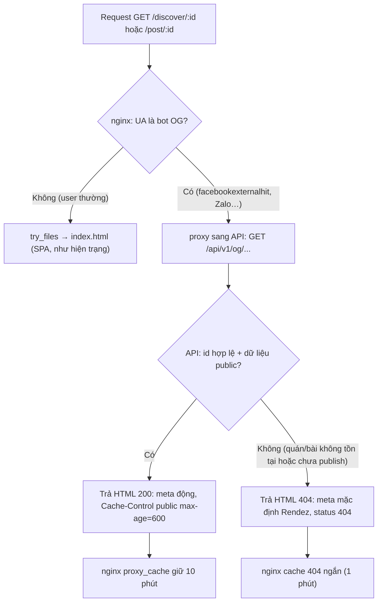

# Thiết kế: Chia sẻ + OG động cho trang quán và bài viết

> Trạng thái: bản thiết kế v1 — chờ review trước khi triển khai (quy mô S nhưng chạm hạ tầng serve: nginx + API + build FE).
> Phạm vi: OG meta động cho `/discover/:id` và `/post/:id` khi bot mạng xã hội (Facebook/Zalo/Messenger) fetch link, + nút "Chia sẻ" tái dùng ở 2 trang chi tiết. KHÔNG sửa code trong tài liệu này.

## 1. Mục tiêu & phạm vi

**Vấn đề:** FE là SPA tĩnh (Vite build → nginx/Caddy serve `index.html`). Khi user copy link `/discover/:id` hay `/post/:id` dán lên Facebook/Zalo/Messenger, bot của các nền tảng này **không chạy JS** — chỉ đọc meta tĩnh trong `index.html`. Kết quả: preview luôn là "Rendez — Ăn gì hôm nay ở Đà Nẵng?" với ảnh banner chung, không có tên quán/bài đăng → link trông kém hấp dẫn, tỉ lệ click thấp.

**Mục tiêu:** bot fetch link quán/bài → nhận HTML có `og:title` (tên quán / caption bài), `og:description`, `og:image` (ảnh quán/bài đầu tiên, fallback ảnh mặc định), `og:url` đúng. Người dùng thường mở link → vẫn nhận SPA như hiện tại, không thay đổi.

**Phạm vi:**

- ✅ Route FE `/discover/:id` (trang quán — lưu ý: *không phải* `/places/:id`, route thật trong [routes.tsx](file:///home/longtran/Projects/rendez/frontend/src/app/router/routes.tsx) là `/discover/:id`) và `/post/:id` (bài đăng — cũng là `/post/:id`, không phải `/posts/:id`).
- ✅ Nút chia sẻ trên 2 trang chi tiết (tái dùng `ShareButton` đã có).
- ❌ Không làm OG cho mọi route (collections, rooms, profile…) — ghi BACKLOG nếu cần sau.
- ❌ Không làm SSR/SSR hydrate, không thêm framework render (Next/Remix) — vi phạm ràng buộc "SPA tĩnh + API riêng" và overengineering cho 2 route.
- ❌ Không làm sitemap động hay SEO indexing sâu — chỉ OG preview cho share link.

**Chỉ số thành công — cách đo, không bịa số:**

| Chỉ số | Cách đo | Nguồn |
|---|---|---|
| Số lượt bot fetch `/discover/:id`, `/post/:id` | nginx access log lọc theo UA bot / location og | log |
| Preview đúng khi dán link | kiểm tay thủ công bằng Facebook Sharing Debugger + Zalo sau deploy | thủ công |

## 2. So sánh phương án & quyết định

### (a) Backend route trả HTML meta cho bot (UA sniff ở nginx)

nginx nhận request, so `User-Agent` với danh sách bot (facebookexternalhit, Facebot, Zalo, TelegramBot…). Bot → proxy sang endpoint mới của API trả **HTML chỉ chứa bộ meta OG động** (không nhúng bundle JS — xem mục 4). Người thường → trả SPA tĩnh như cũ.

- **Ưu:** người dùng không chịu thêm độ trễ API; API chỉ gánh traffic bot (nhỏ); kiểm soát nội dung meta ở một nơi có sẵn dữ liệu (Prisma); không đụng pipeline build FE.
- **Nhược:** có rủi ro *cloaking* nếu HTML cho bot khác HTML cho người (Google phạt). Giảm được: **meta trả cho bot chính là nội dung thật của trang** (tên quán, caption, ảnh thật — không bịa nội dung khác), và người dùng thật không bao giờ nhận HTML này vì UA sniff chỉ khớp danh sách bot preview đã biết. Không nhắm Googlebot (Googlebot vẫn nhận SPA tĩnh như hiện trạng — SEO indexing không đổi).
- **Rủi ro phụ:** danh sách UA bot phải bảo trì (thêm bot mới = sửa nginx); UA có thể bị giả mạo — nhưng endpoint chỉ đọc dữ liệu công khai nên vô hại.

### (b) Prerender tĩnh lúc build

Build FE chạy script gọi API sinh sẵn `dist/discover/<id>/index.html` cho từng quán.

- **Ưu:** không cần logic runtime, nhanh tuyệt đối.
- **Nhược:** **loại ngay** — (1) lúc build FE không có/không nên phụ thuộc DB (container FE build độc lập); (2) 343 quán + bài đăng tăng liên tục (post là dữ liệu user-generated, sinh vô hạn) — prerender vô hạn trang là vô nghĩa; (3) bài đăng mới sau lần build cuối sẽ không bao giờ có meta đúng. Chỉ hợp trang ít thay đổi, không hợp dữ liệu động.

### (c) nginx `sub_filter` chèn meta theo path

`sub_filter` thay chuỗi tĩnh trong response — để chèn *giá trị động theo path*, nginx thuần không lấy được dữ liệu từ API (cần njs/Lua/OpenResty → thêm runtime mới vào image nginx-alpine).

- **Ưu:** nếu dùng njs, một chỗ xử lý, không cần route riêng trên API.
- **Nhược:** phải thêm module njs + script JS chạy trong nginx (hạ tầng mới, khó test, không có typecheck/test như backend); logic escape HTML nằm trong nginx script — ngoài hệ thống test chuẩn của dự án; vi phạm "một nghiệp vụ một nơi" (nghiệp vụ dựng meta thuộc API). **Loại.**

### (d) Phương án khác: backend phục vụ HTML cho *mọi* request vào 2 route

Bỏ UA sniff — nginx/Caddy proxy `/discover/:id` và `/post/:id` thẳng API, API luôn trả HTML shell đầy meta.

- **Ưu:** một code path duy nhất, không lo sai danh sách bot, không cloaking.
- **Nhược:** mọi lượt mở trang quán/bài (kể cả user thường điều hướng trực tiếp/refresh) đều qua API + Prisma — tăng tải vô ích; mất static serving; nếu API chậm/lỗi thì trang quán lỗi thay vì SPA fallback. Traffic user >> traffic bot, đánh đổi xấu.

### Quyết định: **(a) — UA sniff ở nginx, API trả HTML bot**

Lý do: giữ 99%+ traffic (user thường) trên static serving như hiện trạng; API là nơi duy nhất đã có dữ liệu quán/bài (tái dùng `findPublicPlace`, `findPost`); rủi ro cloaking kiểm soát được bằng nguyên tắc "meta trả cho bot = nội dung thật của trang, người dùng không bao giờ nhận HTML này vì UA sniff chỉ khớp bot đã biết" (mục 2, mục 4); không thêm hạ tầng mới (njs/Redis/prerender pipeline).

**Cấu hình UA bot ở nginx bằng `map`** (đặt trong `frontend/nginx.conf`):

```nginx
# Bot preview mạng xã hội — danh sách ngắn, chỉ các bot fetch link khi share.
# meta-externalagent/validator: crawler Meta (Threads/FB) 2024+.
map $http_user_agent $is_og_bot {
    default                   0;
    ~*facebookexternalhit     1;
    ~*^Facebot                1;
    ~*facebookcatalog         1;
    ~*meta-externalagent      1;
    ~*meta-externalvalidator  1;
    ~*Zalo                    1;
    ~*Twitterbot              1;
    ~*slack                   1;
    ~*WhatsApp                1;
    ~*TelegramBot             1;
    ~*discordapp              1;
    ~*LinkedInBot             1;
}
```

**Caddy (prod)** tương đương bằng `@bot header_regexp User-Agent …` + `reverse_proxy api:8000` (mục 6).

## 3. Luồng request chi tiết



**User thường:** không đổi gì — `location /` `try_files … /index.html` như [nginx.conf](file:///home/longtran/Projects/rendez/frontend/nginx.conf) hiện có. Chỉ thêm location regex chặn 2 prefix route trước `location /`.

**Bot:** nginx proxy sang API `GET /api/v1/og/place/:id` / `GET /api/v1/og/post/:id` (đặt ngoài nhóm `/api/v1` chuẩn? — không, đặt trong `/api/v1` luôn để tái dùng middleware request-id/log; nginx location bot proxy cùng upstream `api:8000`).

**Lấy dữ liệu:** API gọi Prisma trực tiếp (không HTTP tự gọi chính mình):

- Quán: tái dùng `findPublicPlace(id)` trong [backend/src/lib/places.ts](file:///home/longtran/Projects/rendez/backend/src/lib/places.ts) — đã có điều kiện `published_at IS NOT NULL AND deleted_at IS NULL` (quán chưa publish coi như không tồn tại, nhất quán với `GET /places/:id`).
- Bài: tái dùng `findPost(id, null)` (viewer null — chỉ thấy nội dung công khai) trong [backend/src/lib/posts.ts](file:///home/longtran/Projects/rendez/backend/src/lib/posts.ts).

**Cache TTL — 2 tầng, không thêm hạ tầng:**

1. **nginx `proxy_cache`** cho location bot: `proxy_cache_valid 200 10m`, key = `$scheme$host$request_uri`. Bot cùng link trong 10 phút không chạm API. 404 cache **1 phút** (`proxy_cache_valid 404 1m`) — đủ gánh lượt bot dồn dập trên link sai, vẫn ngắn để quán mới publish sớm có preview.
2. **API trả header `Cache-Control: public, max-age=600`** để CDN phía trước (Caddy không cache mặc định, nhưng nếu sau này thêm CDN thì đúng sẵn).

**Bust cache nền tảng (vận hành):** FB/Zalo cache preview theo URL ảnh và URL trang độc lập với TTL nginx. Khi sửa tên quán/ảnh mà preview không cập nhật:

- Facebook/Messenger: mở [Facebook Sharing Debugger](https://developers.facebook.com/tools/debug/) → dán link → bấm **"Scrape Again"** (và nút "Scrape Again" cạnh từng ảnh để làm mới ảnh).
- Zalo: không có công cụ chính thức — cách thực dụng là thay `og:image` (URL ảnh đổi → Zalo fetch lại). Vì vậy **gắn version vào URL ảnh**: `og:image = {imageUrl}?v={epoch giây của updatedAt}` (quán: `updated_at`; bài: `created_at` epoch). Một dòng trong `lib/og.ts`; ảnh mặc định dùng thời điểm dựng HTML. Side effect chấp nhận: URL ảnh đổi mỗi lần dữ liệu đổi → cache ảnh nền tảng tự vô hiệu — đúng mục đích.

Không dùng `createTtlCache` trong API — nginx đã gánh; thêm tầng cache in-process là trùng lặp logic (một nghiệp vụ một nơi).

**Xử lý 404:** quán/bài không tồn tại, chưa publish, hoặc bị xoá → API trả **status 404** với HTML chứa meta mặc định (site_name Rendez, title/description chung, ảnh `og-image.png`). Lý do giữ status 404: đúng ngữ nghĩa HTTP, platform preview hiển thị fallback riêng của họ, và không tạo soft-404 trong hệ thống. Không redirect — redirect làm mất preview.

**Escape HTML — chống XSS: không tự viết hàm escape.** Dùng tagged template `html` của `hono/html` (đã xác minh trong `node_modules/hono@4.13.17`: `dist/types/utils/html.d.ts` export `escapeToBuffer`, và `hono/html` export `html`) — mọi giá trị interpolated `${...}` được escape tự động (`& < > " '`). Không nối chuỗi thủ công, không dùng `raw()` cho bất kỳ giá trị nào đến từ DB.

```ts
import { html } from "hono/html"
// …
const body = html`<!doctype html><html lang="vi"><head>
  <meta property="og:title" content="${title}" />
  …
</head><body><div id="root"></div></body></html>`
```

**Whitelist URL ảnh:** chấp nhận URL tuyệt đối bắt đầu bằng `https://` **hoặc** `APP_ORIGIN` (dev là `http://localhost:5173`, prod là `https://domain` — cho phép http vì dev), hoặc đường dẫn nội bộ bắt đầu bằng `/`. Mọi scheme khác (`javascript:`, `data:`, `vbscript:`…) → fallback `/og-image.png`. Không có exception.

**Unit test bắt buộc** (mục 8): title/description chứa `<script>`, `"`, `'`, `&`, emoji; id chứa `"`/`<` không xuất hiện nguyên văn trong `og:url`. Không render gì khác ngoài bộ thẻ meta — không chèn caption gốc dạng text body (caption có thể dài/lỗi dòng; description cắt ~160 ký tự, cắt tại khoảng trắng, không cắt giữa cặp surrogate emoji).

**Ảnh fallback:**

- Quán: `place.imageUrl` (từ `place_images`, đã là URL tuyệt đối R2 hoặc đường dẫn cold-start `/data/...`). Không có → ảnh mặc định `/og-image.png` (đã có sẵn trong `frontend/public/`).
- Bài: `post.images[0]` → không có → `post.place.imageUrl` → không có → `/og-image.png`.
- Ảnh tương đối (`/data/...`) được tuyệt đối hoá bằng `APP_ORIGIN`.
- Mọi URL ảnh gắn `?v=<epoch giây của updatedAt>` để bust cache preview của nền tảng (mục 3, bust cache).

**Ảnh hưởng SEO hiện tại:** không đổi. Googlebot không nằm trong danh sách bot OG → nhận SPA tĩnh y như trước (Google render JS được, hiện trạng indexing không thay đổi). `og:url`/canonical trong HTML bot trỏ tới `APP_ORIGIN + path` — khớp URL thật; index.html tĩnh giữ nguyên canonical hiện có. Việc hardcode `https://rendez.example/` trong [index.html](file:///home/longtran/Projects/rendez/frontend/index.html) là nợ hiện hữu — ghi BACKLOG thay bằng `VITE_PUBLIC_BASE_URL` lúc build, **không làm trong phạm vi này** (tránh scope creep; OG bot không đọc index.html nữa nên không ảnh hưởng tính năng này).

## 4. Thiết kế HTML cho bot

Template nhúng trong code (template literal, không file .html riêng — tránh đồng bộ 2 nguồn sự thật với index.html; phần `<head>` chung viết thành hàm dùng lại):

```html
<!doctype html>
<html lang="vi">
  <head>
    <meta charset="UTF-8" />
    <meta name="viewport" content="width=device-width, initial-scale=1.0" />
    <title>{title}</title>
    <meta name="description" content="{description}" />
    <meta property="og:site_name" content="Rendez" />
    <meta property="og:type" content="{website|article}" />
    <meta property="og:title" content="{title}" />
    <meta property="og:description" content="{description}" />
    <meta property="og:url" content="{APP_ORIGIN}{path}" />
    <meta property="og:image" content="{imageUrl}?v={updatedAtEpoch}" />
    <meta property="og:locale" content="vi_VN" />
    <meta name="twitter:card" content="summary_large_image" />
    <meta name="twitter:title" content="{title}" />
    <meta name="twitter:description" content="{description}" />
    <meta name="twitter:image" content="{imageUrl}?v={updatedAtEpoch}" />
    <link rel="canonical" href="{APP_ORIGIN}{path}" />
  </head>
  <body>
    <div id="root"></div>
    <!-- Không nhúng bundle JS: API không biết tên file hashed của bản build FE,
         và bot preview (FB/Zalo) chỉ đọc meta, không chạy JS. Xem ghi chú dưới. -->
  </body>
</html>
```

> [!NOTE]
> Bỏ `og:image:width`/`og:image:height`: ảnh quán/bài có tỉ lệ tùy ý, hardcode 1200×630 là **sai sự thật** — Facebook/Zalo tự đo kích thước ảnh khi fetch. Chỉ ảnh mặc định `og-image.png` mới đúng 1200×630 và nó đã tự khai trong `index.html` tĩnh.

> [!NOTE]
> **CSP `default-src 'none'` là chủ ý:** middleware `secureHeaders` trong [app.ts](file:///home/longtran/Projects/rendez/backend/src/app.ts) áp CSP `default-src 'none'` cho mọi route của API, gồm cả `/og/*`. HTML preview không load JS/CSS/font nào (chỉ thẻ meta) nên CSP này vô hại — và nếu ai đó thêm script vào template sau này, CSP sẽ chặn ngay (lưới an toàn). Ghi comment một dòng ngay trong module `lib/og.ts` để người sau không tưởng là lỗi cấu hình.

> [!IMPORTANT]
> Quyết định có chủ đích: HTML cho bot **chỉ chứa meta, không nhúng bundle JS** (API không biết tên file hashed của FE, và nhúng sai còn tệ hơn không nhúng). Đây không phải cloaking gây hại: **meta trả cho bot chính là nội dung thật của trang** (tên quán, caption, ảnh thật), và **người dùng thật không bao giờ nhận HTML này** vì UA sniff chỉ khớp danh sách bot preview đã biết. Hệ quả chấp nhận: nếu ai đó giả UA bot bằng trình duyệt, họ thấy trang chỉ có meta (trang trắng) — vô hại, không lộ dữ liệu gì thêm. Nếu sau này muốn Googlebot nhận HTML đầy đủ → đó là bài toán SSR/ISR khác, ngoài phạm vi.

**Nội dung meta cụ thể:**

| Trang | og:title | og:description | og:type |
|---|---|---|---|
| Quán | `{name}` | `{address}, {district}, {city}` + `(rating ★ {rating})` nếu `reviewCount > 0`; thiếu địa chỉ → `Khám phá quán ăn tại Đà Nẵng trên Rendez` | `website` |
| Bài | `{author.name} kiểm tra quán` hoặc nếu có place: `Bài viết tại {place.name}` | `{caption}` cắt ≤ 160 ký tự; caption rỗng → `Xem bài viết trên Rendez` | `article` |

## 5. Thiết kế API (endpoint mới)

Trong `backend/src/routes/og.ts` (module mới, mount trong `backend/src/routes/index.ts`):

- `GET /og/place/:id` — id khớp `SLUG_ID_RE` (slug từ dataset, như `GET /places/:id`); sai format → 404 meta mặc định.
- `GET /og/post/:id` — id là uuid; dùng `requireUuid` **đã chuyển lên** `backend/src/lib/cursor.ts` (cạnh `SLUG_ID_RE`) và export cho cả `routes/posts.ts` lẫn `lib/og.ts` dùng — không copy logic vào module OG. Sai format → 404 meta mặc định.
- Response: `c.html(...)` (Hono có sẵn) + header `Cache-Control: public, max-age=600`.
- **Không** dùng `jsonWithCache` (đó là JSON); viết helper `htmlWithCache(c, html, { maxAge })` cạnh nó trong `backend/src/lib/http-cache.ts` để nhất quán pattern.
- Không requireAuth, không CORS cần thiết (bot không gửi preflight; endpoint trả HTML không JSON). CORS middleware hiện tại `origin`-based không cản GET thường.
- Rate limit: không áp dụng — cùng lý do `GET /places/:id` (đọc công khai, nginx đã cache). Nếu thấy abuse trong log → thêm `rateLimit` sẵn có sau.

## 6. Cấu hình serve

### Dev (`frontend/nginx.conf`)

Thêm **trước** `location /` (regex location ưu tiên hơn prefix `location /`):

```nginx
# Cache cho HTML bot — khai báo ở http context (file conf.d được include trong
# `http`, nên đặt ngoài khối `server` là hợp lệ).
proxy_cache_path /var/cache/nginx/og levels=1:2 keys_zone=og_cache:1m
                 max_size=20m inactive=1h use_temp_path=off;

server {
  # … giữ nguyên các location hiện có …

  # 2 route cần OG. Bot → proxy API; user thường → SPA fallback như cũ.
  # Dùng `if` + `return` (pattern an toàn của nginx: "if is evil" chỉ cấm
  # đặt proxy_pass/rewrite phức tạp trong if) rồi error_page trỏ named location.
  location ~ ^/(?<og_kind>discover|post)/(?<og_id>[^/]+)$ {
    if ($is_og_bot) { return 418; }
    try_files $uri /index.html;
    error_page 418 = @og_html;
  }

  location @og_html {
    proxy_pass http://api:8000/api/v1/og/$og_kind/$og_id;
    proxy_http_version 1.1;
    proxy_set_header Host $host;
    proxy_set_header X-Forwarded-Proto $scheme;
    proxy_cache og_cache;
    proxy_cache_key "$scheme$host$request_uri";
    proxy_cache_valid 200 10m;
    proxy_cache_valid 404 1m;
    # API chết → trả index.html tĩnh (preview mặc định) thay vì 502.
    proxy_intercept_errors on;
    error_page 500 502 503 504 = @spa_fallback;
  }

  location @spa_fallback {
    try_files /index.html =500;
  }
}
```

Biến `$og_kind`/`$og_id` được `set` từ capture của regex location và **giữ nguyên khi chuyển sang named location** trong cùng request — đây là cơ chế chuẩn của nginx, nhưng **phải kiểm bằng curl ở bước 2 của kế hoạch**; nếu capture không truyền sang (khác phiên bản), phương án dự phòng là tách 2 location `^/discover/` và `^/post/` với `proxy_pass` hardcode tiền tố tương ứng (không cần capture).

### Prod (`deploy/Caddyfile`)

```caddyfile
# Bot preview cho trang quán: /discover/:id → API /api/v1/og/place/:id
@ogplace {
    path_regexp ogplace ^/discover/([^/]+)$
    header_regexp UA User-Agent (facebookexternalhit|Facebot|meta-externalagent|meta-externalvalidator|Zalo|Twitterbot|WhatsApp|TelegramBot|discordapp|LinkedInBot)
}
handle @ogplace {
    rewrite * /api/v1/og/place/{re.ogplace.1}
    reverse_proxy api:8000
}

# Bot preview cho bài đăng: /post/:id → API /api/v1/og/post/:id
@ogpost {
    path_regexp ogpost ^/post/([^/]+)$
    header_regexp UA User-Agent (facebookexternalhit|Facebot|meta-externalagent|meta-externalvalidator|Zalo|Twitterbot|WhatsApp|TelegramBot|discordapp|LinkedInBot)
}
handle @ogpost {
    rewrite * /api/v1/og/post/{re.ogpost.1}
    reverse_proxy api:8000
}
```

đặt **trước** khối `handle` FE tĩnh (Caddy xét `handle` theo thứ tự khai báo). `path_regexp <tên> <pattern>` + `{re.<tên>.<số>}` là cú pháp chuẩn của Caddy 2. Caddy không cache mặc định — chấp nhận API chịu traffic bot prod (thấp), nginx dev có cache là đủ cho demo.

### Biến môi trường

| Biến | Nơi | Mặc định | Ý nghĩa |
|---|---|---|---|
| `APP_ORIGIN` | backend (đã có trong `backend/src/env.ts`) | `http://localhost:5173` | Dựng `og:url`, canonical, tuyệt đối hoá ảnh `/data/...`. **Không thêm biến mới** — tái dùng. |

> [!WARNING]
> `APP_ORIGIN` hiện **KHÔNG có trong `compose.yaml`** — nó chỉ nằm trong `backend/.env` (nạp qua `env_file` optional). Nếu thiếu, mặc định `http://localhost:5173` sẽ lọt vào `og:url`/`og:image` tuyệt đối → preview prod trỏ ảnh về localhost. Bắt buộc thêm vào `environment` của service `api` trong [compose.yaml](file:///home/longtran/Projects/rendez/compose.yaml):
>
> ```yaml
>   api:
>     environment:
>       # … các biến hiện có …
>       # Origin FE công khai — dùng để dựng og:url/og:image tuyệt đối cho HTML bot.
>       APP_ORIGIN: ${APP_ORIGIN:-http://localhost:5173}
> ```
>
> Prod (`deploy/compose.prod.yml`): đặt `APP_ORIGIN=https://<domain-thật>` qua file `.env` cạnh compose — **phải là URL public https**, không được để mặc định localhost. Thêm kiểm fail-fast: `env.ts` đã validate URL; cân nhắc thêm assert `NODE_ENV=production ⇒ APP_ORIGIN không phải localhost` (1 dòng, làm kịp lúc triển khai).

FE không thêm biến mới (nút chia sẻ dùng `window.location.origin` như `shareLink` hiện có).

## 7. Nút "Chia sẻ" trong UI

**Đã có sẵn gần như toàn bộ** — [share-button.tsx](file:///home/longtran/Projects/rendez/frontend/src/components/shared/share-button.tsx) + [share.ts](file:///home/longtran/Projects/rendez/frontend/src/lib/share.ts) (`navigator.share` → fallback clipboard → toast sonner). Việc còn lại:

1. Đặt `<ShareButton>` vào trang chi tiết quán (`place-detail-page.tsx`) và bài đăng (`post-detail-page.tsx`) — vị trí chốt lúc làm (toolbar hành động hiện có của mỗi trang), props: `title` = tên quán / "Bài viết của {author}", `url` = `/discover/{id}` / `/post/{id}` (tương đối — `shareLink` tự ghép origin).

**Không thêm tracking** — không có bảng event, không console-log sự kiện (pattern `daily_picks_click` chỉ là thiết kế chưa triển khai, không tồn tại trong code — YAGNI). Số lượt chia sẻ đo sau nếu thực sự cần, bằng hạ tầng đo riêng.

Không viết hàm chia sẻ mới, không modal chia sẻ riêng (Web Share API của hệ điều hành đã có menu Zalo/FB).

## 8. Kế hoạch triển khai

| Bước | Việc | File chạm |
|---|---|---|
| 0. `requireUuid` dùng chung | Chuyển `requireUuid` từ `routes/posts.ts` sang `lib/cursor.ts` + export, sửa import ở posts.ts | `backend/src/lib/cursor.ts`, `backend/src/routes/posts.ts` |
| 1. Module OG backend | Dựng meta bằng `hono/html`, whitelist ảnh, `?v=` version, handler 2 endpoint | `backend/src/lib/og.ts` (mới), `backend/src/routes/og.ts` (mới), `backend/src/routes/index.ts`, `backend/src/lib/http-cache.ts` (thêm `htmlWithCache`) |
| 2. nginx dev | map UA (có meta-externalagent) + location bot + proxy_cache | `frontend/nginx.conf` |
| 3. Caddy prod | matcher bot + rewrite + reverse_proxy | `deploy/Caddyfile` |
| 4. compose env | Thêm `APP_ORIGIN` vào `environment` service api | `compose.yaml`, `deploy/compose.prod.yml` (hoặc `.env` prod) |
| 5. FE nút chia sẻ | ShareButton vào 2 trang chi tiết (không tracking) | `frontend/src/features/places/pages/place-detail-page.tsx`, `frontend/src/features/social/pages/post-detail-page.tsx` |

**Tổng: ~5 file mới/sửa backend + 2 file cấu hình serve + 1 compose + 2 file FE.** Không migration, không dependency mới (`hono/html` có sẵn trong Hono).

**Test cần viết:**

- **Unit** (`backend/test/og.test.ts`): title/description chứa `<script>`, `"`, `'`, `&`, emoji → HTML sinh ra không chứa ký tự thô (escape của `hono/html`); **id chứa `"` và `<`** → không xuất hiện nguyên văn trong `og:url` (id sai format cũng phải đi nhánh 404 trước khi tới template); caption dài cắt đúng 160 tại khoảng trắng, không cắt giữa emoji; URL ảnh `javascript:alert(1)` bị loại → fallback og-image; ảnh `/data/x.png` được tuyệt đối hoá bằng `APP_ORIGIN`; URL ảnh có `?v=` đúng epoch `updatedAt`.
- **Integration** (`backend/test/og.test.ts`, Postgres thật — pattern sẵn có): seed quán published → `GET /og/place/:id` với UA `facebookexternalhit` trả 200, HTML chứa tên quán trong `og:title`, `Cache-Control: public, max-age=600`; quán chưa publish → 404 + meta mặc định; bài có ảnh → `og:image` là ảnh đầu tiên; bài không ảnh, có place ảnh → ảnh place; cả hai không → og-image.
- **curl kiểm tay** (sau khi chạy compose):
  ```bash
  curl -s -H "User-Agent: facebookexternalhit" http://localhost:5173/discover/<id> | grep og:title
  curl -s -H "User-Agent: meta-externalagent" http://localhost:5173/post/<uuid> | grep og:image
  curl -s -H "User-Agent: Mozilla/5.0" http://localhost:5173/discover/<id> | head -3   # → SPA index.html
  curl -s -o /dev/null -w "%{http_code}" -H "User-Agent: Zalo" http://localhost:5173/discover/khong-ton-tai   # → 404
  ```
- **E2E** (`frontend/e2e/`): trang quán và bài đăng có nút "Chia sẻ"; bấm trên desktop (không có `navigator.share` trong Chromium test) → toast "Đã sao chép liên kết".
- **Kiểm tay preview thật sau deploy:** Facebook Sharing Debugger (bấm "Scrape Again") + dán link vào Zalo chat.

## 9. Rủi ro & cách giảm

| Rủi ro | Mức | Giảm |
|---|---|---|
| `APP_ORIGIN` chưa có trong `compose.yaml` → preview prod trỏ ảnh về localhost | **Cao (đã xác nhận)** | Thêm `APP_ORIGIN` vào `environment` service api (mục 6); prod đặt domain https thật; kiểm bằng `curl` xem `og:image` tuyệt đối |
| Cloaking / bị nền tảng đánh giá nội dung khác nhau giữa bot và user | Thấp | Meta bot = đúng nội dung trang (tên quán, caption, ảnh thật); người dùng thật không nhận HTML này (UA sniff chỉ khớp bot đã biết); không phục vụ Googlebot bằng HTML khác SPA |
| UA giả mạo → người thường nhận HTML chỉ có meta (trang trắng) | Thấp | Chỉ xảy ra khi chủ động giả UA; trang trắng vẫn có meta; chấp nhận — không nhúng bundle vì API không biết tên file hashed |
| Danh sách UA bot thiếu bot mới (vd. Threads) | Thấp | Link vẫn share được, chỉ preview kém; thêm UA vào map/matcher là sửa 1 dòng cấu hình |
| Caption bài chứa ký tự độc → XSS trong HTML bot | Trung bình (nếu bỏ qua) | Tagged template `hono/html` tự escape mọi interpolation + whitelist scheme ảnh (`https://`, `APP_ORIGIN`, `/`) + unit test bắt buộc; cấm `raw()` cho dữ liệu DB |
| API chết → bot nhận 502 thay vì preview | Thấp | nginx `proxy_next_upstream`/`error_page` fallback: khi proxy lỗi, phục vụ index.html tĩnh (preview mặc định) — cấu hình `proxy_intercept_errors` hoặc `error_page 502 = @spa` |
| Cache nginx trả meta cũ sau khi đổi tên quán | Thấp | TTL 10 phút, chấp nhận; không purge chủ động (overengineering cho quy mô này) |
| `if` trong nginx location gây hành vi khó đoán | Trung bình | Đã biết pattern (`if` + `proxy_pass` trong location là an toàn, `if` + thay đổi directive khác là không); chốt cú pháp bằng test curl trước khi commit; nếu lấn cấn thì tách 2 location theo map biến |

## 10. Ngoài phạm vi (không làm vòng này)

- OG cho các route khác (collections, rooms, profile, `/u/:handle`).
- Thay hardcode `rendez.example/` trong `index.html` bằng biến build (`VITE_PUBLIC_BASE_URL`) — nợ hiện hữu, ghi BACKLOG.
- Sitemap động, structured data (JSON-LD), Twitter meta động ngoài bộ tối thiểu ở mục 4.
- SSR/prerender/hydrate — không đổi kiến trúc SPA tĩnh.
- Bảng analytics / sự kiện tracking lượt chia sẻ (kể cả console log) — không có hạ tầng đo, YAGNI ở vòng này.
- Purge cache chủ động / webhook invalidate khi dữ liệu đổi.
- Hạ tầng cache mới (Redis, njs, OpenResty).
