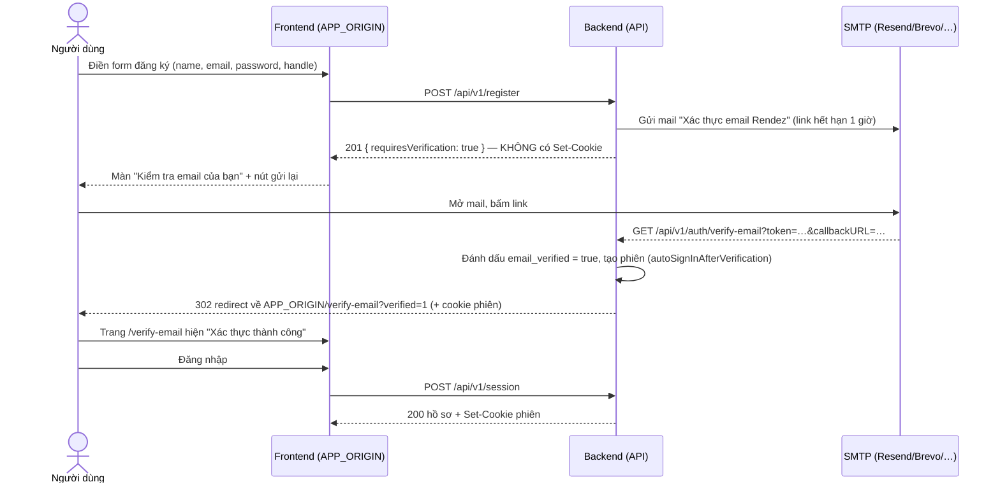

# Thiết kế: Xác thực email khi đăng ký & đăng nhập

> Trạng thái: đã triển khai (2026-11-12) — tài liệu này mô tả lại thiết kế đã áp dụng, khớp quyết định D-056 trong `docs/DECISIONS.md`.
> Phạm vi: vòng đời đăng ký → xác thực email → đăng nhập, mail xác thực, trang `/verify-email`, backfill user cũ. KHÔNG bao gồm tính năng đổi email (chưa làm).

## 1. Bối cảnh

**Vấn đề trước đây:** đăng ký xong là có phiên ngay (`POST /register` trả hồ sơ + `Set-Cookie`). Ai đăng ký bằng email ảo/rác cũng vào được app — email rác, tài khoản ảo, và không có kênh liên hệ nào với người dùng (quên mật khẩu cũng không gửi được vì email có thể là giả).

**Quyết định D-056 (2026-11-12):** bắt buộc xác thực email trước khi đăng nhập. Cột `users.email_verified` có từ migration init nhưng luôn `false` — giờ nó có ý nghĩa thật.

Kèm theo, đăng nhập đã dùng **email** làm định danh (thay cho "tên đăng nhập"): người dùng bớt 1 trường phải nhớ, và email chính là thứ được xác thực.

## 2. Luồng đăng ký → xác thực → đăng nhập



### Các điểm then chốt

- **Đăng ký không tạo phiên.** better-auth với `requireEmailVerification` tự bỏ auto sign-in và trả `{ token: null, user }` (đã đọc source `dist/api/routes/sign-up.mjs`). Route `/register` thấy `token == null` → trả `201 { requiresVerification: true }`, không có `Set-Cookie` nào.
- **Link trong mail trỏ tới API, không trỏ tới FE.** `callbackURL` truyền vào better-auth là `verifyEmailCallbackUrl()` = `APP_ORIGIN + /verify-email?verified=1` (hằng `VERIFY_EMAIL_CALLBACK_PATH` trong `backend/src/lib/auth.ts`). URL trong mail là `BETTER_AUTH_URL/verify-email?token=…&callbackURL=…`. `APP_ORIGIN` được thêm vào `trustedOrigins` vì callbackURL phải thuộc origin tin cậy.
- **API xác thực xong rồi redirect về FE.** Trang `/verify-email` **không tự gọi API** — việc xác thực đã xong ở phía server trước khi redirect (kèm cookie phiên trong response redirect nhờ `autoSignInAfterVerification`).
- **Marker `verified=1` là bắt buộc để hiện "thành công".** Vì sao: trước đây trang coi "không có `?error=`" là thành công, nên mở `/verify-email` trực tiếp (không có token) hay link token sai đều hiện "Xác thực thành công" — trạng thái giả (V1-03/V6-06). Giờ thành công chỉ khi URL có `?verified=1` (do API redirect kèm theo); mở trực tiếp hay lỗi đều rơi vào nhánh "link không dùng được" kèm form gửi lại.
- **Chưa xác thực mà đăng nhập → `403` với message tiếng Việt rõ ràng.** better-auth trả 403 "Email not verified" (`dist/api/routes/sign-in.mjs:338`); route `/session` kiểm nhánh này **trước** nhánh 401/403 chung, map thành:

  > `403 {"message": "Email chưa được xác thực. Hãy mở link trong email xác thực (kiểm tra cả mục spam) rồi đăng nhập lại."}`

  Nếu để lẫn vào 401 chung, người dùng chỉ thấy "Email hoặc mật khẩu không đúng" và không biết cần mở mail.

- **Đăng ký lại bằng email đã tồn tại:** better-auth trả response "generic duplicate" như đăng ký mới (`201 { requiresVerification: true }`) để không lộ email tồn tại; hook `onExistingUserSignUp` gửi mail thật cho chủ tài khoản — chưa xác thực → gửi lại link xác thực, đã xác thực → mail "tài khoản đã tồn tại" kèm lối đăng nhập/quên mật khẩu (không kèm token, chống bị lạm dụng làm công cụ ép gửi link đổi mật khẩu). Người dùng không còn chờ một email không bao giờ tới (V1-02).

## 3. Chi tiết kỹ thuật

### 3a. better-auth emailVerification (`backend/src/lib/auth.ts`)

```ts
emailVerification: {
  sendVerificationEmail: async ({ user, url, token }) => { /* mailer */ },
  sendOnSignUp: true,                    // gửi mail ngay khi đăng ký
  autoSignInAfterVerification: true,     // bấm link xong có phiên luôn
  expiresIn: 60 * 60,                    // token hết hạn sau 1 giờ
},
emailAndPassword: {
  requireEmailVerification: true,        // chặn đăng nhập khi chưa xác thực
  // …
}
```

Chữ ký `{ user, url, token }` của `sendVerificationEmail` đã xác minh trong source better-auth 1.7.19 (`dist/api/routes/email-verification.mjs`, `sign-up.mjs`).

### 3b. `redirectOnError` nối `?error=CODE`

Khi token sai/hết hạn, better-auth không trả lỗi JSON mà redirect về callbackURL kèm `?error=CODE` (cơ chế `redirectOnError` trong `dist/api/routes/email-verification.mjs`). FE nhận `?error=INVALID_TOKEN` / `?error=TOKEN_EXPIRED`… và dịch qua bảng map dùng chung (mục 5). Token sai → redirect có `error=`, **không có cookie phiên**.

### 3c. Backfill migration cho user cũ

Migration MỚI `backend/prisma/migrations/20261112010000_email_verified_backfill/migration.sql` (nội dung thật):

```sql
-- Xác thực email bắt buộc khi đăng nhập (quyết định 2026-11-12).
-- Cột `email_verified` đã có từ migration init (mặc định false). Các user tạo
-- TRƯỚC khi bật verification không hề được gửi mail xác thực — nếu để false thì
-- toàn bộ bị khoá ngoài. Đánh dấu verified cho user hiện có; user mới đăng ký
-- vẫn bắt đầu với `email_verified = false` (default của cột).
UPDATE "users" SET "email_verified" = true;
```

Không sửa migration đã tồn tại — backfill là migration mới, đúng quy ước dự án.

### 3d. Gửi lại email — luôn 200 để không lộ email tồn tại

`POST /api/v1/auth/send-verification-email` (better-auth xử lý): **luôn trả `200 { status: true }`**, kể cả email không tồn tại trong hệ thống — nếu khác nhau, kẻ xấu dùng endpoint này để dò email nào đã đăng ký. FE coi mọi response là "đã gửi" và hiện hướng dẫn kiểm tra hộp thư.

### 3e. Rate limit

`backend/src/lib/rate-limit.ts` áp cho hai endpoint nhạy cảm:

| Endpoint | Scope | Limit |
|---|---|---|
| `POST /api/v1/session` | `auth-session` | 20/phút/IP |
| `POST /api/v1/register` | `auth-register` | 20/phút/IP |

Vượt limit → `429` + header `Retry-After` (middleware trả trực tiếp, không qua `c.header()` trước `throw` — header bị mất nếu throw).

## 4. Mailer (`backend/src/lib/mailer.ts`)

Cùng pattern với mail đặt lại mật khẩu — một nhà cung cấp SMTP chuẩn, đổi nhà cung cấp chỉ đổi biến môi trường (hướng dẫn: `docs/backend/SMTP-SETUP.md`):

- **Đủ cấu hình** (`env.mailConfigured`: đủ `SMTP_HOST`, `SMTP_USER`, `SMTP_PASSWORD`, `MAIL_FROM`) → gửi thật qua nodemailer. `SMTP_PORT` 465/2465 là SMTPS, 25/587/2587 dùng STARTTLS.
- **Thiếu cấu hình** → `sendVerifyEmailEmail` trả `false`:
  - dev/test: log `DEV ONLY — link xác thực email (chưa có SMTP)` kèm `url` + `token` để tự lấy link;
  - production: chỉ log `Yêu cầu xác thực email — chưa cấu hình SMTP`, **không log token** (ai đọc log lấy được thì xác thực hộ người khác).
- **Lỗi SMTP ném ra cho hook log** (`logger.error`), không lộ ra API — chống dò email.
- **Nội dung mail** tách khỏi phần gửi (`buildVerifyEmailMail`) để test được mà không cần SMTP thật: subject `"Xác thực email Rendez"`, text + HTML cùng nội dung, nút "Xác thực email", link dự phòng copy-paste, ghi chú hết hạn sau 1 giờ. **`name` và `url` được escape HTML** (`escapeHtml`) trước khi nhúng vào HTML — chống XSS qua tên người dùng.
- Hai mail phụ cùng file: mail "tài khoản đã tồn tại" (`buildAccountExistsMail`) và mail reset mật khẩu — cùng pattern escape.

## 5. Frontend

### 5a. Trang đăng ký (`register-page.tsx`)

Đăng ký thành công → màn **"Kiểm tra email của bạn"**: hiện email vừa nhập, alert "Xác thực email để đăng nhập" (kiểm tra cả mục spam, link hết hạn sau 1 giờ), nút **"Gửi lại email xác thực"** gọi `useSendVerificationEmail` → `POST /auth/send-verification-email` (server luôn 200 nên FE luôn hiện "Đã gửi lại email").

### 5b. Trang `/verify-email` (`verify-email-page.tsx`) — 3 trạng thái

| Trạng thái | Điều kiện | Hiển thị |
|---|---|---|
| Thành công | `?verified=1` và không có `?error=` | Alert "Xác thực thành công" + nút "Vào Rendez" (`/discover`) |
| Lỗi kèm form gửi lại | có `?error=CODE` | Alert destructive "Link không dùng được" + lý do từ map lỗi + form nhập email gửi lại |
| Mở trực tiếp | thiếu `verified=1` (và không có `error`) | Giống trạng thái lỗi — lý do "Link không hợp lệ hoặc thiếu token xác thực." |

- **Map lỗi qua `mapAuthErrorMessage`** (`auth-error-messages.ts`): `?error=TOKEN_EXPIRED` → "Link đã hết hạn. Hãy yêu cầu link mới.", `INVALID_TOKEN` → "Link không hợp lệ hoặc đã hết hạn…", v.v. Mã lạ không có trong bảng → câu chung "Không xác thực được email." (không hiện mã thô cho người dùng).
- Trang không tự gọi API xác thực — chỉ đọc tham số URL và render.

### 5c. Trang đăng nhập (`login-page.tsx`)

Lỗi 403 chưa xác thực → hiện nút gửi lại email xác thực (cùng hook `useSendVerificationEmail`).

## 6. Kiểm thử

### Backend — `backend/test/auth.test.ts` (25 test, 9 test liên quan xác thực email)

| Test | Kiểm chứng |
|---|---|
| `POST /register tạo tài khoản, trả {requiresVerification:true} và không có phiên` | 201, body đúng, **0 cookie**, `emailVerified = false` trong DB |
| `POST /session khi chưa xác thực email trả 403 kèm hướng dẫn` | 403, message chứa "chưa được xác thực" |
| `POST /auth/send-verification-email trả {status:true} (kể cả email lạ)` | email thật và email lạ đều 200 `{status:true}` |
| `GET /auth/verify-email xác thực, tự tạo phiên (autoSignIn) và redirect về FE` | tự ký token bằng `createEmailVerificationToken` (export chính thức của better-auth/api); 302 → đúng callbackURL, redirect **kèm cookie phiên**, `/me` bằng cookie đó trả 200 |
| `GET /auth/verify-email token sai redirect kèm ?error= và không có phiên` | 302 có `error=`, không có cookie phiên |
| `POST /session sau khi xác thực trả hồ sơ + cookie mới` | đăng nhập được sau verify |
| `POST /register trùng email trả 201 {requiresVerification:true} — không lộ email tồn tại` | response trung tính như đăng ký mới |
| `chưa xác thực → gửi lại link xác thực` | `notifyExistingUserSignUp` trả `"verification-resent"` |
| `đã xác thực → mail 'tài khoản đã tồn tại'` | trả `"account-exists-mail"` |

### Backend — `backend/test/mailer.test.ts`

3 test cho mail xác thực: đủ `from/to/subject/text/html` và chứa link xác thực; thiếu tên thì chào trung tính; escape HTML trong tên người dùng.

### E2E — `frontend/e2e/auth.spec.ts` (project mock)

- Luồng đăng ký mock: đăng ký → "Kiểm tra email của bạn" → mock `POST /auth/send-verification-email` coi như "đã bấm link" (mock không có hộp thư thật — ghi chú ngay trong code) → đăng nhập → `/discover`.
- `trang /verify-email: ?verified=1 → thành công, thiếu marker/?error= → link không hợp lệ`: mở `?verified=1` hiện thành công; mở trực tiếp **không** hiện thành công; `?error=TOKEN_EXPIRED` hiện đúng câu trong bảng map.
- Project `backend` (e2e thật): `global-setup` đánh dấu `email_verified = true` cho tài khoản demo qua `docker exec` (không bấm được link trong mail từ e2e); luồng token thật được phủ ở backend test.

## 7. Chưa xác minh

- **Chưa gửi mail thật qua dịch vụ SMTP nào** (Resend chưa cấu hình) — luồng gửi thật chỉ được phủ bởi unit test nội dung mail + mock transport; chưa chạy end-to-end với SMTP thật.
- **Chưa kiểm preview trong Gmail/Outlook thật** — HTML mail viết inline-style tối giản nhưng chưa xem render thực tế trên client mail (nút, link dự phòng, xuống dòng ở bản text).
