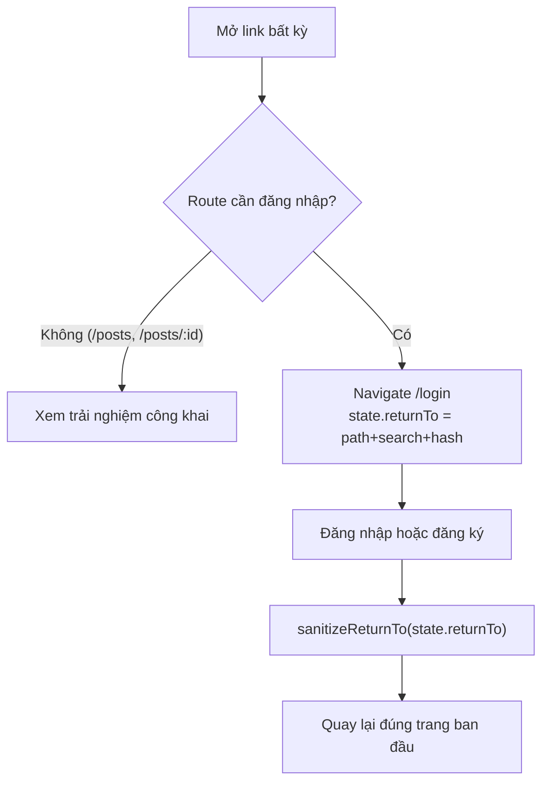
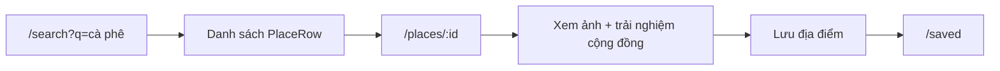
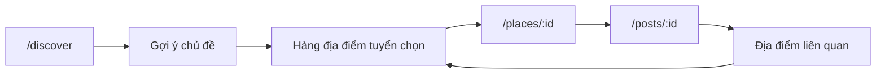
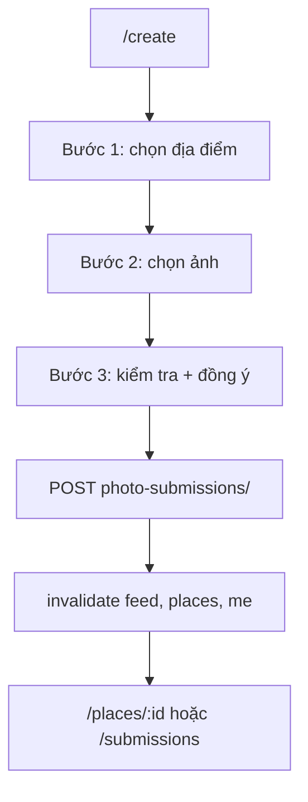

# Rendez UI Route Map

> Nguồn sự thật: [App.tsx](file:///home/longtran/Projects/rendez-web/frontend/src/app/App.tsx).
> Bảng dưới đây đối chiếu từng route với trang thực thi, endpoint API và quyền truy cập
> **thật của backend** (đọc từ `backend/openapi.yaml`).

---

## 1. Bảng route

| URL | Trang | Tệp | Quyền | Endpoint chính |
|---|---|---|---|---|
| `/` | Redirect | `App.tsx` | — | `→ /discover` |
| `/discover` | Khám phá | `features/discovery/DiscoverPage.tsx` | `IsAuthenticated` | `feed/`, `places/`, `places/{id}/photos/`, `categories/` |
| `/search` | Tìm kiếm | `features/search/SearchPage.tsx` | `IsAuthenticated` | `places/?q&category&attributes&sort&page`, `categories/`, `attributes/` |
| `/map` | Bản đồ | `app/map.tsx` (lazy) | `IsAuthenticated` | `places/map/?bbox&category&attributes` |
| `/places/:id` | Chi tiết địa điểm | `features/places/PlaceDetailPage.tsx` | `IsAuthenticated` | `places/{id}/?attributes`, `places/{id}/photos/`, `places/{id}/saved/`, `places/{id}/report/` |
| `/photos/:id` | Chi tiết ảnh | `features/experiences/PhotoDetailPage.tsx` | `IsAuthenticated` | `photos/{id}/`, `/likes/`, `/comments/`, `/similar/`, `/manage/`, `/report/` |
| `/posts` | Dòng trải nghiệm | `features/experiences/ExperiencesPage.tsx` | **AllowAny** | `posts/?place&author&page` |
| `/posts/:id` | Chi tiết trải nghiệm | `features/experiences/PostDetailPage.tsx` | **AllowAny** | `posts/{id}/`, `/likes/`, `/saved/`, `/shares/`, `/views/`, `/comments/` |
| `/saved` | Đã lưu | `features/saved/SavedPage.tsx` | `IsAuthenticated` | `favorites/?page`, `posts/saved/` |
| `/create` | Đăng trải nghiệm | `features/contribute/CreateExperiencePage.tsx` | `IsAuthenticated` | `places/?q`, `places/geocode/?q`, `photo-submissions/` (multipart) |
| `/profile` | Hồ sơ | `features/profile/ProfilePage.tsx` | `IsAuthenticated` | `auth/me/`, `feed/?mine=true`, `favorites/` |
| `/settings` | Cài đặt | `features/profile/SettingsPage.tsx` | `IsAuthenticated` | `auth/me/` (PATCH), `auth/password/` (POST), `auth/logout/` |
| `/creators/:id` | Hồ sơ tác giả | `app/creator.tsx` (legacy) | `IsAuthenticated` | `creators/{id}/`, `creators/{id}/photos/` |
| `/submissions` | Lịch sử đăng ảnh | `app/contributions.tsx` (legacy) | `IsAuthenticated` | `photo-submissions/` |
| `/submissions/new` | Nộp ảnh (legacy) | `app/contributions.tsx` | `IsAuthenticated` | `photo-submissions/` |
| `/submissions/:id` | Chi tiết lượt nộp | `app/contributions.tsx` | `IsAuthenticated` | `photo-submissions/{id}/` |
| `/login` | Đăng nhập | `app/auth.tsx` | Công khai | `auth/csrf/`, `auth/login/` |
| `/register` | Tạo tài khoản | `app/auth.tsx` (`register`) | Công khai | `auth/csrf/`, `auth/register/` |
| `*` | 404 | `features/shell/NotFoundPage.tsx` | `IsAuthenticated` | — |

> [!IMPORTANT]
> `/posts` và `/posts/:id` **cố ý** nằm ngoài `RequireLogin` vì backend khai báo
> `AllowAny` cho hai endpoint này. Mọi route khác đều đi qua `RequireLogin`.

---

## 2. Luồng điều hướng chính

### 2.1. Khách (chưa đăng nhập)

`sanitizeReturnTo` chặn URL tuyệt đối, `//evil.com`, backslash, `javascript:`, và vòng
lặp `/login*` `/register*`. Nếu không hợp lệ → `/discover`.

### 2.2. Ý định rõ ràng (intent-driven)

### 2.3. Khám phá mở (open-ended)

Search luôn truy cập được từ topbar trong `AppShell`, kể cả khi đang ở `/discover`.

### 2.4. Đóng góp

---

## 3. Điều hướng trong shell

| Vị trí | Đích | Ghi chú |
|---|---|---|
| Sidebar — Khám phá | `/discover` | `aria-current="page"` theo `pathname` |
| Sidebar — Tìm kiếm | `/search` | |
| Sidebar — Bản đồ | `/map` | `fullBleed` khi `pathname === "/map"` |
| Sidebar — Trải nghiệm | `/posts` | |
| Sidebar — Đã lưu | `/saved` | |
| Nút tạo | `/create` | `CreateAction` |
| Topbar | form tìm kiếm → `/search?q=` | Luôn hiện |
| Theme toggle | — | Đổi light/dark/system |
| Account menu | `/profile`, `/settings`, Đăng xuất | `role="menu"`, Escape đóng + trả focus |
| Mobile nav | Khám phá / Tìm / Tạo / Đã lưu / Tài khoản | Dưới 680px |

---

## 4. Hành vi khi đổi route

Mỗi lần `pathname` đổi, `AppShell` thực hiện tuần tự:

1. `document.title = titleFor(pathname) + " · Rendez"`
2. `document.getElementById("main")?.focus()`
3. `window.scrollTo(0, 0)`

Điều này đảm bảo screen reader được thông báo trang mới và người dùng bàn phím không bị
giữ focus ở nơi cũ.

---

## 5. Route không còn được dùng

Các tệp sau **không còn xuất hiện trong cây route** nhưng vẫn tồn tại vì test hoặc module
khác import:

| Tệp | Lý do còn giữ |
|---|---|
| `app/discovery.tsx` | `image_perf.test.tsx` import `PhotoDetailPage`; `social.tsx` dùng `PhotoCard` |
| `app/post_detail.tsx` | Chưa migrate test |
| `app/posts_feed.tsx` | Chưa migrate test |

Xoá các tệp này cần migrate test trước — xem
[ui-implementation-status.md](file:///home/longtran/Projects/rendez-web/docs/ui-implementation-status.md).
