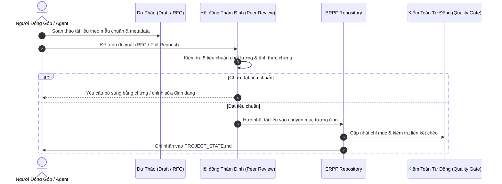
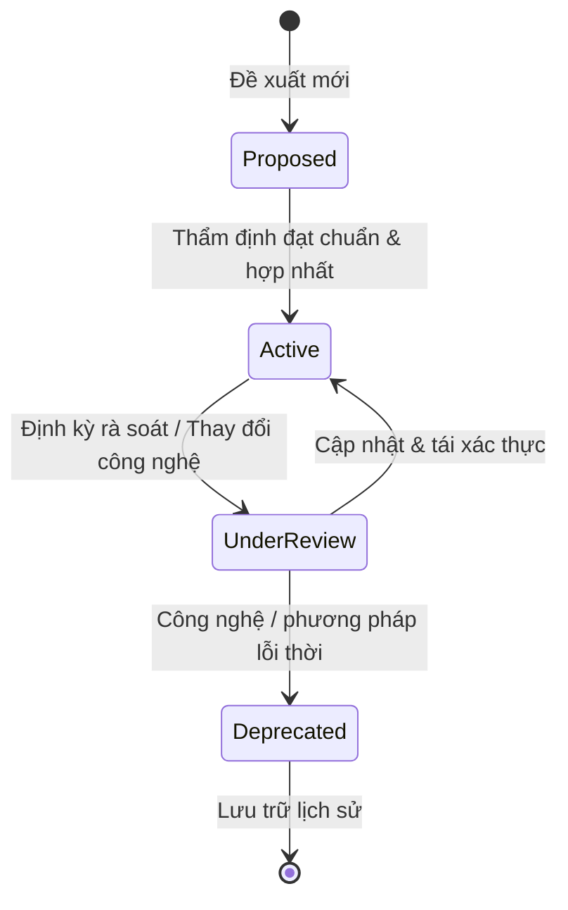

# Quy Chế Đóng Góp & Tiêu Chuẩn Chất Lượng (Contributing Guide)
# Contribution Guidelines & Quality Standards: ERPF

---

## 1. Nguyên Tắc Đóng Góp Tri Thức (Core Principles)

Mọi đóng góp vào **Engineering & Research Practice Framework (ERPF)** phải hướng tới việc xây dựng tri thức thực chứng, có khả năng thực thi và có thể kiểm chứng. Tài liệu trong ERPF không phải là bài viết chia sẻ quan điểm cá nhân, mà là các chuẩn mực kỹ thuật và phương pháp luận vận hành.

---

## 2. Quy Chuẩn Đặt Tên (Naming Conventions)

Để bảo đảm tính nhất quán và khả năng điều hướng tự động của các AI Agent, toàn bộ hệ thống tệp và định danh phải tuân thủ nghiêm ngặt các quy tắc sau:

| Đối Tượng | Quy Chuẩn Đặt Tên | Ví Dụ Hợp Lệ | Ví Dụ Không Hợp Lệ |
|---|---|---|---|
| **Văn bản quản trị (Governance Docs)** | `UPPER_SNAKE_CASE.md` tại gốc `erpf/` | `PROJECT_CHARTER.md`, `ROADMAP.md` | `project-charter.md`, `Roadmap.txt` |
| **Mã chuyên mục (Category Codes)** | 3 chữ cái in hoa (`UPPERCASE`) | `ENG`, `RES`, `AGT`, `ARC`, `GOV` | `eng`, `Research`, `agent_skills` |
| **Tài liệu hướng dẫn (Practice Guides)**| `kebab-case.md` | `deep-modules.md`, `tdd-cycles.md` | `DeepModules.md`, `tdd_cycles.doc` |
| **Kỹ năng Agent (Agent Skills)** | Thư mục `kebab-case/` chứa `SKILL.md` | `code-review/SKILL.md` | `codeReview/skill.txt` |
| **Quyết định kiến trúc (ADRs)** | `ADR-###-kebab-case.md` | `ADR-001-clean-monolith.md` | `adr1.md`, `decision_monolith.md` |
| **Ký hiệu mã nguồn & biến** | Chuẩn ngôn ngữ tương ứng | PascalCase (Class), snake_case (Python fn), camelCase (TS fn) | Trộn lẫn không nhất quán |

---

## 3. Tiêu Chuẩn Chất Lượng Nội Dung (Content Quality Standards)

Mọi tài liệu tri thức khi đưa vào ERPF bắt buộc phải đáp ứng 5 tiêu chuẩn chất lượng sau:

### 3.1. Tính Thực Chứng & Truy Xuất Nguồn Gốc (Evidence-Backed & Traceable)
- Mọi nguyên lý kỹ thuật hoặc khẳng định phương pháp luận phải đi kèm dẫn chứng thực tế: liên kết mã nguồn cụ thể (`file://...#L...`), bài kiểm thử kiểm chứng, hoặc trích dẫn tài liệu học thuật thẩm quyền.
- Tuyệt đối không đưa ra các nhận định chung chung, suy diễn không có căn cứ hoặc phỏng đoán hành vi hệ thống.

### 3.2. Tính Hành Động & Cụ Thể Hóa (Actionable & Concrete)
- Tài liệu phải hướng dẫn rõ ràng: *Khi nào áp dụng?*, *Các bước thực hiện tuần tự là gì?*, *Làm sao để biết đã làm đúng?*.
- Bắt buộc phải có các ví dụ cụ thể, đoạn mã mẫu (code snippets), lệnh bash chính xác hoặc sơ đồ luồng Mermaid minh họa.

### 3.3. Phân Định Rạch Ròi Hiện Trạng vs Định Hướng (As-Is vs To-Be Distinction)
- Tách biệt tuyệt đối giữa:
  - **Đã kiểm chứng (Verified):** Hiện trạng mã nguồn/thực nghiệm đã chạy thực tế.
  - **Đã duyệt (Accepted):** Quyết định đã được thông qua chính thức.
  - **Đề xuất (Proposed):** Ý tưởng, cải tiến đang trong giai đoạn thảo luận.
  - **Chờ quyết định (Decision Pending):** Các điểm còn bỏ ngỏ cần sự can thiệp của người có thẩm quyền.

### 3.4. Chuẩn Mực Ngôn Ngữ & Thuật Ngữ Kỹ Thuật (Language & Terminology Policy)
- Văn bản diễn giải sử dụng **Tiếng Việt chuyên nghiệp, gãy gọn, chuẩn mực học thuật**.
- **Giữ nguyên thuật ngữ kỹ thuật tiếng Anh tiêu chuẩn quốc tế** (như *Interface*, *Abstraction*, *Dependency Injection*, *Overfitting*, *Data Leakage*, *Idempotency*). Khi một thuật ngữ lần đầu xuất hiện, kèm theo giải thích ngắn gọn bằng tiếng Việt.

### 3.5. Tiêu Chuẩn Khối Metadata (Document Header Standard)
Mọi tài liệu tri thức chuyên sâu phải bắt đầu bằng khối metadata YAML chuẩn hóa:

```yaml
---
id: ERPF-ENG-001
title: Thiết Kế Mô-Đun Sâu (Deep Module Design)
category: ENG
status: Verified
version: 1.0.0
authors: [Engineering Knowledge Architect]
last_reviewed: 2026-10-30
tags: [architecture, module-design, clean-code]
---
```

---

## 4. Quy Trình Thêm & Cập Nhật Tri Thức (Knowledge Workflow)



### Các Bước Thực Hiện:
1. **Bước 1 — Xác định Nhu cầu & Chuyên mục:** Xác định rõ bài học/phương pháp luận thuộc chuyên mục nào (`ENG`, `RES`, `AGT`, `ARC`, `GOV`).
2. **Bước 2 — Soạn thảo Bản thảo (Drafting):** Viết tài liệu tuân thủ cấu trúc, có ví dụ thực chứng và khối metadata.
3. **Bước 3 — Thẩm định Độc lập (Review):** Được đánh giá bởi ít nhất một kỹ sư/nhà nghiên cứu độc lập hoặc agent chuyên trách (`code-review`, `spec-reviewer`).
4. **Bước 4 — Tích hợp & Cập nhật Trạng thái:** Đưa tài liệu vào thư mục chuyên mục và ghi nhận trạng thái vào `PROJECT_STATE.md`.

---

## 5. Vòng Đời Trạng Thái Tài Liệu (Document Lifecycle)

Tài liệu trong ERPF được quản lý qua 4 trạng thái vòng đời:



1. **`Proposed` (Đề xuất):** Dự thảo đang được lấy ý kiến, chưa chính thức áp dụng làm chuẩn mực.
2. **`Active` (Hiệu lực):** Quy chuẩn chính thức đang được áp dụng rộng rãi.
3. **`UnderReview` (Đang rà soát):** Đang được đánh giá lại tính hiệu quả hoặc cập nhật theo phiên bản mới.
4. **`Deprecated` (Lỗi thời):** Không còn được khuyến nghị áp dụng; được lưu trữ làm tư liệu lịch sử kèm lý do thay thế.
