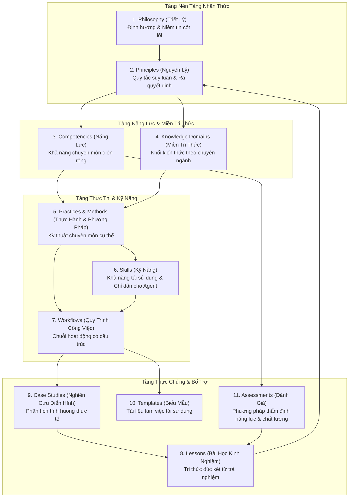

# Kiến Trúc Tri Thức: Khung Thực Hành Kỹ Thuật & Nghiên Cứu (ERPF)
# Knowledge Architecture: Engineering & Research Practice Framework

---

## 1. Mô Hình Tri Thức Cốt Lõi (Core Knowledge Model)

Để xây dựng một khung tri thức vững chắc, nhất quán và có thể chuyển giao giữa con người và AI Agent, ERPF thiết lập mô hình 11 khái niệm tri thức cốt lõi. Mỗi khái niệm có định nghĩa, ranh giới và vai trò chuyên biệt, tránh việc đồng nhất hoặc nhập nhằng giữa các cấp độ nhận thức.



---

## 2. Định Nghĩa & Phân Biệt 11 Khái Niệm Tri Thức

### 2.1. Philosophy (Triết Lý)
- **Định nghĩa:** Hệ thống niềm tin tổng thể, thế giới quan và định hướng giá trị chỉ đạo toàn bộ hành vi chuyên môn. Triết lý trả lời câu hỏi *"Tại sao chúng ta làm điều này?"* và xác lập lập trường đạo đức, chất lượng kỹ thuật.
- **Ranh giới:** Có tính bao trùm cao nhất, không bị thay đổi bởi công nghệ cụ thể; mang tính định hướng lâu dài.
- **Ví dụ trong ERPF:** *Visual Truth* (Chân thực thị giác), *Local-First Data Sovereignty* (Tự chủ dữ liệu bản địa), *Human-Agent Symbiosis* (Cộng tác cộng sinh người - máy).

### 2.2. Principles (Nguyên Lý)
- **Định nghĩa:** Các quy tắc suy luận, tiên đề tư duy logic và tiêu chí đánh đổi (trade-offs) hướng dẫn việc ra quyết định kỹ thuật hoặc thiết kế nghiên cứu. Nguyên lý trả lời câu hỏi *"Dựa vào quy tắc nào để lựa chọn giữa các phương án?"*.
- **Ranh giới:** Cụ thể hơn triết lý, có thể kiểm chứng tính hợp lý qua phản biện logic, nhưng chưa phải là các bước thao tác chi tiết.
- **Ví dụ:** *Evidence Over Assumptions* (Thực chứng thay vì giả định), *Deep Modules & Narrow Interfaces* (Mô-đun sâu & giao diện hẹp), *Falsifiability & Reproducibility* (Tính khả bác & khả năng tái lập).

### 2.3. Competencies (Năng Lực)
- **Định nghĩa:** Khả năng chuyên môn diện rộng cấu thành từ sự tổng hòa của kiến thức, kỹ năng và tư duy phản biện, cho phép một cá nhân hoặc tác nhân tự chủ giải quyết một lớp bài toán phức tạp. Trả lời câu hỏi *"Chủ thể có khả năng đảm trách vai trò gì?"*.
- **Ranh giới:** Mô tả kết quả đầu ra tổng thể của năng lực, không gắn chặt với một công cụ đơn lẻ.
- **Ví dụ:** *System Modularization & Decoupling* (Phân rã module hệ thống), *Empirical Hypothesis Testing* (Kiểm định giả thuyết thực nghiệm), *Automated Agent Guardrailing* (Thiết lập ranh giới an toàn cho tác nhân).

### 2.4. Knowledge Domains (Miền Tri Thức)
- **Định nghĩa:** Khối tri thức chuyên biệt theo chủ đề, bao gồm thuật ngữ học thuật (Ontology), lý thuyết nền tảng, các mô hình chuẩn và bài toán kinh điển của một lĩnh vực. Trả lời câu hỏi *"Khối kiến thức này bao gồm những đối tượng nào?"*.
- **Ranh giới:** Là bản đồ phân định ranh giới chuyên môn, không phải hành động thực thi.
- **Ví dụ:** *Distributed Systems Consistency* (Tính nhất quán hệ phân tán), *Deep Learning Optimization Dynamics* (Động lực học tối ưu hóa Deep Learning), *Geospatial Data Modeling* (Mô hình hóa dữ liệu không gian).

### 2.5. Practices and Methods (Thực Hành & Phương Pháp)
- **Định nghĩa:** Các kỹ thuật chuyên môn cụ thể, đã được kiểm chứng và lặp lại nhiều lần, mô tả cách giải quyết một bài toán kỹ thuật hoặc nghiên cứu cụ thể. Trả lời câu hỏi *"Làm thế nào để đạt được kết quả mong muốn?"*.
- **Ranh giới:** Có cấu trúc rõ ràng, mang tính quy phạm, gắn với bài toán cụ thể nhưng độc lập với công cụ triển khai.
- **Ví dụ:** *Test-Driven Development (TDD)*, *Refactoring via Seams*, *Ablation Study Design* (Thiết kế thực nghiệm phân tích thành phần), *Idempotent API Implementation* (Thiết kế API bất biến).

### 2.6. Skills (Kỹ Năng)
- **Định nghĩa:** Khả năng thao tác vi mô tái sử dụng được, đóng gói thành các chỉ dẫn thực thi rõ ràng (executable instructions) mà con người có thể rèn luyện hoặc AI Agent có thể kích hoạt tự động qua giao thức công cụ. Trả lời câu hỏi *"Hành động vi mô cụ thể cần chạy là gì?"*.
- **Ranh giới:** Đóng gói trong một đơn vị độc lập (`SKILL.md`), có đầu vào, đầu ra, công cụ sử dụng và tiêu chí hoàn thành.
- **Ví dụ:** `diagnosing-bugs` (chẩn đoán lỗi), `domain-modeling` (mô hình hóa miền), `hyperparameter-sweep` (quét siêu tham số), `git-guardrails` (chặn lệnh git phá hủy).

### 2.7. Workflows (Quy Trình Công Việc)
- **Định nghĩa:** Chuỗi hoạt động có cấu trúc tuần tự hoặc rẽ nhánh kết nối nhiều kỹ năng, thực hành và con người/agent lại với nhau để hoàn thành một mục tiêu kỹ thuật lớn. Trả lời câu hỏi *"Quy trình phối hợp từ đầu đến cuối diễn ra theo thứ tự nào?"*.
- **Ranh giới:** Có trạng thái (Stateful), có các cổng chuyển tiếp (Gates), có phân định vai trò và phụ thuộc thời gian.
- **Ví dụ:** *Research-to-Production (R2P) Transition Workflow*, *Pull Request Review & Quality Gate Flow*, *Automated Regression Quarantine Flow*.

### 2.8. Lessons (Bài Học Kinh Nghiệm)
- **Định nghĩa:** Tri thức chuyển giao được đúc kết từ thành công hoặc thất bại trong quá khứ sau khi phân tích nguyên nhân gốc rễ. Trả lời câu hỏi *"Chúng ta rút ra được điều gì để không lặp lại sai lầm?"*.
- **Ranh giới:** Luôn bắt nguồn từ sự kiện thực tế, có tính khái quát hóa để áp dụng cho bối cảnh tương lai.
- **Ví dụ:** *Hậu quả của việc dùng soft-delete `deleted_at` thay cho trạng thái đóng cửa kinh doanh*, *Rủi ro rò rỉ dữ liệu khi chuẩn hóa features trước khi chia train/val split*.

### 2.9. Case Studies (Nghiên Cứu Điển Hình / Tình Huống)
- **Định nghĩa:** Phân tích sâu và toàn diện một tình huống kỹ thuật hoặc nghiên cứu cụ thể (thực tế hoặc giả định chuẩn mực), làm rõ bối cảnh, các quyết định đánh đổi, diễn biến thực thi và kết quả đo lường. Trả lời câu hỏi *"Trong tình huống X, việc giải quyết đã diễn ra như thế nào?"*.
- **Ranh giới:** Mang tính tường thuật và phân tích thực chứng, có dữ liệu cụ thể, số liệu benchmark và đối chiếu mã nguồn.
- **Ví dụ:** *Khảo sát thực chứng kiến trúc Clean Monolith tại Rendez-web*, *Tái lập và chẩn đoán sự mất hội tụ trong huấn luyện mô hình Transformer lớn*.

### 2.10. Templates (Biểu Mẫu)
- **Định nghĩa:** Tài liệu làm việc tái sử dụng có sẵn cấu trúc, hướng dẫn điền và các trường bắt buộc, giúp chuẩn hóa tài liệu hóa kỹ thuật. Trả lời câu hỏi *"Có khung sẵn nào để bắt đầu viết không?"*.
- **Ranh giới:** Không chứa nội dung cụ thể, chỉ chứa khung dàn ý, chú thích hướng dẫn và metadata schema.
- **Ví dụ:** *Architecture Decision Record (ADR) Template*, *Empirical Research Experiment Plan Template*, *Bug Diagnosis Incident Report Template*.

### 2.11. Assessments (Đánh Giá)
- **Định nghĩa:** Phương pháp, bộ tiêu chí định lượng hoặc harness kiểm thử tự động nhằm thẩm định mức độ thuần thục của năng lực, chất lượng của mã nguồn hoặc độ tin cậy của mô hình/agent. Trả lời câu hỏi *"Làm sao đo lường và xác thực chất lượng đạt chuẩn?"*.
- **Ranh giới:** Có thang điểm rõ ràng, tiêu chuẩn đạt/trượt khách quan, khả năng tự động hóa cao.
- **Ví dụ:** *Cold-Start Agent Onboarding 17-Question Benchmark*, *Test Coverage & Mutation Testing Gate*, *Model Generalization & Robustness Metric Suite*.

---

## 3. Thiết Kế Hai Nhánh Chuyên Môn (Two Professional Tracks)

ERPF thiết lập hai nhánh chuyên môn chính chia sẻ chung một nền tảng tư duy vững chắc, đồng thời tôn trọng đặc thù chu trình sống của từng ngành:

```mermaid
graph TD
    subgraph Common_Foundation [Nền Tảng Chung (Common Foundation)]
        F_Phil["Triết Lý: Thực chứng, Tự chủ, Cộng tác Human-Agent"]
        F_Prin["Nguyên Lý: Mô-đun sâu, Khả bác, An toàn Trust Boundary"]
        F_Gov["Quản Trị: ADRs, Truy xuất nguồn gốc, Quality Gates"]
        F_Tool["Công Cụ: Agent Skills Standard, Version Control"]
    end

    subgraph Track_SE [Nhánh Kỹ Thuật Phần Mềm (Software Engineering Track)]
        SE_Cycle["Chu Trình Sống Hệ Thống (System Lifecycle)"]
        SE_1["Thiết Kế Mã Nguồn & DDD"]
        SE_2["TDD, Invariants & Unit/Integration Tests"]
        SE_3["Clean Monolith & Tối Ưu Truy Vấn Database"]
        SE_4["Refactoring, Code Review & Zero-Downtime Deploy"]
    end

    subgraph Track_AI [Nhánh Nghiên Cứu AI/ML (AI Research Track)]
        AI_Cycle["Chu Trình Thực Nghiệm Thực Chứng (Empirical Loop)"]
        AI_1["Literature Review & Xác Lập Giả Thuyết"]
        AI_2["Data Curation, Split Integrity & Feature Engineering"]
        AI_3["Model Training, Hyperparameter Sweep & Tracking"]
        AI_4["Evaluation Harness, Error Analysis & Ablation Studies"]
    end

    subgraph Bridge_R2P [Cầu Nối Nghiên Cứu Vào Sản Xuất (Research-to-Production - R2P)]
        B_1["Model Packaging, Quantization & Serving APIs"]
        B_2["Inference Latency Benchmarking & Resource Guardrails"]
        B_3["Continuous Model Monitoring & Drift Detection"]
    end

    Common_Foundation ==> Track_SE
    Common_Foundation ==> Track_AI
    Track_SE <==> Bridge_R2P
    Track_AI <==> Bridge_R2P
```

### 3.1. Điểm Tương Đồng Nền Tảng (Shared Foundation)
1. **Tư duy Thực chứng (Evidence-First Mindset):** Cả kỹ sư phần mềm lẫn nhà nghiên cứu AI đều không được đưa ra kết luận dựa trên giả định chưa kiểm chứng. Kỹ sư chứng minh bằng Unit/Integration Tests; nhà nghiên cứu chứng minh bằng Evaluation Harness và Statistical Significance.
2. **Nguyên lý Mô-đun hóa (Modularity):** Dù là module mã nguồn hay pipeline huấn luyện, các thành phần đều phải có giao diện rõ ràng, tách bạch trách nhiệm và che giấu độ phức tạp triển khai.
3. **Cơ chế Hợp tác với AI Agent:** Cả hai nhánh đều sử dụng Agent Skills và Operating Contracts để tự động hóa các tác vụ lặp lại (chẩn đoán lỗi, review mã, quét siêu tham số, phân tích tài liệu).
4. **Tiêu chuẩn Thể chế Quản trị:** Chung cấu trúc metadata, chung quy trình thẩm định đồng cấp (Peer Review), và chung cách lưu vết quyết định (ADRs/Research Logs).

### 3.2. Đặc Thù Riêng Biệt Của Từng Nhánh

| Tiêu Chí | Nhánh Kỹ Thuật Phần Mềm (Software Engineering) | Nhánh Nghiên Cứu AI/ML (AI Research) |
|---|---|---|
| **Động lực cốt lõi** | Tính tất định, độ tin cậy, tính bảo trì và hiệu năng vận hành dài hạn | Khám phá giả thuyết mới, tối ưu hóa độ chính xác và tính tổng quát hóa |
| **Đơn vị thực nghiệm** | Code commits, Test suites, Database migrations, System releases | Hypotheses, Datasets, Model weights, Metrics, Ablation runs |
| **Tiêu chí hoàn thành** | 100% tests pass, zero regression, clean architecture, invariants satisfied | Statistical significance, reproducible benchmarks, ablation verified |
| **Tính chất lỗi** | Bugs logic, race condition, data corruption, security vulnerability | Underfitting, overfitting, data leakage, distribution drift, bias |
| **Tài nguyên trọng tâm** | CPU/RAM, Database connections, I/O latency, storage throughput | GPU/TPU compute, VRAM capacity, batch throughput, dataset fidelity |

---

## 4. Cơ Chế Kết Nối: Research-to-Production (R2P)

Để tránh tình trạng "nghiên cứu trên tháp ngà" không thể đưa vào sản phẩm thực tế, ERPF thiết lập cầu nối **Research-to-Production (R2P)**:
1. **Chuẩn hóa Hợp đồng Đầu ra Mô hình (Model Interface Contracts):** Mô hình được đóng gói kèm đặc tả rõ ràng về kiểu dữ liệu tensor đầu vào/đầu ra, tiền xử lý và hậu xử lý.
2. **Kiểm soát Độ trễ & Tài nguyên (Latency & Resource Constraints):** Thiết lập ngân sách tài nguyên (Latency/VRAM budget) ngay từ khâu thiết kế thực nghiệm nghiên cứu.
3. **Quy trình Lượng tử hóa & Phục vụ (Quantization & Serving):** Phương pháp chuyển đổi trọng số mô hình từ môi trường huấn luyện (PyTorch) sang môi trường suy luận tối ưu (ONNX Runtime, TensorRT, vLLM).
