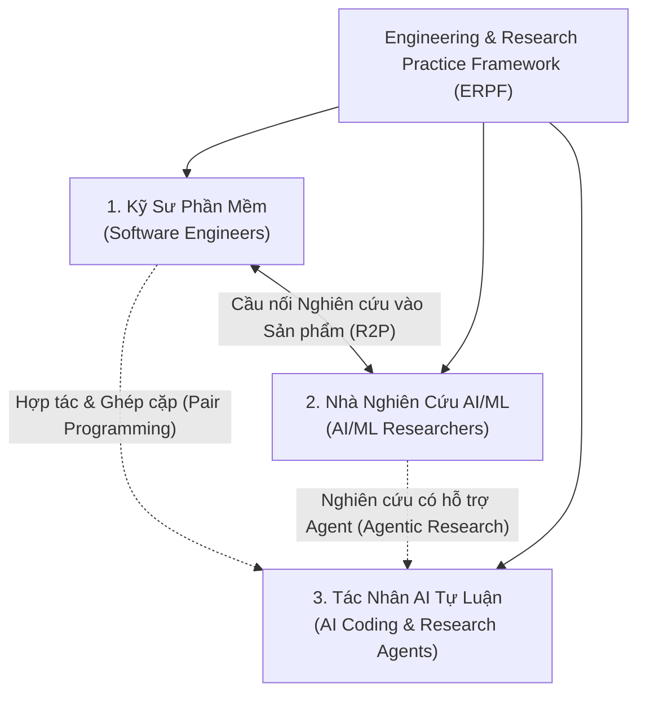

# Điều Lệ Dự Án: Khung Thực Hành Kỹ Thuật & Nghiên Cứu (ERPF)
# Project Charter: Engineering & Research Practice Framework

---

## 1. Tôn Chỉ & Sứ Mệnh (Mission & Vision)

**Engineering & Research Practice Framework (ERPF)** là khung chuẩn hóa tri thức, phương pháp luận và quy trình thực hành dành cho kỹ thuật phần mềm hiện đại và nghiên cứu AI/ML.

Sứ mệnh của ERPF là thiết lập một **hệ thống tri thức vận hành nhất quán, có khả năng thực thi và có thể chuyển giao** giữa con người (kỹ sư, nhà nghiên cứu) và các tác nhân AI tự율 (AI coding/research agents). Khung này biến các nguyên lý kỹ thuật trừu tượng thành các chỉ dẫn hành động cụ thể, có thể đo lường và kiểm chứng thực tế.

---

## 2. Đối Tượng Thụ Hưởng Mục Tiêu (Target Audiences)

Khung thực hành được thiết kế chuyên biệt để phục vụ ba nhóm đối tượng cốt lõi:

1. **Kỹ Sư Phần Mềm (Software Engineers):**
   - Áp dụng các quy chuẩn thiết kế module sâu (Deep Modules), phát triển hướng kiểm thử (TDD), tái cấu trúc an toàn, đánh giá mã nguồn (Code Review) và bảo toàn tính toàn vẹn hệ thống.
2. **Nhà Nghiên Cứu AI/ML (AI/ML Researchers):**
   - Áp dụng phương pháp nghiên cứu thực chứng, chuẩn hóa quy trình tổng quan tài liệu (Literature Review), thiết kế thực nghiệm có khả năng tái lập (Reproducibility), quản lý artifact và đánh giá mô hình khách quan.
3. **Tác Nhân AI Lập Trình & Nghiên Cứu (AI Coding & Research Agents):**
   - Nhận diện ngữ cảnh dự án trong trạng thái khởi động lạnh (Cold-Start), tuân thủ hợp đồng vận hành (Operating Contracts), kích hoạt đúng kỹ năng (Skills), và thực thi tác vụ với độ chính xác cao mà không gây đột biến ngoài ý muốn.

---

## 3. Phạm Vi & Ranh Giới (Scope & Boundaries)

### 3.1. Phạm Vi Bao Phủ (In-Scope)
- Chuẩn hóa các phương pháp luận kỹ thuật phần mềm cốt lõi (Kiến trúc phân tầng, DDD, Clean Monolith, Module Interface).
- Chuẩn hóa các quy trình nghiên cứu AI/ML thực nghiệm (Harness đánh giá, theo dõi thực nghiệm, kiểm soát rò rỉ dữ liệu).
- Thiết lập giao thức tương tác và kỹ năng dành cho AI Coding Agents (Agent Skills, System Prompts, Guardrails).
- Quy định cổng chất lượng (Quality Gates), quy chuẩn kiểm thử và tiêu chuẩn tài liệu kỹ thuật.
- Cơ chế quản lý trạng thái dự án và lưu vết các quyết định kiến trúc (ADRs, Decision Registers).

### 3.2. Ranh Giới Loại Trừ (Out-of-Scope)
- ERPF không phải là một framework lập trình cụ thể (không thay thế Django, React, PyTorch, v.v.).
- ERPF không thay thế các công cụ CI/CD thương mại hoặc hệ thống quản lý dự án cấp doanh nghiệp (Jira, Linear).
- ERPF không bao gồm mã nguồn nghiệp vụ của các ứng dụng cụ thể (như nghiệp vụ cà phê của Rendez), mà đóng vai trò là khung phương pháp luận độc lập.

---

## 4. Hệ Thống Phân Loại Tri Thức (Knowledge Categories)

Tri thức trong ERPF được tổ chức thành 5 chuyên mục chiến lược:

| Mã Chuyên Mục | Tên Chuyên Mục | Nội Dung Trọng Tâm |
|---|---|---|
| **ENG** | Kỹ Thuật Phần Mềm Cốt Lõi (Core Engineering Practices) | Codebase design, Deep modules, TDD, Bug diagnosis, Refactoring, Code review |
| **RES** | Phương Pháp Nghiên Cứu AI/ML (Research Methodologies) | Khảo sát tài liệu, Thiết kế thực nghiệm, Tính tái lập, Evaluation harness, Metrics |
| **AGT** | Quy Trình & Kỹ Năng Agent (Agentic Workflows & Skills) | Skill authoring, Tool integration, Operating contracts, Multi-agent collaboration |
| **ARC** | Kiến Trúc & Chất Lượng (Architecture & Quality Standards) | Domain-Driven Design (DDD), Clean architecture, Trust boundaries, Security |
| **GOV** | Quản Trị & Vận Hành (Governance & Operational Practice) | Đăng bạ quyết định, Quản lý trạng thái, Tiêu chuẩn tài liệu, Truy xuất nguồn gốc |

---

## 5. Chính Sách Ngôn Ngữ (Language Policy)

1. **Ngôn Ngữ Tài Liệu Tri Thức (Human-Readable Knowledge Documents):**
   - Sử dụng **Tiếng Việt chuẩn mực** làm ngôn ngữ chính cho toàn bộ tài liệu diễn giải, điều lệ, lộ trình và hướng dẫn.
   - **Bảo lưu nguyên bản các thuật ngữ kỹ thuật tiếng Anh chuẩn mực** (như *Test-Driven Development*, *Clean Monolith*, *Domain-Driven Design*, *Evaluation Harness*, *Idempotency*, *Race Condition*, *Cold-Start*), kèm chú giải ngữ nghĩa tiếng Việt khi cần thiết để bảo đảm tính chính xác học thuật.
2. **Ngôn Ngữ Chỉ Dẫn Tác Nhân (Agent Skill Instructions):**
   - Các tệp chỉ dẫn kỹ thuật dành riêng cho agent (`SKILL.md`, agent prompts) có thể sử dụng tiếng Anh khi điều này nâng cao khả năng tương thích và độ chính xác của các mô hình ngôn ngữ lớn (LLMs), nhưng phải tuân thủ nhất quán các thuật ngữ đã định nghĩa.

---

## 6. Các Nguyên Lý Cốt Lõi (Guiding Principles)

1. **Thực Chứng Thay Vì Giả Định (Evidence Over Assumptions):** Mọi quy chuẩn kỹ thuật hoặc phát hiện nghiên cứu đều phải có bằng chứng kiểm chứng từ mã nguồn, dữ liệu thực nghiệm hoặc tài liệu thẩm quyền.
2. **Khả Năng Tái Lập Tuyệt Đối (Reproducibility First):** Bất kỳ quy trình kỹ thuật hay thực nghiệm nào cũng phải cho ra kết quả nhất quán khi được lặp lại bởi một kỹ sư khác hoặc một AI agent mới.
3. **Mô-đun Sâu & Giao Diện Hẹp (Deep Modules, Narrow Interfaces):** Tối đa hóa giá trị bên trong mô-đun và tối thiểu hóa sự phức tạp của giao tiếp ngoại vi.
4. **An Toàn Tại Ranh Giới Tin Cậy (Zero Compromise on Trust Boundaries):** Không bao giờ cắt giảm kiểm tra hợp lệ, bảo mật hoặc xử lý lỗi để đổi lấy sự ngắn gọn của mã nguồn.
5. **Đồng Bộ Giữa Con Người & AI (Human-Agent Symbiosis):** Tri thức phải vừa dễ tiếp cận cho con người, vừa có cấu trúc chặt chẽ để AI agents có thể diễn giải và thực thi tự động.
