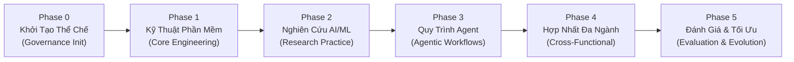

# Lộ Trình Triển Khai Khung Thực Hành (ERPF Roadmap)
# Implementation Roadmap: Engineering & Research Practice Framework

---

## 1. Tổng Quan Lộ Trình (Roadmap Overview)

Lộ trình triển khai **Engineering & Research Practice Framework (ERPF)** được chia thành 6 giai đoạn tuần tự từ khởi tạo thể chế quản trị đến chuẩn hóa toàn diện các thực hành kỹ thuật, nghiên cứu và quy trình cộng tác giữa con người và AI Agent.

---

## 2. Các Giai Đoạn Triển Khai Chi Tiết (Phases & Milestones)

### Giai Đoạn 0: Khảo Sát Không Gian & Khởi Tạo Thể Chế Quản Trị (Phase 0 — Current)
- **Mục tiêu:** Khảo sát toàn diện workspace hiện tại, xác lập ranh giới, ban hành các văn bản thể chế ban đầu và thiết lập trạng thái vận hành bền vững.
- **Sản phẩm bàn giao (Deliverables):**
  - [x] Điều lệ dự án: `PROJECT_CHARTER.md` (Tôn chỉ, phạm vi, đối tượng, phân loại tri thức).
  - [x] Lộ trình triển khai: `ROADMAP.md` (Các giai đoạn, mốc thời gian, cổng kiểm tra).
  - [x] Quy chế đóng góp: `CONTRIBUTING.md` (Quy chuẩn đặt tên, tiêu chuẩn chất lượng, quy trình cập nhật).
  - [x] Đăng bạ trạng thái: `PROJECT_STATE.md` (Ghi nhận trạng thái hiện thời, nhật ký quyết định).
- **Cổng nghiệm thu (Exit Gate):** Cả 4 văn bản quản trị được tạo lập hoàn chỉnh, không xung đột với mã nguồn ứng dụng hiện có, trạng thái được cập nhật đầy đủ.

---

### Giai Đoạn 1: Chuẩn Hóa Kỹ Thuật Phần Mềm Cốt Lõi (Phase 1 — Core Engineering Practices)
- **Mục tiêu:** Hệ thống hóa và đóng gói các phương pháp luận kỹ thuật phần mềm thành các cẩm nang thực hành chi tiết.
- **Phụ thuộc:** Hoàn thành Phase 0.
- **Nội dung trọng tâm:**
  - *Mô-đun sâu & Thiết kế giao diện (Deep Modules & Interface Design):* Tối đa hóa công năng ẩn, tối thiểu hóa bề mặt API.
  - *Phát triển hướng kiểm thử (Test-Driven Development - TDD):* Chu trình Đỏ - Xanh - Tái cấu trúc (Red-Green-Refactor) và kiểm thử ranh giới tin cậy (Trust Boundary Testing).
  - *Quy trình chẩn đoán lỗi (Bug Diagnosis Loop):* Phương pháp khoanh vùng nguyên nhân gốc rễ (Root Cause Analysis) và phòng ngừa hồi quy.
  - *Đánh giá mã nguồn hai trục (Two-Axis Code Review):* Đánh giá độc lập theo trục Quy chuẩn (Standards) và trục Đặc tả (Spec).
- **Sản phẩm bàn giao:** Bộ tài liệu thực hành kỹ thuật trong chuyên mục `ENG/`.

---

### Giai Đoạn 2: Chuẩn Hóa Phương Pháp Nghiên Cứu AI/ML (Phase 2 — AI/ML Research Methodologies)
- **Mục tiêu:** Xây dựng khung phương pháp luận cho nghiên cứu AI/ML thực nghiệm, giải quyết triệt để vấn đề mất kiểm soát thực nghiệm và thiếu tính tái lập.
- **Phụ thuộc:** Hoàn thành Phase 1.
- **Nội dung trọng tâm:**
  - *Quy trình khảo sát tài liệu khoa học (Structured Literature Review):* Truy vết nguồn gốc học thuật, phân tích ưu/nhược điểm các công trình liên quan.
  - *Thiết kế thực nghiệm có khả năng tái lập (Reproducible Experimentation):* Cố định seed, quản lý phiên bản dữ liệu/mô hình, lưu vết siêu tham số (Hyperparameters).
  - *Khung đánh giá khách quan (Evaluation Harness & Metrics):* Tách biệt tập kiểm tra, phát hiện rò rỉ dữ liệu (Data Leakage), đo lường độ trễ và thông lượng.
- **Sản phẩm bàn giao:** Bộ tài liệu phương pháp luận nghiên cứu trong chuyên mục `RES/`.

---

### Giai Đoạn 3: Năng Lực & Quy Trình Tác Nhân AI (Phase 3 — Agentic Workflows & Autonomous Skills)
- **Mục tiêu:** Tối ưu hóa khả năng vận hành của các AI Coding & Research Agents trong môi trường mã nguồn thực tế.
- **Phụ thuộc:** Hoàn thành Phase 1 và Phase 2.
- **Nội dung trọng tâm:**
  - *Quy chuẩn thiết kế kỹ năng Agent (Agent Skills Specification):* Chuẩn hóa cấu trúc thư mục `SKILL.md`, metadata frontmatter và chỉ dẫn thực thi.
  - *Giao thức an toàn & Ranh giới vận hành (Operating Contract Guardrails):* Ngăn chặn các thao tác phá hủy Git, bảo vệ bí mật môi trường, thực thi không cần con người can thiệp trực tiếp.
  - *Quy trình khởi động lạnh (Cold-Start Agent Onboarding):* Cơ chế giúp agent mới tự định hướng dự án thông qua tài liệu mà không cần bộ nhớ hội thoại trước.
- **Sản phẩm bàn giao:** Bộ quy chuẩn kỹ năng và hợp đồng vận hành trong chuyên mục `AGT/`.

---

### Giai Đoạn 4: Hợp Nhất Quy Trình Đa Ngành (Phase 4 — Cross-Functional Workflows & Synthesis)
- **Mục tiêu:** Kết nối nghiên cứu AI/ML vào quy trình sản xuất kỹ thuật phần mềm (Research-to-Production Pipeline).
- **Phụ thuộc:** Hoàn thành Phase 3.
- **Nội dung trọng tâm:**
  - *Đóng gói mô hình phục vụ sản xuất (Model Serving & Packaging):* Tối ưu hóa inference, hợp đồng API suy luận, kiểm soát tài nguyên phần cứng.
  - *Phối hợp đa tác nhân (Multi-Agent Swarm & Delegation):* Mô hình cộng tác giữa Agent Giám đốc Thiết kế, Agent Quét Lỗ Hổng và Agent Lập Trình.
- **Sản phẩm bàn giao:** Các cẩm nang tích hợp liên ngành và kịch bản phối hợp trong chuyên mục `ARC/` và `GOV/`.

---

### Giai Đoạn 5: Đánh Giá Liên Tục, Đo Lường & Tiến Hóa Khung (Phase 5 — Continuous Evolution)
- **Mục tiêu:** Thiết lập cơ chế tự kiểm toán (Self-Audit), thu thập phản hồi và cập nhật khung thực hành theo sự phát triển của công nghệ.
- **Phụ thuộc:** Hoàn thành Phase 4.
- **Nội dung trọng tâm:**
  - Bộ chuẩn kiểm thử khả năng hiểu của Agent (Agent Understanding Benchmarks).
  - Cơ chế rà soát và đánh dấu lỗi thời (Deprecation Review Lifecycle).
- **Sản phẩm bàn giao:** Báo cáo kiểm toán định kỳ và quy trình nâng cấp phiên bản khung.

---

## 3. Ma Trận Phụ Thuộc & Cổng Chuyển Giai Đoạn (Gates & Dependencies)

| Chuyển Giai Đoạn | Điều Kiện Tiên Quyết | Tiêu Tác Nghiệm Thu (Exit Criteria) |
|---|---|---|
| **Phase 0 $\rightarrow$ Phase 1** | Hoàn thành TASK 00 | 4 tệp quản trị tồn tại, không xung đột, trạng thái `PROJECT_STATE.md` đạt chuẩn |
| **Phase 1 $\rightarrow$ Phase 2** | Hoàn thành chuyên mục ENG | Các bài thực hành kỹ thuật có test cases mẫu và kiểm chứng thực tế |
| **Phase 2 $\rightarrow$ Phase 3** | Hoàn thành chuyên mục RES | Khung thực nghiệm AI/ML bảo đảm 100% khả năng tái lập kết quả |
| **Phase 3 $\rightarrow$ Phase 4** | Hoàn thành chuyên mục AGT | Agent mới có thể tự đọc tài liệu và vượt qua bài kiểm tra Cold-Start $\ge 90\%$ |
| **Phase 4 $\rightarrow$ Phase 5** | Hoàn thành chuyên mục ARC/GOV | Hoàn tất tích hợp luồng đưa mô hình/thực nghiệm vào môi trường triển khai thực |
