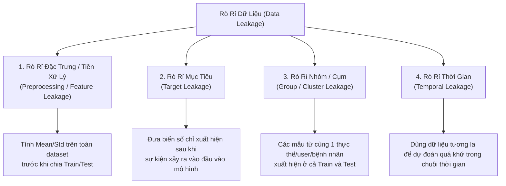
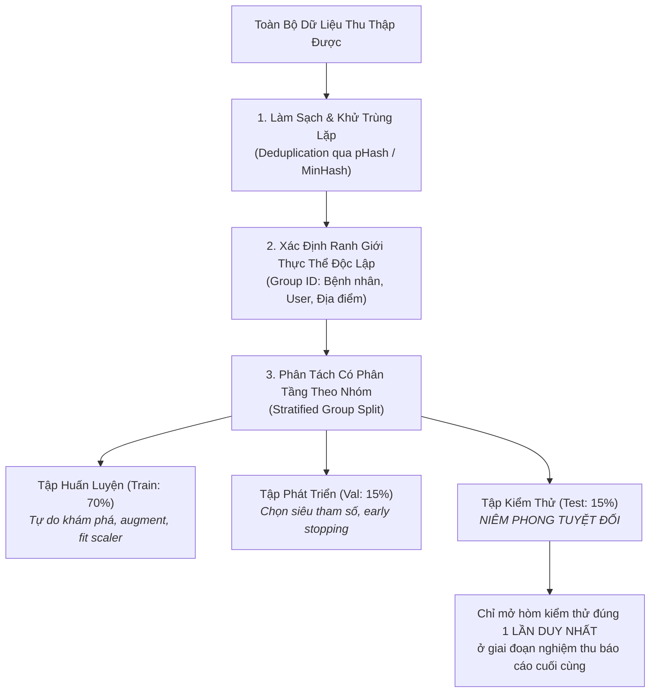

# Phân Tích Dữ Liệu Thực Nghiệm & Kiểm Soát Rò Rỉ
# Dataset Integrity & Data Leakage Prevention

---

## 1. Nguyên Lý Nền Tảng (Fundamentals)

### 1.1. Dữ Liệu Là Nền Móng Thực Nghiệm (Data-Centric AI)
Trong nghiên cứu trí tuệ nhân tạo hiện đại, mô hình học máy thực chất là **một hàm ánh xạ được học từ dữ liệu**. Nếu tập dữ liệu bị nhiễm độc, bị rò rỉ hoặc chứa đựng các mối tương quan giả mạo (Spurious Correlations), thì toàn bộ cấu trúc toán học phức tạp và các chu kỳ tính toán hàng triệu FLOPs đều trở nên vô giá trị.

Một tập dữ liệu nghiên cứu chuẩn mực đòi hỏi:
1. **Nguồn gốc minh bạch (Data Provenance):** Rõ ràng về cách thức thu thập, bản quyền sử dụng, sự đồng thuận của đối tượng thu thập và quy trình làm sạch.
2. **Độ tin cậy của nhãn gán (Annotation Reliability):** Được kiểm chứng thông qua các chỉ số đồng thuận giữa các chuyên gia dán nhãn (Inter-annotator agreement).
3. **Tính độc lập thống kê giữa các tập phân tách:** Tập kiểm thử (Test Set) phải là "chiếc hòm niêm phong" mô phỏng trung thực thế giới thực, không bao giờ được phép chia sẻ bất kỳ thông tin ngầm định nào với tập huấn luyện (Train Set).

---

## 2. Bản Thể Học Các Dạng Rò Rỉ Dữ Liệu (The Taxonomy of Data Leakage)

Rò rỉ dữ liệu (Data Leakage) xảy ra khi thông tin từ ngoài tập huấn luyện (thường là từ tập test hoặc từ tương lai) vô tình được đưa vào quá trình xây dựng hoặc tiền xử lý mô hình, tạo ra hiệu năng cao giả tạo.

### Chi Tiết 4 Dạng Rò Rỉ Nguy Hiểm Nhất

1. **Rò rỉ tiền xử lý (Preprocessing / Feature Leakage):**
   - *Cơ chế:* Kỹ sư thực hiện chuẩn hóa dữ liệu (Z-score scaling), chọn đặc trưng (Feature selection), hoặc xây dựng từ điển từ vựng (Vocabulary building) trên **toàn bộ tập dữ liệu** trước khi gọi hàm chia `train_test_split()`.
   - *Hậu quả:* Giá trị trung bình ($\mu$) và độ lệch chuẩn ($\sigma$) của tập test đã ngấm vào tập train.
   - *Cách phòng chống:* Mọi biến đổi thống kê (Fit) **chỉ được phép tính toán trên tập Train**, sau đó chỉ áp dụng phép biến đổi (Transform) lên tập Val và Test.
2. **Rò rỉ nhóm / Cụm (Group / Cluster Leakage):**
   - *Cơ chế:* Dữ liệu y tế có 10 ảnh X-quang của cùng một bệnh nhân. Nếu chia ngẫu nhiên (Random Split), 8 ảnh rơi vào Train và 2 ảnh rơi vào Test. Mô hình không học nhận diện bệnh lý, mà học nhận diện đặc điểm cơ thể riêng biệt của bệnh nhân đó.
   - *Tương tự trong Rendez:* Nếu chia ảnh quán cafe ngẫu nhiên, các góc chụp khác nhau của cùng một quán cafe sẽ nằm ở cả Train và Test. Mô hình đạt điểm nhận diện cao ngất ngưởng vì đã "nhìn thấy quán đó rồi", nhưng khi gặp một quán cafe mới hoàn toàn thì độ chính xác sụt giảm thảm hại.
   - *Cách phòng chống:* Bắt buộc dùng **Group-aware Split** (nhóm theo Bệnh nhân ID hoặc Place ID).
3. **Rò rỉ thời gian (Temporal Leakage):**
   - *Cơ chế:* Với dữ liệu chuỗi thời gian (Time-series / Lịch sử click), chia dữ liệu ngẫu nhiên khiến mô hình dùng hành vi của người dùng vào ngày mai để dự đoán hành động của ngày hôm qua.
   - *Cách phòng chống:* Luôn chia tập dữ liệu theo thứ tự thời gian tuyến tính (Temporal Split: Train là quá khứ, Test là tương lai).
4. **Rò rỉ mục tiêu (Target Leakage):**
   - *Cơ chế:* Đưa vào mô hình một đặc trưng mà trong thực tế đặc trưng đó chỉ xuất hiện *sau khi* kết quả mục tiêu đã xảy ra (ví dụ: dự đoán người dùng có hủy tài khoản không bằng đặc trưng "Ngày gửi email xin lỗi khách hàng").

---

## 3. Các Dạng Dịch Chuyển Phân Phối (Distribution Shift)

Khi mô hình được triển khai vào môi trường thực tế, phân phối dữ liệu hiếm khi giữ nguyên như tập huấn luyện. Nhà nghiên cứu cần phân biệt 3 dạng dịch chuyển cơ bản:

$$\text{Xác suất đồng thời: } P(X, Y) = P(X) \times P(Y|X) = P(Y) \times P(X|Y)$$

| Dạng Dịch Chuyển | Công Thức Toán Học | Ý Nghĩa Thực Tế | Ví Dụ Minh Họa |
|---|---|---|---|
| **1. Dịch chuyển hiệp biến (Covariate Shift)** | $P(X)$ thay đổi, nhưng $P(Y\|X)$ giữ nguyên | Phân phối của đầu vào thay đổi, nhưng quy luật nhân quả giữa đầu vào và nhãn không đổi. | Huấn luyện nhận diện địa điểm bằng ảnh chụp ban ngày đẹp đẽ ($X_{\text{day}}$), nhưng khi test người dùng tải lên ảnh chụp ban đêm tối tăm ($X_{\text{night}}$). Quy luật quán cafe $Y$ vẫn vậy. |
| **2. Dịch chuyển nhãn (Label Shift)** | $P(Y)$ thay đổi, nhưng $P(X\|Y)$ giữ nguyên | Tỷ lệ phân bố của các lớp mục tiêu thay đổi, nhưng đặc trưng của từng lớp không đổi. | Trước mùa dịch, tỷ lệ ảnh quán cafe đông đúc chiếm 80%. Trong mùa dịch, tỷ lệ quán đóng cửa tăng vọt lên 70%. |
| **3. Dịch chuyển khái niệm (Concept Shift)** | $P(Y\|X)$ thay đổi, nhưng $P(X)$ có thể không đổi | Mối quan hệ thực chất giữa đặc trưng và nhãn bị thay đổi theo thời gian hoặc ngữ cảnh. | Định nghĩa về một "quán cafe hot trend" thay đổi hoàn toàn: Năm 2020 là quán acoustic ấm cúng, năm 2026 là quán phong cách tối giản công nghiệp. |

---

## 4. Kiểm Soát Chất Lượng Gán Nhãn & Mất Cân Bằng Lớp

### 4.1. Đo Lường Độ Tin Cậy Gán Nhãn (Inter-Annotator Agreement)
Không bao giờ tin tưởng tuyệt đối vào nhãn do một cá nhân gán. Đối với các bài toán có tính chủ quan (như đánh giá bầu không khí, cảm xúc, hoặc mức độ liên quan), cần có ít nhất 2–3 người gán nhãn độc lập và đo lường:
- **Cohen's Kappa ($\kappa$):** Đo lường mức độ đồng thuận giữa 2 người gán nhãn, đã loại trừ yếu tố trùng hợp ngẫu nhiên.
  $$\kappa = \frac{p_o - p_e}{1 - p_e}$$
  (Trong đó $p_o$ là tỷ lệ quan sát thực tế, $p_e$ là tỷ lệ trùng hợp do ngẫu nhiên). Nếu $\kappa < 0.6$, dữ liệu gán nhãn có độ tin cậy yếu, không thể dùng làm ground-truth khoa học.
- **Fleiss' Kappa:** Mở rộng cho trường hợp có từ 3 người gán nhãn trở lên.

### 4.2. Xử Lý Mất Cân Bằng Lớp (Class Imbalance) Một Cách Lành Mạnh
Khi một lớp chiếm 99% dữ liệu (ví dụ: phát hiện giao dịch gian lận hoặc ảnh vi phạm tiêu chuẩn cộng đồng), mô hình tầm thường chỉ cần đoán nhãn âm tính là đã đạt 99% Accuracy!
- **Chiến lược lấy mẫu:** Lấy mẫu ngẫu nhiên có trọng số (Weighted Random Sampling) trong DataLoader để mỗi batch đều có tỷ lệ cân bằng giữa các lớp.
- **Hàm mất mát thích ứng (Focal Loss / Class-Weighted Cross Entropy):** Tăng trọng số phạt cho các mẫu thuộc lớp hiếm và các mẫu khó phân loại:
  $$\text{FL}(p_t) = -\alpha_t (1 - p_t)^\gamma \log(p_t)$$
- **Thước đo đánh giá phù hợp:** Cấm tuyệt đối dùng Accuracy. Bắt buộc chuyển sang dùng **Precision-Recall AUC (PR-AUC)** hoặc **Macro-F1 Score**.

---

## 5. Quy Chuẩn Phân Tách Tập Dữ Liệu An Toàn (The Safe Split Protocol)

Quy trình 5 bước niêm phong tập dữ liệu nghiên cứu:

---

## 6. Sai Lầm Thường Gặp & Anti-Patterns (Common Mistakes)

1. **Tối ưu hóa lặp lại trên tập Test (Overfitting the Test Set):** Chạy thực nghiệm, thấy điểm test thấp, quay lại sửa mô hình rồi chạy lại test. Lặp lại 50 lần như vậy, tập test thực chất đã biến thành tập train gián tiếp và kết quả công bố hoàn toàn bị sai lệch.
2. **Bỏ qua ảnh trùng lặp gần (Near-Duplicate Contamination):** Trong dữ liệu web cào được, có hàng ngàn ảnh gần như giống hệt nhau (chỉ khác kích thước hoặc bị nén lại). Nếu không dùng Perceptual Hash (`pHash`) để khử trùng lặp, các ảnh giống hệt nhau sẽ nằm ở cả hai tập Train và Test.
3. **Ảo tưởng tập dữ liệu lớn (Big Data Fallacy):** Thu thập hàng triệu mẫu dữ liệu rác không kiểm soát chất lượng nhãn, sau đó hy vọng "mô hình đủ lớn sẽ tự lọc được nhiễu". Dữ liệu bẩn quy mô lớn chỉ tạo ra mô hình tự tin sai lầm ở quy mô lớn.
4. **Không công bố giới hạn của dữ liệu (Hiding Limitations):** Che giấu việc tập dữ liệu chỉ được thu thập tại một thành phố duy nhất hoặc trong một khung giờ duy nhất, khiến người đọc lầm tưởng mô hình có thể hoạt động toàn cầu.

---

## 7. Đánh Giá Đánh Đổi (Trade-off Analysis)

### Bảng Đánh Đổi: Gán Nhãn Chất Lượng Cao vs Quy Mô Dữ Liệu Khổng Lồ

| Tiêu Chí | Dữ Liệu Nhỏ Nhưng Nhãn Chuyên Gia (Small & Clean) | Dữ Liệu Khổng Lồ Gán Nhãn Tự Động (Massive & Noisy) |
|---|---|---|
| **Chi phí thu thập** | Rất cao, đòi hỏi trả phí cho chuyên gia con người | Rất rẻ, cào từ internet hoặc dùng nhãn giả (Pseudo-labeling) |
| **Độ tin cậy của Ground-Truth** | Cực kỳ cao, sai số nhãn dưới 2% | Thấp, tỷ lệ nhãn sai hoặc mâu thuẫn từ 15–30% |
| **Mục đích nghiên cứu tối ưu** | **Bắt buộc cho tập Test và Benchmark đánh giá** | Phù hợp cho giai đoạn tiền huấn luyện tự giám sát (Self-Supervised Pre-training) |
| **Nguyên tắc vàng** | *Có thể pre-train trên dữ liệu nhiễu, nhưng BẮT BUỘC phải đánh giá trên dữ liệu sạch hoàn hảo!* |
