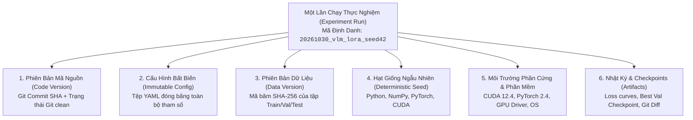
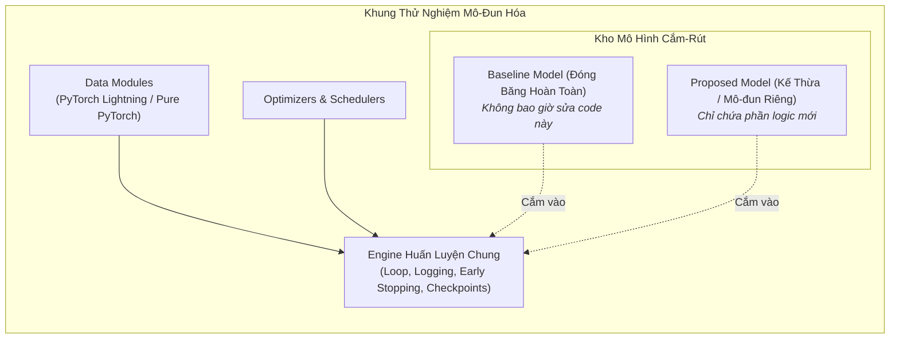

# Quản Lý Vòng Đời Thực Nghiệm & Hiện Thực Hóa Nghiên Cứu
# Experiment Management & Modular Research Implementation

---

## 1. Nguyên Lý Nền Tảng (Fundamentals)

### 1.1. Khủng Hoảng Tái Lập Trong Nghiên Cứu AI (The Reproducibility Crisis)
Một tỷ lệ lớn các bài báo AI được công bố không thể tái lập được kết quả bởi các nhà nghiên cứu độc lập. Nguyên nhân không phải do các nhà khoa học cố tình gian lận, mà chủ yếu do **quy trình quản lý thực nghiệm yếu kém**:
- Không biết chính xác commit Git nào đã sinh ra con số trong bảng kết quả.
- Tệp dữ liệu bị sửa đổi âm thầm mà không có mã băm toàn vẹn (Checksum / Hash).
- Các siêu tham số được truyền qua dòng lệnh terminal (CLI flags) rời rạc và bị quên lãng sau 2 tuần.
- Kết quả phụ thuộc vào một hạt giống ngẫu nhiên tình cờ không được lưu lại.

**Quy tắc vận hành bất biến:** Một thực nghiệm chỉ được coi là hoàn tất khi **bất kỳ ai, tại bất kỳ thời điểm nào trong tương lai, đều có thể chạy một lệnh duy nhất để tái tạo lại chính xác kết quả đó đến từng chữ số thập phân**.

### 1.2. Phân Tách Lỗi Lập Trình vs Đặc Tính Thuật Toán (Implementation Errors vs Algorithmic Findings)
Một hiểm họa lớn trong nghiên cứu AI là **Lỗi cài đặt thầm lặng (Silent Implementation Bugs)**:
- Nếu một thuật toán mới cho kết quả thấp, liệu đó là vì ý tưởng thuật toán dở, hay do người lập trình quên khởi tạo lại optimizer, viết nhầm dấu trừ thành dấu cộng trong hàm loss, hoặc hoán đổi nhầm chiều của tensor?
- Nếu không có các bài test tự động (Sanity Checks & Invariant Tests), nhà nghiên cứu sẽ đưa ra những kết luận lý thuyết sai lầm chết người dựa trên những dòng code bị bug!

---

## 2. Hệ Thống Theo Dõi Thực Nghiệm Chuẩn Mực (Experiment Tracking System)

Một lần chạy thực nghiệm (Experiment Run) chuẩn mực phải là một gói dữ liệu đóng kín chứa đầy đủ 6 thành phần:



### 2.1. Cấu Hình Tuyên Bố Bất Biến (Declarative Immutable Configurations)
Không bao giờ dùng các biến toàn cục (Global Variables) hoặc truyền 20 tham số qua CLI:
- Định nghĩa toàn bộ cấu hình trong một tệp YAML hoặc Hydra config duy nhất.
- Khi thực nghiệm khởi chạy, mã nguồn tự động copy tệp config đó vào thư mục lưu trữ kết quả và đánh dấu quyền chỉ đọc (Read-only).
- Cấu hình phải ghi rõ:
  ```yaml
  experiment:
    name: "vlm_temporal_projection"
    seed: 42
    git_hash: "a1c8f9b7d3e2a4b5"
  model:
    architecture: "vit_b_16"
    projection_dim: 512
    dropout: 0.1
  training:
    optimizer: "adamw"
    learning_rate: 1.0e-4
    weight_decay: 0.01
    batch_size: 64
    max_epochs: 50
    precision: "bf16"
  ```

### 2.2. Chiến Lược Cố Định Hạt Giống Ngẫu Nhiên (Deterministic Seeding)
Một hàm cố định hạt giống toàn diện bắt buộc phải thiết lập cho toàn bộ các thư viện liên quan:
```python
def seed_everything(seed: int = 42):
    random.seed(seed)
    os.environ['PYTHONHASHSEED'] = str(seed)
    np.random.seed(seed)
    torch.manual_seed(seed)
    torch.cuda.manual_seed_all(seed)
    # Bắt buộc các thuật toán CUDA chạy tất định (Deterministic)
    torch.backends.cudnn.deterministic = True
    torch.backends.cudnn.benchmark = False
```

---

## 3. Kiến Trúc Mã Nguồn Nghiên Cứu Mô-Đun Hóa (Modular Research Codebase)

Mã nguồn nghiên cứu cẩu thả thường là một tệp `train.py` dài 2,000 dòng chứa lẫn lộn tiền xử lý, định nghĩa mạng, vòng lặp huấn luyện và vẽ đồ thị. Khi muốn thử một cơ chế mới, tác giả sửa trực tiếp vào file đó, làm hỏng hoàn toàn code baseline cũ!

### Nguyên Tắc Bất Biến: Giữ Nguyên Vẹn Code Baseline (Frozen Baseline Wrappers)



- **Mô hình Zoo dạng Cắm-Rút (Plug-and-Play Model Zoo):** Mọi mô hình đều triển khai cùng một Interface chuẩn mực (`forward(batch) -> dict[str, Tensor]`).
- **Engine huấn luyện độc lập:** Vòng lặp huấn luyện, tính toán loss, ghi log TensorBoard và lưu checkpoint nằm trong một class `Trainer` dùng chung. Cả Baseline và mô hình đề xuất đều chạy qua đúng một `Trainer` duy nhất, loại bỏ hoàn toàn khả năng một bên được hưởng lợi từ code huấn luyện riêng.

---

## 4. Kiểm Thử Mã Nguồn Nghiên Cứu (Sanity Checks & Invariant Testing)

Trước khi bấm nút khởi chạy một chiến dịch tốn 100 giờ GPU, bắt buộc phải vượt qua 3 bài kiểm tra tỉnh táo (Sanity Checks):

### 4.1. Sanity Check 1: Khả Năng Quá Khớp Trên 1 Batch (Overfit Single Batch)
- Lấy đúng 1 batch dữ liệu nhỏ (ví dụ: 8 ảnh hoặc 8 câu).
- Tắt toàn bộ Regularization (Dropout = 0, Weight Decay = 0).
- Huấn luyện mô hình trên đúng batch đó trong 100 bước.
- **Tiêu chí đạt:** Loss bắt buộc phải giảm tiệm cận về 0 và Accuracy/Metric phải đạt xấp xỉ 100%. Nếu loss không giảm, mô hình chắc chắn có lỗi gãy đồ thị gradient, khởi tạo trọng số sai, hoặc nhãn bị xáo trộn!

### 4.2. Sanity Check 2: Kiểm Tra Rò Rỉ Đồ Thị Tính Toán (Gradient Leakage & Detach)
- Khi triển khai các mô hình có hai mạng (như GANs, Actor-Critic, hoặc Self-Supervised với Momentum Encoder), kiểm tra xem các tensor mục tiêu đã được `.detach()` hay chưa. Nếu quên detach, gradient sẽ vô tình lan truyền ngược vào cả mạng đích, làm hỏng toàn bộ lý thuyết toán học.

### 4.3. Sanity Check 3: Kiểm Tra Tính Bất Biến Hoán Vị & Kích Thước Tensor (Shape Assertions)
- Đặt các câu lệnh `assert tensor.shape == (B, C, H, W)` rõ ràng tại các ranh giới biến đổi. Không bao giờ lạm dụng các phép `tensor.view(-1)` bừa bãi vì nó có thể âm thầm trộn lẫn các chiều dữ liệu mà không báo lỗi cú pháp.

---

## 5. Quản Lý Checkpoints & Phục Hồi An Toàn (Atomic Checkpoint Management)

Mất điện đột ngột hoặc cụm tính toán bị thu hồi phiên (Preemption) trong lúc đang ghi file checkpoint có thể làm tệp checkpoint bị hỏng nhị phân (Corrupted file).

### Cơ Chế Ghi File Nguyên Tử (Atomic Checkpoint Saving):
```python
def save_checkpoint_atomic(state_dict: dict, filepath: Path):
    temp_filepath = filepath.with_suffix('.tmp')
    # 1. Ghi ra tệp tạm trước
    torch.save(state_dict, temp_filepath)
    # 2. Đổi tên nguyên tử (Atomic Rename ở cấp độ Hệ điều hành POSIX)
    os.replace(temp_filepath, filepath)
```
Cơ chế này đảm bảo rằng trên đĩa cứng luôn luôn là một tệp checkpoint hoàn chỉnh, không bao giờ bị tình trạng file dở dang.

### Phân Tách Checkpoint:
- `checkpoint_best.pt`: Lưu trạng thái có điểm Validation metric cao nhất (dùng để đánh giá trên tập Test).
- `checkpoint_last.pt`: Lưu trạng thái ở epoch gần nhất kèm toàn bộ trạng thái của Optimizer và Scheduler (dùng để tiếp tục huấn luyện nếu bị ngắt quãng).

---

## 6. Sai Lầm Thường Gặp & Anti-Patterns (Common Mistakes)

1. **Thực nghiệm không tên (Nameless Experiments):** Đặt tên thư mục lưu kết quả là `test1`, `test2_fix`, `test2_fix_final`, `test_final_really`. Sau 1 tuần, không ai nhớ nổi mỗi thư mục chứa kết quả của ý tưởng nào.
2. **Quên lưu trạng thái của Optimizer khi tạo Checkpoint:** Chỉ lưu trọng số mô hình `model.state_dict()`. Khi nạp lại để huấn luyện tiếp, các giá trị momentum của AdamW bị reset về 0, gây ra hiện tượng giật cục gradient và mất nhiều epoch mới ổn định lại.
3. **Sửa code khi đang chạy thực nghiệm:** Thay đổi một file hàm tiện ích trong lúc một tiến trình huấn luyện nền đang chạy. Khi tiến trình import lại module đó, nó sẽ nạp code mới, khiến nửa đầu của thực nghiệm chạy bằng code cũ và nửa sau chạy bằng code mới.
4. **Không dọn dẹp bộ nhớ GPU khi crash:** Quá trình huấn luyện bị crash nhưng tiến trình con không bị kill, tiếp tục chiếm dụng VRAM GPU làm tiến trình tiếp theo bị lỗi Out-Of-Memory (OOM).

---

## 7. Đánh Giá Đánh Đổi (Trade-off Analysis)

### Bảng Đánh Đổi: Ghi Log Chi Tiết Tối Đa vs Hiệu Suất Huấn Luyện

| Chiến Lược Ghi Log | Ghi Log Cực Hạn (Extreme Logging) | Ghi Log Chuẩn Mực (Balanced Logging) |
|---|---|---|
| **Dữ liệu lưu vết** | Bắn toàn bộ histogram trọng số, gradient từng layer ở mọi step | Ghi Scalar Loss ở mỗi step; chỉ tính Validation metric ở cuối epoch |
| **Ảnh hưởng tốc độ I/O** | Chậm đi 20–30% do liên tục đồng bộ GPU-CPU để ghi đĩa | Gần như bằng 0 overhead (dưới 1% tổng thời gian) |
| **Dung lượng đĩa cứng** | Tốn hàng trăm Gigabyte dữ liệu log cho một lần chạy | Vài Megabyte cho tệp scalar event và log JSON |
| **Khuyến nghị vận hành** | Chỉ bật trong 100 steps đầu tiên khi cần debug hiện tượng vanishing gradient | **Mặc định lựa chọn** cho toàn bộ quá trình huấn luyện chính thức |
