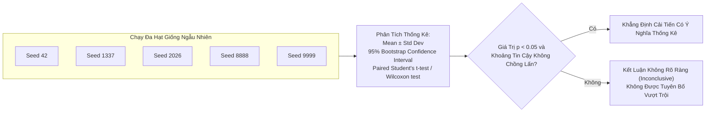

# Thiết Kế Thí Nghiệm Có Đối Chứng & Lựa Chọn Baseline Công Bằng
# Controlled Experimental Design & Fair Baseline Selection

---

## 1. Nguyên Lý Nền Tảng (Fundamentals)

### 1.1. Bản Chất Của Thí Nghiệm Có Đối Chứng (Controlled Experiments)
Trong phương pháp luận khoa học, cách duy nhất để chứng minh rằng một sự thay đổi kỹ thuật $A$ là **nguyên nhân trực tiếp** tạo ra sự cải thiện hiệu năng $B$ là thực hiện một **Thí Nghiệm Có Đối Chứng (Controlled Experiment)**:
- Mọi yếu tố xung quanh (Dữ liệu, tiền xử lý, thuật toán tối ưu, số epoch, hạt giống ngẫu nhiên, phần cứng) phải được giữ **cố định tuyệt đối**.
- Yếu tố duy nhất được phép thay đổi giữa hai lần chạy là **Biến Độc Lập (Independent Variable)** đang được thử nghiệm.
- Nếu bạn thay đổi cùng lúc 2 yếu tố, bạn không còn làm khoa học mà đang thực hiện một canh bạc ngẫu nhiên.

### 1.2. Tại Sao Thiết Kế Thực Nghiệm Quyết Định Tính Hợp Lệ Của Kết Luận?
Một kết luận khoa học ("Thuật toán X tốt hơn thuật toán Y") chỉ có giá trị khi nó được xây dựng trên một thiết kế thực nghiệm hợp lệ:
- **Ngụy biện tương quan (Correlation is not Causation):** Việc mô hình của bạn đạt điểm cao hơn mô hình cơ sở không chứng minh rằng thuật toán của bạn tốt hơn, trừ khi bạn chứng minh được rằng sự khác biệt đó không xuất phát từ việc baseline bị thiếu tài nguyên, bị cấu hình sai, hoặc do mô hình của bạn hưởng lợi từ một hiệu ứng lề ngẫu nhiên.
- **Tính vững chắc thống kê (Statistical Robustness):** Một cải thiện $0.3\%$ về độ chính xác trên một lần chạy duy nhất không mang ý nghĩa khoa học nếu phương sai giữa các hạt giống ngẫu nhiên (Seed variance) lên tới $\pm 0.5\%$.

---

## 2. Phân Tích Chuyên Sâu Các Cạm Bẫy So Sánh Thường Gặp (Failure Modes in Detail)

### 2.1. Cạm Bẫy Thay Đổi Nhiều Thành Phần Cùng Lúc (Confounded Multi-Component Changes)

```mermaid
graph TD
    subgraph Bad_Experiment [Thiết Kế Sai Lầm: Đổi Nhiều Thứ Cùng Lúc]
        Base1["Baseline: ResNet-50<br/>Adam, LR=1e-3, Không Augment"] --> Comp1["Đề Xuất: NewNet-50<br/>AdamW, Cosine LR, RandAugment, Focal Loss"]
        Comp1 --> Conclude1["Kết Luận Sai:<br/><i>'NewNet vượt trội hơn ResNet 4%'</i>"]
    end

    subgraph Good_Experiment [Thiết Kế Chuẩn Mực: Bóc Tách Từng Biến (Ablation)]
        Base2["1. ResNet-50 (Gốc)"] --> Step1["2. ResNet-50 + New Training (AdamW, Cosine, Augment)"]
        Step1 --> Step2["3. NewNet-50 + New Training (Chỉ đổi kiến trúc)"]
        Step2 --> Conclude2["Kết Luận Chuẩn:<br/><i>'ResNet tăng 3.5% nhờ chế độ train mới;<br/>NewNet chỉ đóng góp thêm 0.5% thực chất'</i>"]
    end
```

#### Ví dụ thực tế:
Nhiều bài báo công bố kiến trúc Vision mới đánh bại ResNet-50 trên ImageNet. Tuy nhiên, khi nhóm tác giả của Wightman et al. (2021) áp dụng chính quy trình huấn luyện hiện đại đó (Modern Training Recipes: RandAugment, Mixup, Cosine LR, EMA) vào chính ResNet-50 nguyên bản năm 2015, độ chính xác Top-1 của ResNet-50 nhảy vọt từ **76.3% lên 80.4%** — san bằng hoặc đánh bại hàng chục kiến trúc "đột phá" được công bố trong suốt 5 năm trước đó!

### 2.2. So Sánh Dưới Môi Trường Huấn Luyện Khác Nhau (Mismatched Training Regimes)
So sánh mô hình đề xuất với baseline nhưng:
- Mô hình đề xuất được huấn luyện 300 epochs; baseline lấy kết quả từ bài báo gốc chỉ train 90 epochs.
- Mô hình đề xuất dùng batch size 1024 trên cụm 8 GPU; baseline chạy batch size 32 trên 1 GPU (ảnh hưởng trực tiếp đến tính ổn định của Batch Normalization).
- Mô hình đề xuất được lọc dữ liệu kỹ càng; baseline được nạp dữ liệu thô.
- *Quy tắc:* **Mọi mô hình đem ra so sánh phải được chạy lại trong cùng một môi trường huấn luyện đồng nhất (Benchmarked in the same harness)**.

### 2.3. Tinh Chỉnh Siêu Tham Số Bất Công (Uncontrolled Hyperparameter Tuning)
- Nếu bạn dành 50 lần thử nghiệm với Bayesian Optimization để tìm learning rate, weight decay, và dropout tối ưu cho mô hình của bạn; nhưng chỉ chạy baseline với đúng một giá trị mặc định (`lr = 0.001`), bạn đang thực hiện một cuộc so sánh gian lận.
- **Quy tắc ngân sách tinh chỉnh công bằng (Tuning Budget Parity):** Cả mô hình đề xuất và baseline phải được cấp cùng một số lượng lần thử nghiệm siêu tham số (ví dụ: mỗi bên được 20 lần chạy Random Search trên cùng một không gian tham số hợp lý).

---

## 3. Lựa Chọn Baseline: Bộ Quy Tắc Baseline Công Bằng (The Fair Baseline Rules)

Một đề tài nghiên cứu chỉ có giá trị khi nó đối đầu với những đối thủ xứng tầm:

| Tiêu Chí Baseline | Yêu Cầu Cụ Thể | Bằng Chứng Xác Minh |
|---|---|---|
| **1. Tính Đương Đại (Modernity)** | Phải bao gồm các phương pháp SOTA trong 12–24 tháng gần nhất | Không chỉ so sánh với các mô hình kinh điển từ 10 năm trước |
| **2. Tương Đương Tham Số (Parameter-Matched)** | Baseline phải có dung lượng tham số xấp xỉ mô hình đề xuất ($\pm 10\%$) | Mở rộng baseline tương ứng nếu mô hình đề xuất thêm tham số |
| **3. Tương Đương Tính Toán (Compute-Matched)** | Cùng số lượng FLOPs suy luận và cùng số lượng tokens/samples huấn luyện | Bảng so sánh FLOPs và Throughput công khai |
| **4. Triển Khai Minh Bạch (Verified Implementation)** | Ưu tiên dùng checkpoint hoặc mã nguồn chính thức của tác giả baseline | Không tự code lại baseline một cách cẩu thả rồi tuyên bố nó yếu |

---

## 4. Cỡ Mẫu & Kiểm Định Ý Nghĩa Thống Kê (Statistical Rigor in AI)

Đã qua rồi thời kỳ các bài báo AI chỉ đưa ra một con số duy nhất trong bảng kết quả. Một nghiên cứu nghiêm cẩn bắt buộc phải có phân tích thống kê:



### 4.1. Phân Phối Khoảng Tin Cậy Bootstrap (Bootstrap Confidence Intervals)
Thay vì giả định kết quả tuân theo phân phối chuẩn, phương pháp Bootstrap lấy mẫu lại có hoàn lại 1,000 lần từ tập kết quả kiểm thử để xây dựng khoảng tin cậy 95% (95% CI):
- Nếu Mô hình đề xuất có $95\% \text{ CI} = [82.1\%, 84.3\%]$ và Baseline có $95\% \text{ CI} = [81.8\%, 83.9\%]$.
- Hai khoảng tin cậy này **bị chồng lấn đáng kể**. Mặc dù điểm trung bình của mô hình đề xuất ($83.2\%$) cao hơn baseline ($82.8\%$), ta **không có đủ bằng chứng thống kê** để khẳng định mô hình mới vượt trội hơn!

### 4.2. Kiểm Định Thống Kê Cặp Đôi (Paired Significance Tests)
- Khi so sánh trên cùng một tập dữ liệu kiểm thử, mỗi mẫu dữ liệu được cả hai mô hình dự đoán. Do đó, phải sử dụng kiểm định ghép cặp (Paired t-test cho điểm liên tục hoặc McNemar's test cho phân loại nhị phân) thay vì kiểm định hai mẫu độc lập.

---

## 5. Thiết Kế Nghiên Cứu Bóc Tách (Ablation Study Architecture)

Nghiên cứu bóc tách (Ablation Study) là phần quan trọng nhất trong một bài báo AI xuất sắc. Nó trả lời câu hỏi: *"Thành phần nào trong mô hình thực sự đóng góp vào thành công?"*.

### Bảng Thiết Kế Bóc Tách Chuẩn Mực

| Cấu Hình Thử Nghiệm (Variant) | Thành Phần A (Kiến trúc) | Thành Phần B (Hàm Loss) | Thành Phần C (Data Aug) | Kết Quả Đạt Được (nDCG@10) | Nhận Xét & Phân Tích Khoa Học |
|---|:---:|:---:|:---:|:---:|---|
| **(1) Baseline Toàn Phần** | ResNet-50 | Cross-Entropy | Không | $0.621 \pm 0.004$ | Mức cơ sở ban đầu |
| **(2) + Thành phần A** | **SparseNet-50** | Cross-Entropy | Không | $0.628 \pm 0.005$ | Đổi kiến trúc chỉ tăng khiêm tốn (+0.7%) |
| **(3) + Thành phần B** | ResNet-50 | **Focal Loss** | Không | $0.655 \pm 0.003$ | Đổi hàm loss mang lại bước nhảy lớn nhất (+3.4%) |
| **(4) + Thành phần C** | ResNet-50 | Cross-Entropy | **RandAugment** | $0.642 \pm 0.004$ | Tăng cường dữ liệu tăng (+2.1%) |
| **(5) Hệ Thống Đầy Đủ** | **SparseNet-50** | **Focal Loss** | **RandAugment** | $\mathbf{0.678 \pm 0.003}$ | Sự kết hợp cộng hưởng của cả 3 yếu tố (+5.7%) |

Nhìn vào bảng trên, người đọc thấy rõ: **Thành phần B (Focal Loss)** là nhân tố then chốt nhất của nghiên cứu, chứ không phải kiến trúc SparseNet! Sự trung thực này tạo nên uy tín học thuật bền vững.

---

## 6. Sai Lầm Thường Gặp & Anti-Patterns (Common Mistakes)

1. **Báo cáo kết quả của hạt giống may mắn (Single-Seed Cherry-Picking):** Chạy 10 seeds khác nhau, thấy seed 42 tình cờ đạt điểm cao nhất thì chỉ đưa con số đó vào bài báo và giấu đi 9 seeds còn lại.
2. **So sánh mô hình lớn với mô hình nhỏ (Unfair Capacity Comparison):** So sánh mô hình mới 500 triệu tham số với baseline 100 triệu tham số, sau đó ca ngợi kiến trúc mới thông minh hơn mà không khớp tham số.
3. **Thay đổi dữ liệu kiểm thử giữa chừng:** Lọc bớt các mẫu khó trong tập test vì "mô hình của chúng tôi không nhắm vào các trường hợp này", nhưng vẫn so sánh với điểm số của baseline chạy trên tập test nguyên bản.
4. **Không cô lập biến số (Confounded Debugging):** Khi thấy kết quả thấp, vừa tăng learning rate, vừa đổi hàm kích hoạt, vừa thêm dropout cùng lúc. Khi điểm tăng lên, hoàn toàn không biết do yếu tố nào.

---

## 7. Đánh Giá Đánh Đổi (Trade-off Analysis)

### Bảng Đánh Đổi: Chạy Đa Hạt Giống Ngẫu Nhiên vs Ngân Sách GPU

| Số Lượng Seeds Chạy | Chi Phí Tính Toán (GPU Hours) | Độ Tin Cậy Thống Kê (Statistical Rigor) | Khuyến Nghị Thực Tiễn |
|---|---|---|---|
| **1 Seed** | $1\times$ (Tiết kiệm nhất) | Cực kỳ thấp, dễ rơi vào bẫy ngẫu nhiên | Chỉ dùng trong giai đoạn code debugging và sanity check |
| **3 Seeds** | $3\times$ | Tạm chấp nhận được cho các mô hình lớn tốn kém | Khuyến nghị tối thiểu cho các bài báo hội nghị |
| **5 Seeds** | $5\times$ | **Tiêu chuẩn vàng cho nghiên cứu học thuật** | Đủ điều kiện để chạy t-test và báo cáo Mean $\pm$ Std |
| **10+ Seeds** | $10\times$+ | Rất cao, phù hợp cho các nghiên cứu lý thuyết nhỏ | Dành cho các bài toán benchmark nhỏ hoặc phân tích phương sai |
