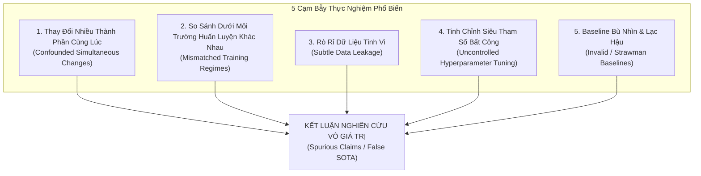
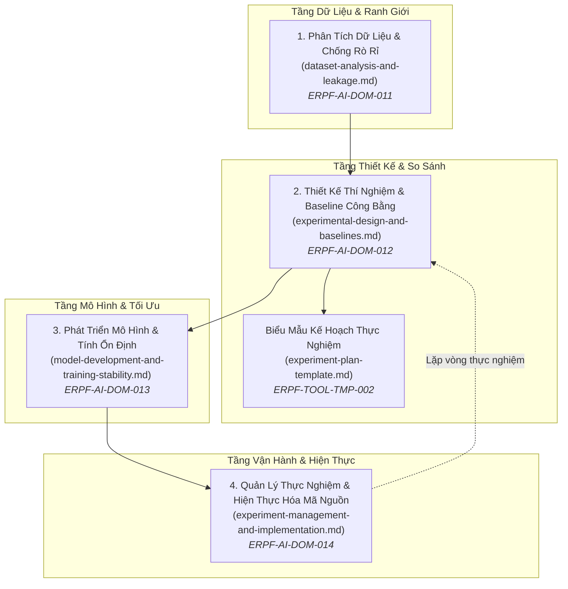

# Miền Tri Thức: Vòng Lặp Thực Nghiệm AI & Thiết Kế Thí Nghiệm
# AI Empirical Loop & Experimental Design

---

## 1. Tầm Nhìn & Nguyên Lý Cốt Tử (Domain Vision & Fundamental Axioms)

Miền tri thức **Vòng Lặp Thực Nghiệm AI & Thiết Kế Thí Nghiệm (Empirical Loop & Experimental Design)** là trụ cột thứ hai trong Nhánh Nghiên Cứu AI của ERPF.

Nếu miền *Phương Pháp Luận & Định Hình Nghiên Cứu* (`methodology/`) giải quyết câu hỏi: *"Chúng ta đang nghiên cứu câu hỏi khoa học nào và giả thuyết là gì?"*, thì miền này giải quyết câu hỏi thực thi mang tính quyết định: **"Làm thế nào để thiết kế một chiến dịch thực nghiệm khoa học nhằm kiểm chứng giả thuyết đó một cách khách quan, công bằng và không thể bị bác bỏ?"**.

### Nguyên Lý Tối Thượng: Thiết Kế Thực Nghiệm Quyết Định Tính Hợp Lệ Của Kết Luận Khoa Học
Trong nghiên cứu AI/ML, một thuật toán không được coi là vượt trội chỉ vì con số độ chính xác trên bảng kết quả cao hơn. **Con số kết quả hoàn toàn vô nghĩa nếu thiết kế thực nghiệm bị khiếm khuyết**.
- Nếu dữ liệu bị rò rỉ (Data Leakage), con số chính xác 99% thực chất là kết quả của việc "học vẹt phao thi".
- Nếu baseline không được tinh chỉnh công bằng (Strawman baseline), con số chiến thắng thực chất là kết quả của sự ngụy biện so sánh.
- Nếu thay đổi 3 thành phần cùng một lúc (Confounded changes), ta hoàn toàn không biết thành phần nào thực sự mang lại hiệu quả và thành phần nào đang kéo lùi hệ thống.

---

## 2. Năm Cạm Bẫy Phá Hủy Tính Hợp Lệ Của Nghiên Cứu AI (The 5 Critical Failure Modes)

Cộng đồng nghiên cứu AI thường xuyên bị đánh lừa bởi 5 sai lầm thiết kế thực nghiệm sau đây:

1. **Thay đổi nhiều thành phần cùng lúc (Confounded Multi-component Changes):** Một bài báo đề xuất: Kiến trúc mạng mới + Hàm mất mát mới + Kỹ thuật tăng cường dữ liệu (Data Augmentation) mới. Khi mô hình đạt điểm cao hơn, tác giả kết luận rằng "Kiến trúc mạng mới vượt trội". Đây là kết luận ngụy biện. Rất có thể kiến trúc mạng mới thực chất kém hơn, nhưng kỹ thuật Data Augmentation quá mạnh đã che giấu sự yếu kém đó. Mọi thay đổi bắt buộc phải được bóc tách đơn lẻ (Ablation).
2. **So sánh dưới môi trường huấn luyện khác nhau (Mismatched Training Regimes):** Đưa ra so sánh giữa mô hình đề xuất được huấn luyện với Optimizer AdamW, Cosine Annealing Learning Rate, 100 epochs, và Data Augmentation hiện đại; đối đầu với Baseline chỉ được train bằng Vanilla SGD, Constant Learning Rate, và 30 epochs lấy lại từ một bài báo cũ năm 2018. Kết quả vượt trội ở đây là do **chế độ huấn luyện tốt hơn**, hoàn toàn không chứng minh được tính ưu việt của ý tưởng thuật toán.
3. **Rò rỉ dữ liệu tinh vi (Data Leakage):** Chuẩn hóa dữ liệu (Z-score normalization) trên toàn bộ tập dữ liệu trước khi chia train/test; hoặc chia ngẫu nhiên các frame từ cùng một video clip vào cả tập train và tập test. Mô hình đạt độ chính xác ảo cực cao nhưng hoàn toàn sập khi chạy trên dữ liệu thực tế.
4. **Tinh chỉnh siêu tham số bất công (Uncontrolled Hyperparameter Selection):** Dành 2 tuần và 100 lần chạy để tìm ra learning rate và weight decay tối ưu nhất cho mô hình đề xuất; trong khi mô hình baseline chỉ chạy đúng 1 lần với tham số mặc định của thư viện.
5. **Baseline bù nhìn (Strawman Baselines):** Tự tạo ra các mô hình đối thủ yếu ớt, lỗi thời hoặc cố tình cấu hình sai để làm nổi bật mô hình của mình, né tránh so sánh với các phương pháp SOTA đương đại mạnh nhất.

---

## 3. Phân Biệt Tính Mới Nghiên Cứu vs Chất Lượng Hiện Thực Kỹ Thuật (Research Novelty vs Engineering Quality)

Trong nhiều bài báo, một thuật toán mới đạt điểm cao không phải vì ý tưởng toán học hay cấu trúc nơ-ron mới mẻ, mà thuần túy vì **kỹ thuật hiện thực hóa phần mềm (Software Engineering) tốt hơn**:
- Việc viết lại code bằng CUDA kernel tối ưu hóa bộ nhớ đệm (như FlashAttention) là một **đóng góp kỹ thuật hệ thống xuất sắc**, nhưng cơ chế toán học của Attention vẫn giữ nguyên.
- Việc sửa lỗi tràn số (numerical stability), cài đặt đúng gradient clipping, hoặc dùng mixed precision FP16 chuẩn xác giúp mô hình hội tụ tốt hơn là **chất lượng lập trình (Engineering Quality)**, không phải là một **tính mới về mặt thuật toán học máy (Algorithmic Novelty)**.
- Người làm nghiên cứu phải minh bạch: Nếu cải tiến đến từ kỹ thuật lập trình hệ thống, hãy tự hào ghi nhận nó là một đóng góp kỹ thuật (System/Engineering Contribution); không được ngụy trang nó thành một đột phá lý thuyết.

---

## 4. Tránh Giáo Điều Hóa Quy Ước Thực Nghiệm (Plurality of Legitimate Methodologies)

Khoa học AI không có một "công thức duy nhất bắt buộc cho mọi trường hợp". Kỹ sư và nhà nghiên cứu cần linh hoạt lựa chọn quy ước phù hợp với bản chất bài toán, miễn là giải trình minh bạch:
- **Offline Benchmark vs Online A/B Testing:** Trong nghiên cứu hàn lâm, benchmark tĩnh (như ImageNet, MMLU) là chuẩn mực để so sánh công bằng. Tuy nhiên trong nghiên cứu hệ thống khuyến nghị thực tế (như feed khám phá địa điểm Rendez), tương tác động của người dùng (CTR, thời gian dừng) chỉ có thể đo lường qua Online A/B Testing. Cả hai đều có giá trị khoa học chính đáng.
- **Dữ liệu tổng hợp (Synthetic Data) vs Dữ liệu thực tế (Real-world Data):** Dữ liệu thực tế phản ánh đúng phân phối tự nhiên nhưng thường thiếu nhãn sạch và khó kiểm soát biến; dữ liệu tổng hợp cho phép kiểm soát biến số hoàn hảo và nghiên cứu các trường hợp cực hạn (stress-testing), dù có nguy cơ chênh lệch miền (Sim-to-Real gap).
- **Mô hình cố định (Frozen Backbone) vs End-to-End Fine-tuning:** Tùy thuộc vào ngân sách tài nguyên và mục tiêu kiểm chứng cơ chế biểu diễn.

---

## 5. Bản Đồ 4 Chuyên Đề Cốt Lõi (Core Knowledge Areas)

Miền tri thức được cấu trúc thành 4 chuyên đề sâu và 1 biểu mẫu lập kế hoạch thực nghiệm chuẩn hóa:

1. [**`dataset-analysis-and-leakage.md`**](file:///home/longtran/Projects/rendez-web/erpf/ai-research/empirical-loop/dataset-analysis-and-leakage.md) (`ERPF-AI-DOM-011`): Nguồn gốc dữ liệu, chất lượng gán nhãn, mất cân bằng lớp, phân loại các dạng rò rỉ dữ liệu (Feature, Target, Temporal, Group leakage), dịch chuyển phân phối (Distribution shift), và các chiến lược phân tách tập dữ liệu an toàn.
2. [**`experimental-design-and-baselines.md`**](file:///home/longtran/Projects/rendez-web/erpf/ai-research/empirical-loop/experimental-design-and-baselines.md) (`ERPF-AI-DOM-012`): Thiết kế thí nghiệm có đối chứng, phân lập biến độc lập/phụ thuộc/gây nhiễu, quy tắc lựa chọn Baseline công bằng (Param-matched, Compute-matched), cỡ mẫu và kiểm định ý nghĩa thống kê.
3. [**`model-development-and-training-stability.md`**](file:///home/longtran/Projects/rendez-web/erpf/ai-research/empirical-loop/model-development-and-training-stability.md) (`ERPF-AI-DOM-013`): Lựa chọn kiến trúc theo thiên kiến quy nạp (Inductive Biases), thiết kế hàm mất mát (Surrogate loss), chiến lược tối ưu hóa (AdamW, LR schedules, Warmup), tìm kiếm siêu tham số, quản lý ngân sách tính toán (FLOPs, Mixed Precision FP16/BF16), và các kỹ thuật chống bất ổn định huấn luyện (Gradient clipping, NaN checks).
4. [**`experiment-management-and-implementation.md`**](file:///home/longtran/Projects/rendez-web/erpf/ai-research/empirical-loop/experiment-management-and-implementation.md) (`ERPF-AI-DOM-014`): Theo dõi cấu hình bất biến (Declarative Configs YAML/Hydra), quản lý phiên bản code và dataset (Git SHA, DVC), chiến lược quản lý hạt giống ngẫu nhiên (Multi-seed reporting), quản lý checkpoint, chuẩn mực ghi log số liệu, và kỹ thuật viết mã nghiên cứu mô-đun hóa không làm bẩn baseline code.
5. [**`experiment-plan-template.md`**](file:///home/longtran/Projects/rendez-web/erpf/toolkit/templates/experiment-plan-template.md) (`ERPF-TOOL-TMP-002`): Biểu mẫu đăng ký trước thực nghiệm (Pre-registration Experiment Plan) bắt buộc phải hoàn thành trước khi tiêu tốn ngân sách GPU.

---

## 6. Bản Đồ Ánh Xạ Năng Lực Nghiên Cứu (Competency Mapping)

| Năng Lực Liên Ngành (`ERPF-CORE-COMP-001`) | Kỹ Thuật Áp Dụng Trong Miền Này | Bằng Chứng Tạo Tác Kỹ Thuật (Observable Artifacts) |
|---|---|---|
| **C1. Problem Formulation & Decomposition** | Phân rã mục tiêu lớn thành chuỗi thực nghiệm đơn biến (Single-variable experiments) | Tài liệu Kế hoạch thực nghiệm [`experiment-plan-template.md`](file:///home/longtran/Projects/rendez-web/erpf/toolkit/templates/experiment-plan-template.md) |
| **C2. Analytical Reasoning** | Đọc hiểu đường cong tổn thất (Loss curves), phân tích hiện tượng gradient vanishing/exploding | Biểu đồ TensorBoard ghi nhận gradient norms và learning rate |
| **C3. Critical Evaluation** | Phát hiện rò rỉ dữ liệu tiềm ẩn, từ chối các kết quả không có kiểm định thống kê | Báo cáo kiểm định ý nghĩa thống kê (p-values, bootstrap intervals) |
| **C4. Information Literacy & Synthesis** | Chọn đúng SOTA Baselines từ các hội nghị hàng đầu để so sánh | Bảng đối chiếu cấu hình giữa mô hình đề xuất và Baselines |
| **C5. Technical Decision-Making** | Quyết định dừng sớm (Early Stopping) khi mô hình có dấu hiệu phân kỳ hoặc overfit | Cấu hình tham số patience và quy tắc dừng trong script huấn luyện |
| **C6. Systems Thinking** | Quản lý bộ nhớ VRAM, tối ưu hóa I/O nạp dữ liệu (DataLoader workers, pinning memory) | Mã nguồn pipeline DataLoader không bị nghẽn CPU bottleneck |
| **C7. Planning & Prioritization** | Ước lượng chính xác GPU-giờ và dung lượng đĩa trước khi khởi chạy | Kế hoạch phân bổ tài nguyên tính toán cho từng thực nghiệm |
| **C10. Self-Assessment & Continuous Learning** | Ghi nhận trung thực các thực nghiệm thất bại (Negative Results) trong phòng lab | Nhật ký thực nghiệm (Experiment Log) lưu vết đầy đủ các lần chạy hỏng |
