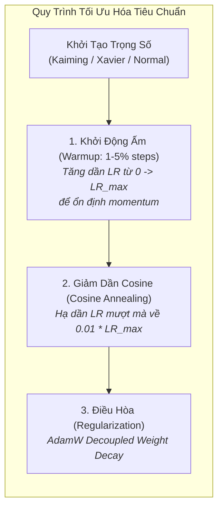
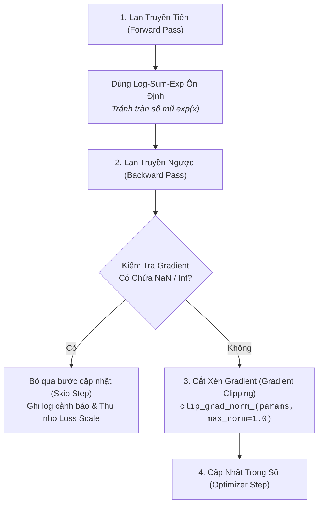

# Phát Triển Mô Hình, Tối Ưu Hóa & Tính Ổn Định Huấn Luyện
# Model Architecture, Optimization & Training Stability

---

## 1. Nguyên Lý Nền Tảng (Fundamentals)

### 1.1. Thiên Kiến Quy Nạp & Lựa Chọn Kiến Trúc (Inductive Biases)
Mỗi kiến trúc mạng nơ-ron chứa đựng một tập hợp các **Giả định ngầm định về cấu trúc của thế giới (Inductive Biases)**:
- **CNN (Convolutional Networks):** Chứa thiên kiến về tính bất biến tịnh tiến (Translation Equivariance) và tính cục bộ không gian (Locality) — các pixel gần nhau có quan hệ chặt chẽ hơn các pixel ở xa.
- **Transformers (Self-Attention):** Chứa thiên kiến tối thiểu — cho phép mọi phần tử tương tác trực tiếp với mọi phần tử khác với độ phức tạp $O(N^2)$, cực kỳ linh hoạt nhưng đòi hỏi lượng dữ liệu khổng lồ để học được các quy luật mà CNN đã có sẵn.
- **GNN (Graph Neural Networks):** Chứa thiên kiến về tính bất biến hoán vị của các đồ thị (Permutation Invariance).

**Quy tắc lựa chọn:** Không chọn kiến trúc theo xu hướng truyền thông. Chọn kiến trúc mà thiên kiến quy nạp của nó **khớp chính xác với cấu trúc đối xứng và hình học của bài toán**.

### 1.2. Hàm Mất Mát Thay Thế (Surrogate Losses)
Trong nhiều bài toán AI, chỉ số thực tế ta muốn tối ưu hóa là không khả vi (Non-differentiable) — ví dụ: 0-1 Error, Accuracy, BLEU, hoặc nDCG.
- Vì không thể tính gradient trực tiếp, ta bắt buộc phải sử dụng **Hàm mất mát thay thế (Surrogate Loss)** khả vi và lồi/mịn (như Cross-Entropy, Focal Loss, hoặc InfoNCE contrastive loss).
- *Hiểm họa ngầm định:* Tối ưu hóa surrogate loss quá mức có thể dẫn đến việc mô hình tự tin thái quá nhưng chỉ số nghiệp vụ thực tế không tăng (Metric-Loss Mismatch).

---

## 2. Chiến Lược Tối Ưu Hóa & Lịch Trình Tốc Độ Học (Optimization Dynamics)

Huấn luyện mạng nơ-ron sâu là một bài toán tối ưu hóa phi lồi (Non-convex optimization) trên không gian hàng triệu chiều.



### 2.1. Tại Sao Bắt Buộc Dùng AdamW Thay Vì Adam Cũ?
Trong thuật toán Adam gốc (Kingma & Ba, 2014), kỹ thuật $L_2$ regularization được cài đặt sai cách bằng cách cộng gradient của trọng số vào gradient của hàm mất mát. Loshchilov & Hutter (2017) đã chứng minh rằng điều này làm mất đi bản chất của weight decay khi kết hợp với tốc độ học thích ứng.
- **AdamW (Decoupled Weight Decay):** Tách biệt hoàn toàn việc trừ hao trọng số ($w \leftarrow w - \eta \lambda w$) khỏi bước cập nhật của gradient moment. Điều này giúp mô hình khái quát hóa tốt hơn rõ rệt trên hầu hết các bài toán NLP và Computer Vision.

### 2.2. Tầm Quan Trọng Tuyệt Đối Của Learning Rate Warmup
Ở những bước đầu tiên của quá trình huấn luyện, các tham số của mô hình hoàn toàn ngẫu nhiên. Nếu lập tức áp dụng tốc độ học lớn, gradient khổng lồ sẽ phá hủy hoàn toàn cấu trúc khởi tạo và khiến mô hình phân kỳ ngay lập tức:
- **Linear Warmup:** Bắt đầu với $LR = 0$ và tăng dần tuyến tính lên $LR_{\max}$ trong 1,000 đến 5,000 bước đầu tiên, cho phép bộ nhớ momentum thích ứng dần với địa hình của hàm mất mát.

---

## 3. Kiểm Soát Tính Ổn Định Số Học & Triệt Tiêu Lỗi NaN/Inf (Training Stability)

Hiện tượng mô hình đang huấn luyện mượt mà thì đột ngột ném ra `Loss: NaN` sau 3 ngày chạy là cơn ác mộng phổ biến nhất trong Deep Learning.

### 3.1. Các Biện Pháp Phòng Ngừa Thảm Họa Số Học (Numerical Safeguards)



1. **Cắt xén Gradient (Gradient Clipping by Norm):** Giới hạn độ dài vector gradient toàn cục không vượt quá một ngưỡng nhất định (thường là $1.0$ hoặc $5.0$). Ngăn chặn triệt để hiện tượng nổ gradient (Exploding Gradients) khi mô hình đi qua các vùng vách đá dốc của hàm mất mát.
2. **Kỹ thuật Log-Sum-Exp ổn định:** Khi tính Softmax hoặc Cross-Entropy, luôn trừ đi giá trị lớn nhất của vector trước khi lấy hàm mũ:
   $$\log \sum_{i} e^{x_i} = c + \log \sum_{i} e^{x_i - c} \quad \text{với } c = \max(x)$$
   Kỹ thuật này ngăn chặn hoàn toàn việc tràn số trên (Overflow) sang $\infty$.
3. **Epsilon hợp lý trong Normalization:** Luôn đặt $\epsilon \ge 10^{-5}$ trong LayerNorm và RMSNorm để tránh lỗi chia cho 0 khi phương sai của activation quá nhỏ.

---

## 4. Quản Lý Ngân Sách Tính Toán & Mixed Precision Training

Huấn luyện mô hình hiện đại bắt buộc phải cân đối giữa độ chính xác số thực và tài nguyên VRAM:

| Kiểu Định Dạng Số | Số Bit Mantissa (Độ chính xác) | Số Bit Exponent (Dải động) | Dung Lượng VRAM | Khuyến Nghị Vận Hành |
|---|:---:|:---:|:---:|---|
| **FP32 (Single Precision)** | 23 bits | 8 bits | $1\times$ (Mặc định chuẩn) | Chuẩn mực vàng cho nghiên cứu nhỏ; quá tốn VRAM cho mô hình lớn. |
| **FP16 (Half Precision)** | 10 bits | 5 bits | **Giảm 50%** | Dải động hẹp, rất dễ bị tràn số dưới (Underflow) $\rightarrow$ Bắt buộc dùng Dynamic Loss Scaling. |
| **BF16 (Bfloat16)** | 7 bits | 8 bits (Bằng FP32) | **Giảm 50%** | **Tiêu chuẩn vàng hiện đại (A100/H100/RTX 4090)**: Dải động bằng FP32, không bao giờ cần Loss Scaling, cực kỳ ổn định. |
| **FP8 (8-bit Float)** | 2-3 bits | 4-5 bits | **Giảm 75%** | Dành cho giai đoạn tiền huấn luyện LLM siêu lớn; đòi hỏi phần cứng thế hệ mới (Hopper/Ada Lovelace). |

### Kỹ Thuật Tích Lũy Gradient (Gradient Accumulation)
Khi bộ nhớ GPU chỉ chứa được batch size = 4 nhưng bài toán đòi hỏi batch size hiệu dụng = 64 để Batch Normalization hoặc Contrastive Loss hoạt động ổn định:
- Chạy forward và backward pass 16 lần liên tiếp mà không gọi `optimizer.step()`.
- Chia nhỏ gradient cho 16 (`loss = loss / 16`).
- Chỉ gọi `optimizer.step()` và `optimizer.zero_grad()` sau mỗi 16 micro-batches.
- Kết quả toán học hoàn toàn tương đương với việc huấn luyện trên một GPU khổng lồ chứa được batch size 64.

---

## 5. Chiến Lược Tìm Kiếm Siêu Tham Số (Hyperparameter Optimization)

Không bao giờ dùng Grid Search thủ công khi không gian tham số có nhiều hơn 3 chiều:

```
                          TÌM KIẾM THEO LƯỚI (Grid Search)         TÌM KIẾM NGẪU NHIÊN (Random Search)
                                (Kém hiệu quả)                          (Hiệu quả vượt trội)
                  Param 2 ┌───┬───┬───┬───┐              Param 2 ┌───┬───┬───┬───┐
                          │ • │ • │ • │ • │                      │   │ • │   │   │
                          ├───┼───┼───┼───┤                      ├───┼───┼───┼───┤
                          │ • │ • │ • │ • │                      │ • │   │   │ • │
                          ├───┼───┼───┼───┤                      ├───┼───┼───┼───┤
                          │ • │ • │ • │ • │                      │   │   │ • │   │
                          ├───┼───┼───┼───┤                      ├───┼───┼───┼───┤
                          │ • │ • │ • │ • │                      │   │ • │   │   │
                          └───┴───┴───┴───┘                      └───┴───┴───┴───┘
                            Param 1 (Quan trọng)                   Param 1 (Quan trọng)
                  -> Chỉ thử được 4 giá trị của Param 1!  -> Thử được 9 giá trị KHÁC NHAU của Param 1!
```

Theo nghiên cứu kinh điển của Bergstra & Bengio (2012): Trong thực tế, chỉ có 1 hoặc 2 siêu tham số thực sự chi phối hiệu năng (thường là Learning Rate). **Random Search** luôn vượt trội hơn Grid Search với cùng một ngân sách tính toán vì nó thử nghiệm được nhiều giá trị phân tán hơn trên trục tham số quan trọng.

---

## 6. Sai Lầm Thường Gặp & Anti-Patterns (Common Mistakes)

1. **Thay đổi Batch Size nhưng giữ nguyên Learning Rate:** Khi tăng batch size gấp đôi, số lần cập nhật gradient giảm đi một nửa. Cần áp dụng quy tắc tỷ lệ tuyến tính (Linear Scaling Rule: $\text{LR} \propto \text{Batch Size}$) hoặc căn bậc hai tùy bài toán.
2. **Quên đặt chế độ `model.eval()` khi đánh giá:** Để mô hình ở chế độ `train()` trong lúc chạy trên tập validation, khiến Dropout vẫn tiếp tục tắt ngẫu nhiên nơ-ron và BatchNorm tính mean/std theo batch nhỏ thay vì dùng running statistics.
3. **Thêm quá nhiều tầng phức tạp không có lý do:** Ghép nối 5 loại attention khác nhau vào mô hình mà không có lý thuyết dẫn đường, dẫn đến hiện tượng quá khớp (Overfitting) và không thể hội tụ.
4. **Không kiểm tra Sanity Check trước khi train:** Không thử nghiệm nạp đúng 1 batch dữ liệu nhỏ (10 mẫu) và ép mô hình phải overfit đạt $100\%$ accuracy. Nếu mô hình không thể overfit được 10 mẫu dữ liệu, chắc chắn code đang có lỗi logic nghiêm trọng!

---

## 7. Đánh Giá Đánh Đổi (Trade-off Analysis)

### Bảng Đánh Đổi: AdamW vs SGD có Momentum

| Thuộc Tính | AdamW (Adaptive Learning Rate) | SGD with Momentum |
|---|---|---|
| **Tốc độ hội tụ ban đầu** | Cực nhanh, ít nhạy cảm với khởi tạo | Chậm hơn, đòi hỏi lịch trình LR khắt khe |
| **Độ nhạy siêu tham số** | Tương đối bao dung, `lr=1e-4` thường chạy tốt | Rất nhạy cảm, phải tinh chỉnh LR cực kỳ cẩn thận |
| **Độ phẳng của cực tiểu (Generalization)** | Có xu hướng hội tụ vào các cực tiểu hẹp (Sharper Minima) | Thường tìm thấy các cực tiểu phẳng hơn (Flatter Minima), khái quát hóa tốt hơn một chút trên Vision |
| **Khuyến nghị vận hành** | **Mặc định lựa chọn hàng đầu** cho Transformer, NLP, và mọi kiến trúc phức tạp | Phù hợp cho huấn luyện ResNet/ConvNet cổ điển từ đầu |
