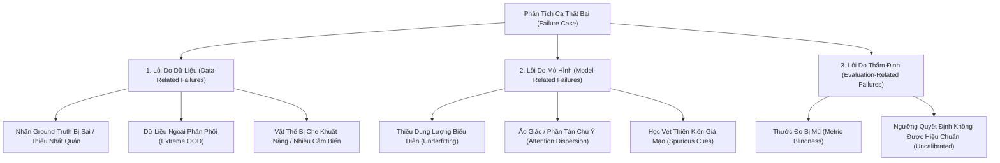
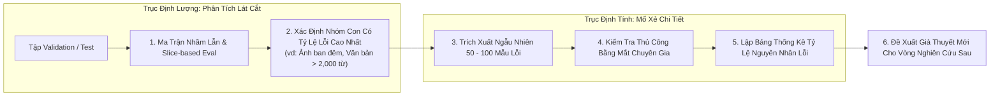

# Phân Tích Lỗi Thực Nghiệm & Phân Loại Thất Bại Hệ Thống
# Failure Analysis & Systematic Error Categorization

---

## 1. Nguyên Lý Nền Tảng (Fundamentals)

### 1.1. Giá Trị Khoa Học Của Sự Thất Bại (Learning from Errors)
Trong nghiên cứu AI, các mẫu dự đoán đúng chỉ cho biết mô hình đã học được gì; nhưng **chính các mẫu dự đoán sai (Failure Cases) mới là nơi chứa đựng toàn bộ tri thức khoa học mới**.

Một bài báo AI tầm thường chỉ khoe khoang những bức ảnh dự đoán đẹp mắt (Cherry-picking). Một bài báo AI xuất sắc dành dung lượng thích đáng để **mổ xẻ những trường hợp mô hình thất bại thảm hại nhất**, bởi vì:
- Lỗi sai bộc lộ chính xác ranh giới năng lực và thiên kiến quy nạp của kiến trúc.
- Lỗi sai chỉ ra những khiếm khuyết tiềm ẩn trong tập dữ liệu ground-truth.
- Lỗi sai là chiếc la bàn định hướng cho việc xây dựng giả thuyết khoa học của nghiên cứu tiếp theo.

### 1.2. Phân Định: Lỗi Hệ Thống (Systematic Errors) vs Nhiễu Ngẫu Nhiên (Aleatoric Noise)
Khi phân tích các trường hợp thất bại, nhà nghiên cứu phải phân biệt hai bản chất lỗi:
- **Nhiễu ngẫu nhiên không thể triệt tiêu (Aleatoric Noise / Irreducible Error):** Hình ảnh bị nhòe mờ hoàn toàn không thể nhận diện mắt thường, hoặc văn bản có ngữ nghĩa mập mờ đến mức chính 3 chuyên gia con người cũng cãi nhau về nhãn. Đây là giới hạn tự nhiên của bài toán, không thể khắc phục bằng thuật toán.
- **Lỗi hệ thống (Systematic Errors):** Mô hình liên tục dự đoán sai trên một nhóm mẫu cụ thể có chung một đặc trưng hình học, thời gian hoặc ngữ cảnh (ví dụ: mô hình luôn nhận diện sai tất cả các ảnh quán cafe chụp dưới ánh đèn vàng ban đêm). Đây là **lỗi có cấu trúc (Structural Defect)** mà thuật toán mới có thể giải quyết!

---

## 2. Bản Thể Học Phân Loại Thất Bại (Taxonomy of AI Failure Modes)

Mọi ca thất bại của hệ thống AI đều có thể được truy nguyên về một trong ba nguồn gốc cốt lõi:



---

## 3. Quy Trình Phân Tích Lỗi Hai Trục: Định Tính & Định Lượng (Two-Pronged Error Analysis)

Để phân tích lỗi khoa học, cần kết hợp cả chiều sâu định tính và quy mô định lượng:



### 3.1. Phân Tích Định Lượng Theo Lát Cắt (Slice-Based Error Analysis)
Thay vì chỉ tính một con số Error Rate chung chung, ta chia tập dữ liệu thành các lát cắt có ý nghĩa nghiệp vụ:
- Theo độ dài câu: $[0-20], [21-50], [51-200], [>200]$ từ.
- Theo điều kiện chụp ảnh: Ban ngày (Daylight), Hoàng hôn (Sunset), Ban đêm (Night), Trong nhà (Indoor).
- Nếu tỷ lệ lỗi ở lát cắt "Ban đêm" lên tới $42\%$ trong khi các lát cắt khác chỉ $8\%$, điểm nghẽn của mô hình đã bị lộ diện rõ ràng!

### 3.2. Bảng Phân Loại Nguyên Nhân Lỗi Định Tính (Qualitative Error Audit Table)
Trích xuất ngẫu nhiên 100 mẫu lỗi từ nhóm có vấn đề và gán nhãn nguyên nhân thủ công:

| Mã Ca Lỗi | Đầu Vào (Input) | Nhãn Ground-Truth ($y$) | Dự Đoán Của Mô Hình ($\hat{y}$) | Phân Loại Nguyên Nhân | Phân Tích Chi Tiết Của Nhà Nghiên Cứu |
|---|---|---|---|:---:|---|
| `#ERR-01` | Ảnh quán cafe ban đêm có đèn neon | "Không gian yên tĩnh đọc sách" | "Quán bar / Nightlife sôi động" | **Model (Spurious Cue)** | Mô hình liên kết màu đèn neon với quán bar thay vì đọc không gian bàn ghế xung quanh. |
| `#ERR-02` | Ảnh góc chụp cận cảnh một tách trà | "Quán cafe phong cách tối giản" | "Cửa hàng gốm sứ" | **Data (Lack of Context)** | Ảnh chụp quá sát (Macro crop), con người cũng không thể biết đây là quán cafe hay phòng khách. |
| `#ERR-03` | Ảnh quán cafe sân vườn | "Quán cafe sân vườn" | "Công viên công cộng" | **Evaluation (Ambiguity)** | Nhãn ground-truth thiếu thông tin; cả hai nhãn đều có lý về mặt ngữ nghĩa. |

---

## 4. Kết Nối Phân Tích Lỗi Ngược Về Giả Thuyết Nghiên Cứu (Closing the Hypothesis Loop)

Phân tích lỗi không phải là công việc báo cáo hành chính, mà là **động cơ thúc đẩy chu trình nghiên cứu lặp lại**:

```
PHÁT HIỆN LỖI:
"Mô hình VLM nhầm lẫn 35% ảnh quán cafe ban đêm thành quán bar do đèn neon."
                               │
                               ▼
PHÂN TÍCH NGUYÊN NHÂN GỐC RỄ:
"Tầng Self-Attention bị phân tán bởi các pixel có độ sáng cao (High-contrast neon lights),
bỏ qua các đặc trưng ngữ cảnh không gian tinh tế (kệ sách, bàn học)."
                               │
                               ▼
HÌNH THÀNH GIẢ THUYẾT MỚI:
"Nếu áp dụng cơ chế Masked Contrastive Loss ép mô hình chú ý vào cấu trúc không gian bàn ghế
và làm giảm trọng số của các nguồn sáng cục bộ, tỷ lệ nhầm lẫn ảnh ban đêm sẽ giảm ít nhất 50%."
                               │
                               ▼
KHỞI CHẠY CHU TRÌNH THỰC NGHIỆM MỚI (ERPF-AI-DOM-010)
```

---

## 5. Sai Lầm Thường Gặp & Anti-Patterns (Common Mistakes)

1. **Giấu nhẹm các ca dự đoán sai (Hiding Failures):** Chỉ chọn đưa vào bài báo những bức ảnh mô hình vẽ bounding box hoàn hảo hoặc những câu trả lời xuất sắc của chatbot, cố tình giấu đi các trường hợp mô hình nói nhảm hoặc ảo giác nặng.
2. **Đổ lỗi mù quáng cho dữ liệu (Blaming the Data):** Mỗi khi mô hình đoán sai, lập tức kết luận là "do dữ liệu bị nhiễu" mà không hề mở ảnh ra kiểm tra thực tế xem nhãn có thực sự sai hay không.
3. **Phân tích lỗi hời hợt (Superficial Error Analysis):** Chỉ viết một đoạn văn ngắn 3 dòng: *"Mô hình đôi khi nhầm lẫn giữa lớp A và lớp B vì chúng trông giống nhau"* mà không có bất kỳ con số thống kê hay phân loại có hệ thống nào.
4. **Không phân biệt lỗi nguy hiểm vs lỗi nhẹ:** Coi việc nhầm một quán cafe phong cách hiện đại thành phong cách tối giản (lỗi nhẹ vô hại) ngang hàng với việc nhầm một hình ảnh khiêu dâm độc hại thành ảnh quán cafe an toàn (lỗi bảo mật nghiêm trọng).

---

## 6. Đánh Giá Đánh Đổi (Trade-off Analysis)

### Bảng Đánh Đổi: Phân Tích Lỗi Tự Động vs Kiểm Tra Thủ Công Bằng Mắt Con Người

| Phương Pháp | Phân Tích Lỗi Tự Động (Automated Slice Metrics) | Kiểm Tra Thủ Công Mắt Con Người (Manual Error Auditing) |
|---|---|---|
| **Tốc độ & Quy mô** | Cực nhanh, quét qua hàng triệu mẫu trong vài phút | Rất chậm, chuyên gia chỉ đọc được tối đa 100–200 mẫu/ngày |
| **Độ sâu nhận thức** | Nông — chỉ phát hiện nhóm nào có điểm thấp, không hiểu lý do | Cực sâu — phát hiện ra các thiên kiến ngầm định và quy luật phi lý |
| **Khả năng sinh giả thuyết mới** | Thấp | **Cực kỳ cao — hầu hết ý tưởng nghiên cứu đột phá đều sinh ra từ đây** |
| **Quy trình kết hợp chuẩn** | Dùng phân tích tự động để tìm ra 2 nhóm lát cắt có tỷ lệ lỗi cao nhất $\rightarrow$ Dành thời gian kiểm tra thủ công 100 mẫu trong 2 nhóm đó |
