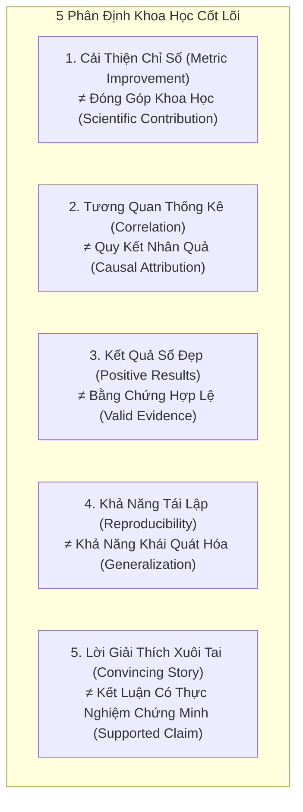
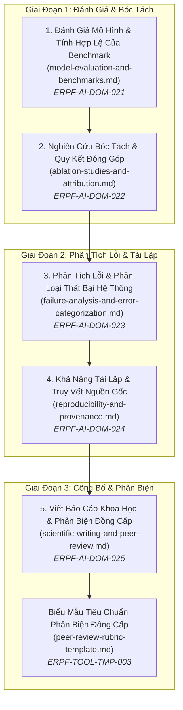

# Miền Tri Thức: Thẩm Định Nghiên Cứu AI & Đánh Giá Khoa Học
# AI Research Evaluation & Scientific Validation

---

## 1. Tầm Nhìn & Ranh Giới Đánh Giá Khoa Học (Domain Vision & Epistemology)

Miền tri thức **Thẩm Định Nghiên Cứu AI & Đánh Giá Khoa Học (AI Research Evaluation & Scientific Validation)** là đỉnh cao của Nhánh Nghiên Cứu AI trong ERPF.

Sau khi đã định hình bài toán (`methodology/`) và hoàn thành các chiến dịch thực nghiệm (`empirical-loop/`), nghiên cứu AI bước vào giai đoạn then chốt nhất: **Thẩm tra xem các kết quả thu được có thực sự phản ánh một khám phá khoa học chân chính hay chỉ là ảo ảnh của sự tối ưu hóa số liệu**.

Khoa học thực sự không kết thúc khi một con số trong bảng benchmark đạt mức cao nhất (SOTA). Khoa học chỉ bắt đầu khi ta **phân tích tỉ mỉ tại sao mô hình đạt được kết quả đó, khi nào nó thất bại, thành phần nào thực sự tạo ra sự khác biệt, và liệu người khác có thể tái lập lại kết luận đó hay không**.

---

## 2. Năm Phân Định Bản Thể Luận Sống Còn (5 Crucial Epistemological Distinctions)

Để không rơi vào các cạm bẫy ngụy biện phổ biến trong các bài báo AI hiện đại, nhà nghiên cứu bắt buộc phải phân biệt rạch ròi 5 cặp khái niệm sau:

### Chi Tiết 5 Cặp Phân Định:

1. **Cải thiện chỉ số (Metric Improvement) $\neq$ Đóng góp khoa học (Scientific Contribution):**
   - *Cải thiện chỉ số:* Tăng thêm $0.8\%$ điểm Accuracy trên tập kiểm thử bằng cách ghép thêm một tầng nơ-ron hoặc tinh chỉnh siêu tham số phức tạp.
   - *Đóng góp khoa học:* Làm sáng tỏ một nguyên lý mới, chứng minh được một cơ chế toán học, hoặc cung cấp hiểu biết sâu sắc về lý do tại sao một lớp thuật toán lại hoạt động hiệu quả hơn lớp khác. Một bài báo có thể cải thiện chỉ số rất ít nhưng đóng góp tri thức khổng lồ (ví dụ: bài báo phân tích hiện tượng "Double Descent" của Belkin et al., 2019). Ngược lại, một bài báo tăng điểm số cao ngất ngưởng nhờ hack benchmark không mang lại bất kỳ đóng góp khoa học nào.
2. **Tương quan thống kê (Correlation) $\neq$ Quy kết nhân quả (Causal Attribution):**
   - Việc hai biến số biến thiên cùng nhau (ví dụ: mô hình có thêm cơ chế Attention và điểm số tăng lên) **không chứng minh được** rằng cơ chế Attention là nguyên nhân gây ra sự tăng điểm đó. Chỉ có các thực nghiệm có đối chứng cô lập nghiêm ngặt (Controlled Ablation Studies) mới có quyền đưa ra kết luận nhân quả.
3. **Kết quả tích cực (Positive Results) $\neq$ Bằng chứng hợp lệ (Valid Evidence):**
   - Một kết quả trông rất đẹp mắt (Loss giảm sâu, Accuracy cao) nhưng thu được từ một quy trình thực nghiệm bị rò rỉ dữ liệu (Data Leakage) hoặc đánh giá trên baseline yếu ớt là **bằng chứng hoàn toàn vô giá trị**. Ngược lại, một kết quả phủ định (Negative Result) chứng minh một giả thuyết nổi tiếng là sai lầm nhưng được thực hiện với thiết kế thực nghiệm hoàn hảo là **bằng chứng khoa học vô giá**.
4. **Khả năng tái lập (Reproducibility) $\neq$ Khả năng khái quát hóa (Generalization):**
   - *Tái lập:* Chạy lại chính xác mã nguồn đó trên cùng tập dữ liệu và thu được cùng một con số. Điều này chỉ chứng minh code không bị lỗi ngẫu nhiên.
   - *Khái quát hóa:* Mô hình vẫn duy trì được năng lực dự đoán khi đối mặt với các tập dữ liệu mới ngoài đời thực chưa từng thấy (Out-of-Distribution). Một mô hình có thể tái lập 100% nhưng hoàn toàn vô dụng vì quá khớp (Overfit) vào một benchmark duy nhất.
5. **Lời giải thích xuôi tai (Convincing Explanation) $\neq$ Kết luận có thực nghiệm chứng minh (Supported Claim):**
   - Viết một câu chuyện nghe rất hợp lý và đầy tính triết học trong phần Giới thiệu (ví dụ: *"Cơ chế của chúng tôi mô phỏng vỏ não thị giác con người"*) **hoàn toàn không tương đương với một kết luận khoa học**. Mọi tuyên bố đều phải được hậu thuẫn bằng số liệu bóc tách và kiểm định thống kê rõ ràng.

---

## 3. Bản Đồ 5 Chuyên Đề Cốt Lõi (Core Knowledge Areas)

Miền tri thức bao gồm 5 chuyên đề chuyên sâu và 1 biểu mẫu tiêu chuẩn đánh giá phản biện:

1. [**`model-evaluation-and-benchmarks.md`**](file:///home/longtran/Projects/rendez-web/erpf/ai-research/evaluation-validation/model-evaluation-and-benchmarks.md) (`ERPF-AI-DOM-021`): Giao thức đánh giá mô hình, lựa chọn và diễn giải thước đo, giới hạn nguy hiểm của các chỉ số tổng hợp (Aggregate Metrics & Simpson's Paradox), tính hợp lệ của Benchmark, hiện tượng học đường tắt (Shortcut Learning / Clever Hans), và lượng hóa độ bất định (Uncertainty Quantification).
2. [**`ablation-studies-and-attribution.md`**](file:///home/longtran/Projects/rendez-web/erpf/ai-research/evaluation-validation/ablation-studies-and-attribution.md) (`ERPF-AI-DOM-022`): Mục đích cốt lõi của nghiên cứu bóc tách (cô lập tính cần thiết vs tính đầy đủ), quy trình Leave-One-Out vs Add-One-In, phân tích hiệu ứng tương tác phi tuyến tính giữa các mô-đun, quy kết đóng góp chính xác, và nhận diện giới hạn của kết luận bóc tách.
3. [**`failure-analysis-and-error-categorization.md`**](file:///home/longtran/Projects/rendez-web/erpf/ai-research/evaluation-validation/failure-analysis-and-error-categorization.md) (`ERPF-AI-DOM-023`): Phân tích định tính và định lượng các ca dự đoán sai, bản thể học phân loại lỗi (Lỗi do dữ liệu, do mô hình, do thước đo), nhận diện lỗi hệ thống (Systematic Errors) vs nhiễu ngẫu nhiên, và phương pháp liên kết lỗi ngược về giả thuyết nghiên cứu ban đầu.
4. [**`reproducibility-and-provenance.md`**](file:///home/longtran/Projects/rendez-web/erpf/ai-research/evaluation-validation/reproducibility-and-provenance.md) (`ERPF-AI-DOM-024`): Phân biệt Reproducibility vs Replicability, kiểm soát các nguồn bất tất định trong Deep Learning (CUDA non-determinism, multi-threading), đóng gói môi trường nghiên cứu, tiêu chuẩn NeurIPS/ICLR Reproducibility Checklist, và truy vết phả hệ kết quả (Result Provenance).
5. [**`scientific-writing-and-peer-review.md`**](file:///home/longtran/Projects/rendez-web/erpf/ai-research/evaluation-validation/scientific-writing-and-peer-review.md) (`ERPF-AI-DOM-025`): Cấu trúc bài báo khoa học chuẩn mực (Rhetorical Structure), căn chỉnh tuyên bố với bằng chứng thực nghiệm (Evidence-to-Claim Alignment), nguyên tắc viết phần Limitations trung thực, quy trình Phản biện Đồng cấp Phê phán (Critical Peer Review), và kỹ thuật viết nhận xét phản biện mang tính xây dựng.
6. [**`peer-review-rubric-template.md`**](file:///home/longtran/Projects/rendez-web/erpf/toolkit/templates/peer-review-rubric-template.md) (`ERPF-TOOL-TMP-003`): Biểu mẫu đánh giá phản biện bài báo khoa học đạt chuẩn NeurIPS, ICLR và ACL.

---

## 4. Bản Đồ Ánh Xạ Năng Lực Nghiên Cứu (Competency Mapping)

| Năng Lực Liên Ngành (`ERPF-CORE-COMP-001`) | Kỹ Thuật Áp Dụng Trong Miền Này | Bằng Chứng Tạo Tác Kỹ Thuật (Observable Artifacts) |
|---|---|---|
| **C2. Analytical Reasoning** | Bóc tách tương tác giữa các thành phần mô hình, phân tích ma trận nhầm lẫn (Confusion Matrix) | Bảng phân tích bóc tách đa biến (Multi-way Ablation Table) |
| **C3. Critical Evaluation** | Phát hiện các tuyên bố phóng đại (Overclaiming), nhận diện hiện tượng Goodhart's Law | Báo cáo phản biện đồng cấp [`peer-review-rubric-template.md`](file:///home/longtran/Projects/rendez-web/erpf/toolkit/templates/peer-review-rubric-template.md) |
| **C4. Information Literacy & Synthesis** | Đặt kết quả nghiên cứu vào đúng bối cảnh SOTA mà không xuyên tạc công trình người khác | Phần "Results & Discussion" so sánh khách quan với các công trình cạnh tranh |
| **C5. Technical Decision-Making** | Quyết định công bố hay hủy bỏ một bài báo khi phát hiện lỗi phương pháp luận nghiêm trọng | Quyết định kỹ thuật được ghi chép trong nhật ký phòng thí nghiệm |
| **C8. Technical Communication** | Soạn thảo bài báo khoa học chuẩn IEEE/ACM với lập luận chặt chẽ và đồ thị chuẩn | Bản thảo bài báo khoa học hoàn chỉnh có đầy đủ mục Limitations |
| **C9. Collaboration & Peer Review** | Đưa ra nhận xét phản biện đồng cấp mang tính xây dựng, chỉ rõ khiếm khuyết kỹ thuật | Báo cáo Peer Review chi tiết tập trung vào phương pháp luận |
| **C10. Self-Assessment & Continuous Learning** | Tự phân tích các trường hợp thất bại và điểm mù của mô hình do chính mình tạo ra | Mục "Failure Analysis & Limitations" thẳng thắn trong bài báo |
