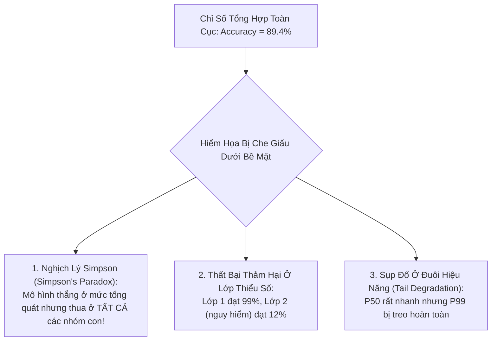

# Thẩm Định Mô Hình & Tính Hợp Lệ Của Benchmark
# Model Evaluation & Benchmark Validity

---

## 1. Nguyên Lý Nền Tảng (Fundamentals)

### 1.1. Bản Chất Của Việc Đánh Giá Mô Hình
Đánh giá mô hình học máy không đơn thuần là việc tính toán một điểm số trung bình trên một tập kiểm thử. Đó là **quá trình đo lường định lượng mức độ tiệm cận của mô hình đối với năng lực trí tuệ mà nó được kỳ vọng sẽ thể hiện**.

Một quy trình đánh giá chuẩn mực đòi hỏi:
1. **Tính khớp nối khái niệm (Construct Validity):** Thước đo toán học (Metric) phải phản ánh đúng phẩm chất nghiệp vụ/khoa học thực tế. Nếu thước đo không khớp với mục tiêu, việc tối ưu hóa điểm số sẽ biến thành trò chơi số liệu vô bổ.
2. **Khả năng khái quát hóa độc lập (Out-of-Distribution Robustness):** Mô hình phải được kiểm tra trên các phân phối dữ liệu đa dạng, không chỉ bó hẹp trong một benchmark tĩnh quen thuộc.
3. **Lượng hóa sự bất định (Uncertainty Quantification):** Mọi con số hiệu năng đều phải đi kèm với khoảng tin cậy (Confidence Intervals) để phản ánh phương sai thống kê.

---

## 2. Lựa Chọn & Diễn Giải Thước Đo (Metric Selection & Interpretation)

Không có một thước đo nào là hoàn hảo cho mọi bài toán. Việc chọn sai thước đo sẽ dẫn đến những kết luận sai lệch nghiêm trọng:

| Bài Toán AI | Thước Đo Khuyên Dùng | Thước Đo Cần Cảnh Giác | Lý Do Bản Thể Học |
|---|---|---|---|
| **Phân loại mất cân bằng lớp** | **PR-AUC, Macro-F1** | Accuracy, ROC-AUC | Accuracy bị bóp méo bởi lớp đa số; ROC-AUC quá lạc quan khi tỷ lệ âm tính thực tế (True Negatives) khổng lồ. |
| **Xếp hạng & Tìm kiếm (Retrieval)** | **nDCG@K, MRR** | Precision@K | nDCG tính đến vị trí của tài liệu liên quan (tài liệu đúng ở vị trí #1 có giá trị hơn ở vị trí #10). |
| **Tóm tắt văn bản / Dịch máy** | **Human Eval, BERTScore** | BLEU, ROUGE | BLEU/ROUGE chỉ đếm n-gram trùng lặp bề mặt, hoàn toàn bỏ qua tính đúng đắn ngữ nghĩa (Factuality) và có thể bị đánh lừa dễ dàng. |
| **Mô hình Ngôn ngữ Lớn (LLMs)** | **Task-specific Accuracy, Calibrated Log-Likelihood** | Raw Perplexity | Perplexity thấp chỉ cho thấy mô hình dự đoán từ tiếp theo tốt trên tập văn bản đó, không đồng nghĩa với khả năng suy luận logic hay giải toán. |

### Phân Biệt Macro-Average vs Micro-Average:
- **Macro-Average:** Tính metric độc lập cho từng lớp rồi lấy trung bình cộng. Cho trọng số bình đẳng cho mọi lớp, bảo vệ quyền lợi của các lớp thiểu số.
- **Micro-Average:** Gộp chung tất cả các dự đoán của toàn bộ các lớp lại rồi mới tính metric. Thước đo này bị chi phối hoàn toàn bởi lớp chiếm đa số mẫu.

---

## 3. Cạm Bẫy Của Các Chỉ Số Tổng Hợp (The Limitations of Aggregate Metrics)

Sai lầm phổ biến nhất trong báo cáo nghiên cứu AI là chỉ đưa ra một con số trung bình toàn cục (ví dụ: *"Độ chính xác đạt 89.4%"*).



### Nghịch Lý Simpson (Simpson's Paradox) Trong Học Máy
Hiện tượng kỳ lạ xảy ra khi một xu hướng xuất hiện trong các nhóm dữ liệu khác nhau nhưng lại biến mất hoặc đảo ngược hoàn toàn khi các nhóm này được gộp chung lại.
- Mô hình A có vẻ có Accuracy cao hơn Mô hình B trên toàn bộ tập dữ liệu.
- Tuy nhiên, khi bóc tách theo từng lát cắt (Slice-based evaluation: ví dụ theo độ phân giải ảnh cao/thấp hoặc theo ngôn ngữ), Mô hình B lại chiến thắng Mô hình A ở **từng lát cắt riêng lẻ**! Nguyên nhân là do phân phối số lượng mẫu giữa các nhóm con không đồng đều.
- **Bài học:** Bắt buộc phải thực hiện **Đánh giá theo lát cắt (Slice-based Evaluation)** trên các nhóm dữ liệu nhạy cảm thay vì chỉ nhìn vào điểm tổng hợp.

---

## 4. Tính Hợp Lệ Của Benchmark & Hiện Tượng Học Đường Tắt (Shortcut Learning)

### 4.1. Định Luật Goodhart Trong Các Bộ Benchmark AI
> *"Khi một chỉ số trở thành mục tiêu, nó không còn là một chỉ số tốt nữa."*

Khi một bộ benchmark (như ImageNet, SQuAD, GLUE, MMLU) trở thành tiêu chuẩn vàng để cạnh tranh công bố bài báo, cộng đồng nghiên cứu bắt đầu vô thức (hoặc cố ý) tối ưu hóa mô hình để "giải quyết bộ benchmark" thay vì "giải quyết bài toán thực tế". Hiện tượng này gọi là **Benchmark Saturation (Bão hòa Benchmark)**.

### 4.2. Hiệu Ứng Con Ngựa Thông Minh Hans (The Clever Hans Effect / Shortcut Learning)
Con ngựa Hans nổi tiếng vào thế kỷ 20 được cho là biết làm toán số học. Thực chất, nó không hề biết tính toán mà chỉ quan sát biểu cảm khuôn mặt căng thẳng của người hỏi và gõ móng chân cho đến khi người hỏi thở phào nhẹ nhõm.
- Trong AI, các mô hình Deep Learning là những cỗ máy khai thác đường tắt siêu việt:
  - Một mô hình phân loại nhận diện "Chó sói" với độ chính xác 98% chỉ vì trong tập dữ liệu, mọi con sói đều đứng trên **nền tuyết trắng**, trong khi chó nhà đứng trên nền cỏ! Khi đưa ảnh con sói đứng trên đồng cỏ, mô hình đoán ngay là chó nhà.
  - Một mô hình VLM trả lời câu hỏi đọc hiểu biểu đồ đạt điểm cao chỉ vì nó nhận diện được màu sắc của font chữ thay vì đọc số liệu.
- **Cách phòng chống:** Thiết kế các bài kiểm thử đối kháng (Adversarial Stress-Testing) và bài kiểm thử hoán vị (Counterfactual Evaluation) để bóc trần hiện tượng học đường tắt.

---

## 5. Lượng Hóa Độ Bất Định Bằng Bootstrap Sampling (Uncertainty Quantification)

Trong nghiên cứu khoa học, một tuyên bố: *"Mô hình của chúng tôi đạt 84.2%, vượt trội hơn Baseline đạt 83.7%"* là **hoàn toàn vô căn cứ** nếu không có phân tích phương sai.

### Quy Trình Lấy Mẫu Lại Bootstrap (Bootstrap Resampling Protocol):
```python
def compute_bootstrap_confidence_interval(y_true, y_pred, n_bootstraps=1000, alpha=0.05):
    bootstrapped_scores = []
    n_samples = len(y_true)
    for _ in range(n_bootstraps):
        # Lấy mẫu ngẫu nhiên có hoàn lại
        indices = np.random.choice(n_samples, size=n_samples, replace=True)
        score = metric_fn(y_true[indices], y_pred[indices])
        bootstrapped_scores.append(score)

    # Tính khoảng tin cậy 95%
    lower_bound = np.percentile(bootstrapped_scores, 100 * (alpha / 2))
    upper_bound = np.percentile(bootstrapped_scores, 100 * (1 - alpha / 2))
    return lower_bound, upper_bound
```

Nếu khoảng tin cậy của mô hình đề xuất và baseline bị chồng lấn (Overlapping CIs), bài báo **bắt buộc phải thừa nhận** rằng sự khác biệt chưa đủ ý nghĩa thống kê ở mức tin cậy $95\%$.

---

## 6. Sai Lầm Thường Gặp & Anti-Patterns (Common Mistakes)

1. **Báo cáo điểm số đơn lẻ không có độ lệch chuẩn (Point Estimates Without Variance):** Bảng kết quả chỉ có duy nhất một con số trần trụi, không có $\pm \sigma$ và không có thông tin về số lần chạy lặp lại.
2. **Thay đổi Prompt bí mật để tăng điểm (Prompt Hacking in Evaluation):** Khi đánh giá LLM, tác giả âm thầm tinh chỉnh prompt thật dài và chi tiết cho mô hình của mình nhưng dùng prompt ngắn cũn cỡn cho mô hình đối thủ.
3. **Thẩm định bằng LLM không chuẩn mực (Uncalibrated LLM-as-a-Judge):** Dùng một LLM (như GPT-4) để chấm điểm bài viết của các mô hình khác nhưng không kiểm tra thiên vị tự nhiên của LLM: Thiên vị câu trả lời dài (Verbosity bias), thiên vị câu trả lời đứng trước (Position bias), và thiên vị câu trả lời do chính nó sinh ra (Self-enhancement bias).
4. **Bỏ qua bài kiểm tra tính cân bằng ngẫu nhiên (Chance-Level Neglect):** Không kiểm tra xem một thuật toán đoán mò ngẫu nhiên (Random guess) hoặc đoán nhãn phổ biến nhất (Majority class baseline) sẽ đạt bao nhiêu điểm trên tập test.

---

## 7. Đánh Giá Đánh Đổi (Trade-off Analysis)

### Bảng Đánh Đổi: Đánh Giá Trên Benchmark Tĩnh vs Đánh Giá Đối Kháng Động

| Phương Pháp | Benchmark Tĩnh Tiêu Chuẩn (Static Benchmarks) | Đánh Giá Đối Kháng Động (Dynamic Adversarial Testing) |
|---|---|---|
| **Khả năng so sánh lịch sử** | Tuyệt đối — có thể đối chiếu trực tiếp với bài báo từ 5 năm trước | Thấp — bộ dữ liệu thay đổi liên tục khiến khó so sánh ngang hàng |
| **Chi phí vận hành** | Rất rẻ, chỉ cần tải tập dữ liệu về và chạy script đánh giá | Rất cao, đòi hỏi con người hoặc AI sinh ra các ca kiểm thử mới liên tục |
| **Khả năng chống học vẹt** | Rất kém — benchmark nhanh chóng bị bão hòa và rò rỉ vào pre-training | Cực kỳ cao — bộc lộ chính xác giới hạn thực sự của mô hình |
| **Khuyến nghị phối hợp** | Báo cáo trên Static Benchmarks để đáp ứng chuẩn mực học thuật; **bắt buộc bổ sung Adversarial Stress-test** để chứng minh tính vững chắc khoa học |
