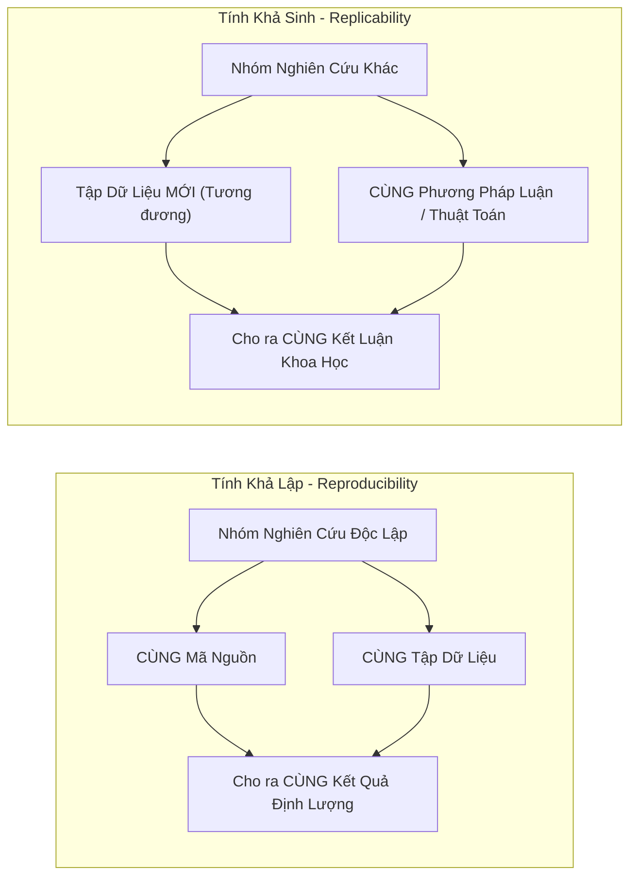
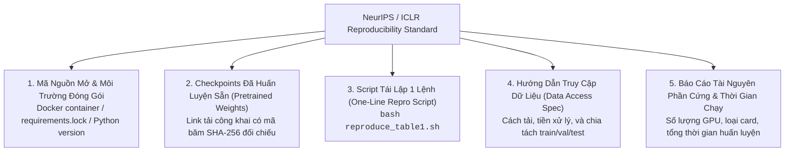

# Tính Khả Lập, Khả Sinh & Phả Hệ Thực Nghiệm
# Scientific Reproducibility, Replicability & Provenance

---

## 1. Nguyên Lý Nền Tảng (Fundamentals)

### 1.1. Phân Biệt Tuyệt Đối: Tính Khả Lập (Reproducibility) vs Tính Khả Sinh (Replicability)
Hiệp hội Máy tính Quốc tế (ACM) và Viện Hàn lâm Khoa học Quốc gia Hoa Kỳ đã chuẩn hóa sự phân biệt giữa hai thuật ngữ này:



- **Reproducibility (Tính Khả Lập):** Một người thứ ba sử dụng **chính xác cùng bộ dữ liệu và cùng đoạn code** của tác giả thì phải chạy ra **đúng các con số** được công bố trong bài báo. Đây là yêu cầu tối thiểu về tính trung thực và kỹ thuật.
- **Replicability (Tính Khả Sinh):** Một nhóm nghiên cứu hoàn toàn độc lập, tự viết lại code từ đầu theo mô tả trong bài báo và thu thập một tập dữ liệu tương tự, vẫn quan sát được **cùng một hiện tượng khoa học và cùng một kết luận**. Đây là tiêu chuẩn vàng của chân lý khoa học.

### 1.2. Phả Hệ Kết Quả Nghiên Cứu (Result Provenance)
Mọi con số xuất hiện trong bài báo khoa học (ví dụ: *"Bảng 2, hàng 4: 84.7%"*) phải có một **dây chuyền phả hệ không thể chối cãi (Unbroken Provenance Chain)** dẫn ngược về:
1. File log thực nghiệm cụ thể nào?
2. File checkpoint nhị phân nào trên ổ đĩa?
3. Commit Git SHA chính xác nào của mã nguồn?
4. Mã băm SHA-256 của tập dữ liệu kiểm thử nào?
Nếu tác giả không thể chỉ ra con số đó sinh ra từ file log nào, con số đó bị coi là **không có nguồn gốc hợp lệ**.

---

## 2. Kiểm Soát Các Nguồn Bất Tất Định Trong GPU Computing (Nondeterminism)

Nhiều kỹ sư nhầm tưởng rằng chỉ cần gọi `seed_everything(42)` là mã nguồn PyTorch sẽ chạy ra kết quả giống hệt nhau $100\%$. Trong thực tế, các kiến trúc GPU hiện đại chứa nhiều nguồn bất tất định phần cứng:

### 2.1. Phép Cộng Nguyên Tử Bất Tất Định (Atomic Add Non-determinism)
Trong lan truyền ngược (Backward pass) của các phép toán như `torch.bmm`, `index_add_`, hoặc Scatter operations:
- Hàng ngàn CUDA threads tính toán gradient đồng thời và cùng ghi kết quả vào cùng một vị trí bộ nhớ thông qua lệnh `atomicAdd`.
- Thứ tự mà các thread chạm vào bộ nhớ là **hoàn toàn ngẫu nhiên** tùy thuộc vào nhiệt độ chip, xung nhịp vi xử lý và lịch trình phần cứng.
- Vì phép cộng số thực dấu phẩy động (Floating-Point Addition) **không có tính kết hợp**:
  $$(a + b) + c \neq a + (b + c)$$
  Sự thay đổi thứ tự cộng sẽ dẫn đến sai số ở các bit cuối (Least Significant Bits). Sau hàng triệu bước lan truyền, sai số này tích tụ và khiến hai lần chạy cùng một seed cho ra hai checkpoint hoàn toàn khác nhau!

### 2.2. Thiết Lập Môi Trường Tất Định Hoàn Toàn (Strict Determinism Configuration)
Trong PyTorch, bắt buộc phải kích hoạt cờ ép buộc thuật toán tất định:
```python
import os
import torch

# 1. Ép buộc thuật toán cuBLAS chạy tất định
os.environ["CUBLAS_WORKSPACE_CONFIG"] = ":4096:8"

# 2. Cấm PyTorch dùng các kernel không tất định
torch.use_deterministic_algorithms(True)

# 3. Tắt tối ưu hóa tìm kiếm kernel của cuDNN
torch.backends.cudnn.benchmark = False
torch.backends.cudnn.deterministic = True
```
> *Lưu ý đánh đổi:* Việc ép buộc tính tất định có thể làm giảm tốc độ huấn luyện từ 10% đến 25%, nhưng đây là cái giá bắt buộc phải trả khi thực hiện các thực nghiệm kiểm chứng khoa học then chốt.

---

## 3. Tiêu Chuẩn NeurIPS / ICLR Reproducibility Checklist

Để một bài báo AI được chấp thuận tại các hội nghị đỉnh cao, tác giả phải đáp ứng danh mục kiểm tra 5 thành phần:



---

## 4. Giới Hạn Của Khả Năng Tái Lập Phần Cứng (Hardware Architecture Dependence)

Một sự thật ít được biết đến trong Deep Learning: **Tính khả lập tuyệt đối không thể duy trì xuyên suốt các kiến trúc GPU khác nhau**.
- Chạy cùng một code, cùng seed 42 trên GPU **NVIDIA V100 (Volta)** và **NVIDIA A100 (Ampere)** hoặc **H100 (Hopper)** sẽ cho ra kết quả hơi khác nhau.
- Nguyên nhân: Các thế hệ GPU khác nhau sử dụng cấu trúc Tensor Core khác nhau, hỗ trợ kiểu làm tròn (Rounding modes) khác nhau và tích hợp tập lệnh Fused Multiply-Add (FMA) khác nhau.
- **Quy tắc công bố:** Luôn ghi rõ chính xác kiến trúc GPU đã sử dụng trong phần Experimental Setup (ví dụ: *"Toàn bộ thực nghiệm được thực hiện trên 4x NVIDIA A100-SXM4-80GB với CUDA 12.2"*).

---

## 5. Sai Lầm Thường Gặp & Anti-Patterns (Common Mistakes)

1. **Repo mã nguồn kiểu "Vườn hoang" (Code Dump Repo):** Đẩy lên GitHub một mớ code hỗn độn chưa dọn dẹp, chứa đường dẫn cứng tuyệt đối (`/home/user/my_desktop/data/`), không có tệp hướng dẫn `README.md`, và không thể chạy được.
2. **Khóa dữ liệu bí mật nhưng tuyên bố SOTA:** Đánh giá mô hình trên một tập dữ liệu nội bộ bí mật của công ty mà không ai bên ngoài có thể tiếp cận, sau đó tuyên bố phương pháp của mình đánh bại toàn bộ các nghiên cứu công khai trên thế giới.
3. **Quên ghim phiên bản thư viện (Floating Dependencies):** Tệp `requirements.txt` chỉ ghi tên thư viện chung chung (`torch`, `transformers`) mà không ghim phiên bản chính xác (`torch==2.4.0`). Sau 6 tháng, các thư viện cập nhật phiên bản mới làm gãy toàn bộ mã nguồn cũ.
4. **Không cung cấp Weights của mô hình:** Chỉ chia sẻ code mà không cung cấp checkpoint đã train. Người khác muốn kiểm chứng phải bỏ ra 10,000 USD tiền thuê GPU để train lại từ đầu.

---

## 6. Đánh Giá Đánh Đổi (Trade-off Analysis)

### Bảng Đánh Đổi: Đóng Gói Nghiên Cứu Chuẩn Mực vs Tốc Độ Ra Bài

| Khía Cạnh | Đóng Gói Tái Lập Hoàn Hảo (Docker + Seed + Clean Code) | Đẩy Code Nhanh Chiếu Lệ (Quick Code Dump) |
|---|---|---|
| **Thời gian đầu tư** | Tốn thêm 1–2 tuần chuẩn bị tệp tái lập, Docker, và tài liệu | Tiết kiệm được thời gian ngay trước deadline nộp bài |
| **Tỷ lệ bài báo được chấp thuận** | Rất cao — người phản biện (Reviewers) dễ dàng kiểm chứng và tin tưởng | Dễ bị từ chối thẳng thừng (Desk Reject) do nghi ngờ gian lận |
| **Tác động học thuật lâu dài (Citations)** | Rất lớn — cộng đồng dễ dàng kế thừa, chạy lại và trích dẫn | Rất thấp — không ai chạy được code nên họ sẽ bỏ qua bài báo |
| **Uy tín khoa học của tác giả** | Bền vững, được cộng đồng kính trọng | Bị hoen ố nếu bị cộng đồng phanh phui không thể tái lập |
