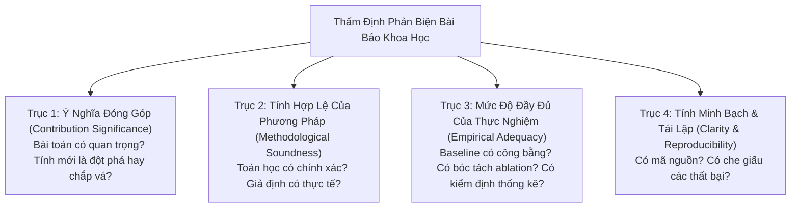

# Soạn Thảo Báo Cáo Khoa Học & Phản Biện Đồng Cấp
# Scientific Writing & Critical Peer Review

---

## 1. Nguyên Lý Nền Tảng (Fundamentals)

### 1.1. Bản Chất Của Bài Báo Khoa Học (The Nature of a Scientific Paper)
Một bài báo khoa học không phải là một cuốn nhật ký ghi lại mọi việc bạn đã làm trong phòng lab, cũng không phải là một bài quảng cáo tiếp thị sản phẩm (Marketing Pitch).

Một bài báo khoa học là **một luận điểm thuyết phục được xây dựng bằng lập luận logic chặt chẽ và được hậu thuẫn bằng bằng chứng thực nghiệm khách quan**. Mục đích tối thượng của nó là truyền đạt một tri thức mới cho cộng đồng khoa học theo cách mà người đọc có thể kiểm chứng, phản biện và kế thừa.

### 1.2. Nguyên Tắc Căn Chỉnh Tuyên Bố Với Bằng Chứng (Evidence-to-Claim Alignment)
Căn bệnh phổ biến nhất trong các bài báo AI bị từ chối là **Tuyên bố phóng đại (Overclaiming)**:
- *Tuyên bố vượt quá bằng chứng:* "Phương pháp của chúng tôi giải quyết toàn diện vấn đề suy luận trừu tượng của trí tuệ nhân tạo." (Trong khi thực tế tác giả chỉ thử nghiệm trên bài toán phân loại số viết tay MNIST!).
- *Tuyên bố được căn chỉnh chuẩn xác:* "Phương pháp của chúng tôi cải thiện độ chính xác phân loại đối tượng trong điều kiện thiếu sáng trên tập dữ liệu ảnh đô thị, với mức cải thiện trung bình 3.2% mAP so với 3 mô hình baseline cùng quy mô tham số."

---

## 2. Cấu Trúc Hùng Biện Của Bài Báo Khoa Học (Paper Structure & Rhetorical Flow)

Một bài báo chuẩn mực tại các hội nghị đỉnh cao (NeurIPS, ICLR, ACL) tuân thủ cấu trúc hình đồng hồ cát (Hourglass Structure): Bắt đầu từ bối cảnh rộng lớn, thu hẹp vào chi tiết kỹ thuật cụ thể, và mở rộng ra tác động tổng thể:

```mermaid
graph TD
    subgraph Hourglass_Structure [Cấu Trúc Hùng Biện Hình Đồng Hồ Cát]
        Title["1. Tiêu Đề & Tóm Tắt (Title & Abstract)<br/><i>Móc câu, vấn đề, phương pháp, kết quả số định lượng, ý nghĩa</i>"]
        Intro["2. Giới Thiệu (Introduction)<br/><i>Bối cảnh rộng -> Khoảng trống -> Câu hỏi -> Đóng góp cụ thể</i>"]
        RelWork["3. Công Trình Liên Quan (Related Work)<br/><i>Lập bản đồ y văn có cấu trúc, chỉ rõ ranh giới</i>"]
        Method["4. Phương Pháp Luận (Methodology)<br/><i>Công thức toán học, trực giác, inductive biases</i>"]
        Exp["5. Thiết Kế Thực Nghiệm (Experimental Setup)<br/><i>Datasets, Baselines công bằng, Metrics, Hyperparameters</i>"]
        Res["6. Kết Quả & Thảo Luận (Results & Discussion)<br/><i>Bảng chính, kiểm định thống kê, phân tích bóc tách</i>"]
        Lim["7. Giới Hạn & Đạo Đức (Limitations)<br/><i>Thành thật thừa nhận điểm yếu và điều kiện biên</i>"]
        Conc["8. Kết Luận (Conclusion)<br/><i>Tóm lược tri thức mới và định hướng tương lai</i>"]
    end

    Title --> Intro
    Intro --> RelWork
    RelWork --> Method
    Method --> Exp
    Exp --> Res
    Res --> Lim
    Lim --> Conc
```



### Các Yêu Cầu Cốt Tử Của Từng Phần:
1. **Abstract (Tóm tắt - 150 đến 250 từ):** Phải chứa đủ 5 câu: (1) Bối cảnh rộng; (2) Vấn đề cốt lõi và tại sao các phương pháp cũ thất bại; (3) Ý tưởng mới đề xuất; (4) Kết quả định lượng then chốt trên benchmark chuẩn; (5) Tác động hoặc bài học rút ra.
2. **Introduction (Giới thiệu):** Kết thúc phần Introduction **bắt buộc phải có danh sách đóng góp tường minh (List of Contributions)** gồm 3 đến 4 gạch đầu dòng rõ ràng, không mập mờ.
3. **Limitations (Giới hạn nghiên cứu):** Một bài báo không có mục Limitations sẽ bị các reviewer trừ điểm nặng nề. Phần này chứng minh sự chín chắn học thuật của tác giả khi tự mình chỉ ra các điều kiện mà mô hình sẽ thất bại.

---

## 3. Quy Trình Phản Biện Đồng Cấp Phê Phán (Critical Peer Review Protocol)

Khi đóng vai trò là Người Phản Biện (Reviewer), kỹ sư hoặc AI Agent không tìm cách "bới lông tìm vết" tiểu tiết, mà phải đánh giá bài báo dọc theo **4 trục chất lượng nền tảng**:



### Tiêu Chuẩn Phân Loại Khiếm Khuyết:
- **Lỗi chí mạng (Fatal Flaws - Dẫn đến Reject ngay lập tức):** Rò rỉ dữ liệu (Data Leakage); Baseline cố tình chọn loại quá yếu hoặc không tune; Tuyên bố vượt quá bằng chứng nhưng từ chối thu hẹp kết luận; Bằng chứng toán học bị sai tiền đề.
- **Lỗi nhỏ có thể khắc phục (Minor Issues - Yêu cầu sửa đổi):** Thiếu một số trích dẫn công trình liên quan gần đây; Thiếu chi tiết về phiên bản GPU; Đồ thị biểu đồ thiếu nhãn trục tọa độ rõ ràng.

---

## 4. Kỹ Thuật Viết Nhận Xét Phản Biện Mang Tính Xây Dựng (Constructive Criticism)

Một nhận xét phản biện xuất sắc phải sắc bén về mặt kỹ thuật nhưng văn minh và mang tính xây dựng:

```
┌────────────────────────────────────────────────────────────────────────┐
│ MẪU CẤU TRÚC BẢN PHẢN BIỆN CHUẨN MỰC (Review Structure)                │
│                                                                        │
│ 1. Tóm Tắt Bài Báo (Summary of the Paper):                             │
│    Mô tả lại bài toán, phương pháp và kết quả theo cách hiểu của       │
│    reviewer để tác giả biết mình đã được lắng nghe đúng hay chưa.      │
│                                                                        │
│ 2. Điểm Mạnh (Strengths):                                              │
│    Ghi nhận trung thực các đóng góp tốt: Ý tưởng mới lạ, thực nghiệm   │
│    quy mô lớn, mã nguồn mở sạch sẽ, bài viết mạch lạc.                 │
│                                                                        │
│ 3. Điểm Yếu Cốt Tử (Weaknesses / Key Concerns):                        │
│    Chỉ rõ bằng chứng cụ thể: "Tại Bảng 2, tác giả so sánh với ResNet   │
│    nhưng dùng learning rate 1e-1 khiến baseline không hội tụ. Bằng     │
│    chứng từ Wightman et al. (2021) cho thấy..."                        │
│                                                                        │
│ 4. Câu Hỏi & Đề Xuất Cụ Thể (Questions & Actionable Suggestions):     │
│    Đặt các câu hỏi kỹ thuật mà tác giả cần làm rõ trong giai đoạn      │
│    Rebuttal: "Tác giả có thể bổ sung kết quả chạy trên Seed 42 & 1337  │
│    vào Bảng 1 được không?"                                             │
└────────────────────────────────────────────────────────────────────────┘
```

---

## 5. Sai Lầm Thường Gặp & Anti-Patterns (Common Mistakes)

1. **Phản biện cảm tính, thiếu bằng chứng (Vague Unsubstantiated Reviews):** Viết nhận xét cộc lốc: *"Bài báo này thiếu tính mới và thực nghiệm quá yếu"* mà không chỉ ra bài báo nào đi trước đã làm điều đó hoặc thực nghiệm yếu ở khía cạnh cụ thể nào.
2. **Dùng từ ngữ khoa trương, giật gân (Sensationalist Writing):** Sử dụng các từ ngữ mang tính tiếp thị như *"Cách mạng hóa"*, *"Kỳ tích chưa từng thấy"*, *"Đột phá vĩ đại"* trong một bài báo khoa học kỹ thuật.
3. **Biến phần Related Work thành danh sách giặt ủi (Laundry List):** Viết liệt kê từng bài báo một cách rời rạc mà không có sự đối chiếu, phân loại theo trường phái giải pháp.
4. **Tranh cãi mang tính cá nhân trong Rebuttal:** Khi nhận xét của reviewer chỉ trích bài báo, tác giả phản ứng gay gắt, xúc phạm trình độ của reviewer thay vì tập trung trả lời bằng số liệu thực nghiệm bổ sung.

---

## 6. Đánh Giá Đánh Đổi (Trade-off Analysis)

### Bảng Đánh Đổi: Nộp Bài Sớm (Fast Submission) vs Hoàn Thiện Thấu Đáo (Polished Submission)

| Tiêu Chí | Nộp Bài Vội Vã (Rushed Deadline) | Chuẩn Bị Kỹ Lưỡng (Polished & Verified) |
|---|---|---|
| **Tình trạng mã nguồn** | Code chưa kịp dọn, chưa có script tái lập | Có link GitHub sạch, Docker và 1-line script chạy lại |
| **Độ phủ của thực nghiệm** | Chỉ có 1 hạt giống, thiếu bảng Ablation | Đầy đủ 5 hạt giống, có khoảng tin cậy và bóc tách sâu |
| **Xác suất được chấp thuận** | Rất thấp (dưới 15%), dễ bị Reject ngay vòng 1 | Rất cao (trên 60%), reviewer đánh giá cao sự trung thực |
| **Chi phí thời gian tổng thể** | Tốn thêm 6 tháng do bị Reject và phải nộp lại hội nghị khác | Tiết kiệm 6 tháng vì được Accept ngay lần đầu |
| **Khuyến nghị vận hành** | **Tuyệt đối không nộp bài khi chưa có Ablation và Reproducibility script!** |
