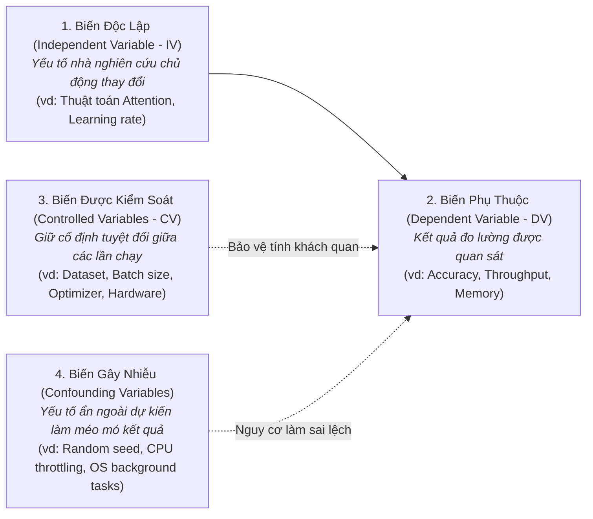
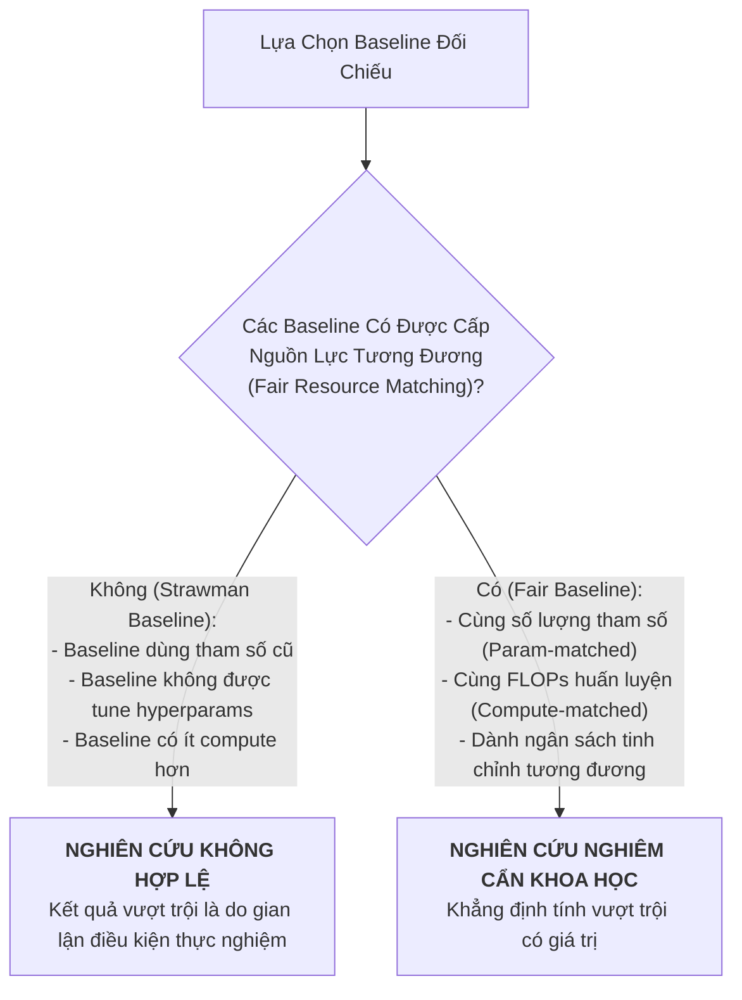

# Thiết Lập Giả Thuyết Khả Bác & Phương Pháp Luận Thực Nghiệm
# Falsifiable Hypothesis Development & Experimental Methodology

---

## 1. Nguyên Lý Nền Tảng (Fundamentals)

### 1.1. Tiêu Chuẩn Khả Bác Của Karl Popper Trong Nghiên Cứu AI
Trong triết học khoa học, một lý thuyết chỉ được coi là **khoa học** khi và chỉ khi nó có **tính khả bác (Falsifiability)** — nghĩa là phải tồn tại ít nhất một quan sát thực nghiệm khả dĩ có khả năng chứng minh lý thuyết đó là sai.

Trong nghiên cứu AI/ML hiện đại, nhiều "giả thuyết" bị biến thành những phát biểu ngụy biện hoặc luôn đúng (Tautologies):
- *Phát biểu phi khoa học:* "Mạng nơ-ron sâu hơn với cơ chế của chúng tôi sẽ học được các đặc trưng tốt hơn." (Không thể bác bỏ vì từ "tốt hơn" không có định nghĩa cụ thể, và tác giả luôn có thể đổ lỗi cho việc chưa train đủ số epochs).
- *Giả thuyết khoa học chuẩn mực:* "Nếu thay thế cơ chế Full Attention bằng Sparse Block Attention với kích thước khối $B=64$, thì mức tiêu thụ VRAM đỉnh khi xử lý chuỗi 16k tokens sẽ giảm ít nhất 40% trong khi điểm Perplexity trên tập Wikitext-103 không suy giảm quá 0.5 điểm so với Full Attention baseline." (Có thể bị bác bỏ dứt khoát nếu VRAM chỉ giảm 20% hoặc Perplexity tăng 1.2 điểm).

### 1.2. Phân Cặp Giả Thuyết Không ($H_0$) và Giả Thuyết Đối ($H_1$)
Mọi thiết kế thực nghiệm đều phải bắt đầu từ việc xác lập rõ hai giả thuyết đối lập:
- **Giả thuyết Không (Null Hypothesis - $H_0$):** Can thiệp kỹ thuật mới (thuật toán mới, hàm loss mới) **không tạo ra sự khác biệt có ý nghĩa thống kê** so với mô hình cơ sở hiện có, mọi cải thiện quan sát được chỉ là do nhiễu ngẫu nhiên hoặc may mắn hạt giống (seed luck).
- **Giả thuyết Đối (Alternative Hypothesis - $H_1$):** Can thiệp kỹ thuật mới tạo ra sự thay đổi thực chất theo hướng dự đoán, và xác suất xảy ra do ngẫu nhiên là cực kỳ thấp ($p < 0.05$ qua kiểm định thống kê).
- *Nguyên tắc đạo đức:* Nhà nghiên cứu không "cố gắng chứng minh mình đúng", mà đóng vai trò là quan tòa khách quan tìm mọi cách để xem liệu dữ liệu thực nghiệm có đủ sức mạnh để **bác bỏ giả thuyết không ($H_0$)** hay không.

---

## 2. Bóc Tách Các Biến Số Thực Nghiệm (Experimental Variables)

Một thực nghiệm khoa học đáng tin cậy phải phân lập rõ ràng 4 loại biến số:

### Cách Kiểm Soát Biến Gây Nhiễu (Confounding Variables):
1. **Kiểm soát Hạt giống Ngẫu nhiên (Seed Averaging):** Không bao giờ báo cáo kết quả của một lần chạy duy nhất. Luôn chạy thực nghiệm trên ít nhất 3 đến 5 hạt giống ngẫu nhiên khác nhau (`seed = [42, 1337, 2026, ...]`) và báo cáo cả **giá trị trung bình cùng độ lệch chuẩn (Mean $\pm$ Std)**.
2. **Cố định môi trường phần cứng và thư viện:** Chạy cả baseline và mô hình đề xuất trên cùng một máy chủ GPU vật lý, cùng phiên bản CUDA và PyTorch để loại trừ sai số do driver hoặc tối ưu hóa biên dịch của hệ điều hành.

---

## 3. Quy Tắc Baseline Công Bằng (The Fair Baseline Rule)

Sai lầm lớn nhất và cũng là thủ thuật ngụy biện phổ biến nhất trong các bài báo AI kém chất lượng là sử dụng **Mô hình cơ sở bù nhìn (Strawman Baselines)**:

### Các Tiêu Chí Đối Chiếu Baseline Chuẩn Mực:
1. **Khớp tham số (Parameter-matched Baselines):** Nếu mô hình đề xuất có 100M tham số do thêm các tầng mới, mô hình baseline cũng phải được mở rộng lên 100M tham số (bằng cách tăng hidden dimension hoặc số layers) để chứng minh rằng cải tiến đến từ **cơ chế kiến trúc mới** chứ không phải đơn thuần do mô hình có dung lượng biểu diễn lớn hơn.
2. **Khớp ngân sách tính toán (FLOPs-matched / Compute-matched):** Cả hai phương pháp phải được huấn luyện trên cùng một ngân sách GPU-giờ hoặc cùng số lượng tokens nhìn thấy.
3. **Ngân sách tinh chỉnh công bằng (Tuning Budget Fairness):** Phải dành cùng một số lượng bước tìm kiếm Grid Search hoặc Random Search cho siêu tham số của baseline tương đương như mô hình đề xuất. Nhiều bài báo "đánh bại" baseline chỉ vì tác giả dùng siêu tham số mặc định của thư viện cho baseline trong khi dày công tune mô hình của mình suốt 3 tháng.

---

## 4. Bốn Trụ Cột Mối Đe Dọa Đối Với Tính Hợp Lệ (Threats to Validity)

Mọi báo cáo nghiên cứu AI nghiêm túc đều phải tự phản biện 4 mối đe dọa đối với tính hợp lệ của kết quả:

### 4.1. Tính Hợp Lệ Nội Tại (Internal Validity)
- **Câu hỏi:** *Liệu sự cải thiện hiệu năng có thực sự bắt nguồn từ thuật toán mới, hay do rò rỉ dữ liệu hoặc lỗi cài đặt?*
- **Rủi ro lớn nhất:** **Data Contamination (Rò rỉ dữ liệu)** — Các mẫu trong tập kiểm thử (Test set) đã vô tình xuất hiện trong tập huấn luyện (Train set) do quy trình tiền xử lý dữ liệu bị lỗi, khiến mô hình đạt điểm cao nhờ học vẹt chứ không phải do khả năng khái quát hóa.

### 4.2. Tính Hợp Lệ Bên Ngoài (External Validity / Generalizability)
- **Câu hỏi:** *Kết quả này có còn đúng khi áp dụng sang miền dữ liệu khác, ngôn ngữ khác hoặc phân phối thực tế không?*
- **Rủi ro lớn nhất:** **Overfitting vào Benchmark** — Mô hình chỉ chạy tốt trên tập dữ liệu chuẩn hóa của học thuật (ví dụ: ImageNet hoặc GLUE), nhưng khi đưa vào dữ liệu thực tế ngoài đời thực (ảnh rung lắc, văn bản chứa tiếng lóng) thì hiệu năng sụt giảm nghiêm trọng (Distribution Shift).

### 4.3. Tính Hợp Lệ Khái Niệm (Construct Validity)
- **Câu hỏi:** *Chỉ số đo lường (Metric) có thực sự đại diện cho năng lực trí tuệ mà chúng ta đang tuyên bố hay không?*
- **Rủi ro lớn nhất:** **Goodhart's Law ("Khi một thước đo trở thành mục tiêu, nó không còn là một thước đo tốt")** — Tối ưu hóa điểm số ROUGE/BLEU trong tóm tắt văn bản bằng cách lặp lại từ khóa khiến điểm tự động rất cao, nhưng khi con người đọc thì văn bản hoàn toàn lủng củng và vô nghĩa.

### 4.4. Tính Hợp Lệ Kết Luận Thống Kê (Statistical Conclusion Validity)
- **Câu hỏi:** *Sự khác biệt giữa hai mô hình có đủ ý nghĩa thống kê hay chỉ là ngẫu nhiên?*
- **Quy tắc:** Bắt buộc phải thực hiện các kiểm định ý nghĩa thống kê (Student's t-test, Wilcoxon signed-rank test, hoặc Bootstrap confidence intervals). Nếu khoảng tin cậy 95% của mô hình đề xuất và baseline bị chồng lấn lên nhau (Overlapping confidence intervals), ta **không được phép tuyên bố** phương pháp mới vượt trội hơn.

---

## 5. Sai Lầm Thường Gặp & Anti-Patterns (Common Mistakes)

1. **HARKing (Hypothesizing After the Results are Known):** Chạy thực nghiệm lung tung không có kế hoạch, tình cờ thấy một biến số ngẫu nhiên cho kết quả cao, sau đó viết báo cáo quay ngược lại vẽ ra một "giả thuyết" như thể mình đã đoán trước từ đầu.
2. **Khai thác dữ liệu quá đà (p-hacking / Cherry-picking):** Chạy 20 hạt giống ngẫu nhiên, chỉ chọn báo cáo hạt giống duy nhất có điểm cao nhất và giấu đi 19 hạt giống bị thất bại.
3. **Giả định ngầm định không được kiểm tra (Unstated Inductive Biases):** Giả định rằng dữ liệu ngoài đời thực luôn có phân phối Gauss hoặc luôn có quan hệ tuyến tính mà không kiểm tra thực tế.
4. **Nghiên cứu thiếu Ablation (No Ablation Study):** Đề xuất một hệ thống gồm 4 kỹ thuật mới kết hợp lại với nhau và thấy điểm tăng, nhưng không làm thí nghiệm bóc tách từng kỹ thuật một để xem liệu có kỹ thuật nào thực chất đang kéo lùi hệ thống hay không.

---

## 6. Đánh Giá Đánh Đổi (Trade-off Analysis)

### Bảng Đánh Đổi: Đánh Giá Tự Động Rẻ Tiền vs Đánh Giá Con Người Tốn Kém

| Khía Cạnh Đánh Đổi | Metrics Tự Động (BLEU, ROUGE, Accuracy, Perplexity) | Đánh Giá Của Chuyên Gia Con Người (Human Evaluation) |
|---|---|---|
| **Chi phí & Tốc độ** | Cực rẻ, tính toán trong vài giây trên GPU | Cực kỳ tốn kém, mất nhiều ngày hoặc nhiều tuần |
| **Tính tái lập (Reproducibility)** | Tuyệt đối (100% deterministic nếu code chuẩn) | Tương đối (dao động giữa các nhóm người chấm, mệt mỏi) |
| **Độ chân thực ngữ nghĩa (Construct Validity)** | Thấp — dễ bị đánh lừa bởi thủ thuật bề mặt | Rất cao — phản ánh chính xác trải nghiệm và nhận thức thực tế |
| **Khuyến nghị phối hợp** | Sử dụng metrics tự động trong chu trình lặp thử nghiệm hàng ngày; bắt buộc phải có Human Evaluation mù đôi (Double-Blind) ở báo cáo cuối cùng |

---

## 7. Tình Huống Thực Tế: Thiết Kế Thực Nghiệm Kiểm Chứng Cơ Chế Chú Ý Không Gian

Quay trở lại bài toán Rendez (tìm kiếm ảnh quán cafe theo bầu không khí):
- **Giả thuyết khoa học:** *Việc đưa vector nhúng thời gian chụp ($t$) vào tầng Cross-Attention của VLM sẽ cải thiện độ chính xác xếp hạng truy xuất nDCG@10 thêm ít nhất 10% trên các truy vấn liên quan đến ánh sáng tự nhiên.*
- **Thiết kế biến số:**
  - *Biến độc lập (IV):* Cơ chế tiếp nhận thời gian (Baseline: Không có thời gian vs Phương án 1: Nối vector ở tầng cuối vs Phương án 2: Tích hợp trực tiếp vào Cross-Attention keys/values).
  - *Biến phụ thuộc (DV):* nDCG@10, Mean Reciprocal Rank (MRR), và độ trễ suy luận (Inference Latency P95 tính bằng ms).
  - *Biến kiểm soát (CV):* Cố định kiến trúc backbone (ViT-B/16), cùng tập dữ liệu 50,000 ảnh Đà Nẵng, cùng optimizer AdamW với learning rate $10^{-4}$.
- **Kiểm soát tính hợp lệ (Threats to Validity Control):**
  - *Chống Leakage:* Chia tập train/val/test theo **Địa điểm (Place-level split)**, tuyệt đối không chia theo ảnh để tránh việc ảnh của cùng một quán cafe xuất hiện ở cả hai tập.
  - *Kiểm định thống kê:* Chạy 5 seeds ngẫu nhiên, thực hiện kiểm định t-test cặp đôi (Paired t-test) để khẳng định giá trị $p < 0.01$.
