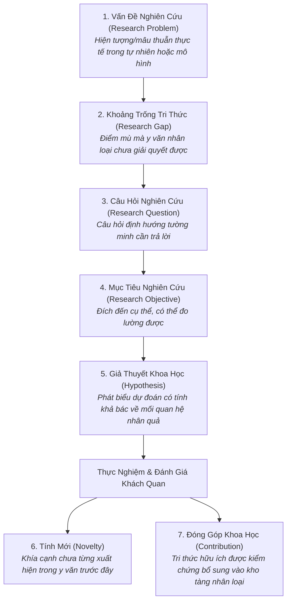
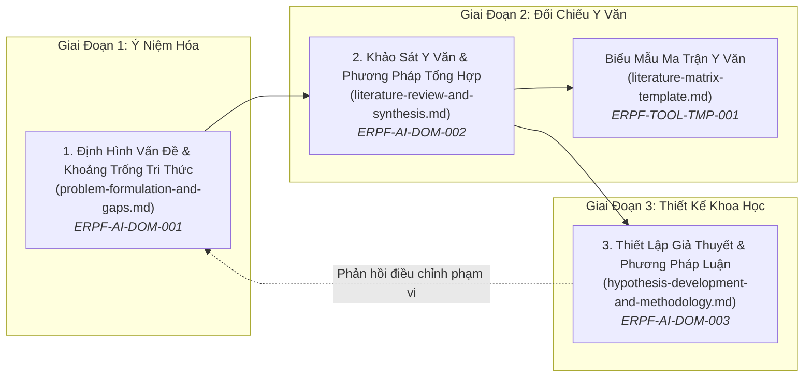

# Miền Tri Thức: Định Hình Nghiên Cứu AI & Lập Luận Khoa Học
# AI Research Formulation & Scientific Reasoning

---

## 1. Tầm Nhìn & Bản Chất Của Nghiên Cứu AI Thực Chứng (Domain Vision & Epistemology)

Miền tri thức **Định Hình Nghiên Cứu AI & Lập Luận Khoa Học (AI Research Formulation & Scientific Reasoning)** là nền tảng đầu tiên trong Nhánh Nghiên Cứu Trí Tuệ Nhân Tạo (AI Research Track) của ERPF.

Trong bối cảnh làn sóng AI hiện đại phát triển với tốc độ vũ bão, lĩnh vực này đang phải đối mặt với một cuộc khủng hoảng nghiêm trọng về **tính nghiêm cẩn khoa học (Scientific Rigor)**:
- Sự bùng nổ của các bài báo vội vã đưa ra những tuyên bố tính mới phóng đại (Hype-driven novelty claims).
- Sự nhầm lẫn tai hại giữa việc giải quyết một bài toán kỹ thuật thông thường (Engineering task) với việc đóng góp một tri thức mới cho nhân loại (Scientific contribution).
- Việc đánh giá mô hình dựa trên các bài toán so sánh không công bằng (Strawman baselines) hoặc rò rỉ dữ liệu (Data leakage).

Miền tri thức này xác lập một bộ quy chuẩn nghiêm ngặt: **Nghiên cứu AI là một nhánh của khoa học thực nghiệm (Empirical Science)**. Mọi tuyên bố đều phải xuất phát từ câu hỏi khoa học rõ ràng, được đối chiếu với khoảng trống tri thức đã kiểm chứng trong y văn học thuật, kiểm định qua các giả thuyết có tính khả bác (Falsifiable Hypotheses), và chứng minh bằng thực nghiệm có khả năng tái lập hoàn toàn (Reproducibility).

---

## 2. Phân Định Bản Thể Luận Bắt Buộc (The 7 Core Epistemological Concepts)

Trong nghiên cứu khoa học, 7 thuật ngữ sau đây **tuyệt đối không được sử dụng thay thế cho nhau (Not Interchangeable)**. Việc nhầm lẫn giữa chúng là nguyên nhân hàng đầu khiến các đề xuất nghiên cứu bị từ chối hoặc đi vào ngõ cụt:

### Bảng So Sánh Chi Tiết 7 Khái Niệm Cốt Lõi

| Khái Niệm | Định Nghĩa Bản Thể Luận | Câu Hỏi Trọng Tâm | Dấu Hiệu Nhận Biết Hợp Lệ | Sai Lầm Phổ Biến (Anti-patterns) |
|---|---|---|---|---|
| **1. Research Problem** *(Vấn đề nghiên cứu)* | Một mâu thuẫn, nghịch lý hoặc giới hạn nội tại trong các hệ thống AI hiện hữu gây ảnh hưởng tiêu cực đến hiệu năng, độ tin cậy hoặc nhận thức khoa học. | *"Thực tế đang có hiện tượng bất thường hoặc điểm nghẽn nghiêm trọng nào?"* | Mô tả một hiện tượng khách quan độc lập với giải pháp (vd: Hiện tượng suy giảm chú ý khi ngữ cảnh kéo dài vượt quá 32k tokens). | Nhầm vấn đề với việc thiếu một công cụ (vd: "Vấn đề là chúng tôi chưa có thư viện PyTorch cho mô hình X"). |
| **2. Research Gap** *(Khoảng trống tri thức)* | Giới hạn hoặc điểm mù chưa được khám phá trong y văn hiện tại: Nơi các phương pháp hiện hành thất bại, hoặc mối quan hệ giữa các biến chưa được giải thích. | *"Các nghiên cứu đi trước đã bỏ sót hoặc bất lực trước khía cạnh nào?"* | Được hỗ trợ bằng tổng hợp y văn (Literature Matrix) chỉ rõ ranh giới mà các công trình đi trước dừng lại. | Nhầm khoảng trống kỹ thuật với khoảng trống nghiên cứu (vd: "Chưa ai áp dụng model này lên tập dữ liệu của công ty tôi"). |
| **3. Research Question** *(Câu hỏi nghiên cứu)* | Câu hỏi cụ thể, tường minh, có tính định hướng mà nghiên cứu nhằm mục đích trả lời thông qua phương pháp luận thực nghiệm. | *"Nghiên cứu này cần trả lời chính xác câu hỏi học thuật nào?"* | Bắt đầu bằng: *Làm thế nào? Tại sao? Mối quan hệ giữa A và B là gì? Yếu tố nào chi phối C?* | Đặt câu hỏi nhị phân đơn giản (Yes/No) hoặc câu hỏi kỹ thuật tầm thường. |
| **4. Research Objective** *(Mục tiêu nghiên cứu)* | Kết quả đầu ra cụ thể, có thể định lượng và đo lường được (SMART) mà dự án cam kết hoàn thành. | *"Chúng ta sẽ hoàn thành và bàn giao tạo tác hoặc bằng chứng đo lường nào?"* | Sử dụng động từ hành động: *Xây dựng, định lượng, chứng minh, đo lường, phân loại*. | Đặt mục tiêu mơ hồ không thể nghiệm thu (vd: "Làm cho AI thông minh hơn"). |
| **5. Hypothesis** *(Giả thuyết khoa học)* | Một phát biểu mang tính dự đoán về mối quan hệ nhân quả giữa hai hay nhiều biến, **bắt buộc phải có tính khả bác (Falsifiable)**. | *"Nếu can thiệp vào biến độc lập A, biến phụ thuộc B sẽ biến đổi như thế nào và tại sao?"* | Cấu trúc: *Nếu [can thiệp A] thì [kết quả B] bởi vì [cơ chế C]*. Có tiêu chí rõ ràng để bác bỏ giả thuyết. | Đưa ra phát biểu hiển nhiên luôn đúng (Tautology) hoặc phát biểu không thể kiểm chứng bằng thực nghiệm. |
| **6. Novelty** *(Tính mới)* | Yếu tố mới lạ, khác biệt về mặt ý tưởng, cơ chế, thuật toán hoặc phân tích lý thuyết so với toàn bộ y văn đã xuất bản. | *"Ý tưởng hoặc cơ chế này có gì khác biệt với những gì thế giới đã biết?"* | Chỉ ra chính xác điểm phân kỳ về mặt thuật toán hoặc giả định so với các phương pháp cơ sở (Baselines). | Tính mới hình thức (Incremental tweaking): Thay đổi vài siêu tham số nhỏ mà không có động lực lý thuyết. |
| **7. Contribution** *(Đóng góp khoa học)* | Giá trị tri thức thực tế được bổ sung vào kho tàng hiểu biết của nhân loại, đã được kiểm chứng bằng thực nghiệm hoặc chứng minh toán học. | *"Thế giới học thuật và kỹ thuật thu được hiểu biết hoặc công cụ hữu ích gì sau bài báo này?"* | Có thể là: Đóng góp thuật toán, đóng góp phân tích thực nghiệm, đóng góp lý thuyết, hoặc đóng góp tập dữ liệu/benchmark chuẩn. | Liệt kê việc viết code hay hoàn thành dự án là đóng góp khoa học. |

---

## 3. Bản Đồ 3 Chuyên Khảo Cốt Lõi (Core Knowledge Areas)

Miền tri thức được triển khai thành 3 chuyên đề chuyên sâu và 1 biểu mẫu công cụ thực hành:

1. [**`problem-formulation-and-gaps.md`**](file:///home/longtran/Projects/rendez-web/erpf/ai-research/methodology/problem-formulation-and-gaps.md) (`ERPF-AI-DOM-001`): Kỹ thuật nhận diện vấn đề nghiên cứu thực thụ, định nghĩa thao tác hóa (Operational Definitions), đánh giá tính khả thi (Compute & Data Feasibility), phân biệt khoảng trống nghiên cứu với cơ hội kỹ thuật, và phân loại các tầng đóng góp khoa học.
2. [**`literature-review-and-synthesis.md`**](file:///home/longtran/Projects/rendez-web/erpf/ai-research/methodology/literature-review-and-synthesis.md) (`ERPF-AI-DOM-002`): Chiến lược tìm kiếm tài liệu học thuật không ảo giác trích dẫn, quy trình lọc tài liệu theo PRISMA, kỹ thuật đọc bài báo 3 bước (Three-Pass Approach của Keshav), bóc tách chi tiết phương pháp luận, và duy trì Ma trận Tổng hợp Y văn (Literature Matrix).
3. [**`hypothesis-development-and-methodology.md`**](file:///home/longtran/Projects/rendez-web/erpf/ai-research/methodology/hypothesis-development-and-methodology.md) (`ERPF-AI-DOM-003`): Xây dựng giả thuyết khoa học theo tiêu chuẩn Popparian Falsifiability, bóc tách giả định ngầm định (Inductive Biases), phân lập biến thực nghiệm, nguyên tắc chọn Baseline công bằng (The Fair Baseline Rule), và phân tích các mối đe dọa đối với tính hợp lệ (Threats to Validity).
4. [**`literature-matrix-template.md`**](file:///home/longtran/Projects/rendez-web/erpf/toolkit/templates/literature-matrix-template.md) (`ERPF-TOOL-TMP-001`): Biểu mẫu tái sử dụng chuẩn hóa để tổng hợp và so sánh chéo các công trình nghiên cứu đi trước.

---

## 4. Chính Sách Thực Chứng & Trích Dẫn Học Thuật (Evidence & Citation Policy)

Để bảo tồn tính trung thực trí tuệ tuyệt đối, ERPF ban hành 4 quy tắc bắt buộc cho toàn bộ nghiên cứu và tác nhân AI:

1. **Không Chế Tác Trích Dẫn (Zero Fabricated Citations):** Tuyệt đối không bao giờ bịa đặt tên tác giả, năm xuất bản, tên hội nghị hoặc chỉ số DOI. Mọi trích dẫn đưa vào tài liệu phải là các công trình thực tế có thể truy vết trên Semantic Scholar, arXiv, DBLP hoặc Google Scholar.
2. **Minh Bạch Khi Thiếu Khả Năng Truy Cập:** Nếu môi trường làm việc bị cô lập (Sandbox không có internet), tác nhân AI **phải ghi rõ:** `[Cần xác minh nguồn thực tế qua internet]` thay vì tự sáng tạo ra một trích dẫn nghe có vẻ hợp lý.
3. **Phân Tách Tri Thức Xác Lập vs Ý Kiến Diễn Giải:** Phân định rõ ràng giữa sự thật đã được cộng đồng khoa học công nhận rộng rãi (Established Knowledge - ví dụ: cơ chế Transformer Attention có độ phức tạp $O(N^2)$ theo độ dài chuỗi) với các diễn giải hoặc giả định đang còn tranh cãi.
4. **Ghi Nhận Bất Đồng Học Thuật (Unresolved Disagreements):** Khi y văn tồn tại hai trường phái mâu thuẫn nhau (ví dụ: tranh luận về việc liệu LLM có khả năng suy luận trừu tượng thực sự hay chỉ là bộ vẹt xác suất tái tổ hợp), tài liệu phải trình bày khách quan luận điểm và bằng chứng của cả hai phía.

---

## 5. Bản Đồ Ánh Xạ Năng Lực Nghiên Cứu (Competency Mapping)

Bảng đối chiếu giữa các năng lực liên ngành (`ERPF-CORE-COMP-001`) và các kỹ thuật trong miền Phương Pháp Luận Nghiên Cứu AI:

| Năng Lực Liên Ngành (Core Competency) | Bài Học Áp Dụng Trong Miền Này | Bằng Chứng Tạo Tác Kỹ Thuật (Observable Artifacts) |
|---|---|---|
| **C1. Problem Formulation & Decomposition** | Chuyển hóa hiện tượng mơ hồ thành Research Questions tường minh | Đề xuất nghiên cứu (Research Proposal) với câu hỏi khoa học rõ ràng |
| **C2. Analytical Reasoning** | Phân lập biến độc lập, biến phụ thuộc và biến gây nhiễu (Confounders) | Bảng phân tích biến số thực nghiệm (Experimental Variables Matrix) |
| **C3. Critical Evaluation** | Thẩm định tính khả bác của giả thuyết, phát hiện strawman baselines trong y văn | Báo cáo phản biện bài báo (Peer Review Report) vạch rõ điểm yếu phương pháp luận |
| **C4. Information Literacy & Synthesis** | Tìm kiếm có hệ thống, tổng hợp 20+ bài báo vào Literature Matrix | Ma trận tổng hợp y văn [`literature-matrix-template.md`](file:///home/longtran/Projects/rendez-web/erpf/toolkit/templates/literature-matrix-template.md) |
| **C5. Technical Decision-Making** | Quyết định dừng một hướng tiếp cận khi giả thuyết bị thực nghiệm bác bỏ | Post-mortem nghiên cứu ghi nhận các hướng đi thất bại (Negative Results) |
| **C7. Planning & Prioritization** | Ước tính ngân sách GPU giờ (Compute Budget) trước khi huấn luyện mô hình | Bảng ước lượng chi phí FLOPs và thời gian thực nghiệm khả thi |
| **C8. Technical Communication** | Viết tóm tắt nghiên cứu (Abstract) và phần Phương pháp luận đạt chuẩn IEEE/ACM | Bản thảo bài báo khoa học tuân thủ quy chuẩn hội nghị quốc tế |
| **C10. Self-Assessment & Continuous Learning** | Thừa nhận giới hạn của nghiên cứu và các mối đe dọa đối với tính hợp lệ | Mục "Limitations & Threats to Validity" trong báo cáo nghiên cứu |
