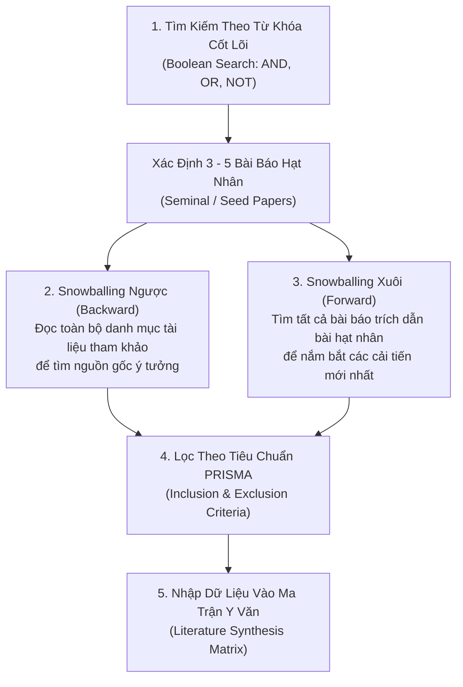

# Khảo Sát Y Văn Học Thuật & Phương Pháp Tổng Hợp Tri Thức
# Academic Literature Review & Systematic Synthesis

---

## 1. Nguyên Lý Nền Tảng (Fundamentals)

### 1.1. Bản Chất Của Khảo Sát Y Văn (Literature Review)
Khảo sát y văn học thuật không phải là việc liệt kê tuần tự tóm tắt của 20 bài báo rời rạc (kiểu *"Tác giả A làm cái này, tác giả B làm cái kia"*). Đó là **quá trình tổng hợp tri thức có hệ thống (Critical Synthesis)** nhằm:
1. Xác lập bức tranh toàn cảnh về hiện trạng của lĩnh vực (State of the Art - SOTA).
2. Lập bản đồ các dòng tư tưởng (Lineages of thought) và sự tiến hóa của các phương pháp luận.
3. Chỉ ra sự đồng thuận, bất đồng học thuật và những điểm mù chưa được giải quyết (Research Gaps).

Một bài tổng quan y văn xuất sắc phải có khả năng trả lời: *"Cộng đồng khoa học đã thử những gì, phương pháp nào đã đạt đến trần giới hạn, tại sao chúng thất bại, và cơ hội tiếp theo nằm ở đâu?"*.

### 1.2. Chính Sách Thực Chứng Tuyệt Đối: Chống Ảo Giác Trích Dẫn (Zero Citation Hallucination)
Trong kỷ nguyên của các mô hình ngôn ngữ lớn (LLMs), hiện tượng AI tự sáng tạo ra các trích dẫn giả mạo (Fake citations) với tên tác giả nghe rất thật, tiêu đề bài báo hấp dẫn nhưng không hề tồn tại trên đời là một vi phạm nghiêm trọng về đạo đức nghiên cứu.

**Quy tắc vận hành của ERPF:**
- Mọi trích dẫn đưa vào tài liệu bắt buộc phải được truy vết từ các nguồn học thuật uy tín: arXiv, Semantic Scholar, DBLP, Google Scholar, ACL Anthology, IEEE Xplore, ACM Digital Library.
- Nếu không có quyền truy cập internet để xác minh chỉ số DOI hoặc tên hội nghị chính xác, **bắt buộc phải đánh dấu:** `[Nguồn cần xác minh qua Semantic Scholar]` thay vì tự điền thông tin phỏng đoán.

---

## 2. Chiến Lược Tìm Kiếm & Thu Thập Tài Liệu Có Hệ Thống (Search Strategy)

Để không bỏ sót các công trình quan trọng, quy trình tìm kiếm phải kết hợp cả chiều rộng và chiều sâu:



### 2.1. Kỹ Thuật Snowballing (Lăn Cầu Tuyết Trích Dẫn)
- **Snowballing Ngược (Backward Snowballing):** Lần ngược danh mục tài liệu tham khảo của bài báo để truy tìm công trình gốc (Foundation paper). Nếu 5 bài báo độc lập đều cùng trích dẫn một bài báo X từ năm 2017, bài X chắc chắn là công trình nền tảng bắt buộc phải đọc kỹ.
- **Snowballing Xuôi (Forward Snowballing):** Sử dụng tính năng "Cited by" trên Google Scholar hoặc Semantic Scholar để xem những ai đã phát triển tiếp ý tưởng đó trong 12–24 tháng gần nhất.

### 2.2. Khung Sàng Lọc PRISMA (Preferred Reporting Items for Systematic Reviews)
Để loại trừ các bài báo kém chất lượng hoặc không liên quan, áp dụng bộ lọc 4 bước:
1. **Identification (Nhận diện):** Thu thập toàn bộ kết quả từ các truy vấn tìm kiếm (ví dụ: 150 bài).
2. **Screening (Sàng lọc sơ bộ):** Đọc tiêu đề và Abstract; loại bỏ các bài báo không đúng ngữ cảnh hoặc sai lĩnh vực (còn lại 60 bài).
3. **Eligibility (Đủ điều kiện):** Đọc lướt phần phương pháp và kết quả; kiểm tra tiêu chí loại trừ: Có mã nguồn đi kèm không? Đánh giá trên benchmark chuẩn không? Có peer-reviewed tại các hội nghị uy tín (NeurIPS, ICML, ICLR, ACL, CVPR) không? (còn lại 20 bài).
4. **Inclusion (Đưa vào nghiên cứu):** Đọc sâu toàn diện và đưa vào Ma trận Y văn (15–20 bài cốt lõi).

---

## 3. Kỹ Thuật Đọc Bài Báo Khoa Học 3 Bước (The Three-Pass Approach của S. Keshav)

Đọc tuần tự từng từ một bài báo khoa học từ đầu đến cuối là cách làm cực kỳ kém hiệu quả. Phương pháp chuẩn mực được áp dụng rộng rãi trong giới nghiên cứu là kỹ thuật 3 bước:

```
┌────────────────────────────────────────────────────────────────────────┐
│ BƯỚC 1: CÁI NHÌN TOÀN CẢNH (First Pass - 5 đến 10 phút)                │
│ Đọc: Title, Abstract, Introduction, Headings, và Conclusion.           │
│ Xem lướt: Các hình vẽ, bảng biểu chính và tài liệu tham khảo.          │
│ Trả lời 5 chữ C: Category, Context, Correctness, Contribution, Clarity.│
├────────────────────────────────────────────────────────────────────────┤
│ BƯỚC 2: NẮM BẮT NỘI DUNG (Second Pass - 30 đến 60 phút)                │
│ Đọc chi tiết từng phần, nhưng bỏ qua các chứng minh toán học phức tạp. │
│ Chú ý: Các biểu đồ (Graphs) — trục tọa độ có bắt đầu từ 0? Có error    │
│ bars không? Điểm nào là baselines? Đánh dấu các thuật ngữ chưa hiểu.   │
├────────────────────────────────────────────────────────────────────────┤
│ BƯỚC 3: TÁI TẠO TƯ DUY (Third Pass - 2 đến 4 giờ)                      │
│ Đọc với tinh thần phản biện tuyệt đối: "Tự đặt mình vào vị trí tác giả"│
│ Dự đoán điều tác giả sẽ làm ở trang tiếp theo. Thử tìm kiếm các giả định│
│ ngầm định (Implicit assumptions) bị giấu kín hoặc lỗi logic tiềm ẩn.   │
└────────────────────────────────────────────────────────────────────────┘
```

---

## 4. Bóc Tách Chi Tiết Phương Pháp Luận (Methodological Extraction)

Khi đọc phần Phương pháp (Methodology) và Thực nghiệm (Experiments) của một bài báo, nhà nghiên cứu cần bóc tách chính xác 6 thông số cốt tử:

1. **Tập Dữ Liệu Thực Nghiệm (Datasets & Benchmarks):** Dữ liệu có tính đại diện thực tế không? Có nguy cơ rò rỉ tập kiểm tra vào tập huấn luyện (Data Contamination) không?
2. **Các Đường Cơ Sở (Baselines):** Tác giả so sánh với những đối thủ nào? Có so sánh với các phương pháp SOTA mới nhất không, hay chỉ so sánh với các mô hình cũ kỹ yếu ớt (Strawman Baselines)?
3. **Các Tham Số & Tinh Chỉnh (Hyperparameter Fairness):** Tác giả có tinh chỉnh siêu tham số công bằng cho cả mô hình cơ sở không, hay chỉ dồn tài nguyên tinh chỉnh cho mô hình của riêng họ?
4. **Chỉ Số Đánh Giá (Evaluation Metrics):** Chỉ số đo lường có phản ánh đúng mục tiêu không? (ví dụ: BLEU score trong dịch máy có thực sự tương quan với chất lượng con người đánh giá?).
5. **Nghiên Cứu Bóc Tách (Ablation Studies):** Tác giả có tắt từng thành phần mới trong mô hình để chứng minh thành phần đó thực sự đóng góp vào kết quả, hay kết quả tăng điểm chỉ do may mắn ngẫu nhiên?
6. **Mã Nguồn & Khả Năng Tái Lập (Reproducibility):** Có liên kết GitHub chứa mã nguồn, weights, và script tái lập kết quả không?

---

## 5. Cấu Trúc Ma Trận Tổng Hợp Y Văn (Literature Synthesis Matrix)

Công cụ đắc lực nhất để tổng hợp tri thức là duy trì một tệp bảng tính hoặc Markdown Matrix. Mỗi dòng đại diện cho một bài báo, mỗi cột đại diện cho một tiêu chí so sánh then chốt:

| Mã Bài Báo | Tác Giả & Năm | Hội Nghị / Nguồn | Bài Toán / Câu Hỏi Cốt Lõi | Phương Pháp Đề Xuất | Tập Dữ Liệu & Baseline | Kết Quả Then Chốt | Điểm Hạn Chế / Ranh Giới (Gap) |
|---|---|---|---|---|---|---|---|
| **[REF-01]** | Vaswani et al. (2017) | NeurIPS | Loại bỏ hoàn toàn đệ quy RNN trong dịch máy | Transformer (Multi-Head Self-Attention) | WMT 2014 En-De; Baselines: GNMT, ConvS2S | BLEU 28.4 (SOTA lúc bấy giờ), train nhanh hơn 10x | Chi phí tính toán $O(N^2)$ theo độ dài chuỗi; không scale được với ngữ cảnh cực dài |
| **[REF-02]** | Lewis et al. (2020) | NeurIPS | Giảm thiểu ảo giác thông tin trong sinh văn bản | Retrieval-Augmented Generation (RAG) | Natural Questions, TriviaQA; Baselines: T5, BART | Cải thiện đáng kể độ chính xác factuality trên Open-Domain QA | Phụ thuộc hoàn toàn vào độ chính xác của retriever; độ trễ suy luận tăng gấp đôi |
| **[REF-03]** | Hu et al. (2021) | ICLR | Chi phí fine-tuning toàn bộ tham số LLM quá tốn kém | LoRA (Low-Rank Adaptation) | GLUE, WikiSQL; Baselines: Full Fine-tuning, Adapters | Giảm 10,000 lần tham số cần train mà chất lượng tương đương | Giả định rank thấp có thể không đủ dung lượng biểu diễn khi học miền tri thức hoàn toàn mới |

*(Xem biểu mẫu đầy đủ và hướng dẫn điền chi tiết tại [`erpf/toolkit/templates/literature-matrix-template.md`](file:///home/longtran/Projects/rendez-web/erpf/toolkit/templates/literature-matrix-template.md))*

---

## 6. Sai Lầm Thường Gặp & Anti-Patterns (Common Mistakes)

1. **Tổng quan y văn kiểu danh sách giặt ủi (Laundry List Literature Review):** Viết lại tóm tắt từng bài báo theo thứ tự thời gian mà không có sự liên kết, so sánh chéo hoặc nhóm theo các trường phái tiếp cận.
2. **Thiên vị trích dẫn (Confirmation Bias in Citation):** Chỉ tìm kiếm và trích dẫn các bài báo ủng hộ quan điểm của mình, cố tình lờ đi các nghiên cứu chứng minh phương pháp của mình có nhược điểm hoặc không hiệu quả.
3. **Trích dẫn kiểu dây chuyền mù quáng (Blind Citations):** Trích dẫn một bài báo chỉ vì thấy người khác trích dẫn, mà bản thân chưa từng mở bài báo đó ra đọc để kiểm tra xem nội dung bên trong có đúng như lời đồn hay không.
4. **Bỏ qua các bài báo thất bại (Ignoring Negative Results):** Không đọc các bài báo phân tích điểm mù hoặc thất bại của các mô hình nổi tiếng, dẫn đến việc lặp lại chính những sai lầm mà người đi trước đã cảnh báo.

---

## 7. Đánh Giá Đánh Đổi (Trade-off Analysis)

### Bảng Đánh Đổi: Khảo Sát Rộng Diện Rộng vs Khảo Sát Sâu Trọng Điểm

| Khía Cạnh | Khảo Sát Rộng (Broad Survey) | Khảo Sát Sâu (Deep Dive) |
|---|---|---|
| **Mục đích** | Hiểu được toàn cảnh bức tranh, thuật ngữ và các nhánh con của lĩnh vực | Hiểu chi tiết công thức toán học, cấu trúc code và tham số thực nghiệm |
| **Số lượng bài báo** | 50 – 100+ bài báo đọc ở Bước 1 & Bước 2 | 5 – 10 bài báo hạt nhân đọc ở Bước 3 |
| **Rủi ro chính** | Hiểu biết nông cạn, không thể tự mình tái lập hoặc tìm ra điểm yếu thuật toán | Bị mắc kẹt vào chi tiết vụn vặt, bỏ sót các phương pháp tiếp cận hoàn toàn mới |
| **Chiến lược tối ưu** | Dành 30% thời gian quét rộng bằng Forward/Backward Snowballing $\rightarrow$ chọn ra Top 10 bài xuất sắc nhất để dành 70% thời gian đọc sâu |
