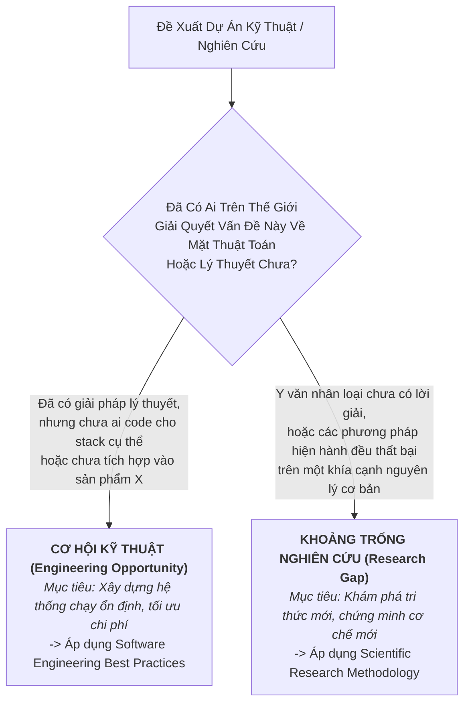
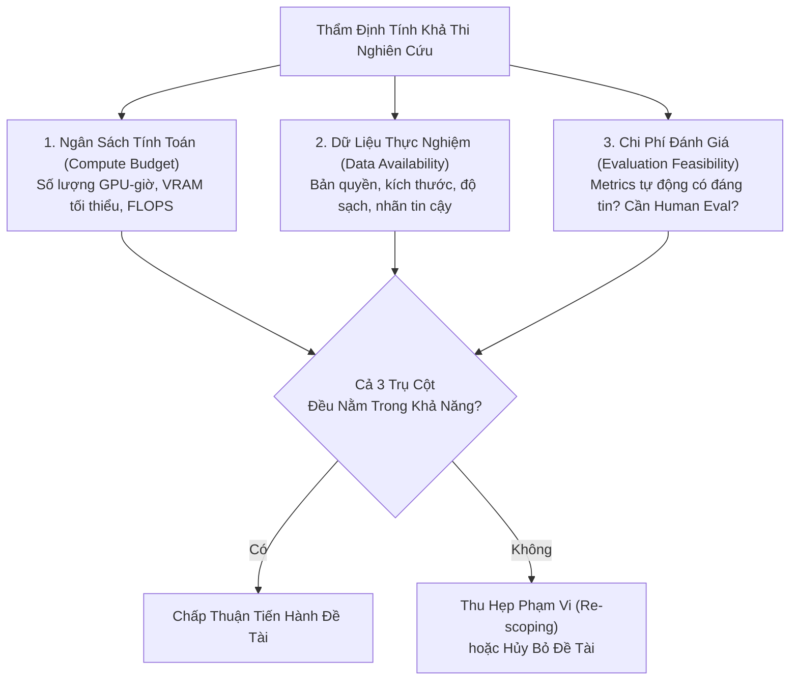

# Định Hình Vấn Đề Nghiên Cứu & Xác Lập Khoảng Trống Tri Thức
# Research Problem Formulation & Identifying Research Gaps

---

## 1. Nguyên Lý Nền Tảng (Fundamentals)

### 1.1. Vấn Đề Nghiên Cứu Là Gì?
Trong khoa học máy tính và AI, một **Vấn Đề Nghiên Cứu (Research Problem)** không phải là một "công việc cần làm" (như viết API hay tinh chỉnh một model có sẵn), mà là một **sự bất định về mặt tri thức (Epistemic Uncertainty)** hoặc một **giới hạn căn bản chưa có lời giải** trong việc hiểu và cải tiến các hệ thống thông minh.

Một vấn đề nghiên cứu xứng đáng đòi hỏi:
1. **Tính phổ quát (Generality):** Giải pháp cho vấn đề phải mang lại hiểu biết hoặc kỹ thuật có thể áp dụng rộng rãi hơn phạm vi của một tập dữ liệu hoặc một công ty cụ thể.
2. **Tính phi tầm thường (Non-triviality):** Không thể giải quyết vấn đề đơn thuần bằng cách áp dụng công thức có sẵn, tăng thêm dữ liệu một cách cơ bắp, hay viết thêm vài dòng code glue-code.
3. **Ý nghĩa khoa học (Research Significance):** Việc giải quyết vấn đề sẽ mở ra khả năng mới, cải thiện độ chính xác/hiệu năng ở mức độ mang tính bước ngoặt, hoặc làm sáng tỏ một cơ chế lý thuyết nền tảng.

### 1.2. Thao Tác Hóa Các Khái Niệm Trừu Tượng (Operational Definitions)
Nhiều đề xuất nghiên cứu AI thất bại ngay từ khâu định hình vì sử dụng các thuật ngữ mơ hồ, phi thực tế (ví dụ: *"làm cho mô hình hiểu ngữ cảnh sâu hơn"*, *"tăng cường khả năng suy luận tự nhiên"*).

**Quy tắc Thao Tác Hóa (Operationalization):** Mọi khái niệm trừu tượng bắt buộc phải được chuyển đổi thành các biến số hoặc hành vi quan sát được và có thể đo lường định lượng được:
- Thay vì nói: *"Mô hình ghi nhớ thông tin tốt hơn trong văn bản dài."*
- Hãy thao tác hóa thành: *"Độ chính xác truy xuất kim trong đống rơm (Needle In A Haystack retrieval accuracy) tại độ dài ngữ cảnh $K \in [4k, 128k]$ tokens với độ sâu chèn biến thiên từ 0% đến 100%."*

---

## 2. Phân Biệt Khoảng Trống Nghiên Cứu vs Cơ Hội Kỹ Thuật (Research Gap vs Engineering Opportunity)

Đây là ranh giới sống còn giúp kỹ sư và nhà nghiên cứu không lãng phí thời gian:



### Bảng Đối Chiếu Thực Tế

| Tình Huống Đề Xuất | Phân Loại Bản Chất | Lý Do Bản Thể Học | Hành Động Phù Hợp |
|---|:---:|---|---|
| *"Chưa ai tích hợp mô hình Whisper speech-to-text vào ứng dụng di động Flutter qua C++ FFI."* | **Engineering Opportunity** | Không có câu hỏi khoa học mới. Cơ chế Whisper đã biết, C++ FFI đã biết. Thử thách ở đây là công sức lập trình và tương thích hệ thống. | Triển khai theo quy trình kỹ thuật phần mềm, viết tài liệu kỹ thuật, không viết bài báo nghiên cứu. |
| *"Khi fine-tune LLM trên dữ liệu hội thoại tiếng Việt, mô hình bị hiện tượng quên thảm khốc (Catastrophic Forgetting) kiến thức lập trình tiếng Anh dù đã áp dụng LoRA."* | **Research Gap** | Cơ chế tương tác giữa các subspace biểu diễn ngôn ngữ khác nhau trong ma trận trọng số thích ứng thấp (LoRA) là một câu hỏi mở về mặt khoa học. | Định hình giả thuyết, khảo sát y văn về continual learning/representation alignment, thiết kế thực nghiệm đo lường. |
| *"Chưa ai huấn luyện mô hình YOLOv8 trên tập dữ liệu biển số xe tại một bãi đỗ xe cụ thể."* | **Engineering Opportunity** | Việc thu thập thêm dữ liệu để huấn luyện mô hình có sẵn là công việc kỹ thuật ứng dụng (Data/ML Engineering), không chứa đựng tính mới về thuật toán. | Thực hiện pipeline huấn luyện, đo lường mAP, triển khai phục vụ người dùng. |

---

## 3. Phân Loại Tầng Đóng Góp Khoa Học (Taxonomy of Scientific Contributions)

Không phải mọi nghiên cứu đều phải phát minh ra một kiến trúc mạng nơ-ron hoàn toàn mới như Transformer. Khoa học AI ghi nhận 5 tầng đóng góp chính đáng:

```
┌────────────────────────────────────────────────────────────────────────┐
│ 1. Đóng Góp Lý Thuyết (Theoretical Contribution)                       │
│    Chứng minh toán học về tính hội tụ, bounds, hoặc năng lực biểu diễn │
├────────────────────────────────────────────────────────────────────────┤
│ 2. Đóng Góp Thuật Toán / Kiến Trúc (Algorithmic / Architectural)        │
│    Cơ chế tính toán mới, hàm mất mát mới, phương pháp tối ưu hóa mới   │
├────────────────────────────────────────────────────────────────────────┤
│ 3. Đóng Góp Phân Tích Thực Nghiệm (Empirical / Analytical)             │
│    Nghiên cứu bóc tách sâu sắc (Ablation), so sánh quy mô lớn,        │
│    khám phá các quy luật tỷ lệ (Scaling Laws) hoặc điểm mù của mô hình │
├────────────────────────────────────────────────────────────────────────┤
│ 4. Đóng Góp Tài Nguyên & Benchmark (Dataset / Benchmark / Evaluation)  │
│    Bộ dữ liệu chuẩn hóa chất lượng cao, harness đánh giá chống gian lận│
├────────────────────────────────────────────────────────────────────────┤
│ 5. Đóng Góp Tổng Hợp Hệ Thống (Systematization of Knowledge - SoK)     │
│    Khung phân loại toàn diện, chuẩn hóa thuật ngữ và định hướng mở     │
└────────────────────────────────────────────────────────────────────────┘
```

### Đánh Giá Tính Mới: Tiến Hóa (Incremental) vs Bước Ngoặt (Substantial)
- **Tính mới gia tăng có giá trị (Valuable Incremental Novelty):** Tinh chỉnh một cơ chế đã biết (ví dụ: thay đổi hàm kích hoạt hoặc kỹ thuật chuẩn hóa lớp) nhưng đi kèm với **phân tích thực nghiệm nghiêm ngặt** giải thích rõ tại sao sự thay đổi đó hiệu quả hơn trên đa dạng tác vụ.
- **Tính mới hình thức (Spurious Novelty):** Đổi tên một kỹ thuật cũ thành thuật ngữ mỹ miều mới, hoặc thêm 5 tham số không cần thiết vào mô hình để làm cho nó có vẻ phức tạp nhưng không mang lại cải tiến có ý nghĩa thống kê.
- **Tính mới bước ngoặt (Substantial Novelty):** Giới thiệu một hệ hình (paradigm) hoàn toàn mới thay đổi cách cộng đồng tiếp cận bài toán (ví dụ: Chuyển từ Seq2Seq RNN sang Self-Attention trong Vaswani et al., 2017; hoặc chuyển từ Fine-tuning toàn phần sang Tham Số Thấp LoRA trong Hu et al., 2021).

---

## 4. Đánh Giá Tính Khả Thi Của Nghiên Cứu (Research Feasibility Assessment)

Một ý tưởng nghiên cứu xuất sắc nhưng bất khả thi về mặt tài nguyên là một cái bẫy chết người đối với nhà nghiên cứu. Trước khi bắt đầu, phải hoàn thành **Bản Đánh Giá Khả Thi Tam Giác (Feasibility Triangle)**:



### Công Thức Ước Tính Nhanh Giới Hạn FLOPs Huấn Luyện
Theo công thức kinh nghiệm phổ biến trong huấn luyện mô hình ngôn ngữ dựa trên Transformer:
$$\text{Compute (FLOPs)} \approx 6 \times N \times D$$
Trong đó:
- $N$: Số lượng tham số không bao gồm tầng embedding.
- $D$: Số lượng tokens trong tập dữ liệu huấn luyện.
- Nếu một đề tài dự kiến train mô hình 7 tỷ tham số ($N = 7 \times 10^9$) trên 100 tỷ tokens ($D = 10^{11}$), tổng số FLOPs cần thiết là $\approx 4.2 \times 10^{21}$ FLOPs, tương đương hàng trăm giờ chạy trên cụm 8x A100. Nếu phòng thí nghiệm chỉ có 1 GPU RTX 3090 (24GB VRAM), đề tài này **hoàn toàn bất khả thi** và bắt buộc phải chuyển sang hướng tiếp cận PEFT (LoRA/QLoRA) hoặc Transfer Learning.

---

## 5. Sai Lầm Thường Gặp & Anti-Patterns (Common Mistakes)

1. **Giải pháp đi tìm bài toán (Solution Looking for a Problem):** Phát minh ra một thuật toán hoặc mô hình phức tạp kỳ quặc trước, sau đó mới đi tìm xem có tập dữ liệu nào mà nó chạy tốt hơn một chút để viết báo cáo.
2. **Tuyên bố tính mới không có cơ sở (Unsupported Novelty Claims):** Dùng các từ ngữ tuyệt đối như *"Đầu tiên trên thế giới"*, *"Chưa từng có ai nghiên cứu"* mà chỉ tìm kiếm sơ sài trên Google Scholar qua vài từ khóa tiếng Anh cơ bản.
3. **Mục tiêu di động (Moving Goalposts):** Thay đổi câu hỏi nghiên cứu liên tục mỗi khi mô hình chạy ra kết quả không như ý, biến nghiên cứu thành một cuộc dò dẫm thiếu định hướng.
4. **Nghiên cứu hộp đen (Black-Box Tinkering):** Thử nghiệm 50 cấu hình siêu tham số khác nhau, chọn ra cấu hình có điểm cao nhất nhưng không thể giải thích được nguyên nhân khoa học tại sao cấu hình đó lại tốt hơn.

---

## 6. Đánh Giá Đánh Đổi (Trade-off Analysis)

### Bảng Đánh Đổi: Đề Tài Đột Phá Rủi Ro Cao vs Đề Tài Gia Tăng An Toàn

| Tiêu Chí | Đề Tài Đột Phá (High-Risk, High-Reward) | Đề Tài Gia Tăng (Incremental, Methodical) |
|---|---|---|
| **Mục tiêu nghiên cứu** | Bác bỏ một giả định lâu đời, đề xuất kiến trúc hoàn toàn mới | Cải tiến, phân tích hoặc kết hợp các phương pháp đã được kiểm chứng |
| **Xác suất thất bại** | Rất cao (70–90% giả thuyết có thể bị bác bỏ) | Thấp (10–20%), gần như chắc chắn sẽ có cải thiện nhỏ |
| **Giá trị khi thành công** | Tạo bước ngoặt học thuật, trích dẫn cao, định hình hướng đi mới | Đóng góp thêm bằng chứng thực nghiệm vững chắc, tích lũy tri thức |
| **Yêu cầu tài nguyên** | Đòi hỏi thời gian dài và nguồn lực tính toán linh hoạt | Dự đoán được chính xác ngân sách GPU và thời gian hoàn thành |
| **Chiến lược cân bằng** | Dành 20–30% nguồn lực cho các ý tưởng đột phá | Dành 70–80% nguồn lực cho các đề tài có phương pháp luận vững chắc |

---

## 7. Tình Huống Minh Họa Nghiên Cứu Thực Tế

### Case Study: Chuyển Hóa Bài Toán Khám Phá Địa Điểm Thành Câu Hỏi Nghiên Cứu Thực Thụ

Giả sử một nhóm kỹ sư tại Rendez nhận thấy: Khi người dùng tìm kiếm *"quán cafe yên tĩnh để đọc sách vào buổi chiều có ánh nắng đẹp"*, hệ thống tìm kiếm từ khóa hiện tại (Elasticsearch BM25) hoàn toàn bất lực vì thông tin này không có trong trường `description` văn bản mà ẩn chứa trong hình ảnh do cộng đồng gửi lên.

#### Bước 1: Tránh cái bẫy "Engineering Task"
- *Cách tiếp cận thuần kỹ thuật:* "Hãy tích hợp mô hình CLIP có sẵn để tìm kiếm ảnh theo text." $\rightarrow$ Đây là một công việc kỹ thuật phần mềm, không phải nghiên cứu khoa học.

#### Bước 2: Nhận diện khoảng trống nghiên cứu thực thụ (Research Gap)
- Khi thử nghiệm CLIP gốc trên ảnh quán cafe thực tế (User-Generated Content - UGC), nhóm phát hiện: CLIP nhận diện rất tốt vật thể đơn lẻ (cốc cafe, chiếc bàn), nhưng **hoàn toàn thất bại trong việc suy luận không gian phức tạp và cảm xúc bầu không khí (Atmosphere & Ambience Reasoning)**, do ảnh UGC có ánh sáng phức tạp, góc chụp nghiệp dư và chứa nhiều chi tiết gây nhiễu.

#### Bước 3: Định hình câu hỏi và mục tiêu nghiên cứu chuẩn mực
- **Research Problem:** Mô hình Vision-Language nền tảng (VLM) bị suy giảm độ chính xác nghiêm trọng khi suy luận các thuộc tính bầu không khí trừu tượng từ ảnh do người dùng chụp trong môi trường thực tế.
- **Research Question:** *Liệu việc bổ sung thông tin ngữ cảnh thời gian (thời điểm chụp trong ngày) và cấu trúc hình học không gian (bố cục bàn ghế) có cải thiện được năng lực căn chỉnh đa phương thức (Multimodal Alignment) cho các truy vấn cảm xúc hay không?*
- **Operational Objective:** Xây dựng phương pháp chiếu không-thời gian (Spatio-Temporal Projection) thích ứng thấp, đo lường sự cải thiện qua chỉ số Mean Reciprocal Rank (MRR) và nDCG@10 trên tập kiểm thử 5,000 truy vấn thực tế được gán nhãn bởi con người.
- **Hypothesis:** *Nếu tích hợp vector nhúng thời gian chụp vào quá trình cross-attention giữa văn bản và hình ảnh, thì điểm xếp hạng truy xuất cho các truy vấn liên quan đến ánh sáng và bầu không khí sẽ tăng ít nhất 15% MRR so với CLIP baseline.*
