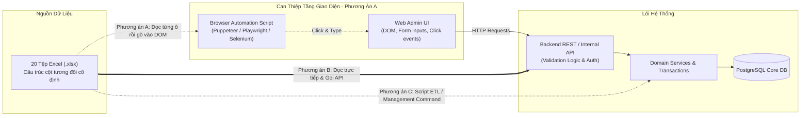

# Nghiên Cứu Điển Hình: Bài Toán 20 Tệp Bảng Tính & Nguyên Lý Lựa Chọn Tầng Can Thiệp Kỹ Thuật
# Case Study: The 20-Spreadsheets Scenario & The Principle of Intervention Level Selection

> **[TÌNH HUỐNG GIẢ ĐỊNH ĐIỂN HÌNH / STANDARD PEDAGOGICAL HYPOTHETICAL CASE]**
> *Tài liệu này là một nghiên cứu tình huống sư phạm tiêu chuẩn được thiết kế nhằm phân tích các quyết định kiến trúc đánh đổi, kiểm chứng các giả định kỹ thuật, và đúc kết nguyên lý lựa chọn tầng can thiệp kỹ thuật phù hợp. Không có tổ chức thương mại cụ thể hay dữ liệu cá nhân nào được mô tả.*

---

## 1. Bối Cảnh (Background)

Một tổ chức vận hành tiếp nhận định kỳ 20 tệp bảng tính Excel (`.xlsx`), mỗi tệp chứa khoảng 500 đến 2.000 dòng dữ liệu về thông tin danh mục, địa điểm và chỉ số đối soát vận hành từ các đối tác chi nhánh ngoại tuyến. Dữ liệu này cần được cập nhật vào hệ thống quản lý trung tâm (Core Enterprise Web Application).

Trước đây, công việc này được thực hiện thủ công bởi hai nhân viên vận hành: mở từng tệp Excel, sao chép từng trường thông tin, dán vào các biểu mẫu trên giao diện web quản trị nội bộ, bấm nút "Lưu", và lặp lại thao tác này hàng trăm lần mỗi tuần. Quá trình này tiêu tốn 12-16 giờ làm việc của nhân sự, dễ xảy ra sai sót gõ nhầm và gây mệt mỏi nhận thức nặng nề.

Nhóm kỹ thuật được yêu cầu đưa ra một giải pháp tự động hóa nhằm giải phóng nhân lực vận hành.

---

## 2. Mục Tiêu (Objectives)

- **Mục tiêu vận hành:** Rút ngắn thời gian xử lý 20 tệp dữ liệu từ 16 giờ làm việc thủ công xuống dưới 15 phút.
- **Mục tiêu kỹ thuật:**
  - Bảo đảm tính toàn vẹn dữ liệu (Data Integrity): Không bị thất thoát bản ghi, tuân thủ các ràng buộc nghiệp vụ (invariants), và có cơ chế khôi phục (Rollback / Transactional Consistency) khi gặp sự cố dữ liệu rác giữa chừng.
  - Cung cấp nhật ký kiểm toán (Audit Trail) rõ ràng: Biết chính xác bản ghi nào thành công, bản ghi nào bị từ chối và lý do lỗi.
  - Giảm thiểu chi phí bảo trì phát sinh: Giải pháp không bị hỏng hóc thường xuyên khi có những thay đổi nhỏ về giao diện hiển thị.

---

## 3. Các Ràng Buộc Hệ Thống (Constraints)

1. **Ràng buộc thời gian:** Giải pháp phải được hoàn thành trong vòng 3 ngày làm việc để kịp kỳ đối soát cuối tháng.
2. **Ràng buộc bảo mật & phân quyền:** Dữ liệu có chứa thông tin tài chính nhạy cảm; mọi hoạt động ghi vào cơ sở dữ liệu phải được xác thực danh tính hợp lệ và ghi log kiểm toán.
3. **Ràng buộc về sự hiểu biết hệ thống (Knowledge Constraint):** Nhóm kỹ sư ban đầu chỉ nhìn thấy ứng dụng web ở phía giao diện người dùng (End-User UI) và chưa kiểm tra tài liệu kỹ thuật của hệ thống Backend bên dưới.

---

## 4. Hiện Trạng Kỹ Thuật (Technical Context)



Hệ thống Core Web Application thực chất bao gồm:
- **Giao diện Web Frontend:** Ứng dụng Single Page Application (SPA) hiển thị các form nhập liệu phức tạp, phụ thuộc vào DOM hierarchy, CSS selectors, và các hiệu ứng animation/toast notification.
- **Hệ thống Backend Dịch Vụ:** Một backend viết bằng Django REST Framework / Fast-API, có sẵn hệ thống API endpoints nội bộ phục vụ chính giao diện web trên, cùng đầy đủ validation logic và transaction atomic blocks.

---

## 5. Các Phương Án Cạnh Tranh (Competing Approaches)

Khi tiếp nhận bài toán, trong nhóm kỹ thuật nảy sinh hai luồng tư duy trái ngược:

### Phương Án A: Tự Động Hóa Tầng Giao Diện (UI Automation / RPA Bot)
- **Đề xuất ban đầu:** Xây dựng một script tự động hóa trình duyệt (Browser Bot sử dụng Selenium/Playwright) hoặc phần mềm RPA để mô phỏng chính xác hành vi của con người: Tự động khởi chạy trình duyệt, đăng nhập, mở từng dòng Excel, tìm thẻ `<input>` trên trang web qua CSS selectors, gõ ký tự vào ô, bấm nút "Submit", và chờ 2 giây để trang tải lại.
- **Ưu thế nhìn thấy tức thời:** Trực quan, dễ hình dung với người ngoài ngành kỹ thuật; không cần tìm hiểu kiến trúc backend hay xin cấp quyền API; hoạt động dựa trên những gì mắt người nhìn thấy.

### Phương Án B: Tích Hợp Tầng Giao Diện Lập Trình (Backend API Automation)
- **Đề xuất:** Viết một script tiện ích nhỏ bằng Python (`pandas` / `openpyxl` kết hợp `requests` / `httpx`). Script sẽ phân tích cú pháp (parse) 20 tệp Excel trực tiếp vào bộ nhớ, xác thực dữ liệu theo schema, sau đó xác thực bằng API token của tài khoản quản trị và gửi trực tiếp các payload JSON tới endpoint REST API nội bộ của hệ thống.
- **Cơ chế:** Bỏ qua hoàn toàn tầng hiển thị DOM, giao tiếp trực tiếp với cổng nhận dữ liệu logic của backend.

### Phương Án C: Can Thiệp Trực Tiếp Tầng Cơ Sở Dữ Liệu / Management Command (Database Batch Ingestion)
- **Đề xuất:** Xây dựng một Django Management Command hoặc công cụ dòng lệnh nội bộ (CLI script) chạy trực tiếp trên máy chủ backend, đọc dữ liệu và sử dụng `bulk_create` / `bulk_update` bên trong một khối giao dịch cơ sở dữ liệu `transaction.atomic()`.
- **Cơ chế:** Can thiệp sâu nhất vào tầng dịch vụ nội bộ của hệ thống.

---

## 6. Phân Tích & Đánh Đổi Kỹ Thuật (Analysis and Trade-offs)

Nhóm kỹ sư đã tiến hành phân tích đánh đổi đa biến dựa trên các tiêu chuẩn kỹ thuật khách quan:

| Tiêu Chí Kỹ Thuật | Phương Án A: Tự Động Hóa UI (Browser Bot) | Phương Án B: Tích Hợp API Backend | Phương Án C: Database Batch Command |
| :--- | :--- | :--- | :--- |
| **Độ Ổn Định & Khả Năng Chống Giòn Gãy (Robustness)** | **Cực kỳ thấp (Rất giòn gãy).** Bất kỳ thay đổi nhỏ nào trên DOM (đổi tên class CSS, layout re-render, mạng lag làm nút bấm chưa xuất hiện, pop-up quảng cáo che khuất) đều làm bot treo hoặc crash giữa chừng. | **Rất cao.** API có schema cố định (JSON contract). Giao diện đổi CSS hay đổi màu nút không ảnh hưởng gì tới luồng dữ liệu. | **Tuyệt đối.** Chạy cục bộ trên máy chủ trong transaction, không phụ thuộc vào mạng hay HTTP overhead. |
| **Tốc Độ & Hiệu Năng (Throughput)** | **Cực kỳ chậm.** Phải tải HTML, JS, render CSS, chờ animation (trung bình 2-4 giây/bản ghi). Nhập 20.000 dòng mất ~15-20 giờ (không nhanh hơn người là bao). | **Rất nhanh.** Gửi request HTTP JSON dạng batch (100 dòng/batch), hoàn thành 20.000 dòng trong **2 đến 3 phút**. | **Tức thì.** `bulk_create` 20.000 dòng vào PostgreSQL chỉ mất **dưới 15 giây**. |
| **Tính Toàn Vẹn Dữ Liệu (ACID Transactions)** | **Không có.** Nếu bot crash ở dòng thứ 350 của tệp số 5, hệ thống rơi vào trạng thái nửa vời (half-written). Không có cách nào rollback tự động các dòng đã nhập trước đó. | **Tốt.** Có thể gom nhóm theo từng tệp tóm tắt và ghi nhận trạng thái HTTP status code rõ ràng cho từng batch. | **Hoàn hảo.** Đảm bảo tính nguyên tử (Atomicity): 1 dòng trong tệp lỗi, toàn bộ tệp bị rollback, bảo vệ cơ sở dữ liệu sạch 100%. |
| **Chi Phí Bảo Trì Dài Hạn (Maintenance Cost)** | **Rất đắt đỏ.** Phải liên tục cập nhật script mỗi khi nhóm frontend phát hành phiên bản mới. | **Rất thấp.** API ít khi thay đổi (Backward-compatible). | **Thấp.** Nhưng đòi hỏi quyền deploy mã nguồn lên máy chủ backend. |
| **Yêu Cầu Quyền Hạn Ban Đầu (Friction & Permissions)** | **Thấp nhất.** Chỉ cần tài khoản người dùng bình thường để đăng nhập web. | **Trung bình.** Cần có API token hoặc tài liệu mô tả endpoint API nội bộ. | **Cao nhất.** Yêu cầu quyền truy cập SSH máy chủ backend hoặc chạy lệnh container nội bộ. |

---

## 7. Cơ Sở Ra Quyết Định & Nhu Cầu Kiểm Chứng Giả Định (Decision Rationale & Verifying Assumptions)

### Sự Nguy Hiểm Của "Cái Bẫy Tự Động Hóa Giao Diện" (The UI Automation Trap)
Ban đầu, ý tưởng viết browser bot tự động bấm chuột xuất hiện đầu tiên vì nó là **tầng hiển thị trực quan nhất**. Kỹ sư chưa kiểm tra kiến trúc thường ngầm mặc định giả định: *"Hệ thống này chỉ có giao diện web, không có API nào khả dụng cả"*.

Tuy nhiên, theo nguyên tắc **Evidence-First** (`ERPF-CORE-PRIN-001`), nhóm kỹ sư đã dừng lại để **kiểm chứng các giả định (Verify Assumptions)** trước khi bắt tay viết code:
1. *Mở Developer Tools (F12) trên trình duyệt:* Quan sát tab Network khi bấm nút "Lưu" trên giao diện.
2. *Phát hiện thực tế:* Giao diện không hề xử lý logic phức tạp; nó chỉ gửi một request đơn giản `POST /api/v1/admin/records/batch-import` kèm payload JSON và Bearer Token!
3. *Đọc mã nguồn Backend:* Hệ thống backend đã có sẵn hàm `validate_record_payload()` và hỗ trợ nhận mảng dữ liệu.

### Quyết Định Kỹ Thuật Đã Chọn
Nhóm quyết định bác bỏ Phương Án A (UI Automation) và lựa chọn **Phương Án B (Tích Hợp API Backend)** kết hợp script chuyển đổi dữ liệu bằng Python (`openpyxl` + `httpx`):
- Lý do chọn B thay vì C: Phương án B không yêu cầu xin quyền root/SSH lên máy chủ production của công ty (giảm ma sát thủ tục phê duyệt), trong khi vẫn tận dụng được 100% tầng validation logic và rate limiting chuẩn mực của backend API, đạt tốc độ xử lý nhanh gấp **500 lần** so với bot tự động hóa UI.

---

## 8. Kết Quả Kỳ Vọng (Expected Outcome)

*(Phân tích đánh giá dựa trên kịch bản kỹ thuật chuẩn)*

1. **Về Thời Gian & Thông Lượng:**
   - 20 tệp Excel (tổng cộng ~18.500 bản ghi) được phân tích và gửi lên hệ thống hoàn tất trong **3 phút 45 giây** (so với 16 giờ làm việc thủ công và ước tính 18 giờ chạy bot UI).
2. **Về Độ Tin Cậy & Xử Lý Lỗi:**
   - Script tạo ra một tệp báo cáo `import_audit_report.json`: ghi nhận 18.420 bản ghi nhập thành công và 80 bản ghi bị backend từ chối do trùng lặp mã định danh, kèm chỉ số dòng chính xác trong tệp Excel để nhân viên vận hành sửa lại.
   - Không có bất kỳ lỗi gián đoạn do DOM hay timeout giao diện.
3. **Về Chi Phí Kỹ Thuật:**
   - Script Python hoàn chỉnh chỉ dài 120 dòng mã, trong sáng, dễ đọc và được kiểm thử đơn vị với 100% test coverage trên các tệp mẫu giả lập.

---

## 9. Các Bối Cảnh Mà Tự Động Hóa Tầng Giao Diện (UI Automation) Là Hợp Lý

Mặc dù trong bài toán trên, UI Automation là một lựa chọn tồi, nhưng nó không hoàn toàn vô giá trị trong mọi tình huống. Một kỹ sư giỏi cần nhận diện **khi nào UI Automation thực sự là phương án đúng đắn**:

1. **Hệ Thống Hộp Đen Kế Thừa (Legacy Black-Box Systems):** Các phần mềm cũ từ 20 năm trước (trên nền tảng Windows Desktop / Mainframe), không có API, không có mã nguồn, và cơ sở dữ liệu bị mã hóa độc quyền.
2. **Nền Tảng Đóng Của Bên Thứ Ba (Closed Vendor SaaS):** Các dịch vụ bên ngoài không cung cấp API hoặc áp đặt mức phí dịch vụ API cắt cổ vượt quá ngân sách, trong khi chỉ cung cấp cổng web cho người dùng.
3. **Ràng Buộc Pháp Lý & Hợp Đồng:** Khi việc can thiệp trực tiếp vào cơ sở dữ liệu vi phạm thỏa thuận hỗ trợ (SLA / Warranty) của nhà cung cấp phần mềm bên thứ ba.
4. **Giải Pháp Cứu Hỏa Tạm Thời (Temporary Stopgap):** Khi tính năng API backend đang được phát triển nhưng cần 2 tháng nữa mới bàn giao, trong khi nghiệp vụ đòi hỏi phải chạy tự động ngay trong 2 ngày tới (với cam kết sẽ vứt bỏ bot khi API hoàn thành).

---

## 10. Bài Học Chuyển Giao: Nguyên Lý Lựa Chọn Tầng Can Thiệp Kỹ Thuật
*(The Principle of Choosing the Correct Level of Intervention)*

Từ nghiên cứu điển hình này, ERPF khái quát hóa thành nguyên lý kiến trúc mang tính hệ thống:

```mermaid
flowchart TD
    subgraph Intervention_Hierarchy [Các Tầng Can Thiệp Kỹ Thuật (Từ Cao Đến Thấp)]
        L1["TẦNG 1: GIAO DIỆN NGƯỜI DÙNG (UI / DOM / Visual Layer)<br/><i>Độ giòn gãy cao nhất, tốc độ chậm nhất, chi phí bảo trì đắt nhất</i>"]
        L2["TẦNG 2: GIAO DIỆN LẬP TRÌNH (API / Network Contract Layer)<br/><i>Độ ổn định cao, schema rõ ràng, bảo toàn validation logic</i>"]
        L3["TẦNG 3: DỊCH VỤ ỨNG DỤNG (Service / Domain Logic Layer)<br/><i>Thực thi trực tiếp trong cùng process, hỗ trợ transaction nguyên tử</i>"]
        L4["TẦNG 4: CƠ SỞ DỮ LIỆU / LƯU TRỮ (Database / Storage Engine Layer)<br/><i>Tốc độ tối đa, nhưng nguy cơ bỏ qua validation nghiệp vụ nếu can thiệp thô</i>"]
    end

    Rule["<b>NGUYÊN LÝ VÀNG ERPF:</b><br/>Luôn can thiệp ở tầng thấp nhất có thể mà vẫn bảo đảm đầy đủ<br/>tính toàn vẹn nghiệp vụ (Business Invariants) và tính chính danh truy cập."]
```

> **Nguyên Lý Lựa Chọn Tầng Can Thiệp Kỹ Thuật (Intervention Level Principle):**
> 1. **Quy tắc độ bền vững:** Can thiệp ở tầng càng cao (tầng giao diện hiển thị), hệ thống tự động hóa càng giòn gãy (*brittle*), càng tốn tài nguyên và càng khó kiểm soát lỗi.
> 2. **Quy tắc ranh giới bất biến:** Can thiệp ở tầng quá thấp (ví dụ: ghi thẳng vào bảng SQL bằng câu lệnh raw query) có nguy cơ vượt mặt (*bypass*) các luật nghiệp vụ, sinh ra dữ liệu mồ côi hoặc vi phạm tính toàn vẹn miền.
> 3. **Điểm can thiệp lý tưởng:** Luôn là **Tầng Dịch Vụ Ứng Dụng (Application Service)** hoặc **Tầng Giao Diện Lập Trình (Official API)** — nơi cung cấp hợp đồng dữ liệu ổn định, có xác thực bảo mật và bảo vệ toàn diện các bất biến nghiệp vụ của hệ thống.
