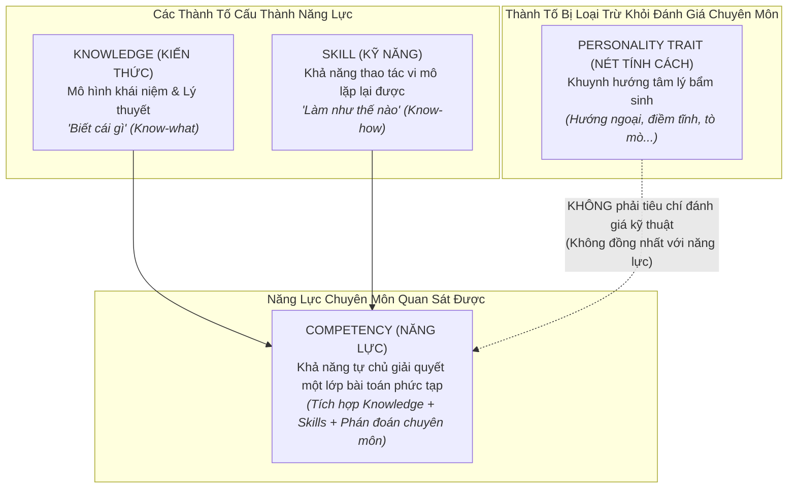
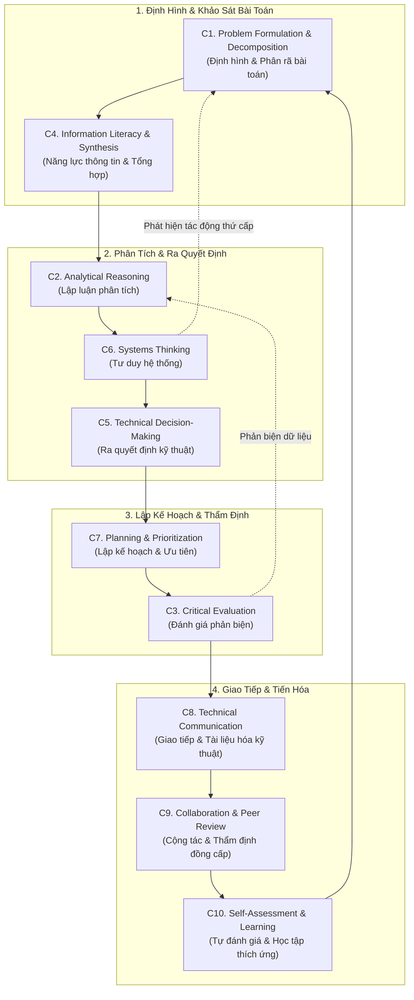

# Khung Năng Lực Cốt Lõi Liên Ngành
# Cross-Disciplinary Core Competencies

---

## 1. Phân Định Bản Thể Luận: Năng Lực vs Kỹ Năng vs Kiến Thức vs Tính Cách

Để ngăn chặn sự mơ hồ thường gặp trong các khung năng lực truyền thống, ERPF thiết lập ranh giới phân định chặt chẽ giữa 4 khái niệm thường bị nhầm lẫn:

### Bảng Phân Biệt Chi Tiết

| Khái Niệm | Bản Chất | Tính Biến Thiên & Đào Tạo | Thước Đo Đánh Giá | Ví Dụ Minh Họa |
|---|---|---|---|---|
| **Knowledge (Kiến thức)** | Khối thông tin khái niệm, mô hình toán học và nguyên lý lý thuyết trong bộ nhớ | Tiếp thu qua đọc tài liệu, bài giảng; dễ đo lường bằng trắc nghiệm | Nhớ, tái hiện và giải thích được các định lý/kiến trúc | Hiểu định lý CAP; biết cấu trúc của mô hình Transformer |
| **Skill (Kỹ năng)** | Thao tác kỹ thuật vi mô cụ thể, có tính quy trình đóng gói và lặp lại được | Rèn luyện qua thực hành lặp lại; có thể tự động hóa bằng script/agent | Tốc độ và độ chính xác khi thực hiện thao tác | Viết một câu lệnh SQL JOIN; cấu hình PyTorch DataLoader; chạy git rebase |
| **Competency (Năng lực)** | **Khả năng tổng hợp kiến thức và kỹ năng để tự chủ đưa ra phán đoán và giải quyết trọn vẹn bài toán phức tạp** | Phát triển qua trải nghiệm thực tế, giải quyết xung đột và chịu trách nhiệm | **Kết quả kỹ thuật thực tế quan sát được (Artifacts, Benchmarks, Reliability)** | **Tự chủ thiết kế hệ thống dữ liệu chịu tải cao; Tự chủ thiết kế pipeline thực nghiệm kiểm định mô hình** |
| **Personality Trait (Tính cách)** | Khuynh hướng tâm lý, xúc cảm bẩm sinh của cá nhân | Tương đối ổn định, rất khó thay đổi; **KHÔNG PHẢI** năng lực kỹ thuật | Đánh giá tâm lý học (MBTI, Big Five) — **Ngoài phạm vi kỹ thuật** | Tò mò, hướng nội, lạc quan, cẩn thận |

> [!IMPORTANT]
> **Nguyên Tắc Loại Trừ "Kỹ Năng Mềm Chung Chung" (No Generic Soft Skills):**
> ERPF không định nghĩa các kỹ năng giao tiếp hay làm việc nhóm theo kiểu cảm tính xã hội. Mọi năng lực trong tài liệu này đều được gắn chặt với **các tạo tác kỹ thuật quan sát được (Observable Technical Artifacts)**: mã nguồn, kiến trúc tài liệu, báo cáo thực nghiệm, mã test, logs chẩn đoán và review comments.

---

## 2. Bản Đồ Liên Kết Mạng Lưới Năng Lực (Competency Map)

Mười năng lực cốt lõi được liên kết theo một cấu trúc chu trình khép kín, từ khâu tiếp nhận bài toán đến khâu thực thi, phản biện và tiến hóa:

---

## 3. Định Nghĩa Chi Tiết 10 Năng Lực Cốt Lõi

---

### C1. Problem Formulation and Decomposition (Định Hình & Phân Rã Bài Toán)

#### 1. Định nghĩa & Tầm quan trọng
- **Bản chất:** Khả năng chuyển hóa một yêu cầu kinh doanh, nhu cầu người dùng hoặc hiện tượng khoa học mơ hồ, phức tạp thành một tập hợp các bài toán kỹ thuật/nghiên cứu được định nghĩa chính xác, có ranh giới rõ ràng và có thể giải quyết độc lập.
- **Tầm quan trọng:** Một bài toán bị định hình sai sẽ dẫn đến việc lãng phí 100% công sức xây dựng giải pháp. Phân rã bài toán là chìa khóa để giảm tải nhận thức và phân công công việc song song cho nhiều kỹ sư hoặc AI agents.

#### 2. Hành vi quan sát được ở người thuần thục (Observable Behaviors)
- Viết ra đặc tả bài toán (Problem Statement) ngắn gọn, tách bạch rõ triệu chứng và nguyên nhân.
- Xác lập rõ ràng điều kiện thành công (Definition of Success) và tiêu chuẩn nghiệm thu định lượng trước khi làm.
- Phân rã bài toán lớn thành cây mục tiêu con (Sub-problems) với giao diện tương tác hẹp (Narrow Interfaces) và mức độ phụ thuộc tối thiểu (Loose Coupling).

#### 3. Kiến thức & Kỹ năng tiên quyết
- **Kiến thức:** Lý thuyết đồ thị phụ thuộc (DAGs), nguyên tắc phân rã module trong Domain-Driven Design (DDD), phân tích yêu cầu phần mềm.
- **Phương pháp/Kỹ thuật:** *Functional Decomposition*, *Event Storming*, *MECE Principle* (Mutually Exclusive, Collectively Exhaustive).

#### 4. Điểm yếu thường gặp & Cách khắc phục
- **Điểm yếu:** Nhảy ngay vào thiết kế class/database hoặc chọn mô hình ML khi chưa rõ bài toán; chia nhỏ bài toán nhưng các bài toán con bị phụ thuộc chéo vòng quanh (Circular Dependency).
- **Rèn luyện:** Thực hành kỹ thuật viết RFC (Request for Comments) hoặc một trang tóm tắt bài toán (One-Pager) và yêu cầu đồng nghiệp phản biện độc lập.
- **Đánh giá:** Đánh giá tính độc lập của các tasks/issues được tạo ra trên Jira/Linear; kiểm tra xem có module nào phải viết lại do hiểu sai yêu cầu ban đầu không.

#### 5. Sự khác biệt ứng dụng: Kỹ Thuật Phần Mềm vs Nghiên Cứu AI
- **Kỹ thuật phần mềm:** Phân rã theo ranh giới nghiệp vụ (Bounded Contexts) và dòng dữ liệu hệ thống (Data Pipelines), tạo ra các contracts API rõ ràng giữa Frontend, Backend và Database.
- **Nghiên cứu AI/ML:** Chuyển hóa mục tiêu định tính (VD: *"Làm cho trợ lý ảo nói chuyện an toàn hơn"*) thành hàm mục tiêu toán học cụ thể (Optimization Objective) và thiết lập tập dữ liệu kiểm thử phân rã theo từng loại rủi ro (Bias, Toxicity, Hallucination).

---

### C2. Analytical Reasoning (Lập Luận Phân Tích)

#### 1. Định nghĩa & Tầm quan trọng
- **Bản chất:** Năng lực bóc tách dữ liệu kỹ thuật, mã nguồn, nhật ký hệ thống hoặc bảng số liệu thực nghiệm thành các thành tố logic cơ bản, từ đó xác lập mối quan hệ nhân quả (causality) có thể chứng minh được thay vì dựa vào trực giác.
- **Tầm quan trọng:** Trực giác của con người thường bị đánh lừa trong các hệ thống phần mềm bất đồng bộ và các mô hình học sâu phi tuyến. Lập luận phân tích bảo đảm mọi chẩn đoán và thiết kế đều có nền tảng toán học và logic vững chắc.

#### 2. Hành vi quan sát được ở người thuần thục
- Khi gặp lỗi, không đoán mò sửa thử; sử dụng kỹ thuật cô lập biến số (Isolation) để khoanh vùng nguyên nhân.
- Sử dụng số liệu thống kê mô tả (Distribution, Percentiles p50/p95/p99) thay vì chỉ nhìn vào giá trị trung bình (Mean).
- Có khả năng đọc hiểu và diễn giải chính xác bytecode, câu lệnh giải trình SQL (`EXPLAIN ANALYZE`), hoặc đồ thị tính toán gradient.

#### 3. Kiến thức & Kỹ năng tiên quyết
- **Kiến thức:** Xác suất thống kê ứng dụng, độ phức tạp thuật toán (Big-O notation), cấu trúc máy tính và kiến trúc hệ điều hành (I/O, Memory, Threads).
- **Phương pháp/Kỹ thuật:** *Statistical Hypothesis Testing*, *Algorithmic Profiling*, *Log Correlation Analysis*, *Variance Analysis*.

#### 4. Điểm yếu thường gặp & Cách khắc phục
- **Điểm yếu:** Nhầm lẫn giữa tương quan (Correlation) và nhân quả (Causation); đưa ra kết luận từ kích thước mẫu quá nhỏ (Sample Bias).
- **Rèn luyện:** Thực hành profiling định kỳ trên hệ thống thực tế; viết script phân tích phân phối độ trễ hoặc phân phối trọng số mô hình.
- **Đánh giá:** Kiểm tra tính chặt chẽ logic trong các bản chẩn đoán lỗi (Root Cause Analysis reports) hoặc phần thảo luận kết quả trong bài báo khoa học.

#### 5. Sự khác biệt ứng dụng: Kỹ Thuật Phần Mềm vs Nghiên Cứu AI
- **Kỹ thuật phần mềm:** Phân tích độ phức tạp thời gian/không gian ($O(N)$, $O(\log N)$), phân tích vết thắt cổ chai tài nguyên (CPU bound vs I/O bound), phân tích deadlock và race conditions trong đa luồng.
- **Nghiên cứu AI/ML:** Phân tích sự dịch chuyển phân phối dữ liệu (Covariate Shift), phân tích ma trận lỗi (Error Confusion Matrix), phân tích gradient norm để phát hiện vanishing/exploding gradients.

---

### C3. Critical Evaluation (Đánh Giá Phản Biện)

#### 1. Định nghĩa & Tầm quan trọng
- **Bản chất:** Năng lực thẩm định khách quan, nghiêm cẩn và có phương pháp đối với các khẳng định kỹ thuật, kết quả thực nghiệm, mã nguồn, kiến trúc hoặc công bố khoa học; chủ động tìm kiếm các điều kiện khiến khẳng định đó bị sai (Falsifiability).
- **Tầm quan trọng:** Ngăn chặn việc đưa vào hệ thống các thành phần kém chất lượng, các thư viện mã nguồn mở tiềm ẩn lỗ hổng bảo mật, hoặc các mô hình AI bị rò rỉ dữ liệu (Data Leakage) tạo ra độ chính xác ảo.

#### 2. Hành vi quan sát được ở người thuần thục
- Đặt câu hỏi phản biện sắc bén trong các buổi Code Review hoặc Paper Review mà không mang tính công kích cá nhân.
- Tự thiết kế các bài kiểm thử phá hủy (Chaos testing, Fuzz testing) để tìm ra điểm sụp đổ của hệ thống.
- Kiểm tra tính toàn vẹn của tập dữ liệu kiểm thử (Test Split Integrity) trước khi tin vào các con số benchmark ấn tượng.

#### 3. Kiến thức & Kỹ năng tiên quyết
- **Kiến thức:** Tiêu chuẩn chất lượng phần mềm (ISO/IEC 25010), các dạng thiên kiến nghiên cứu (Publication bias, Overfitting), các lỗ hổng bảo mật phổ biến (OWASP Top 10).
- **Phương pháp/Kỹ thuật:** *Red Teaming*, *Fuzz Testing*, *Ablation Studies*, *Adversarial Robustness Testing*, *Sanity Checks*.

#### 4. Điểm yếu thường gặp & Cách khắc phục
- **Điểm yếu:** Thiên kiến xác nhận (Confirmation Bias) — chỉ chạy các test case mà mình biết chắc code sẽ chạy đúng; chấp nhận kết quả nghiên cứu chỉ vì uy tín của tác giả hoặc tổ chức công bố.
- **Rèn luyện:** Áp dụng kỹ thuật Mutation Testing (tự động tiêm lỗi vào code để kiểm tra xem test suite có bắt được không).
- **Đánh giá:** Tỷ lệ phát hiện lỗi logic tiềm ẩn trong các phiên review; độ sâu của các bài phân tích rủi ro trong tài liệu kiến trúc.

#### 5. Sự khác biệt ứng dụng: Kỹ Thuật Phần Mềm vs Nghiên Cứu AI
- **Kỹ thuật phần mềm:** Đánh giá độ bao phủ kiểm thử (Branch/Line Coverage), kiểm tra ranh giới bảo mật tại Trust Boundaries, kiểm tra tính toàn vẹn dữ liệu khi mất kết nối cơ sở dữ liệu đột ngột.
- **Nghiên cứu AI/ML:** Đánh giá tính rò rỉ dữ liệu giữa tập train và test, đánh giá tính nhạy cảm của mô hình đối với nhiễu ngẫu nhiên (Noise Sensitivity), đánh giá tính công bằng và an toàn (Safety & Fairness Alignment).

---

### C4. Information Literacy and Knowledge Synthesis (Năng Lực Thông Tin & Tổng Hợp Tri Thức)

#### 1. Định nghĩa & Tầm quan trọng
- **Bản chất:** Năng lực định vị, trích xuất, thẩm định độ tin cậy và tổng hợp thông tin từ nhiều nguồn phân tán (mã nguồn legacy, tài liệu kỹ thuật, papers học thuật, issue trackers) thành một mô hình tri thức có cấu trúc, phục vụ trực tiếp cho việc ra quyết định.
- **Tầm quan trọng:** Trong kỷ nguyên bùng nổ thông tin và mã nguồn mở, năng lực này giúp kỹ sư/nhà nghiên cứu không bị ngợp trong biển tài liệu, nhanh chóng nắm bắt bản chất của hệ thống lạ (Cold-Start onboarding) và tránh lãng phí thời gian giải quyết các bài toán đã có lời giải chuẩn mực.

#### 2. Hành vi quan sát được ở người thuần thục
- Khi tiếp nhận một codebase mới, biết cách lần theo các điểm nhập cảnh (Entry points, Dockerfiles, Migrations, Tests) để vẽ lại bức tranh toàn cảnh mà không cần tài liệu giải thích miệng.
- Viết các bản tổng quan tài liệu (Literature Review) hoặc so sánh công nghệ ngắn gọn, có cấu trúc bảng rõ ràng, nêu bật các tiêu chí đánh đổi.
- Cập nhật tài liệu dự án một cách tự nhiên ngay khi phát hiện sự bất nhất giữa mã nguồn và tài liệu cũ.

#### 3. Kiến thức & Kỹ năng tiên quyết
- **Kiến thức:** Kỹ thuật tìm kiếm nâng cao (Boolean search, AST search), phương pháp luận tổng quan tài liệu có hệ thống (Systematic Literature Review - SLR), phân loại nguồn tài liệu thẩm quyền.
- **Phương pháp/Kỹ thuật:** *Codebase Archaeology*, *Literature Mapping*, *Citation Graph Traversal*, *Semantic Tagging*.

#### 4. Điểm yếu thường gặp & Cách khắc phục
- **Điểm yếu:** Sao chép nguyên văn mã nguồn từ StackOverflow hoặc tài liệu LLM mà không hiểu cơ chế vận hành; tin tưởng mù quáng vào tài liệu dự án đã bị lỗi thời nhiều năm.
- **Rèn luyện:** Thực hành kỹ thuật "Đọc code như đọc văn học" — dành thời gian đọc các kho mã nguồn mở chất lượng cao (như Linux kernel, Django core, PyTorch source).
- **Đánh giá:** Khả năng hoàn thành nhiệm vụ Cold-Start Onboarding (như bài test 17 câu hỏi trong Rendez); chất lượng của các tài liệu tổng quan kỹ thuật được đồng nghiệp tái sử dụng.

#### 5. Sự khác biệt ứng dụng: Kỹ Thuật Phần Mềm vs Nghiên Cứu AI
- **Kỹ thuật phần mềm:** Định vị mã nguồn, đọc Git blame, hiểu kiến trúc microservices/monolith phân tán, tổng hợp tài liệu API contracts từ mã nguồn thực tế.
- **Nghiên cứu AI/ML:** Đọc hiểu và phân tích cấu trúc toán học của các bài báo khoa học trên ArXiv, phân tích cây trích dẫn (Citation Tree) để tìm ra nguồn gốc của một ý tưởng thuật toán, tái lập thuật toán từ mô tả văn bản trong paper.

---

### C5. Technical Decision-Making (Ra Quyết Định Kỹ Thuật)

#### 1. Định nghĩa & Tầm quan trọng
- **Bản chất:** Khả năng lựa chọn dứt khoát một phương án kỹ thuật hoặc hướng đi nghiên cứu tối ưu giữa nhiều lựa chọn cạnh tranh nhau dưới áp lực của sự bất định và nguồn lực hữu hạn; đi kèm với việc công khai các đánh đổi và phương án giảm thiểu rủi ro.
- **Tầm quan trọng:** Sự do dự hoặc né tránh ra quyết định làm tê liệt tiến độ dự án. Ra quyết định thiếu phương pháp luận sẽ tích tụ nợ kỹ thuật khổng lồ, dẫn đến việc phải đập bỏ xây lại hệ thống sau vài tháng.

#### 2. Hành vi quan sát được ở người thuần thục
- Phân biệt rõ quyết định Cửa Một Chiều (One-Way Doors — khó hoàn tác) và Cửa Hai Chiều (Two-Way Doors — dễ hoàn tác) để áp dụng mức độ thẩm định tương ứng.
- Luôn soạn thảo Architecture Decision Record (ADR) cho các quyết định lớn, ghi nhận ít nhất 2 phương án thay thế đã bị từ chối cùng lý do cụ thể.
- Đặt ra các ngưỡng định lượng (Triggers) để kích hoạt việc thay đổi quyết định khi bối cảnh thực tế thay đổi.

#### 3. Kiến thức & Kỹ năng tiên quyết
- **Kiến thức:** Lý thuyết ra quyết định, ma trận phân tích đánh đổi (Trade-off Matrix), kinh tế học phần mềm (Cost of Delay, Technical Debt).
- **Phương pháp/Kỹ thuật:** *Architecture Decision Records (ADRs)*, *Weighted Decision Matrix*, *Pre-mortem Analysis*, *Spike Prototyping*.

#### 4. Điểm yếu thường gặp & Cách khắc phục
- **Điểm yếu:** Quyết định dựa trên cảm tính hoặc trào lưu (Resume-Driven Development); chần chừ không dám quyết định vì sợ sai lầm (Analysis Paralysis).
- **Rèn luyện:** Áp dụng quy tắc ra quyết định với 70% thông tin cần thiết đối với các quyết định khả nghịch (Two-way doors); thực hành viết ADR cho mọi thay đổi kiến trúc.
- **Đánh giá:** Tỷ lệ các quyết định kỹ thuật phải đảo ngược ngoài dự kiến; mức độ rõ ràng và tính thuyết phục của hồ sơ ADRs trong repository.

#### 5. Sự khác biệt ứng dụng: Kỹ Thuật Phần Mềm vs Nghiên Cứu AI
- **Kỹ thuật phần mềm:** Quyết định lựa chọn hệ quản trị cơ sở dữ liệu (PostgreSQL vs NoSQL), mô hình kiến trúc (Clean Monolith vs Microservices), cấu trúc phân tầng API và chiến lược kiểm thử.
- **Nghiên cứu AI/ML:** Quyết định hướng kiến trúc mô hình (Transformer vs Mamba/SSM), lựa chọn hàm mất mát (Loss Function), quyết định dừng hay tiếp tục đầu tư compute vào một nhánh thực nghiệm (Explore vs Exploit trade-off).

---

### C6. Systems Thinking (Tư Duy Hệ Thống Trong Vận Hành)

#### 1. Định nghĩa & Tầm quan trọng
- **Bản chất:** Năng lực nhận thức và thiết kế các giải pháp kỹ thuật dựa trên sự thấu hiểu toàn bộ mối tương quan động giữa các thành phần, các vòng lặp phản hồi, độ trễ lan truyền và các hậu quả thứ cấp đối với toàn bộ hệ sinh thái phần mềm hoặc mô hình AI.
- **Tầm quan trọng:** Tránh bẫy tối ưu hóa cục bộ (Local Optimization) phá hủy hệ thống toàn cục. Bảo đảm rằng một tính năng mới thêm vào không tạo ra các điểm nghẽn bất ngờ ở hạ tầng mạng, bộ nhớ hay cơ sở dữ liệu.

#### 2. Hành vi quan sát được ở người thuần thục
- Luôn quan sát bức tranh toàn cảnh (End-to-End lifecycle) từ trình duyệt client đến máy chủ WSGI, DB, đĩa cứng và network switches.
- Thiết kế các cơ chế tự bảo vệ hệ thống: Giới hạn tần suất (Rate Limiting), Ngắt mạch (Circuit Breakers), Hủy bỏ theo tầng (Cascading Cancellation).
- Dự báo chính xác sự thay đổi hành vi hệ thống khi quy mô tải tăng đột biến gấp 10x hoặc 100x.

#### 3. Kiến thức & Kỹ năng tiên quyết
- **Kiến thức:** Lý thuyết hệ thống động (System Dynamics), định luật Little, định lý CAP, các mẫu hình kiến trúc hệ thống phân tán (Distributed System Patterns).
- **Phương pháp/Kỹ thuật:** *Causal Loop Diagrams*, *Capacity Planning*, *Failure Mode and Effects Analysis (FMEA)*, *Back-of-the-envelope Calculation*.

#### 4. Điểm yếu thường gặp & Cách khắc phục
- **Điểm yếu:** Tối ưu hóa code chạy nhanh hơn 5ms nhưng làm tăng 500 kết nối đồng thời vào cơ sở dữ liệu khiến DB sập; thiết kế module cô lập không tính đến chi phí đồng bộ hóa dữ liệu.
- **Rèn luyện:** Vẽ sơ đồ tương tác hệ thống hoàn chỉnh trước khi code; thực hành tính toán ước tính dung lượng thô (Back-of-the-envelope) trước mọi thiết kế.
- **Đánh giá:** Khả năng phát hiện và giải thích các điểm nghẽn hệ thống phức tạp trong các bài kiểm thử tải hoặc sự cố thực tế.

#### 5. Sự khác biệt ứng dụng: Kỹ Thuật Phần Mềm vs Nghiên Cứu AI
- **Kỹ thuật phần mềm:** Quản lý connection pooling, chiến lược cache vô hiệu hóa, tính toàn vẹn giao dịch ACID xuyên suốt các bảng, phân phối tải giữa các tiến trình worker.
- **Nghiên cứu AI/ML:** Quản lý dòng chảy dữ liệu từ đĩa $\rightarrow$ RAM $\rightarrow$ VRAM (Data pipeline throughput), cân bằng tải giữa giao tiếp liên GPU (AllReduce communication) và tính toán thuần túy (Compute bound) trong huấn luyện phân tán.

---

### C7. Planning and Prioritization (Lập Kế Hoạch & Ưu Tiên Hóa)

#### 1. Định nghĩa & Tầm quan trọng
- **Bản chất:** Khả năng sắp xếp tuần tự các hạng mục công việc kỹ thuật hoặc các đợt thực nghiệm dựa trên sự phân tích chặt chẽ giữa Giá trị mang lại, Chi phí thực hiện, Rủi ro kỹ thuật và Đường găng phụ thuộc (Critical Path).
- **Tầm quan trọng:** Nguồn lực kỹ thuật và compute luôn hữu hạn. Làm việc không có thứ tự ưu tiên rõ ràng sẽ dẫn đến việc lãng phí thời gian vào các tối ưu hóa râu ria trong khi các rủi ro sống còn (blockers) không được giải quyết sớm.

#### 2. Hành vi quan sát được ở người thuần thục
- Luôn giải quyết các rủi ro kỹ thuật cao nhất (High-risk unknowns) ở giai đoạn đầu tiên (De-risking early).
- Biết cách cắt giảm phạm vi (Scope Cutting) một cách thông minh để đạt được Sản phẩm Khả dụng Tối thiểu (MVP) mà không làm tổn hại đến chất lượng kiến trúc cốt lõi.
- Xác định chính xác các nhiệm vụ phụ thuộc (Dependencies) để loại bỏ thời gian chết (Idle time) của các thành viên hoặc agents.

#### 3. Kiến thức & Kỹ năng tiên quyết
- **Kiến thức:** Phương pháp quản lý dự án Agile/Scrum/Kanban, phân tích đường găng (Critical Path Method), lý thuyết xếp hàng (Queueing Theory).
- **Phương pháp/Kỹ thuật:** *Eisenhower Matrix*, *RICE Scoring*, *MoSCoW Method*, *Spike & De-risk Sprints*.

#### 4. Điểm yếu thường gặp & Cách khắc phục
- **Điểm yếu:** Sa vào bẫy "Làm việc dễ trước, việc khó để sau" khiến rủi ro kiến trúc bùng phát sát ngày bàn giao; ước lượng thời gian quá lạc quan (Planning Fallacy).
- **Rèn luyện:** Áp dụng phương pháp phân rã công việc thành các mốc bàn giao nhỏ có thể kiểm chứng được trong tối đa 2–3 ngày.
- **Đánh giá:** Tỷ lệ hoàn thành đúng cam kết kỹ thuật; khả năng loại bỏ các blockers trước khi chúng làm đình trệ dự án.

#### 5. Sự khác biệt ứng dụng: Kỹ Thuật Phần Mềm vs Nghiên Cứu AI
- **Kỹ thuật phần mềm:** Lập kế hoạch theo sprint, ưu tiên các tính năng nền tảng (Auth, Schema, Core Services) trước khi làm giao diện người dùng; quản lý lộ trình nâng cấp hạ tầng và di chuyển dữ liệu (Migration plans).
- **Nghiên cứu AI/ML:** Lập kế hoạch phân bổ ngân sách GPU compute, ưu tiên các thực nghiệm thăm dò nhanh (Fast exploratory runs) với tập dữ liệu nhỏ để kiểm tra tính khả thi trước khi chạy các đợt huấn luyện lớn tốn kém hàng tuần.

---

### C8. Technical Communication (Giao Tiếp & Tài Liệu Hóa Kỹ Thuật)

#### 1. Định nghĩa & Tầm quan trọng
- **Bản chất:** Năng lực truyền đạt các khái niệm, kiến trúc, quyết định và kết quả kỹ thuật phức tạp một cách chính xác, ngắn gọn, có cấu trúc và có thể hành động được cho các đối tượng khác nhau (kỹ sư đồng cấp, nhà nghiên cứu, quản lý và AI agents).
- **Tầm quan trọng:** Một kiến trúc xuất sắc nhưng không ai hiểu được sẽ nhanh chóng bị phá vỡ. Tài liệu kỹ thuật chính xác là phương tiện duy nhất để bảo tồn tri thức dự án và cho phép các AI agents vận hành tự chủ mà không cần con người giải thích lại từ đầu.

#### 2. Hành vi quan sát được ở người thuần thục
- Viết tài liệu kỹ thuật có cấu trúc rõ ràng, sử dụng sơ đồ trực quan (Mermaid diagrams) để mô tả luồng dữ liệu thay vì viết các đoạn văn dài dòng mơ hồ.
- Sử dụng thuật ngữ kỹ thuật chính xác, nhất quán với Ubiquitous Language của dự án; không sử dụng từ ngữ hoa mỹ, khẩu hiệu sáo rỗng.
- Viết commit messages và Pull Request descriptions nêu rõ lý do thay đổi (Why) chứ không chỉ mô tả lại code đã làm gì (What).

#### 3. Kiến thức & Kỹ năng tiên quyết
- **Kiến thức:** Tiêu chuẩn tài liệu hóa phần mềm (Diátaxis Framework, Architecture Documentation), cú pháp Markdown nâng cao, công cụ mô hình hóa (UML, Mermaid, C4 Model).
- **Phương pháp/Kỹ thuật:** *ADR Authoring*, *API Documentation (OpenAPI/Swagger)*, *Mermaid Diagramming*, *Executive Summaries*.

#### 4. Điểm yếu thường gặp & Cách khắc phục
- **Điểm yếu:** Lười viết tài liệu hoặc viết tài liệu chỉ để đối phó; tài liệu hóa những điều hiển nhiên nhưng bỏ qua các giả định ngầm ẩn và các điểm đánh đổi quan trọng.
- **Rèn luyện:** Áp dụng quy tắc "Tài liệu như mã nguồn" (Docs-as-Code) — lưu trữ tài liệu trong repo Git, rà soát tài liệu qua PR như rà soát mã nguồn.
- **Đánh giá:** Mức độ độc lập của một kỹ sư/agent mới khi tiếp nhận dự án dựa hoàn toàn vào tài liệu (được đo bằng bài kiểm tra Cold-Start Onboarding).

#### 5. Sự khác biệt ứng dụng: Kỹ Thuật Phần Mềm vs Nghiên Cứu AI
- **Kỹ thuật phần mềm:** Tài liệu hóa API contracts, sơ đồ phân tầng Monolith/Microservices, hướng dẫn cài đặt môi trường (`ENGINEERING_GUIDE.md`), cẩm nang vận hành xử lý sự cố (Runbooks).
- **Nghiên cứu AI/ML:** Viết báo cáo khoa học theo chuẩn hội nghị (NeurIPS, ICML), trình bày công thức toán học chặt chẽ bằng LaTeX, trực quan hóa biểu đồ phân phối dữ liệu và đường cong hội tụ có chú giải rõ ràng.

---

### C9. Collaboration and Peer Review (Cộng Tác & Thẩm Định Đồng Cấp)

#### 1. Định nghĩa & Tầm quan trọng
- **Bản chất:** Năng lực làm việc hiệu quả trong môi trường kỹ thuật đa ngành, tích cực đóng góp vào việc nâng cao chất lượng công việc của tập thể thông qua việc thẩm định mã nguồn/nghiên cứu của đồng nghiệp một cách nghiêm cẩn, mang tính xây dựng và không có thiên kiến cá nhân.
- **Tầm quan trọng:** Thẩm định đồng cấp là tuyến phòng thủ then chốt để phát hiện lỗi logic, chia sẻ ngữ cảnh dự án và duy trì tính nhất quán về tiêu chuẩn kỹ thuật trong toàn bộ tổ chức.

#### 2. Hành vi quan sát được ở người thuần thục
- Tiến hành Code Review theo cả hai trục: Trục Quy chuẩn (Standards) và Trục Đặc tả nghiệp vụ (Spec alignment).
- Đưa ra phản hồi cụ thể, có giải thích lý do tại sao và đề xuất phương án cải tiến khả thi (Actionable Feedback); khen ngợi các giải pháp thiết kế thông minh của đồng nghiệp.
- Sẵn sàng tiếp nhận phản biện đối với mã nguồn/nghiên cứu của chính mình với thái độ cởi mở và trung thực trí tuệ.

#### 3. Kiến thức & Kỹ năng tiên quyết
- **Kiến thức:** Quy trình Git workflows (Feature branching, PRs, Rebase), tiêu chuẩn mã nguồn sạch (Clean Code), quy tắc tâm lý an toàn trong nhóm kỹ thuật (Psychological Safety).
- **Phương pháp/Kỹ thuật:** *Two-Axis Code Review*, *Pair Programming*, *Mob Programming*, *Constructive PR Commenting*.

#### 4. Điểm yếu thường gặp & Cách khắc phục
- **Điểm yếu:** Nitpicking (chỉ soi mói lỗi chính tả, format mà bỏ qua lỗ hổng logic lớn); Rubber-stamping (bấm Approve qua loa mà không đọc kỹ mã nguồn); Tấn công cá nhân khi phản biện.
- **Rèn luyện:** Tự động hóa toàn bộ việc kiểm tra format/linting bằng CI/CD để phiên review của con người tập trung 100% vào logic, kiến trúc và ranh giới an toàn.
- **Đánh giá:** Tỷ lệ lỗi logic được phát hiện tại khâu review trước khi merge vào nhánh chính; mức độ hài lòng và tiến bộ chuyên môn của các thành viên trong nhóm.

#### 5. Sự khác biệt ứng dụng: Kỹ Thuật Phần Mềm vs Nghiên Cứu AI
- **Kỹ thuật phần mềm:** Đánh giá tính sạch sẽ của mã nguồn, kiểm tra nguy cơ race condition, kiểm tra các trường hợp biên của API serializer, bảo đảm mã test bao phủ logic mới.
- **Nghiên cứu AI/ML:** Thẩm định tính hợp lý của phương pháp luận toán học, kiểm tra tính độc lập của quy trình tiền xử lý dữ liệu, thẩm định tính khách quan của nhóm đối chứng (Control Group) trong thực nghiệm.

---

### C10. Self-Assessment and Continuous Learning (Tự Đánh Giá & Học Tập Thích Ứng)

#### 1. Định nghĩa & Tầm quan trọng
- **Bản chất:** Năng lực tự giác định lượng và nhận thức chính xác ranh giới năng lực của bản thân, chủ động xác định các lỗ hổng tri thức, và thiết lập kỷ luật tự học để liên tục thích ứng với sự phát triển vũ bão của công nghệ phần mềm và trí tuệ nhân tạo.
- **Tầm quan trọng:** Trong một lĩnh vực mà các công cụ, frameworks và mô hình thay đổi hàng năm, một kỹ sư hay tác nhân AI ngừng học tập sẽ nhanh chóng trở nên lạc hậu và tạo ra các giải pháp không còn tối ưu.

#### 2. Hành vi quan sát được ở người thuần thục
- Thẳng thắn nói *"Tôi chưa biết điều này, tôi sẽ nghiên cứu và kiểm chứng lại"* thay vì đưa ra câu trả lời ngụy tạo hoặc phỏng đoán bừa bãi.
- Chủ động tìm kiếm phản hồi từ đồng nghiệp và hệ thống giám sát để nhận diện điểm yếu kỹ thuật của bản thân.
- Thường xuyên thực hiện các dự án thử nghiệm nhỏ (Spikes / Mini-experiments) để khám phá công nghệ mới trước khi đưa vào hệ thống chính.

#### 3. Kiến thức & Kỹ năng tiên quyết
- **Kiến thức:** Tâm lý học nhận thức (Hiệu ứng Dunning-Kruger), phương pháp tự học có chủ đích (Deliberate Practice), kỹ năng phân loại tri thức cá nhân (Personal Knowledge Management - PKM).
- **Phương pháp/Kỹ thuật:** *Blameless Post-mortem*, *Quarterly Skill Matrix Audit*, *Deliberate Practice katas*, *Technical Reading Clubs*.

#### 4. Điểm yếu thường gặp & Cách khắc phục
- **Điểm yếu:** Tự mãn với các kỹ năng đã thành thạo trong quá khứ; sa đà vào việc chạy theo các trào lưu công nghệ bề mặt mà bỏ qua việc củng cố các nguyên lý nền tảng.
- **Rèn luyện:** Định kỳ đánh giá bản thân dựa trên Khung năng lực ERPF; định kỳ làm mới các bài kiểm tra thực hành kiểm thử.
- **Đánh giá:** Khả năng tự phát hiện và sửa chữa các sai lệch kiến trúc cũ của chính mình; tốc độ làm chủ một công nghệ mới một cách có phương pháp.

#### 5. Sự khác biệt ứng dụng: Kỹ Thuật Phần Mềm vs Nghiên Cứu AI
- **Kỹ thuật phần mềm:** Cập nhật các phiên bản ngôn ngữ/framework mới (VD: Django 5, React 19), làm chủ các mẫu hình kiến trúc hiện đại, nâng cao kỹ năng kiểm thử bảo mật.
- **Nghiên cứu AI/ML:** Cập nhật các kiến trúc mạng nơ-ron đột phá mới (Diffusion models, State-Space Models), làm chủ các kỹ thuật tối ưu hóa phần cứng mới (FlashAttention, Kernel fusion), cập nhật các kỹ thuật căn chỉnh an toàn mô hình mới nhất.
