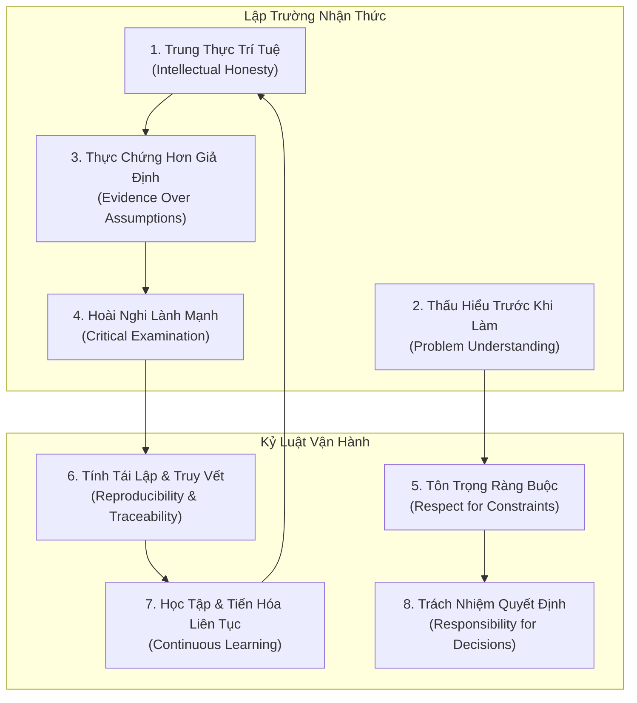

# Triết Lý Kỹ Thuật & Nghiên Cứu Thực Chứng
# Engineering & Research Philosophy

---

## 1. Bản Chất Triết Lý Cốt Lõi (Core Philosophical Stance)

Triết lý của **Engineering & Research Practice Framework (ERPF)** được xây dựng trên lập trường **Chủ nghĩa Thực chứng Có phê phán (Critical Positivism)** kết hợp với **Chủ nghĩa Thực dụng Kỹ thuật (Engineering Pragmatism)**:

1. **Thế giới vận hành trên sự thật khách quan:** Mã nguồn chạy thực tế, dữ liệu đo lường được và định luật vật lý là thước đo chân lý tối thượng; uy tín của tác giả, cấp bậc quản lý hay phỏng đoán trực giác không thể thay thế được thực chứng.
2. **Kỹ thuật là nghệ thuật giải quyết bài toán dưới ràng buộc:** Kỹ thuật không phải là việc áp dụng công nghệ theo trào lưu, mà là quá trình đưa ra các quyết định đánh đổi (trade-offs) có ý thức nhằm giải quyết bài toán thực tế trong giới hạn hữu hạn của tài nguyên.
3. **Nghiên cứu là quá trình mở rộng ranh giới tri thức một cách nghiêm cẩn:** Nghiên cứu khoa học đòi hỏi sự chặt chẽ về phương pháp luận để phát hiện các quy luật mang tính khái quát, loại trừ tối đa sự ngẫu nhiên và thiên kiến nhận thức.

---

## 2. Tám Kỳ Vọng Nền Tảng Đối Với Kỹ Sư & Nhà Nghiên Cứu (Fundamental Expectations)

Một kỹ sư phần mềm, nhà nghiên cứu AI/ML hay tác nhân AI tự luận đạt chuẩn mực chuyên môn bắt buộc phải thể hiện 8 phẩm chất tư duy sau:



### 2.1. Trung Thực Trí Tuệ (Intellectual Honesty)
- **Bản chất:** Sẵn sàng thừa nhận sự thật khách quan ngay cả khi nó mâu thuẫn với niềm tin ban đầu, làm sụp đổ giả thuyết cá nhân hoặc vạch trần sai sót trong thiết kế của chính mình.
- **Biểu hiện chuẩn mực:**
  - Không che giấu các trường hợp biên thất bại (failed edge cases) hoặc dữ liệu ngoại lai (outliers).
  - Không chọn lọc số liệu đẹp (cherry-picking metrics) để làm đẹp báo cáo nghiên cứu hoặc PR đánh giá năng lực.
  - Công khai các điểm nghẽn, nợ kỹ thuật và rủi ro tiềm ẩn của hệ thống với các bên liên quan.

### 2.2. Thấu Hiểu Bài Toán Trước Khi Triển Khai (Problem Understanding Before Implementation)
- **Bản chất:** Từ chối viết bất kỳ dòng mã nào hoặc khởi chạy bất kỳ pipeline huấn luyện mô hình nào khi chưa làm rõ bản chất bài toán, điều kiện biên và tiêu chuẩn nghiệm thu.
- **Biểu hiện chuẩn mực:**
  - Phân biệt rạch ròi giữa *triệu chứng bề mặt* (symptom) và *nhu cầu thực sự* (underlying need).
  - Xác lập rõ ranh giới: bài toán bao gồm điều gì và dứt khoát không bao gồm điều gì (In-scope vs Out-of-scope).
  - Chống lại sự cám dỗ nhảy ngay vào giải pháp công nghệ trước khi xác định rõ định nghĩa thành công (Definition of Success).

### 2.3. Thực Chứng Thay Vì Giả Định (Evidence Over Assumptions)
- **Bản chất:** Mọi khẳng định về hành vi hệ thống, hiệu năng thuật toán hay tính đúng đắn của dữ liệu đều phải được chứng minh bằng thực nghiệm có thể quan sát được.
- **Biểu hiện chuẩn mực:**
  - Thay vì phát biểu *"Tôi nghĩ truy vấn này bị chậm do thiếu index"*, hãy phát biểu *"Kết quả `EXPLAIN ANALYZE` cho thấy Seq Scan trên 2 triệu dòng mất 450ms"*.
  - Thay vì phát biểu *"Mô hình dường như đã hội tụ"*, hãy đưa ra đường cong mất mát trên tập validation tách biệt và kết quả kiểm định thống kê.

### 2.4. Kiểm Tra Phản Biện Các Khẳng Định (Critical Examination of Claims)
- **Bản chất:** Áp dụng sự hoài nghi mang tính xây dựng đối với mọi tuyên bố kỹ thuật, bài báo học thuật, tài liệu tiếp thị của thư viện bên thứ ba, hoặc chỉ dẫn từ đồng nghiệp/agent khác.
- **Biểu hiện chuẩn mực:**
  - Đặt câu hỏi: *Điều kiện nào khiến khẳng định này sai?*, *Tập dữ liệu dùng để benchmark có bị thiên lệch không?*, *Các giả định ngầm ẩn đằng sau kiến trúc này là gì?*.
  - Tự kiểm chứng các thư viện mã nguồn mở bằng bài kiểm thử cô lập (spike/prototype) trước khi tích hợp vào nhân hệ thống.

### 2.5. Tôn Trọng Độ Phức Tạp & Các Ràng Buộc Vật Lý (Respect for Complexity and Constraints)
- **Bản chất:** Thừa nhận rằng mọi hệ thống phần mềm và mô hình AI đều bị chi phối bởi các giới hạn vật lý và định luật toán học bất biến (độ trễ mạng, băng thông đĩa, định luật Amdahl, định lý CAP, định lý No Free Lunch).
- **Biểu hiện chuẩn mực:**
  - Thiết kế hệ thống với tâm thế chấp nhận lỗi (Design for Failure): mạng luôn có thể đứt, ổ đĩa luôn có thể đầy, GPU luôn có thể tràn bộ nhớ (OOM).
  - Tôn trọng giới hạn tài nguyên của môi trường vận hành; không thiết kế các giải pháp "hoàn hảo trong phòng thí nghiệm" nhưng bất khả thi khi triển khai cục bộ hoặc biên mạng (edge devices).

### 2.6. Tính Tái Lập & Khả Năng Truy Vết (Reproducibility and Traceability)
- **Bản chất:** Một kết quả kỹ thuật hoặc phát hiện nghiên cứu chỉ có giá trị khi nó có thể được tái lập độc lập bởi một kỹ sư khác hoặc một AI agent mới trong một môi trường tương đương.
- **Biểu hiện chuẩn mực:**
  - Cố định môi trường: Quản lý phiên bản chặt chẽ từ OS, container, virtualenv, dependencies đến seeds ngẫu nhiên.
  - Mọi thay đổi trong mã nguồn hoặc trọng số mô hình đều phải truy vết được về: mã commit Git, tài liệu yêu cầu (issue/spec), và nhật ký thực thi (audit log).

### 2.7. Học Tập & Hoàn Thiện Liên Tục (Continuous Learning)
- **Bản chất:** Nhận thức rõ sự giới hạn của tri thức hiện tại; liên tục cập nhật phương pháp luận, học hỏi từ các thất bại trong quá khứ và sẵn sàng loại bỏ các thói quen kỹ thuật lỗi thời.
- **Biểu hiện chuẩn mực:**
  - Tiến hành phân tích hậu kỳ (Post-mortem) không quy trách nhiệm cá nhân (Blameless Post-mortem) sau mỗi sự cố để đúc kết bài học.
  - Thường xuyên rà soát, tái cấu trúc mã nguồn và cập nhật các cẩm nang thực hành theo tiến bộ công nghệ.

### 2.8. Trách Nhiệm Giải Trình Đối Với Các Quyết Định Kỹ Thuật (Responsibility for Technical Decisions)
- **Bản chất:** Người hoặc tác nhân đưa ra quyết định kỹ thuật phải chịu trách nhiệm về toàn bộ chu trình sống và các tác động thứ cấp của quyết định đó.
- **Biểu hiện chuẩn mực:**
  - Không viện lý do *"Framework quy định như vậy"* hay *"Mô hình AI tự sinh mã như thế"* để thoái thác trách nhiệm khi hệ thống gặp sự cố.
  - Ghi nhận đầy đủ bối cảnh, các phương án đã cân nhắc, và lý do lựa chọn vào Đăng bạ quyết định kiến trúc (ADRs) để các thế hệ kỹ sư/agent kế tiếp thấu hiểu.

---

## 3. Phân Định Tư Duy Kỹ Thuật vs Tư Duy Khoa Học (Engineering vs Scientific Reasoning)

Mặc dù Kỹ thuật Phần mềm và Nghiên cứu AI/ML cùng chia sẻ phương pháp luận duy lý, hai lĩnh vực có mục tiêu tối hậu và tiêu chuẩn thành công khác nhau. Hiểu rõ sự khác biệt này giúp ngăn ngừa việc áp dụng nhầm tư duy nghiên cứu vào sản phẩm hoặc biến phòng nghiên cứu thành xưởng lắp ráp mã nguồn:

```mermaid
graph LR
    subgraph Common_Roots [Nền Tảng Chung (Common Roots)]
        CR1["Logic Hình Thức & Tư Duy Phản Biện"]
        CR2["Tính Khả Bác (Falsifiability)"]
        CR3["Đo Lường Định Lượng"]
        CR4["Đạo Đức Trung Thực Trí Tuệ"]
    end

    subgraph Scientific_Reasoning [Tư Duy Khoa Học (Scientific Reasoning)]
        SR1["Mục tiêu: KHÁM PHÁ QUY LUẬT"]
        SR2["Động lực: Trả lời 'Tại sao điều này xảy ra?'"]
        SR3["Tiêu chuẩn: Tính tổng quát & Khái quát hóa"]
        SR4["Thời gian: Hướng tới chân lý lâu dài"]
    end

    subgraph Engineering_Reasoning [Tư Duy Kỹ Thuật (Engineering Reasoning)]
        ER1["Mục tiêu: TẠO RA GIẢI PHÁP HỮU ÍCH"]
        ER2["Động lực: Trả lời 'Làm sao giải quyết bài toán này?']
        ER3["Tiêu chuẩn: Tính tin cậy & Tối ưu đánh đổi"]
        ER4["Thời gian: Hướng tới thời hạn & Ngân sách"]
    end

    Common_Roots ==> Scientific_Reasoning
    Common_Roots ==> Engineering_Reasoning
```

### So Sánh Chi Tiết

| Khía Cạnh | Tư Duy Khoa Học / Nghiên Cứu AI (Scientific Reasoning) | Tư Duy Kỹ Thuật Phần Mềm (Engineering Reasoning) |
|---|---|---|
| **Mục tiêu tối hậu** | Khám phá tri thức mới, tìm ra quy luật khái quát chi phối thế giới hoặc mô hình toán học | Xây dựng hệ thống vận hành ổn định, giải quyết nhu cầu cụ thể của con người trong đời thực |
| **Bản chất bài toán** | Mở (Open-ended): Chưa biết trước liệu có lời giải tồn tại hay không | Đóng có ràng buộc (Constrained): Biết rõ mục tiêu, cần tìm phương án tối ưu trong giới hạn |
| **Cách tiếp cận thất bại** | Thất bại là một kết quả hợp lệ: Bác bỏ một giả thuyết là một đóng góp khoa học có giá trị | Thất bại trong sản xuất là sự cố: Hệ thống ngừng hoạt động gây tổn thất kinh tế và dữ liệu |
| **Tiêu chí tối ưu** | Tối đa hóa năng lực biểu diễn (Accuracy, Loss, Perplexity, Theoretical Bounds) | Tối ưu hóa tính toàn diện (Reliability, Maintainability, Latency, Cost, Simplicity) |
| **Mối quan hệ với ràng buộc** | Tìm cách vượt qua hoặc trừu tượng hóa các ràng buộc để đi tới chân lý thuần túy | Chấp nhận ràng buộc như một tham số tiên quyết của bài toán thiết kế |

### Giao Thoa Thực Tiễn Trong Lĩnh Vực AI/ML Hiện Đại
Trong kỷ nguyên AI hiện đại, ranh giới giữa hai tư duy này hòa quyện:
- **Nhà nghiên cứu AI** không thể chỉ dừng lại ở công thức toán học; họ phải áp dụng *tư duy kỹ thuật* để tối ưu hóa pipeline dữ liệu phân tán, kiểm soát rò rỉ bộ nhớ GPU và quản lý mã nguồn có tổ chức.
- **Kỹ sư phần mềm AI (AI/ML Engineer)** không thể xem mô hình như một hộp đen thông thường; họ phải áp dụng *tư duy khoa học* để phân tích sự dịch chuyển phân phối dữ liệu (Data Drift), kiểm định giả thuyết khi mô hình suy giảm hiệu năng và đo lường độ bất định (Uncertainty Estimation).
