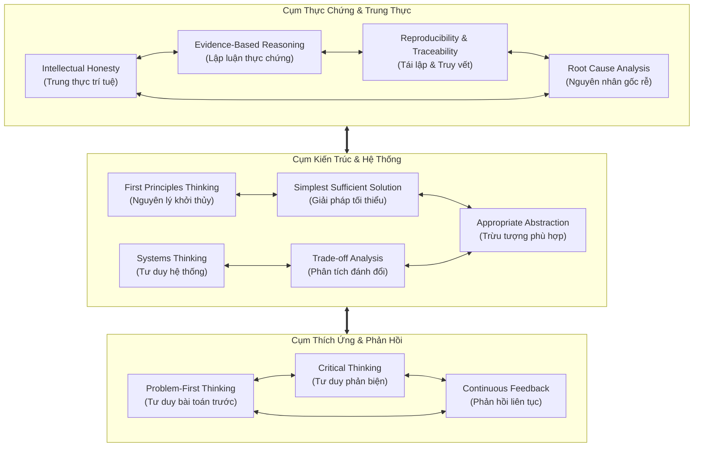
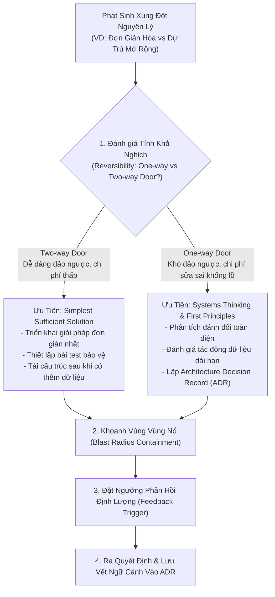

# Tương Tác, Xung Đột & Cân Bằng Các Nguyên Lý Suy Luận
# Reasoning Connections, Tensions & Decision Balancing

---

## 1. Mạng Lưới Tương Hỗ Giữa Các Nguyên Lý (Reinforcing Synergies)

Các nguyên lý suy luận trong ERPF không tồn tại độc lập mà tạo thành một mạng lưới hỗ trợ lẫn nhau. Khi được kết hợp đúng cách, chúng tạo ra hiệu ứng cộng hưởng mạnh mẽ giúp nâng cao chất lượng kỹ thuật:

### 1.1. Cặp Đôi "Thực Chứng & Trung Thực Trí Tuệ" (Evidence + Intellectual Honesty)
- **Tác động tương hỗ:** Lập luận dựa trên thực chứng cung cấp dữ liệu khách quan để bảo vệ người kỹ sư khỏi thiên kiến nhận thức. Ngược lại, trung thực trí tuệ là động lực thôi thúc người kỹ sư chủ động tìm kiếm các bằng chứng phản bác giả thuyết của chính mình.
- **Biểu hiện:** Không thể có phân tích nguyên nhân gốc rễ (`Root Cause Analysis`) chân thực nếu thiếu lập luận thực chứng và sự trung thực trí tuệ.

### 1.2. Cặp Đôi "Nguyên Lý Khởi Thủy & Giải Pháp Tối Thiểu" (First Principles + Simplest Solution)
- **Tác động tương hỗ:** Khi phân rã một bài toán về bản chất vật lý và toán học ban đầu, người kỹ sư nhận ra phần lớn sự phức tạp của các framework thông thường là dư thừa cho bài toán hiện tại. Điều này mở đường cho việc xây dựng một giải pháp tối thiểu thỏa đáng (`Simplest Sufficient Solution`) cực kỳ thanh lịch và hiệu năng cao.
- **Biểu hiện:** Clean Monolith trong Rendez ra đời từ việc kết hợp phân tích nguyên lý khởi thủy về độ trễ mạng nội bộ với nguyên tắc đơn giản hóa hệ thống.

### 1.3. Cặp Đôi "Tư Duy Hệ Thống & Phân Tích Đánh Đổi" (Systems Thinking + Trade-offs)
- **Tác động tương hỗ:** Tư duy hệ thống mở rộng không gian quan sát, giúp nhận diện các tác động thứ cấp (second-order effects). Phân tích đánh đổi giúp lượng hóa các tác động đó để đưa ra lựa chọn sáng suốt nhất trên bức tranh tổng thể.

---

## 2. Các Điểm Xung Đột & Lực Kéo Căng Thường Gặp (Principle Tensions)

Trong thực tế vận hành, các nguyên lý thường kéo kỹ sư và nhà nghiên cứu về các hướng đối nghịch nhau. Nhận thức rõ các xung đột này là bước đầu tiên để tránh rơi vào sự bế tắc hoặc cực đoan kỹ thuật:

| Lực Kéo Căng (Tension Pair) | Bản Chất Xung Đột | Hậu Quả Nếu Quá Cực Đoan Về Một Phía |
|---|---|---|
| **Problem-First vs. First Principles** | Giải quyết nhanh nhu cầu thực tế vs Đào sâu bản chất nền tảng | **Chỉ Problem-First:** Giải pháp chắp vá, tầm nhìn ngắn hạn. **Chỉ First Principles:** Tê liệt phân tích, phát minh lại bánh xe vô ích. |
| **Simplest Solution vs. Systems Thinking** | Đơn giản hóa cục bộ cho tác vụ trước mắt vs Dự trù tính tiến hóa toàn cục | **Chỉ Simplest:** Kiến trúc manh mún, không mở rộng được khi quy mô tăng. **Chỉ Systems:** Kiến trúc thượng tầng (Over-engineering), phức tạp hóa bài toán đơn giản. |
| **Evidence-Based vs. Innovation Under Uncertainty** | Chỉ hành động khi có đủ dữ liệu vs Đột phá sáng tạo trong vùng mù | **Chỉ Evidence:** Dậm chân tại chỗ, bỏ lỡ đột phá công nghệ mới. **Chỉ Innovation:** Ảo tưởng, lãng phí tài nguyên vào các ý tưởng viển vông. |
| **Appropriate Abstraction vs. Simplest Solution** | Tạo tầng trừu tượng che giấu phức tạp vs Viết mã trực tiếp đơn giản | **Chỉ Abstraction:** Ma trận wrappers khó hiểu, chi phí nhận thức tăng vọt. **Chỉ Simplest:** Trùng lặp mã nguồn khắp nơi, rò rỉ logic nghiệp vụ ra ngoài. |

---

## 3. Khung Cân Bằng Quyết Định (Decision Balancing Framework)

Để giải quyết các xung đột giữa các nguyên lý một cách có phương pháp, ERPF thiết lập khung cân bằng 4 bước dựa trên tính khả nghịch và mức độ ảnh hưởng:

### Bước 1: Phân Loại Quyết Định Theo Tính Khả Nghịch (Two-Way vs. One-Way Doors)
- **Quyết định Cửa Hai Chiều (Two-Way Door - Reversible):**
  - *Đặc điểm:* Có thể hoàn tác dễ dàng mà không làm mất dữ liệu hoặc ảnh hưởng nghiêm trọng đến hệ thống (VD: đổi thuật toán nén ảnh nội bộ, đổi tên biến, tinh chỉnh CSS).
  - *Chiến lược:* **Ưu tiên Tốc độ & Giải pháp Tối thiểu (Simplest Sufficient Solution)**. Đưa ra quyết định nhanh, nhận phản hồi sớm thay vì tranh cãi kéo dài.
- **Quyết định Cửa Một Chiều (One-Way Door - Irreversible):**
  - *Đặc điểm:* Rất khó hoặc cực kỳ tốn kém để hoàn tác (VD: lựa chọn hệ quản trị cơ sở dữ liệu, thiết kế khóa chính/schema lưu trữ, chọn mô hình danh tính entity, ký hợp đồng API công khai).
  - *Chiến lược:* **Ưu tiên Tư Duy Hệ Thống & Lập Luận Thực Chứng Nghiêm Ngặt**. Bắt buộc phải có ADR, phân tích rủi ro thứ cấp và bằng chứng benchmark trước khi chốt.

### Bước 2: Khoanh Vùng Bán Kính Ảnh Hưởng (Blast Radius Containment)
- Khi áp dụng một nguyên lý mới hoặc thử nghiệm một công nghệ chưa chắc chắn, bắt buộc phải cô lập nó sau một ranh giới bảo vệ (Seam / Interface / Feature Flag).
- Nếu giải pháp thất bại, bán kính tổn thất phải được giới hạn trong phạm vi một module duy nhất mà không làm ảnh hưởng đến toàn bộ hệ sinh thái.

### Bước 3: Đặt Ngưỡng Kích Hoạt Tái Đánh Giá (Quantitative Triggers)
- Thay vì tranh cãi *"Khi nào thì hệ thống cần chuyển sang cơ chế cache Redis?"*, hãy xác lập ngưỡng định lượng rõ ràng:
  - *Trạng thái hiện tại:* Dùng PostgreSQL query trực tiếp (đơn giản, đủ dùng).
  - *Ngưỡng kích hoạt:* Khi lưu lượng đọc vượt quá 2,000 QPS hoặc CPU database duy trì trên 75% trong 15 phút liên tục $\rightarrow$ Khi đó mới kích hoạt việc bổ sung tầng Redis.

### Bước 4: Ghi Nhận Ngữ Cảnh Đánh Đổi Vào ADR
- Mọi sự cân bằng giữa các nguyên lý đều phải được lưu vết rõ ràng: *"Chúng tôi chọn phương án A (đơn giản hơn) thay vì phương án B (mạnh mẽ hơn nhưng phức tạp hơn) vì hiện tại quy mô dữ liệu mới ở mức 10,000 bản ghi. Chúng tôi chấp nhận đánh đổi việc sẽ phải viết lại module này khi quy mô đạt 1 triệu bản ghi"*.

---

## 4. Tác Động Của Các Nguyên Lý Lên Quyết Định Thực Tế

### 4.1. Đối Với Kỹ Sư Phần Mềm (Software Engineers)
- **Khi thiết kế API:** Sử dụng *Problem-First* và *Appropriate Abstraction* để tạo ra các endpoints phản ánh đúng nhu cầu nghiệp vụ của client thay vì phơi bày toàn bộ các bảng trong cơ sở dữ liệu.
- **Khi tối ưu hóa hiệu năng:** Sử dụng *Evidence-Based Reasoning* (chạy Profiler) để tìm nút thắt cổ chai thực sự trước khi viết code tối ưu; tránh việc tối ưu hóa sớm (Premature Optimization) vi phạm nguyên lý *Simplest Sufficient Solution*.

### 4.2. Đối Với Nhà Nghiên Cứu AI/ML (AI/ML Researchers)
- **Khi thiết kế kiến trúc mô hình:** Sử dụng *First Principles* để xem xét liệu bài toán có đòi hỏi một kiến trúc hoàn toàn mới hay không; áp dụng *Ablation Studies* (phân tích thành phần dựa trên thực chứng) để chứng minh từng khối module mới thêm vào thực sự mang lại giá trị chứ không phải do may mắn ngẫu nhiên.
- **Khi công bố kết quả:** Sử dụng *Intellectual Honesty* và *Reproducibility* để công khai đầy đủ mã nguồn, seeds, quy trình lọc dữ liệu và các trường hợp mô hình thất bại.

### 4.3. Đối Với Các Tác Nhân AI Tự Luận (Autonomous AI Agents)
- **Khi tiếp nhận yêu cầu mới:** Bắt buộc áp dụng *Problem-First* và *Operating Contract Guardrails*: Đọc hiểu toàn bộ tài liệu và kiểm tra `git status` trước khi sửa file; tuyệt đối không tự ý thêm package hay sửa mã nguồn khi nhiệm vụ chỉ yêu cầu lập tài liệu.
- **Khi gặp lỗi kiểm thử:** Áp dụng *Root Cause Analysis* và *Evidence-Based Reasoning*: Đọc kỹ traceback và logs để tìm nguyên nhân gốc; tuyệt đối không sửa code kiểu phỏng đoán hoặc làm giảm độ nghiêm ngặt của bài test để ép nó pass giả tạo.
