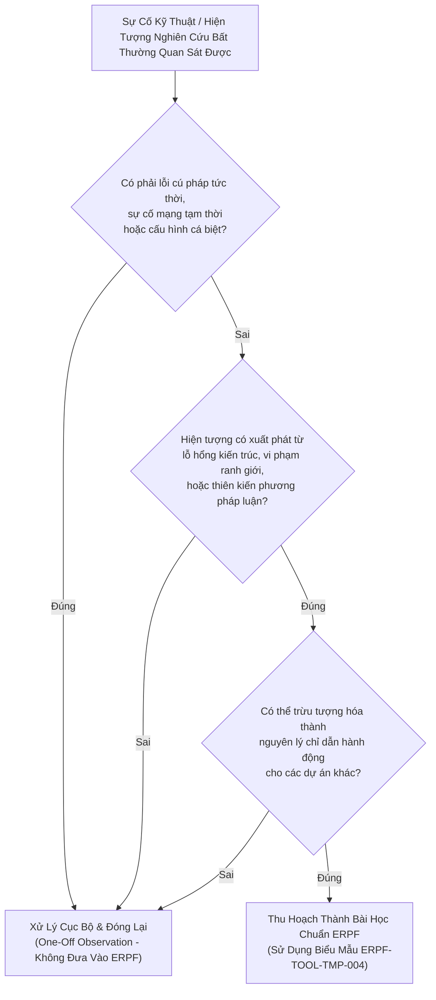

# Thư Viện Bài Học Kinh Nghiệm Kỹ Thuật & Nghiên Cứu
# Lessons Learned Library & Knowledge Capture Guide

---

## 1. Triết Lý & Vai Trò Của Thư Viện Bài Học (Philosophy & Role)

Trong khuôn khổ **Engineering & Research Practice Framework (ERPF)**, một tổ chức kỹ thuật hoặc nhóm nghiên cứu trưởng thành không được đánh giá bằng việc họ *chưa bao giờ gặp sự cố*, mà bằng **tốc độ và chất lượng chuyển hóa sự cố thành tri thức có thể tái sử dụng**.

Bài học kinh nghiệm (*Lesson Learned*) là mắt xích liên kết giữa **Thực tiễn đau thương trong quá khứ** và **Nguyên lý suy luận trong tương lai**. Một bài học đạt chuẩn ERPF phải trả lời được ba câu hỏi cốt tử:
1. *Cơ chế kỹ thuật hoặc thiên kiến nhận thức bản chất nào đã gây ra hiện tượng?*
2. *Nguyên lý khái quát hóa nào giúp bất kỳ ai trong tổ chức không bao giờ mắc lại sai lầm này?*
3. *Đâu là điều kiện biên mà nếu bước qua, bài học này sẽ không còn đúng?*

---

## 2. Phân Định Giữa "Bài Học Khái Quát Hóa" & "Quan Sát Nhất Thời"
*(Distinguishing a Generalizable Lesson from a One-Off Observation)*

Một trong những sai lầm phổ biến nhất trong quản trị tri thức kỹ thuật là việc lưu trữ bừa bãi mọi lỗi cú pháp, sự cố nhất thời hoặc hành vi ad-hoc thành "bài học", làm loãng hệ thống tài liệu và gây nhiễu cho các kỹ sư lẫn AI agents.

ERPF thiết lập **Bộ Tiêu Chí 5 Chiều Khắt Khe** để sàng lọc:

| Chiều Đánh Giá | Quan Sát Nhất Thời (One-Off Observation) | Bài Học Khái Quát Hóa (Generalizable Lesson) |
| :--- | :--- | :--- |
| **1. Bản Chất Sự Cố** | Lỗi gõ phím (typo), đường truyền mạng chập chờn nhất thời, sự cố dịch vụ bên thứ ba bị sập 5 phút, phiên bản bug đã được hotfix ngay. | Lỗ hổng trong mô hình tư duy (mental model flaw), vi phạm tính bất biến kiến trúc, hiểu sai ngữ nghĩa giao thức, rò rỉ dữ liệu qua ranh giới. |
| **2. Tần Suất & Quy Luật** | Diễn ra một lần do ngẫu nhiên; không mang tính quy luật và rất khó tái hiện nếu không có đúng điều kiện ngẫu nhiên đó. | Có cơ chế lặp lại mang tính tất yếu; bất kỳ ai tiếp cận bài toán theo tư duy cũ đều sẽ rơi vào cái bẫy tương tự. |
| **3. Mức Độ Trừu Tượng** | Quá gắn chặt vào chi tiết bề mặt (*"Biến X ở dòng 42 bị null"*). | Được trừu tượng hóa lên cấp độ cấu trúc (*"Hiện tượng thiếu kiểm tra ranh giới tại Trust Boundary khi nhận payload từ bên ngoài"*). |
| **4. Giá Trị Hành Động** | Chỉ có tác dụng ghi nhớ cá nhân hoặc xóa bỏ sau khi sửa xong mã nguồn. | Cung cấp quy tắc suy luận (*Heuristic / Principle*) và cổng kiểm soát (*Quality Gate*) áp dụng cho toàn bộ dự án hiện tại và tương lai. |
| **5. Điều Kiện Biên (Boundary)** | Không có giới hạn rõ ràng vì bản thân sự việc là ngẫu nhiên. | Có phạm vi áp dụng cụ thể và chỉ rõ các bối cảnh ngoại lệ mà nguyên lý không được áp dụng máy móc. |

---

## 3. Quy Trình 4 Bước Thu Hoạch Bài Học (The 4-Step Capture Workflow)

Khi một sự cố kỹ thuật lớn (P0/P1), một lỗi thiết kế nghiêm trọng, hoặc một khiếm khuyết phương pháp luận nghiên cứu được phát hiện:

1. **Bước 1: Cách Ly Triệu Chứng & Thu Thập Bằng Chứng Thực Chứng:**
   - Thu thập toàn bộ log hệ thống, stack trace, mã nguồn liên quan hoặc bảng số liệu thực nghiệm.
   - Tuyệt đối không suy đoán cảm tính; mọi khẳng định phải có dữ liệu chứng minh.
2. **Bước 2: Mổ Xẻ Nguyên Nhân Gốc Bằng Kỹ Thuật 5 Whys:**
   - Đào sâu chuỗi quan hệ nhân quả cho đến khi chạm tới lỗ hổng trong giả định thiết kế, quy trình kiểm thử hoặc phương pháp đánh giá.
3. **Bước 3: Trừu Tượng Hóa Thành Nguyên Lý Suy Luận:**
   - Đặt câu hỏi: *"Nếu người khác đối mặt với bài toán tương tự ở một ngôn ngữ/lĩnh vực khác, quy tắc nào sẽ cứu họ?"*.
   - Xác định rõ ràng các trường hợp ngoại lệ (khi nào không áp dụng).
4. **Bước 4: Đăng Bạ Vào Thư Viện ERPF:**
   - Áp dụng cấu trúc biểu mẫu [`erpf/toolkit/templates/lesson-template.md`](file:///home/longtran/Projects/rendez-web/erpf/toolkit/templates/lesson-template.md) (`ERPF-TOOL-TMP-004`).
   - Cấp phát mã định danh `ERPF-[CORE/SE/AI]-LESS-[xxx]` và liên kết chéo với các tài liệu miền kỹ thuật.

---

## 4. Danh Mục Bài Học Đã Được Kiểm Chứng (Verified Lessons Register)

### A. Nhánh Kỹ Thuật Phần Mềm (Software Engineering Track)
1. [`erpf/lessons/software-engineering/symptom-masking-vs-root-cause.md`](file:///home/longtran/Projects/rendez-web/erpf/lessons/software-engineering/symptom-masking-vs-root-cause.md) (`ERPF-SE-LESS-001`):
   - **Lĩnh vực:** Debugging & Software Design.
   - **Tóm tắt bài học:** Cạm bẫy của việc "vá triệu chứng bề mặt" (thêm kiểm tra null, catch exception im lặng) thay vì loại bỏ biến trạng thái dị thường ở nguồn gốc; nguyên tắc sửa dứt điểm nguyên nhân gốc rễ và khóa bằng regression test.

### B. Nhánh Nghiên Cứu Trí Tuệ Nhân Tạo (AI Research Track)
1. [`erpf/lessons/ai-research/data-leakage-pre-split-normalization.md`](file:///home/longtran/Projects/rendez-web/erpf/lessons/ai-research/data-leakage-pre-split-normalization.md) (`ERPF-AI-LESS-001`):
   - **Lĩnh vực:** Research Methodology & Experimental Validity.
   - **Tóm tắt bài học:** Sự nguy hiểm chết người của việc chuẩn hóa dữ liệu (Feature Scaling / TF-IDF fitting / Tokenizer training) trên toàn bộ tập dữ liệu trước khi chia Train/Validation split; tạo ra ảo giác hiệu năng cao giả mạo và thất bại hoàn toàn trên môi trường thực tế.
2. [`erpf/lessons/ai-research/shortcut-learning-clever-hans.md`](file:///home/longtran/Projects/rendez-web/erpf/lessons/ai-research/shortcut-learning-clever-hans.md) (`ERPF-AI-LESS-002`):
   - **Lĩnh vực:** Model Evaluation & Scientific Reasoning.
   - **Tóm tắt bài học:** Ảo giác mô hình thông minh từ hiện tượng "Ngựa Clever Hans" (mô hình học tương quan rác, watermark, background noise thay vì đặc trưng bản chất); bắt buộc phải kiểm định bằng stress testing trên Out-Of-Distribution (OOD) và phân tích attribution maps.

---

## 5. Bảng Nhận Diện Ứng Viên Bài Học Liên Ngành (Cross-Disciplinary Lesson Candidates)

Dựa trên kho tri thức nền tảng đã xây dựng tại Tasks 02 đến 08, các ứng viên bài học sâu sắc tiếp theo đã được xác định và phân loại theo 7 lĩnh vực cốt lõi để tiếp tục hoàn thiện khi có đủ bằng chứng kỹ thuật:

| Lĩnh Vực Cốt Lõi | Ứng Viên Bài Học (Lesson Candidate) | Miền Tri Thức Nền Tảng Đối Ứng | Cơ Chế Bản Chất & Cạm Bẫy Trọng Tâm |
| :--- | :--- | :--- | :--- |
| **1. Software Design** | *Sự giòn gãy của kế thừa sâu vs Sức bền của Composition* | `ERPF-SE-DOM-004` (Software Design) | Kế thừa nhiều tầng làm lộ chi tiết cài đặt của lớp cha; thay đổi nhỏ ở lớp gốc làm gãy hàng loạt lớp con. |
| **2. Debugging** | *Cạm bẫy vá triệu chứng bề mặt thay vì triệt tiêu nguyên nhân gốc* | `ERPF-SE-DOM-011` (Debugging & RCA) | **[ĐÃ HOÀN TẤT - `ERPF-SE-LESS-001`]** Nuốt ngoại lệ hoặc thêm null-check làm tha hóa dữ liệu ngầm trong DB. |
| **3. Testing** | *Ảo tưởng an toàn từ 100% Code Coverage nhưng rỗng Assertion* | `ERPF-SE-DOM-012` (Software Testing) | Chạy qua tất cả các dòng code nhưng không kiểm tra bất biến nghiệp vụ và ranh giới tin cậy (Trust Boundary). |
| **4. Research Methodology** | *Thiên kiến tìm kiếm xác nhận trong khảo sát y văn (Confirmation Bias)* | `ERPF-AI-DOM-002` (Literature Review) | Chỉ trích dẫn các bài báo ủng hộ giả thuyết của bản thân, bỏ qua các công trình chỉ ra giới hạn hoặc phản nghiệm. |
| **5. Experimental Validity** | *Rò rỉ dữ liệu qua biến đổi đặc trưng trước khi phân tách tập dữ liệu* | `ERPF-AI-DOM-011` (Dataset Analysis) | **[ĐÃ HOÀN TẤT - `ERPF-AI-LESS-001`]** Tính toán thống kê toàn cục trên test set làm sai lệch kết quả lab và hỏng trên thực tế. |
| **6. Model Evaluation** | *Ảo giác hiệu năng từ học đường tắt (Shortcut Learning / Clever Hans)* | `ERPF-AI-DOM-021` (Model Evaluation) | **[ĐÃ HOÀN TẤT - `ERPF-AI-LESS-002`]** Mô hình học đặc trưng rác (watermark, nhiễu nền) thay vì bản chất bệnh lý/ngữ nghĩa. |
| **7. Scientific Reasoning** | *Cạm bẫy thổi phồng đóng góp khoa học khi thiếu bóc tách độc lập* | `ERPF-AI-DOM-022` (Ablation Studies) | Gán toàn bộ công trạng vượt trội cho module đề xuất mới trong khi thực chất chỉ do bộ siêu tham số được tune tốt hơn. |

---

## 6. Hướng Dẫn Mở Rộng & Đóng Góp Bài Học Mới

Mọi kỹ sư, nhà nghiên cứu và AI Agent khi đóng góp bài học mới vào thư mục `erpf/lessons/` bắt buộc phải tuân thủ:
- **Nguyên tắc thực chứng không nhân nhượng:** Không bịa đặt sự cố, không tự tạo số liệu benchmark giả mạo, không trích dẫn tài liệu không tồn tại.
- **Tính đầy đủ của cấu trúc 11 mục:** Điền đầy đủ từ Bối cảnh đến Giới hạn và Tài liệu liên quan theo [`ERPF-TOOL-TMP-004`](file:///home/longtran/Projects/rendez-web/erpf/toolkit/templates/lesson-template.md).
- **Cập nhật đăng bạ:** Bổ sung bài học mới vào bảng mục lục tại tài liệu này và ghi nhận vào [`erpf/PROJECT_STATE.md`](file:///home/longtran/Projects/rendez-web/erpf/PROJECT_STATE.md).
