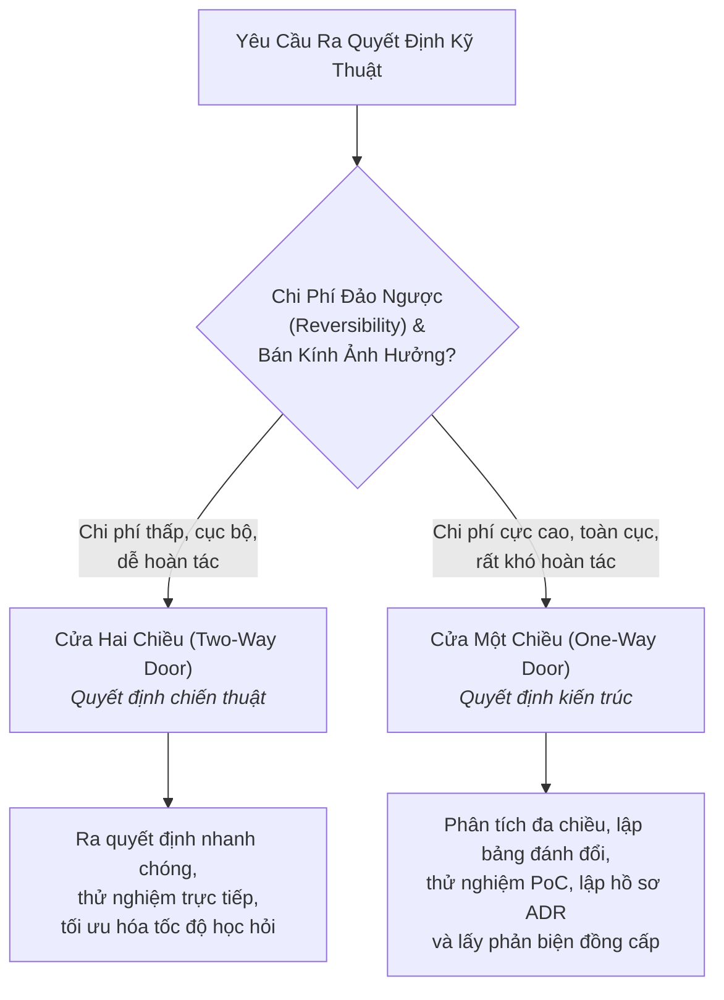
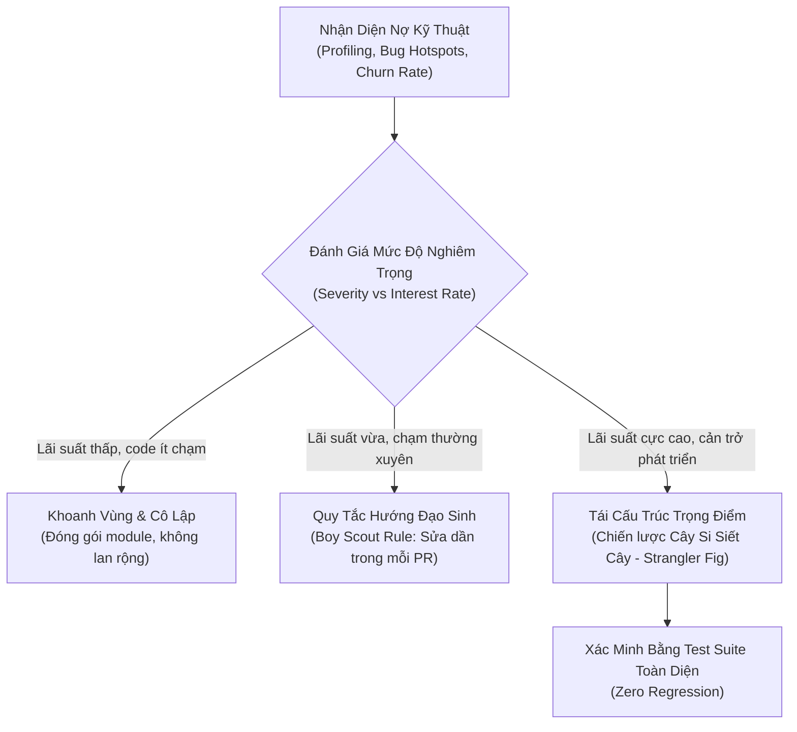

# Quyết Định Kiến Trúc & Quản Trị Nợ Kỹ Thuật
# Architecture Decision-Making & Technical Debt Governance

---

## 1. Nguyên Lý Nền Tảng (Fundamentals)

### 1.1. Bản Chất Của Quyết Định Kiến Trúc
Kiến trúc phần mềm không phải là một trạng thái tĩnh hay một bản vẽ kỹ thuật cố định, mà là **chuỗi các quyết định kỹ thuật có chi phí đảo ngược cao (High Cost of Reversal)** được đưa ra trong suốt vòng đời của hệ thống.

Một quyết định được xếp vào hàng "quyết định kiến trúc" khi nó đáp ứng ít nhất một trong các tiêu chí sau:
1. **Khó thay đổi:** Việc hoàn tác hoặc thay thế đòi hỏi tái cấu trúc diện rộng trên nhiều mô-đun hoặc di chuyển dữ liệu phức tạp.
2. **Định hình các ràng buộc nền tảng:** Nó đặt ra luật chơi, giới hạn và quy ước mà mọi thành phần khác trong hệ thống bắt buộc phải tuân theo (ví dụ: mô hình lưu trữ dữ liệu, giao thức liên lạc, cơ chế xác thực danh tính).
3. **Ảnh hưởng trực tiếp đến các thuộc tính chất lượng (Architectural Quality Attributes):** Khả năng mở rộng (Scalability), độ trễ (Latency), tính nhất quán (Consistency), độ sẵn sàng (Availability) và tính bảo mật (Security).

### 1.2. Khung Phân Loại Quyết Định: Cửa Một Chiều vs Cửa Hai Chiều (One-Way vs Two-Way Door)
Không phải quyết định nào cũng cần sự cẩn trọng và quy trình xem xét như nhau. Kỹ sư trưởng cần phân loại quyết định ngay từ đầu:



- **Quyết định Cửa Hai Chiều (Two-Way Door):** Ví dụ như chọn thư viện tiện ích nhỏ, đổi tên hàm nội bộ, cấu trúc lại một component UI. Nếu sai, ta có thể revert commit hoặc đổi lại trong vài giờ mà không ảnh hưởng tới dữ liệu hay API client. Cần ra quyết định nhanh, tránh tê liệt phân tích (Analysis Paralysis).
- **Quyết định Cửa Một Chiều (One-Way Door):** Ví dụ như chọn cơ sở dữ liệu quan hệ (PostgreSQL) hay tài liệu (MongoDB), chuyển từ Monolith sang Microservices, chọn cơ chế sinh khóa chính (Auto-increment integer vs UUIDv7), thiết kế cấu trúc URL công khai. Một khi đã phát hành và có hàng triệu bản ghi, việc quay đầu tốn hàng tháng kỹ thuật và rủi ro mất dữ liệu. Bắt buộc phải có phân tích thấu đáo và tài liệu hóa bằng ADR.

---

## 2. So Sánh Các Phương Án Kỹ Thuật (Comparing Alternatives)

Khi đứng trước một bài toán kiến trúc, sai lầm phổ biến nhất là chỉ nghĩ ra một phương án rồi cố gắng tìm lý do biện minh cho nó. Một kỹ sư vững vàng luôn đặt lên bàn **ít nhất hai đến ba phương án khả thi** và đánh giá khách quan dựa trên bằng chứng.

### 2.1. Ma Trận Đánh Giá Đa Tiêu Chí (Pugh Decision Matrix)
Công cụ hữu hiệu để so sánh là ma trận có trọng số, đối chiếu các phương án cạnh tranh với tập tiêu chí rõ ràng:

| Tiêu Chí Đánh Giá (Criteria) | Trọng Số (Weight: 1-5) | Phương Án A: Clean Monolith (PostgreSQL + Django) | Phương Án B: Microservices (gRPC + Kafka + Polyglot DB) | Phương Án C: Serverless Functions (AWS Lambda + DynamoDB) |
|---|:---:|:---:|:---:|:---:|
| **Độ phức tạp vận hành (Operational Simplicity)** | 5 | **5** (Cực thấp, 1 repo, 1 DB) | **1** (Rất cao, cần K8s, tracing, mesh) | **3** (Trung bình, phụ thuộc cloud) |
| **Tính toàn vẹn dữ liệu (Data Consistency)** | 5 | **5** (ACID native, Foreign Keys) | **2** (Eventual consistency, Saga) | **2** (Non-relational, custom logic) |
| **Tốc độ lặp tính năng (Feature Velocity)** | 4 | **4** (Tái sử dụng code, test nhanh) | **2** (Phân mảnh repo, đồng bộ schema) | **3** (Độc lập nhưng khó debug E2E) |
| **Khả năng mở rộng cục bộ (Targeted Scaling)** | 3 | **3** (Scale theo chiều dọc hoặc nhân bản) | **5** (Scale độc lập từng service) | **5** (Scale tự động theo request) |
| **Chi phí hạ tầng cố định (Fixed Cost)** | 4 | **5** (1 VPS/Container nhỏ là đủ) | **1** (Cần cụm cluster lớn, nhiều RAM) | **4** (Pay-per-use, rẻ khi traffic thấp) |
| **Tổng Điểm Có Trọng Số (Weighted Score)** | — | **93 / 105** *(Chiến thắng)* | **44 / 105** | **70 / 105** |

### 2.2. Kiểm Chứng Bằng Bản Mẫu Bỏ Đi (Throwaway Prototyping / Spike)
Đừng tranh cãi lý thuyết khi có thể viết một đoạn mã thực nghiệm:
- Khi băn khoăn liệu PostgreSQL PostGIS có xử lý nổi truy vấn không gian phức tạp với 100,000 địa điểm hay không, hãy tạo một scratch script, nạp 100,000 điểm dữ liệu giả lập và chạy `EXPLAIN ANALYZE`.
- Bản mẫu này chỉ nhằm trả lời một câu hỏi giả thuyết duy nhất, sau đó loại bỏ, không đưa trực tiếp vào sản phẩm chính.

---

## 3. Quy Chuẩn Hồ Sơ Quyết Định Kiến Trúc (Architecture Decision Records - ADRs)

### 3.1. Tại Sao Cần ADR?
Trong mọi tổ chức phần mềm, code chỉ cho biết **hệ thống đang làm gì**, test cho biết **hệ thống được kỳ vọng hoạt động thế nào**, nhưng chỉ có ADR mới cho biết **TẠI SAO hệ thống lại được xây dựng như vậy** và **những phương án nào đã bị từ chối**.

Nếu không có ADR, những kỹ sư mới hoặc AI agents khi tiếp nhận dự án sẽ:
- Không hiểu lý do của những đoạn code "kỳ quặc" và vô tình xóa bỏ những cơ chế phòng vệ cốt tử.
- Liên tục đề xuất lại những ý tưởng tồi mà đội ngũ trước đó đã nghiên cứu và bác bỏ.
- Mất hàng tuần lễ để tái khám phá lại các ràng buộc lịch sử.

### 3.2. Cấu Trúc Chuẩn Của Một Bản Ghi ADR
Một bản ghi ADR xuất sắc phải ngắn gọn (1–2 trang Markdown), được lưu trữ trực tiếp trong kho mã nguồn (ví dụ: `docs/adr/` hoặc `erpf/`) và nằm dưới sự kiểm soát phiên bản của Git:

```markdown
# ADR-00X: [Tiêu Đề Quyết Định - Ngắn Gọn, Rõ Ràng]

- **Trạng thái (Status):** [Proposed | Accepted | Superseded by ADR-00Y | Deprecated]
- **Ngày quyết định (Date):** YYYY-MM-DD
- **Tác giả (Deciders):** [Danh sách kỹ sư / Agents tham gia]
- **Thuật ngữ & Phạm vi:** [Các domain concepts liên quan]

## 1. Ngữ Cảnh & Vấn Đề (Context and Problem Statement)
Mô tả tình huống thực tế, động lực thúc đẩy và bài toán cần giải quyết. Những yếu tố nào khiến hiện trạng không còn đáp ứng được yêu cầu?

## 2. Các Động Lực Quyết Định (Decision Drivers)
- Ràng buộc kỹ thuật / thời gian / tài nguyên.
- Yêu cầu phi chức năng cần ưu tiên (ví dụ: P95 latency < 50ms, tính toàn vẹn dữ liệu tuyệt đối).
- Mục tiêu kinh doanh hoặc trải nghiệm người dùng.

## 3. Các Phương Án Đã Xem Xét (Considered Options)
- **Phương án 1:** [Tên phương án] — Ưu điểm, nhược điểm, chi phí.
- **Phương án 2:** [Tên phương án] — Ưu điểm, nhược điểm, chi phí.
- **Phương án 3:** [Tên phương án] — Ưu điểm, nhược điểm, chi phí.

## 4. Quyết Định Đã Chọn (Decision Outcome)
Phương án được lựa chọn là **Phương án X**, bởi vì [lý do thuyết phục nhất dựa trên bằng chứng].

### Chi tiết kỹ thuật cốt lõi:
- [Mô tả ngắn gọn cơ chế triển khai chính].

## 5. Hệ Quả & Đánh Đổi (Consequences)
### Tích cực (Positive Consequences):
- [Những lợi ích hệ thống thu được].
### Tiêu cực & Rủi ro chấp nhận (Negative Consequences & Accepted Risks):
- [Những gánh nặng kỹ thuật phát sinh, điểm nghẽn tiềm tàng và cách giảm thiểu rủi ro].

## 6. Tính Khả Nghịch & Điều Kiện Tái Đánh Giá (Reversibility & Triggers)
- Quyết định này là Cửa Một Chiều hay Cửa Hai Chiều?
- Khi nào cần kích hoạt xem xét lại quyết định này (ví dụ: khi lượng truy cập vượt quá 50,000 QPS, hoặc khi dữ liệu vượt quá 10TB)?
```

### 3.3. Vòng Đời Của Một ADR (ADR Lifecycle)
Một nguyên tắc bất di bất dịch: **Không bao giờ chỉnh sửa lịch sử của một ADR đã Accepted để thay đổi nội dung quyết định**.
- Khi một quyết định cũ không còn phù hợp, tạo một ADR mới (ví dụ: `ADR-012: Chuyển đổi sang UUIDv7`).
- Đánh dấu ADR cũ thành `Superseded by ADR-012`.
- Cách tiếp cận này bảo tồn dòng thời gian tiến hóa nhận thức của tổ chức.

---

## 4. Quản Lý Ràng Buộc Kiến Trúc (Architectural Constraints)

Kiến trúc phần mềm luôn vận hành trong một không gian bị giới hạn bởi các ràng buộc. Kỹ sư giỏi không coi ràng buộc là vật cản, mà coi chúng là **công cụ thu hẹp không gian tìm kiếm giải pháp**.

### 4.1. Bốn Nhóm Ràng Buộc Cốt Lõi
1. **Ràng buộc nghiệp vụ (Business Constraints):** Ngân sách hạ tầng cố định hàng tháng, ngày ra mắt cố định (Hard Deadline), số lượng nhân sự phát triển giới hạn.
2. **Ràng buộc kỹ thuật (Technical Constraints):** Hệ thống phải chạy trên hạ tầng tự vận hành (Self-hosted) không phụ thuộc dịch vụ tính phí của bên thứ ba; cơ sở dữ liệu phải hỗ trợ truy vấn địa lý không gian; môi trường client là trình duyệt di động băng thông thấp.
3. **Ràng buộc pháp lý & Bảo mật (Compliance & Privacy):** Dữ liệu định vị và ảnh chụp cá nhân phải tuân thủ quyền riêng tư; metadata nhạy cảm (EXIF GPS) phải bị xóa bỏ trước khi lưu trữ công khai; không được gửi dữ liệu qua các máy chủ bên ngoài khu vực quy định.
4. **Ràng buộc tương thích ngược (Backward Compatibility):** Định dạng API công khai hoặc cấu trúc schema cũ đang phục vụ mobile app cũ không được phép bị gãy đột ngột mà phải qua lộ trình deprecation rõ ràng.

---

## 5. Bản Thể Học & Chiến Lược Quản Trị Nợ Kỹ Thuật (Technical Debt Governance)

### 5.1. Bản Chất Của Nợ Kỹ Thuật
Thuật ngữ "Technical Debt" (do Ward Cunningham khởi xướng) là một phép ẩn dụ tài chính:
- Đôi khi, việc chấp nhận một giải pháp chưa hoàn hảo để đưa tính năng ra thị trường sớm là một hành động hợp lý — giống như việc **vay vốn kinh doanh**.
- Tuy nhiên, nợ kỹ thuật bắt buộc phải trả **lãi suất (Interest)**: đó là thời gian kỹ sư phải bỏ thêm ra cho mỗi lần sửa lỗi, tốc độ phát triển tính năng mới bị chậm lại, và nguy cơ lỗi dây chuyền tăng cao.
- Nếu không trả nợ gốc (Principal), lãi suất cộng dồn sẽ dẫn đến **phá sản kỹ thuật (Technical Bankruptcy)**: tình trạng codebase tê liệt, không ai dám sửa đổi bất kỳ dòng code nào vì sợ sập hệ thống.

### 5.2. Tứ Phân Vị Nợ Kỹ Thuật (Martin Fowler's Technical Debt Quadrant)
Không phải khoản nợ nào cũng giống nhau:

```
               CÓ CHỦ ĐÍCH (Deliberate)         VÔ TÌNH / THIẾU HIỂU BIẾT (Inadvertent)
         ┌─────────────────────────────────┬─────────────────────────────────┐
         │ 1. Nợ Khôn Ngoan & Có Chủ Đích   │ 3. Nợ Khôn Ngoan Do Tiến Hóa     │
         │    (Prudent & Deliberate)       │    (Prudent & Inadvertent)      │
KHÔN     │ "Chúng ta cần phát hành ngay để  │ "Bây giờ chúng ta đã hiểu sâu   │
NGOAN    │ kiểm chứng thị trường; chúng ta │ hơn về bài toán sau 1 năm chạy   │
(Prudent)│ biết rõ điểm cắt giảm và đã lập │ thực tế; chúng ta cần tái cấu    │
         │ kế hoạch tái cấu trúc vào Q2."  │ trúc lại mô hình dữ liệu."       │
         ├─────────────────────────────────┼─────────────────────────────────┤
         │ 2. Nợ Liều Lĩnh & Có Chủ Đích   │ 4. Nợ Liều Lĩnh Do Yếu Kém       │
LIỀU     │    (Reckless & Deliberate)      │    (Reckless & Inadvertent)     │
LĨNH     │ "Chúng ta không có thời gian    │ "Thiết kế theo tầng là gì? Cứ   │
(Reckless│ viết test hay thiết kế; cứ viết │ ném hết logic vào controller và  │
         │ đại cho chạy là được!"          │ copy-paste code thôi."           │
         └─────────────────────────────────┴─────────────────────────────────┘
```

- **Ô 1 (Chấp nhận được có kiểm soát):** Được coi là đòn bẩy kỹ thuật nếu có kế hoạch trả nợ rõ ràng.
- **Ô 2 & Ô 4 (Cực kỳ độc hại):** Cần bị ngăn chặn triệt để thông qua quy trình Code Review và rào chắn kiểm thử tự động.
- **Ô 3 (Tự nhiên & Không thể tránh khỏi):** Khi hệ thống lớn lên, sự hiểu biết về miền tăng lên, code cũ tự nhiên trở thành nợ. Đây là dấu hiệu của sự tiến hóa, không phải lỗi lầm.

### 5.3. Chiến Lược Quản Trị & Trả Nợ Kỹ Thuật Thực Tiễn



1. **Quy tắc Hướng đạo sinh (Boy Scout Rule):** "Luôn để khu cắm trại sạch hơn lúc bạn đến". Bất cứ khi nào chạm vào một tệp để thêm tính năng hay sửa bug, hãy dành thêm 10–15 phút dọn dẹp các code smell nhỏ, thêm type hint hoặc bổ sung test thiếu.
2. **Chiến lược Cây Si Siết Cây (Strangler Fig Pattern):** Khi cần thay thế một mô-đun cũ bị thối rữa (rot), **tuyệt đối không viết lại toàn bộ từ con số 0 (Grand Redesign)**. Thay vào đó:
   - Đặt một Interceptor hoặc Proxy ở phía trước.
   - Viết tính năng mới hoặc trích xuất từng phần nhỏ của logic sang mô-đun mới.
   - Dần dần định tuyến lưu lượng sang mô-đun mới cho đến khi mô-đun cũ không còn được gọi.
   - Xóa bỏ an toàn mô-đun cũ.
3. **Sổ Đăng Ký Nợ Kỹ Thuật (Tech Debt Register):** Mọi khoản nợ có chủ đích phải được ghi vào issue tracker hoặc tài liệu kỹ thuật của dự án với ước tính lãi suất và điều kiện trả nợ, tránh tình trạng "lời hứa suông sẽ quay lại sửa sau".

---

## 6. Sai Lầm Thường Gặp & Anti-Patterns (Common Mistakes)

1. **Tê liệt phân tích (Analysis Paralysis):** Dành hàng tháng trời họp bàn, vẽ sơ đồ và tranh cãi về các kịch bản tương lai xa xôi thay vì đưa ra quyết định tối thiểu đủ dùng (Simplest Sufficient Solution) để kiểm chứng thực tế.
2. **Hội chứng Viết lại Toàn Bộ (The Second System Effect / Full Rewrite Fallacy):** Tin rằng việc đập bỏ toàn bộ codebase hiện tại để viết lại từ đầu sẽ giải quyết mọi vấn đề. Thực tế cho thấy các dự án viết lại toàn bộ thường trễ hạn nghiêm trọng, phát sinh lại toàn bộ các bug mà hệ thống cũ đã mất nhiều năm khắc phục, và thường kết thúc trong thảm họa.
3. **Quyết định dựa trên xu hướng đám đông (Resume-Driven Development):** Chọn một công nghệ phức tạp chỉ vì nó đang thịnh hành hoặc để làm đẹp hồ sơ cá nhân của kỹ sư, bất chấp nó không phù hợp với bài toán và năng lực vận hành của đội ngũ.
4. **ADR viết theo kiểu chiếu lệ (Cargo Cult ADRs):** Lập tài liệu ADR sau khi code đã được merge chỉ để đối phó quy trình, không ghi nhận các phương án bị loại bỏ hay các rủi ro chấp nhận.
5. **Đổi mới quá nhiều thứ cùng lúc (High Innovation Token Consumption):** Trong một dự án hoặc một quý, áp dụng đồng thời cơ sở dữ liệu mới, ngôn ngữ mới, kiến trúc mới và công cụ CI/CD mới. Quy tắc an toàn: Mỗi dự án chỉ nên tiêu tốn tối đa 1–2 "đồng xu đổi mới" (Innovation Tokens).

---

## 7. Đánh Giá Đánh Đổi & Ví Dụ Thực Tế (Trade-off Analysis & Practical Examples)

### Bảng Đánh Đổi Cốt Lõi: Tốc Độ Phát Hành Ngắn Hạn vs Nợ Kỹ Thuật Dài Hạn

| Khía Cạnh Đánh Đổi | Vay Nợ Kỹ Thuật Chiến Lược (Strategic Debt) | Trả Hết Nợ Ngay Lập Tức (Perfect Engineering) |
|---|---|---|
| **Thời gian ra mắt (Time to Market)** | Nhanh hơn 2–3 lần, sớm nhận phản hồi thị trường | Chậm trễ, có nguy cơ lỡ cơ hội kinh doanh |
| **Độ rõ ràng của yêu cầu** | Thấp — chấp nhận vừa làm vừa khám phá | Đòi hỏi yêu cầu phải cực kỳ rõ ràng ngay từ đầu |
| **Chi phí bảo trì tương lai** | Tăng cao nếu không có kế hoạch trả nợ | Cực thấp, hệ thống ổn định và dễ mở rộng |
| **Rủi ro cốt lõi** | Lãi suất nợ tích tụ làm tê liệt phát triển | Lãng phí công sức xây dựng thứ không ai cần |

### Tình Huống Thực Tế Tại Rendez: Loại Bỏ Ứng Dụng Rác & Chuẩn Hóa Schema

Trong quá trình phát triển Rendez, nhóm kỹ sư đã đối mặt với hai quyết định kiến trúc điển hình:

#### Ví dụ 1: Quyết định loại bỏ ứng dụng thừa (`pricing` và `contributions`)
- **Ngữ cảnh:** Trong giai đoạn thử nghiệm ý tưởng ban đầu, codebase chứa các Django app `pricing` và `contributions` với schema dở dang, không có tests và không gắn kết với luồng khám phá địa điểm cốt lõi.
- **Quyết định (ADR):** Dũng cảm xóa bỏ hoàn toàn hai app này khỏi `INSTALLED_APPS` và mã nguồn thay vì cố gắng bảo trì chúng.
- **Kết quả:** Giảm 25% diện tích bề mặt tấn công và bảo trì, loại bỏ sự xao nhãng cho các kỹ sư mới, tập trung 100% tài nguyên vào pipeline xử lý địa điểm (`places`) và ảnh (`photos`).

#### Ví dụ 2: Khóa ràng buộc UniqueConstraint cho Ảnh Đại Diện (`PlacePhoto.is_cover`)
- **Ngữ cảnh:** Mỗi địa điểm chỉ được phép có duy nhất một ảnh đại diện chính thức (`is_cover=True`).
- **Phương án A (Vay nợ liều lĩnh):** Chỉ kiểm tra trong mã ứng dụng (`if PlacePhoto.objects.filter(place=place, is_cover=True).exists(): raise ValidationError`).
- **Phương án B (Kỹ thuật chuẩn xác):** Đặt ràng buộc toàn vẹn cơ sở dữ liệu bằng `models.UniqueConstraint(fields=['place'], condition=models.Q(is_cover=True), name='unique_cover_photo_per_place')`.
- **Đánh đổi:** Phương án A viết nhanh hơn nhưng khi hai request chạy đồng thời (Race Condition), hai ảnh cover sẽ cùng được tạo trong cơ sở dữ liệu, phá vỡ bất biến của hệ thống. Nhóm đã quyết định chọn Phương án B — bảo vệ bất biến ở tầng dữ liệu thấp nhất, loại trừ hoàn toàn nợ kỹ thuật tiềm ẩn.
