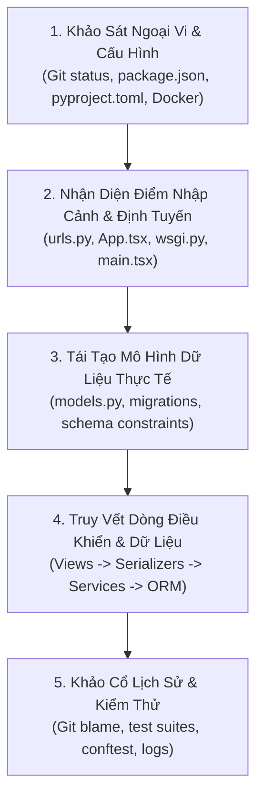

# Thấu Hiểu & Khảo Cổ Codebase Hiện Hữu
# Codebase Understanding & Archaeology

---

## 1. Nguyên Lý Nền Tảng (Fundamentals)

### 1.1. Bản Chất Của Việc Thấu Hiểu Codebase
Trong kỹ thuật phần mềm thực tế, hơn 70% thời gian của một kỹ sư hay tác nhân AI được dành cho việc **đọc, điều tra và hiểu mã nguồn hiện có**, thay vì viết mã mới.

Thấu hiểu codebase là quá trình tái tạo lại **mô hình tinh thần (Mental Model)** chính xác về hệ thống từ các tạo tác vật lý: cấu trúc thư mục, tệp cấu hình, migrations cơ sở dữ liệu, bài kiểm thử tự động, và lịch sử commit Git.

### 1.2. Khảo Cổ Mã Nguồn (Codebase Archaeology)
Mã nguồn chỉ cho chúng ta biết *hệ thống đang làm gì (What)*. Lịch sử Git, tài liệu PR, các bản ghi kiểm toán và bài kiểm thử cho chúng ta biết *tại sao nó lại được viết như vậy (Why)*. Khảo cổ mã nguồn là kỹ năng trích xuất các tri thức ẩn (Tacit Knowledge) — những quyết định đánh đổi trong quá khứ không được ghi thành tài liệu riêng — để tránh việc sửa một đoạn code tưởng chừng "kỳ quặc" nhưng thực chất là một bản vá lỗi biên chí mạng.

### 1.3. Nguyên Tắc Bảo Toàn Trước Khi Sửa (Pre-flight Verification)
> [!IMPORTANT]
> **Tuyệt đối không sửa đổi mã nguồn khi chưa xác minh hành vi hiện tại (As-Is Behavior).**
> Mọi thay đổi mã nguồn mà không kiểm tra callers, tests, cấu hình và trạng thái Git trước đó đều có nguy cơ cao phá vỡ các bất biến ngầm định của hệ thống.

---

## 2. Bối Cảnh Áp Dụng (When It Is Useful)

- **Khi tiếp nhận một repository hoàn toàn mới (Cold-Start Onboarding):** Kỹ sư hoặc AI agent mới bước vào dự án với bộ nhớ bằng 0, không có người hướng dẫn trực tiếp.
- **Trước khi thực hiện bất kỳ đợt tái cấu trúc (Refactoring) nào:** Cần vẽ lại bản đồ phụ thuộc để xác định "bán kính nổ" (Blast Radius) của thay đổi.
- **Khi chẩn đoán các lỗi gián đoạn khó tái hiện:** Cần lần theo toàn bộ dòng chảy điều khiển (Control Flow) và dòng chảy dữ liệu (Data Flow) xuyên suốt các tầng.

---

## 3. Quy Trình Khảo Sát & Thấu Hiểu Codebase 5 Bước (How to Apply)

### Bước 1: Khảo Sát Ngoại Vi, Môi Trường & Trạng Thái Git
1. Chạy `git status --short` để nắm bắt hiện trạng working tree; ghi nhận các tệp đã bị thay đổi hoặc chưa commit để bảo toàn.
2. Đọc các bản kê khai phụ thuộc (`pyproject.toml`, `package.json`, `skills-lock.json`) để xác định chính xác công nghệ và phiên bản runtime.
3. Đọc các tệp cấu hình triển khai (`compose.yaml`, `Dockerfile`, `.env.example`, `scripts/`) để hiểu cách hệ thống khởi chạy môi trường cục bộ.

### Bước 2: Nhận Diện Điểm Nhập Cảnh (Entry Points) & Bộ Định Tuyến
- **Backend:** Bắt đầu từ tệp cấu hình URL gốc (`backend/config/urls.py`) $\rightarrow$ phân tích tiền tố tuyến đường $\rightarrow$ lập danh mục toàn bộ API endpoints.
- **Frontend:** Bắt đầu từ tệp khởi tạo DOM (`main.tsx`) $\rightarrow$ tệp điều phối định tuyến (`App.tsx`) $\rightarrow$ lập danh mục toàn bộ màn hình và quyền truy cập tương ứng.

### Bước 3: Tái Tạo Mô Hình Dữ Liệu Từ Schema & Migrations
Không chỉ đọc định nghĩa model; hãy đọc cả thư mục `migrations/`:
- Các trường `null=False`, `unique=True`, `on_delete=PROTECT/CASCADE`.
- Các chỉ mục đặc thù (Index GIST không gian, UniqueConstraint có điều kiện).
- Nhận diện các model "mồ côi" (models tồn tại trong database nhưng mã nguồn tầng nghiệp vụ không còn gọi tới).

### Bước 4: Truy Vết Dòng Dữ Liệu & Ranh Giới Giao Dịch (Data & Control Flow)
Lần theo một chu trình khép kín của một request ghi dữ liệu (VD: Nộp ảnh):
1. **Giao diện Client:** Form submit gửi dữ liệu multipart gì? Có đính kèm header `X-CSRFToken` không?
2. **API View:** Lớp View nào tiếp nhận? Kiểm tra phân quyền (`permission_classes`) bằng lớp nào?
3. **Serializer:** Dữ liệu được validate ở đâu? Trường nào bị chặn ở tầng API nhưng không bị chặn ở tầng DB?
4. **Service Layer:** Hàm nghiệp vụ nào được gọi? Có sử dụng `transaction.atomic()` không? Có khóa dòng `select_for_update()` không?
5. **Persistence & Storage:** Bản ghi nào được lưu trước, file nào được ghi lên đĩa? Nếu DB lỗi thì file trên đĩa được xử lý ra sao?

### Bước 5: Khảo Cổ Lịch Sử Bằng Git Blame & Test Suite
- Đọc thư mục `tests/`: Các bài test là đặc tả chính xác nhất về *hành vi thực tế mà hệ thống kỳ vọng hoạt động đúng*.
- Sử dụng `git log -S "tên_hàm"` hoặc `git blame -L start,end file.py` để đọc commit message giải thích lý do đoạn mã ra đời.

---

## 4. Tiêu Chí Ra Quyết Định Khi Tiếp Xúc Codebase (Decision Criteria)

1. **Tiêu chí "Không chạm vào mã nguồn đang chạy tốt":** Nếu một đoạn mã trông có vẻ vụng về nhưng có test cases bao phủ đầy đủ và không gây lỗi trong sản xuất, không tự ý viết lại chỉ để cho "đẹp mắt" trừ khi có yêu cầu tái cấu trúc rõ ràng.
2. **Tiêu chí phân biệt Hiện trạng (As-Is) vs Ý định (To-Be):**
   - Luôn tin vào mã nguồn đang chạy thực tế và test suite hơn là tin vào một tệp tài liệu Markdown được viết từ 6 tháng trước.
   - Nếu tài liệu mô tả tính năng A nhưng mã nguồn không có, ghi nhận rõ ràng: *Tài liệu mô tả ý định sản phẩm (Intended), mã nguồn chưa triển khai (Unimplemented)*.

---

## 5. Sai Lầm Thường Gặp & Bẫy Nhận Thức (Common Mistakes)

- **Suy diễn nghiệp vụ từ tên biến hoặc tên class:** Thấy model tên `VenueProposal` liền suy đoán hệ thống có luồng duyệt quán trước khi đăng, trong khi thực tế mã nguồn bỏ qua model này và xuất bản thẳng `Place(published)`.
- **Sửa code trước khi chạy thử test suite:** Lao vào chỉnh sửa file ngay lập tức; khi chạy test thấy lỗi đỏ rực không biết lỗi do mình mới tạo ra hay do hệ thống đã hỏng từ trước.
- **Xóa code mà không tìm kiếm Callers toàn cục:** Thấy một hàm không được gọi trong file hiện tại liền xóa đi, không nhận ra nó đang được gọi động qua REST API hoặc qua Django template tag ở một app khác.

---

## 6. Phân Tích Đánh Đổi (Trade-off Analysis)

| Chiến Lược Khảo Sát | Ưu Điểm Đạt Được | Nhược Điểm Phải Chấp Nhận |
|---|---|---|
| **Đọc lướt nhanh & Thử nghiệm trực tiếp (Spike/Trial)** | Nhanh chóng cảm nhận được phản hồi của hệ thống | Dễ bỏ sót các bất biến ngầm định và ranh giới an toàn tinh vi |
| **Khảo sát toàn diện có hệ thống (Systematic Audit)** | Tái tạo mô hình tinh thần hoàn hảo 100%, không gây lỗi hồi quy | Tốn chi phí thời gian ban đầu trước khi có thể viết dòng code đầu tiên |
| **Dựa hoàn toàn vào tài liệu sẵn có** | Tốc độ tiếp thu nhanh nếu tài liệu chuẩn mực | Rủi ro chí mạng nếu tài liệu bị lệch pha (out-of-sync) với mã nguồn thực tế |

---

## 7. Ví Dụ Thực Tiễn Từ Rendez (Concrete Practical Examples)

### Ví dụ 1: Phát Hiện Model Mồ Côi `VenueProposal` Qua Khảo Cổ
- **Hiện tượng:** Tài liệu cũ ghi nhận *"Người dùng gửi đề xuất quán mới qua VenueProposal chờ duyệt"*.
- **Quá trình điều tra thực tế:**
  1. Mở `backend/apps/photos/models.py:21`: Thấy model `VenueProposal` có đầy đủ các trường.
  2. Tìm kiếm toàn cục `grep -rn "VenueProposal" backend/`: Phát hiện model chỉ xuất hiện trong `models.py`, `admin.py` và các file migration. Hoàn toàn không xuất hiện trong `services.py` hay `views.py`.
  3. Mở `backend/apps/photos/services.py:65`: Thấy hàm `submit()` khi nhận cơ sở mới đã trực tiếp gọi `Place.objects.create(status="published")`.
  4. Mở `backend/tests/test_auto_publication.py:59`: Test khẳng định rõ ràng quán mới được xuất bản ngay lập tức mà không tạo `VenueProposal`.
- **Kết luận khảo cổ:** Model `VenueProposal` là một thành phần dư thừa của kiến trúc cũ chưa dọn dẹp; luồng thực tế của hệ thống hiện tại là Auto-Publication.

### Ví dụ 2: Lần Theo Dòng Dữ Liệu Tải Ảnh An Toàn
- Khi điều tra cách ảnh được phục vụ cho người dùng:
  - Khảo sát `urls.py`: Không thấy cấu hình `static(settings.MEDIA_URL)` thông thường của Django.
  - Thấy 3 endpoint: `public-photo-media/<id>/`, `private-photo-media/<id>/`, `private-photo-original/<id>/`.
  - Lần vào `views.py`: Thấy `PublicPhotoMediaView` truy vấn `PlacePhoto`, kiểm tra `status == "published"` và `place.deleted_at IS NULL`, sau đó mới mở tệp phái sinh (`derivative`) từ `.local/media/` và stream về client bằng `FileResponse`.
  - **Bài học:** Hệ thống chủ động không dùng web server phục vụ file tĩnh để bảo đảm mọi lượt tải ảnh đều phải đi qua cổng kiểm soát phân quyền ứng dụng.
