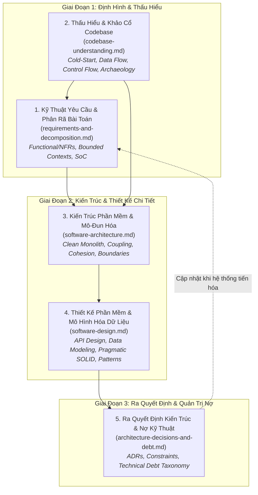

# Miền Tri Thức: Kiến Trúc & Thiết Kế Phần Mềm
# Software Architecture & Engineering Design

---

## 1. Tầm Nhìn & Phạm Vi Của Miền (Domain Vision & Scope)

Miền tri thức **Kiến Trúc & Thiết Kế Phần Mềm** là nền tảng kỹ thuật đầu tiên trong Nhánh Kỹ Thuật Phần Mềm (Software Engineering Track) của ERPF.

Mục tiêu cốt lõi của miền này là trang bị cho kỹ sư phần mềm và các AI Coding Agents phương pháp luận có cấu trúc để chuyển hóa các bài toán nghiệp vụ phức tạp thành các hệ thống phần mềm **bền vững, dễ đọc hiểu, dễ kiểm thử và có khả năng tiến hóa lâu dài**. Miền tri thức này kiên quyết bác bỏ cả hai thái cực cực đoan:
1. **Kiến trúc thượng tầng (Over-engineering):** Đưa vào quá nhiều tầng trừu tượng, microservices hoặc design patterns không cần thiết khi bài toán chưa đòi hỏi.
2. **Lập trình chắp vá (Under-engineering):** Viết mã vội vã, trộn lẫn logic nghiệp vụ với tầng giao diện và cơ sở dữ liệu, phá vỡ các ranh giới tin cậy (Trust Boundaries).

---

## 2. Bản Đồ Các Chuyên Đề Cốt Lõi (Core Knowledge Areas)

Miền tri thức bao gồm 5 chuyên khảo sâu sắc, bao quát toàn bộ 6 khía cạnh của chu trình kiến trúc và thiết kế:

### Chi Tiết 5 Chuyên Khảo
1. [**`requirements-and-decomposition.md`**](file:///home/longtran/Projects/rendez-web/erpf/software-engineering/architecture-design/requirements-and-decomposition.md) (`ERPF-SE-DOM-001`): Kỹ thuật trích xuất yêu cầu, giải quyết xung đột yêu cầu phi chức năng (NFRs), tiêu chuẩn nghiệm thu định lượng, và phương pháp phân rã hệ thống phức tạp theo Domain-Driven Design (DDD).
2. [**`codebase-understanding.md`**](file:///home/longtran/Projects/rendez-web/erpf/software-engineering/architecture-design/codebase-understanding.md) (`ERPF-SE-DOM-002`): Quy trình định hướng và thấu hiểu một codebase lạ (Cold-Start onboarding), truy vết dòng dữ liệu/dòng điều khiển, phân tích đồ thị phụ thuộc, và khảo cổ mã nguồn (Codebase archaeology).
3. [**`software-architecture.md`**](file:///home/longtran/Projects/rendez-web/erpf/software-engineering/architecture-design/software-architecture.md) (`ERPF-SE-DOM-003`): Các phong cách kiến trúc (Clean Monolith, Ports & Adapters, Hexagonal, Microservices trade-offs), nguyên tắc kết dính cao (High Cohesion) và ghép nối lỏng (Loose Coupling), ranh giới tin cậy (Trust Boundaries) và các đánh đổi kiến trúc.
4. [**`software-design.md`**](file:///home/longtran/Projects/rendez-web/erpf/software-engineering/architecture-design/software-design.md) (`ERPF-SE-DOM-004`): Thiết kế API chuẩn mực (RESTful, Idempotency, Error envelopes), mô hình hóa dữ liệu quan hệ/không gian, mô-đun sâu (Deep Modules), áp dụng thực dụng các nguyên lý SOLID, và phân tích bẫy lạm dụng Design Patterns.
5. [**`architecture-decisions-and-debt.md`**](file:///home/longtran/Projects/rendez-web/erpf/software-engineering/architecture-design/architecture-decisions-and-debt.md) (`ERPF-SE-DOM-005`): Khung so sánh phương án kiến trúc, quản lý ràng buộc hệ thống, quy chuẩn soạn thảo Architecture Decision Records (ADRs), và phân loại/kiểm soát nợ kỹ thuật (Technical Debt).

---

## 3. Bản Đồ Ánh Xạ Năng Lực Cốt Lõi (Competency Mapping)

Bảng đối chiếu giữa các năng lực liên ngành (đã định nghĩa trong `ERPF-CORE-COMP-001`) và các bài học kỹ thuật trong miền Kiến trúc & Thiết kế Phần mềm:

| Năng Lực Liên Ngành (Core Competency) | Bài Học / Khái Niệm Áp Dụng Trong Miền Này | Bằng Chứng Tạo Tác Kỹ Thuật (Observable Artifacts) |
|---|---|---|
| **C1. Problem Formulation & Decomposition** | Phân rã Bounded Contexts, xác lập acceptance criteria, chia nhỏ hệ thống monolith | Bản đặc tả Bounded Contexts, sơ đồ quan hệ Entity-Relationship |
| **C2. Analytical Reasoning** | Phân tích đồ thị phụ thuộc (DAGs), profiling truy vấn SQL, phân tích race conditions | Báo cáo `EXPLAIN ANALYZE`, bài test kiểm chứng concurrency locking |
| **C3. Critical Evaluation** | Phản biện các quyết định đưa microservices vào dự án nhỏ, kiểm tra leaky abstractions | Báo cáo đánh giá kiến trúc, kết quả bài test Mutation Testing |
| **C4. Information Literacy & Synthesis** | Khảo cổ Git blame, tái tạo sơ đồ kiến trúc từ codebase thực tế, Cold-Start onboarding | Tài liệu `PROJECT_GUIDE.md`, sơ đồ kiến trúc Mermaid trích xuất từ code |
| **C5. Technical Decision-Making** | Đánh đổi Cửa Một Chiều vs Cửa Hai Chiều, lựa chọn phong cách kiến trúc | Bộ hồ sơ Architecture Decision Records (ADRs) |
| **C6. Systems Thinking** | Nhận diện vòng lặp phản hồi, quản lý connection pool, lan truyền lỗi thứ cấp | Sơ đồ dòng dữ liệu End-to-End, cấu hình rate limit và timeout |
| **C8. Technical Communication** | Tài liệu hóa giao diện API contracts, sơ đồ phân tầng Monolith, Runbooks | Tài liệu OpenAPI/Swagger, cẩm nang `ENGINEERING_GUIDE.md` |
