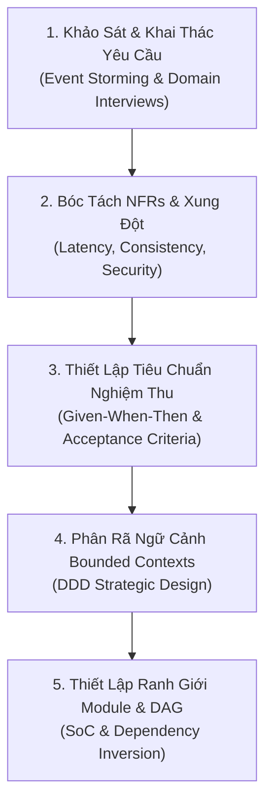

# Kỹ Thuật Yêu Cầu & Phân Rã Hệ Thống Phức Tạp
# Requirements Engineering & Problem Decomposition

---

## 1. Nguyên Lý Nền Tảng (Fundamentals)

### 1.1. Bản Chất Của Kỹ Thuật Yêu Cầu (Requirements Engineering)
Kỹ thuật yêu cầu là quá trình khám phá, phân tích, tài liệu hóa và kiểm chứng các nhu cầu thực sự của các bên liên quan (Stakeholders) để định hình hệ thống phần mềm. Yêu cầu được phân thành hai nhóm cốt lõi:
1. **Yêu cầu chức năng (Functional Requirements - FRs):** Xác định *hệ thống phải làm gì* (hành vi, luồng xử lý dữ liệu, các phép biến đổi trạng thái, tương tác người dùng).
2. **Yêu cầu phi chức năng (Non-Functional Requirements - NFRs / Quality Attributes):** Xác định *hệ thống hoạt động tốt đến mức nào* dưới các ràng buộc vận hành (Độ trễ, Thông lượng, Độ sẵn sàng, Tính nhất quán, Khả năng chịu lỗi, Bảo mật, Quyền riêng tư, và Khả năng kiểm toán).

### 1.2. Phân Rã Bài Toán & Phân Tách Trách Nhiệm (Problem Decomposition & SoC)
Một hệ thống phần mềm lớn không thể được giải quyết nguyên khối trong đầu một kỹ sư. Phân rã bài toán là kỹ thuật phân chia hệ thống thành các hệ thống con (Subsystems) và mô-đun nhỏ hơn dựa trên:
- **Ngữ cảnh giới hạn (Bounded Contexts - DDD):** Ranh giới nơi một mô hình miền nghiệp vụ và ngôn ngữ chuyên ngành (Ubiquitous Language) được áp dụng nhất quán.
- **Phân tách các mối quan tâm (Separation of Concerns - SoC):** Tách bạch rạch ròi giữa việc *hiển thị dữ liệu* (Presentation), *quy tắc nghiệp vụ cốt lõi* (Domain Business Logic), *lưu trữ cơ sở dữ liệu* (Persistence), và *tích hợp dịch vụ ngoại vi* (Infrastructure/Integration).
- **Quản lý phụ thuộc đơn hướng (Directed Acyclic Dependencies - DAG):** Các mô-đun cấp cao điều khiển chính sách không được phụ thuộc trực tiếp vào chi tiết kỹ thuật cấp thấp; đồ thị phụ thuộc giữa các mô-đun phải là đồ thị có hướng không có chu trình (Acyclic).

---

## 2. Bối Cảnh Áp Dụng (When It Is Useful)

- **Khi tiếp nhận một bài toán kinh doanh mơ hồ:** Chuyển hóa mục tiêu trừu tượng (VD: *"Người dùng cần tìm được chỗ ngồi làm việc tốt"*) thành tập hợp yêu cầu kỹ thuật đo lường được (lưới ảnh giữ tỉ lệ, lọc theo ổ cắm, đồng bộ tọa độ `bbox`).
- **Khi hệ thống bắt đầu phình to và khó kiểm soát:** Mã nguồn bắt đầu xuất hiện tình trạng một file chứa hàng ngàn dòng code trộn lẫn truy vấn SQL, render HTML, và xử lý nghiệp vụ.
- **Khi các yêu cầu xung đột nhau:** Cần làm rõ sự đánh đổi giữa việc người dùng muốn nộp ảnh nhanh (không qua duyệt) và nhu cầu giữ cho dữ liệu sạch sẽ, không có ảnh rác.

---

## 3. Quy Trình Áp Dụng Từng Bước (How to Apply)



### Bước 1: Khai Thác & Làm Rõ Yêu Cầu (Elicitation & Ambiguity Resolution)
- Không chỉ hỏi người dùng *"Bạn muốn tính năng gì?"*, hãy hỏi: *"Hiện tại khi gặp khó khăn đó, bạn đang giải quyết tạm thời bằng cách nào?"*.
- Nhận diện các từ ngữ mơ hồ mang tính bẫy: *"Hệ thống phải nhanh"*, *"Giao diện phải thân thiện"*, *"Dữ liệu phải an toàn"*. Bắt buộc chuyển hóa thành các chỉ số định lượng:
  - *"Nhanh"* $\rightarrow$ Thời gian phản hồi API p95 dưới 200ms với tải 500 RPS.
  - *"An toàn"* $\rightarrow$ Toàn bộ ảnh tải lên bị bóc tách siêu dữ liệu EXIF trước khi lưu đĩa; mật khẩu được băm bằng PBKDF2/Argon2.

### Bước 2: Thiết Lập Tiêu Chuẩn Nghiệm Thu Định Lượng (Acceptance Criteria)
Sử dụng cấu trúc **Given-When-Then** chuẩn hóa để không để lại bất kỳ kẽ hở suy diễn nào cho lập trình viên hoặc AI agent:
```text
Given: Một thành viên đã đăng nhập và một cơ sở cà phê đã tồn tại
When: Thành viên tải lên 3 tệp ảnh JPEG hợp lệ kèm xác nhận cam kết 'photo-rights-v2'
Then: Hệ thống tạo bản ghi PhotoSubmission, chuẩn hóa ảnh bóc tách EXIF, tạo PlacePhoto ở trạng thái 'published', tự động gán 'is_cover=True' nếu quán chưa có ảnh bìa, và trả về mã HTTP 201 Created.
```

### Bước 3: Phân Rã Hệ Thống Theo Bounded Contexts
1. Xác định các danh từ thực thể cốt lõi và các động từ hành động.
2. Vẽ ranh giới ngữ cảnh: Một từ ngữ có thể mang ý nghĩa khác nhau ở các ngữ cảnh khác nhau (VD: Trong ngữ cảnh Khám phá, `Place` là một thực thể địa lý; trong ngữ cảnh Kiểm toán, `Place` chỉ là một mã ID tham chiếu).
3. Đóng gói mỗi ngữ cảnh thành một module hoặc một Django app độc lập (`accounts`, `places`, `photos`, `favorites`).

### Bước 4: Kiểm Soát Đồ Thị Phụ Thuộc (Dependency Inversion)
- Module Presentation (Views/Serializers) $\rightarrow$ Module Domain/Services $\rightarrow$ Module Models/Database.
- Tuyệt đối không cho phép chu trình phụ thuộc (Circular Dependency): Nếu App A import App B, App B dứt khoát không được import ngược lại App A. Sử dụng tín hiệu (Signals), sự kiện (Events) hoặc tách module thứ ba nếu cần giao tiếp.

---

## 4. Tiêu Chí Ra Quyết Định (Decision Criteria)

1. **Tiêu chí tách module:** Chỉ tách thành 2 module riêng biệt khi chúng thay đổi vì các lý do khác nhau (khác tác nhân vận hành, khác tần suất cập nhật) và có mô hình dữ liệu độc lập.
2. **Tiêu chí ưu tiên NFRs:** Khi có xung đột giữa NFRs:
   - **Tính toàn vẹn dữ liệu (Data Integrity) luôn ưu tiên hơn Tính sẵn sàng tức thời (Availability):** Thà trả về lỗi hoặc từ chối request nộp ảnh còn hơn ghi vào cơ sở dữ liệu một bản ghi mồ côi (orphan record).
   - **Tính đơn giản vận hành (Operability) ưu tiên hơn Tính co giãn lý thuyết (Theoretical Scalability):** Không đầu tư kiến trúc phân tán cho quy mô tải chưa từng xuất hiện.

---

## 5. Sai Lầm Thường Gặp & Bẫy Chết Người (Common Mistakes)

- **Đồng nhất Yêu cầu chức năng với Thiết kế giao diện (UI as Requirements):** Cho rằng bản vẽ Figma là toàn bộ yêu cầu; bỏ qua các trường hợp biên, các trạng thái mạng rớt, phân quyền và dữ liệu rỗng.
- **Bỏ quên các trường hợp suy thoái (Degradation Modes):** Chỉ mô tả "Happy Path" (khi mọi thứ hoàn hảo); không có yêu cầu nào về việc hệ thống phải ứng xử ra sao khi dịch vụ Geocoding bên ngoài bị timeout.
- **Phân rã theo công nghệ thay vì phân rã theo miền nghiệp vụ:** Chia nhỏ hệ thống thành thư mục `controllers/`, `models/`, `views/` chứa lẫn lộn mọi nghiệp vụ của toàn dự án, thay vì gom nhóm theo Bounded Contexts (`places/`, `photos/`, `accounts/`).

---

## 6. Phân Tích Đánh Đổi (Trade-off Analysis)

| Phương Án | Ưu Điểm Đạt Được | Nhược Điểm Phải Chấp Nhận |
|---|---|---|
| **Phân rã sâu thành nhiều module nhỏ** | Trách nhiệm cô lập, dễ kiểm thử độc lập, ít xung đột Git | Chi phí ghép nối (integration overhead) tăng, khó theo dõi luồng dữ liệu end-to-end |
| **Phân rã ít (Module lớn / Clean Monolith)** | Dễ hiểu toàn cục, giao dịch ACID trực tiếp, không có độ trễ mạng liên-module | Đòi hỏi kỷ luật mã nguồn nghiêm cẩn để tránh biến module lớn thành "cục bùn lớn" (Big Ball of Mud) |
| **Đặc tả yêu cầu cực kỳ chi tiết (Upfront Spec)** | Giảm thiểu tối đa sự bất định và hiểu lầm khi triển khai | Tốn thời gian ban đầu, có nguy cơ tài liệu bị lỗi thời khi nhu cầu thực tế thay đổi |

---

## 7. Ví Dụ Thực Tiễn (Concrete Practical Examples)

### Ví dụ 1: Xử Lý Xung Đột Yêu Cầu Trong Luồng Nộp Ảnh Rendez
- **Xung đột phát sinh:**
  - *Nhu cầu người dùng:* Nộp ảnh nhanh chóng, hiển thị ngay trên bản đồ để chia sẻ bạn bè.
  - *Nhu cầu ban quản trị:* Bảo vệ dữ liệu thực địa, ngăn chặn ảnh quảng cáo spam hoặc sai lệch vị trí.
- **Giải pháp phân rã kiến trúc:**
  - Tách bạch quy trình thành 2 pha độc lập: Pha 1 (Auto-Publication) cho phép ảnh công khai ngay với cờ `rights_confirmed='photo-rights-v2'` để khuyến khích đóng góp; Pha 2 (Post-Moderation) cung cấp view kiểm duyệt riêng `admin:photos_review` cho phép Moderator rút ảnh (`withdrawn`) và gán nhãn sau đó.
  - Phân tách trách nhiệm: `services.submit()` chỉ tập trung vào việc ghi nhận dữ liệu nguyên tử; `services.change_publication()` tập trung vào việc quản trị vòng đời và kiểm toán (`PhotoAudit`).

### Ví dụ 2: Phân Rã Dependency Giữa `Place` và `Category`
- `Place` bắt buộc phải thuộc về một `Category`.
- Ở tầng cơ sở dữ liệu: `Place.category` được đặt `on_delete=PROTECT` (ngăn chặn xóa Category khi còn Place).
- Ở tầng nghiệp vụ: `Place.clean()` kiểm tra `category.is_active = True`. Việc phân tách này bảo đảm tính toàn vẹn tầng dữ liệu (DB Integrity) đồng thời giữ cho logic kiểm tra trạng thái hoạt động nằm đúng ở tầng ứng dụng (Application Logic).
