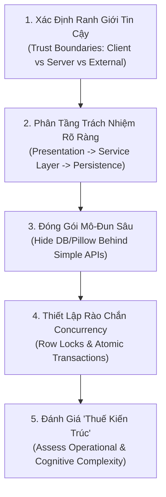

# Kiến Trúc Phần Mềm: Phong Cách, Mô-Đun Hóa & Đánh Đổi
# Software Architecture & Modularity

---

## 1. Nguyên Lý Nền Tảng (Fundamentals)

### 1.1. Bản Chất Của Kiến Trúc Phần Mềm
Kiến trúc phần mềm không phải là các sơ đồ hộp - mũi tên đẹp mắt; kiến trúc là **tập hợp các quyết định kỹ thuật cơ bản nhất về cấu trúc, tổ chức các thành phần và ranh giới hệ thống mà việc thay đổi chúng về sau sẽ cực kỳ tốn kém** (One-Way Doors).

Một kiến trúc tốt tối ưu hóa hai mục tiêu:
1. **Kiểm soát độ phức tạp nhận thức (Cognitive Load):** Cho phép một kỹ sư hoặc AI agent có thể phát triển, kiểm thử và sửa lỗi một module mà không cần phải ghi nhớ toàn bộ mã nguồn của dự án trong đầu.
2. **Ngăn chặn sự lan truyền lỗi (Blast Radius Containment):** Đảm bảo sự cố ở một thành phần không làm sụp đổ dây chuyền (Cascading Failure) toàn bộ hệ thống.

### 1.2. Các Thuộc Tính Cốt Lõi Của Mô-Đun Hóa

```mermaid
graph LR
    subgraph Coupling_Dimension [Ghép Nối (Coupling)]
        direction TB
        Tight["Ghép Nối Chặt (Tight Coupling)<br/>- Biết chi tiết nội bộ của nhau<br/>- Phụ thuộc dữ liệu trực tiếp<br/>- Một bên đổi, bên kia gãy"]
        Loose["Ghép Nối Lỏng (Loose Coupling)<br/>- Chỉ giao tiếp qua Contract/Interface<br/>- Che giấu triển khai bí mật<br/>- Tiến hóa độc lập"]
    end

    subgraph Cohesion_Dimension [Kết Dính (Cohesion)]
        direction TB
        Low["Kết Dính Thấp (Low Cohesion)<br/>- Gom các hàm không liên quan<br/>- Module 'Utils' hoặc 'Helpers'<br/>- Nhiều lý do để thay đổi"]
        High["Kết Dính Cao (High Cohesion)<br/>- Toàn bộ code cùng phục vụ 1 mục tiêu<br/>- Dữ liệu và hành vi đi liền nhau<br/>- Chỉ có 1 lý do để thay đổi"]
    end

    Goal["MỤC TIÊU VÀNG CỦA KIẾN TRÚC:<br/>KẾT DÍNH CAO (HIGH COHESION) + GHÉP NỐI LỎNG (LOOSE COUPLING)"]
```

- **Ghép Nối Lỏng (Loose Coupling):** Giảm thiểu tối đa mức độ phụ thuộc giữa các module. Đo lường qua Afferent Coupling ($C_a$ - số module ngoài phụ thuộc vào module này) và Efferent Coupling ($C_e$ - số module ngoài mà module này phụ thuộc vào).
- **Kết Dính Cao (High Functional Cohesion):** Mọi dòng code bên trong một module đều cùng hướng tới việc thực hiện một trách nhiệm nghiệp vụ duy nhất và chặt chẽ.
- **Triết Lý Mô-Đun Sâu (Deep Modules):** Mô-đun tốt nhất là mô-đun có **giao diện cực kỳ đơn giản (Narrow Interface)** nhưng **chức năng và logic bên trong cực kỳ mạnh mẽ (Deep Functionality)**. Ngược lại, mô-đun nông (Shallow Module) là loại mô-đun có giao diện phức tạp nhưng bên trong hầu như không làm gì ngoài việc chuyển tiếp lời gọi hàm.

---

## 2. Bối Cảnh Áp Dụng Các Phong Cách Kiến Trúc (Architectural Styles)

Không có phong cách kiến trúc nào là "tốt nhất"; mỗi phong cách là một tập hợp các đánh đổi có chủ đích:

### 2.1. Clean Monolith (Monolith Phân Tầng Sạch)
- **Đặc điểm:** Toàn bộ hệ thống chạy trong một tiến trình duy nhất (Single Process), cùng chia sẻ một cơ sở dữ liệu quan hệ, nhưng mã nguồn được phân chia thành các app/layer nghiêm ngặt.
- **Khi nào áp dụng:** Đội ngũ phát triển từ 1 đến 15 kỹ sư; hệ thống có quy mô dữ liệu và lưu lượng từ nhỏ đến trung bình (dưới 10,000 QPS); đòi hỏi tính nhất quán giao dịch ACID cao và chi phí vận hành hạ tầng thấp.

### 2.2. Modular Monolith (Monolith Hướng Mô-Đun)
- **Đặc điểm:** Một codebase duy nhất, triển khai như một khối đơn, nhưng các module có cơ chế ranh giới nghiêm ngặt (Boundary enforcement) ngăn chặn import trực tiếp model của nhau, chỉ giao tiếp qua Public API hoặc Domain Events nội bộ.
- **Khi nào áp dụng:** Dự án lớn dần (15–50 kỹ sư), bắt đầu có sự phân chia các nhóm chuyên môn, nhưng chưa muốn chịu "thuế vận hành" (Operational Tax) của mạng phân tán.

### 2.3. Hexagonal / Ports & Adapters
- **Đặc điểm:** Đặt lõi nghiệp vụ (Domain Core) ở trung tâm, hoàn toàn độc lập với frameworks, UI và DB. Giao tiếp với thế giới bên ngoài thông qua Ports (Interfaces) và Adapters (Triển khai cụ thể).
- **Khi nào áp dụng:** Nghiệp vụ có vòng đời rất dài (10–20 năm), cần độc lập hoàn toàn với việc thay đổi các thư viện bên thứ ba hoặc cơ sở dữ liệu.

### 2.4. Microservices (Kiến Trúc Vi Dịch Vụ)
- **Đặc điểm:** Hệ thống phân chia thành hàng chục hoặc hàng trăm dịch vụ độc lập, mỗi dịch vụ sở hữu cơ sở dữ liệu riêng (Database-per-service), giao tiếp qua mạng (HTTP/gRPC/Kafka).
- **Khi nào áp dụng:** **CHỈ ÁP DỤNG** khi quy mô tổ chức vượt quá hàng trăm kỹ sư làm việc song song bị nghẽn quy trình commit, hoặc khi các module có đặc tính chịu tải hoàn toàn lệch pha (VD: một module cần 1,000 GPU, module khác chỉ cần 1 CPU).
- **Cảnh báo:** Áp dụng Microservices cho dự án nhỏ là một thảm họa kỹ thuật: biến các lời gọi hàm in-memory 0ms thành các lời gọi mạng tiềm ẩn lỗi, mất tính nhất quán ACID, và làm phức tạp hóa môi trường kiểm thử cục bộ gấp hàng chục lần.

---

## 3. Quy Trình Thiết Kế Kiến Trúc & Ranh Giới (How to Apply)



### Bước 1: Thiết Lập Ranh Giới Tin Cậy (Trust Boundaries)
Mọi dữ liệu đi xuyên qua ranh giới tin cậy (từ trình duyệt vào API, hoặc từ dịch vụ bên thứ ba vào hệ thống) đều phải bị coi là **không an toàn**:
- Bắt buộc kiểm tra hợp lệ tại tầng Serializer (cắt tỉa chuỗi, kiểm tra định dạng MIME, giới hạn dung lượng tệp, kiểm tra CSRF).
- Tách bạch rõ: Mã nguồn bên trong tầng Service có thể tin cậy lẫn nhau, nhưng không bao giờ tin cậy dữ liệu thô từ HTTP request.

### Bước 2: Phân Tầng Trách Nhiệm Rạch Ròi (Four-Tier Architecture)
1. **Tầng Trình Diễn (Presentation Tier):** `views.py`, `serializers.py` — chỉ nhận HTTP, validate cú pháp, phân quyền và trả về JSON. Tuyệt đối không chứa logic tính toán nghiệp vụ phức tạp.
2. **Tầng Nghiệp Vụ (Service Layer):** `services.py` — trái tim của ứng dụng. Điều phối các bước nghiệp vụ, quản lý giao dịch nguyên tử, gọi các tiện ích chuẩn hóa ảnh, phát sinh sự kiện.
3. **Tầng Truy Vấn Tối Ưu (Selectors Tier):** `selectors.py` — đóng gói các truy vấn đọc phức tạp, áp dụng eager loading (`select_related`, `prefetch_related`) để triệt tiêu N+1 query.
4. **Tầng Dữ Liệu (Persistence Tier):** `models.py` — định nghĩa cấu trúc bảng, các ràng buộc SQL (`CheckConstraint`, `UniqueConstraint`), và phương thức xóa mềm.

### Bước 3: Thiết Kế Giao Diện Sâu (Deep Interface Design)
- Thay vì để View tự lấy `Place`, tự tạo `PlacePhoto`, tự mở thư mục đĩa lưu file, hãy đóng gói toàn bộ quy trình đó vào một hàm duy nhất:
  ```python
  def submit(*, user, place_id, files, rights_confirmed) -> PhotoSubmission:
  ```
- View chỉ cần gọi hàm này và nhận kết quả. Mọi chi tiết về khóa dòng `select_for_update()`, pipeline xử lý ảnh Pillow, rollback tệp đĩa đều được giấu kín hoàn hảo bên trong tầng Service.

---

## 4. Tiêu Chí Ra Quyết Định Kiến Trúc (Decision Criteria)

1. **Tiêu chí Clean Monolith vs Microservices:**
   - Nếu hệ thống có thể chạy vừa trên một máy chủ cục bộ hoặc một cụm máy chủ chia sẻ DB, **hãy chọn Clean Monolith**.
   - Chỉ cân nhắc tách dịch vụ khi một module có yêu cầu công nghệ bắt buộc khác biệt (VD: module AI Inference cần môi trường CUDA/GPU riêng biệt với web app).
2. **Tiêu chí thiết lập Service Layer:**
   - Nếu một thao tác ghi dữ liệu liên quan đến từ 2 bảng trở lên, hoặc liên quan đến việc ghi tệp ngoài DB, **bắt buộc phải đưa vào `services.py`** với `transaction.atomic()`, không viết trực tiếp trong `views.py` hay `models.save()`.

---

## 5. Bẫy Kiến Trúc & Sai Lầm Thường Gặp (Common Mistakes)

- **Mô Hình "Fat Models, Thin Views" Bị Lạm Dụng:** Nhét toàn bộ logic nghiệp vụ, gọi API bên ngoài và xử lý file vào `models.py`. Kết quả: Model phụ thuộc vào thế giới bên ngoài, gây khó khăn khi viết unit tests mà không cần database.
- **Phân Mảnh Quá Mức (Anemic Domain Model & Over-abstraction):** Tạo ra quá nhiều lớp trung gian: `Controller` $\rightarrow$ `Service` $\rightarrow$ `Manager` $\rightarrow$ `Repository` $\rightarrow$ `DAO` $\rightarrow$ `Model` chỉ để thực hiện một câu lệnh `SELECT * FROM table WHERE id = ?`. Đây là sự lãng phí nhận thức nghiêm trọng.
- **Kiến Trúc Cơ Sở Dữ Liệu Chia Sẻ Giữa Các Microservices (Shared Database Anti-pattern):** Tách mã nguồn thành nhiều microservices nhưng tất cả cùng cắm chung vào một cơ sở dữ liệu. Kết quả: Chịu toàn bộ nhược điểm của microservices mà không nhận được bất kỳ ưu điểm nào về tính độc lập dữ liệu.

---

## 6. Phân Tích Đánh Đổi Kiến Trúc (Architectural Trade-offs)

| Quyết Định Đánh Đổi | Lợi Ích Thu Được | Cái Giá Phải Trả |
|---|---|---|
| **ACID Transactions (PostgreSQL locking)** | Dữ liệu chính xác tuyệt đối, không bao giờ bị race condition gán ảnh bìa | Giảm nhẹ thông lượng ghi tối đa tại một thời điểm trên cùng một dòng |
| **Protected Media Views (DRF Streaming)** | Kiểm soát phân quyền tuyệt đối đến từng byte ảnh, bảo vệ quyền riêng tư | Tốn tài nguyên CPU của tiến trình Python hơn so với Nginx serve tĩnh |
| **Local-First & Data Sovereignty** | Tự chủ hoàn toàn, không phụ thuộc chi phí API đám mây, chạy offline/local tốt | Đội ngũ kỹ thuật phải tự quản lý việc sao lưu, dung lượng đĩa và tài nguyên bản đồ |

---

## 7. Ví Dụ Thực Tiễn Từ Rendez (Concrete Practical Examples)

### Ví dụ 1: Kiến Trúc Clean Monolith Thực Thụ Của Rendez
- **Bối cảnh:** Rendez là ứng dụng khám phá không gian Đà Nẵng.
- **Hiện thực kiến trúc:**
  - Gunicorn chạy một tiến trình phục vụ: Frontend SPA build (WhiteNoise), Backend API (`/api/v1/`), Django Admin (`/admin/`), và Media Streaming.
  - Một cơ sở dữ liệu PostgreSQL 17 + PostGIS duy nhất trên cổng 55433.
  - Không Celery, không Redis, không message queues ngoài.
- **Hiệu quả thực chứng:** Toàn bộ hệ thống khởi động trong 3 giây bằng `./scripts/start-local.sh`; toàn bộ 178 bài test backend và 56 bài test frontend chạy xong trong 86 giây; bảo trì cực kỳ đơn giản, không tốn chi phí vận hành đám mây.

### Ví dụ 2: Ranh Giới Concurrency Control Bằng Row Lock
- Trong `backend/apps/photos/services.py:65`:
  ```python
  with transaction.atomic():
      if place_id:
          place = Place.objects.select_for_update().get(id=place_id)
      # Xử lý ảnh và gán cover nếu quán chưa có ảnh bìa
  ```
- **Ý nghĩa kiến trúc:** Sử dụng khóa dòng cấp cơ sở dữ liệu (`SELECT FOR UPDATE`) bên trong transaction nguyên tử. Nếu 2 người cùng nộp ảnh cho cùng 1 quán tại cùng 1 mili-giây, giao dịch thứ hai bắt buộc phải chờ giao dịch thứ nhất hoàn tất. Điều này đảm bảo bất biến nghiệp vụ: *Mỗi quán tại một thời điểm chỉ có tối đa một ảnh bìa công khai*.
