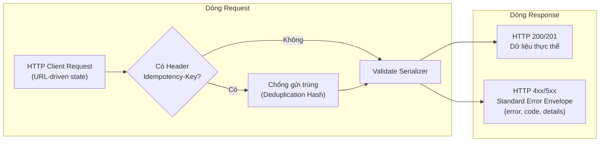
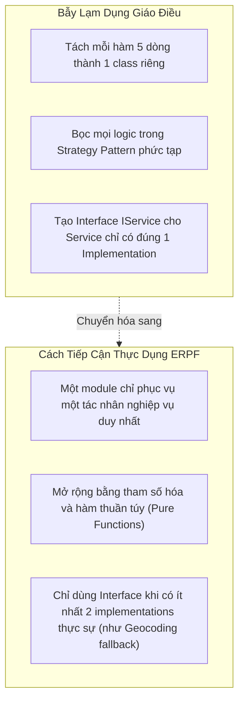

# Thiết Kế Phần Mềm Thực Dụng & Mô Hình Hóa Dữ Liệu
# Pragmatic Software Design & Data Modeling

---

## 1. Nguyên Lý Nền Tảng (Fundamentals)

### 1.1. Bản Chất Của Thiết Kế Phần Mềm (Software Design)
Nếu kiến trúc phần mềm là việc xác lập các ranh giới và cấu trúc tổng thể của hệ sinh thái (macro), thì thiết kế phần mềm là nghệ thuật tổ chức các lớp, hàm, cấu trúc dữ liệu và hợp đồng giao tiếp ở cấp độ chi tiết (micro).

Thiết kế phần mềm tốt hướng tới một mục tiêu duy nhất: **Làm cho mã nguồn trở nên hiển nhiên (Obvious Code)** — bất kỳ kỹ sư hoặc AI agent nào khi đọc mã nguồn đều hiểu ngay logic nghiệp vụ, không bị bất ngờ (Principle of Least Surprise) và dễ dàng mở rộng mà không sợ phá vỡ các phần khác.

### 1.2. Mô Hình Hóa Dữ Liệu: Trái Tim Của Hệ Thống (Data-Centric Design)
Mọi ứng dụng phần mềm thực chất là các phép biến đổi trên dữ liệu. Một mô hình dữ liệu (Data Model) sai lầm sẽ làm méo mó toàn bộ logic nghiệp vụ bên trên:
- **Thực thể (Entity):** Đối tượng có danh tính bền vững theo thời gian (`id`, `UUID`), trạng thái có thể biến đổi nhưng danh tính giữ nguyên (VD: `Place`, `User`, `PlacePhoto`).
- **Đối tượng Giá trị (Value Object):** Đối tượng được định danh thuần túy bằng giá trị của các thuộc tính, có tính bất biến (Immutable) (VD: `OpeningHoursSpecification`, Tọa độ WGS-84 `(lat, lon)`).
- **Ràng buộc toàn vẹn cơ sở dữ liệu (Database Invariants):** Mọi quy tắc cốt lõi phải được bảo vệ ở tầng thấp nhất có thể (SQL `NOT NULL`, `CHECK`, `UNIQUE`, `FOREIGN KEY PROTECT`) thay vì chỉ trông cậy vào tầng code ứng dụng.

---

## 2. Thiết Kế Hợp Đồng API Chuẩn Mực (API Design)

Một API RESTful xuất sắc cần tuân thủ các nguyên tắc thiết kế thực dụng sau:



1. **Trạng Thái Dẫn Dắt Bằng URL (URL-Driven State):** Mọi trạng thái lọc, tìm kiếm và khung nhìn bản đồ đều phải được biểu diễn trên tham số URL query (`?category=cafe&attributes=power&bbox=...`). Điều này giúp người dùng có thể bookmark, refresh hoặc chia sẻ link cho người khác mà giữ nguyên trạng thái hiển thị.
2. **Khóa Chống Gửi Trùng (Idempotency Keys):** Các thao tác ghi dữ liệu tốn kém hoặc nhạy cảm (như nộp ảnh, thanh toán) bắt buộc phải hỗ trợ header `Idempotency-Key`. Nếu client gửi lại request cùng key và cùng nội dung (do mạng lag), hệ thống trả về ngay kết quả lần gửi trước mà không tạo bản ghi nhân bản. Nếu cùng key nhưng khác nội dung, trả về lỗi `409 Conflict`.
3. **Bao Bì Lỗi Chuẩn Hóa (Standard Error Envelope):** Tuyệt đối không trả về chuỗi văn bản thuần túy hoặc cấu trúc lỗi tùy tiện. Mọi phản hồi lỗi đều tuân thủ cấu trúc có thể phân tích tự động:
   ```json
   {
     "error": "Thông báo lỗi bằng ngôn ngữ tự nhiên",
     "code": "ERROR_CODE_MACHINE_READABLE",
     "details": { "field_name": ["Lý do không hợp lệ cụ thể"] }
   }
   ```

---

## 3. Áp Dụng Thực Dụng Nguyên Lý SOLID (Pragmatic SOLID)

Các nguyên lý SOLID là những chỉ dẫn tuyệt vời, nhưng việc áp dụng giáo điều, mù quáng sẽ biến mã nguồn thành một mớ bòng bong phân mảnh. Dưới đây là cách hiểu thực dụng:



### 3.1. Single Responsibility Principle (SRP) — Thực Dụng
- **Hiểu đúng:** Một module chỉ nên có **một lý do duy nhất để thay đổi** (tức là chỉ phục vụ một nhóm người dùng hoặc một tác nhân nghiệp vụ cụ thể).
- **Tránh bẫy:** Không đồng nhất SRP với việc "mỗi class chỉ được làm đúng 1 việc nhỏ xíu". Việc chia nhỏ một quy trình nộp ảnh thành 15 classes riêng biệt chỉ làm tăng chi phí nhảy file (file hopping) và làm vỡ dòng chảy đọc hiểu.

### 3.2. Open/Closed Principle (OCP) — Thực Dụng
- **Hiểu đúng:** Thiết kế hệ thống sao cho khi có yêu cầu mới, ta có thể bổ sung mã mới thay vì phải sửa đổi và làm xáo trộn mã cũ đã chạy ổn định.
- **Tránh bẫy:** Không tạo trước các tầng abstraction suy đoán cho những trường hợp chưa xảy ra. Hãy viết code đơn giản trước; chỉ khi có trường hợp thứ hai hoặc thứ ba xuất hiện mới tiến hành trừu tượng hóa (Rule of Three).

### 3.3. Dependency Inversion Principle (DIP) — Thực Dụng
- **Hiểu đúng:** Các chính sách nghiệp vụ cấp cao không nên phụ thuộc vào thư viện bên ngoài cấp thấp.
- **Tránh bẫy:** Không tạo giao diện giả tạo kiểu `IPlaceService` chỉ để phục vụ đúng một class `PlaceServiceImpl` trong một dự án monolithic nhỏ. Chỉ tạo interface khi có nhiều implementations thực tế (chẳng hạn như module Geocoding hỗ trợ cả Photon, Nominatim và Esri).

---

## 4. Phân Tích Các Design Patterns Thường Bị Lạm Dụng

Design Patterns là các giải pháp kinh điển cho các bài toán kinh điển, nhưng chúng mang theo chi phí gián tiếp (Indirection Overhead):

| Mẫu Thiết Kế (Design Pattern) | Khi Nào Thực Sự Hữu Ích | Khi Nào Trở Thành Anti-Pattern Cồng Kềnh |
|---|---|---|
| **Repository Pattern** | Khi cần chuyển đổi linh hoạt giữa cơ sở dữ liệu in-memory (cho test nhanh) và SQL database | Khi dùng chung với Django ORM / SQLAlchemy: Bản thân ORM đã là một Repository + Data Mapper hoàn chỉnh. Bọc thêm một tầng Repository nông (Shallow Repository) chỉ làm mất đi các tính năng mạnh mẽ của ORM (`select_related`, `F expressions`). |
| **Service Layer Pattern** | Khi một quy trình nghiệp vụ ghi dữ liệu liên quan đến nhiều bảng, kiểm soát concurrency và xử lý file ngoài DB | Khi áp dụng cho các thao tác CRUD đọc đơn giản: Viết một hàm Service chỉ để gọi `Place.objects.get(id=id)` là sự lãng phí vô nghĩa. |
| **Strategy Pattern** | Khi có các thuật toán xử lý có thể hoán đổi lúc runtime (VD: chuyển đổi giữa các dịch vụ Geocoding khi gặp sự cố) | Khi chỉ có duy nhất một thuật toán và không có kế hoạch thay thế nào trong tương lai gần. |
| **Factory Pattern** | Khi việc khởi tạo một đối tượng đòi hỏi logic lắp ráp phức tạp phụ thuộc vào cấu hình môi trường | Khi chỉ cần gọi hàm khởi tạo bình thường `Place(...)` mà cố tình tạo thêm `PlaceFactoryBuilderProvider`. |

---

## 5. Nguyên Tắc YAGNI & Nghệ Thuật Xóa Code (Pragmatic YAGNI)

### 5.1. Triết Lý YAGNI (You Aren't Gonna Need It)
- Tuyệt đối không bổ sung các trường cơ sở dữ liệu, các tham số hàm hoặc các lớp trừu tượng dựa trên phỏng đoán *"Có thể sau này tính năng X sẽ cần đến"*.
- **Cái giá của sự dự trù:** Mã nguồn dự trù cho tương lai phải chịu chi phí kiểm thử, chi phí đọc hiểu của các kỹ sư khác, và 90% trường hợp tương lai thực tế sẽ diễn ra khác hoàn toàn so với phỏng đoán ban đầu.

### 5.2. Xóa Code Là Một Hoạt Động Thiết Kế (Deleting Code as a Design Activity)
- Kỹ sư giỏi không được đo bằng số dòng code viết thêm, mà được đo bằng khả năng giải quyết bài toán với số dòng code tối thiểu.
- Khi một tính năng hoặc một model cũ không còn được sử dụng (như các app `pricing` hay `contributions` cũ trong Rendez), **hãy dũng cảm xóa bỏ hoàn toàn khỏi repository**. Đừng comment out hoặc giữ lại "làm kỷ niệm" — lịch sử Git đã lưu trữ tất cả.

---

## 6. Tiêu Chí Ra Quyết Định Thiết Kế (Decision Criteria)

1. **Quy Tắc Số Ba (Rule of Three):**
   - Lần thứ nhất viết code: Cứ viết giải pháp đơn giản trực tiếp.
   - Lần thứ hai thấy lặp lại: Chấp nhận sự trùng lặp (Duplication is far cheaper than the wrong abstraction).
   - Lần thứ ba thấy lặp lại cùng một cấu trúc: Khi đó mới tiến hành tái cấu trúc để tạo ra một hàm hoặc tầng trừu tượng dùng chung.
2. **Tiêu Chí Lựa Chọn Mô Hình Dữ Liệu:**
   - Sử dụng **Cơ sở dữ liệu quan hệ (PostgreSQL)** làm mặc định cho mọi dữ liệu nghiệp vụ có cấu trúc, đòi hỏi toàn vẹn và giao dịch ACID.
   - Chỉ sử dụng các trường phi cấu trúc (JSONField) cho các thuộc tính biến thiên tự do hoặc dữ liệu đặc tả mở rộng (như `opening_hours_specification`).

---

## 7. Ví Dụ Thực Tiễn Từ Rendez (Concrete Practical Examples)

### Ví dụ 1: Mô Hình Hóa Bất Biến Tại Tầng Cơ Sở Dữ Liệu
Trong `backend/apps/photos/models.py:196`:
```python
class PlacePhoto(models.Model):
    place = models.ForeignKey(Place, on_delete=models.CASCADE)
    is_cover = models.BooleanField(default=False)
    status = models.CharField(max_length=20, choices=Status.choices)

    class Meta:
        constraints = [
            models.UniqueConstraint(
                fields=["place"],
                condition=models.Q(is_cover=True, status="published"),
                name="unique_published_cover_per_place",
            )
        ]
```
- **Phân tích thiết kế:** Thay vì chỉ kiểm tra trong code Python (dễ bị race condition khi 2 request gửi đồng thời), kỹ sư đưa bất biến nghiệp vụ xuống tận tầng PostgreSQL bằng `UniqueConstraint` có điều kiện. Cơ sở dữ liệu bảo đảm về mặt vật lý rằng không bao giờ có 2 ảnh bìa cùng được xuất bản cho một cơ sở.

### Ví dụ 2: Loại Bỏ Các App Cũ Nhằm Giữ Cho Thiết Kế Tinh Gọn
- Trong lịch sử, Rendez từng có các app quản lý giá cả (`pricing`) và hóa đơn (`contributions`).
- **Quyết định thiết kế thực dụng:** Nhận thấy sản phẩm tập trung 100% vào giá trị cốt lõi là *tư liệu không gian thị giác*, toàn bộ mã nguồn của hai app này đã được xóa bỏ hoàn toàn khỏi codebase. Kết quả: Giảm 40% bề mặt mã nguồn, triệt tiêu nợ kỹ thuật và giúp các AI agents mới tiếp nhận hiểu ngay trọng tâm dự án mà không bị phân tâm.
