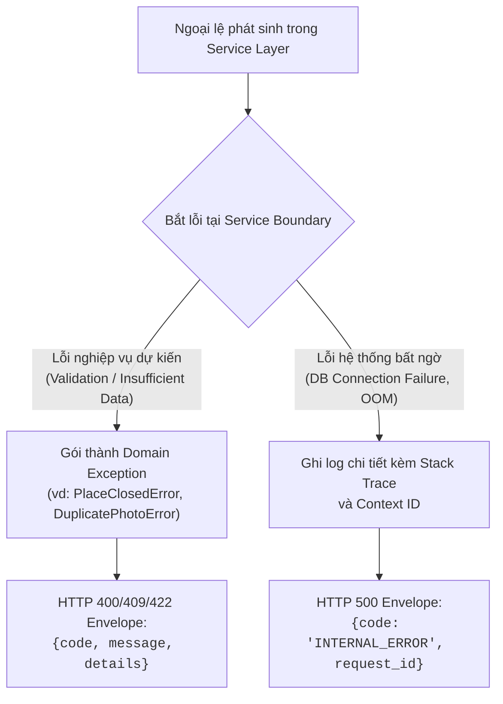
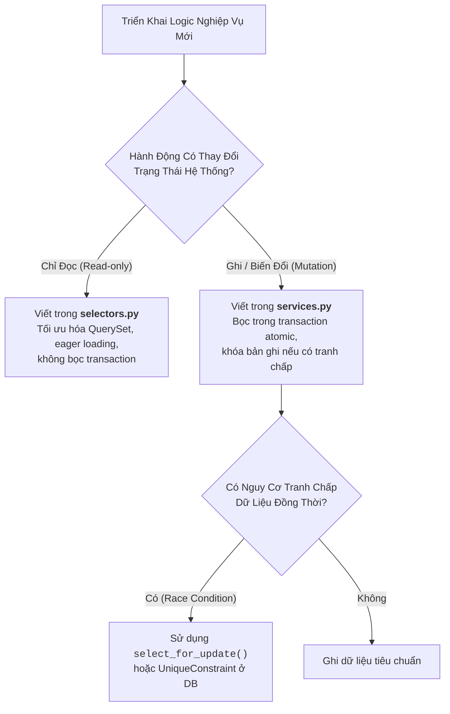

# Thực Hành Hiện Thực Hóa Mã Nguồn & Tái Cấu Trúc
# Implementation Practices & Safe Refactoring

---

## 1. Nguyên Lý Nền Tảng (Fundamentals)

### 1.1. Bản Chất Của Mã Nguồn Thực Thi Tốt
Mã nguồn được viết ra cho con người (và AI agents) đọc hiểu là chủ yếu, việc máy tính thực thi chỉ là mục tiêu thứ hai. Một đoạn mã được coi là chất lượng cao khi nó đáp ứng:
1. **Tính hiển nhiên (Obviousness):** Người đọc nắm bắt được mục đích và luồng xử lý mà không cần phải đoán mò hay lật qua lại giữa hàng chục tệp tin rời rạc.
2. **Khả năng dự đoán (Predictability):** Không có hiệu ứng lề ẩn (Hidden side effects), không thay đổi tham số truyền vào mà không thông báo, hành vi tuân thủ nguyên lý ít gây ngạc nhiên nhất (Principle of Least Surprise).
3. **Phòng thủ ở ranh giới, tự do ở bên trong:** Thẩm định nghiêm ngặt tại các ranh giới tin cậy (Trust Boundaries: HTTP inputs, file uploads, external APIs), nhưng một khi dữ liệu đã được xác thực thành các kiểu dữ liệu an toàn, mã nội bộ được phép vận hành mà không cần lặp lại các kiểm tra râu ria vô tận.

### 1.2. Phân Tách Rõ Ràng Các Tầng Trách Nhiệm (Separation of Concerns in Code)
Để mã nguồn không bị biến thành một "mớ bòng bong", cần áp dụng triệt để mô hình phân tách chức năng:
- **Selectors (Read-only queries):** Chuyên trách đọc dữ liệu từ database, tối ưu hóa truy vấn (`select_related`, `prefetch_related`), không làm thay đổi trạng thái hệ thống.
- **Services (Business mutations):** Chuyên trách thay đổi trạng thái, thực thi business logic, quản lý transaction cơ sở dữ liệu (`transaction.atomic()`), khóa bản ghi chống xung đột (`select_for_update()`).
- **Serializers / DTOs (Boundary validation & formatting):** Chuyên trách parse và kiểm tra tính hợp lệ của dữ liệu đầu vào từ HTTP request, và serialize dữ liệu đầu ra thành định dạng JSON chuẩn.

---

## 2. Bối Cảnh Áp Dụng & Kỹ Thuật Cốt Lõi (Core Techniques)

### 2.1. Quản Lý Lỗi & Phong Bì Lỗi Chuẩn Hóa (Error Handling & Error Envelopes)
Sai lầm phổ biến nhất trong xử lý lỗi là "nuốt ngoại lệ" (Exception Swallowing) hoặc ném ra các thông báo lỗi chung chung (`Something went wrong`).



#### Quy tắc xử lý lỗi bất di bất dịch:
- **Không bao giờ dùng khối `except Exception: pass`:** Việc nuốt lỗi này sẽ biến hệ thống thành một "hố đen", che giấu các bug chết người và làm tê liệt khả năng debug.
- **Fail-Fast (Thất bại sớm):** Kiểm tra các điều kiện tiên quyết (Pre-conditions) ngay đầu hàm; nếu không thỏa mãn, ném ngoại lệ hoặc trả về lỗi ngay lập tức thay vì để code chạy sâu vào trong rồi mới sập.
- **Chuẩn hóa Error Envelope:** Mọi phản hồi lỗi gửi về cho client phải có cùng một định dạng JSON thống nhất:
  ```json
  {
    "error": {
      "code": "PHOTO_LIMIT_EXCEEDED",
      "message": "Mỗi submission chỉ được phép chứa tối đa 5 ảnh.",
      "request_id": "req-9b1deb4d-3b7d-4bad-9bdd-2b0d7b3dcb6d",
      "details": {
        "max_allowed": 5,
        "provided": 7
      }
    }
  }
  ```

### 2.2. Thẩm Định Dữ Liệu Đầu Vào: Parse, Don't Validate
Thay vì kiểm tra một chuỗi string rồi tiếp tục truyền chuỗi thô đó qua toàn bộ hệ thống, hãy chuyển đổi (parse) nó ngay tại ranh giới thành một kiểu dữ liệu có cấu trúc mạnh mẽ (Value Object hoặc Pydantic/Serializer model):
- Nếu đầu vào là một chuỗi ngày giờ, hãy parse nó thành `datetime` object có múi giờ cụ thể.
- Nếu đầu vào là tọa độ, hãy parse nó thành đối tượng `Point(x=lon, y=lat, srid=4326)`.
- Một khi kiểu dữ liệu đã được tạo thành công, toàn bộ mã nguồn bên trong hoàn toàn yên tâm rằng dữ liệu luôn đúng đắn, không cần kiểm tra lại định dạng string thêm một lần nào nữa.

### 2.3. Quản Lý Vòng Đời Tài Nguyên (Resource & State Management)
Rò rỉ tài nguyên (Resource Leak) là nguyên nhân hàng đầu khiến các hệ thống backend bị sập sau vài tuần hoạt động:
- **Nguyên tắc Context Manager / RAII (Resource Acquisition Is Initialization):** Mọi tài nguyên hữu hạn (File handles, Database connections, Mutex locks, Network sockets) bắt buộc phải được bọc trong các khối giải phóng tự động (`with open(...)`, `with transaction.atomic():`, `try ... finally`).
- **Phạm vi Transaction tối thiểu:** Chỉ bọc khối `transaction.atomic()` quanh các thao tác ghi dữ liệu bắt buộc phải đảm bảo tính ACID. Tuyệt đối không bọc transaction quanh các cuộc gọi mạng HTTP bên thứ ba hoặc các tác vụ xử lý ảnh nặng, vì điều này sẽ giữ connection database quá lâu, gây cạn kiệt Connection Pool.

### 2.4. Tái Cấu Trúc An Toàn Thông Qua Đường Nối (Refactoring via Seams)
Tái cấu trúc (Refactoring) là việc thay đổi cấu trúc bên trong của mã nguồn mà **không làm thay đổi hành vi có thể quan sát được bên ngoài**.
- **Tìm kiếm đường nối (Find the Seam):** Xác định điểm giao tiếp giữa đoạn code cần tái cấu trúc và phần còn lại của hệ thống.
- **Bảo vệ bằng bài test bao bọc (Characterization Test):** Viết test bao quanh đường nối đó để ghi lại hành vi hiện tại (kể cả các quirks nếu chưa có spec).
- **Thực hiện từng bước nhỏ (Small atomic steps):** Đổi tên, trích xuất hàm (Extract Method), trích xuất lớp (Extract Class). Chạy test sau mỗi bước sửa đổi nhỏ.
- **Quy tắc cam kết:** Nếu test pass, commit ngay. Nếu test fail, revert về commit gần nhất thay vì cố gắng sửa chữa một mớ hỗn độn.

---

## 3. Quản Lý Phụ Thuộc (Dependency Management)

Một dự án lành mạnh cần kiểm soát phụ thuộc như kiểm soát dịch bệnh:
1. **Khóa chặt phiên bản (Lockfile Pinning):** Luôn sử dụng tệp khóa phiên bản chính xác (`requirements.lock`, `poetry.lock`, `package-lock.json`) trong môi trường production để bảo đảm tính tái lập hoàn toàn trên mọi máy chủ.
2. **Quy tắc "Một Dòng Code Không Bằng Một Thư Viện":** Cân nhắc cực kỳ kỹ lưỡng trước khi cài đặt một package chỉ để dùng một hàm đơn giản (như kiểm tra `is-odd` hay định dạng ngày tháng cơ bản). Mỗi dependency mới là một gánh nặng bảo trì, tiềm ẩn lỗ hổng bảo mật và nguy cơ phá vỡ tương thích (breaking changes).
3. **Cô lập thư viện bên thứ ba bằng Adapter:** Không để các đối tượng từ thư viện bên thứ ba lan tràn khắp domain logic. Bọc chúng lại sau một interface do chính dự án định nghĩa để khi thư viện đó ngừng bảo trì hoặc thay đổi API, ta chỉ cần sửa đúng một file adapter duy nhất.

---

## 4. Tiêu Chí Ra Quyết Định Trong Triển Khai (Decision Criteria)

Khi hiện thực hóa một chức năng, kỹ sư đối chiếu với bộ tiêu chí sau để lựa chọn cách tiếp cận:



---

## 5. Sai Lầm Thường Gặp & Anti-Patterns (Common Mistakes)

1. **Thần thánh hóa One-Liner (Clever Code Trap):** Cố nén 5 tầng logic vào một dòng comprehension phức tạp chỉ để chứng tỏ sự thông minh. Hậu quả là không ai đọc hiểu được, không thể đặt breakpoint debug và cực kỳ dễ sinh lỗi ngầm.
2. **Khối bắt lỗi nuốt chửng (Pokemon Exception Handling):** `catch (Exception e) {}` — "Bắt hết tất cả". Lỗi cú pháp, lỗi thiếu bộ nhớ, lỗi ngắt kết nối DB đều bị âm thầm bỏ qua, khiến hệ thống tiếp tục chạy trong trạng thái dữ liệu bị hỏng (Corrupted State).
3. **Trộn lẫn Tầng Trình Diễn vào Tầng Nghiệp Vụ (Fat Views / Anemic Services):** Viết hàng trăm dòng kiểm tra permission, query SQL, xử lý ảnh và sinh JSON ngay trong hàm xử lý HTTP request (Django View hoặc Express Controller). View chỉ nên làm nhiệm vụ parse request và render response.
4. **Tái cấu trúc lớn không có mạng an toàn (Big Bang Refactoring):** Tự ý mở một nhánh lớn, sửa đổi hàng trăm tệp tin cùng lúc mà không có unit test bảo vệ, sau đó không thể merge vào nhánh chính vì xung đột mã nguồn khổng lồ.
5. **Rò rỉ kết nối mạng / File không đóng:** Mở file hoặc gọi HTTP connection mà không dùng context manager, dẫn đến lỗi hệ điều hành `Too many open files` sau vài ngày chạy.

---

## 6. Đánh Giá Đánh Đổi (Trade-off Analysis)

### Bảng Đánh Đổi: Lập Trình Phòng Thủ Nghiêm Ngặt vs Tốc Độ Triển Khai

| Tiêu Chí So Sánh | Lập Trình Phòng Thủ & Parse Tuyệt Đối (Strict Defensive) | Triển Khai Nhanh Chấp Nhận Dữ Liệu Lỏng Lẻo (Fast & Loose) |
|---|---|---|
| **Thời gian viết mã ban đầu** | Tốn thêm 20–30% thời gian thiết kế DTO/Serializer | Nhanh hơn, chỉ cần truyền dictionary/tuple thô |
| **Chi phí gỡ lỗi (Debugging Cost)** | Cực thấp, lỗi phát hiện ngay tại cổng vào với thông báo rõ ràng | Cực cao, lỗi âm thầm lan sâu vào hệ thống mới phát nổ |
| **Độ tin cậy của hệ thống** | Rất cao, các bất biến dữ liệu luôn được đảm bảo | Rất thấp, dễ sập do giá trị `None` hoặc sai kiểu dữ liệu |
| **Khả năng tự động hóa kiểm thử** | Dễ dàng viết unit test nhờ kiểu dữ liệu rõ ràng | Khó test, phải giả lập nhiều cấu trúc dict phức tạp |

---

## 7. Ví Dụ Thực Tế & Tình Huống Minh Họa Tại Rendez

### Minh Họa 1: Phân Tách Tuyệt Đối Giữa `services.py` và `selectors.py`
Trong codebase Rendez:
- Để truy vấn danh sách địa điểm phục vụ tìm kiếm bản đồ, mã nguồn sử dụng `backend/apps/places/selectors.py`:
  ```python
  # selectors.py - Thuần túy đọc dữ liệu, không tác dụng phụ
  def get_places_in_bounding_box(bbox: BoundingBox) -> QuerySet[Place]:
      return (
          Place.objects.filter(deleted_at__isnull=True)
          .filter(location__contained=bbox.to_polygon())
          .select_related('owner')
          .prefetch_related('photos')
      )
  ```
- Để xử lý việc người dùng gửi ảnh đóng góp, mã nguồn sử dụng `backend/apps/photos/services.py`:
  ```python
  # services.py - Đột biến dữ liệu an toàn, có transaction và khóa dòng
  @transaction.atomic
  def submit_photo_batch(user: User, place_id: int, files: list[UploadedFile]) -> PhotoSubmission:
      # 1. Khóa địa điểm chống race condition khi cập nhật thống kê
      place = Place.objects.select_for_update().get(id=place_id)

      # 2. Thực thi nghiệp vụ và quản lý tài nguyên
      submission = PhotoSubmission.objects.create(user=user, place=place)
      for file in files:
          process_and_store_photo(submission=submission, raw_file=file)

      return submission
  ```

### Minh Họa 2: Quản Lý Tài Nguyên File Tự Động Trong Xử Lý Ảnh
Trong pipeline chuẩn hóa ảnh `backend/apps/photos/images.py`:
- Tệp ảnh tải lên được xử lý bằng PIL/Pillow thông qua khối context manager để đảm bảo buffer bộ nhớ và file tạm trên ổ đĩa luôn được giải phóng ngay cả khi ảnh bị lỗi định dạng:
  ```python
  with Image.open(raw_file) as img:
      # Loại bỏ EXIF nhạy cảm và chuẩn hóa sang sRGB WebP
      clean_img = strip_exif_metadata(img)
      clean_img.save(output_buffer, format="WEBP", quality=85)
  # Ra khỏi with block, file handle của img được đóng lập tức
  ```
Cách làm này ngăn ngừa triệt để hiện tượng tràn bộ nhớ (Memory Leak) khi người dùng tải lên đồng thời hàng chục ảnh độ phân giải cao.
