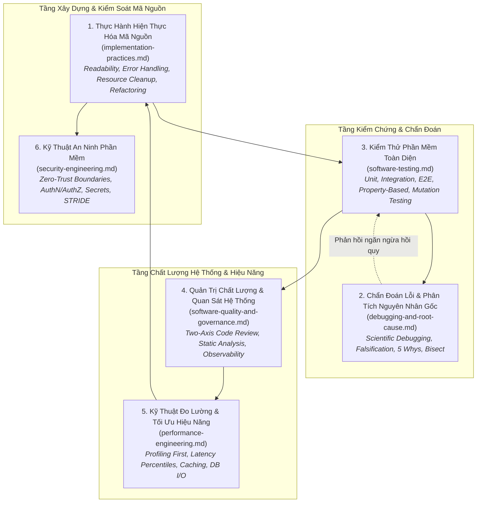

# Miền Tri Thức: Hiện Thực Hóa Phần Mềm & Chất Lượng Kỹ Thuật
# Software Implementation & Engineering Quality

---

## 1. Tầm Nhìn & Nguyên Lý Cốt Tử Của Miền (Domain Vision & Fundamental Axioms)

Nếu miền tri thức **Kiến Trúc & Thiết Kế Phần Mềm** xác lập các ranh giới hệ thống, cấu trúc dữ liệu và hợp đồng giao tiếp vĩ mô, thì miền tri thức **Hiện Thực Hóa Phần Mềm & Chất Lượng Kỹ Thuật (Implementation & Engineering Quality)** là nơi các bản thiết kế được biến thành hiện thực mã nguồn vận hành ổn định trên máy chủ vật lý.

Chất lượng kỹ thuật phần mềm không phải là một "tính năng" được gắn thêm vào giai đoạn cuối của dự án. Nó là một **thuộc tính nội tại (Intrinsic Property)** được hình thành từ từng dòng code, từng kiểm tra ranh giới, từng bài test tự động và từng phép đo lường thực nghiệm.

### Bốn Định Đề Vận Hành Tuyệt Đối (Non-Negotiable Operating Axioms)

1. **Phân biệt rạch ròi giữa Chẩn đoán lỗi (Debugging) và Tối ưu hóa hiệu năng (Performance Optimization):**
   - *Debugging* là việc khôi phục **Tính Đúng Đắn (Correctness)**: Hệ thống đang vi phạm đặc tả hoặc các bất biến nghiệp vụ, mục tiêu là tìm ra và loại bỏ nguyên nhân gốc rễ gây sai lệch.
   - *Performance Optimization* là việc nâng cao **Hiệu Quả Tài Nguyên (Resource Efficiency)**: Hệ thống đã chạy đúng về mặt logic, mục tiêu là giảm thời gian thực thi (Latency), tăng thông lượng (Throughput), hoặc giảm mức tiêu thụ RAM/CPU/IO.
   - *Quy tắc:* Tuyệt đối không tối ưu hóa một hệ thống đang chạy sai logic. Tính đúng đắn luôn đi trước tính tối ưu.

2. **Phân biệt rạch ròi giữa Kiểm thử phần mềm (Testing) và Đảm bảo chất lượng (Quality Assurance - QA):**
   - *Testing* là **hoạt động kiểm định thực nghiệm (Empirical Verification)**: Chạy các ca kiểm thử cụ thể (Unit, Integration, E2E) để kiểm tra xem mã nguồn có thỏa mãn các kỳ vọng đã biết hay không. Testing chỉ chứng minh sự hiện diện của lỗi, không chứng minh sự vắng mặt của lỗi.
   - *Quality Assurance (QA)* là **khung quản trị quy trình và văn hóa hệ thống (Systemic Governance)**: Bao gồm chuẩn mực code review, phân tích tĩnh, quản lý rủi ro, khả năng quan sát (Observability), quy trình release an toàn và văn hóa chịu trách nhiệm kỹ thuật để đảm bảo toàn bộ chu trình phát triển sản sinh ra phần mềm đáng tin cậy.

3. **Nguyên tắc "Không Tối Ưu Hóa Khi Chưa Đo Lường" (No Optimization Without Measurement):**
   - Trực giác của con người và AI về điểm nghẽn hiệu năng thường sai lệch nghiêm trọng. Mọi hành vi tái cấu trúc hoặc thay đổi thuật toán với lý do "để chạy nhanh hơn" mà không có dữ liệu đo kiểm (Profiling, Benchmark, Tracing) trước và sau khi sửa đều bị coi là **Kiến Trúc Thượng Tầng Nguy Hại (Speculative Over-engineering)**.

4. **Phương pháp luận đi trước công cụ (Method Before Tooling):**
   - Công cụ linter, profiler hay test runner chỉ là phương tiện hỗ trợ. Kỹ sư phải hiểu sâu sắc nguyên lý cốt lõi, tiêu chí lựa chọn và các ranh giới giới hạn của công cụ trước khi tích hợp vào pipeline.

---

## 2. Bản Đồ 6 Chuyên Đề Chuyên Sâu (Core Knowledge Areas)

Miền tri thức được cấu trúc thành 6 chuyên đề chuyên sâu, tạo thành một chu trình khép kín từ lúc gõ dòng code đầu tiên tới lúc vận hành an toàn:

### Chi Tiết 6 Chuyên Khảo

1. [**`implementation-practices.md`**](file:///home/longtran/Projects/rendez-web/erpf/software-engineering/implementation-quality/implementation-practices.md) (`ERPF-SE-DOM-011`): Tổ chức mã nguồn, nguyên tắc viết code rõ ràng, kiểm tra và bao bọc lỗi (Error handling & envelope), thẩm định dữ liệu đầu vào tại ranh giới tin cậy, quản lý vòng đời tài nguyên (Context managers, RAII), và kỹ thuật tái cấu trúc an toàn (Refactoring via seams).
2. [**`debugging-and-root-cause.md`**](file:///home/longtran/Projects/rendez-web/erpf/software-engineering/implementation-quality/debugging-and-root-cause.md) (`ERPF-SE-DOM-012`): Phương pháp luận chẩn đoán lỗi khoa học (Scientific Debugging), tái lập lỗi với trường hợp tối thiểu (MRE), đọc và giải mã stack traces đa tầng, phân lập biến độc lập, truy tìm nguyên nhân gốc rễ (5 Whys) và điều tra chống lỗi hồi quy (Regression analysis).
3. [**`software-testing.md`**](file:///home/longtran/Projects/rendez-web/erpf/software-engineering/implementation-quality/software-testing.md) (`ERPF-SE-DOM-013`): Kim tự tháp kiểm thử thực tế, kỹ thuật viết Unit/Integration/E2E test sạch với mẫu AAA, quản lý fixtures và test data, nhận diện giới hạn của độ bao phủ mã (Coverage illusion), và kiểm thử dựa trên thuộc tính (Property-based testing).
4. [**`software-quality-and-governance.md`**](file:///home/longtran/Projects/rendez-web/erpf/software-engineering/implementation-quality/software-quality-and-governance.md) (`ERPF-SE-DOM-014`): Thẩm định mã nguồn hai trục (Standards vs Spec), hệ thống phân tích tĩnh và type checking nghiêm ngặt, chỉ số khả năng bảo trì, và ba trụ cột của năng lực quan sát hệ thống (Structured Logs, Metrics, Distributed Tracing).
5. [**`performance-engineering.md`**](file:///home/longtran/Projects/rendez-web/erpf/software-engineering/implementation-quality/performance-engineering.md) (`ERPF-SE-DOM-015`): Quy trình tối ưu hóa dựa trên đo lường thực nghiệm (Measure First), kỹ thuật Profiling CPU/RAM, giải quyết triệt để điểm nghẽn I/O và truy vấn cơ sở dữ liệu N+1, thiết kế benchmark chuẩn thống kê, chiến lược Caching bền vững, và concurrency an toàn.
6. [**`security-engineering.md`**](file:///home/longtran/Projects/rendez-web/erpf/software-engineering/implementation-quality/security-engineering.md) (`ERPF-SE-DOM-016`): Lập trình phòng thủ (Secure Coding), kiến trúc Zero-Trust tại ranh giới vào/ra, cơ chế xác thực (AuthN) và ủy quyền (AuthZ) chống IDOR, quản lý bí mật không rò rỉ (Secrets hygiene), kiểm soát chuỗi cung ứng mã nguồn, và mô hình hóa mối đe dọa với STRIDE.

---

## 3. Bản Đồ Ánh Xạ Năng Lực Cốt Lõi (Competency Mapping)

Bảng đối chiếu giữa các năng lực liên ngành (trong `ERPF-CORE-COMP-001`) và các bài học kỹ thuật trong miền Hiện Thực Hóa & Chất Lượng Kỹ Thuật:

| Năng Lực Liên Ngành (Core Competency) | Bài Học / Khái Niệm Áp Dụng Trong Miền Này | Bằng Chứng Tạo Tác Kỹ Thuật (Observable Artifacts) |
|---|---|---|
| **C1. Problem Formulation & Decomposition** | Phân tách logic nghiệp vụ khỏi quản lý tài nguyên, cô lập biến khi gỡ lỗi | Hàm tái cấu trúc nhỏ gọn, bộ test case MRE tái lập lỗi |
| **C2. Analytical Reasoning** | Phân tích cây stack trace, phân tích đồ thị ngọn lửa (Flamegraph), đánh giá độ phức tạp $O(N)$ | Kết quả profiling cProfile/py-spy, báo cáo phân tích độ phức tạp thời gian/bộ nhớ |
| **C3. Critical Evaluation** | Phản biện các tối ưu hóa sớm không có số liệu, phát hiện lỗ hổng kiểm thử do test suite giả định sai | Báo cáo Mutation Testing, benchmark so sánh trước/sau có phân phối percentiles (P95/P99) |
| **C4. Information Literacy & Synthesis** | Đọc hiểu và truy vết mã lỗi upstream, liên kết logs phân tán qua Correlation ID | Cấu trúc log JSON có `request_id`, tài liệu mô tả chuỗi nguyên nhân lỗi |
| **C5. Technical Decision-Making** | Đánh đổi giữa chi phí Caching và rủi ro Stale Data; cân nhắc giữa Mocking và Real DB tests | Bản ghi quyết định kỹ thuật trong PR, cấu hình chính sách cache TTL/LRU |
| **C6. Systems Thinking** | Nhận diện rò rỉ kết nối (Connection Pool Leaks), lan truyền lỗi phân tán, tấn công từ chối dịch vụ (DoS) | Cấu hình timeouts, circuit breakers, rate limiting và context cleanup |
| **C7. Planning & Prioritization** | Lập kế hoạch trả nợ kỹ thuật, ưu tiên sửa chữa lỗ hổng bảo mật theo điểm CVSS | Danh sách lỗi bảo mật được xếp hạng ưu tiên, kế hoạch tái cấu trúc theo bước an toàn |
| **C8. Technical Communication** | Soạn thảo thông báo lỗi rõ nghĩa cho client, viết tài liệu kiểm thử và mô tả PR chất lượng cao | Error envelopes chuẩn hóa (`code`, `detail`, `meta`), PR descriptions theo chuẩn |
| **C9. Collaboration & Peer Review** | Thực hiện Code Review hai trục (Standards vs Spec), thảo luận mang tính xây dựng | Nhận xét Review PR tập trung vào lỗi tiềm ẩn thay vì phong cách định dạng |
| **C10. Self-Assessment & Continuous Learning** | Phân tích nguyên nhân gốc sau sự cố (Post-mortem), bổ sung test case ngăn ngừa tái diễn | Tài liệu Post-mortem phân tích 5 Whys, test tự động chặn bug tái phát |
